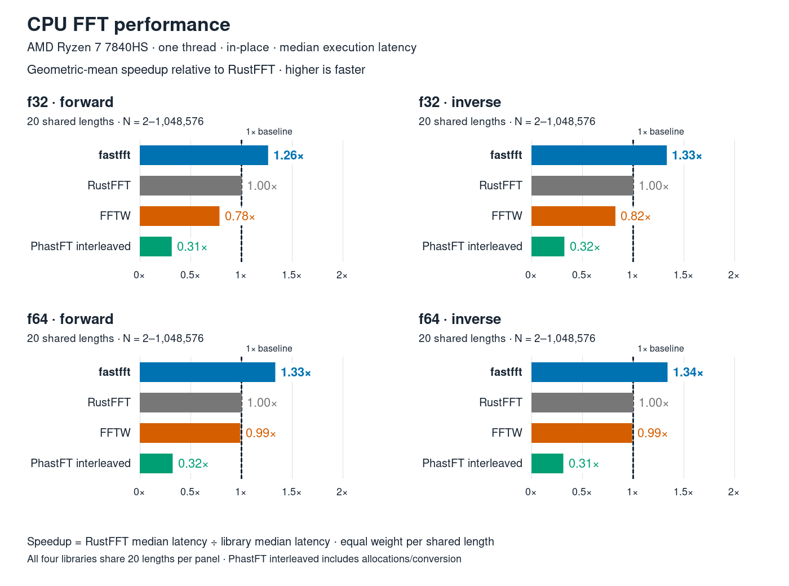
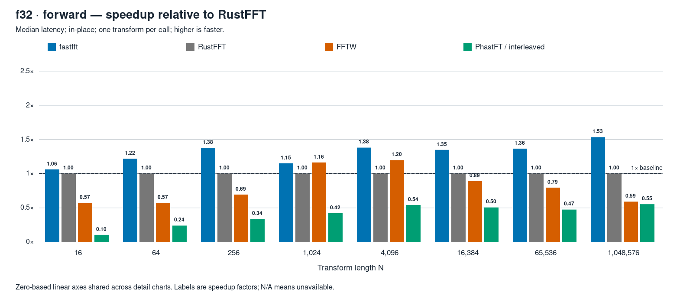
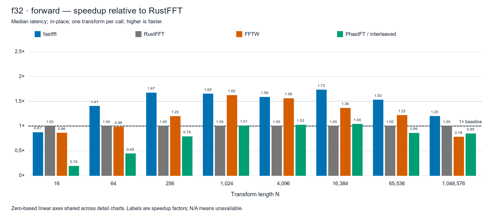

# fastfft

**Fast FFTs on CPU**

A new implementation of the classic FFT, built for CPU speed. fastfft is a
pure-Rust library for single-threaded, one-dimensional complex FFTs in `f32`
and `f64`, with a RustFFT-compatible API.

## Measured performance

### Averaged speedups

**AMD Ryzen 7 7840HS (Zen 4, AVX-512) · x86-64 / Linux**

[](docs/assets/readme-benchmark.svg)

Each group equally weights 20 power-of-two lengths. Above 1× is faster
than RustFFT. Per-length speedups follow below.

### Per-transform speedups

Forward `f32` transforms at eight selected FFT lengths. Bars show RustFFT
median latency divided by each library's median latency on the same host;
above 1× is faster.

**AMD Ryzen 7 7840HS (Zen 4, AVX-512) · x86-64 / Linux**

[](docs/benchmarks/2026-10-16-mini-ryzen-four-library-comparison/f32-forward.svg)

**Apple M6 · ARM64 / macOS**

[](docs/benchmarks/2026-10-17-163801-macos-master-diagnostic/f32-forward.svg)

Click a chart for the full-size SVG. Full reports below include both
precisions, both directions, and absolute latencies for all 20 lengths.

### Results and methodology

| Tested machine | Execution speed vs RustFFT | Full results and plots |
|---|---:|---|
| AMD Ryzen 7 7840HS (Zen 4, AVX-512) · x86-64 / Linux | **1.26–1.34×** | [Validated run](docs/benchmarks/2026-10-16-mini-ryzen-four-library-comparison/summary.md) |
| Apple M6 · ARM64 / macOS | **1.24–1.36×** | [Local diagnostic run](docs/benchmarks/2026-10-17-163801-macos-master-diagnostic/summary.md) |

Speedup is RustFFT median execution latency divided by fastfft's on each
host; above 1× is faster. Ranges cover four geometric means (f32/f64 ×
forward/inverse), each equally weighting 20 power-of-two lengths. In-place
complex FFTs, N = 2–1,048,576, 64-byte-aligned buffers; planning excluded.
Individual sizes can favor another library.

The Linux run uses pinned CPU affinity. The macOS run is unpinned and
**diagnostic, not release-validation evidence**. These are separate runs
and source revisions, not a controlled comparison between CPUs or a
guarantee for every workload. See the linked reports for all four libraries,
verification, scheduling limits, and [measurement protocol](docs/benchmarking.md).

**The x86 results depend on AVX-512.** On the Ryzen, fastfft selected AVX-512
kernels (512-bit, or 256-bit vectors with AVX-512's 32 registers) in 68 of
the 80 cells, including every length from 64 upward. RustFFT 6.4.1 has no
AVX-512 path and ran its AVX kernels. On this machine, a large part of
fastfft's lead comes from the extra registers and permutes of AVX-512. In a
separate [run on the same machine](docs/benchmarks/2026-10-11-mini-ryzen-ticket23-gates/README.md)
with fastfft limited to AVX2, the power-of-two geometric mean was 1.14×
RustFFT. That run covered N up to 2²⁴, in place and out of place, so it is
not directly comparable to the table. **Expect smaller gains on x86 CPUs
without AVX-512**, which include most recent Intel desktop and laptop
processors. This comparison has not yet been run on other x86 CPUs.

PhastFT uses its interleaved API, including temporary allocation and
conversion; its split-array API is not represented.

## Quick start

fastfft is under active development. Add it directly from the repository:

```sh
cargo add fastfft --git https://github.com/inhesrom/fastfft
```

The library requires **Rust 1.89 or newer**. The repository pins a newer
toolchain for development and reproducible builds; consumers do not need to
use that exact version.

```rust
use fastfft::{FftPlanner, num_complex::Complex};

fn main() {
    let mut planner = FftPlanner::<f32>::new();
    let fft = planner.plan_fft_forward(1024);
    let mut samples = vec![Complex::new(1.0, 0.0); 1024];

    fft.process(&mut samples);

    // A constant signal has all its energy in the DC component.
    assert!((samples[0].re - 1024.0).abs() < 1e-3);
    assert!(samples[0].im.abs() < 1e-3);
}
```

The planner detects available CPU instructions at runtime and caches plans
by length and direction. Keep the resulting plan to process more buffers
without planning again. No native FFT library is required by fastfft.

## Moving from RustFFT

Start by changing the dependency and crate imports:

```diff
-use rustfft::{FftPlanner, num_complex::Complex};
+use fastfft::{FftPlanner, num_complex::Complex};
```

The familiar `plan_fft_forward`, `plan_fft_inverse`, `process`, and
`*_with_scratch` methods retain the same conventions. Existing interleaved
`Complex<T>` buffers use the same data layout, and output stays in natural
frequency order.

Query scratch requirements from the new plan: they depend on the
implementation, CPU, and execution placement. An out-of-place transform
may still require scratch. Also update any explicit `Fft` trait imports:
`fastfft::Fft` and `rustfft::Fft` are separate traits, so their trait objects
are not interchangeable.

## How it gets its speed

- **Generated SIMD kernels.** Small FFT building blocks use generated
  straight-line code, with fused multiply-add operations and schedules
  designed to make good use of CPU execution resources.
- **An engine for the working set.** Small transforms can stay in
  registers, Stockham handles intermediate sizes, and a four-step engine
  breaks large transforms into cache-friendly panels. Bluestein handles
  lengths with larger prime factors.
- **Runtime selection.** The planner chooses instruction tiers, vector
  widths, and decompositions for the transform. AVX-512-capable CPUs can
  use either 256-bit or 512-bit kernels; wider is not always faster.

These are implementation choices around established FFT algorithms. The
design decisions and their measurements are recorded in the
[engine design](docs/decisions/0001-internal-layout-and-engine.md).

## Getting the best performance

Reuse plans and allocate caller scratch once when you want direct control
over workspace. This is the explicit-scratch form of the quick start:

```rust
use fastfft::{FftPlanner, num_complex::Complex};

fn main() {
    let mut planner = FftPlanner::<f32>::new();
    let fft = planner.plan_fft_forward(1024);
    let mut samples = vec![Complex::new(1.0, 0.0); 1024];
    let mut scratch = vec![Complex::new(0.0, 0.0); fft.get_inplace_scratch_len()];

    fft.process_with_scratch(&mut samples, &mut scratch);

    assert!((samples[0].re - 1024.0).abs() < 1e-3);
}
```

For convenience, `process()` manages reusable, grow-only thread-local
scratch. It may allocate on the first call or when a larger workspace is
needed.

Pass consecutive transforms in a single buffer to expose batch
optimizations. Its length must be a multiple of the planned transform
length. For example, a 1,024-element buffer with a length-256 plan contains
four transforms.

Prefer **64-byte-aligned input and output buffers** for predictable
performance. Ordinary Rust alignment is sufficient for correctness, but
`Vec<Complex<T>>` does not guarantee 64-byte alignment, and subslicing can
lose it. Caller scratch does not need special SIMD alignment. See the
[detailed alignment and scratch guidance](crates/fastfft/README.md#alignment-and-scratch).

## Supported transforms and CPUs

| Capability | Current support |
|---|---|
| Precision | Complex `f32` and `f64` |
| Transform | One-dimensional, forward and inverse, arbitrary lengths |
| Execution | In-place, mutable out-of-place, and immutable input |
| Batches | Consecutive transforms of the planned length |
| Output | Natural frequency order; both directions unnormalized |
| Parallelism | Single-threaded execution |
| x86-64 SIMD | AVX-512, AVX-512 with 256-bit vectors, AVX2+FMA, SSE2 |
| ARM64 SIMD | NEON, including Apple Silicon |
| Other CPUs | Portable scalar fallback |

A forward/inverse round trip scales the original signal by `N`; divide
by `N` when you need the original amplitude. Mutable out-of-place calls
may overwrite their input; use the immutable method to preserve it.

The x86 SIMD and ARM64 NEON Cargo features are enabled by default; the
planner selects supported instruction tiers at runtime. Features for other
architectures are ignored. Individual tiers can be disabled to reduce
compilation work and binary size.

## Status and documentation

The ambition is to build the fastest CPU FFT library. Release validation,
broader CPU coverage, and further tuning are ongoing. Real-input FFTs,
multidimensional transforms, and internal multithreading are future work.

- [Roadmap and release gates](ROADMAP.md)
- [Detailed API, planning, and workspace guidance](crates/fastfft/README.md)
- [Benchmarking and reproduction](docs/benchmarking.md)
- [Profiling and assembly review](docs/architecture.md)

fastfft is licensed under the [Mozilla Public License 2.0](LICENSE).
