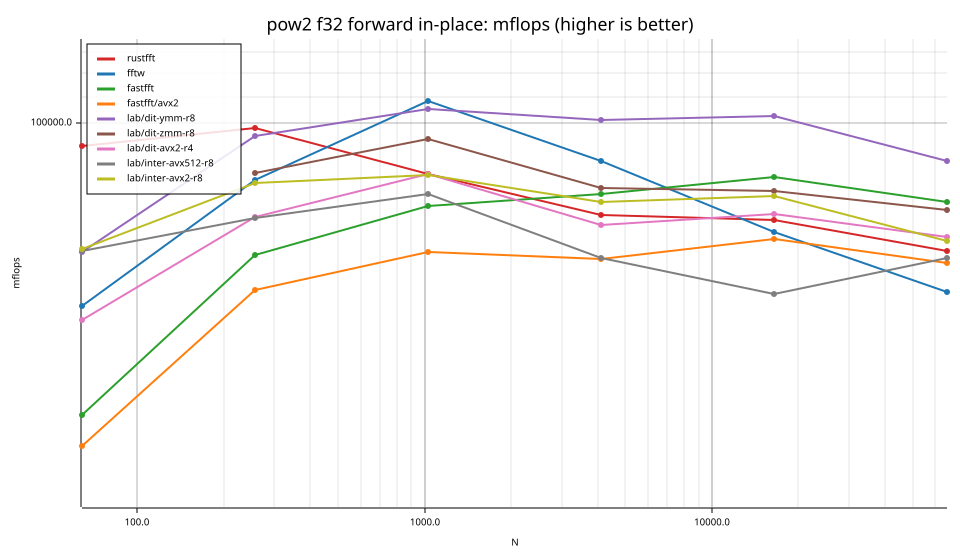
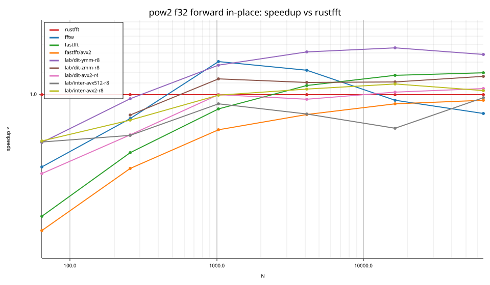
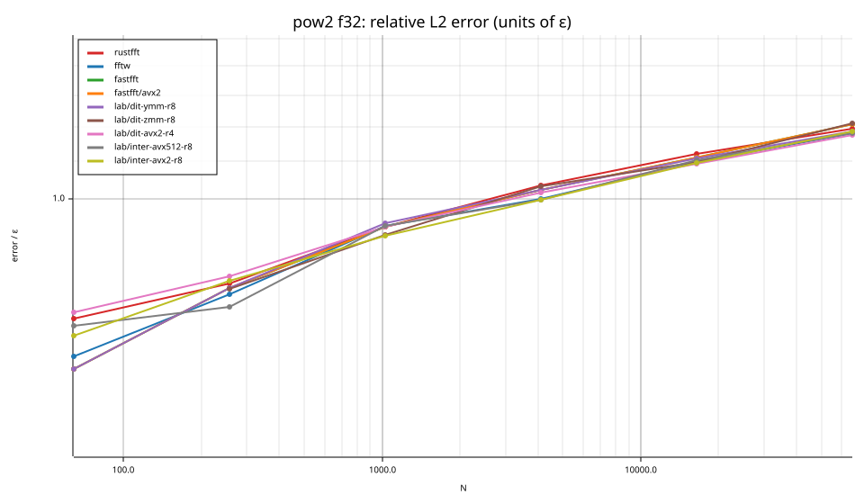
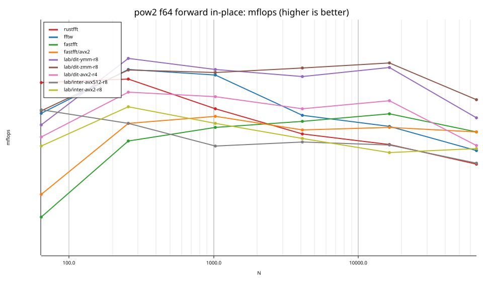
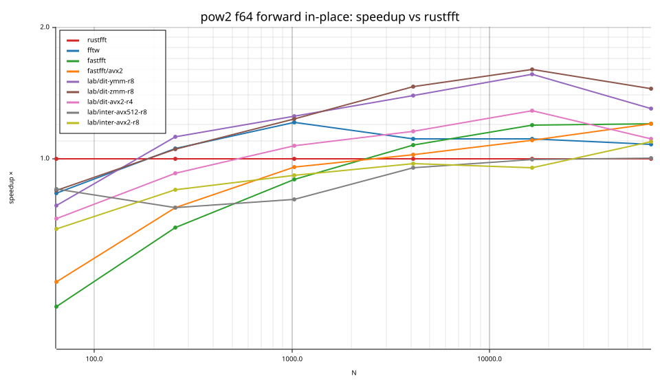
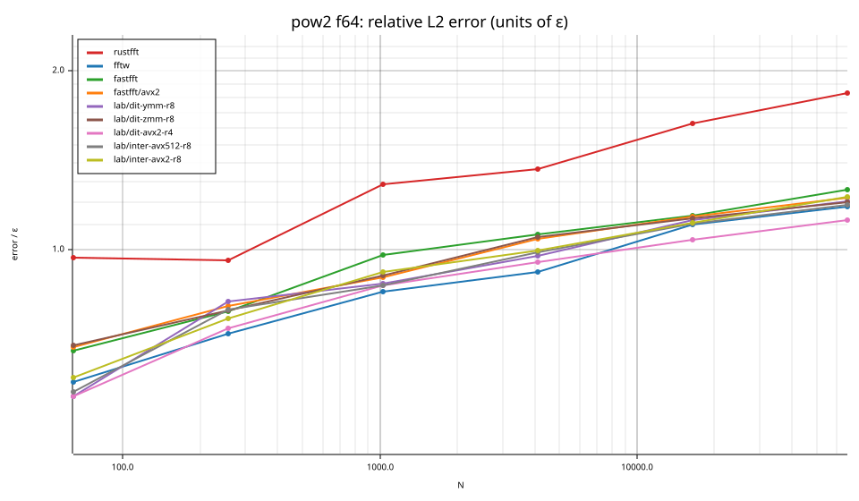

# fastfft arena report: `20260923T194206Z-mini-ryzen-m2-final`

| | |
|---|---|
| Host | mini-ryzen |
| CPU | AMD Ryzen 7 7840HS w/ Radeon 780M Graphics (family 25, model 116, stepping 1, microcode 0xa704108) |
| Pinned CPU | 2 (SMT siblings 2,10) |
| Governor / EPP / boost | performance / performance / 1 |
| Kernel | Linux version 7.0.0-28-generic |
| Virtualization | none |
| rustc | rustc 1.95.0 (59807616e 2026-04-14); binary: rustc; commit-hash: 59807616e1fa2540724bfbac14d7976d7e4a3860; commit-date: 2026-04-14; host: x86_64-unknown-linux-gnu; release: 1.95.0; LLVM version: 22.1.2 |
| Build profile / RUSTFLAGS | arena / `` |
| Libraries | {"fearless_simd":"0.5.0","num-complex":"0.4.6","oxifft":"0.4.2","phastft":"0.4.1","pulp":"0.22.3","rustfft":"6.4.1","tfhe-fft":"0.10.1"} |
| FFTW | fftw-3.3.11-sse2-avx-avx2-avx2_128-avx512 `double: CFLAGS='-O3 -fPIC -std=gnu17' ./configure --enable-static --disable-shared --disable-fortran --disable-doc --enable-sse2 --enable-avx --enable-avx2 --enable-avx512 --enable-fma
single: CFLAGS='-O3 -fPIC -std=gnu17' ./configure --enable-static --disable-shared --disable-fortran --disable-doc --enable-sse2 --enable-avx --enable-avx2 --enable-avx512 --enable-fma --enable-float` |
| Git | 82f82bce460acb030689491a389ead3864fd69fb (dirty: false) |
| Profile | full |
| Official | true  |
| Control drift | max 1.49% over 2 control runs |
| Cells | 12 |

Times are per transform. *best* = minimum batch mean, *median* = median batch mean. Speedup = rustfft time ÷ library time (> 1 means faster than rustfft); *geomean* over the cells both libraries ran. mflops = 5·N·log2(N)/t(µs).

## Release gates (fastfft)

| Gate | Criterion | Status | Detail |
|---|---|---|---|
| G1 | pow2 vs rustfft: geomean ≥ 1.5×, no cell < 0.95× | ❌ fail | geomean best 0.849×, median 0.846×, worst cell 0.376× (pow2:f32:fwd:ip:n64), 12 cells |
| G2 | smooth vs rustfft: geomean ≥ 1.3×, no cell < 0.95× | – n/a | no data |
| G3 | rough vs rustfft: geomean ≥ 0.75×, no cell < 0.5× | – n/a | no data |
| G4 | vs each other Rust library: geomean ≥ 1.1×, ≥ 0.97× on ≥ 90% of cells | – n/a |  |
| G5 | AVX2 forced: pow2 ≥ 1.2×, smooth ≥ 1.1× vs rustfft | ❌ fail | pow2 0.787×/0.780×, smooth NaN×/NaN× |
| G6 | scenarios ≥ 1.3× each; batch geomean ≥ 1.5× | – n/a | scenarios min inf×, batch NaN×/NaN× |
| G7 | accuracy within §6 thresholds and ≤ 1.5× rustfft + 1ε | ✅ pass | 12 cells checked |
| G8 | Estimate planning time ≤ 2× rustfft for every N ≤ 2^20 | ❌ fail | worst ratio 5.77× (pow2:f64:fwd:ip:n64), 12 cells |

G9 (build time) is measured by `cargo xtask build-time`, not by the arena.

## Speedup vs rustfft (geomean of best-time ratios; median-time ratio in parentheses)

| suite | prec | rustfft | fftw | fastfft | fastfft/avx2 | lab/dit-ymm-r8 | lab/dit-zmm-r8 | lab/dit-avx2-r4 | lab/inter-avx512-r8 | lab/inter-avx2-r8 |
|---|---|---|---|---|---|---|---|---|---|---|
| pow2 | f32 | 1.00× (1.00×) 0/6/0 | 0.92× (0.87×) 2/0/4 | 0.83× (0.82×) 3/0/3 | 0.69× (0.68×) 0/0/6 | 1.16× (1.16×) 4/0/2 | 1.07× (1.06×) 4/0/1 | 0.86× (0.85×) 1/2/3 | 0.81× (0.81×) 0/1/5 | 0.93× (0.93×) 3/1/2 |
| pow2 | f64 | 1.00× (1.00×) 0/6/0 | 1.06× (1.03×) 5/0/1 | 0.87× (0.87×) 3/0/3 | 0.90× (0.89×) 2/1/3 | 1.21× (1.20×) 5/0/1 | 1.25× (1.22×) 5/0/1 | 1.03× (1.02×) 4/0/2 | 0.89× (0.88×) 0/2/4 | 0.91× (0.90×) 1/1/4 |

w/t/l = cells faster / within ±3% / slower than rustfft (best times).

## Suite `pow2`

### pow2 f32

| cell | rustfft | fftw | fastfft | fastfft/avx2 | lab/dit-ymm-r8 | lab/dit-zmm-r8 | lab/dit-avx2-r4 | lab/inter-avx512-r8 | lab/inter-avx2-r8 |
|---|---|---|---|---|---|---|---|---|---|
| N=64 fwd ip | 20.9ns | 37.3ns (0.56×) | 55.5ns (0.38×) | 62.3ns (0.34×) | 30.6ns (0.68×) | – | 39.3ns (0.53×) | 30.6ns (0.68×) | 30.3ns (0.69×) |
| N=256 fwd ip | 104.0ns | 125.9ns (0.83×) | 165.6ns (0.63×) | 187.8ns (0.55×) | 107.2ns (0.97×) | 122.5ns (0.85×) | 143.8ns (0.72×) | 144.3ns (0.72×) | 127.4ns (0.82×) |
| N=1024 fwd ip | 615.8ns | 471.2ns (1.31×) | 691.3ns (0.89×) | 817.3ns (0.75×) | 485.5ns (1.27×) | 542.2ns (1.14×) | 616.0ns (1.00×) | 662.2ns (0.93×) | 618.3ns (1.00×) |
| N=4096 fwd ip | 3.43us | 2.82us (1.22×) | 3.18us (1.08×) | 4.02us (0.85×) | 2.43us (1.41×) | 3.11us (1.10×) | 3.56us (0.96×) | 4.01us (0.86×) | 3.27us (1.05×) |
| N=16384 fwd ip | 16.29us | 17.03us (0.96×) | 13.94us (1.17×) | 17.50us (0.93×) | 11.16us (1.46×) | 14.68us (1.11×) | 15.96us (1.02×) | 21.33us (0.76×) | 14.92us (1.09×) |
| N=65536 fwd ip | 83.35us | 97.02us (0.86×) | 69.91us (1.19×) | 87.27us (0.96×) | 60.18us (1.38×) | 71.80us (1.16×) | 79.43us (1.05×) | 85.48us (0.98×) | 80.50us (1.04×) |

### pow2 f64

| cell | rustfft | fftw | fastfft | fastfft/avx2 | lab/dit-ymm-r8 | lab/dit-zmm-r8 | lab/dit-avx2-r4 | lab/inter-avx512-r8 | lab/inter-avx2-r8 |
|---|---|---|---|---|---|---|---|---|---|
| N=64 fwd ip | 39.4ns | 47.1ns (0.84×) | 85.7ns (0.46×) | 75.2ns (0.52×) | 50.4ns (0.78×) | 46.5ns (0.85×) | 54.0ns (0.73×) | 46.2ns (0.85×) | 56.9ns (0.69×) |
| N=256 fwd ip | 206.2ns | 195.4ns (1.06×) | 295.4ns (0.70×) | 266.2ns (0.77×) | 183.2ns (1.13×) | 196.0ns (1.05×) | 222.6ns (0.93×) | 266.7ns (0.77×) | 242.1ns (0.85×) |
| N=1024 fwd ip | 1.22us | 1.01us (1.21×) | 1.36us (0.90×) | 1.28us (0.96×) | 976.3ns (1.25×) | 992.3ns (1.23×) | 1.14us (1.07×) | 1.52us (0.81×) | 1.33us (0.92×) |
| N=4096 fwd ip | 6.80us | 6.11us (1.11×) | 6.32us (1.08×) | 6.63us (1.02×) | 4.88us (1.39×) | 4.64us (1.46×) | 5.88us (1.16×) | 7.12us (0.95×) | 6.98us (0.97×) |
| N=16384 fwd ip | 33.74us | 30.39us (1.11×) | 28.20us (1.20×) | 30.58us (1.10×) | 21.61us (1.56×) | 21.07us (1.60×) | 26.19us (1.29×) | 33.82us (1.00×) | 35.30us (0.96×) |
| N=65536 fwd ip | 172.41us | 159.76us (1.08×) | 143.35us (1.20×) | 143.29us (1.20×) | 132.23us (1.30×) | 118.95us (1.45×) | 155.14us (1.11×) | 171.48us (1.01×) | 157.60us (1.09×) |

## Accuracy and planning time (medians over cells)

| lib | cells verified | failed | median error (ε) | worst error (ε) | median plan time |
|---|---|---|---|---|---|
| rustfft | 12 | 0 | 1.12 | 1.83 | 32.75us |
| fftw | 12 | 0 | 0.93 | 1.18 | 1.63ms |
| fastfft | 12 | 0 | 1.02 | 1.26 | 71.14us |
| fastfft/avx2 | 12 | 0 | 1.02 | 1.22 | 70.30us |
| lab/dit-ymm-r8 | 12 | 0 | 0.98 | 1.20 | 1.39ms |
| lab/dit-zmm-r8 | 11 | 0 | 1.03 | 1.21 | 1.39ms |
| lab/dit-avx2-r4 | 12 | 0 | 0.95 | 1.17 | 1.41ms |
| lab/inter-avx512-r8 | 12 | 0 | 0.99 | 1.19 | 1.38ms |
| lab/inter-avx2-r8 | 12 | 0 | 1.00 | 1.23 | 1.37ms |
