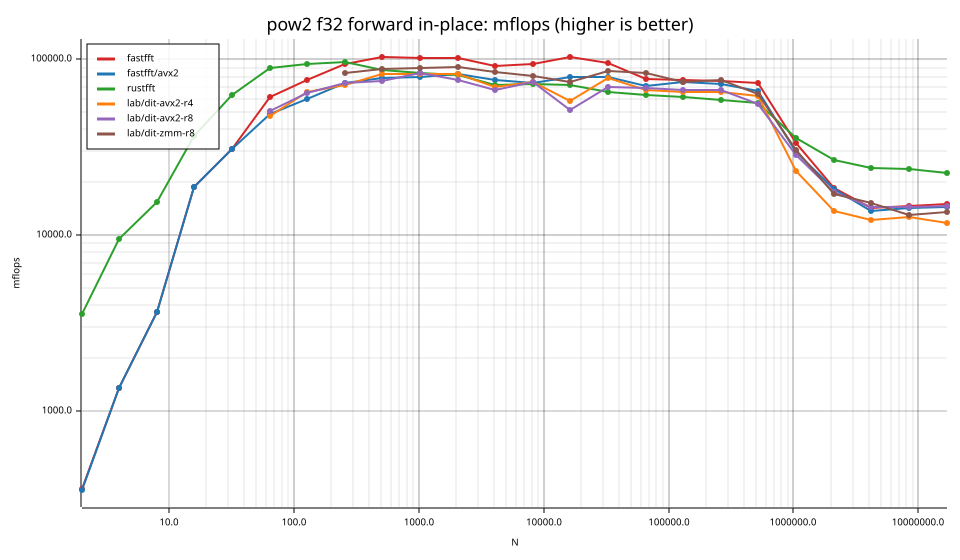
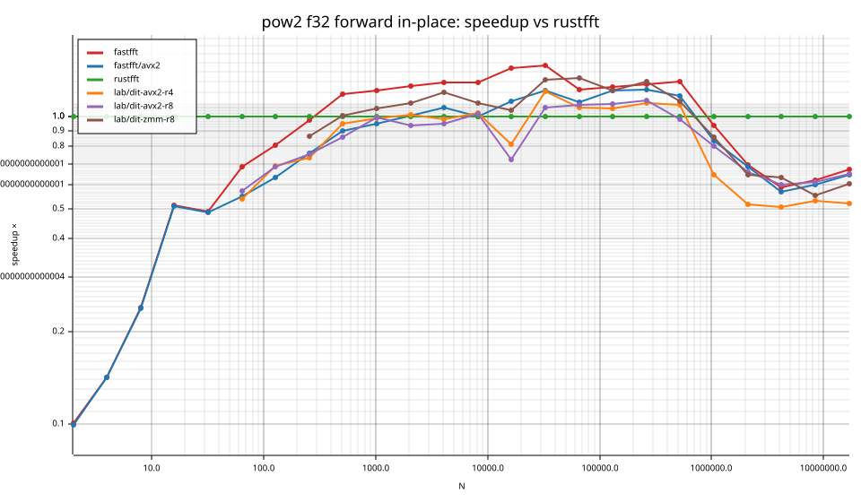
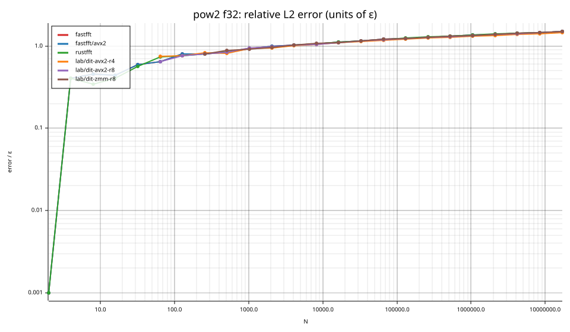
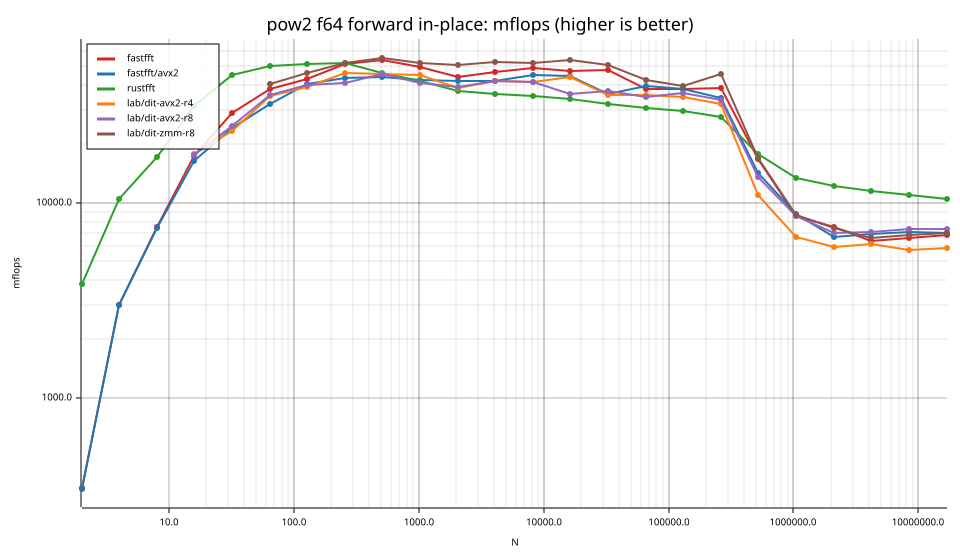
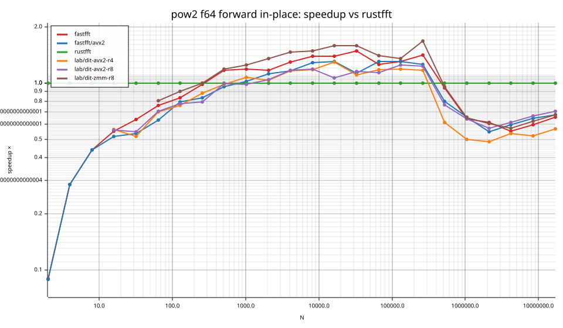
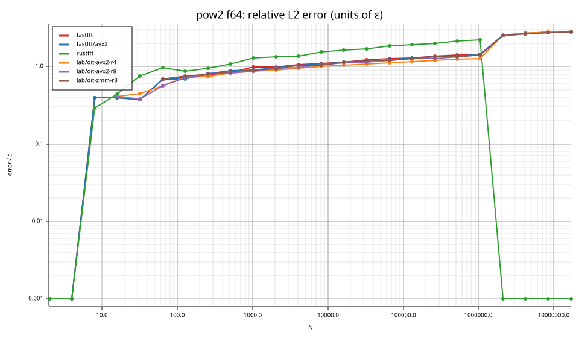

# fastfft arena report: `ticket10-avx2-radices`

Interpretation, source patch, and validation: [M3 checkpoint](../2026-09-25-mini-ryzen-m3-quick/checkpoint.md).

| | |
|---|---|
| Host | mini-ryzen |
| CPU | AMD Ryzen 7 7840HS w/ Radeon 780M Graphics (family 25, model 116, stepping 1, microcode 0xa704108) |
| Pinned CPU | 2 (SMT siblings 2,10) |
| Governor / EPP / boost | performance / performance / 1 |
| Kernel | Linux version 7.0.0-28-generic |
| Virtualization | container-other |
| rustc | rustc 1.95.0 (59807616e 2026-04-14); binary: rustc; commit-hash: 59807616e1fa2540724bfbac14d7976d7e4a3860; commit-date: 2026-04-14; host: x86_64-unknown-linux-gnu; release: 1.95.0; LLVM version: 22.1.2 |
| Build profile / RUSTFLAGS | arena / `` |
| Libraries | {"fearless_simd":"0.5.0","num-complex":"0.4.6","oxifft":"0.4.2","phastft":"0.4.1","pulp":"0.22.3","rustfft":"6.4.1","tfhe-fft":"0.10.1"} |
| FFTW | fftw-3.3.11-sse2-avx-avx2-avx2_128-avx512 `double: CFLAGS='-O3 -fPIC -std=gnu17' ./configure --enable-static --disable-shared --disable-fortran --disable-doc --enable-sse2 --enable-avx --enable-avx2 --enable-avx512 --enable-fma
single: CFLAGS='-O3 -fPIC -std=gnu17' ./configure --enable-static --disable-shared --disable-fortran --disable-doc --enable-sse2 --enable-avx --enable-avx2 --enable-avx512 --enable-fma --enable-float` |
| Git | a77142dd9e24bd3d4e32157c996361d04fd390f8 (dirty: true) |
| Profile | quick |
| Official | true  |
| Control drift | max 1.96% over 3 control runs |
| Cells | 48 |

Times are per transform. *best* = minimum batch mean, *median* = median batch mean. Speedup = rustfft time ÷ library time (> 1 means faster than rustfft); *geomean* over the cells both libraries ran. mflops = 5·N·log2(N)/t(µs).

## Release gates (fastfft)

| Gate | Criterion | Status | Detail |
|---|---|---|---|
| G1 | pow2 vs rustfft: geomean ≥ 1.5×, no cell < 0.95× | ❌ fail | geomean best 0.769×, median 0.763×, worst cell 0.089× (pow2:f64:fwd:ip:n2), 48 cells |
| G2 | smooth vs rustfft: geomean ≥ 1.3×, no cell < 0.95× | – n/a | no data |
| G3 | rough vs rustfft: geomean ≥ 0.75×, no cell < 0.5× | – n/a | no data |
| G4 | vs each other Rust library: geomean ≥ 1.1×, ≥ 0.97× on ≥ 90% of cells | – n/a |  |
| G5 | AVX2 forced: pow2 ≥ 1.2×, smooth ≥ 1.1× vs rustfft | ❌ fail | pow2 0.698×/0.698×, smooth NaN×/NaN× |
| G6 | scenarios ≥ 1.3× each; batch geomean ≥ 1.5× | – n/a | scenarios min inf×, batch NaN×/NaN× |
| G7 | accuracy within §6 thresholds and ≤ 1.5× rustfft + 1ε | ✅ pass | 40 cells checked |
| G8 | Estimate planning time ≤ 2× rustfft for every N ≤ 2^20 | ❌ fail | worst ratio 12.62× (pow2:f64:fwd:ip:n16), 40 cells |

G9 (build time) is measured by `cargo xtask build-time`, not by the arena.

## Speedup vs rustfft (geomean of best-time ratios; median-time ratio in parentheses)

| suite | prec | fastfft | fastfft/avx2 | rustfft | lab/dit-avx2-r4 | lab/dit-avx2-r8 | lab/dit-zmm-r8 |
|---|---|---|---|---|---|---|---|
| pow2 | f32 | 0.76× (0.75×) 11/1/12 | 0.67× (0.67×) 7/2/15 | 1.00× (1.00×) 0/24/0 | 0.81× (0.80×) 5/4/10 | 0.83× (0.83×) 4/3/12 | 0.96× (0.96×) 10/1/6 |
| pow2 | f64 | 0.78× (0.78×) 10/1/13 | 0.73× (0.73×) 8/1/15 | 1.00× (1.00×) 0/24/0 | 0.81× (0.80×) 9/1/11 | 0.85× (0.85×) 8/2/11 | 1.04× (1.03×) 10/1/8 |

w/t/l = cells faster / within ±3% / slower than rustfft (best times).

## Suite `pow2`

### pow2 f32

| cell | fastfft | fastfft/avx2 | rustfft | lab/dit-avx2-r4 | lab/dit-avx2-r8 | lab/dit-zmm-r8 |
|---|---|---|---|---|---|---|
| N=2 fwd ip | 27.7ns (0.10×) | 28.2ns (0.10×) | 2.8ns | – | – | – |
| N=4 fwd ip | 29.5ns (0.14×) | 29.5ns (0.14×) | 4.2ns | – | – | – |
| N=8 fwd ip | 32.6ns (0.24×) | 32.7ns (0.24×) | 7.8ns | – | – | – |
| N=16 fwd ip | 17.1ns (0.51×) | 17.1ns (0.51×) | 8.8ns | – | – | – |
| N=32 fwd ip | 25.8ns (0.49×) | 25.9ns (0.49×) | 12.7ns | – | – | – |
| N=64 fwd ip | 31.4ns (0.69×) | 39.1ns (0.55×) | 21.6ns | 40.1ns (0.54×) | 37.6ns (0.57×) | – |
| N=128 fwd ip | 58.5ns (0.81×) | 75.0ns (0.63×) | 47.3ns | 68.6ns (0.69×) | 69.1ns (0.68×) | – |
| N=256 fwd ip | 108.5ns (0.97×) | 139.1ns (0.76×) | 105.3ns | 143.0ns (0.74×) | 140.0ns (0.75×) | 122.3ns (0.86×) |
| N=512 fwd ip | 221.7ns (1.19×) | 292.8ns (0.90×) | 262.7ns | 277.5ns (0.95×) | 306.6ns (0.86×) | 260.1ns (1.01×) |
| N=1024 fwd ip | 502.3ns (1.21×) | 643.8ns (0.95×) | 609.0ns | 616.4ns (0.99×) | 612.4ns (0.99×) | 573.3ns (1.06×) |
| N=2048 fwd ip | 1.10us (1.26×) | 1.37us (1.01×) | 1.38us | 1.36us (1.02×) | 1.47us (0.94×) | 1.25us (1.11×) |
| N=4096 fwd ip | 2.68us (1.29×) | 3.23us (1.07×) | 3.45us | 3.51us (0.98×) | 3.65us (0.95×) | 2.88us (1.20×) |
| N=8192 fwd ip | 5.63us (1.30×) | 7.28us (1.00×) | 7.29us | 7.11us (1.03×) | 7.17us (1.02×) | 6.60us (1.10×) |
| N=16384 fwd ip | 11.14us (1.44×) | 14.34us (1.12×) | 16.06us | 19.71us (0.82×) | 22.23us (0.72×) | 15.34us (1.05×) |
| N=32768 fwd ip | 25.62us (1.47×) | 30.99us (1.22×) | 37.67us | 31.23us (1.21×) | 35.19us (1.07×) | 28.55us (1.32×) |
| N=65536 fwd ip | 67.88us (1.22×) | 74.35us (1.12×) | 83.09us | 77.66us (1.07×) | 75.90us (1.09×) | 62.30us (1.33×) |
| N=131072 fwd ip | 146.04us (1.25×) | 150.07us (1.22×) | 182.35us | 171.46us (1.06×) | 165.95us (1.10×) | 149.69us (1.22×) |
| N=262144 fwd ip | 313.79us (1.27×) | 325.49us (1.23×) | 399.36us | 361.93us (1.10×) | 353.63us (1.13×) | 306.93us (1.30×) |
| N=524288 fwd ip | 674.71us (1.30×) | 750.25us (1.17×) | 877.00us | 804.65us (1.09×) | 892.44us (0.98×) | 781.95us (1.12×) |
| N=1048576 fwd ip | 3.14ms (0.93×) | 3.50ms (0.84×) | 2.93ms | 4.53ms (0.65×) | 3.66ms (0.80×) | 3.42ms (0.86×) |
| N=2097152 fwd ip | 11.90ms (0.69×) | 12.00ms (0.69×) | 8.26ms | 15.92ms (0.52×) | 12.53ms (0.66×) | 12.79ms (0.65×) |
| N=4194304 fwd ip | 32.23ms (0.59×) | 33.53ms (0.57×) | 19.03ms | 37.55ms (0.51×) | 31.72ms (0.60×) | 30.05ms (0.63×) |
| N=8388608 fwd ip | 65.68ms (0.62×) | 67.75ms (0.60×) | 40.66ms | 76.21ms (0.53×) | 66.56ms (0.61×) | 73.47ms (0.55×) |
| N=16777216 fwd ip | 133.25ms (0.67×) | 138.02ms (0.65×) | 89.48ms | 171.20ms (0.52×) | 137.35ms (0.65×) | 147.84ms (0.61×) |

### pow2 f64

| cell | fastfft | fastfft/avx2 | rustfft | lab/dit-avx2-r4 | lab/dit-avx2-r8 | lab/dit-zmm-r8 |
|---|---|---|---|---|---|---|
| N=2 fwd ip | 29.1ns (0.09×) | 29.2ns (0.09×) | 2.6ns | – | – | – |
| N=4 fwd ip | 13.3ns (0.29×) | 13.4ns (0.29×) | 3.8ns | – | – | – |
| N=8 fwd ip | 16.0ns (0.44×) | 16.1ns (0.44×) | 7.0ns | – | – | – |
| N=16 fwd ip | 18.4ns (0.55×) | 19.7ns (0.52×) | 10.2ns | 18.1ns (0.56×) | 18.2ns (0.56×) | – |
| N=32 fwd ip | 27.9ns (0.64×) | 33.2ns (0.54×) | 17.8ns | 34.5ns (0.52×) | 32.5ns (0.55×) | – |
| N=64 fwd ip | 50.3ns (0.76×) | 60.1ns (0.63×) | 38.1ns | 54.6ns (0.70×) | 54.0ns (0.70×) | 47.3ns (0.81×) |
| N=128 fwd ip | 104.0ns (0.83×) | 110.1ns (0.79×) | 86.8ns | 114.9ns (0.76×) | 111.9ns (0.78×) | 96.6ns (0.90×) |
| N=256 fwd ip | 199.0ns (0.98×) | 235.0ns (0.83×) | 195.9ns | 221.4ns (0.88×) | 247.9ns (0.79×) | 196.8ns (1.00×) |
| N=512 fwd ip | 426.3ns (1.17×) | 521.0ns (0.96×) | 498.2ns | 505.9ns (0.98×) | 501.6ns (0.99×) | 419.2ns (1.19×) |
| N=1024 fwd ip | 1.03us (1.19×) | 1.20us (1.02×) | 1.22us | 1.14us (1.07×) | 1.24us (0.98×) | 979.9ns (1.25×) |
| N=2048 fwd ip | 2.57us (1.17×) | 2.67us (1.12×) | 3.00us | 2.91us (1.03×) | 2.88us (1.04×) | 2.21us (1.35×) |
| N=4096 fwd ip | 5.27us (1.29×) | 5.86us (1.16×) | 6.79us | 5.86us (1.16×) | 5.82us (1.17×) | 4.64us (1.46×) |
| N=8192 fwd ip | 10.85us (1.39×) | 11.81us (1.28×) | 15.12us | 12.83us (1.18×) | 12.79us (1.18×) | 10.22us (1.48×) |
| N=16384 fwd ip | 24.15us (1.39×) | 25.80us (1.30×) | 33.59us | 26.04us (1.29×) | 31.61us (1.06×) | 21.24us (1.58×) |
| N=32768 fwd ip | 51.39us (1.48×) | 67.87us (1.12×) | 76.25us | 69.06us (1.10×) | 65.97us (1.16×) | 48.32us (1.58×) |
| N=65536 fwd ip | 137.01us (1.25×) | 132.28us (1.30×) | 171.66us | 146.19us (1.17×) | 150.72us (1.14×) | 122.78us (1.40×) |
| N=131072 fwd ip | 289.89us (1.31×) | 291.04us (1.30×) | 378.86us | 320.03us (1.18×) | 304.61us (1.24×) | 280.16us (1.35×) |
| N=262144 fwd ip | 610.27us (1.41×) | 684.16us (1.26×) | 860.97us | 739.18us (1.16×) | 699.97us (1.23×) | 515.11us (1.67×) |
| N=524288 fwd ip | 2.97ms (0.94×) | 3.52ms (0.80×) | 2.80ms | 4.56ms (0.61×) | 3.67ms (0.76×) | 2.94ms (0.95×) |
| N=1048576 fwd ip | 12.22ms (0.64×) | 11.98ms (0.66×) | 7.87ms | 15.73ms (0.50×) | 12.22ms (0.64×) | 12.10ms (0.65×) |
| N=2097152 fwd ip | 29.33ms (0.61×) | 32.97ms (0.55×) | 18.01ms | 37.25ms (0.48×) | 31.55ms (0.57×) | 29.66ms (0.61×) |
| N=4194304 fwd ip | 72.38ms (0.55×) | 66.71ms (0.60×) | 39.95ms | 74.71ms (0.53×) | 64.94ms (0.62×) | 70.04ms (0.57×) |
| N=8388608 fwd ip | 146.42ms (0.60×) | 135.47ms (0.65×) | 87.68ms | 168.25ms (0.52×) | 131.44ms (0.67×) | 141.04ms (0.62×) |
| N=16777216 fwd ip | 294.97ms (0.66×) | 287.77ms (0.67×) | 193.65ms | 341.49ms (0.57×) | 275.27ms (0.70×) | 287.57ms (0.67×) |

## Accuracy and planning time (medians over cells)

| lib | cells verified | failed | median error (ε) | worst error (ε) | median plan time |
|---|---|---|---|---|---|
| fastfft | 48 | 0 | 1.07 | 2.80 | 138.02us |
| fastfft/avx2 | 48 | 0 | 1.07 | 2.85 | 136.67us |
| rustfft | 48 | 0 | 1.07 | 2.21 | 66.33us |
| lab/dit-avx2-r4 | 40 | 0 | 1.09 | 2.84 | 11.09ms |
| lab/dit-avx2-r8 | 40 | 0 | 1.14 | 2.79 | 11.18ms |
| lab/dit-zmm-r8 | 36 | 0 | 1.20 | 2.80 | 21.98ms |
