# fastfft arena report: `ticket10-m3-quick`

M3 scope, conclusions, source patch, and validation: [checkpoint.md](checkpoint.md).

| | |
|---|---|
| Host | mini-ryzen |
| CPU | AMD Ryzen 7 7840HS w/ Radeon 780M Graphics (family 25, model 116, stepping 1, microcode 0xa704108) |
| Pinned CPU | 2 (SMT siblings 2,10) |
| Governor / EPP / boost | performance / performance / 1 |
| Kernel | Linux version 7.0.0-28-generic |
| Virtualization | container-other |
| rustc | rustc 1.95.0 (59807616e 2026-04-14); binary: rustc; commit-hash: 59807616e1fa2540724bfbac14d7976d7e4a3860; commit-date: 2026-04-14; host: x86_64-unknown-linux-gnu; release: 1.95.0; LLVM version: 22.1.2 |
| Build profile / RUSTFLAGS | arena / `` |
| Libraries | {"fearless_simd":"0.5.0","num-complex":"0.4.6","oxifft":"0.4.2","phastft":"0.4.1","pulp":"0.22.3","rustfft":"6.4.1","tfhe-fft":"0.10.1"} |
| FFTW | fftw-3.3.11-sse2-avx-avx2-avx2_128-avx512 `double: CFLAGS='-O3 -fPIC -std=gnu17' ./configure --enable-static --disable-shared --disable-fortran --disable-doc --enable-sse2 --enable-avx --enable-avx2 --enable-avx512 --enable-fma
single: CFLAGS='-O3 -fPIC -std=gnu17' ./configure --enable-static --disable-shared --disable-fortran --disable-doc --enable-sse2 --enable-avx --enable-avx2 --enable-avx512 --enable-fma --enable-float` |
| Git | a77142dd9e24bd3d4e32157c996361d04fd390f8 (dirty: true) |
| Profile | quick |
| Official | true  |
| Control drift | max 2.15% over 9 control runs |
| Cells | 180 |

Times are per transform. *best* = minimum batch mean, *median* = median batch mean. Speedup = rustfft time ÷ library time (> 1 means faster than rustfft); *geomean* over the cells both libraries ran. mflops = 5·N·log2(N)/t(µs).

## Release gates (fastfft)

| Gate | Criterion | Status | Detail |
|---|---|---|---|
| G1 | pow2 vs rustfft: geomean ≥ 1.5×, no cell < 0.95× | ❌ fail | geomean best 0.765×, median 0.759×, worst cell 0.088× (pow2:f64:fwd:ip:n2), 48 cells |
| G2 | smooth vs rustfft: geomean ≥ 1.3×, no cell < 0.95× | ❌ fail | geomean best 0.907×, median 0.901×, worst cell 0.235× (smooth:f64:fwd:ip:n9), 82 cells |
| G3 | rough vs rustfft: geomean ≥ 0.75×, no cell < 0.5× | ❌ fail | geomean best 0.759×, median 0.754×, worst cell 0.207× (rough:f64:fwd:ip:n17), 34 cells |
| G4 | vs each other Rust library: geomean ≥ 1.1×, ≥ 0.97× on ≥ 90% of cells | – n/a |  |
| G5 | AVX2 forced: pow2 ≥ 1.2×, smooth ≥ 1.1× vs rustfft | ❌ fail | pow2 0.695×/0.694×, smooth 0.768×/0.764× |
| G6 | scenarios ≥ 1.3× each; batch geomean ≥ 1.5× | ❌ fail | scenarios min inf×, batch 0.583×/0.592× |
| G7 | accuracy within §6 thresholds and ≤ 1.5× rustfft + 1ε | ✅ pass | 172 cells checked |
| G8 | Estimate planning time ≤ 2× rustfft for every N ≤ 2^20 | ❌ fail | worst ratio 60.99× (rough:f64:fwd:ip:n31), 172 cells |

G9 (build time) is measured by `cargo xtask build-time`, not by the arena.

## Speedup vs rustfft (geomean of best-time ratios; median-time ratio in parentheses)

| suite | prec | fastfft | fastfft/avx2 | fastfft/avx512 | fastfft/avx512-ymm | fastfft/sse2 | fastfft/scalar | rustfft | lab/dit-ymm-r8 |
|---|---|---|---|---|---|---|---|---|---|
| pow2 | f32 | 0.75× (0.75×) 11/1/12 | 0.66× (0.66×) 7/1/16 | 0.78× (0.78×) 11/1/12 | 0.78× (0.78×) 11/1/12 | 0.47× (0.47×) 0/0/24 | 0.14× (0.14×) 0/0/24 | 1.00× (1.00×) 0/24/0 | 1.06× (1.05×) 11/1/7 |
| pow2 | f64 | 0.78× (0.77×) 10/2/12 | 0.73× (0.73×) 8/1/15 | 0.82× (0.81×) 11/1/12 | 0.81× (0.81×) 11/0/13 | 0.48× (0.48×) 0/0/24 | 0.25× (0.25×) 0/0/24 | 1.00× (1.00×) 0/24/0 | 0.98× (0.98×) 11/0/10 |
| smooth | f32 | 0.82× (0.81×) 21/1/19 | 0.69× (0.69×) 10/3/28 | 0.81× (0.81×) 21/0/20 | 0.81× (0.81×) 21/1/19 | 0.50× (0.49×) 0/0/41 | 0.22× (0.22×) 0/0/41 | 1.00× (1.00×) 0/41/0 | – |
| smooth | f64 | 1.00× (1.00×) 28/0/13 | 0.85× (0.85×) 21/1/19 | 1.00× (1.00×) 28/0/13 | 1.01× (1.01×) 28/0/13 | 0.53× (0.53×) 0/0/41 | 0.41× (0.40×) 0/0/41 | 1.00× (1.00×) 0/41/0 | – |
| rough | f32 | 0.79× (0.79×) 6/1/10 | 0.66× (0.66×) 2/2/13 | 0.77× (0.77×) 6/1/10 | 0.79× (0.78×) 6/1/10 | 0.46× (0.46×) 0/0/17 | 0.17× (0.17×) 0/0/17 | 1.00× (1.00×) 0/17/0 | – |
| rough | f64 | 0.73× (0.72×) 4/3/10 | 0.62× (0.62×) 0/1/16 | 0.73× (0.72×) 4/1/12 | 0.71× (0.71×) 3/2/12 | 0.40× (0.40×) 0/0/17 | 0.25× (0.25×) 0/0/17 | 1.00× (1.00×) 0/17/0 | – |
| batch | f32 | 0.49× (0.49×) 2/1/5 | 0.42× (0.42×) 0/0/8 | 0.49× (0.49×) 2/1/5 | 0.49× (0.49×) 2/1/5 | 0.32× (0.32×) 0/0/8 | 0.12× (0.12×) 0/0/8 | 1.00× (1.00×) 0/8/0 | 0.94× (0.94×) 2/1/2 |
| batch | f64 | 0.69× (0.72×) 3/0/5 | 0.63× (0.67×) 2/1/5 | 0.69× (0.72×) 3/0/5 | 0.71× (0.74×) 4/0/4 | 0.44× (0.47×) 0/0/8 | 0.26× (0.28×) 0/0/8 | 1.00× (1.00×) 0/8/0 | 0.87× (0.90×) 4/0/3 |

w/t/l = cells faster / within ±3% / slower than rustfft (best times).

## Suite `pow2`

### pow2 f32

| cell | fastfft | fastfft/avx2 | fastfft/avx512 | fastfft/avx512-ymm | fastfft/sse2 | fastfft/scalar | rustfft | lab/dit-ymm-r8 |
|---|---|---|---|---|---|---|---|---|
| N=2 fwd ip | 27.4ns (0.10×) | 27.7ns (0.10×) | 27.8ns (0.10×) | 27.8ns (0.10×) | 27.8ns (0.10×) | 27.8ns (0.10×) | 2.8ns | – |
| N=4 fwd ip | 29.4ns (0.14×) | 30.6ns (0.14×) | 29.8ns (0.14×) | 29.8ns (0.14×) | 30.4ns (0.14×) | 29.8ns (0.14×) | 4.2ns | – |
| N=8 fwd ip | 32.7ns (0.24×) | 32.6ns (0.24×) | 33.0ns (0.24×) | 33.1ns (0.24×) | 33.0ns (0.24×) | 32.9ns (0.24×) | 7.8ns | – |
| N=16 fwd ip | 17.1ns (0.51×) | 17.4ns (0.50×) | 17.4ns (0.50×) | 17.4ns (0.50×) | 17.4ns (0.50×) | 46.5ns (0.19×) | 8.8ns | – |
| N=32 fwd ip | 25.8ns (0.49×) | 25.8ns (0.49×) | 26.0ns (0.49×) | 26.2ns (0.48×) | 26.2ns (0.48×) | 81.4ns (0.16×) | 12.6ns | – |
| N=64 fwd ip | 31.3ns (0.69×) | 40.7ns (0.53×) | 31.2ns (0.69×) | 31.3ns (0.69×) | 54.5ns (0.39×) | 162.7ns (0.13×) | 21.5ns | 30.5ns (0.70×) |
| N=128 fwd ip | 59.3ns (0.80×) | 75.1ns (0.63×) | 59.5ns (0.79×) | 58.8ns (0.80×) | 105.1ns (0.45×) | 321.9ns (0.15×) | 47.2ns | 58.0ns (0.81×) |
| N=256 fwd ip | 108.9ns (0.98×) | 139.4ns (0.76×) | 108.1ns (0.98×) | 108.2ns (0.98×) | 236.8ns (0.45×) | 727.0ns (0.15×) | 106.3ns | 107.9ns (0.99×) |
| N=512 fwd ip | 222.5ns (1.16×) | 293.5ns (0.88×) | 221.5ns (1.16×) | 221.6ns (1.16×) | 546.8ns (0.47×) | 1.69us (0.15×) | 258.0ns | 217.9ns (1.18×) |
| N=1024 fwd ip | 500.2ns (1.21×) | 656.3ns (0.92×) | 499.8ns (1.21×) | 501.0ns (1.21×) | 1.14us (0.53×) | 3.80us (0.16×) | 605.7ns | 483.5ns (1.25×) |
| N=2048 fwd ip | 1.11us (1.18×) | 1.40us (0.94×) | 1.11us (1.18×) | 1.11us (1.19×) | 2.66us (0.49×) | 7.97us (0.17×) | 1.31us | 1.12us (1.17×) |
| N=4096 fwd ip | 2.82us (1.30×) | 3.19us (1.15×) | 2.36us (1.55×) | 2.40us (1.53×) | 6.08us (0.60×) | 18.31us (0.20×) | 3.67us | 2.44us (1.50×) |
| N=8192 fwd ip | 5.68us (1.26×) | 7.12us (1.00×) | 5.46us (1.31×) | 5.49us (1.30×) | 12.57us (0.57×) | 75.96us (0.09×) | 7.14us | 5.41us (1.32×) |
| N=16384 fwd ip | 11.11us (1.44×) | 14.92us (1.08×) | 11.43us (1.40×) | 11.34us (1.41×) | 28.08us (0.57×) | 159.11us (0.10×) | 16.05us | 11.04us (1.45×) |
| N=32768 fwd ip | 25.59us (1.48×) | 30.97us (1.22×) | 23.22us (1.63×) | 23.01us (1.64×) | 61.38us (0.62×) | 325.00us (0.12×) | 37.79us | 23.50us (1.61×) |
| N=65536 fwd ip | 68.16us (1.21×) | 73.34us (1.12×) | 61.11us (1.35×) | 59.67us (1.38×) | 126.48us (0.65×) | 736.56us (0.11×) | 82.26us | 60.09us (1.37×) |
| N=131072 fwd ip | 145.60us (1.26×) | 152.07us (1.21×) | 125.59us (1.46×) | 127.51us (1.44×) | 276.24us (0.66×) | 1.48ms (0.12×) | 183.28us | 140.01us (1.31×) |
| N=262144 fwd ip | 313.35us (1.32×) | 354.85us (1.16×) | 266.82us (1.55×) | 264.50us (1.56×) | 598.08us (0.69×) | 3.10ms (0.13×) | 412.68us | 270.45us (1.53×) |
| N=524288 fwd ip | 679.71us (1.32×) | 793.13us (1.13×) | 616.89us (1.45×) | 648.82us (1.38×) | 1.30ms (0.69×) | 6.32ms (0.14×) | 894.36us | 628.24us (1.42×) |
| N=1048576 fwd ip | 3.14ms (0.94×) | 3.47ms (0.84×) | 3.20ms (0.92×) | 3.33ms (0.88×) | 4.48ms (0.66×) | 14.42ms (0.20×) | 2.93ms | 3.24ms (0.91×) |
| N=2097152 fwd ip | 11.85ms (0.69×) | 12.38ms (0.66×) | 11.78ms (0.69×) | 11.77ms (0.70×) | 14.64ms (0.56×) | 35.38ms (0.23×) | 8.18ms | 11.72ms (0.70×) |
| N=4194304 fwd ip | 32.26ms (0.59×) | 33.33ms (0.57×) | 32.31ms (0.59×) | 32.26ms (0.59×) | 35.21ms (0.54×) | 92.78ms (0.21×) | 19.04ms | 30.64ms (0.62×) |
| N=8388608 fwd ip | 65.79ms (0.62×) | 68.64ms (0.60×) | 65.44ms (0.62×) | 63.46ms (0.64×) | 70.89ms (0.58×) | 386.75ms (0.11×) | 40.87ms | 65.40ms (0.62×) |
| N=16777216 fwd ip | 133.99ms (0.67×) | 137.06ms (0.66×) | 128.36ms (0.70×) | 127.95ms (0.70×) | 156.01ms (0.58×) | 1.25s (0.07×) | 89.78ms | 134.67ms (0.67×) |

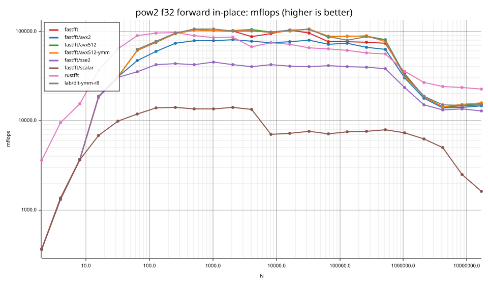
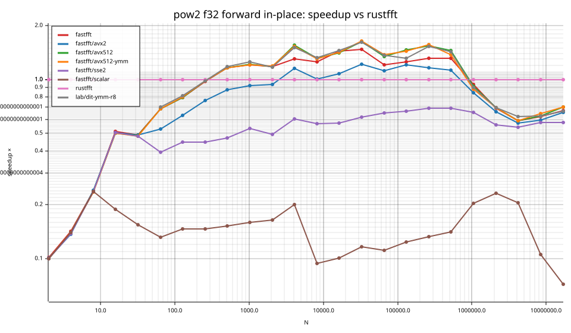
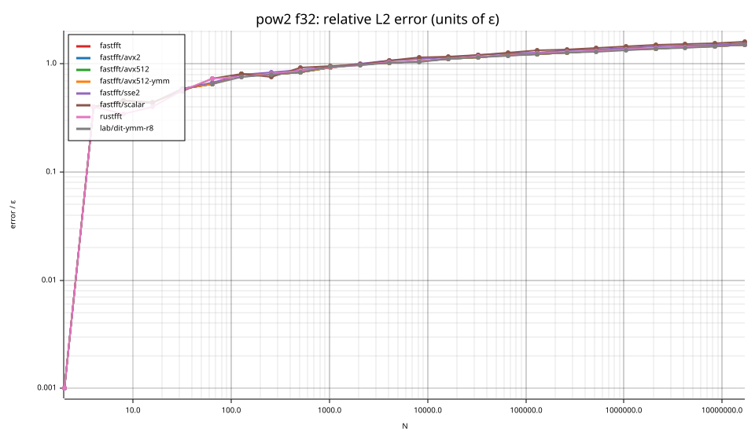

### pow2 f64

| cell | fastfft | fastfft/avx2 | fastfft/avx512 | fastfft/avx512-ymm | fastfft/sse2 | fastfft/scalar | rustfft | lab/dit-ymm-r8 |
|---|---|---|---|---|---|---|---|---|
| N=2 fwd ip | 29.2ns (0.09×) | 29.6ns (0.09×) | 29.4ns (0.09×) | 29.4ns (0.09×) | 29.6ns (0.09×) | 29.6ns (0.09×) | 2.6ns | – |
| N=4 fwd ip | 13.3ns (0.29×) | 13.4ns (0.29×) | 13.5ns (0.28×) | 13.5ns (0.28×) | 13.5ns (0.28×) | 31.2ns (0.12×) | 3.8ns | – |
| N=8 fwd ip | 16.1ns (0.44×) | 16.1ns (0.44×) | 16.3ns (0.43×) | 16.3ns (0.43×) | 16.3ns (0.43×) | 35.2ns (0.20×) | 7.0ns | – |
| N=16 fwd ip | 18.3ns (0.56×) | 19.7ns (0.52×) | 18.6ns (0.55×) | 18.6ns (0.55×) | 23.6ns (0.43×) | 46.0ns (0.22×) | 10.2ns | 18.2ns (0.56×) |
| N=32 fwd ip | 28.1ns (0.65×) | 33.2ns (0.55×) | 28.6ns (0.64×) | 28.4ns (0.64×) | 47.9ns (0.38×) | 80.4ns (0.23×) | 18.3ns | 26.9ns (0.68×) |
| N=64 fwd ip | 51.3ns (0.76×) | 60.1ns (0.65×) | 51.3ns (0.76×) | 50.5ns (0.78×) | 90.4ns (0.43×) | 142.5ns (0.27×) | 39.1ns | 50.4ns (0.78×) |
| N=128 fwd ip | 103.7ns (0.83×) | 108.0ns (0.80×) | 105.9ns (0.81×) | 91.1ns (0.94×) | 207.9ns (0.41×) | 272.6ns (0.32×) | 86.0ns | 89.4ns (0.96×) |
| N=256 fwd ip | 204.8ns (1.02×) | 235.4ns (0.89×) | 200.6ns (1.04×) | 188.9ns (1.10×) | 480.1ns (0.43×) | 647.6ns (0.32×) | 208.5ns | 183.7ns (1.14×) |
| N=512 fwd ip | 426.5ns (1.19×) | 530.0ns (0.96×) | 423.9ns (1.20×) | 434.5ns (1.17×) | 1.01us (0.50×) | 1.53us (0.33×) | 508.1ns | 413.2ns (1.23×) |
| N=1024 fwd ip | 1.04us (1.13×) | 1.16us (1.00×) | 1.02us (1.14×) | 995.6ns (1.17×) | 2.41us (0.48×) | 3.36us (0.35×) | 1.17us | 1.01us (1.15×) |
| N=2048 fwd ip | 2.68us (1.11×) | 2.79us (1.06×) | 2.35us (1.27×) | 2.22us (1.34×) | 5.63us (0.53×) | 7.65us (0.39×) | 2.97us | 2.31us (1.29×) |
| N=4096 fwd ip | 6.00us (1.12×) | 6.06us (1.11×) | 4.58us (1.47×) | 5.16us (1.31×) | 11.66us (0.58×) | 30.34us (0.22×) | 6.74us | 4.88us (1.38×) |
| N=8192 fwd ip | 10.96us (1.35×) | 11.76us (1.26×) | 10.68us (1.39×) | 10.30us (1.44×) | 26.16us (0.57×) | 74.74us (0.20×) | 14.82us | 10.71us (1.38×) |
| N=16384 fwd ip | 24.30us (1.39×) | 26.25us (1.28×) | 22.07us (1.53×) | 21.75us (1.55×) | 60.55us (0.56×) | 152.71us (0.22×) | 33.71us | 21.48us (1.57×) |
| N=32768 fwd ip | 51.86us (1.47×) | 64.49us (1.18×) | 47.20us (1.61×) | 56.32us (1.35×) | 122.67us (0.62×) | 317.75us (0.24×) | 76.15us | 58.31us (1.31×) |
| N=65536 fwd ip | 136.50us (1.25×) | 133.50us (1.28×) | 118.81us (1.44×) | 119.65us (1.43×) | 267.45us (0.64×) | 779.84us (0.22×) | 170.81us | 121.12us (1.41×) |
| N=131072 fwd ip | 291.76us (1.31×) | 292.31us (1.31×) | 240.85us (1.59×) | 249.00us (1.54×) | 579.85us (0.66×) | 1.46ms (0.26×) | 382.81us | 252.77us (1.51×) |
| N=262144 fwd ip | 607.43us (1.44×) | 691.80us (1.26×) | 516.17us (1.69×) | 600.80us (1.45×) | 1.28ms (0.68×) | 3.02ms (0.29×) | 874.09us | 603.69us (1.45×) |
| N=524288 fwd ip | 2.94ms (0.97×) | 3.50ms (0.82×) | 2.85ms (1.00×) | 3.34ms (0.85×) | 4.51ms (0.63×) | 7.01ms (0.41×) | 2.86ms | 3.31ms (0.86×) |
| N=1048576 fwd ip | 12.38ms (0.65×) | 11.91ms (0.67×) | 12.09ms (0.66×) | 11.81ms (0.68×) | 15.20ms (0.53×) | 18.84ms (0.43×) | 8.01ms | 11.69ms (0.69×) |
| N=2097152 fwd ip | 29.16ms (0.62×) | 32.92ms (0.55×) | 29.11ms (0.62×) | 32.34ms (0.56×) | 34.76ms (0.52×) | 54.71ms (0.33×) | 17.99ms | 31.50ms (0.57×) |
| N=4194304 fwd ip | 72.90ms (0.55×) | 66.60ms (0.60×) | 72.06ms (0.56×) | 64.57ms (0.62×) | 70.11ms (0.57×) | 142.84ms (0.28×) | 40.05ms | 64.82ms (0.62×) |
| N=8388608 fwd ip | 145.20ms (0.60×) | 135.20ms (0.65×) | 142.27ms (0.62×) | 129.75ms (0.67×) | 155.11ms (0.56×) | 551.89ms (0.16×) | 87.52ms | 132.87ms (0.66×) |
| N=16777216 fwd ip | 293.62ms (0.65×) | 286.80ms (0.66×) | 287.18ms (0.66×) | 273.76ms (0.69×) | 310.39ms (0.61×) | 526.54ms (0.36×) | 189.53ms | 276.03ms (0.69×) |

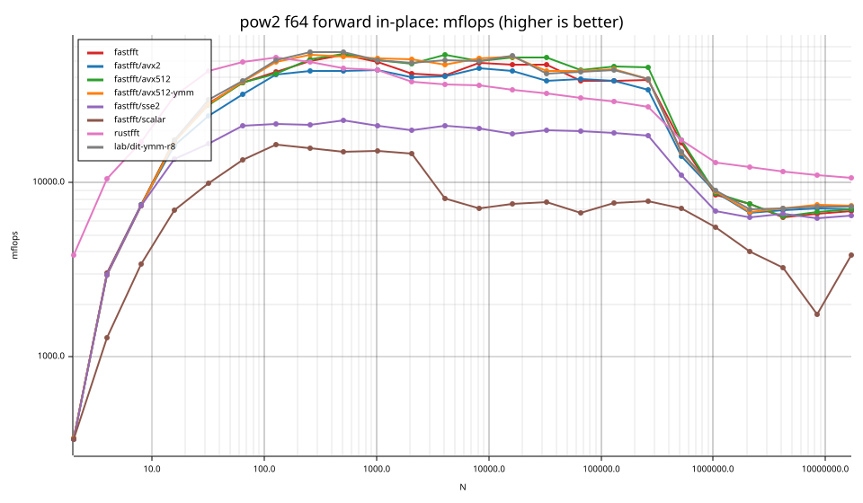
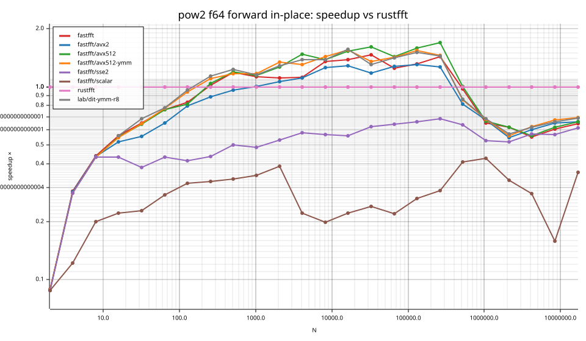
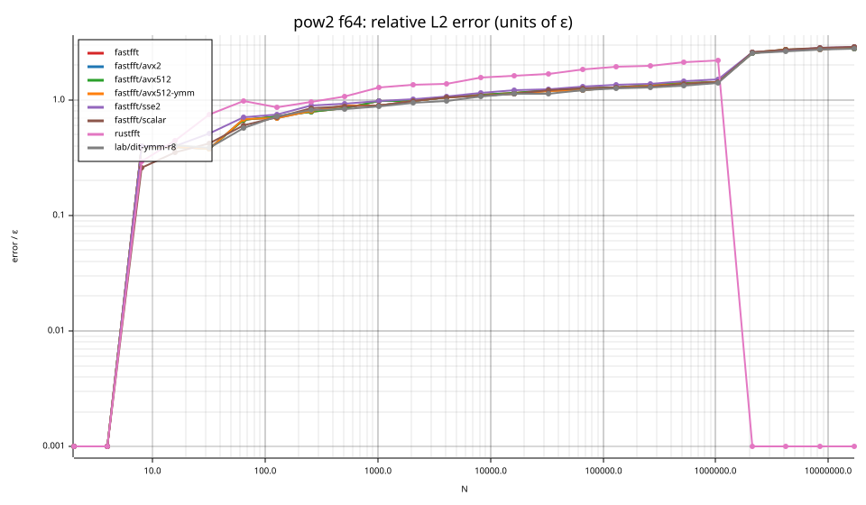

## Suite `smooth`

### smooth f32

| cell | fastfft | fastfft/avx2 | fastfft/avx512 | fastfft/avx512-ymm | fastfft/sse2 | fastfft/scalar | rustfft | lab/dit-ymm-r8 |
|---|---|---|---|---|---|---|---|---|
| N=6 fwd ip | 30.6ns (0.31×) | 30.4ns (0.31×) | 30.4ns (0.31×) | 30.4ns (0.31×) | 30.4ns (0.31×) | 31.4ns (0.30×) | 9.5ns | – |
| N=9 fwd ip | 41.7ns (0.32×) | 42.0ns (0.32×) | 42.4ns (0.31×) | 42.4ns (0.31×) | 42.4ns (0.31×) | 42.6ns (0.31×) | 13.2ns | – |
| N=12 fwd ip | 37.8ns (0.29×) | 37.9ns (0.29×) | 38.1ns (0.29×) | 38.1ns (0.29×) | 38.1ns (0.29×) | 37.3ns (0.30×) | 11.0ns | – |
| N=15 fwd ip | 81.6ns (0.32×) | 67.2ns (0.39×) | 89.2ns (0.29×) | 91.3ns (0.29×) | 69.2ns (0.38×) | 91.3ns (0.29×) | 26.3ns | – |
| N=18 fwd ip | 56.2ns (0.42×) | 56.9ns (0.42×) | 56.6ns (0.42×) | 57.3ns (0.41×) | 55.8ns (0.42×) | 55.6ns (0.43×) | 23.6ns | – |
| N=24 fwd ip | 35.2ns (0.41×) | 35.9ns (0.40×) | 35.5ns (0.41×) | 35.5ns (0.41×) | 35.3ns (0.41×) | 61.8ns (0.23×) | 14.5ns | – |
| N=36 fwd ip | 47.2ns (0.42×) | 47.3ns (0.42×) | 48.0ns (0.41×) | 47.7ns (0.42×) | 47.7ns (0.42×) | 91.3ns (0.22×) | 19.8ns | – |
| N=48 fwd ip | 38.3ns (0.44×) | 38.5ns (0.44×) | 38.7ns (0.44×) | 38.3ns (0.45×) | 38.4ns (0.44×) | 115.8ns (0.15×) | 17.0ns | – |
| N=80 fwd ip | 74.5ns (0.52×) | 74.9ns (0.51×) | 74.7ns (0.52×) | 74.6ns (0.52×) | 74.5ns (0.52×) | 190.8ns (0.20×) | 38.5ns | – |
| N=96 fwd ip | 84.2ns (0.57×) | 84.5ns (0.57×) | 84.8ns (0.57×) | 84.5ns (0.57×) | 84.4ns (0.57×) | 221.4ns (0.22×) | 48.4ns | – |
| N=108 fwd ip | 124.7ns (0.49×) | 125.1ns (0.49×) | 125.9ns (0.49×) | 124.9ns (0.49×) | 125.2ns (0.49×) | 289.6ns (0.21×) | 61.4ns | – |
| N=120 fwd ip | 104.5ns (0.59×) | 116.7ns (0.53×) | 103.6ns (0.60×) | 103.8ns (0.59×) | 131.4ns (0.47×) | 281.6ns (0.22×) | 61.7ns | – |
| N=160 fwd ip | 153.6ns (0.54×) | 152.2ns (0.54×) | 152.7ns (0.54×) | 152.9ns (0.54×) | 153.1ns (0.54×) | 407.2ns (0.20×) | 82.7ns | – |
| N=210 fwd ip | 576.4ns (0.44×) | 579.2ns (0.44×) | 577.6ns (0.44×) | 578.4ns (0.44×) | 579.0ns (0.44×) | 577.8ns (0.44×) | 253.9ns | – |
| N=240 fwd ip | 166.5ns (0.72×) | 191.9ns (0.63×) | 166.7ns (0.72×) | 166.9ns (0.72×) | 227.6ns (0.53×) | 702.9ns (0.17×) | 120.2ns | – |
| N=320 fwd ip | 142.0ns (1.18×) | 191.2ns (0.88×) | 142.4ns (1.18×) | 142.4ns (1.18×) | 321.7ns (0.52×) | 940.1ns (0.18×) | 167.9ns | – |
| N=384 fwd ip | 165.8ns (1.22×) | 221.4ns (0.91×) | 166.1ns (1.21×) | 165.9ns (1.22×) | 389.3ns (0.52×) | 1.31us (0.15×) | 201.8ns | – |
| N=480 fwd ip | 250.1ns (1.32×) | 315.7ns (1.04×) | 249.1ns (1.32×) | 249.0ns (1.32×) | 527.1ns (0.63×) | 1.50us (0.22×) | 329.6ns | – |
| N=504 fwd ip | 310.7ns (0.92×) | 369.8ns (0.77×) | 309.8ns (0.92×) | 310.1ns (0.92×) | 635.3ns (0.45×) | 1.62us (0.18×) | 285.4ns | – |
| N=640 fwd ip | 284.7ns (1.30×) | 418.9ns (0.88×) | 284.3ns (1.30×) | 284.4ns (1.30×) | 736.0ns (0.50×) | 2.16us (0.17×) | 370.5ns | – |
| N=720 fwd ip | 862.9ns (0.60×) | 865.8ns (0.60×) | 869.3ns (0.60×) | 869.7ns (0.60×) | 869.5ns (0.60×) | 2.55us (0.20×) | 518.7ns | – |
| N=768 fwd ip | 346.8ns (1.25×) | 475.2ns (0.91×) | 346.7ns (1.25×) | 345.7ns (1.25×) | 885.1ns (0.49×) | 2.91us (0.15×) | 432.7ns | – |
| N=960 fwd ip | 445.2ns (1.45×) | 645.3ns (1.00×) | 444.9ns (1.45×) | 448.4ns (1.44×) | 1.20us (0.54×) | 3.15us (0.21×) | 647.1ns | – |
| N=1000 fwd ip | 623.1ns (1.51×) | 679.3ns (1.39×) | 615.1ns (1.53×) | 615.9ns (1.53×) | 1.24us (0.76×) | 3.32us (0.28×) | 942.6ns | – |
| N=1200 fwd ip | 678.0ns (1.25×) | 1.06us (0.80×) | 688.4ns (1.23×) | 674.9ns (1.25×) | 1.64us (0.52×) | 4.04us (0.21×) | 845.6ns | – |
| N=1536 fwd ip | 810.8ns (1.33×) | 1.08us (1.00×) | 813.6ns (1.32×) | 815.3ns (1.32×) | 1.88us (0.57×) | 6.05us (0.18×) | 1.08us | – |
| N=1920 fwd ip | 1.06us (1.34×) | 1.46us (0.97×) | 1.05us (1.34×) | 1.06us (1.33×) | 2.52us (0.56×) | 7.71us (0.18×) | 1.41us | – |
| N=1960 fwd ip | 1.25us (1.59×) | 1.47us (1.35×) | 1.26us (1.58×) | 1.26us (1.58×) | 2.92us (0.68×) | 7.03us (0.28×) | 1.99us | – |
| N=2400 fwd ip | 1.47us (1.61×) | 1.93us (1.23×) | 1.48us (1.61×) | 1.47us (1.61×) | 3.35us (0.71×) | 9.68us (0.25×) | 2.38us | – |
| N=3072 fwd ip | 1.74us (1.39×) | 2.25us (1.08×) | 1.75us (1.39×) | 1.77us (1.37×) | 4.24us (0.57×) | 13.44us (0.18×) | 2.42us | – |
| N=4725 fwd ip | 24.06us (0.25×) | 24.03us (0.25×) | 24.05us (0.25×) | 24.06us (0.25×) | 24.10us (0.25×) | 24.03us (0.25×) | 6.11us | – |
| N=4800 fwd ip | 2.84us (1.63×) | 3.83us (1.21×) | 2.85us (1.62×) | 2.85us (1.62×) | 7.40us (0.63×) | 20.60us (0.22×) | 4.63us | – |
| N=6144 fwd ip | 3.71us (1.39×) | 4.97us (1.04×) | 3.72us (1.39×) | 3.72us (1.39×) | 10.18us (0.51×) | 31.93us (0.16×) | 5.17us | – |
| N=10368 fwd ip | 6.54us (1.33×) | 8.87us (0.98×) | 6.53us (1.33×) | 6.54us (1.33×) | 16.75us (0.52×) | 55.10us (0.16×) | 8.68us | – |
| N=12288 fwd ip | 8.96us (1.39×) | 14.37us (0.86×) | 8.84us (1.41×) | 9.02us (1.38×) | 21.51us (0.58×) | 71.53us (0.17×) | 12.42us | – |
| N=27000 fwd ip | 20.41us (1.64×) | 27.38us (1.23×) | 20.65us (1.62×) | 20.49us (1.64×) | 55.76us (0.60×) | 145.46us (0.23×) | 33.56us | – |
| N=48000 fwd ip | 35.48us (1.71×) | 48.04us (1.26×) | 35.37us (1.71×) | 35.95us (1.69×) | 96.59us (0.63×) | 263.46us (0.23×) | 60.62us | – |
| N=75600 fwd ip | 68.48us (1.54×) | 109.10us (0.96×) | 70.04us (1.50×) | 69.06us (1.52×) | 169.19us (0.62×) | 460.79us (0.23×) | 105.15us | – |
| N=96000 fwd ip | 77.50us (1.72×) | 108.31us (1.23×) | 77.95us (1.71×) | 77.94us (1.71×) | 211.62us (0.63×) | 544.49us (0.24×) | 133.01us | – |
| N=165375 fwd ip | 1.19ms (0.27×) | 1.19ms (0.27×) | 1.19ms (0.27×) | 1.19ms (0.27×) | 1.19ms (0.27×) | 1.19ms (0.27×) | 316.49us | – |
| N=1000000 fwd ip | 2.88ms (1.01×) | 3.29ms (0.88×) | 3.03ms (0.96×) | 2.91ms (1.00×) | 4.12ms (0.70×) | 7.68ms (0.38×) | 2.90ms | – |

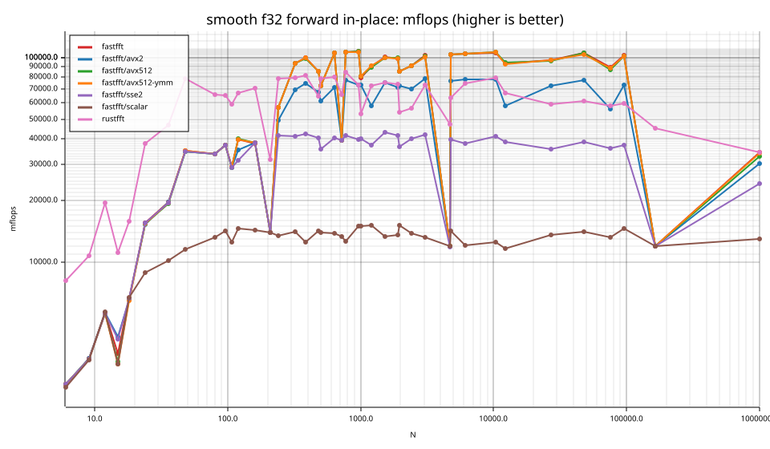
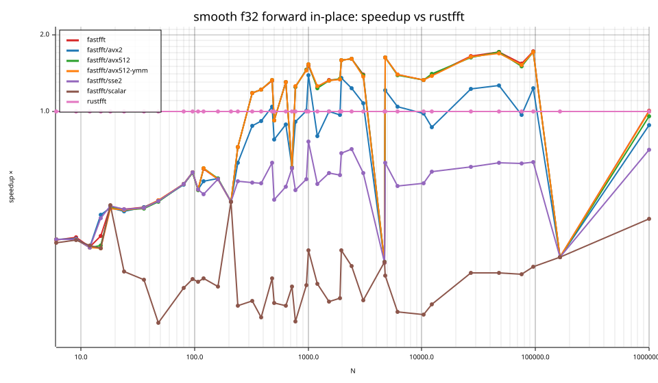
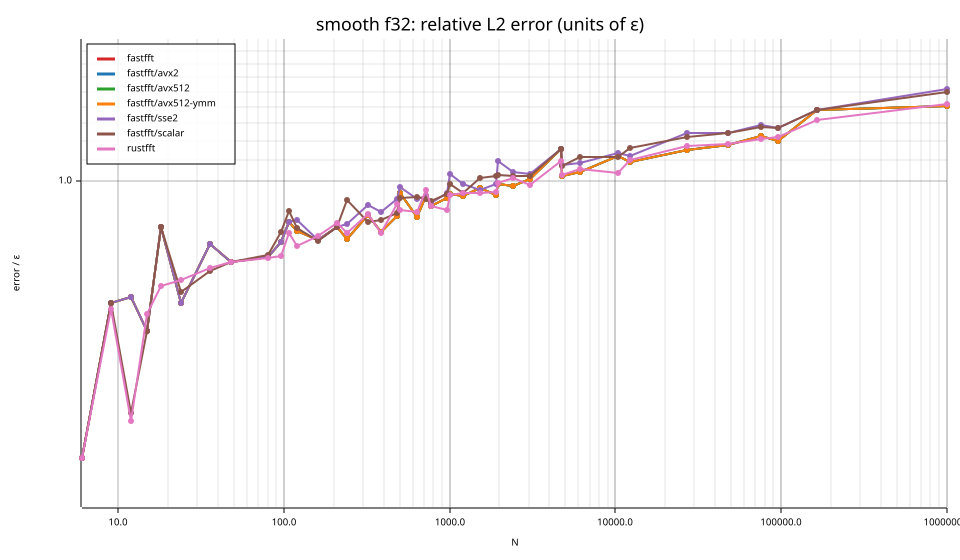

### smooth f64

| cell | fastfft | fastfft/avx2 | fastfft/avx512 | fastfft/avx512-ymm | fastfft/sse2 | fastfft/scalar | rustfft | lab/dit-ymm-r8 |
|---|---|---|---|---|---|---|---|---|
| N=6 fwd ip | 22.3ns (0.25×) | 22.6ns (0.25×) | 22.7ns (0.25×) | 22.5ns (0.25×) | 22.4ns (0.25×) | 32.9ns (0.17×) | 5.6ns | – |
| N=9 fwd ip | 40.2ns (0.24×) | 40.4ns (0.24×) | 40.7ns (0.23×) | 40.6ns (0.23×) | 40.6ns (0.23×) | 40.6ns (0.23×) | 9.5ns | – |
| N=12 fwd ip | 19.4ns (0.60×) | 19.4ns (0.60×) | 19.6ns (0.59×) | 19.7ns (0.59×) | 19.7ns (0.59×) | 39.5ns (0.29×) | 11.6ns | – |
| N=15 fwd ip | 46.5ns (0.62×) | 46.6ns (0.62×) | 46.3ns (0.63×) | 46.5ns (0.62×) | 46.3ns (0.63×) | 46.5ns (0.62×) | 29.0ns | – |
| N=18 fwd ip | 35.8ns (0.39×) | 35.9ns (0.39×) | 35.8ns (0.39×) | 36.3ns (0.38×) | 36.6ns (0.38×) | 55.0ns (0.25×) | 13.9ns | – |
| N=24 fwd ip | 33.5ns (0.42×) | 33.3ns (0.42×) | 33.8ns (0.41×) | 33.8ns (0.41×) | 34.1ns (0.41×) | 61.6ns (0.23×) | 14.0ns | – |
| N=36 fwd ip | 49.1ns (0.49×) | 67.0ns (0.36×) | 48.9ns (0.49×) | 48.9ns (0.49×) | 54.0ns (0.45×) | 86.5ns (0.28×) | 24.2ns | – |
| N=48 fwd ip | 37.5ns (1.06×) | 47.5ns (0.84×) | 37.5ns (1.06×) | 37.4ns (1.07×) | 74.1ns (0.54×) | 104.4ns (0.38×) | 39.9ns | – |
| N=80 fwd ip | 65.2ns (1.06×) | 78.1ns (0.88×) | 65.0ns (1.06×) | 64.6ns (1.07×) | 137.0ns (0.50×) | 183.0ns (0.38×) | 69.0ns | – |
| N=96 fwd ip | 76.7ns (1.08×) | 93.2ns (0.89×) | 76.4ns (1.08×) | 76.6ns (1.08×) | 148.5ns (0.56×) | 190.1ns (0.44×) | 82.8ns | – |
| N=108 fwd ip | 118.9ns (0.79×) | 136.6ns (0.69×) | 119.6ns (0.78×) | 119.5ns (0.78×) | 190.7ns (0.49×) | 266.0ns (0.35×) | 93.7ns | – |
| N=120 fwd ip | 170.1ns (0.63×) | 131.2ns (0.81×) | 168.2ns (0.64×) | 115.1ns (0.93×) | 199.8ns (0.53×) | 268.0ns (0.40×) | 106.9ns | – |
| N=160 fwd ip | 121.8ns (1.22×) | 158.8ns (0.93×) | 121.4ns (1.22×) | 121.8ns (1.22×) | 285.8ns (0.52×) | 379.2ns (0.39×) | 148.4ns | – |
| N=210 fwd ip | 466.2ns (0.64×) | 466.8ns (0.63×) | 471.1ns (0.63×) | 470.0ns (0.63×) | 471.2ns (0.63×) | 520.5ns (0.57×) | 296.4ns | – |
| N=240 fwd ip | 247.8ns (1.14×) | 232.4ns (1.21×) | 247.6ns (1.14×) | 193.9ns (1.45×) | 468.0ns (0.60×) | 617.3ns (0.46×) | 281.4ns | – |
| N=320 fwd ip | 254.9ns (1.34×) | 325.7ns (1.05×) | 256.6ns (1.33×) | 245.8ns (1.39×) | 655.6ns (0.52×) | 895.4ns (0.38×) | 341.7ns | – |
| N=384 fwd ip | 318.3ns (1.16×) | 391.6ns (0.94×) | 311.3ns (1.18×) | 304.1ns (1.21×) | 784.3ns (0.47×) | 1.09us (0.34×) | 368.8ns | – |
| N=480 fwd ip | 453.8ns (1.25×) | 533.8ns (1.06×) | 466.4ns (1.22×) | 391.5ns (1.45×) | 1.07us (0.53×) | 1.32us (0.43×) | 566.7ns | – |
| N=504 fwd ip | 525.3ns (1.28×) | 581.5ns (1.16×) | 519.2ns (1.30×) | 470.6ns (1.43×) | 1.16us (0.58×) | 1.49us (0.45×) | 673.9ns | – |
| N=640 fwd ip | 546.9ns (1.32×) | 752.7ns (0.96×) | 564.5ns (1.28×) | 570.4ns (1.27×) | 1.39us (0.52×) | 1.91us (0.38×) | 721.8ns | – |
| N=720 fwd ip | 669.0ns (1.38×) | 881.9ns (1.04×) | 673.9ns (1.37×) | 670.7ns (1.37×) | 1.80us (0.51×) | 2.17us (0.42×) | 921.0ns | – |
| N=768 fwd ip | 682.3ns (1.42×) | 911.0ns (1.07×) | 700.2ns (1.39×) | 741.2ns (1.31×) | 1.71us (0.57×) | 2.35us (0.41×) | 970.3ns | – |
| N=960 fwd ip | 859.7ns (1.54×) | 1.24us (1.06×) | 860.2ns (1.54×) | 961.0ns (1.38×) | 2.30us (0.58×) | 2.76us (0.48×) | 1.32us | – |
| N=1000 fwd ip | 1.11us (1.50×) | 1.27us (1.30×) | 1.11us (1.50×) | 1.09us (1.53×) | 2.57us (0.65×) | 3.16us (0.53×) | 1.66us | – |
| N=1200 fwd ip | 1.22us (1.67×) | 1.63us (1.25×) | 1.22us (1.67×) | 1.32us (1.54×) | 3.06us (0.67×) | 3.89us (0.52×) | 2.04us | – |
| N=1536 fwd ip | 1.70us (1.31×) | 1.91us (1.17×) | 1.69us (1.32×) | 1.62us (1.38×) | 3.88us (0.58×) | 4.92us (0.45×) | 2.23us | – |
| N=1920 fwd ip | 2.09us (1.36×) | 2.61us (1.09×) | 2.15us (1.33×) | 2.06us (1.38×) | 5.16us (0.55×) | 6.68us (0.43×) | 2.84us | – |
| N=1960 fwd ip | 2.21us (1.68×) | 2.59us (1.43×) | 2.19us (1.69×) | 2.22us (1.67×) | 6.05us (0.61×) | 6.80us (0.54×) | 3.71us | – |
| N=2400 fwd ip | 2.91us (1.49×) | 3.27us (1.33×) | 2.89us (1.50×) | 2.64us (1.64×) | 6.86us (0.63×) | 8.81us (0.49×) | 4.34us | – |
| N=3072 fwd ip | 3.49us (1.33×) | 4.36us (1.07×) | 3.54us (1.31×) | 3.48us (1.34×) | 9.41us (0.49×) | 12.97us (0.36×) | 4.65us | – |
| N=4725 fwd ip | 20.72us (0.49×) | 20.73us (0.49×) | 20.84us (0.49×) | 20.87us (0.49×) | 20.84us (0.49×) | 20.88us (0.49×) | 10.21us | – |
| N=4800 fwd ip | 5.37us (1.70×) | 7.25us (1.26×) | 5.43us (1.68×) | 5.39us (1.70×) | 15.14us (0.60×) | 18.64us (0.49×) | 9.14us | – |
| N=6144 fwd ip | 7.81us (1.48×) | 11.28us (1.03×) | 7.68us (1.51×) | 8.35us (1.39×) | 20.02us (0.58×) | 30.60us (0.38×) | 11.57us | – |
| N=10368 fwd ip | 12.27us (1.64×) | 16.09us (1.25×) | 12.20us (1.65×) | 13.42us (1.50×) | 34.05us (0.59×) | 44.13us (0.46×) | 20.10us | – |
| N=12288 fwd ip | 17.32us (1.43×) | 20.05us (1.24×) | 16.94us (1.47×) | 16.70us (1.49×) | 44.87us (0.55×) | 108.76us (0.23×) | 24.84us | – |
| N=27000 fwd ip | 44.01us (1.51×) | 56.90us (1.17×) | 43.46us (1.53×) | 46.30us (1.43×) | 107.48us (0.62×) | 131.68us (0.50×) | 66.38us | – |
| N=48000 fwd ip | 68.51us (1.82×) | 99.67us (1.25×) | 68.73us (1.81×) | 75.21us (1.66×) | 202.56us (0.62×) | 244.92us (0.51×) | 124.65us | – |
| N=75600 fwd ip | 139.81us (1.45×) | 162.41us (1.25×) | 139.76us (1.45×) | 131.74us (1.54×) | 357.62us (0.57×) | 430.54us (0.47×) | 202.25us | – |
| N=96000 fwd ip | 146.18us (1.94×) | 246.87us (1.15×) | 147.76us (1.92×) | 186.80us (1.52×) | 421.47us (0.67×) | 505.53us (0.56×) | 283.13us | – |
| N=165375 fwd ip | 1.05ms (0.53×) | 1.06ms (0.53×) | 1.06ms (0.53×) | 1.06ms (0.53×) | 1.06ms (0.53×) | 1.06ms (0.53×) | 560.58us | – |
| N=1000000 fwd ip | 10.96ms (0.72×) | 11.27ms (0.70×) | 10.91ms (0.72×) | 10.98ms (0.72×) | 13.16ms (0.60×) | 13.76ms (0.57×) | 7.86ms | – |

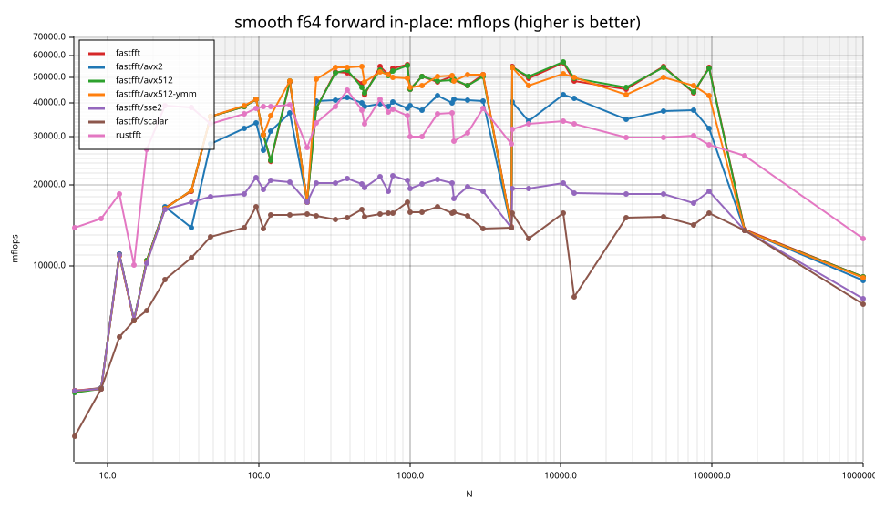
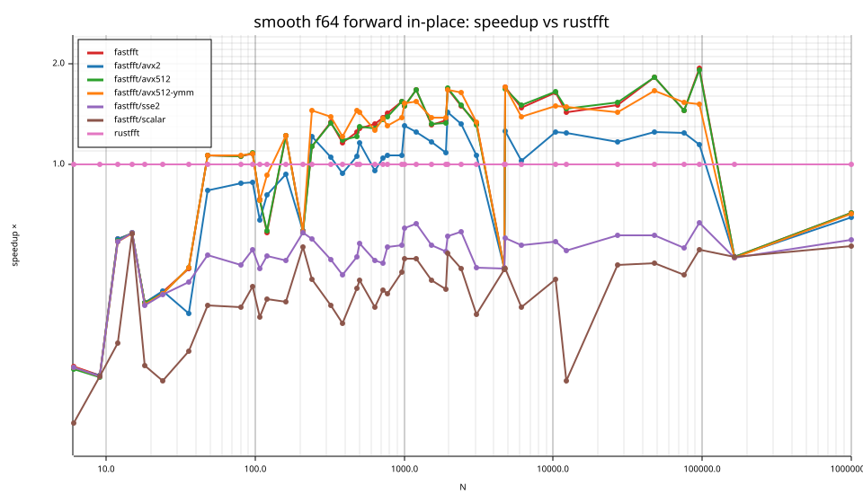
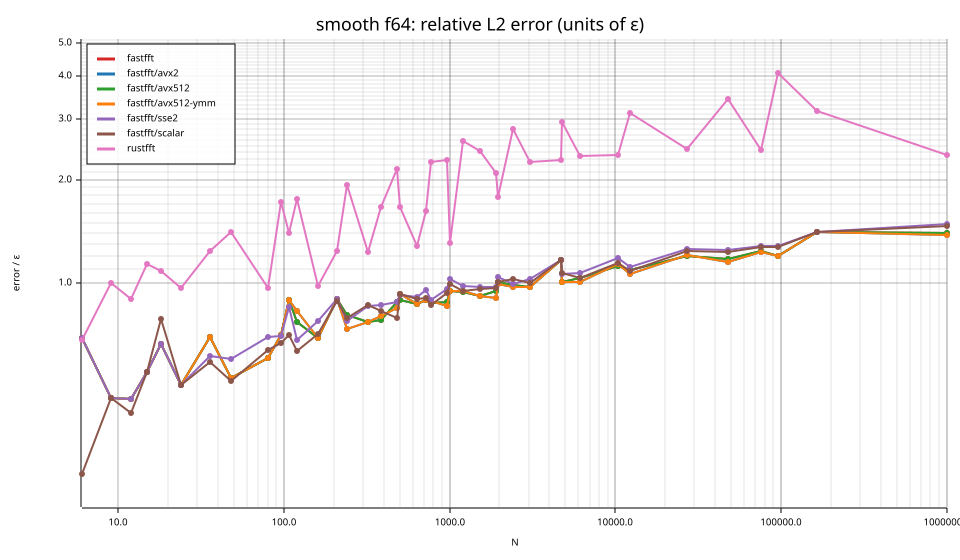

## Suite `rough`

### rough f32

| cell | fastfft | fastfft/avx2 | fastfft/avx512 | fastfft/avx512-ymm | fastfft/sse2 | fastfft/scalar | rustfft | lab/dit-ymm-r8 |
|---|---|---|---|---|---|---|---|---|
| N=17 fwd ip | 126.0ns (0.22×) | 126.8ns (0.22×) | 126.6ns (0.22×) | 136.3ns (0.20×) | 126.8ns (0.22×) | 218.8ns (0.12×) | 27.3ns | – |
| N=31 fwd ip | 113.3ns (0.83×) | 129.5ns (0.73×) | 114.8ns (0.82×) | 114.4ns (0.82×) | 158.4ns (0.60×) | 384.6ns (0.25×) | 94.3ns | – |
| N=61 fwd ip | 207.4ns (0.63×) | 230.6ns (0.57×) | 220.6ns (0.60×) | 203.5ns (0.65×) | 295.2ns (0.45×) | 728.4ns (0.18×) | 131.6ns | – |
| N=127 fwd ip | 402.6ns (1.15×) | 443.5ns (1.04×) | 379.6ns (1.21×) | 378.8ns (1.22×) | 636.9ns (0.72×) | 1.66us (0.28×) | 461.2ns | – |
| N=257 fwd ip | 893.7ns (0.50×) | 1.06us (0.42×) | 870.7ns (0.51×) | 878.9ns (0.50×) | 1.63us (0.27×) | 4.47us (0.10×) | 442.9ns | – |
| N=509 fwd ip | 1.78us (0.85×) | 2.04us (0.74×) | 1.77us (0.86×) | 1.76us (0.86×) | 3.01us (0.50×) | 8.23us (0.18×) | 1.52us | – |
| N=1021 fwd ip | 3.78us (1.38×) | 4.35us (1.19×) | 3.75us (1.38×) | 3.79us (1.37×) | 7.18us (0.72×) | 17.30us (0.30×) | 5.20us | – |
| N=2018 fwd ip | 7.89us (0.71×) | 13.57us (0.41×) | 12.05us (0.46×) | 7.92us (0.70×) | 14.90us (0.37×) | 43.76us (0.13×) | 5.58us | – |
| N=2053 fwd ip | 9.29us (1.21×) | 11.19us (1.00×) | 9.34us (1.20×) | 9.05us (1.24×) | 17.15us (0.66×) | 47.89us (0.23×) | 11.24us | – |
| N=3063 fwd ip | 13.49us (1.21×) | 16.00us (1.02×) | 13.45us (1.22×) | 13.79us (1.19×) | 25.72us (0.64×) | 68.40us (0.24×) | 16.38us | – |
| N=4099 fwd ip | 20.60us (1.07×) | 26.01us (0.85×) | 21.02us (1.05×) | 21.41us (1.03×) | 36.65us (0.60×) | 104.61us (0.21×) | 22.14us | – |
| N=8191 fwd ip | 41.05us (1.20×) | 50.70us (0.97×) | 41.09us (1.20×) | 41.81us (1.18×) | 77.12us (0.64×) | 332.29us (0.15×) | 49.16us | – |
| N=9797 fwd ip | 53.85us (0.90×) | 76.42us (0.63×) | 54.38us (0.89×) | 54.30us (0.89×) | 111.29us (0.43×) | 238.19us (0.20×) | 48.29us | – |
| N=16381 fwd ip | 103.28us (0.97×) | 120.45us (0.84×) | 102.60us (0.98×) | 102.15us (0.98×) | 219.26us (0.46×) | 690.05us (0.15×) | 100.60us | – |
| N=65524 fwd ip | 532.71us (0.80×) | 596.98us (0.72×) | 528.50us (0.81×) | 532.28us (0.80×) | 1.01ms (0.42×) | 4.12ms (0.10×) | 426.86us | – |
| N=65537 fwd ip | 682.00us (0.37×) | 803.69us (0.31×) | 678.26us (0.37×) | 678.82us (0.37×) | 1.32ms (0.19×) | 3.35ms (0.08×) | 252.51us | – |
| N=131071 fwd ip | 1.25ms (0.72×) | 1.47ms (0.61×) | 1.24ms (0.73×) | 1.23ms (0.73×) | 2.05ms (0.44×) | 7.46ms (0.12×) | 900.97us | – |

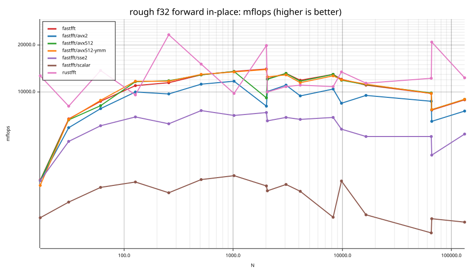
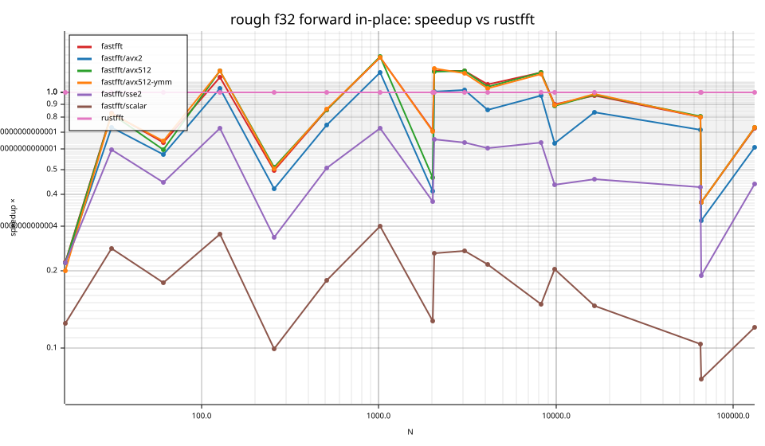
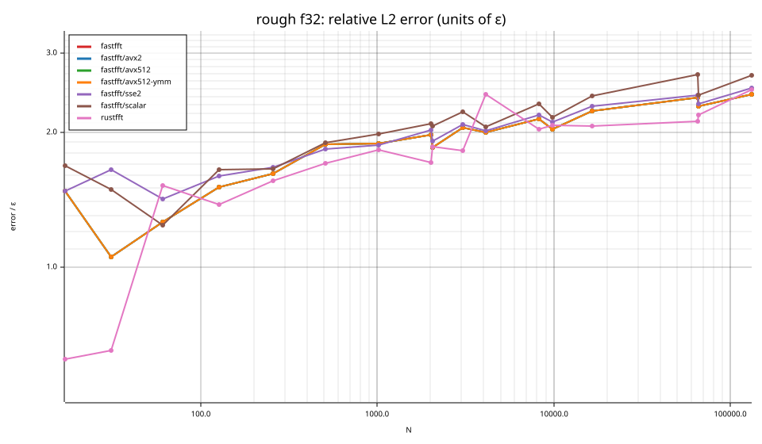

### rough f64

| cell | fastfft | fastfft/avx2 | fastfft/avx512 | fastfft/avx512-ymm | fastfft/sse2 | fastfft/scalar | rustfft | lab/dit-ymm-r8 |
|---|---|---|---|---|---|---|---|---|
| N=17 fwd ip | 151.4ns (0.21×) | 154.5ns (0.20×) | 144.0ns (0.22×) | 144.4ns (0.22×) | 154.5ns (0.20×) | 219.4ns (0.14×) | 31.4ns | – |
| N=31 fwd ip | 192.6ns (0.48×) | 197.2ns (0.47×) | 177.6ns (0.52×) | 180.6ns (0.51×) | 257.3ns (0.36×) | 361.2ns (0.26×) | 92.6ns | – |
| N=61 fwd ip | 354.4ns (0.60×) | 365.4ns (0.58×) | 352.9ns (0.60×) | 327.3ns (0.65×) | 554.0ns (0.38×) | 689.5ns (0.31×) | 212.3ns | – |
| N=127 fwd ip | 683.3ns (0.70×) | 765.1ns (0.62×) | 678.4ns (0.70×) | 659.3ns (0.72×) | 1.25us (0.38×) | 1.58us (0.30×) | 475.6ns | – |
| N=257 fwd ip | 1.63us (0.53×) | 1.90us (0.45×) | 1.62us (0.53×) | 1.59us (0.54×) | 3.22us (0.27×) | 3.87us (0.22×) | 862.9ns | – |
| N=509 fwd ip | 3.18us (1.01×) | 3.79us (0.85×) | 3.45us (0.94×) | 3.40us (0.95×) | 5.97us (0.54×) | 7.91us (0.41×) | 3.23us | – |
| N=1021 fwd ip | 8.75us (0.88×) | 11.50us (0.67×) | 9.90us (0.78×) | 9.91us (0.78×) | 13.72us (0.56×) | 19.62us (0.39×) | 7.69us | – |
| N=2018 fwd ip | 18.80us (0.57×) | 19.06us (0.56×) | 19.12us (0.56×) | 14.73us (0.72×) | 28.89us (0.37×) | 88.80us (0.12×) | 10.67us | – |
| N=2053 fwd ip | 16.95us (1.02×) | 18.59us (0.93×) | 15.78us (1.10×) | 17.78us (0.98×) | 32.35us (0.54×) | 42.37us (0.41×) | 17.35us | – |
| N=3063 fwd ip | 23.86us (1.06×) | 29.88us (0.84×) | 24.01us (1.05×) | 25.16us (1.00×) | 47.28us (0.53×) | 71.94us (0.35×) | 25.19us | – |
| N=4099 fwd ip | 37.03us (1.19×) | 48.75us (0.90×) | 46.74us (0.94×) | 40.24us (1.10×) | 87.67us (0.50×) | 134.15us (0.33×) | 44.08us | – |
| N=8191 fwd ip | 67.74us (1.04×) | 96.30us (0.73×) | 67.71us (1.04×) | 86.31us (0.82×) | 165.30us (0.43×) | 339.39us (0.21×) | 70.36us | – |
| N=9797 fwd ip | 108.25us (0.98×) | 135.86us (0.78×) | 108.48us (0.98×) | 92.39us (1.15×) | 231.15us (0.46×) | 403.88us (0.26×) | 106.46us | – |
| N=16381 fwd ip | 171.00us (0.84×) | 251.19us (0.57×) | 175.37us (0.82×) | 234.63us (0.61×) | 401.63us (0.36×) | 742.68us (0.19×) | 143.84us | – |
| N=65524 fwd ip | 1.05ms (0.60×) | 1.17ms (0.54×) | 963.84us (0.66×) | 1.04ms (0.61×) | 1.58ms (0.40×) | 3.60ms (0.18×) | 633.32us | – |
| N=65537 fwd ip | 1.08ms (0.45×) | 1.05ms (0.46×) | 903.95us (0.53×) | 935.41us (0.52×) | 2.59ms (0.19×) | 4.31ms (0.11×) | 482.92us | – |
| N=131071 fwd ip | 2.10ms (1.31×) | 2.71ms (1.01×) | 2.12ms (1.29×) | 2.50ms (1.10×) | 4.13ms (0.66×) | 7.91ms (0.35×) | 2.74ms | – |

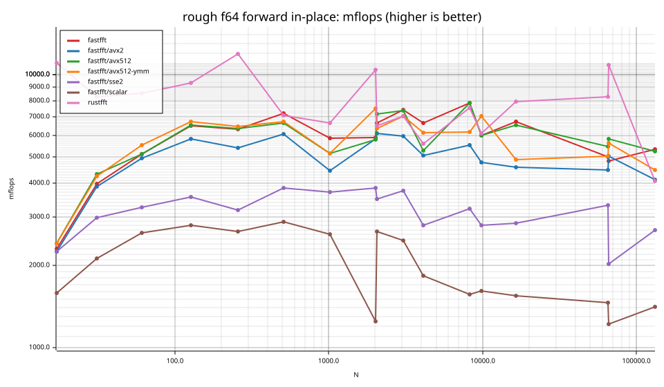
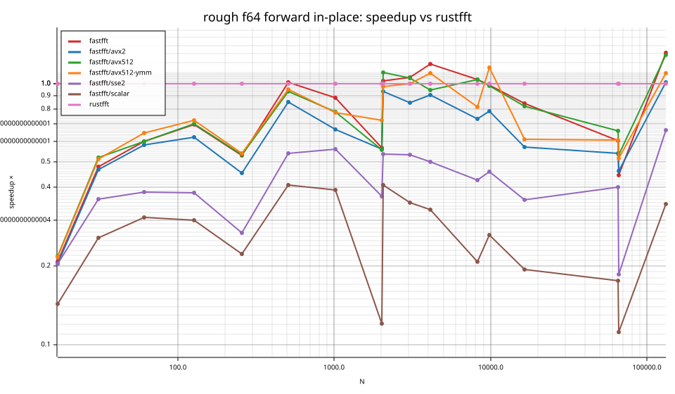
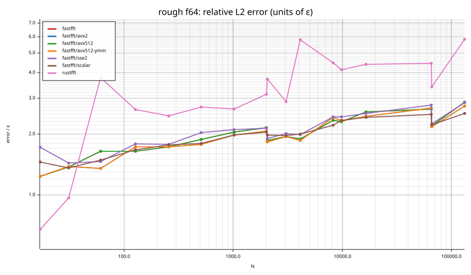

## Suite `batch`

### batch f32

| cell | fastfft | fastfft/avx2 | fastfft/avx512 | fastfft/avx512-ymm | fastfft/sse2 | fastfft/scalar | rustfft | lab/dit-ymm-r8 |
|---|---|---|---|---|---|---|---|---|
| N=8 ×131072 fwd ip | 30.0ns (0.05×) | 30.1ns (0.05×) | 30.1ns (0.05×) | 30.1ns (0.05×) | 30.0ns (0.05×) | 30.1ns (0.05×) | 1.6ns | – |
| N=16 ×65536 fwd ip | 13.7ns (0.24×) | 13.8ns (0.24×) | 13.9ns (0.24×) | 13.9ns (0.24×) | 13.9ns (0.24×) | 45.0ns (0.07×) | 3.4ns | – |
| N=32 ×32768 fwd ip | 22.9ns (0.40×) | 23.0ns (0.39×) | 23.2ns (0.39×) | 23.2ns (0.39×) | 23.2ns (0.39×) | 79.9ns (0.11×) | 9.1ns | – |
| N=64 ×16384 fwd ip | 29.9ns (0.67×) | 38.0ns (0.53×) | 29.9ns (0.67×) | 29.7ns (0.67×) | 51.7ns (0.39×) | 163.3ns (0.12×) | 20.0ns | 28.9ns (0.69×) |
| N=128 ×8192 fwd ip | 60.3ns (0.80×) | 77.9ns (0.62×) | 60.2ns (0.80×) | 60.2ns (0.80×) | 105.4ns (0.46×) | 326.8ns (0.15×) | 48.1ns | 58.7ns (0.82×) |
| N=256 ×4096 fwd ip | 112.3ns (1.00×) | 141.6ns (0.79×) | 111.7ns (1.01×) | 111.6ns (1.01×) | 239.6ns (0.47×) | 739.7ns (0.15×) | 112.3ns | 111.6ns (1.01×) |
| N=512 ×2048 fwd ip | 253.4ns (1.11×) | 325.7ns (0.86×) | 253.8ns (1.10×) | 255.1ns (1.10×) | 580.0ns (0.48×) | 1.70us (0.17×) | 280.3ns | 252.5ns (1.11×) |
| N=1024 ×1024 fwd ip | 570.0ns (1.13×) | 710.7ns (0.91×) | 565.4ns (1.14×) | 569.1ns (1.13×) | 1.20us (0.54×) | 3.95us (0.16×) | 643.2ns | 544.3ns (1.18×) |

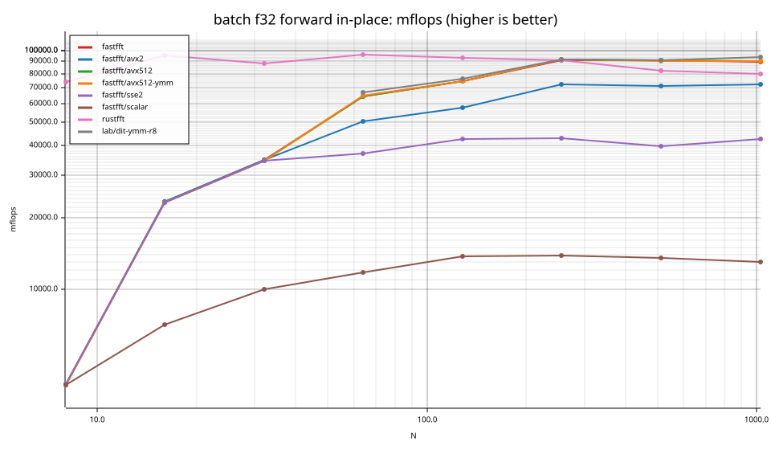
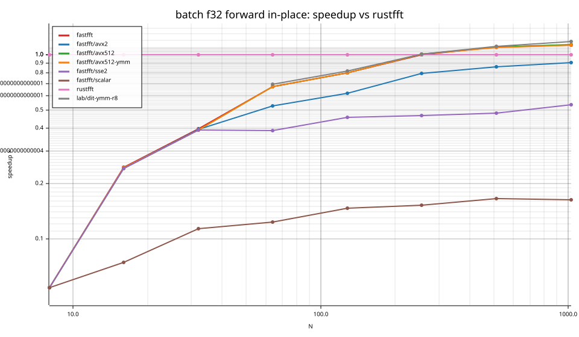
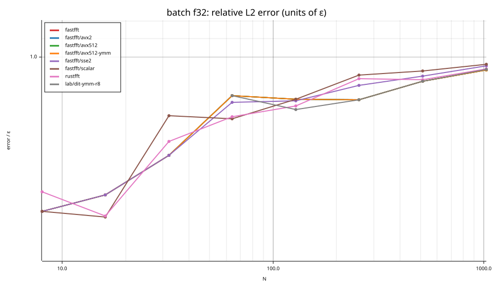

### batch f64

| cell | fastfft | fastfft/avx2 | fastfft/avx512 | fastfft/avx512-ymm | fastfft/sse2 | fastfft/scalar | rustfft | lab/dit-ymm-r8 |
|---|---|---|---|---|---|---|---|---|
| N=8 ×131072 fwd ip | 12.4ns (0.20×) | 12.4ns (0.20×) | 12.5ns (0.20×) | 12.4ns (0.20×) | 12.5ns (0.20×) | 32.4ns (0.08×) | 2.5ns | – |
| N=16 ×65536 fwd ip | 15.6ns (0.39×) | 17.5ns (0.35×) | 15.7ns (0.39×) | 15.7ns (0.39×) | 19.9ns (0.31×) | 42.8ns (0.14×) | 6.2ns | 15.8ns (0.39×) |
| N=32 ×32768 fwd ip | 27.8ns (0.54×) | 32.8ns (0.46×) | 27.9ns (0.54×) | 27.8ns (0.54×) | 45.0ns (0.34×) | 79.3ns (0.19×) | 15.1ns | 23.6ns (0.64×) |
| N=64 ×16384 fwd ip | 55.2ns (0.75×) | 62.5ns (0.66×) | 54.9ns (0.75×) | 52.5ns (0.78×) | 90.4ns (0.46×) | 145.5ns (0.28×) | 41.2ns | 50.7ns (0.81×) |
| N=128 ×8192 fwd ip | 117.6ns (0.93×) | 116.8ns (0.94×) | 117.3ns (0.94×) | 100.9ns (1.09×) | 210.3ns (0.52×) | 286.3ns (0.38×) | 109.8ns | 105.0ns (1.05×) |
| N=256 ×4096 fwd ip | 338.0ns (1.24×) | 359.9ns (1.17×) | 333.3ns (1.26×) | 324.9ns (1.29×) | 594.7ns (0.71×) | 716.7ns (0.59×) | 419.7ns | 308.8ns (1.36×) |
| N=512 ×2048 fwd ip | 698.1ns (1.30×) | 809.9ns (1.12×) | 696.3ns (1.30×) | 730.4ns (1.24×) | 1.32us (0.69×) | 2.07us (0.44×) | 906.6ns | 706.6ns (1.28×) |
| N=1024 ×1024 fwd ip | 1.46us (1.06×) | 1.58us (0.98×) | 1.45us (1.07×) | 1.44us (1.08×) | 2.84us (0.54×) | 4.01us (0.39×) | 1.55us | 1.49us (1.04×) |

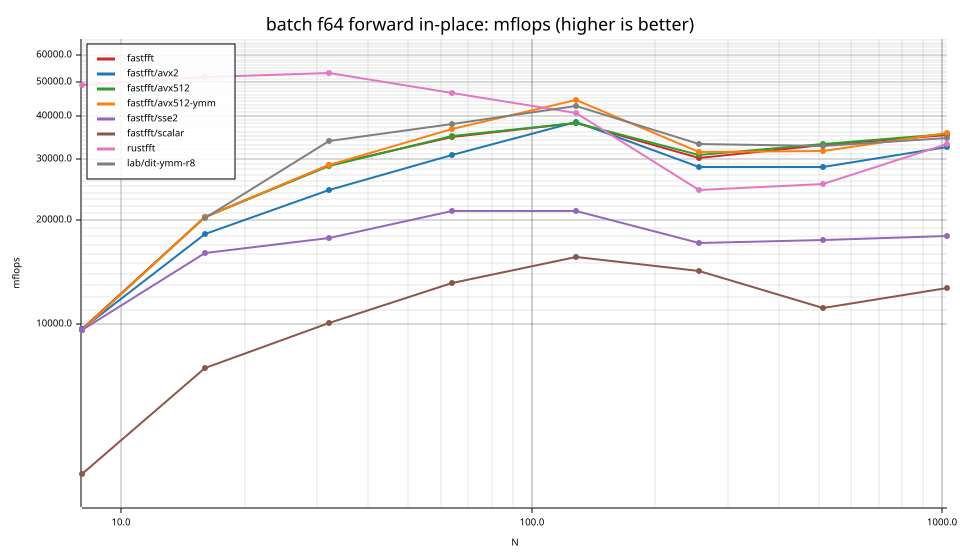
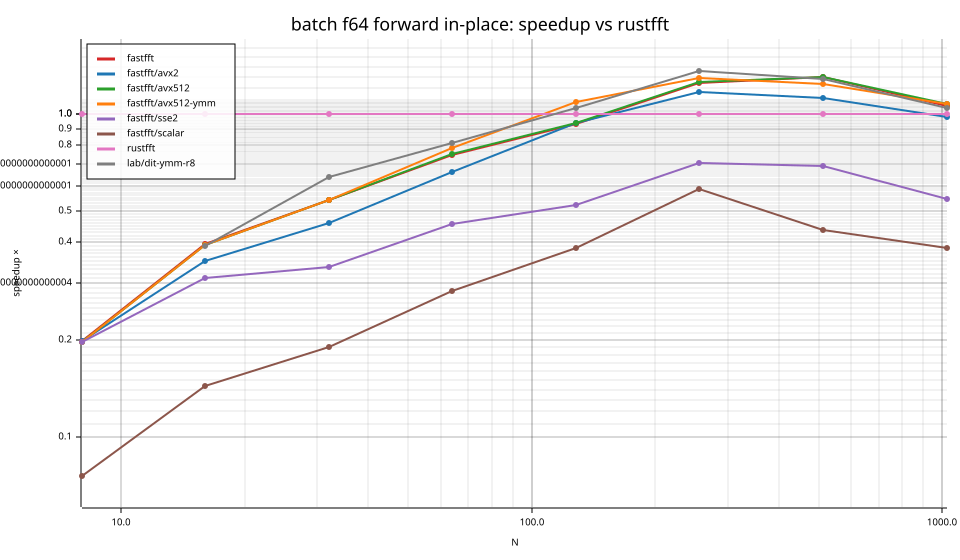
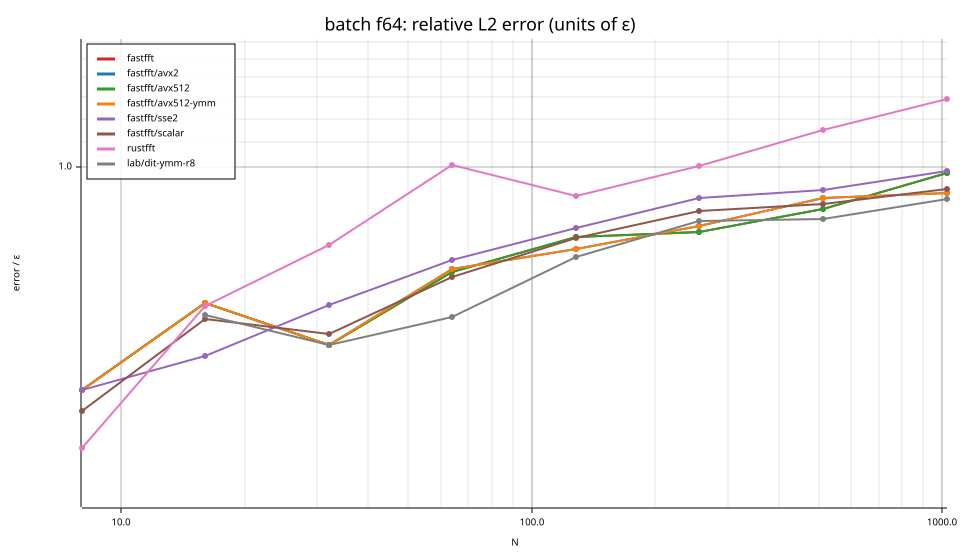

## Accuracy and planning time (medians over cells)

| lib | cells verified | failed | median error (ε) | worst error (ε) | median plan time |
|---|---|---|---|---|---|
| fastfft | 180 | 0 | 0.98 | 2.87 | 31.94us |
| fastfft/avx2 | 180 | 0 | 0.98 | 2.85 | 30.68us |
| fastfft/avx512 | 180 | 0 | 0.98 | 2.87 | 31.19us |
| fastfft/avx512-ymm | 180 | 0 | 0.98 | 2.85 | 29.35us |
| fastfft/sse2 | 180 | 0 | 1.01 | 2.88 | 26.82us |
| fastfft/scalar | 180 | 0 | 1.00 | 2.86 | 28.08us |
| rustfft | 180 | 0 | 1.17 | 5.84 | 8.35us |
| lab/dit-ymm-r8 | 52 | 0 | 0.98 | 2.79 | 1.39ms |
