# fastfft arena report: `20260924T233214Z-mini-ryzen-zen4-baseline`

| | |
|---|---|
| Host | mini-ryzen |
| CPU | AMD Ryzen 7 7840HS w/ Radeon 780M Graphics (family 25, model 116, stepping 1, microcode 0xa704108) |
| Pinned CPU | 2 (SMT siblings 2,10) |
| Governor / EPP / boost | performance / performance / 1 |
| Kernel | Linux version 7.0.0-28-generic |
| Virtualization | none |
| rustc | rustc 1.95.0 (59807616e 2026-04-14); binary: rustc; commit-hash: 59807616e1fa2540724bfbac14d7976d7e4a3860; commit-date: 2026-04-14; host: x86_64-unknown-linux-gnu; release: 1.95.0; LLVM version: 22.1.2 |
| Build profile / RUSTFLAGS | arena / `` |
| Libraries | {"fearless_simd":"0.5.0","num-complex":"0.4.6","oxifft":"0.4.2","phastft":"0.4.1","pulp":"0.22.3","rustfft":"6.4.1","tfhe-fft":"0.10.1"} |
| FFTW | fftw-3.3.11-sse2-avx-avx2-avx2_128-avx512 `double: CFLAGS='-O3 -fPIC -std=gnu17' ./configure --enable-static --disable-shared --disable-fortran --disable-doc --enable-sse2 --enable-avx --enable-avx2 --enable-avx512 --enable-fma
single: CFLAGS='-O3 -fPIC -std=gnu17' ./configure --enable-static --disable-shared --disable-fortran --disable-doc --enable-sse2 --enable-avx --enable-avx2 --enable-avx512 --enable-fma --enable-float` |
| Git | 0ed874b85e4d456ac96f5f9864c35c0a7c054f48 (dirty: false) |
| Profile | full |
| Official | true  |
| Control drift | max 3.95% over 29 control runs — **FLAGGED** |
| Cells | 694 |

Times are per transform. *best* = minimum batch mean, *median* = median batch mean. Speedup = rustfft time ÷ library time (> 1 means faster than rustfft); *geomean* over the cells both libraries ran. mflops = 5·N·log2(N)/t(µs).

## Speedup vs rustfft (geomean of best-time ratios; median-time ratio in parentheses)

| suite | prec | rustfft | phastft/split | phastft/interleaved | tfhe-fft | oxifft | fftw |
|---|---|---|---|---|---|---|---|
| pow2 | f32 | 1.00× (1.00×) 0/96/0 | 0.55× (0.55×) 5/0/43 | 0.34× (0.33×) 0/0/48 | – | 0.13× (0.13×) 0/1/87 | 0.77× (0.77×) 23/4/69 |
| pow2 | f64 | 1.00× (1.00×) 0/96/0 | 0.60× (0.60×) 4/1/43 | 0.36× (0.34×) 0/0/48 | 0.86× (0.86×) 6/2/12 | 0.41× (0.41×) 0/0/64 | 1.00× (1.00×) 53/9/34 |
| smooth | f32 | 1.00× (1.00×) 0/164/0 | – | – | – | 0.08× (0.08×) 2/0/162 | 0.93× (0.92×) 83/20/61 |
| smooth | f64 | 1.00× (1.00×) 0/164/0 | – | – | – | 0.16× (0.16×) 0/0/164 | 1.16× (1.14×) 121/3/40 |
| rough | f32 | 1.00× (1.00×) 0/68/0 | – | – | – | 0.11× (0.11×) 0/0/68 | 0.71× (0.69×) 16/11/41 |
| rough | f64 | 1.00× (1.00×) 0/68/0 | – | – | – | 0.27× (0.27×) 0/0/68 | 0.76× (0.75×) 10/10/48 |
| batch | f32 | 1.00× (1.00×) 0/16/0 | 0.24× (0.24×) 0/0/8 | 0.16× (0.16×) 0/0/8 | – | 0.11× (0.11×) 0/0/16 | 0.87× (0.86×) 3/3/10 |
| batch | f64 | 1.00× (1.00×) 0/16/0 | 0.38× (0.40×) 1/0/7 | 0.25× (0.25×) 0/0/8 | 0.97× (0.98×) 4/1/3 | 0.49× (0.51×) 0/0/16 | 0.94× (0.94×) 4/4/8 |
| realworld | f32 | 1.00× (1.00×) 0/5/0 | 0.87× (0.87×) 0/0/5 | 0.66× (0.66×) 0/0/5 | – | 0.14× (0.14×) 0/0/5 | 1.00× (1.00×) 2/0/3 |
| realworld | f64 | 1.00× (1.00×) 0/1/0 | 0.95× (0.95×) 0/0/1 | 0.72× (0.72×) 0/0/1 | – | 0.58× (0.58×) 0/0/1 | 1.04× (1.05×) 1/0/0 |

w/t/l = cells faster / within ±3% / slower than rustfft (best times).

## Suite `pow2`

### pow2 f32

| cell | rustfft | phastft/split | phastft/interleaved | tfhe-fft | oxifft | fftw |
|---|---|---|---|---|---|---|
| N=2 fwd ip | 2.8ns | 14.8ns (0.19×) | 35.5ns (0.08×) | – | 5.8ns (0.48×) | 3.8ns (0.72×) |
| N=2 fwd oop | 2.4ns | – | – | – | 6.8ns (0.35×) | 3.8ns (0.63×) |
| N=2 inv ip | 2.8ns | 15.4ns (0.18×) | 36.6ns (0.08×) | – | 5.7ns (0.49×) | 3.8ns (0.72×) |
| N=2 inv oop | 2.4ns | – | – | – | 6.8ns (0.35×) | 3.8ns (0.63×) |
| N=4 fwd ip | 4.2ns | 22.9ns (0.18×) | 44.8ns (0.09×) | – | 5.8ns (0.72×) | 4.8ns (0.88×) |
| N=4 fwd oop | 2.8ns | – | – | – | 7.0ns (0.40×) | 4.6ns (0.60×) |
| N=4 inv ip | 4.2ns | 23.7ns (0.18×) | 46.2ns (0.09×) | – | 5.8ns (0.73×) | 4.7ns (0.89×) |
| N=4 inv oop | 2.8ns | – | – | – | 7.0ns (0.40×) | 4.6ns (0.60×) |
| N=8 fwd ip | 7.8ns | 36.3ns (0.21×) | 60.9ns (0.13×) | – | 8.0ns (0.97×) | 7.9ns (0.98×) |
| N=8 fwd oop | 3.0ns | – | – | – | 9.0ns (0.33×) | 7.7ns (0.39×) |
| N=8 inv ip | 7.8ns | 37.4ns (0.21×) | 62.9ns (0.12×) | – | 8.0ns (0.98×) | 7.9ns (0.99×) |
| N=8 inv oop | 3.0ns | – | – | – | 9.0ns (0.33×) | 7.7ns (0.39×) |
| N=16 fwd ip | 8.7ns | 59.9ns (0.15×) | 86.6ns (0.10×) | – | 23.3ns (0.37×) | 14.7ns (0.59×) |
| N=16 fwd oop | 4.0ns | – | – | – | 25.2ns (0.16×) | 15.2ns (0.26×) |
| N=16 inv ip | 8.7ns | 61.5ns (0.14×) | 89.3ns (0.10×) | – | 23.0ns (0.38×) | 15.7ns (0.56×) |
| N=16 inv oop | 4.0ns | – | – | – | 24.8ns (0.16×) | 15.1ns (0.26×) |
| N=32 fwd ip | 12.5ns | 83.0ns (0.15×) | 113.2ns (0.11×) | – | 75.4ns (0.17×) | 28.8ns (0.43×) |
| N=32 fwd oop | 9.8ns | – | – | – | 78.1ns (0.13×) | 15.8ns (0.62×) |
| N=32 inv ip | 12.5ns | 85.1ns (0.15×) | 116.0ns (0.11×) | – | 75.8ns (0.16×) | 26.5ns (0.47×) |
| N=32 inv oop | 9.8ns | – | – | – | 77.4ns (0.13×) | 15.7ns (0.63×) |
| N=64 fwd ip | 21.2ns | 53.5ns (0.40×) | 105.9ns (0.20×) | – | 210.8ns (0.10×) | 37.1ns (0.57×) |
| N=64 fwd oop | 20.1ns | – | – | – | 213.8ns (0.09×) | 24.2ns (0.83×) |
| N=64 inv ip | 21.5ns | 57.2ns (0.38×) | 93.6ns (0.23×) | – | 211.2ns (0.10×) | 37.2ns (0.58×) |
| N=64 inv oop | 20.3ns | – | – | – | 214.5ns (0.09×) | 24.4ns (0.83×) |
| N=128 fwd ip | 47.6ns | 102.1ns (0.47×) | 156.2ns (0.30×) | – | 538.7ns (0.09×) | 57.7ns (0.82×) |
| N=128 fwd oop | 46.5ns | – | – | – | 546.0ns (0.09×) | 41.8ns (1.11×) |
| N=128 inv ip | 47.3ns | 108.9ns (0.43×) | 162.7ns (0.29×) | – | 537.4ns (0.09×) | 59.6ns (0.79×) |
| N=128 inv oop | 46.6ns | – | – | – | 542.2ns (0.09×) | 41.5ns (1.12×) |
| N=256 fwd ip | 104.9ns | 199.1ns (0.53×) | 306.8ns (0.34×) | – | 1.34us (0.08×) | 130.4ns (0.80×) |
| N=256 fwd oop | 102.4ns | – | – | – | 1.36us (0.08×) | 79.0ns (1.30×) |
| N=256 inv ip | 103.6ns | 212.9ns (0.49×) | 321.1ns (0.32×) | – | 1.33us (0.08×) | 132.4ns (0.78×) |
| N=256 inv oop | 102.9ns | – | – | – | 1.35us (0.08×) | 87.8ns (1.17×) |
| N=512 fwd ip | 271.3ns | 405.9ns (0.67×) | 627.5ns (0.43×) | – | 4.06us (0.07×) | 259.2ns (1.05×) |
| N=512 fwd oop | 244.7ns | – | – | – | 4.08us (0.06×) | 173.2ns (1.41×) |
| N=512 inv ip | 257.0ns | 431.2ns (0.60×) | 655.0ns (0.39×) | – | 4.05us (0.06×) | 242.0ns (1.06×) |
| N=512 inv oop | 244.3ns | – | – | – | 4.08us (0.06×) | 179.5ns (1.36×) |
| N=1024 fwd ip | 600.9ns | 844.6ns (0.71×) | 1.28us (0.47×) | – | 8.92us (0.07×) | 477.0ns (1.26×) |
| N=1024 fwd oop | 572.2ns | – | – | – | 8.96us (0.06×) | 403.7ns (1.42×) |
| N=1024 inv ip | 602.9ns | 895.2ns (0.67×) | 1.24us (0.48×) | – | 8.92us (0.07×) | 479.4ns (1.26×) |
| N=1024 inv oop | 573.8ns | – | – | – | 8.97us (0.06×) | 395.9ns (1.45×) |
| N=2048 fwd ip | 1.39us | 1.83us (0.76×) | 2.55us (0.55×) | – | 18.29us (0.08×) | 1.12us (1.24×) |
| N=2048 fwd oop | 1.32us | – | – | – | 18.41us (0.07×) | 942.0ns (1.40×) |
| N=2048 inv ip | 1.41us | 1.92us (0.73×) | 2.84us (0.50×) | – | 18.26us (0.08×) | 1.17us (1.20×) |
| N=2048 inv oop | 1.31us | – | – | – | 18.42us (0.07×) | 931.2ns (1.41×) |
| N=4096 fwd ip | 3.40us | 4.00us (0.85×) | 5.85us (0.58×) | – | 44.25us (0.08×) | 2.82us (1.21×) |
| N=4096 fwd oop | 3.25us | – | – | – | 43.86us (0.07×) | 2.37us (1.37×) |
| N=4096 inv ip | 3.38us | 4.18us (0.81×) | 6.23us (0.54×) | – | 44.28us (0.08×) | 2.75us (1.23×) |
| N=4096 inv oop | 3.25us | – | – | – | 43.81us (0.07×) | 2.32us (1.40×) |
| N=8192 fwd ip | 7.29us | 8.93us (0.82×) | 12.63us (0.58×) | – | 87.11us (0.08×) | 7.96us (0.91×) |
| N=8192 fwd oop | 6.98us | – | – | – | 88.06us (0.08×) | 7.38us (0.95×) |
| N=8192 inv ip | 7.27us | 9.34us (0.78×) | 13.18us (0.55×) | – | 87.30us (0.08×) | 7.97us (0.91×) |
| N=8192 inv oop | 6.97us | – | – | – | 88.17us (0.08×) | 7.44us (0.94×) |
| N=16384 fwd ip | 16.02us | 20.55us (0.78×) | 25.50us (0.63×) | – | 196.54us (0.08×) | 17.09us (0.94×) |
| N=16384 fwd oop | 15.62us | – | – | – | 192.69us (0.08×) | 16.14us (0.97×) |
| N=16384 inv ip | 16.04us | 21.39us (0.75×) | 26.45us (0.61×) | – | 196.80us (0.08×) | 17.58us (0.91×) |
| N=16384 inv oop | 15.65us | – | – | – | 192.59us (0.08×) | 15.85us (0.99×) |
| N=32768 fwd ip | 37.89us | 50.42us (0.75×) | 66.31us (0.57×) | – | 414.18us (0.09×) | 36.27us (1.04×) |
| N=32768 fwd oop | 36.65us | – | – | – | 410.36us (0.09×) | 33.92us (1.08×) |
| N=32768 inv ip | 37.58us | 51.49us (0.73×) | 72.09us (0.52×) | – | 414.09us (0.09×) | 37.13us (1.01×) |
| N=32768 inv oop | 36.50us | – | – | – | 410.64us (0.09×) | 34.24us (1.07×) |
| N=65536 fwd ip | 83.20us | 118.86us (0.70×) | 159.48us (0.52×) | – | 873.88us (0.10×) | 97.44us (0.85×) |
| N=65536 fwd oop | 78.43us | – | – | – | 864.83us (0.09×) | 92.06us (0.85×) |
| N=65536 inv ip | 82.92us | 121.79us (0.68×) | 156.15us (0.53×) | – | 875.40us (0.09×) | 95.50us (0.87×) |
| N=65536 inv oop | 78.15us | – | – | – | 865.32us (0.09×) | 90.20us (0.87×) |
| N=131072 fwd ip | 181.82us | 212.24us (0.86×) | 292.00us (0.62×) | – | 1.85ms (0.10×) | 213.21us (0.85×) |
| N=131072 fwd oop | 171.47us | – | – | – | 1.82ms (0.09×) | 209.92us (0.82×) |
| N=131072 inv ip | 181.48us | 219.78us (0.83×) | 310.44us (0.58×) | – | 1.84ms (0.10×) | 215.53us (0.84×) |
| N=131072 inv oop | 172.13us | – | – | – | 1.82ms (0.09×) | 208.64us (0.83×) |
| N=262144 fwd ip | 409.12us | 469.38us (0.87×) | 676.66us (0.60×) | – | 3.86ms (0.11×) | 494.50us (0.83×) |
| N=262144 fwd oop | 390.72us | – | – | – | 3.84ms (0.10×) | 499.62us (0.78×) |
| N=262144 inv ip | 411.95us | 488.32us (0.84×) | 675.77us (0.61×) | – | 3.87ms (0.11×) | 499.87us (0.82×) |
| N=262144 inv oop | 390.73us | – | – | – | 3.83ms (0.10×) | 476.71us (0.82×) |
| N=524288 fwd ip | 881.54us | 990.54us (0.89×) | 1.46ms (0.60×) | – | 8.21ms (0.11×) | 2.22ms (0.40×) |
| N=524288 fwd oop | 869.82us | – | – | – | 8.08ms (0.11×) | 2.31ms (0.38×) |
| N=524288 inv ip | 873.28us | 1.03ms (0.85×) | 1.47ms (0.59×) | – | 8.18ms (0.11×) | 2.23ms (0.39×) |
| N=524288 inv oop | 870.41us | – | – | – | 8.08ms (0.11×) | 2.31ms (0.38×) |
| N=1048576 fwd ip | 2.92ms | 2.39ms (1.22×) | 4.77ms (0.61×) | – | 19.06ms (0.15×) | 4.92ms (0.59×) |
| N=1048576 fwd oop | 2.65ms | – | – | – | 18.59ms (0.14×) | 5.50ms (0.48×) |
| N=1048576 inv ip | 2.91ms | 2.44ms (1.19×) | 4.87ms (0.60×) | – | 18.97ms (0.15×) | 4.91ms (0.59×) |
| N=1048576 inv oop | 2.62ms | – | – | – | 18.35ms (0.14×) | 5.37ms (0.49×) |
| N=2097152 fwd ip | 8.30ms | 6.92ms (1.20×) | 11.47ms (0.72×) | – | 48.97ms (0.17×) | 11.35ms (0.73×) |
| N=2097152 fwd oop | 7.24ms | – | – | – | 47.33ms (0.15×) | 13.85ms (0.52×) |
| N=2097152 inv ip | 8.38ms | 7.24ms (1.16×) | 12.54ms (0.67×) | – | 48.92ms (0.17×) | 11.47ms (0.73×) |
| N=2097152 inv oop | 7.22ms | – | – | – | 46.64ms (0.15×) | 13.46ms (0.54×) |
| N=4194304 fwd ip | 18.88ms | 18.28ms (1.03×) | 40.63ms (0.46×) | – | 125.85ms (0.15×) | 29.02ms (0.65×) |
| N=4194304 fwd oop | 19.52ms | – | – | – | 108.63ms (0.18×) | 30.20ms (0.65×) |
| N=4194304 inv ip | 19.16ms | 19.92ms (0.96×) | 41.38ms (0.46×) | – | 124.90ms (0.15×) | 33.95ms (0.56×) |
| N=4194304 inv oop | 19.38ms | – | – | – | 108.13ms (0.18×) | 30.73ms (0.63×) |
| N=8388608 fwd ip | 39.88ms | 42.75ms (0.93×) | 119.52ms (0.33×) | – | **failed-verify** | 57.56ms (0.69×) |
| N=8388608 fwd oop | 43.27ms | – | – | – | **failed-verify** | 66.64ms (0.65×) |
| N=8388608 inv ip | 40.95ms | 47.20ms (0.87×) | 120.53ms (0.34×) | – | **failed-verify** | 61.18ms (0.67×) |
| N=8388608 inv oop | 43.15ms | – | – | – | **failed-verify** | 64.63ms (0.67×) |
| N=16777216 fwd ip | 88.24ms | 123.20ms (0.72×) | 262.10ms (0.34×) | – | **failed-verify** | 159.50ms (0.55×) |
| N=16777216 fwd oop | 94.99ms | – | – | – | **failed-verify** | 133.41ms (0.71×) |
| N=16777216 inv ip | 87.55ms | 129.00ms (0.68×) | 300.95ms (0.29×) | – | **failed-verify** | 154.08ms (0.57×) |
| N=16777216 inv oop | 94.87ms | – | – | – | **failed-verify** | 135.16ms (0.70×) |

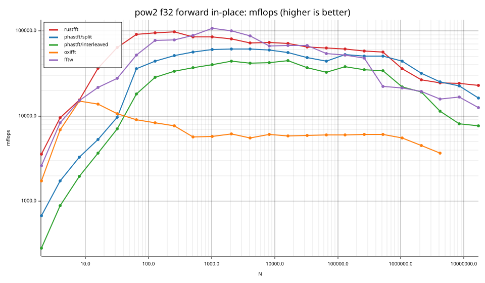
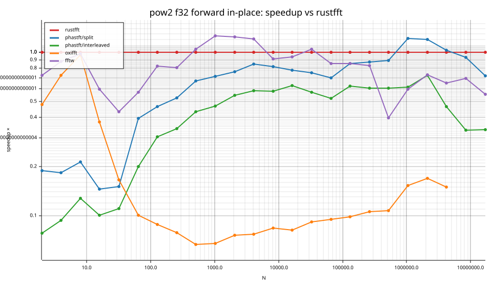
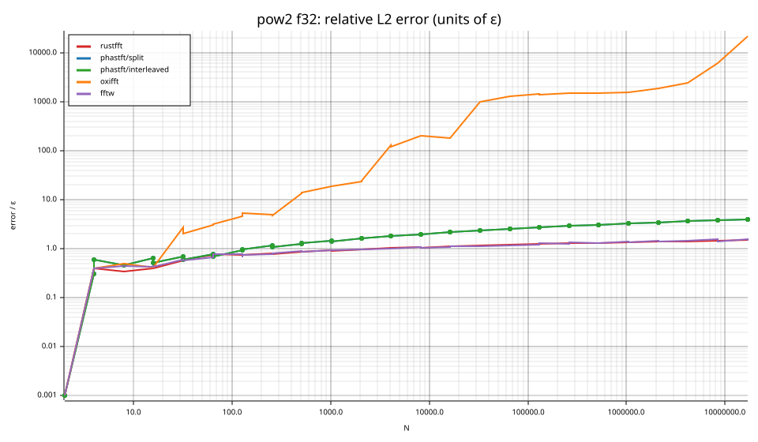

### pow2 f64

| cell | rustfft | phastft/split | phastft/interleaved | tfhe-fft | oxifft | fftw |
|---|---|---|---|---|---|---|
| N=2 fwd ip | 2.6ns | 14.6ns (0.18×) | 36.3ns (0.07×) | 5.5ns (0.47×) | 5.7ns (0.46×) | 3.2ns (0.80×) |
| N=2 fwd oop | 2.2ns | – | – | – | 7.2ns (0.30×) | 3.2ns (0.67×) |
| N=2 inv ip | 2.4ns | 15.2ns (0.16×) | 37.4ns (0.06×) | 7.4ns (0.33×) | 5.5ns (0.44×) | 3.2ns (0.76×) |
| N=2 inv oop | 2.2ns | – | – | – | 7.2ns (0.30×) | 3.4ns (0.64×) |
| N=4 fwd ip | 3.8ns | 22.5ns (0.17×) | 45.9ns (0.08×) | 6.2ns (0.61×) | 6.8ns (0.56×) | 3.6ns (1.04×) |
| N=4 fwd oop | 3.0ns | – | – | – | 7.2ns (0.41×) | 3.3ns (0.90×) |
| N=4 inv ip | 3.8ns | 26.0ns (0.15×) | 49.1ns (0.08×) | 6.0ns (0.63×) | 6.6ns (0.58×) | 4.0ns (0.94×) |
| N=4 inv oop | 3.0ns | – | – | – | 7.3ns (0.41×) | 3.6ns (0.83×) |
| N=8 fwd ip | 7.1ns | 35.2ns (0.20×) | 61.0ns (0.12×) | 8.0ns (0.88×) | 7.6ns (0.93×) | 5.6ns (1.26×) |
| N=8 fwd oop | 3.4ns | – | – | – | 8.7ns (0.39×) | 4.6ns (0.74×) |
| N=8 inv ip | 7.0ns | 36.8ns (0.19×) | 63.1ns (0.11×) | 7.8ns (0.90×) | 7.4ns (0.95×) | 5.5ns (1.27×) |
| N=8 inv oop | 3.4ns | – | – | – | 8.9ns (0.38×) | 4.6ns (0.73×) |
| N=16 fwd ip | 10.2ns | 46.9ns (0.22×) | 76.5ns (0.13×) | 12.7ns (0.80×) | 16.0ns (0.64×) | 9.9ns (1.03×) |
| N=16 fwd oop | 7.5ns | – | – | – | 18.1ns (0.41×) | 9.1ns (0.82×) |
| N=16 inv ip | 10.3ns | 48.4ns (0.21×) | 79.1ns (0.13×) | 12.9ns (0.80×) | 16.2ns (0.64×) | 9.2ns (1.12×) |
| N=16 inv oop | 7.4ns | – | – | – | 18.3ns (0.41×) | 8.6ns (0.87×) |
| N=32 fwd ip | 17.7ns | 94.2ns (0.19×) | 128.1ns (0.14×) | 25.1ns (0.71×) | 75.8ns (0.23×) | 20.2ns (0.88×) |
| N=32 fwd oop | 15.2ns | – | – | – | 78.4ns (0.19×) | 20.2ns (0.75×) |
| N=32 inv ip | 17.7ns | 98.1ns (0.18×) | 131.3ns (0.13×) | 23.1ns (0.77×) | 75.6ns (0.23×) | 22.6ns (0.78×) |
| N=32 inv oop | 15.3ns | – | – | – | 79.6ns (0.19×) | 21.3ns (0.72×) |
| N=64 fwd ip | 39.1ns | 75.0ns (0.52×) | 123.1ns (0.32×) | 41.8ns (0.94×) | 119.6ns (0.33×) | 47.1ns (0.83×) |
| N=64 fwd oop | 38.9ns | – | – | – | 126.8ns (0.31×) | 38.5ns (1.01×) |
| N=64 inv ip | 38.8ns | 85.9ns (0.45×) | 135.1ns (0.29×) | 42.0ns (0.92×) | 119.1ns (0.33×) | 46.8ns (0.83×) |
| N=64 inv oop | 38.8ns | – | – | – | 127.5ns (0.30×) | 37.1ns (1.05×) |
| N=128 fwd ip | 87.6ns | 147.4ns (0.59×) | 250.6ns (0.35×) | 85.4ns (1.03×) | 232.0ns (0.38×) | 116.9ns (0.75×) |
| N=128 fwd oop | 83.8ns | – | – | – | 258.9ns (0.32×) | 69.9ns (1.20×) |
| N=128 inv ip | 87.8ns | 162.4ns (0.54×) | 263.6ns (0.33×) | 85.8ns (1.02×) | 236.8ns (0.37×) | 111.7ns (0.79×) |
| N=128 inv oop | 84.1ns | – | – | – | 256.7ns (0.33×) | 72.8ns (1.16×) |
| N=256 fwd ip | 195.9ns | 307.6ns (0.64×) | 493.8ns (0.40×) | 176.2ns (1.11×) | 503.4ns (0.39×) | 186.9ns (1.05×) |
| N=256 fwd oop | 192.2ns | – | – | – | 560.6ns (0.34×) | 146.7ns (1.31×) |
| N=256 inv ip | 199.0ns | 333.7ns (0.60×) | 541.4ns (0.37×) | 176.5ns (1.13×) | 511.8ns (0.39×) | 208.2ns (0.96×) |
| N=256 inv oop | 192.1ns | – | – | – | 603.4ns (0.32×) | 146.1ns (1.32×) |
| N=512 fwd ip | 499.8ns | 682.4ns (0.73×) | 1.11us (0.45×) | 410.7ns (1.22×) | 1.27us (0.39×) | 417.3ns (1.20×) |
| N=512 fwd oop | 482.3ns | – | – | – | 1.22us (0.39×) | 320.6ns (1.50×) |
| N=512 inv ip | 497.9ns | 703.4ns (0.71×) | 1.03us (0.49×) | 409.9ns (1.21×) | 1.16us (0.43×) | 437.5ns (1.14×) |
| N=512 inv oop | 483.6ns | – | – | – | 1.23us (0.39×) | 330.3ns (1.46×) |
| N=1024 fwd ip | 1.23us | 1.42us (0.87×) | 2.31us (0.54×) | 884.8ns (1.40×) | 2.73us (0.45×) | 1.01us (1.22×) |
| N=1024 fwd oop | 1.17us | – | – | – | 2.87us (0.41×) | 800.3ns (1.46×) |
| N=1024 inv ip | 1.23us | 1.61us (0.76×) | 2.45us (0.50×) | 876.7ns (1.40×) | 2.70us (0.46×) | 986.6ns (1.25×) |
| N=1024 inv oop | 1.16us | – | – | – | 2.88us (0.40×) | 793.2ns (1.47×) |
| N=2048 fwd ip | 3.03us | 3.18us (0.95×) | 4.97us (0.61×) | – | 8.05us (0.38×) | 2.59us (1.17×) |
| N=2048 fwd oop | 2.80us | – | – | – | 7.24us (0.39×) | 2.12us (1.32×) |
| N=2048 inv ip | 3.04us | 3.36us (0.90×) | 4.88us (0.62×) | – | 8.06us (0.38×) | 2.60us (1.17×) |
| N=2048 inv oop | 2.81us | – | – | – | 7.21us (0.39×) | 2.10us (1.34×) |
| N=4096 fwd ip | 6.91us | 7.43us (0.93×) | 11.03us (0.63×) | – | 16.38us (0.42×) | 6.12us (1.13×) |
| N=4096 fwd oop | 6.57us | – | – | – | 14.69us (0.45×) | 5.98us (1.10×) |
| N=4096 inv ip | 6.82us | 8.04us (0.85×) | 10.91us (0.63×) | – | 16.34us (0.42×) | 6.13us (1.11×) |
| N=4096 inv oop | 6.54us | – | – | – | 14.77us (0.44×) | 6.08us (1.08×) |
| N=8192 fwd ip | 14.69us | 16.15us (0.91×) | 22.57us (0.65×) | – | 35.39us (0.42×) | 14.14us (1.04×) |
| N=8192 fwd oop | 14.12us | – | – | – | 33.31us (0.42×) | 12.67us (1.11×) |
| N=8192 inv ip | 14.71us | 17.08us (0.86×) | 26.12us (0.56×) | – | 35.70us (0.41×) | 14.47us (1.02×) |
| N=8192 inv oop | 14.25us | – | – | – | 32.90us (0.43×) | 12.86us (1.11×) |
| N=16384 fwd ip | 33.78us | 35.91us (0.94×) | 54.66us (0.62×) | – | 73.62us (0.46×) | 30.41us (1.11×) |
| N=16384 fwd oop | 33.04us | – | – | – | 69.46us (0.48×) | 28.59us (1.16×) |
| N=16384 inv ip | 33.76us | 37.50us (0.90×) | 56.25us (0.60×) | – | 73.74us (0.46×) | 30.70us (1.10×) |
| N=16384 inv oop | 33.12us | – | – | – | 69.61us (0.48×) | 29.03us (1.14×) |
| N=32768 fwd ip | 76.52us | 84.46us (0.91×) | 122.70us (0.62×) | – | 163.86us (0.47×) | 73.85us (1.04×) |
| N=32768 fwd oop | 74.86us | – | – | – | 149.39us (0.50×) | 65.69us (1.14×) |
| N=32768 inv ip | 76.93us | 87.76us (0.88×) | 129.79us (0.59×) | – | 165.65us (0.46×) | 74.82us (1.03×) |
| N=32768 inv oop | 74.46us | – | – | – | 150.17us (0.50×) | 68.14us (1.09×) |
| N=65536 fwd ip | 169.73us | 185.31us (0.92×) | 270.92us (0.63×) | – | 330.57us (0.51×) | 158.97us (1.07×) |
| N=65536 fwd oop | 162.04us | – | – | – | 302.42us (0.54×) | 155.12us (1.04×) |
| N=65536 inv ip | 169.90us | 193.44us (0.88×) | 281.17us (0.60×) | – | 337.37us (0.50×) | 159.83us (1.06×) |
| N=65536 inv oop | 161.96us | – | – | – | 306.13us (0.53×) | 164.77us (0.98×) |
| N=131072 fwd ip | 380.59us | 418.50us (0.91×) | 550.71us (0.69×) | – | **error** | 360.30us (1.06×) |
| N=131072 fwd oop | 359.99us | – | – | – | **error** | 343.04us (1.05×) |
| N=131072 inv ip | 381.68us | 421.03us (0.91×) | 645.49us (0.59×) | – | **error** | 364.14us (1.05×) |
| N=131072 inv oop | 360.40us | – | – | – | **error** | 349.22us (1.03×) |
| N=262144 fwd ip | 864.60us | 892.16us (0.97×) | 1.47ms (0.59×) | – | **error** | 823.53us (1.05×) |
| N=262144 fwd oop | 840.33us | – | – | – | **error** | 758.98us (1.11×) |
| N=262144 inv ip | 886.16us | 988.47us (0.90×) | 1.56ms (0.57×) | – | **error** | 802.63us (1.10×) |
| N=262144 inv oop | 845.00us | – | – | – | **error** | 838.40us (1.01×) |
| N=524288 fwd ip | 2.80ms | 2.16ms (1.30×) | 4.59ms (0.61×) | – | **error** | 2.78ms (1.01×) |
| N=524288 fwd oop | 2.53ms | – | – | – | **error** | 3.43ms (0.74×) |
| N=524288 inv ip | 2.81ms | 2.27ms (1.24×) | 4.76ms (0.59×) | – | **error** | 2.83ms (0.99×) |
| N=524288 inv oop | 2.53ms | – | – | – | **error** | 3.47ms (0.73×) |
| N=1048576 fwd ip | 7.91ms | 6.67ms (1.19×) | 11.19ms (0.71×) | – | **error** | 7.21ms (1.10×) |
| N=1048576 fwd oop | 6.91ms | – | – | – | **error** | 8.81ms (0.78×) |
| N=1048576 inv ip | 7.85ms | 6.92ms (1.13×) | 12.26ms (0.64×) | – | **error** | 7.54ms (1.04×) |
| N=1048576 inv oop | 6.98ms | – | – | – | **error** | 8.70ms (0.80×) |
| N=2097152 fwd ip | 17.76ms | 17.55ms (1.01×) | 39.68ms (0.45×) | – | **error** | 18.32ms (0.97×) |
| N=2097152 fwd oop | 16.88ms | – | – | – | **error** | 20.80ms (0.81×) |
| N=2097152 inv ip | 17.95ms | 19.12ms (0.94×) | 42.09ms (0.43×) | – | **error** | 18.85ms (0.95×) |
| N=2097152 inv oop | 16.47ms | – | – | – | **error** | 20.62ms (0.80×) |
| N=4194304 fwd ip | 39.57ms | 42.40ms (0.93×) | 113.35ms (0.35×) | – | **error** | 51.64ms (0.77×) |
| N=4194304 fwd oop | 42.24ms | – | – | – | **error** | 43.77ms (0.96×) |
| N=4194304 inv ip | 40.27ms | 46.54ms (0.87×) | 116.97ms (0.34×) | – | **error** | 47.00ms (0.86×) |
| N=4194304 inv oop | 42.13ms | – | – | – | **error** | 41.79ms (1.01×) |
| N=8388608 fwd ip | 86.84ms | 116.15ms (0.75×) | 239.52ms (0.36×) | – | **error** | 84.54ms (1.03×) |
| N=8388608 fwd oop | 93.61ms | – | – | – | **error** | 87.87ms (1.07×) |
| N=8388608 inv ip | 84.65ms | 122.81ms (0.69×) | 248.21ms (0.34×) | – | **error** | 108.07ms (0.78×) |
| N=8388608 inv oop | 93.90ms | – | – | – | **error** | 88.95ms (1.06×) |
| N=16777216 fwd ip | 189.34ms | 403.62ms (0.47×) | 494.56ms (0.38×) | – | **error** | 254.99ms (0.74×) |
| N=16777216 fwd oop | 200.72ms | – | – | – | **error** | 186.76ms (1.07×) |
| N=16777216 inv ip | 191.84ms | 428.29ms (0.45×) | 508.92ms (0.38×) | – | **error** | 251.85ms (0.76×) |
| N=16777216 inv oop | 200.33ms | – | – | – | **error** | 185.17ms (1.08×) |

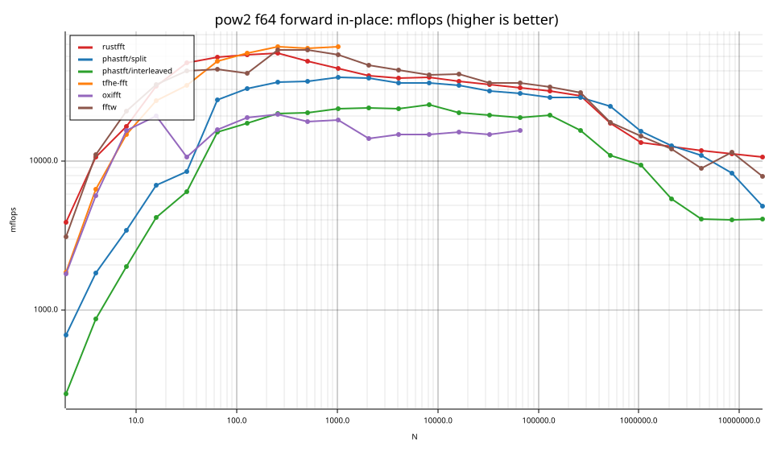
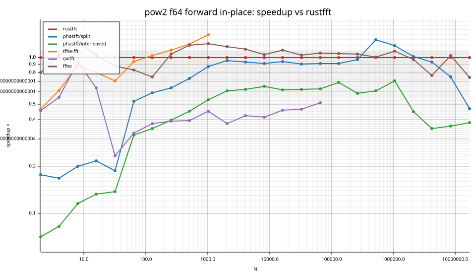
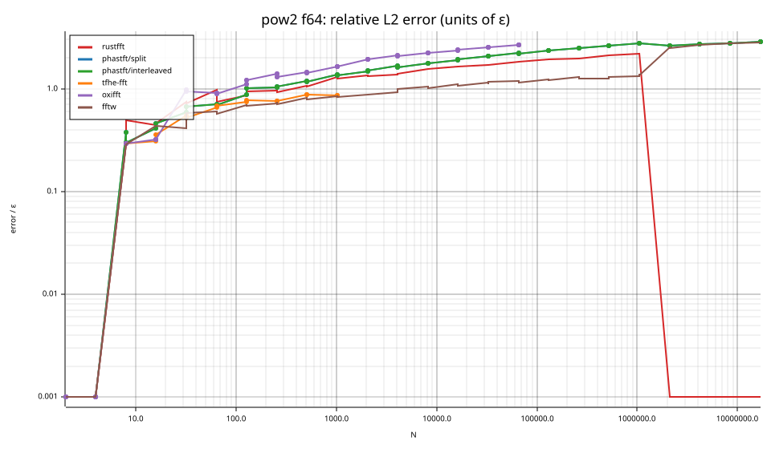

## Suite `smooth`

### smooth f32

| cell | rustfft | phastft/split | phastft/interleaved | tfhe-fft | oxifft | fftw |
|---|---|---|---|---|---|---|
| N=6 fwd ip | 9.4ns | – | – | – | 66.1ns (0.14×) | 6.8ns (1.38×) |
| N=6 fwd oop | 4.6ns | – | – | – | 65.9ns (0.07×) | 6.7ns (0.68×) |
| N=6 inv ip | 9.4ns | – | – | – | 66.9ns (0.14×) | 6.8ns (1.38×) |
| N=6 inv oop | 4.6ns | – | – | – | 66.1ns (0.07×) | 6.7ns (0.68×) |
| N=9 fwd ip | 13.2ns | – | – | – | 10.9ns (1.21×) | 11.9ns (1.11×) |
| N=9 fwd oop | 3.9ns | – | – | – | 10.9ns (0.35×) | 11.9ns (0.33×) |
| N=9 inv ip | 13.2ns | – | – | – | 11.0ns (1.20×) | 12.1ns (1.09×) |
| N=9 inv oop | 3.9ns | – | – | – | 11.0ns (0.35×) | 12.3ns (0.32×) |
| N=12 fwd ip | 11.0ns | – | – | – | 14.5ns (0.76×) | 11.8ns (0.94×) |
| N=12 fwd oop | 3.8ns | – | – | – | 15.5ns (0.24×) | 11.8ns (0.32×) |
| N=12 inv ip | 11.0ns | – | – | – | 14.7ns (0.75×) | 11.7ns (0.94×) |
| N=12 inv oop | 3.8ns | – | – | – | 15.5ns (0.25×) | 11.7ns (0.32×) |
| N=15 fwd ip | 25.8ns | – | – | – | 43.3ns (0.60×) | 17.3ns (1.49×) |
| N=15 fwd oop | 23.1ns | – | – | – | 39.3ns (0.59×) | 17.4ns (1.33×) |
| N=15 inv ip | 25.8ns | – | – | – | 43.9ns (0.59×) | 17.2ns (1.50×) |
| N=15 inv oop | 23.1ns | – | – | – | 39.5ns (0.59×) | 17.3ns (1.34×) |
| N=18 fwd ip | 23.4ns | – | – | – | 63.0ns (0.37×) | 29.6ns (0.79×) |
| N=18 fwd oop | 21.8ns | – | – | – | 73.3ns (0.30×) | 19.0ns (1.14×) |
| N=18 inv ip | 23.4ns | – | – | – | 62.4ns (0.38×) | 29.5ns (0.79×) |
| N=18 inv oop | 21.7ns | – | – | – | 75.7ns (0.29×) | 18.9ns (1.15×) |
| N=24 fwd ip | 14.2ns | – | – | – | 36.5ns (0.39×) | 24.7ns (0.58×) |
| N=24 fwd oop | 8.0ns | – | – | – | 38.0ns (0.21×) | 14.6ns (0.55×) |
| N=24 inv ip | 14.3ns | – | – | – | 36.5ns (0.39×) | 24.9ns (0.57×) |
| N=24 inv oop | 8.0ns | – | – | – | 38.4ns (0.21×) | 14.2ns (0.56×) |
| N=36 fwd ip | 19.7ns | – | – | – | 119.5ns (0.16×) | 36.7ns (0.54×) |
| N=36 fwd oop | 13.3ns | – | – | – | 123.9ns (0.11×) | 25.9ns (0.51×) |
| N=36 inv ip | 19.6ns | – | – | – | 119.5ns (0.16×) | 36.5ns (0.54×) |
| N=36 inv oop | 13.4ns | – | – | – | 122.6ns (0.11×) | 25.5ns (0.52×) |
| N=48 fwd ip | 17.0ns | – | – | – | 104.6ns (0.16×) | 33.9ns (0.50×) |
| N=48 fwd oop | 13.7ns | – | – | – | 107.9ns (0.13×) | 19.8ns (0.69×) |
| N=48 inv ip | 17.0ns | – | – | – | 103.9ns (0.16×) | 32.9ns (0.52×) |
| N=48 inv oop | 13.9ns | – | – | – | 106.7ns (0.13×) | 20.1ns (0.69×) |
| N=80 fwd ip | 42.9ns | – | – | – | 198.1ns (0.22×) | 53.8ns (0.80×) |
| N=80 fwd oop | 37.9ns | – | – | – | 202.2ns (0.19×) | 32.0ns (1.18×) |
| N=80 inv ip | 44.1ns | – | – | – | 197.4ns (0.22×) | 47.6ns (0.93×) |
| N=80 inv oop | 37.7ns | – | – | – | 200.2ns (0.19×) | 36.8ns (1.02×) |
| N=96 fwd ip | 48.1ns | – | – | – | 219.0ns (0.22×) | 51.1ns (0.94×) |
| N=96 fwd oop | 49.6ns | – | – | – | 221.3ns (0.22×) | 36.1ns (1.38×) |
| N=96 inv ip | 49.3ns | – | – | – | 219.9ns (0.22×) | 51.4ns (0.96×) |
| N=96 inv oop | 48.9ns | – | – | – | 224.9ns (0.22×) | 31.2ns (1.57×) |
| N=108 fwd ip | 62.3ns | – | – | – | 1.78us (0.03×) | 91.5ns (0.68×) |
| N=108 fwd oop | 60.8ns | – | – | – | 1.77us (0.03×) | 73.6ns (0.83×) |
| N=108 inv ip | 62.7ns | – | – | – | 1.78us (0.04×) | 90.1ns (0.70×) |
| N=108 inv oop | 62.6ns | – | – | – | 1.77us (0.04×) | 72.8ns (0.86×) |
| N=120 fwd ip | 61.4ns | – | – | – | 1.15us (0.05×) | 77.5ns (0.79×) |
| N=120 fwd oop | 59.7ns | – | – | – | 1.13us (0.05×) | 60.0ns (0.99×) |
| N=120 inv ip | 61.2ns | – | – | – | 1.15us (0.05×) | 76.9ns (0.79×) |
| N=120 inv oop | 60.1ns | – | – | – | 1.14us (0.05×) | 61.2ns (0.98×) |
| N=160 fwd ip | 81.9ns | – | – | – | 1.83us (0.04×) | 83.4ns (0.98×) |
| N=160 fwd oop | 79.8ns | – | – | – | 1.80us (0.04×) | 51.5ns (1.55×) |
| N=160 inv ip | 81.9ns | – | – | – | 1.83us (0.04×) | 99.7ns (0.82×) |
| N=160 inv oop | 79.7ns | – | – | – | 1.80us (0.04×) | 51.1ns (1.56×) |
| N=210 fwd ip | 257.5ns | – | – | – | 3.15us (0.08×) | 242.7ns (1.06×) |
| N=210 fwd oop | 254.9ns | – | – | – | 3.12us (0.08×) | 199.3ns (1.28×) |
| N=210 inv ip | 254.6ns | – | – | – | 3.16us (0.08×) | 246.1ns (1.03×) |
| N=210 inv oop | 254.6ns | – | – | – | 3.12us (0.08×) | 201.0ns (1.27×) |
| N=240 fwd ip | 119.2ns | – | – | – | 2.31us (0.05×) | 141.1ns (0.85×) |
| N=240 fwd oop | 117.6ns | – | – | – | 2.27us (0.05×) | 95.7ns (1.23×) |
| N=240 inv ip | 120.5ns | – | – | – | 2.30us (0.05×) | 142.5ns (0.85×) |
| N=240 inv oop | 117.4ns | – | – | – | 2.27us (0.05×) | 91.9ns (1.28×) |
| N=320 fwd ip | 167.4ns | – | – | – | 2.76us (0.06×) | 161.3ns (1.04×) |
| N=320 fwd oop | 167.8ns | – | – | – | 2.72us (0.06×) | 114.4ns (1.47×) |
| N=320 inv ip | 167.7ns | – | – | – | 2.77us (0.06×) | 165.8ns (1.01×) |
| N=320 inv oop | 167.8ns | – | – | – | 2.72us (0.06×) | 114.9ns (1.46×) |
| N=384 fwd ip | 202.2ns | – | – | – | 3.11us (0.06×) | 192.3ns (1.05×) |
| N=384 fwd oop | 190.8ns | – | – | – | 3.04us (0.06×) | 139.6ns (1.37×) |
| N=384 inv ip | 201.6ns | – | – | – | 3.10us (0.07×) | 191.5ns (1.05×) |
| N=384 inv oop | 191.6ns | – | – | – | 3.06us (0.06×) | 141.3ns (1.36×) |
| N=480 fwd ip | 340.0ns | – | – | – | 7.44us (0.05×) | 314.9ns (1.08×) |
| N=480 fwd oop | 327.5ns | – | – | – | 7.35us (0.04×) | 261.4ns (1.25×) |
| N=480 inv ip | 340.8ns | – | – | – | 7.43us (0.05×) | 317.5ns (1.07×) |
| N=480 inv oop | 326.2ns | – | – | – | 7.35us (0.04×) | 261.5ns (1.25×) |
| N=504 fwd ip | 280.0ns | – | – | – | 7.01us (0.04×) | 435.7ns (0.64×) |
| N=504 fwd oop | 281.9ns | – | – | – | 6.94us (0.04×) | 390.7ns (0.72×) |
| N=504 inv ip | 282.0ns | – | – | – | 7.03us (0.04×) | 437.1ns (0.65×) |
| N=504 inv oop | 277.6ns | – | – | – | 6.94us (0.04×) | 372.6ns (0.75×) |
| N=640 fwd ip | 370.3ns | – | – | – | 4.79us (0.08×) | 292.3ns (1.27×) |
| N=640 fwd oop | 361.6ns | – | – | – | 4.70us (0.08×) | 235.8ns (1.53×) |
| N=640 inv ip | 368.5ns | – | – | – | 4.80us (0.08×) | 312.9ns (1.18×) |
| N=640 inv oop | 361.2ns | – | – | – | 4.71us (0.08×) | 238.6ns (1.51×) |
| N=720 fwd ip | 528.6ns | – | – | – | 10.36us (0.05×) | 505.5ns (1.05×) |
| N=720 fwd oop | 513.0ns | – | – | – | 10.25us (0.05×) | 444.9ns (1.15×) |
| N=720 inv ip | 531.4ns | – | – | – | 10.32us (0.05×) | 539.2ns (0.99×) |
| N=720 inv oop | 517.3ns | – | – | – | 10.24us (0.05×) | 445.3ns (1.16×) |
| N=768 fwd ip | 426.4ns | – | – | – | 5.97us (0.07×) | 389.8ns (1.09×) |
| N=768 fwd oop | 413.7ns | – | – | – | 5.81us (0.07×) | 292.4ns (1.41×) |
| N=768 inv ip | 425.9ns | – | – | – | 5.92us (0.07×) | 414.6ns (1.03×) |
| N=768 inv oop | 414.8ns | – | – | – | 5.81us (0.07×) | 295.0ns (1.41×) |
| N=960 fwd ip | 645.1ns | – | – | – | 12.91us (0.05×) | 618.7ns (1.04×) |
| N=960 fwd oop | 621.3ns | – | – | – | 12.78us (0.05×) | 541.4ns (1.15×) |
| N=960 inv ip | 651.5ns | – | – | – | 12.88us (0.05×) | 619.2ns (1.05×) |
| N=960 inv oop | 620.1ns | – | – | – | 12.77us (0.05×) | 538.1ns (1.15×) |
| N=1000 fwd ip | 962.8ns | – | – | – | 11.69us (0.08×) | 883.0ns (1.09×) |
| N=1000 fwd oop | 922.1ns | – | – | – | 11.52us (0.08×) | 782.3ns (1.18×) |
| N=1000 inv ip | 961.0ns | – | – | – | 11.67us (0.08×) | 836.3ns (1.15×) |
| N=1000 inv oop | 919.5ns | – | – | – | 11.56us (0.08×) | 731.5ns (1.26×) |
| N=1200 fwd ip | 842.8ns | – | – | – | 15.48us (0.05×) | 860.8ns (0.98×) |
| N=1200 fwd oop | 818.7ns | – | – | – | 15.30us (0.05×) | 797.8ns (1.03×) |
| N=1200 inv ip | 843.4ns | – | – | – | 15.36us (0.05×) | 885.8ns (0.95×) |
| N=1200 inv oop | 814.2ns | – | – | – | 15.27us (0.05×) | 779.0ns (1.05×) |
| N=1536 fwd ip | 1.08us | – | – | – | 25.66us (0.04×) | 1.08us (1.00×) |
| N=1536 fwd oop | 1.03us | – | – | – | 25.55us (0.04×) | 924.6ns (1.11×) |
| N=1536 inv ip | 1.08us | – | – | – | 25.67us (0.04×) | 1.09us (0.99×) |
| N=1536 inv oop | 1.02us | – | – | – | 25.53us (0.04×) | 953.0ns (1.07×) |
| N=1920 fwd ip | 1.43us | – | – | – | 24.09us (0.06×) | 1.37us (1.05×) |
| N=1920 fwd oop | 1.38us | – | – | – | 23.81us (0.06×) | 1.23us (1.12×) |
| N=1920 inv ip | 1.42us | – | – | – | 24.12us (0.06×) | 1.41us (1.01×) |
| N=1920 inv oop | 1.38us | – | – | – | 23.91us (0.06×) | 1.22us (1.13×) |
| N=1960 fwd ip | 2.00us | – | – | – | 21.46us (0.09×) | 2.13us (0.94×) |
| N=1960 fwd oop | 1.92us | – | – | – | 21.26us (0.09×) | 1.87us (1.03×) |
| N=1960 inv ip | 2.00us | – | – | – | 21.59us (0.09×) | 1.99us (1.01×) |
| N=1960 inv oop | 1.93us | – | – | – | 21.34us (0.09×) | 1.91us (1.01×) |
| N=2400 fwd ip | 2.33us | – | – | – | 43.97us (0.05×) | 1.79us (1.31×) |
| N=2400 fwd oop | 2.26us | – | – | – | 43.75us (0.05×) | 1.58us (1.43×) |
| N=2400 inv ip | 2.33us | – | – | – | 43.83us (0.05×) | 1.80us (1.29×) |
| N=2400 inv oop | 2.25us | – | – | – | 43.57us (0.05×) | 1.60us (1.41×) |
| N=3072 fwd ip | 2.43us | – | – | – | 38.05us (0.06×) | 2.31us (1.05×) |
| N=3072 fwd oop | 2.32us | – | – | – | 37.62us (0.06×) | 2.02us (1.15×) |
| N=3072 inv ip | 2.43us | – | – | – | 37.98us (0.06×) | 2.37us (1.02×) |
| N=3072 inv oop | 2.32us | – | – | – | 37.66us (0.06×) | 2.13us (1.09×) |
| N=4725 fwd ip | 6.08us | – | – | – | 103.39us (0.06×) | 11.35us (0.54×) |
| N=4725 fwd oop | 5.90us | – | – | – | 111.17us (0.05×) | 10.98us (0.54×) |
| N=4725 inv ip | 6.06us | – | – | – | 103.08us (0.06×) | 11.33us (0.54×) |
| N=4725 inv oop | 5.90us | – | – | – | 110.81us (0.05×) | 10.93us (0.54×) |
| N=4800 fwd ip | 4.59us | – | – | – | 79.34us (0.06×) | 3.96us (1.16×) |
| N=4800 fwd oop | 4.37us | – | – | – | 79.23us (0.06×) | 3.60us (1.21×) |
| N=4800 inv ip | 4.61us | – | – | – | 79.34us (0.06×) | 4.00us (1.15×) |
| N=4800 inv oop | 4.37us | – | – | – | 79.19us (0.06×) | 3.45us (1.27×) |
| N=6144 fwd ip | 5.14us | – | – | – | 68.47us (0.08×) | 5.24us (0.98×) |
| N=6144 fwd oop | 5.00us | – | – | – | 68.23us (0.07×) | 4.42us (1.13×) |
| N=6144 inv ip | 5.15us | – | – | – | 68.77us (0.07×) | 5.10us (1.01×) |
| N=6144 inv oop | 4.99us | – | – | – | 68.07us (0.07×) | 4.51us (1.11×) |
| N=10368 fwd ip | 8.71us | – | – | – | 240.96us (0.04×) | 10.51us (0.83×) |
| N=10368 fwd oop | 8.52us | – | – | – | 245.94us (0.03×) | 9.51us (0.90×) |
| N=10368 inv ip | 8.72us | – | – | – | 241.21us (0.04×) | 10.51us (0.83×) |
| N=10368 inv oop | 8.53us | – | – | – | 241.43us (0.04×) | 9.47us (0.90×) |
| N=12288 fwd ip | 12.11us | – | – | – | 137.52us (0.09×) | 12.45us (0.97×) |
| N=12288 fwd oop | 11.73us | – | – | – | 135.20us (0.09×) | 11.25us (1.04×) |
| N=12288 inv ip | 12.14us | – | – | – | 135.73us (0.09×) | 12.07us (1.01×) |
| N=12288 inv oop | 11.76us | – | – | – | 134.96us (0.09×) | 11.09us (1.06×) |
| N=27000 fwd ip | 33.22us | – | – | – | 677.27us (0.05×) | 30.48us (1.09×) |
| N=27000 fwd oop | 32.65us | – | – | – | 673.36us (0.05×) | 27.85us (1.17×) |
| N=27000 inv ip | 33.32us | – | – | – | 676.72us (0.05×) | 30.09us (1.11×) |
| N=27000 inv oop | 32.72us | – | – | – | 672.16us (0.05×) | 27.11us (1.21×) |
| N=48000 fwd ip | 60.88us | – | – | – | 928.38us (0.07×) | 54.25us (1.12×) |
| N=48000 fwd oop | 59.76us | – | – | – | 924.22us (0.06×) | 49.24us (1.21×) |
| N=48000 inv ip | 60.43us | – | – | – | 928.43us (0.07×) | 53.54us (1.13×) |
| N=48000 inv oop | 59.91us | – | – | – | 922.62us (0.06×) | 49.26us (1.22×) |
| N=75600 fwd ip | 105.17us | – | – | – | 1.91ms (0.06×) | 136.13us (0.77×) |
| N=75600 fwd oop | 101.93us | – | – | – | 1.90ms (0.05×) | 97.83us (1.04×) |
| N=75600 inv ip | 105.32us | – | – | – | 1.90ms (0.06×) | 136.64us (0.77×) |
| N=75600 inv oop | 101.84us | – | – | – | 1.90ms (0.05×) | 97.95us (1.04×) |
| N=96000 fwd ip | 133.04us | – | – | – | 1.88ms (0.07×) | 148.45us (0.90×) |
| N=96000 fwd oop | 127.90us | – | – | – | 1.88ms (0.07×) | 109.95us (1.16×) |
| N=96000 inv ip | 132.70us | – | – | – | 1.88ms (0.07×) | 147.46us (0.90×) |
| N=96000 inv oop | 127.31us | – | – | – | 1.87ms (0.07×) | 117.22us (1.09×) |
| N=165375 fwd ip | 317.47us | – | – | – | 4.67ms (0.07×) | 769.42us (0.41×) |
| N=165375 fwd oop | 309.07us | – | – | – | 4.65ms (0.07×) | 625.83us (0.49×) |
| N=165375 inv ip | 316.86us | – | – | – | 4.66ms (0.07×) | 763.71us (0.41×) |
| N=165375 inv oop | 309.26us | – | – | – | 4.64ms (0.07×) | 625.34us (0.49×) |
| N=1000000 fwd ip | 2.87ms | – | – | – | 29.50ms (0.10×) | 5.68ms (0.51×) |
| N=1000000 fwd oop | 2.64ms | – | – | – | 29.17ms (0.09×) | 5.07ms (0.52×) |
| N=1000000 inv ip | 2.89ms | – | – | – | 29.51ms (0.10×) | 5.68ms (0.51×) |
| N=1000000 inv oop | 2.62ms | – | – | – | 29.25ms (0.09×) | 5.16ms (0.51×) |

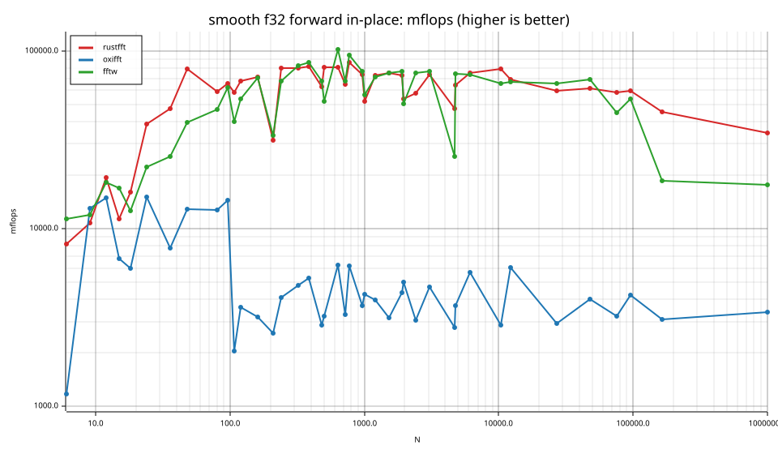
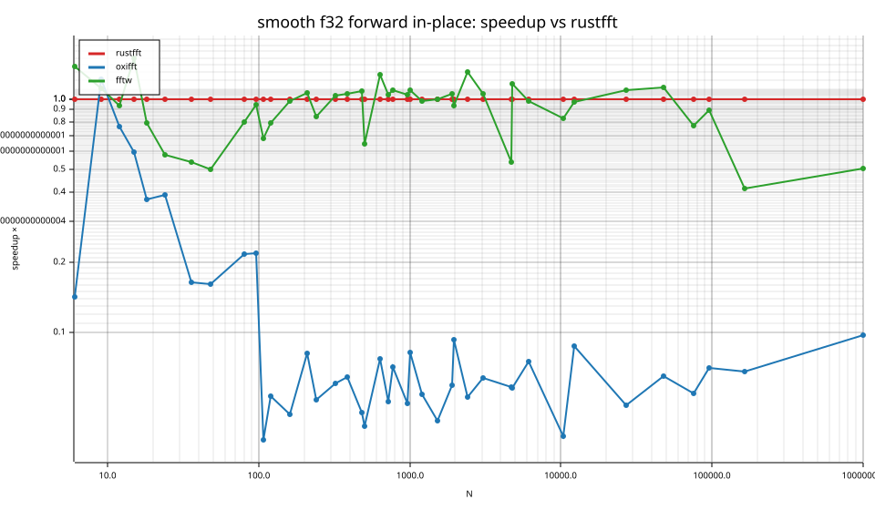
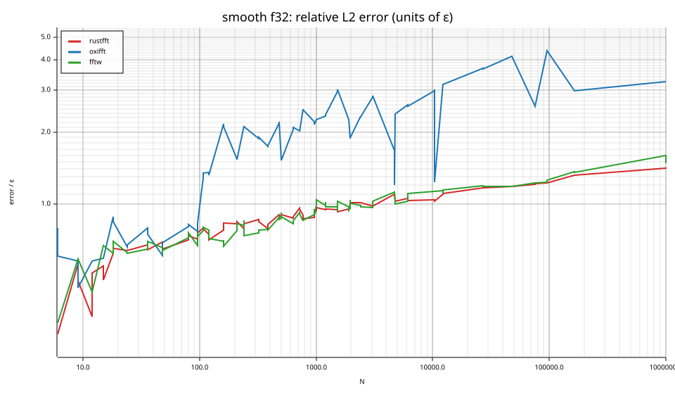

### smooth f64

| cell | rustfft | phastft/split | phastft/interleaved | tfhe-fft | oxifft | fftw |
|---|---|---|---|---|---|---|
| N=6 fwd ip | 5.6ns | – | – | – | 68.3ns (0.08×) | 5.2ns (1.06×) |
| N=6 fwd oop | 3.4ns | – | – | – | 65.2ns (0.05×) | 4.0ns (0.84×) |
| N=6 inv ip | 5.6ns | – | – | – | 68.2ns (0.08×) | 5.4ns (1.03×) |
| N=6 inv oop | 3.4ns | – | – | – | 65.6ns (0.05×) | 4.0ns (0.84×) |
| N=9 fwd ip | 9.4ns | – | – | – | 12.8ns (0.74×) | 10.5ns (0.90×) |
| N=9 fwd oop | 4.7ns | – | – | – | 13.8ns (0.34×) | 7.9ns (0.59×) |
| N=9 inv ip | 9.5ns | – | – | – | 12.9ns (0.73×) | 10.5ns (0.90×) |
| N=9 inv oop | 4.6ns | – | – | – | 13.9ns (0.33×) | 8.0ns (0.58×) |
| N=12 fwd ip | 11.6ns | – | – | – | 13.3ns (0.87×) | 8.1ns (1.44×) |
| N=12 fwd oop | 5.4ns | – | – | – | 15.4ns (0.35×) | 6.3ns (0.86×) |
| N=12 inv ip | 11.6ns | – | – | – | 13.5ns (0.86×) | 7.6ns (1.53×) |
| N=12 inv oop | 5.4ns | – | – | – | 15.3ns (0.35×) | 6.3ns (0.86×) |
| N=15 fwd ip | 28.9ns | – | – | – | 48.4ns (0.60×) | 12.3ns (2.35×) |
| N=15 fwd oop | 26.0ns | – | – | – | 42.4ns (0.61×) | 12.0ns (2.16×) |
| N=15 inv ip | 28.9ns | – | – | – | 48.3ns (0.60×) | 12.2ns (2.37×) |
| N=15 inv oop | 26.1ns | – | – | – | 42.9ns (0.61×) | 11.8ns (2.23×) |
| N=18 fwd ip | 14.0ns | – | – | – | 89.6ns (0.16×) | 27.4ns (0.51×) |
| N=18 fwd oop | 8.8ns | – | – | – | 93.2ns (0.09×) | 16.5ns (0.53×) |
| N=18 inv ip | 14.2ns | – | – | – | 89.7ns (0.16×) | 28.3ns (0.50×) |
| N=18 inv oop | 8.8ns | – | – | – | 92.7ns (0.09×) | 16.5ns (0.53×) |
| N=24 fwd ip | 14.8ns | – | – | – | 31.4ns (0.47×) | 31.1ns (0.48×) |
| N=24 fwd oop | 11.5ns | – | – | – | 34.6ns (0.33×) | 17.8ns (0.65×) |
| N=24 inv ip | 14.0ns | – | – | – | 31.0ns (0.45×) | 29.5ns (0.47×) |
| N=24 inv oop | 11.4ns | – | – | – | 34.7ns (0.33×) | 18.1ns (0.63×) |
| N=36 fwd ip | 22.5ns | – | – | – | 59.2ns (0.38×) | 37.1ns (0.60×) |
| N=36 fwd oop | 18.0ns | – | – | – | 62.4ns (0.29×) | 25.3ns (0.71×) |
| N=36 inv ip | 23.7ns | – | – | – | 59.3ns (0.40×) | 36.6ns (0.65×) |
| N=36 inv oop | 18.2ns | – | – | – | 62.6ns (0.29×) | 25.1ns (0.72×) |
| N=48 fwd ip | 40.0ns | – | – | – | 96.8ns (0.41×) | 42.6ns (0.94×) |
| N=48 fwd oop | 39.6ns | – | – | – | 104.0ns (0.38×) | 28.8ns (1.37×) |
| N=48 inv ip | 40.8ns | – | – | – | 97.7ns (0.42×) | 44.2ns (0.92×) |
| N=48 inv oop | 39.5ns | – | – | – | 104.3ns (0.38×) | 29.5ns (1.34×) |
| N=80 fwd ip | 69.8ns | – | – | – | 201.9ns (0.35×) | 80.9ns (0.86×) |
| N=80 fwd oop | 67.2ns | – | – | – | 211.4ns (0.32×) | 51.4ns (1.31×) |
| N=80 inv ip | 69.4ns | – | – | – | 203.4ns (0.34×) | 80.1ns (0.87×) |
| N=80 inv oop | 67.6ns | – | – | – | 210.9ns (0.32×) | 46.8ns (1.45×) |
| N=96 fwd ip | 82.2ns | – | – | – | 223.9ns (0.37×) | 108.6ns (0.76×) |
| N=96 fwd oop | 80.4ns | – | – | – | 234.1ns (0.34×) | 51.9ns (1.55×) |
| N=96 inv ip | 82.2ns | – | – | – | 224.9ns (0.37×) | 98.8ns (0.83×) |
| N=96 inv oop | 80.8ns | – | – | – | 232.6ns (0.35×) | 53.1ns (1.52×) |
| N=108 fwd ip | 99.2ns | – | – | – | 1.34us (0.07×) | 138.0ns (0.72×) |
| N=108 fwd oop | 92.4ns | – | – | – | 1.32us (0.07×) | 89.4ns (1.03×) |
| N=108 inv ip | 99.5ns | – | – | – | 1.35us (0.07×) | 142.6ns (0.70×) |
| N=108 inv oop | 93.1ns | – | – | – | 1.31us (0.07×) | 97.9ns (0.95×) |
| N=120 fwd ip | 108.7ns | – | – | – | 999.8ns (0.11×) | 119.4ns (0.91×) |
| N=120 fwd oop | 104.4ns | – | – | – | 942.2ns (0.11×) | 67.2ns (1.55×) |
| N=120 inv ip | 111.7ns | – | – | – | 991.3ns (0.11×) | 106.6ns (1.05×) |
| N=120 inv oop | 103.7ns | – | – | – | 935.5ns (0.11×) | 70.5ns (1.47×) |
| N=160 fwd ip | 146.2ns | – | – | – | 1.91us (0.08×) | 142.9ns (1.02×) |
| N=160 fwd oop | 141.6ns | – | – | – | 1.83us (0.08×) | 88.1ns (1.61×) |
| N=160 inv ip | 146.3ns | – | – | – | 1.90us (0.08×) | 133.1ns (1.10×) |
| N=160 inv oop | 143.6ns | – | – | – | 1.82us (0.08×) | 87.8ns (1.64×) |
| N=210 fwd ip | 284.6ns | – | – | – | 2.79us (0.10×) | 247.1ns (1.15×) |
| N=210 fwd oop | 282.3ns | – | – | – | 2.67us (0.11×) | 197.7ns (1.43×) |
| N=210 inv ip | 288.5ns | – | – | – | 2.77us (0.10×) | 243.9ns (1.18×) |
| N=210 inv oop | 288.1ns | – | – | – | 2.67us (0.11×) | 200.4ns (1.44×) |
| N=240 fwd ip | 289.5ns | – | – | – | 1.91us (0.15×) | 201.4ns (1.44×) |
| N=240 fwd oop | 270.9ns | – | – | – | 1.82us (0.15×) | 140.7ns (1.92×) |
| N=240 inv ip | 286.1ns | – | – | – | 1.93us (0.15×) | 202.0ns (1.42×) |
| N=240 inv oop | 270.0ns | – | – | – | 1.83us (0.15×) | 142.9ns (1.89×) |
| N=320 fwd ip | 339.8ns | – | – | – | 2.88us (0.12×) | 263.4ns (1.29×) |
| N=320 fwd oop | 322.8ns | – | – | – | 2.75us (0.12×) | 195.0ns (1.66×) |
| N=320 inv ip | 338.5ns | – | – | – | 2.90us (0.12×) | 260.7ns (1.30×) |
| N=320 inv oop | 323.4ns | – | – | – | 2.74us (0.12×) | 195.4ns (1.65×) |
| N=384 fwd ip | 371.7ns | – | – | – | 3.13us (0.12×) | 293.9ns (1.26×) |
| N=384 fwd oop | 351.4ns | – | – | – | 2.99us (0.12×) | 226.2ns (1.55×) |
| N=384 inv ip | 369.7ns | – | – | – | 3.12us (0.12×) | 311.1ns (1.19×) |
| N=384 inv oop | 356.3ns | – | – | – | 2.94us (0.12×) | 230.6ns (1.54×) |
| N=480 fwd ip | 596.2ns | – | – | – | 6.86us (0.09×) | 481.9ns (1.24×) |
| N=480 fwd oop | 566.7ns | – | – | – | 6.64us (0.09×) | 401.0ns (1.41×) |
| N=480 inv ip | 588.4ns | – | – | – | 6.86us (0.09×) | 486.1ns (1.21×) |
| N=480 inv oop | 568.2ns | – | – | – | 6.67us (0.09×) | 398.9ns (1.42×) |
| N=504 fwd ip | 668.4ns | – | – | – | 5.39us (0.12×) | 591.5ns (1.13×) |
| N=504 fwd oop | 626.8ns | – | – | – | 5.16us (0.12×) | 510.2ns (1.23×) |
| N=504 inv ip | 653.8ns | – | – | – | 5.38us (0.12×) | 588.6ns (1.11×) |
| N=504 inv oop | 628.7ns | – | – | – | 5.17us (0.12×) | 554.2ns (1.13×) |
| N=640 fwd ip | 719.1ns | – | – | – | 4.88us (0.15×) | 571.6ns (1.26×) |
| N=640 fwd oop | 679.6ns | – | – | – | 4.66us (0.15×) | 466.7ns (1.46×) |
| N=640 inv ip | 715.8ns | – | – | – | 4.89us (0.15×) | 567.8ns (1.26×) |
| N=640 inv oop | 677.9ns | – | – | – | 4.60us (0.15×) | 475.6ns (1.43×) |
| N=720 fwd ip | 911.2ns | – | – | – | 8.19us (0.11×) | 773.9ns (1.18×) |
| N=720 fwd oop | 871.5ns | – | – | – | 7.69us (0.11×) | 675.8ns (1.29×) |
| N=720 inv ip | 909.1ns | – | – | – | 8.21us (0.11×) | 785.6ns (1.16×) |
| N=720 inv oop | 868.6ns | – | – | – | 7.73us (0.11×) | 703.8ns (1.23×) |
| N=768 fwd ip | 997.4ns | – | – | – | 5.93us (0.17×) | 721.1ns (1.38×) |
| N=768 fwd oop | 944.7ns | – | – | – | 5.61us (0.17×) | 611.5ns (1.54×) |
| N=768 inv ip | 994.3ns | – | – | – | 5.93us (0.17×) | 702.2ns (1.42×) |
| N=768 inv oop | 939.1ns | – | – | – | 5.67us (0.17×) | 596.6ns (1.57×) |
| N=960 fwd ip | 1.32us | – | – | – | 11.83us (0.11×) | 1.04us (1.26×) |
| N=960 fwd oop | 1.26us | – | – | – | 11.41us (0.11×) | 936.4ns (1.35×) |
| N=960 inv ip | 1.31us | – | – | – | 11.81us (0.11×) | 1.06us (1.24×) |
| N=960 inv oop | 1.26us | – | – | – | 11.42us (0.11×) | 952.6ns (1.32×) |
| N=1000 fwd ip | 1.66us | – | – | – | 10.40us (0.16×) | 1.27us (1.30×) |
| N=1000 fwd oop | 1.58us | – | – | – | 10.24us (0.15×) | 1.12us (1.40×) |
| N=1000 inv ip | 1.63us | – | – | – | 10.37us (0.16×) | 1.21us (1.34×) |
| N=1000 inv oop | 1.59us | – | – | – | 10.05us (0.16×) | 1.11us (1.44×) |
| N=1200 fwd ip | 2.03us | – | – | – | 12.34us (0.16×) | 1.43us (1.42×) |
| N=1200 fwd oop | 1.94us | – | – | – | 12.19us (0.16×) | 1.19us (1.63×) |
| N=1200 inv ip | 2.02us | – | – | – | 12.38us (0.16×) | 1.43us (1.41×) |
| N=1200 inv oop | 1.95us | – | – | – | 12.21us (0.16×) | 1.29us (1.51×) |
| N=1536 fwd ip | 2.26us | – | – | – | 25.74us (0.09×) | 1.87us (1.21×) |
| N=1536 fwd oop | 2.12us | – | – | – | 24.89us (0.09×) | 1.59us (1.34×) |
| N=1536 inv ip | 2.25us | – | – | – | 25.99us (0.09×) | 1.91us (1.18×) |
| N=1536 inv oop | 2.13us | – | – | – | 25.43us (0.08×) | 1.57us (1.35×) |
| N=1920 fwd ip | 2.85us | – | – | – | 23.15us (0.12×) | 2.32us (1.23×) |
| N=1920 fwd oop | 2.71us | – | – | – | 20.76us (0.13×) | 1.90us (1.43×) |
| N=1920 inv ip | 2.83us | – | – | – | 22.97us (0.12×) | 2.28us (1.24×) |
| N=1920 inv oop | 2.71us | – | – | – | 20.52us (0.13×) | 1.92us (1.41×) |
| N=1960 fwd ip | 3.65us | – | – | – | 19.58us (0.19×) | 3.07us (1.19×) |
| N=1960 fwd oop | 3.53us | – | – | – | 18.55us (0.19×) | 2.81us (1.26×) |
| N=1960 inv ip | 3.66us | – | – | – | 19.50us (0.19×) | 3.16us (1.16×) |
| N=1960 inv oop | 3.50us | – | – | – | 18.50us (0.19×) | 2.79us (1.25×) |
| N=2400 fwd ip | 4.34us | – | – | – | 38.84us (0.11×) | 2.96us (1.47×) |
| N=2400 fwd oop | 4.06us | – | – | – | 37.89us (0.11×) | 2.50us (1.63×) |
| N=2400 inv ip | 4.33us | – | – | – | 39.10us (0.11×) | 2.97us (1.46×) |
| N=2400 inv oop | 4.07us | – | – | – | 38.17us (0.11×) | 2.48us (1.64×) |
| N=3072 fwd ip | 4.67us | – | – | – | 38.92us (0.12×) | 4.52us (1.03×) |
| N=3072 fwd oop | 4.51us | – | – | – | 37.93us (0.12×) | 3.82us (1.18×) |
| N=3072 inv ip | 4.65us | – | – | – | 38.64us (0.12×) | 4.47us (1.04×) |
| N=3072 inv oop | 4.52us | – | – | – | 37.95us (0.12×) | 3.81us (1.18×) |
| N=4725 fwd ip | 10.24us | – | – | – | 70.80us (0.14×) | 12.42us (0.82×) |
| N=4725 fwd oop | 10.03us | – | – | – | 68.18us (0.15×) | 11.44us (0.88×) |
| N=4725 inv ip | 10.20us | – | – | – | 71.03us (0.14×) | 12.67us (0.81×) |
| N=4725 inv oop | 10.02us | – | – | – | 68.42us (0.15×) | 11.54us (0.87×) |
| N=4800 fwd ip | 9.15us | – | – | – | 68.71us (0.13×) | 6.43us (1.42×) |
| N=4800 fwd oop | 8.63us | – | – | – | 67.51us (0.13×) | 5.27us (1.64×) |
| N=4800 inv ip | 9.13us | – | – | – | 69.02us (0.13×) | 6.08us (1.50×) |
| N=4800 inv oop | 8.63us | – | – | – | 67.44us (0.13×) | 5.19us (1.66×) |
| N=6144 fwd ip | 11.59us | – | – | – | 69.61us (0.17×) | 9.76us (1.19×) |
| N=6144 fwd oop | 10.68us | – | – | – | 72.31us (0.15×) | 8.69us (1.23×) |
| N=6144 inv ip | 11.90us | – | – | – | 68.88us (0.17×) | 10.25us (1.16×) |
| N=6144 inv oop | 10.64us | – | – | – | 71.82us (0.15×) | 9.00us (1.18×) |
| N=10368 fwd ip | 19.93us | – | – | – | 191.71us (0.10×) | 17.79us (1.12×) |
| N=10368 fwd oop | 19.43us | – | – | – | 187.76us (0.10×) | 16.15us (1.20×) |
| N=10368 inv ip | 19.99us | – | – | – | 192.29us (0.10×) | 17.90us (1.12×) |
| N=10368 inv oop | 19.33us | – | – | – | 188.84us (0.10×) | 15.68us (1.23×) |
| N=12288 fwd ip | 25.55us | – | – | – | 149.98us (0.17×) | 21.99us (1.16×) |
| N=12288 fwd oop | 25.09us | – | – | – | 145.81us (0.17×) | 19.32us (1.30×) |
| N=12288 inv ip | 25.52us | – | – | – | 150.66us (0.17×) | 21.88us (1.17×) |
| N=12288 inv oop | 25.37us | – | – | – | 146.50us (0.17×) | 20.02us (1.27×) |
| N=27000 fwd ip | 66.03us | – | – | – | 498.28us (0.13×) | 52.96us (1.25×) |
| N=27000 fwd oop | 64.98us | – | – | – | 485.30us (0.13×) | 47.95us (1.36×) |
| N=27000 inv ip | 65.73us | – | – | – | 498.56us (0.13×) | 52.51us (1.25×) |
| N=27000 inv oop | 64.73us | – | – | – | 489.10us (0.13×) | 47.86us (1.35×) |
| N=48000 fwd ip | 124.42us | – | – | – | 786.25us (0.16×) | 105.71us (1.18×) |
| N=48000 fwd oop | 119.79us | – | – | – | 767.81us (0.16×) | 82.51us (1.45×) |
| N=48000 inv ip | 124.72us | – | – | – | 783.44us (0.16×) | 106.31us (1.17×) |
| N=48000 inv oop | 119.09us | – | – | – | 775.49us (0.15×) | 82.98us (1.44×) |
| N=75600 fwd ip | 201.21us | – | – | – | 1.38ms (0.15×) | 200.29us (1.00×) |
| N=75600 fwd oop | 195.44us | – | – | – | 1.35ms (0.14×) | 157.08us (1.24×) |
| N=75600 inv ip | 201.48us | – | – | – | 1.39ms (0.14×) | 199.85us (1.01×) |
| N=75600 inv oop | 196.07us | – | – | – | 1.36ms (0.14×) | 158.33us (1.24×) |
| N=96000 fwd ip | 283.27us | – | – | – | 1.57ms (0.18×) | 222.55us (1.27×) |
| N=96000 fwd oop | 271.33us | – | – | – | 1.53ms (0.18×) | 175.56us (1.55×) |
| N=96000 inv ip | 282.60us | – | – | – | 1.59ms (0.18×) | 224.57us (1.26×) |
| N=96000 inv oop | 270.96us | – | – | – | 1.54ms (0.18×) | 174.94us (1.55×) |
| N=165375 fwd ip | 564.56us | – | – | – | 3.59ms (0.16×) | 740.70us (0.76×) |
| N=165375 fwd oop | 569.63us | – | – | – | 3.48ms (0.16×) | 653.00us (0.87×) |
| N=165375 inv ip | 560.49us | – | – | – | 3.60ms (0.16×) | 736.82us (0.76×) |
| N=165375 inv oop | 567.58us | – | – | – | 3.48ms (0.16×) | 655.82us (0.87×) |
| N=1000000 fwd ip | 7.92ms | – | – | – | 33.78ms (0.23×) | 7.27ms (1.09×) |
| N=1000000 fwd oop | 7.02ms | – | – | – | 31.67ms (0.22×) | 7.61ms (0.92×) |
| N=1000000 inv ip | 7.80ms | – | – | – | 34.25ms (0.23×) | 7.34ms (1.06×) |
| N=1000000 inv oop | 7.03ms | – | – | – | 31.44ms (0.22×) | 7.59ms (0.93×) |

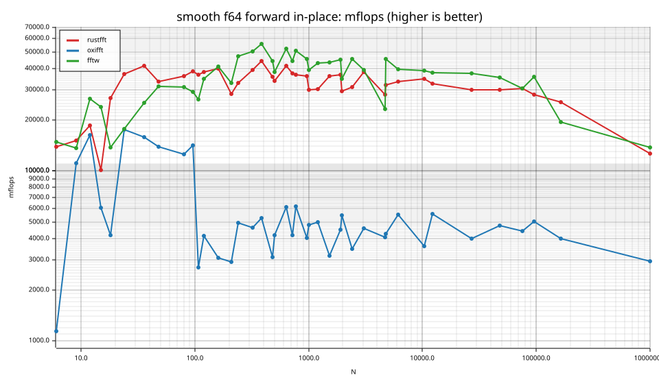
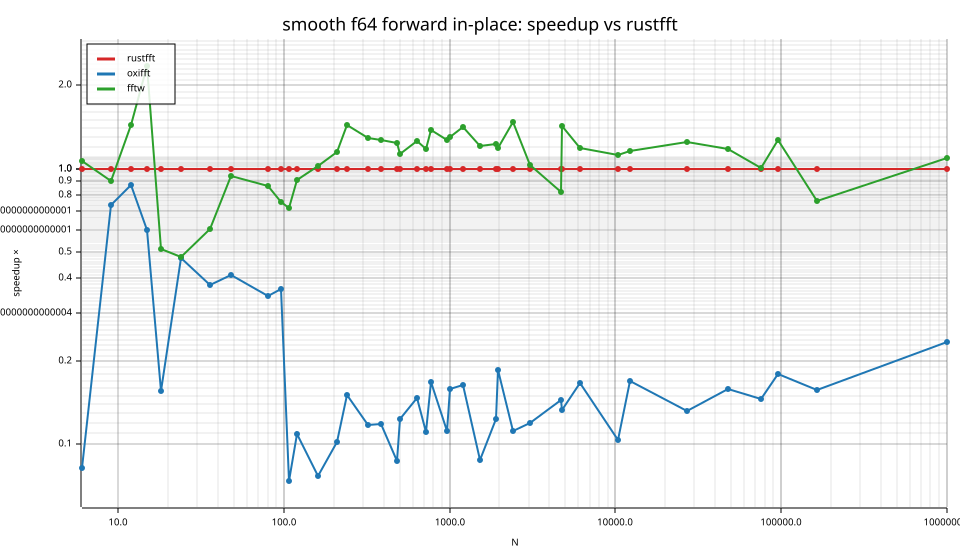
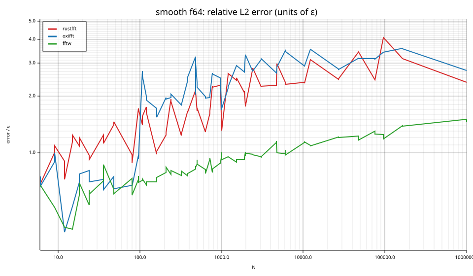

## Suite `rough`

### rough f32

| cell | rustfft | phastft/split | phastft/interleaved | tfhe-fft | oxifft | fftw |
|---|---|---|---|---|---|---|
| N=17 fwd ip | 27.3ns | – | – | – | 99.9ns (0.27×) | 40.9ns (0.67×) |
| N=17 fwd oop | 26.7ns | – | – | – | 95.0ns (0.28×) | 40.8ns (0.66×) |
| N=17 inv ip | 27.4ns | – | – | – | 100.7ns (0.27×) | 40.9ns (0.67×) |
| N=17 inv oop | 26.5ns | – | – | – | 94.9ns (0.28×) | 41.0ns (0.65×) |
| N=31 fwd ip | 93.8ns | – | – | – | 474.6ns (0.20×) | 114.1ns (0.82×) |
| N=31 fwd oop | 94.7ns | – | – | – | 470.3ns (0.20×) | 114.2ns (0.83×) |
| N=31 inv ip | 93.9ns | – | – | – | 473.2ns (0.20×) | 113.5ns (0.83×) |
| N=31 inv oop | 94.6ns | – | – | – | 466.6ns (0.20×) | 114.0ns (0.83×) |
| N=61 fwd ip | 128.3ns | – | – | – | 1.16us (0.11×) | 441.1ns (0.29×) |
| N=61 fwd oop | 126.4ns | – | – | – | 1.16us (0.11×) | 434.1ns (0.29×) |
| N=61 inv ip | 128.9ns | – | – | – | 1.16us (0.11×) | 440.9ns (0.29×) |
| N=61 inv oop | 126.9ns | – | – | – | 1.16us (0.11×) | 443.6ns (0.29×) |
| N=127 fwd ip | 455.1ns | – | – | – | 2.84us (0.16×) | 490.5ns (0.93×) |
| N=127 fwd oop | 455.9ns | – | – | – | 2.83us (0.16×) | 492.6ns (0.93×) |
| N=127 inv ip | 455.2ns | – | – | – | 2.84us (0.16×) | 482.4ns (0.94×) |
| N=127 inv oop | 457.3ns | – | – | – | 2.82us (0.16×) | 486.0ns (0.94×) |
| N=257 fwd ip | 460.7ns | – | – | – | 3.21us (0.14×) | 1.42us (0.32×) |
| N=257 fwd oop | 453.5ns | – | – | – | 3.18us (0.14×) | 1.36us (0.33×) |
| N=257 inv ip | 451.4ns | – | – | – | 3.22us (0.14×) | 1.37us (0.33×) |
| N=257 inv oop | 453.8ns | – | – | – | 3.20us (0.14×) | 1.35us (0.34×) |
| N=509 fwd ip | 1.55us | – | – | – | 18.37us (0.08×) | 1.82us (0.85×) |
| N=509 fwd oop | 1.56us | – | – | – | 18.34us (0.08×) | 1.84us (0.85×) |
| N=509 inv ip | 1.53us | – | – | – | 18.39us (0.08×) | 1.84us (0.83×) |
| N=509 inv oop | 1.56us | – | – | – | 18.33us (0.08×) | 1.85us (0.84×) |
| N=1021 fwd ip | 5.19us | – | – | – | 44.68us (0.12×) | 3.89us (1.33×) |
| N=1021 fwd oop | 5.25us | – | – | – | 44.56us (0.12×) | 3.90us (1.35×) |
| N=1021 inv ip | 5.19us | – | – | – | 44.67us (0.12×) | 3.89us (1.33×) |
| N=1021 inv oop | 5.23us | – | – | – | 44.52us (0.12×) | 3.89us (1.34×) |
| N=2018 fwd ip | 5.56us | – | – | – | 94.99us (0.06×) | 21.88us (0.25×) |
| N=2018 fwd oop | 5.63us | – | – | – | 94.81us (0.06×) | 21.36us (0.26×) |
| N=2018 inv ip | 5.57us | – | – | – | 96.31us (0.06×) | 21.83us (0.26×) |
| N=2018 inv oop | 5.60us | – | – | – | 95.55us (0.06×) | 21.44us (0.26×) |
| N=2053 fwd ip | 11.22us | – | – | – | 217.93us (0.05×) | 11.08us (1.01×) |
| N=2053 fwd oop | 11.27us | – | – | – | 217.38us (0.05×) | 11.10us (1.02×) |
| N=2053 inv ip | 11.24us | – | – | – | 217.69us (0.05×) | 11.09us (1.01×) |
| N=2053 inv oop | 11.28us | – | – | – | 219.67us (0.05×) | 11.10us (1.02×) |
| N=3063 fwd ip | 16.39us | – | – | – | 147.83us (0.11×) | 13.25us (1.24×) |
| N=3063 fwd oop | 16.41us | – | – | – | 147.70us (0.11×) | 12.84us (1.28×) |
| N=3063 inv ip | 16.40us | – | – | – | 147.86us (0.11×) | 13.27us (1.24×) |
| N=3063 inv oop | 16.41us | – | – | – | 147.58us (0.11×) | 12.82us (1.28×) |
| N=4099 fwd ip | 24.02us | – | – | – | 460.54us (0.05×) | 22.78us (1.05×) |
| N=4099 fwd oop | 24.05us | – | – | – | 457.12us (0.05×) | 22.85us (1.05×) |
| N=4099 inv ip | 23.96us | – | – | – | 454.64us (0.05×) | 22.68us (1.06×) |
| N=4099 inv oop | 24.11us | – | – | – | 459.66us (0.05×) | 22.73us (1.06×) |
| N=8191 fwd ip | 49.58us | – | – | – | 461.41us (0.11×) | 47.45us (1.04×) |
| N=8191 fwd oop | 49.80us | – | – | – | 457.71us (0.11×) | 47.80us (1.04×) |
| N=8191 inv ip | 49.50us | – | – | – | 458.92us (0.11×) | 47.48us (1.04×) |
| N=8191 inv oop | 49.73us | – | – | – | 457.27us (0.11×) | 47.60us (1.04×) |
| N=9797 fwd ip | 52.59us | – | – | – | 574.83us (0.09×) | 119.80us (0.44×) |
| N=9797 fwd oop | 52.83us | – | – | – | 575.97us (0.09×) | 118.77us (0.44×) |
| N=9797 inv ip | 52.65us | – | – | – | 573.69us (0.09×) | 120.60us (0.44×) |
| N=9797 inv oop | 52.24us | – | – | – | 575.13us (0.09×) | 118.14us (0.44×) |
| N=16381 fwd ip | 100.83us | – | – | – | 956.44us (0.11×) | 100.35us (1.00×) |
| N=16381 fwd oop | 101.77us | – | – | – | 956.11us (0.11×) | 99.14us (1.03×) |
| N=16381 inv ip | 101.31us | – | – | – | 957.04us (0.11×) | 99.92us (1.01×) |
| N=16381 inv oop | 101.58us | – | – | – | 956.15us (0.11×) | 99.81us (1.02×) |
| N=65524 fwd ip | 428.31us | – | – | – | 4.09ms (0.10×) | 439.18us (0.98×) |
| N=65524 fwd oop | 425.19us | – | – | – | 4.08ms (0.10×) | 430.23us (0.99×) |
| N=65524 inv ip | 428.09us | – | – | – | 4.17ms (0.10×) | 442.30us (0.97×) |
| N=65524 inv oop | 424.24us | – | – | – | 4.11ms (0.10×) | 429.30us (0.99×) |
| N=65537 fwd ip | 251.88us | – | – | – | 2.12ms (0.12×) | 668.02us (0.38×) |
| N=65537 fwd oop | 260.83us | – | – | – | 2.10ms (0.12×) | 666.79us (0.39×) |
| N=65537 inv ip | 250.85us | – | – | – | 2.11ms (0.12×) | 679.59us (0.37×) |
| N=65537 inv oop | 261.48us | – | – | – | 2.10ms (0.12×) | 680.54us (0.38×) |
| N=131071 fwd ip | 975.66us | – | – | – | 8.98ms (0.11×) | 1.21ms (0.81×) |
| N=131071 fwd oop | 985.03us | – | – | – | 8.94ms (0.11×) | 1.20ms (0.82×) |
| N=131071 inv ip | 983.24us | – | – | – | 8.95ms (0.11×) | 1.20ms (0.82×) |
| N=131071 inv oop | 989.78us | – | – | – | 8.96ms (0.11×) | 1.21ms (0.82×) |

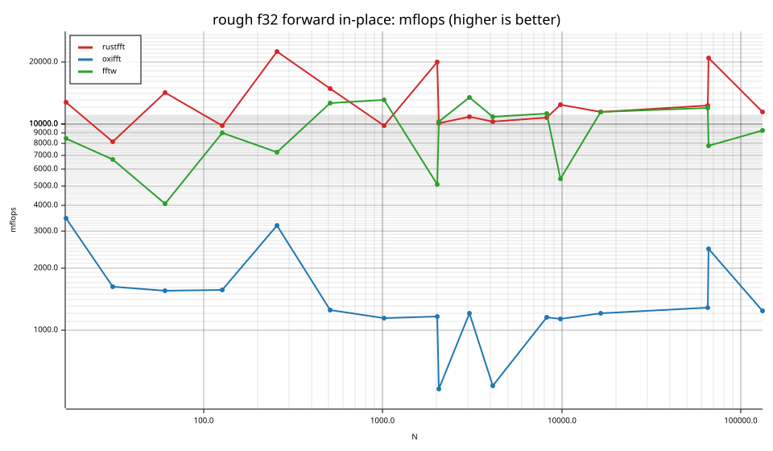
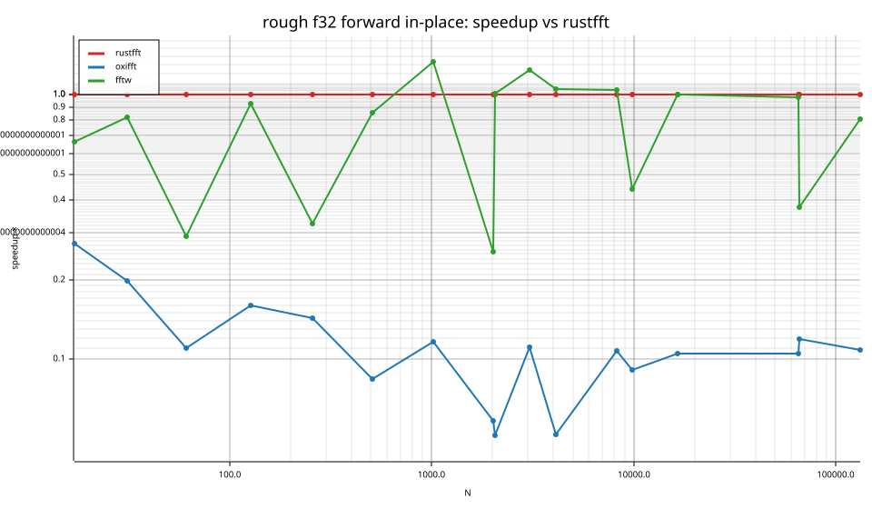
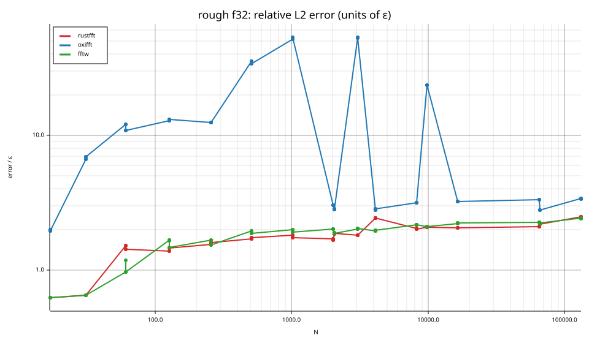

### rough f64

| cell | rustfft | phastft/split | phastft/interleaved | tfhe-fft | oxifft | fftw |
|---|---|---|---|---|---|---|
| N=17 fwd ip | 31.7ns | – | – | – | 90.6ns (0.35×) | 53.6ns (0.59×) |
| N=17 fwd oop | 34.3ns | – | – | – | 83.9ns (0.41×) | 53.4ns (0.64×) |
| N=17 inv ip | 30.7ns | – | – | – | 90.3ns (0.34×) | 54.4ns (0.56×) |
| N=17 inv oop | 34.9ns | – | – | – | 83.8ns (0.42×) | 53.9ns (0.65×) |
| N=31 fwd ip | 92.1ns | – | – | – | 314.3ns (0.29×) | 159.2ns (0.58×) |
| N=31 fwd oop | 91.4ns | – | – | – | 306.5ns (0.30×) | 159.5ns (0.57×) |
| N=31 inv ip | 92.2ns | – | – | – | 315.2ns (0.29×) | 159.4ns (0.58×) |
| N=31 inv oop | 92.9ns | – | – | – | 309.6ns (0.30×) | 159.7ns (0.58×) |
| N=61 fwd ip | 210.2ns | – | – | – | 620.8ns (0.34×) | 431.2ns (0.49×) |
| N=61 fwd oop | 216.6ns | – | – | – | 645.1ns (0.34×) | 432.7ns (0.50×) |
| N=61 inv ip | 211.5ns | – | – | – | 598.1ns (0.35×) | 459.8ns (0.46×) |
| N=61 inv oop | 217.1ns | – | – | – | 628.4ns (0.35×) | 460.3ns (0.47×) |
| N=127 fwd ip | 472.2ns | – | – | – | 1.35us (0.35×) | 714.7ns (0.66×) |
| N=127 fwd oop | 490.1ns | – | – | – | 1.34us (0.37×) | 732.2ns (0.67×) |
| N=127 inv ip | 472.5ns | – | – | – | 1.35us (0.35×) | 715.5ns (0.66×) |
| N=127 inv oop | 488.2ns | – | – | – | 1.34us (0.37×) | 716.0ns (0.68×) |
| N=257 fwd ip | 856.9ns | – | – | – | 1.71us (0.50×) | 1.92us (0.45×) |
| N=257 fwd oop | 892.1ns | – | – | – | 1.69us (0.53×) | 1.91us (0.47×) |
| N=257 inv ip | 860.6ns | – | – | – | 1.81us (0.48×) | 1.97us (0.44×) |
| N=257 inv oop | 896.1ns | – | – | – | 1.73us (0.52×) | 1.96us (0.46×) |
| N=509 fwd ip | 3.15us | – | – | – | 6.69us (0.47×) | 3.21us (0.98×) |
| N=509 fwd oop | 3.16us | – | – | – | 6.64us (0.48×) | 3.18us (0.99×) |
| N=509 inv ip | 3.17us | – | – | – | 6.74us (0.47×) | 3.21us (0.99×) |
| N=509 inv oop | 3.14us | – | – | – | 6.58us (0.48×) | 3.21us (0.98×) |
| N=1021 fwd ip | 7.63us | – | – | – | 20.94us (0.36×) | 7.58us (1.01×) |
| N=1021 fwd oop | 7.91us | – | – | – | 22.26us (0.36×) | 7.67us (1.03×) |
| N=1021 inv ip | 7.64us | – | – | – | 21.06us (0.36×) | 7.57us (1.01×) |
| N=1021 inv oop | 7.88us | – | – | – | 21.31us (0.37×) | 7.57us (1.04×) |
| N=2018 fwd ip | 10.62us | – | – | – | 35.73us (0.30×) | 24.63us (0.43×) |
| N=2018 fwd oop | 10.89us | – | – | – | 34.72us (0.31×) | 24.19us (0.45×) |
| N=2018 inv ip | 10.72us | – | – | – | 35.82us (0.30×) | 24.59us (0.44×) |
| N=2018 inv oop | 10.94us | – | – | – | 34.65us (0.32×) | 24.23us (0.45×) |
| N=2053 fwd ip | 17.36us | – | – | – | 183.17us (0.09×) | 18.49us (0.94×) |
| N=2053 fwd oop | 17.73us | – | – | – | 185.98us (0.10×) | 18.56us (0.96×) |
| N=2053 inv ip | 17.31us | – | – | – | 183.04us (0.09×) | 18.60us (0.93×) |
| N=2053 inv oop | 17.72us | – | – | – | 186.73us (0.09×) | 18.46us (0.96×) |
| N=3063 fwd ip | 24.95us | – | – | – | 75.85us (0.33×) | 24.93us (1.00×) |
| N=3063 fwd oop | 24.87us | – | – | – | 71.97us (0.35×) | 24.36us (1.02×) |
| N=3063 inv ip | 24.63us | – | – | – | 74.42us (0.33×) | 24.65us (1.00×) |
| N=3063 inv oop | 24.83us | – | – | – | 72.20us (0.34×) | 24.27us (1.02×) |
| N=4099 fwd ip | 44.27us | – | – | – | 384.41us (0.12×) | 37.93us (1.17×) |
| N=4099 fwd oop | 44.24us | – | – | – | 382.86us (0.12×) | 37.75us (1.17×) |
| N=4099 inv ip | 44.28us | – | – | – | 384.81us (0.12×) | 37.71us (1.17×) |
| N=4099 inv oop | 44.27us | – | – | – | 382.91us (0.12×) | 37.90us (1.17×) |
| N=8191 fwd ip | 72.22us | – | – | – | 389.22us (0.19×) | 80.73us (0.89×) |
| N=8191 fwd oop | 72.92us | – | – | – | 388.50us (0.19×) | 80.96us (0.90×) |
| N=8191 inv ip | 72.45us | – | – | – | 388.99us (0.19×) | 80.72us (0.90×) |
| N=8191 inv oop | 73.01us | – | – | – | 388.01us (0.19×) | 81.72us (0.89×) |
| N=9797 fwd ip | 107.16us | – | – | – | 288.69us (0.37×) | 153.77us (0.70×) |
| N=9797 fwd oop | 107.66us | – | – | – | 291.99us (0.37×) | 149.86us (0.72×) |
| N=9797 inv ip | 106.03us | – | – | – | 288.60us (0.37×) | 161.22us (0.66×) |
| N=9797 inv oop | 106.88us | – | – | – | 300.63us (0.36×) | 154.08us (0.69×) |
| N=16381 fwd ip | 144.93us | – | – | – | 861.34us (0.17×) | 188.07us (0.77×) |
| N=16381 fwd oop | 151.10us | – | – | – | 864.42us (0.17×) | 186.39us (0.81×) |
| N=16381 inv ip | 145.87us | – | – | – | 864.78us (0.17×) | 187.23us (0.78×) |
| N=16381 inv oop | 151.29us | – | – | – | 860.46us (0.18×) | 187.78us (0.81×) |
| N=65524 fwd ip | 634.60us | – | – | – | 3.73ms (0.17×) | 802.96us (0.79×) |
| N=65524 fwd oop | 636.54us | – | – | – | 3.78ms (0.17×) | 793.73us (0.80×) |
| N=65524 inv ip | 636.96us | – | – | – | 3.73ms (0.17×) | 801.75us (0.79×) |
| N=65524 inv oop | 639.54us | – | – | – | 3.77ms (0.17×) | 794.11us (0.81×) |
| N=65537 fwd ip | 484.70us | – | – | – | 1.96ms (0.25×) | 757.45us (0.64×) |
| N=65537 fwd oop | 549.70us | – | – | – | 1.94ms (0.28×) | 762.45us (0.72×) |
| N=65537 inv ip | 486.03us | – | – | – | 1.97ms (0.25×) | 774.00us (0.63×) |
| N=65537 inv oop | 547.42us | – | – | – | 1.94ms (0.28×) | 780.36us (0.70×) |
| N=131071 fwd ip | 2.68ms | – | – | – | 10.08ms (0.27×) | 2.01ms (1.33×) |
| N=131071 fwd oop | 2.72ms | – | – | – | 9.92ms (0.27×) | 2.04ms (1.33×) |
| N=131071 inv ip | 2.73ms | – | – | – | 10.14ms (0.27×) | 2.02ms (1.35×) |
| N=131071 inv oop | 2.71ms | – | – | – | 9.92ms (0.27×) | 2.04ms (1.33×) |

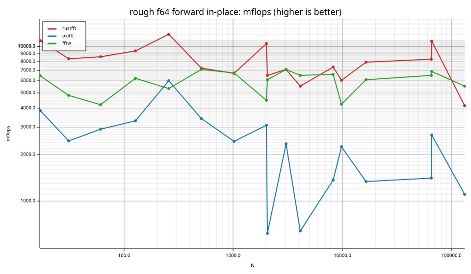
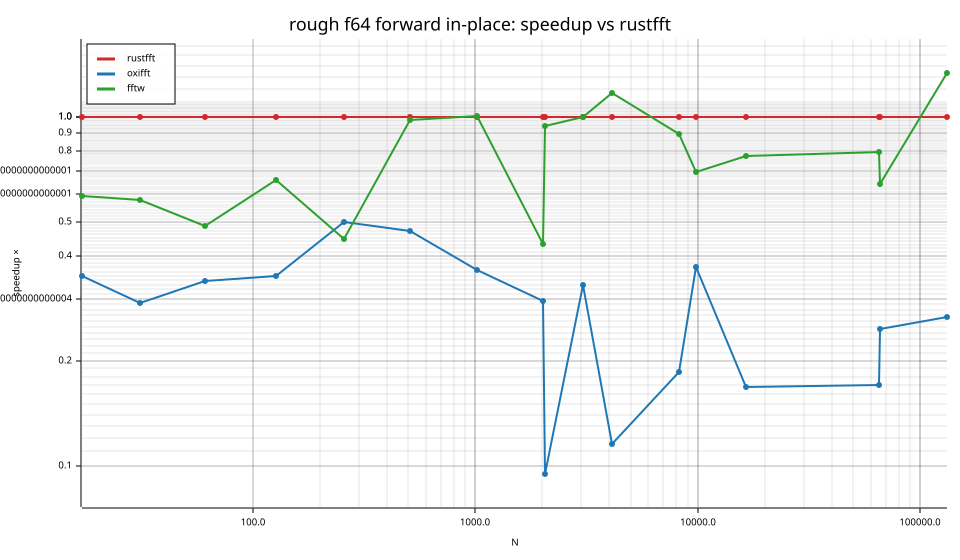
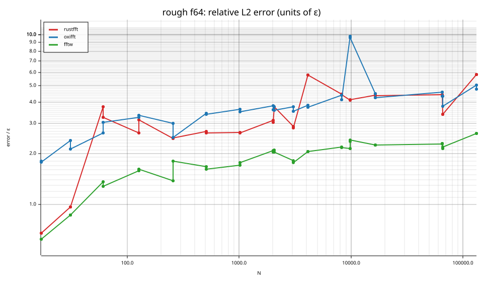

## Suite `batch`

### batch f32

| cell | rustfft | phastft/split | phastft/interleaved | tfhe-fft | oxifft | fftw |
|---|---|---|---|---|---|---|
| N=8 ×131072 fwd ip | 1.6ns | 35.6ns (0.05×) | 57.9ns (0.03×) | – | 5.4ns (0.30×) | 2.1ns (0.77×) |
| N=8 ×131072 fwd oop | 2.0ns | – | – | – | 7.1ns (0.28×) | 2.4ns (0.83×) |
| N=16 ×65536 fwd ip | 3.3ns | 60.7ns (0.06×) | 87.2ns (0.04×) | – | 21.0ns (0.16×) | 4.9ns (0.68×) |
| N=16 ×65536 fwd oop | 4.0ns | – | – | – | 24.1ns (0.16×) | 5.4ns (0.73×) |
| N=32 ×32768 fwd ip | 9.0ns | 81.9ns (0.11×) | 112.1ns (0.08×) | – | 73.8ns (0.12×) | 11.5ns (0.78×) |
| N=32 ×32768 fwd oop | 9.7ns | – | – | – | 78.7ns (0.12×) | 15.1ns (0.65×) |
| N=64 ×16384 fwd ip | 20.1ns | 54.8ns (0.37×) | 88.3ns (0.23×) | – | 215.1ns (0.09×) | 27.9ns (0.72×) |
| N=64 ×16384 fwd oop | 22.0ns | – | – | – | 220.4ns (0.10×) | 27.0ns (0.82×) |
| N=128 ×8192 fwd ip | 48.3ns | 104.2ns (0.46×) | 158.3ns (0.31×) | – | 549.7ns (0.09×) | 55.2ns (0.88×) |
| N=128 ×8192 fwd oop | 50.4ns | – | – | – | 571.3ns (0.09×) | 49.6ns (1.02×) |
| N=256 ×4096 fwd ip | 108.7ns | 204.9ns (0.53×) | 307.2ns (0.35×) | – | 1.36us (0.08×) | 126.8ns (0.86×) |
| N=256 ×4096 fwd oop | 111.7ns | – | – | – | 1.47us (0.08×) | 99.9ns (1.12×) |
| N=512 ×2048 fwd ip | 279.0ns | 414.4ns (0.67×) | 638.8ns (0.44×) | – | 4.13us (0.07×) | 283.1ns (0.99×) |
| N=512 ×2048 fwd oop | 414.0ns | – | – | – | 4.36us (0.09×) | 340.7ns (1.21×) |
| N=1024 ×1024 fwd ip | 645.9ns | 899.3ns (0.72×) | 1.32us (0.49×) | – | 9.10us (0.07×) | 555.3ns (1.16×) |
| N=1024 ×1024 fwd oop | 902.4ns | – | – | – | 9.53us (0.09×) | 897.3ns (1.01×) |

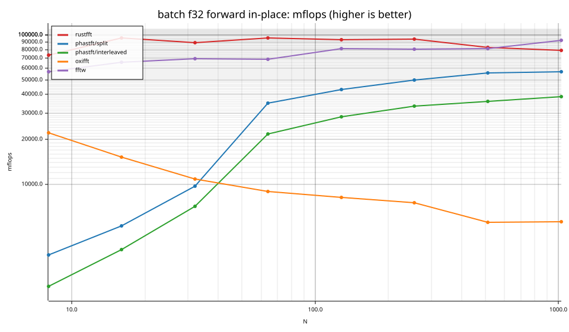
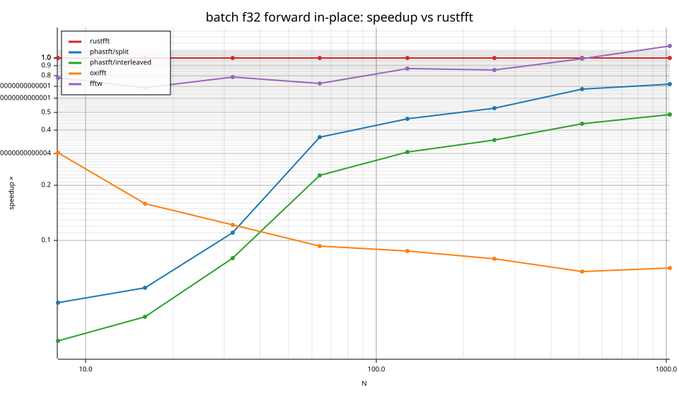
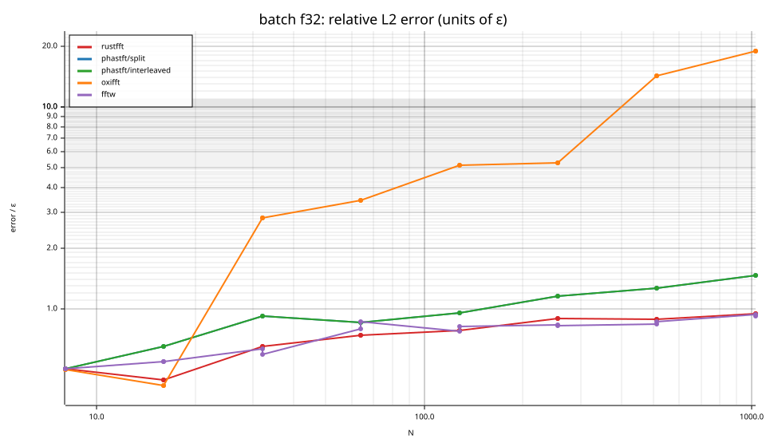

### batch f64

| cell | rustfft | phastft/split | phastft/interleaved | tfhe-fft | oxifft | fftw |
|---|---|---|---|---|---|---|
| N=8 ×131072 fwd ip | 2.4ns | 35.1ns (0.07×) | 59.4ns (0.04×) | 5.1ns (0.48×) | 4.9ns (0.49×) | 2.7ns (0.88×) |
| N=8 ×131072 fwd oop | 7.9ns | – | – | – | 8.8ns (0.90×) | 8.0ns (0.99×) |
| N=16 ×65536 fwd ip | 6.1ns | 45.4ns (0.14×) | 74.0ns (0.08×) | 9.3ns (0.66×) | 14.1ns (0.43×) | 6.1ns (1.00×) |
| N=16 ×65536 fwd oop | 15.7ns | – | – | – | 20.0ns (0.79×) | 16.0ns (0.98×) |
| N=32 ×32768 fwd ip | 14.9ns | 94.1ns (0.16×) | 128.5ns (0.12×) | 18.5ns (0.80×) | 73.6ns (0.20×) | 19.5ns (0.76×) |
| N=32 ×32768 fwd oop | 32.5ns | – | – | – | 82.0ns (0.40×) | 34.5ns (0.94×) |
| N=64 ×16384 fwd ip | 40.7ns | 78.1ns (0.52×) | 131.0ns (0.31×) | 39.8ns (1.02×) | 123.0ns (0.33×) | 48.6ns (0.84×) |
| N=64 ×16384 fwd oop | 71.3ns | – | – | – | 170.1ns (0.42×) | 71.6ns (1.00×) |
| N=128 ×8192 fwd ip | 111.5ns | 155.0ns (0.72×) | 243.0ns (0.46×) | 89.1ns (1.25×) | 240.8ns (0.46×) | 145.4ns (0.77×) |
| N=128 ×8192 fwd oop | 149.3ns | – | – | – | 438.7ns (0.34×) | 185.4ns (0.81×) |
| N=256 ×4096 fwd ip | 381.6ns | 326.3ns (1.17×) | 580.5ns (0.66×) | 231.4ns (1.65×) | 599.2ns (0.64×) | 338.5ns (1.13×) |
| N=256 ×4096 fwd oop | 670.7ns | – | – | – | 922.5ns (0.73×) | 641.1ns (1.05×) |
| N=512 ×2048 fwd ip | 856.7ns | 911.3ns (0.94×) | 1.18us (0.73×) | 757.5ns (1.13×) | 1.64us (0.52×) | 775.2ns (1.11×) |
| N=512 ×2048 fwd oop | 1.52us | – | – | – | 2.12us (0.72×) | 1.43us (1.07×) |
| N=1024 ×1024 fwd ip | 1.57us | 2.00us (0.78×) | 2.57us (0.61×) | 1.22us (1.29×) | 4.04us (0.39×) | 1.65us (0.95×) |
| N=1024 ×1024 fwd oop | 2.66us | – | – | – | 4.29us (0.62×) | 3.21us (0.83×) |

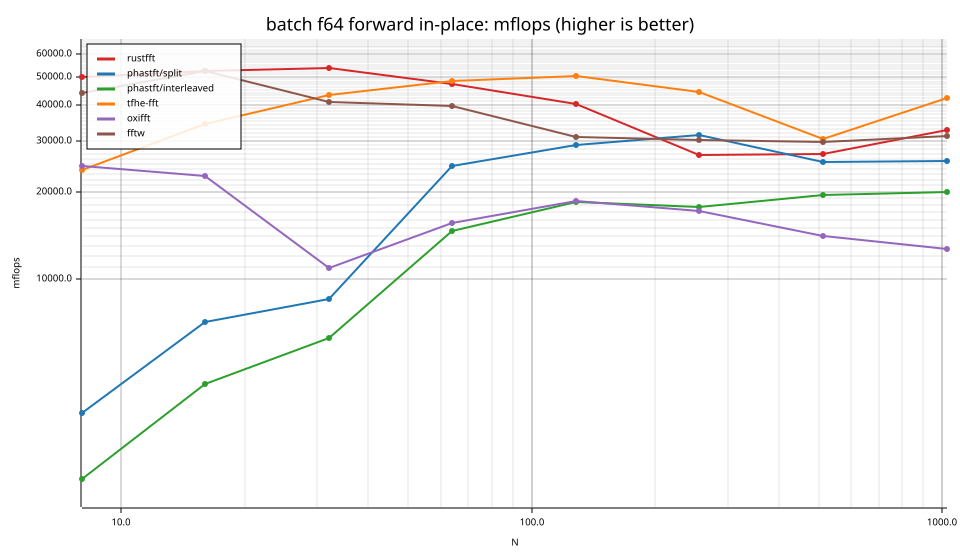
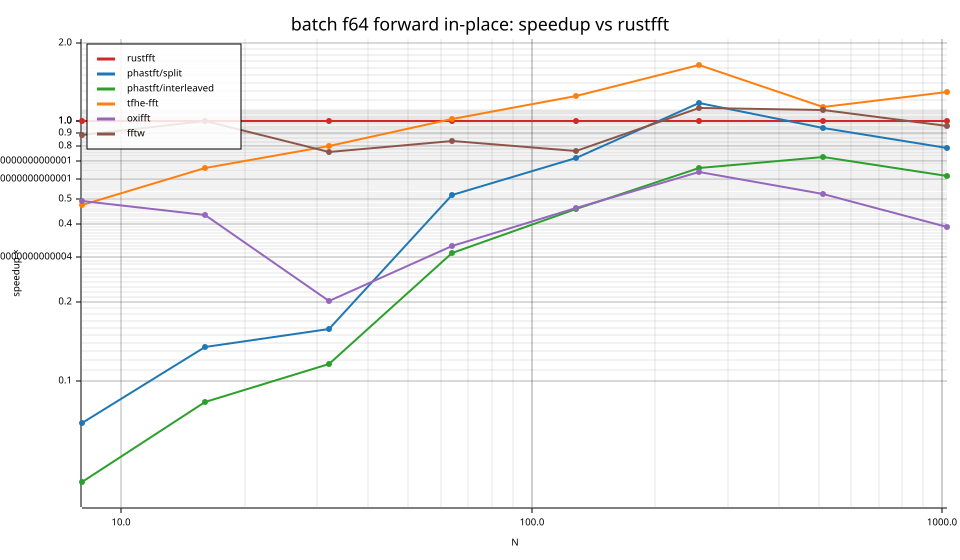
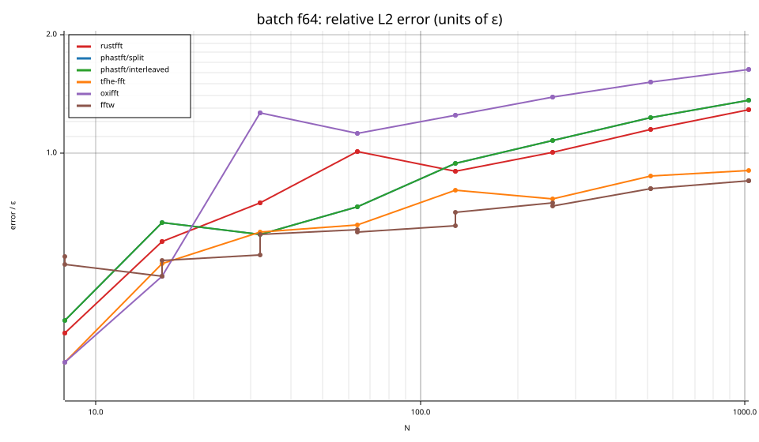

## Suite `realworld`

### realworld f32

| cell | rustfft | phastft/split | phastft/interleaved | tfhe-fft | oxifft | fftw |
|---|---|---|---|---|---|---|
| Spectrogram N=1024 | 778 MS/s | 707 MS/s (0.91×) | 481 MS/s (0.62×) | – | 108 MS/s (0.14×) | 736 MS/s (0.95×) |
| Spectrogram N=4096 | 568 MS/s | 534 MS/s (0.94×) | 393 MS/s (0.69×) | – | 84 MS/s (0.15×) | 611 MS/s (1.08×) |
| Spectrogram N=16384 | 523 MS/s | 461 MS/s (0.88×) | 371 MS/s (0.71×) | – | 76 MS/s (0.15×) | 506 MS/s (0.97×) |
| Spectrogram N=65536 | 478 MS/s | 361 MS/s (0.75×) | 292 MS/s (0.61×) | – | 70 MS/s (0.15×) | 431 MS/s (0.90×) |
| OverlapSave N=4096 | 284 MS/s | 251 MS/s (0.89×) | 188 MS/s (0.66×) | – | 33 MS/s (0.12×) | 314 MS/s (1.11×) |

### realworld f64

| cell | rustfft | phastft/split | phastft/interleaved | tfhe-fft | oxifft | fftw |
|---|---|---|---|---|---|---|
| Spectrogram N=4096 | 291 MS/s | 275 MS/s (0.95×) | 210 MS/s (0.72×) | – | 169 MS/s (0.58×) | 304 MS/s (1.04×) |

## Accuracy and planning time (medians over cells)

| lib | cells verified | failed | median error (ε) | worst error (ε) | median plan time |
|---|---|---|---|---|---|
| rustfft | 694 | 0 | 1.21 | 5.84 | 9.98us |
| phastft/split | 118 | 0 | 1.46 | 4.01 | 217.69us |
| phastft/interleaved | 118 | 0 | 1.46 | 4.01 | 16.28us |
| tfhe-fft | 28 | 0 | 0.66 | 0.90 | 424.37ms |
| oxifft | 662 | 40 | 2.57 | 21916.13 | 2.78ms |
| fftw | 694 | 0 | 0.97 | 2.80 | 3.35ms |

### Verification failures

- `pow2:f32:fwd:ip:n8388608` oxifft: failed-verify error 6131.9ε 
- `pow2:f32:fwd:oop:n8388608` oxifft: failed-verify error 6131.9ε 
- `pow2:f32:inv:ip:n8388608` oxifft: failed-verify error 6131.7ε 
- `pow2:f32:inv:oop:n8388608` oxifft: failed-verify error 6131.7ε 
- `pow2:f32:fwd:ip:n16777216` oxifft: failed-verify error 21916.1ε 
- `pow2:f32:fwd:oop:n16777216` oxifft: failed-verify error 21916.1ε 
- `pow2:f32:inv:ip:n16777216` oxifft: failed-verify error 21915.1ε 
- `pow2:f32:inv:oop:n16777216` oxifft: failed-verify error 21915.1ε 
- `pow2:f64:fwd:ip:n131072` oxifft: error planner panicked: index out of bounds: the len is 16 but the index is 16
- `pow2:f64:fwd:oop:n131072` oxifft: error planner panicked: index out of bounds: the len is 16 but the index is 16
- `pow2:f64:inv:ip:n131072` oxifft: error planner panicked: index out of bounds: the len is 16 but the index is 16
- `pow2:f64:inv:oop:n131072` oxifft: error planner panicked: index out of bounds: the len is 16 but the index is 16
- `pow2:f64:fwd:ip:n262144` oxifft: error planner panicked: index out of bounds: the len is 16 but the index is 16
- `pow2:f64:fwd:oop:n262144` oxifft: error planner panicked: index out of bounds: the len is 16 but the index is 16
- `pow2:f64:inv:ip:n262144` oxifft: error planner panicked: index out of bounds: the len is 16 but the index is 16
- `pow2:f64:inv:oop:n262144` oxifft: error planner panicked: index out of bounds: the len is 16 but the index is 16
- `pow2:f64:fwd:ip:n524288` oxifft: error planner panicked: index out of bounds: the len is 16 but the index is 16
- `pow2:f64:fwd:oop:n524288` oxifft: error planner panicked: index out of bounds: the len is 16 but the index is 16
- `pow2:f64:inv:ip:n524288` oxifft: error planner panicked: index out of bounds: the len is 16 but the index is 16
- `pow2:f64:inv:oop:n524288` oxifft: error planner panicked: index out of bounds: the len is 16 but the index is 16
- `pow2:f64:fwd:ip:n1048576` oxifft: error planner panicked: index out of bounds: the len is 16 but the index is 16
- `pow2:f64:fwd:oop:n1048576` oxifft: error planner panicked: index out of bounds: the len is 16 but the index is 16
- `pow2:f64:inv:ip:n1048576` oxifft: error planner panicked: index out of bounds: the len is 16 but the index is 16
- `pow2:f64:inv:oop:n1048576` oxifft: error planner panicked: index out of bounds: the len is 16 but the index is 16
- `pow2:f64:fwd:ip:n2097152` oxifft: error planner panicked: index out of bounds: the len is 16 but the index is 16
- `pow2:f64:fwd:oop:n2097152` oxifft: error planner panicked: index out of bounds: the len is 16 but the index is 16
- `pow2:f64:inv:ip:n2097152` oxifft: error planner panicked: index out of bounds: the len is 16 but the index is 16
- `pow2:f64:inv:oop:n2097152` oxifft: error planner panicked: index out of bounds: the len is 16 but the index is 16
- `pow2:f64:fwd:ip:n4194304` oxifft: error planner panicked: index out of bounds: the len is 16 but the index is 16
- `pow2:f64:fwd:oop:n4194304` oxifft: error planner panicked: index out of bounds: the len is 16 but the index is 16
- `pow2:f64:inv:ip:n4194304` oxifft: error planner panicked: index out of bounds: the len is 16 but the index is 16
- `pow2:f64:inv:oop:n4194304` oxifft: error planner panicked: index out of bounds: the len is 16 but the index is 16
- `pow2:f64:fwd:ip:n8388608` oxifft: error planner panicked: index out of bounds: the len is 16 but the index is 16
- `pow2:f64:fwd:oop:n8388608` oxifft: error planner panicked: index out of bounds: the len is 16 but the index is 16
- `pow2:f64:inv:ip:n8388608` oxifft: error planner panicked: index out of bounds: the len is 16 but the index is 16
- `pow2:f64:inv:oop:n8388608` oxifft: error planner panicked: index out of bounds: the len is 16 but the index is 16
- `pow2:f64:fwd:ip:n16777216` oxifft: error planner panicked: index out of bounds: the len is 16 but the index is 16
- `pow2:f64:fwd:oop:n16777216` oxifft: error planner panicked: index out of bounds: the len is 16 but the index is 16
- `pow2:f64:inv:ip:n16777216` oxifft: error planner panicked: index out of bounds: the len is 16 but the index is 16
- `pow2:f64:inv:oop:n16777216` oxifft: error planner panicked: index out of bounds: the len is 16 but the index is 16

### Library notes

- phastft/interleaved: interleaved API deinterleaves into temporary Vecs
- phastft/interleaved: normalizes inverse by 1/N
- phastft/split: normalizes inverse by 1/N
