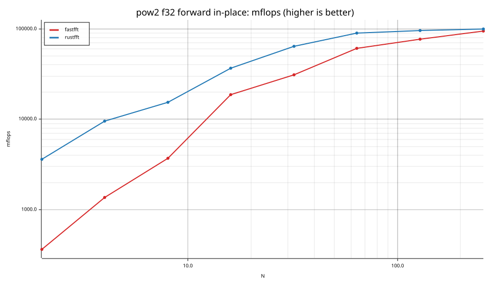
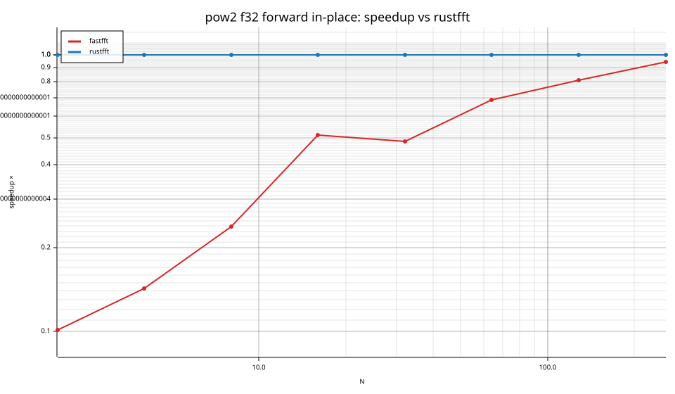
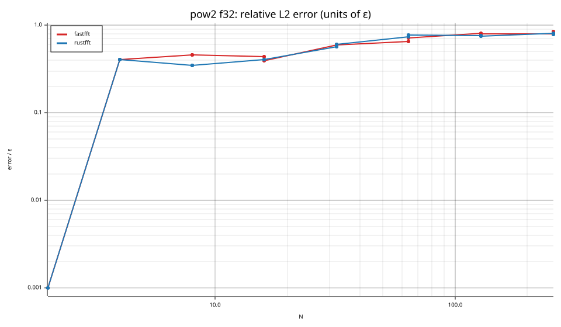
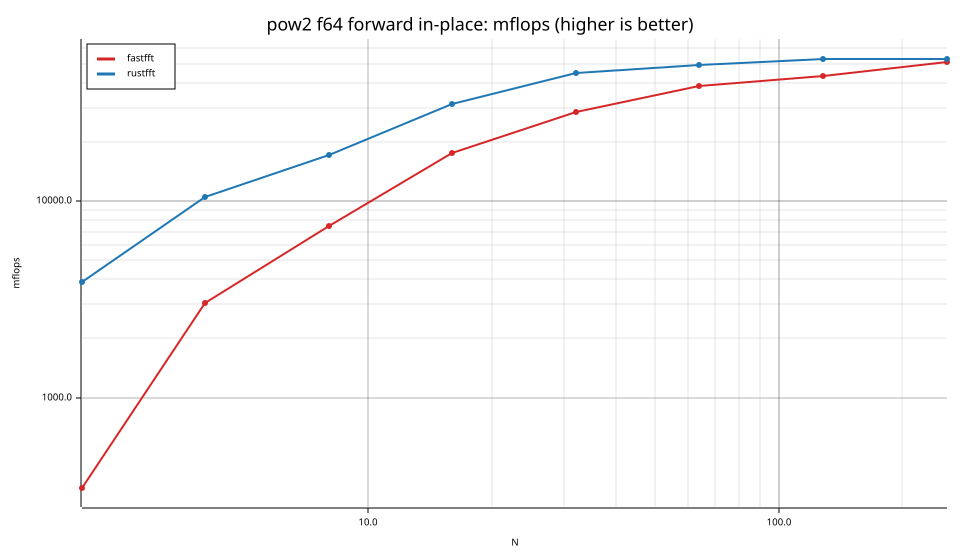
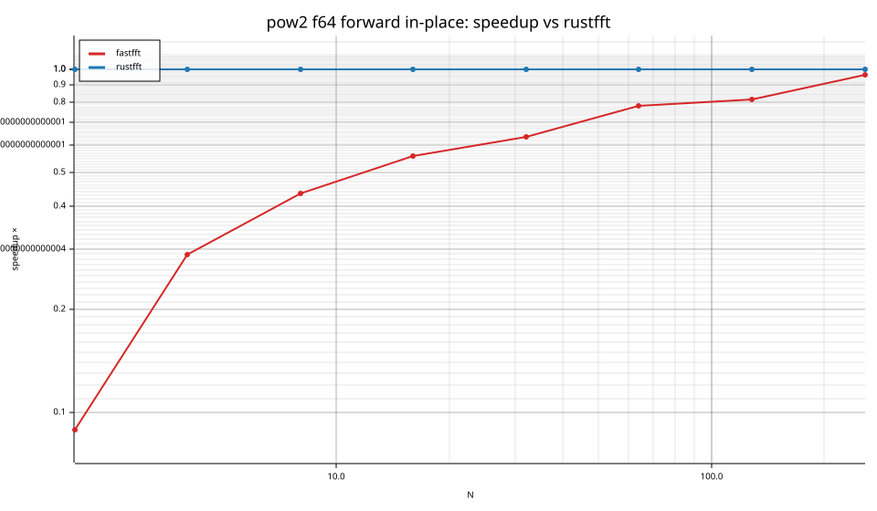
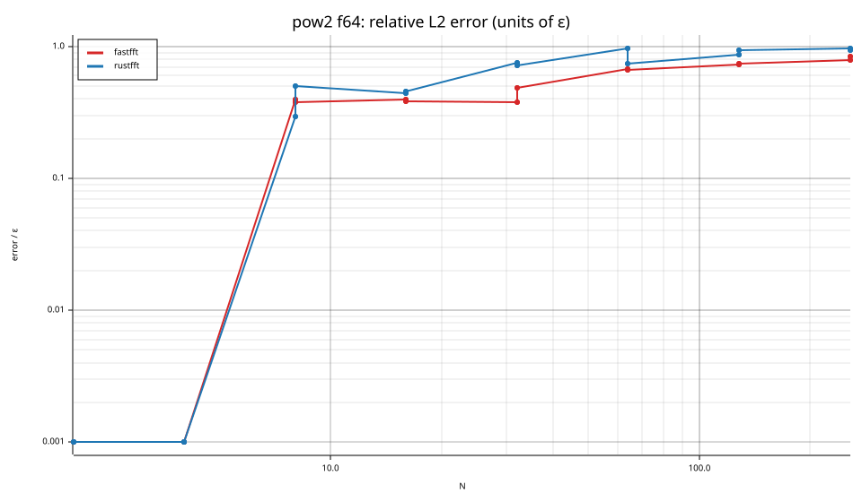

# fastfft arena report: `small-before`

| | |
|---|---|
| Host | mini-ryzen |
| CPU | AMD Ryzen 7 7840HS w/ Radeon 780M Graphics (family 25, model 116, stepping 1, microcode 0xa704108) |
| Pinned CPU | 2 (SMT siblings 2,10) |
| Governor / EPP / boost | performance / performance / 1 |
| Kernel | Linux version 7.0.0-28-generic |
| Virtualization | container-other |
| rustc | rustc 1.95.0 (59807616e 2026-04-14); binary: rustc; commit-hash: 59807616e1fa2540724bfbac14d7976d7e4a3860; commit-date: 2026-04-14; host: x86_64-unknown-linux-gnu; release: 1.95.0; LLVM version: 22.1.2 |
| Build profile / RUSTFLAGS | arena / `` |
| Libraries | {"fearless_simd":"0.5.0","num-complex":"0.4.6","oxifft":"0.4.2","phastft":"0.4.1","pulp":"0.22.3","rustfft":"6.4.1","tfhe-fft":"0.10.1"} |
| FFTW | fftw-3.3.11-sse2-avx-avx2-avx2_128-avx512 `double: CFLAGS='-O3 -fPIC -std=gnu17' ./configure --enable-static --disable-shared --disable-fortran --disable-doc --enable-sse2 --enable-avx --enable-avx2 --enable-avx512 --enable-fma
single: CFLAGS='-O3 -fPIC -std=gnu17' ./configure --enable-static --disable-shared --disable-fortran --disable-doc --enable-sse2 --enable-avx --enable-avx2 --enable-avx512 --enable-fma --enable-float` |
| Git | 40d65034fed313a56e34b9c27e1aa088746067c6 (dirty: true) |
| Profile | full |
| Official | true  |
| Control drift | max 1.32% over 4 control runs |
| Cells | 64 |

Times are per transform. *best* = minimum batch mean, *median* = median batch mean. Speedup = rustfft time ÷ library time (> 1 means faster than rustfft); *geomean* over the cells both libraries ran. mflops = 5·N·log2(N)/t(µs).

## Release gates (fastfft)

| Gate | Criterion | Status | Detail |
|---|---|---|---|
| G1 | pow2 vs rustfft: geomean ≥ 1.5×, no cell < 0.95× | ❌ fail | geomean best 0.378×, median 0.371×, worst cell 0.072× (pow2:f64:inv:oop:n2), 64 cells |
| G2 | smooth vs rustfft: geomean ≥ 1.3×, no cell < 0.95× | – n/a | no data |
| G3 | rough vs rustfft: geomean ≥ 0.75×, no cell < 0.5× | – n/a | no data |
| G4 | vs each other Rust library: geomean ≥ 1.1×, ≥ 0.97× on ≥ 90% of cells | – n/a |  |
| G5 | AVX2 forced: pow2 ≥ 1.2×, smooth ≥ 1.1× vs rustfft | – n/a | pow2 NaN×/NaN×, smooth NaN×/NaN× |
| G6 | scenarios ≥ 1.3× each; batch geomean ≥ 1.5× | – n/a | scenarios min inf×, batch NaN×/NaN× |
| G7 | accuracy within §6 thresholds and ≤ 1.5× rustfft + 1ε | ✅ pass | 64 cells checked |
| G8 | Estimate planning time ≤ 2× rustfft for every N ≤ 2^20 | ❌ fail | worst ratio 14.02× (pow2:f64:inv:ip:n16), 64 cells |

G9 (build time) is measured by `cargo xtask build-time`, not by the arena.

## Speedup vs rustfft (geomean of best-time ratios; median-time ratio in parentheses)

| suite | prec | fastfft | rustfft |
|---|---|---|---|
| pow2 | f32 | 0.33× (0.33×) 0/0/32 | 1.00× (1.00×) 0/32/0 |
| pow2 | f64 | 0.43× (0.42×) 0/1/31 | 1.00× (1.00×) 0/32/0 |

w/t/l = cells faster / within ±3% / slower than rustfft (best times).

## Suite `pow2`

### pow2 f32

| cell | fastfft | rustfft |
|---|---|---|
| N=2 fwd ip | 27.5ns (0.10×) | 2.8ns |
| N=2 fwd oop | 28.6ns (0.10×) | 3.0ns |
| N=2 inv ip | 27.4ns (0.10×) | 2.8ns |
| N=2 inv oop | 27.8ns (0.11×) | 3.0ns |
| N=4 fwd ip | 29.3ns (0.14×) | 4.2ns |
| N=4 fwd oop | 30.4ns (0.11×) | 3.4ns |
| N=4 inv ip | 29.4ns (0.14×) | 4.2ns |
| N=4 inv oop | 29.2ns (0.11×) | 3.2ns |
| N=8 fwd ip | 32.5ns (0.24×) | 7.8ns |
| N=8 fwd oop | 33.5ns (0.11×) | 3.6ns |
| N=8 inv ip | 33.1ns (0.23×) | 7.8ns |
| N=8 inv oop | 33.1ns (0.11×) | 3.6ns |
| N=16 fwd ip | 17.1ns (0.51×) | 8.7ns |
| N=16 fwd oop | 17.5ns (0.23×) | 4.1ns |
| N=16 inv ip | 17.1ns (0.51×) | 8.7ns |
| N=16 inv oop | 17.3ns (0.23×) | 4.0ns |
| N=32 fwd ip | 25.8ns (0.49×) | 12.6ns |
| N=32 fwd oop | 26.1ns (0.37×) | 9.7ns |
| N=32 inv ip | 25.9ns (0.48×) | 12.6ns |
| N=32 inv oop | 26.3ns (0.37×) | 9.7ns |
| N=64 fwd ip | 31.4ns (0.69×) | 21.5ns |
| N=64 fwd oop | 31.9ns (0.64×) | 20.4ns |
| N=64 inv ip | 31.1ns (0.70×) | 21.8ns |
| N=64 inv oop | 32.1ns (0.63×) | 20.2ns |
| N=128 fwd ip | 58.3ns (0.81×) | 47.0ns |
| N=128 fwd oop | 59.8ns (0.77×) | 46.1ns |
| N=128 inv ip | 66.8ns (0.69×) | 46.3ns |
| N=128 inv oop | 59.1ns (0.79×) | 46.6ns |
| N=256 fwd ip | 108.9ns (0.94×) | 102.4ns |
| N=256 fwd oop | 108.3ns (0.96×) | 103.5ns |
| N=256 inv ip | 107.5ns (0.96×) | 102.8ns |
| N=256 inv oop | 108.3ns (0.96×) | 103.8ns |

### pow2 f64

| cell | fastfft | rustfft |
|---|---|---|
| N=2 fwd ip | 29.1ns (0.09×) | 2.6ns |
| N=2 fwd oop | 30.6ns (0.09×) | 2.8ns |
| N=2 inv ip | 29.3ns (0.09×) | 2.6ns |
| N=2 inv oop | 30.4ns (0.07×) | 2.2ns |
| N=4 fwd ip | 13.2ns (0.29×) | 3.8ns |
| N=4 fwd oop | 13.4ns (0.27×) | 3.6ns |
| N=4 inv ip | 13.3ns (0.29×) | 3.8ns |
| N=4 inv oop | 13.5ns (0.27×) | 3.6ns |
| N=8 fwd ip | 16.0ns (0.43×) | 7.0ns |
| N=8 fwd oop | 16.2ns (0.22×) | 3.6ns |
| N=8 inv ip | 15.9ns (0.42×) | 6.8ns |
| N=8 inv oop | 16.2ns (0.22×) | 3.6ns |
| N=16 fwd ip | 18.2ns (0.56×) | 10.2ns |
| N=16 fwd oop | 19.5ns (0.39×) | 7.5ns |
| N=16 inv ip | 18.3ns (0.56×) | 10.2ns |
| N=16 inv oop | 19.4ns (0.39×) | 7.5ns |
| N=32 fwd ip | 28.0ns (0.64×) | 17.8ns |
| N=32 fwd oop | 28.7ns (0.54×) | 15.4ns |
| N=32 inv ip | 27.9ns (0.64×) | 17.8ns |
| N=32 inv oop | 28.8ns (0.54×) | 15.4ns |
| N=64 fwd ip | 49.7ns (0.78×) | 38.9ns |
| N=64 fwd oop | 52.1ns (0.74×) | 38.5ns |
| N=64 inv ip | 50.9ns (0.75×) | 38.4ns |
| N=64 inv oop | 50.8ns (0.76×) | 38.5ns |
| N=128 fwd ip | 103.5ns (0.82×) | 84.5ns |
| N=128 fwd oop | 102.9ns (0.82×) | 84.0ns |
| N=128 inv ip | 104.5ns (0.80×) | 83.5ns |
| N=128 inv oop | 104.9ns (0.80×) | 83.7ns |
| N=256 fwd ip | 199.8ns (0.96×) | 192.1ns |
| N=256 fwd oop | 200.5ns (0.96×) | 192.0ns |
| N=256 inv ip | 200.4ns (0.98×) | 196.7ns |
| N=256 inv oop | 201.1ns (0.95×) | 192.0ns |

## Accuracy and planning time (medians over cells)

| lib | cells verified | failed | median error (ε) | worst error (ε) | median plan time |
|---|---|---|---|---|---|
| fastfft | 64 | 0 | 0.46 | 0.85 | 1.64us |
| rustfft | 64 | 0 | 0.57 | 0.97 | 270.0ns |
