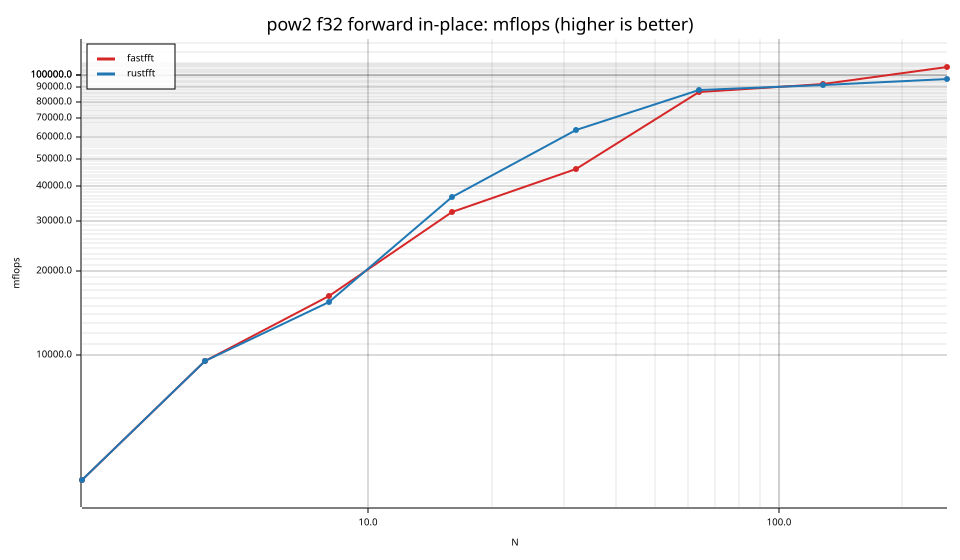
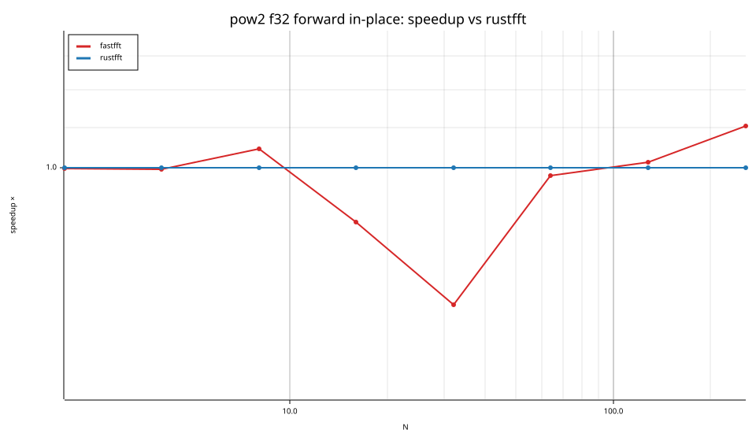
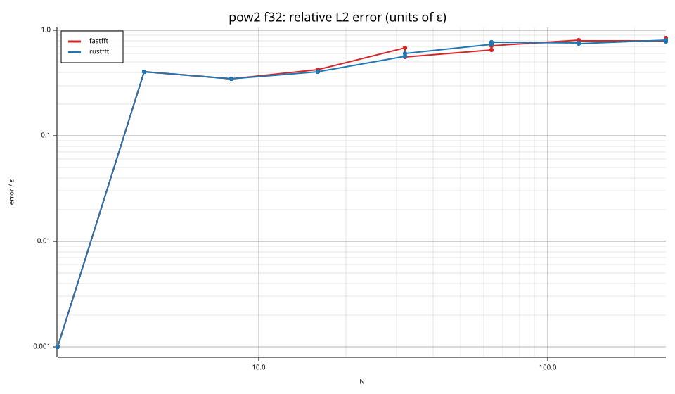
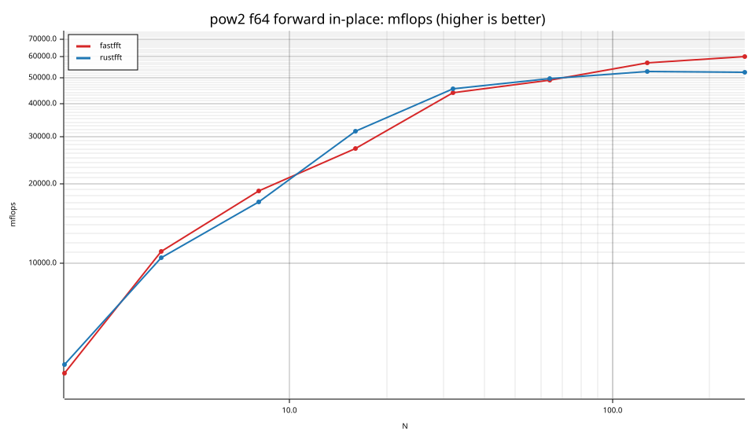
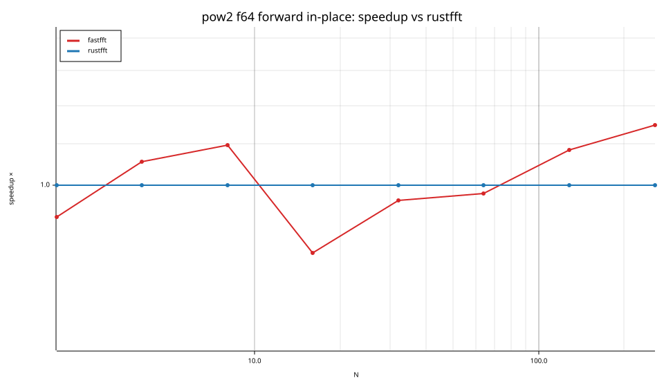
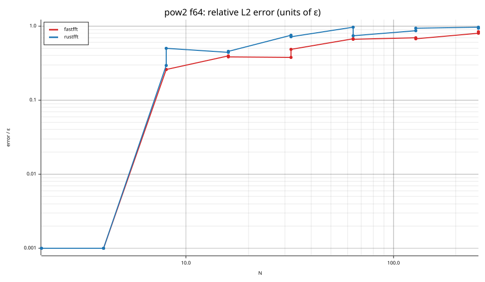

# fastfft arena report: `small-latency-final`

| | |
|---|---|
| Host | mini-ryzen |
| CPU | AMD Ryzen 7 7840HS w/ Radeon 780M Graphics (family 25, model 116, stepping 1, microcode 0xa704108) |
| Pinned CPU | 2 (SMT siblings 2,10) |
| Governor / EPP / boost | performance / performance / 1 |
| Kernel | Linux version 7.0.0-28-generic |
| Virtualization | none |
| rustc | rustc 1.95.0 (59807616e 2026-04-14); binary: rustc; commit-hash: 59807616e1fa2540724bfbac14d7976d7e4a3860; commit-date: 2026-04-14; host: x86_64-unknown-linux-gnu; release: 1.95.0; LLVM version: 22.1.2 |
| Build profile / RUSTFLAGS | arena / `` |
| Libraries | {"fearless_simd":"0.5.0","num-complex":"0.4.6","oxifft":"0.4.2","phastft":"0.4.1","pulp":"0.22.3","rustfft":"6.4.1","tfhe-fft":"0.10.1"} |
| FFTW | fftw-3.3.11-sse2-avx-avx2-avx2_128-avx512 `double: CFLAGS='-O3 -fPIC -std=gnu17' ./configure --enable-static --disable-shared --disable-fortran --disable-doc --enable-sse2 --enable-avx --enable-avx2 --enable-avx512 --enable-fma
single: CFLAGS='-O3 -fPIC -std=gnu17' ./configure --enable-static --disable-shared --disable-fortran --disable-doc --enable-sse2 --enable-avx --enable-avx2 --enable-avx512 --enable-fma --enable-float` |
| Git | 40d65034fed313a56e34b9c27e1aa088746067c6 (dirty: true) |
| Profile | full |
| Official | true  |
| Control drift | max 1.61% over 4 control runs |
| Cells | 64 |

Times are per transform. *best* = minimum batch mean, *median* = median batch mean. Speedup = rustfft time ÷ library time (> 1 means faster than rustfft); *geomean* over the cells both libraries ran. mflops = 5·N·log2(N)/t(µs).

## Release gates (fastfft)

| Gate | Criterion | Status | Detail |
|---|---|---|---|
| G1 | pow2 vs rustfft: geomean ≥ 1.5×, no cell < 0.95× | ❌ fail | geomean best 0.980×, median 0.969×, worst cell 0.549× (pow2:f32:fwd:oop:n16), 64 cells |
| G2 | smooth vs rustfft: geomean ≥ 1.3×, no cell < 0.95× | – n/a | no data |
| G3 | rough vs rustfft: geomean ≥ 0.75×, no cell < 0.5× | – n/a | no data |
| G4 | vs each other Rust library: geomean ≥ 1.1×, ≥ 0.97× on ≥ 90% of cells | – n/a |  |
| G5 | AVX2 forced: pow2 ≥ 1.2×, smooth ≥ 1.1× vs rustfft | – n/a | pow2 NaN×/NaN×, smooth NaN×/NaN× |
| G6 | scenarios ≥ 1.3× each; batch geomean ≥ 1.5× | – n/a | scenarios min inf×, batch NaN×/NaN× |
| G7 | accuracy within §6 thresholds and ≤ 1.5× rustfft + 1ε | ✅ pass | 64 cells checked |
| G8 | Estimate planning time ≤ 2× rustfft for every N ≤ 2^20 | ❌ fail | worst ratio 14.91× (pow2:f64:inv:ip:n16), 64 cells |

G9 (build time) is measured by `cargo xtask build-time`, not by the arena.

## Speedup vs rustfft (geomean of best-time ratios; median-time ratio in parentheses)

| suite | prec | fastfft | rustfft |
|---|---|---|---|
| pow2 | f32 | 0.93× (0.91×) 9/12/11 | 1.00× (1.00×) 0/32/0 |
| pow2 | f64 | 1.04× (1.03×) 19/4/9 | 1.00× (1.00×) 0/32/0 |

w/t/l = cells faster / within ±3% / slower than rustfft (best times).

## Suite `pow2`

### pow2 f32

| cell | fastfft | rustfft |
|---|---|---|
| N=2 fwd ip | 2.8ns (1.00×) | 2.8ns |
| N=2 fwd oop | 2.2ns (1.28×) | 2.8ns |
| N=2 inv ip | 2.8ns (1.00×) | 2.8ns |
| N=2 inv oop | 2.2ns (1.01×) | 2.2ns |
| N=4 fwd ip | 4.2ns (1.00×) | 4.2ns |
| N=4 fwd oop | 3.0ns (1.07×) | 3.2ns |
| N=4 inv ip | 4.3ns (0.99×) | 4.2ns |
| N=4 inv oop | 3.2ns (1.01×) | 3.2ns |
| N=8 fwd ip | 7.4ns (1.04×) | 7.7ns |
| N=8 fwd oop | 3.6ns (0.83×) | 3.0ns |
| N=8 inv ip | 7.4ns (1.05×) | 7.8ns |
| N=8 inv oop | 3.6ns (0.99×) | 3.6ns |
| N=16 fwd ip | 9.9ns (0.88×) | 8.7ns |
| N=16 fwd oop | 7.1ns (0.56×) | 4.0ns |
| N=16 inv ip | 9.9ns (0.88×) | 8.7ns |
| N=16 inv oop | 7.1ns (0.57×) | 4.0ns |
| N=32 fwd ip | 17.3ns (0.73×) | 12.6ns |
| N=32 fwd oop | 15.1ns (0.64×) | 9.7ns |
| N=32 inv ip | 17.4ns (0.73×) | 12.7ns |
| N=32 inv oop | 14.9ns (0.65×) | 9.7ns |
| N=64 fwd ip | 22.2ns (0.98×) | 21.8ns |
| N=64 fwd oop | 19.6ns (1.04×) | 20.3ns |
| N=64 inv ip | 22.2ns (0.97×) | 21.6ns |
| N=64 inv oop | 19.8ns (1.03×) | 20.4ns |
| N=128 fwd ip | 48.3ns (1.01×) | 48.9ns |
| N=128 fwd oop | 49.0ns (0.94×) | 46.3ns |
| N=128 inv ip | 49.0ns (1.00×) | 48.9ns |
| N=128 inv oop | 49.0ns (0.94×) | 45.9ns |
| N=256 fwd ip | 96.0ns (1.10×) | 105.8ns |
| N=256 fwd oop | 95.8ns (1.07×) | 102.9ns |
| N=256 inv ip | 95.7ns (1.09×) | 104.4ns |
| N=256 inv oop | 95.8ns (1.09×) | 104.2ns |

### pow2 f64

| cell | fastfft | rustfft |
|---|---|---|
| N=2 fwd ip | 2.6ns (0.93×) | 2.4ns |
| N=2 fwd oop | 2.4ns (0.93×) | 2.2ns |
| N=2 inv ip | 2.4ns (1.00×) | 2.4ns |
| N=2 inv oop | 2.6ns (1.08×) | 2.8ns |
| N=4 fwd ip | 3.6ns (1.06×) | 3.8ns |
| N=4 fwd oop | 2.8ns (1.29×) | 3.6ns |
| N=4 inv ip | 3.6ns (1.05×) | 3.8ns |
| N=4 inv oop | 2.8ns (1.29×) | 3.6ns |
| N=8 fwd ip | 6.4ns (1.10×) | 7.0ns |
| N=8 fwd oop | 3.8ns (0.95×) | 3.6ns |
| N=8 inv ip | 6.3ns (1.10×) | 7.0ns |
| N=8 inv oop | 3.6ns (1.00×) | 3.6ns |
| N=16 fwd ip | 11.8ns (0.86×) | 10.1ns |
| N=16 fwd oop | 7.0ns (1.07×) | 7.5ns |
| N=16 inv ip | 11.8ns (0.86×) | 10.2ns |
| N=16 inv oop | 7.0ns (1.06×) | 7.5ns |
| N=32 fwd ip | 18.3ns (0.97×) | 17.6ns |
| N=32 fwd oop | 16.8ns (0.92×) | 15.4ns |
| N=32 inv ip | 18.3ns (0.97×) | 17.7ns |
| N=32 inv oop | 16.7ns (0.92×) | 15.5ns |
| N=64 fwd ip | 39.3ns (0.98×) | 38.6ns |
| N=64 fwd oop | 36.6ns (1.04×) | 38.1ns |
| N=64 inv ip | 39.4ns (0.99×) | 38.9ns |
| N=64 inv oop | 36.9ns (1.05×) | 38.9ns |
| N=128 fwd ip | 78.6ns (1.08×) | 85.1ns |
| N=128 fwd oop | 78.8ns (1.07×) | 84.0ns |
| N=128 inv ip | 78.6ns (1.08×) | 85.0ns |
| N=128 inv oop | 79.0ns (1.06×) | 83.3ns |
| N=256 fwd ip | 170.8ns (1.15×) | 195.9ns |
| N=256 fwd oop | 170.2ns (1.14×) | 193.9ns |
| N=256 inv ip | 170.3ns (1.15×) | 196.3ns |
| N=256 inv oop | 170.2ns (1.14×) | 194.2ns |

## Accuracy and planning time (medians over cells)

| lib | cells verified | failed | median error (ε) | worst error (ε) | median plan time |
|---|---|---|---|---|---|
| fastfft | 64 | 0 | 0.42 | 0.85 | 2.21us |
| rustfft | 64 | 0 | 0.57 | 0.97 | 270.0ns |
