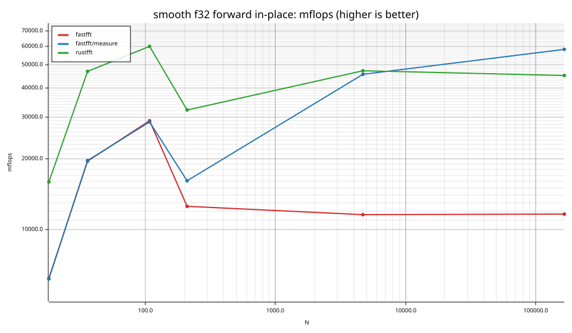
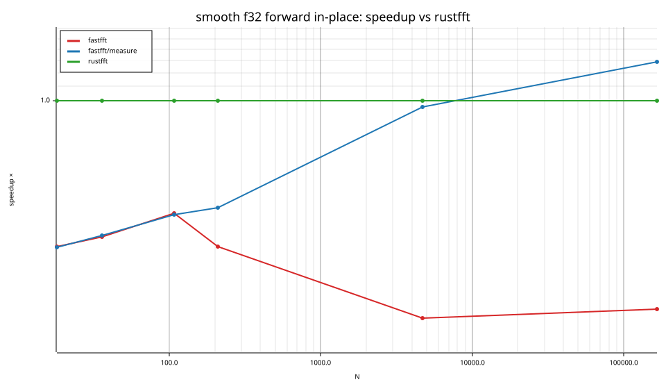
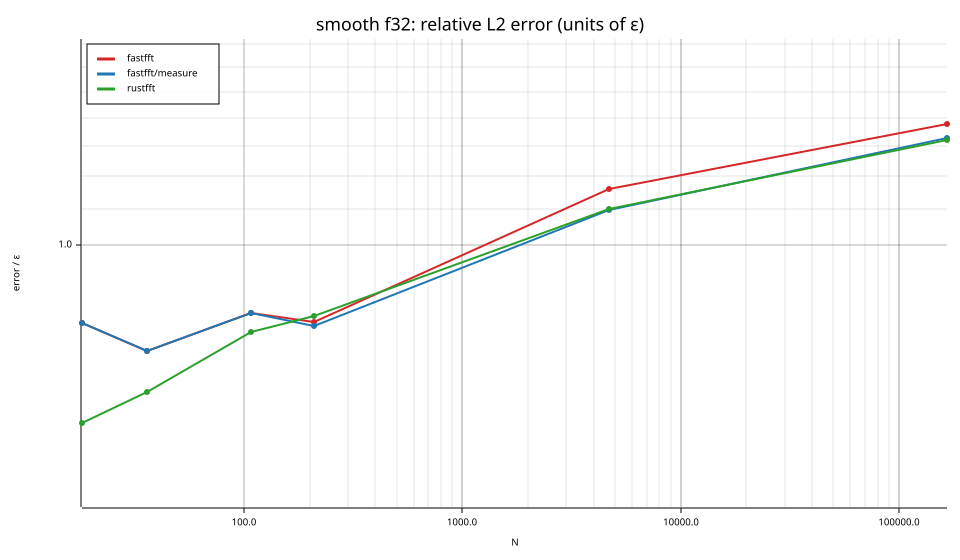
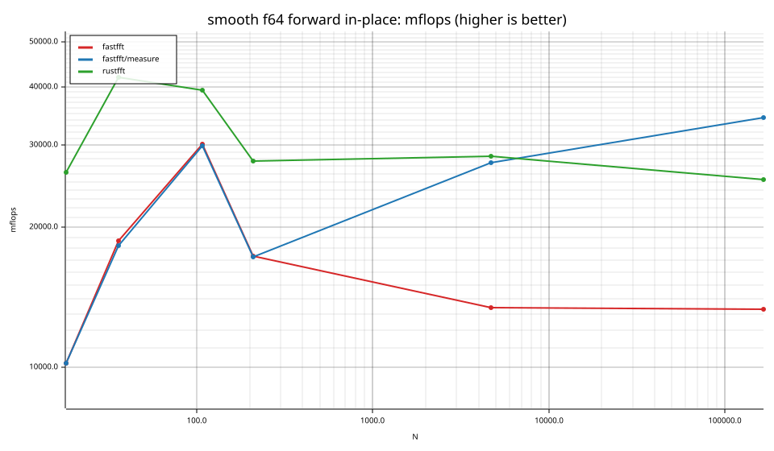
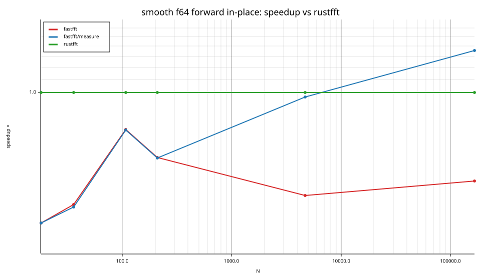
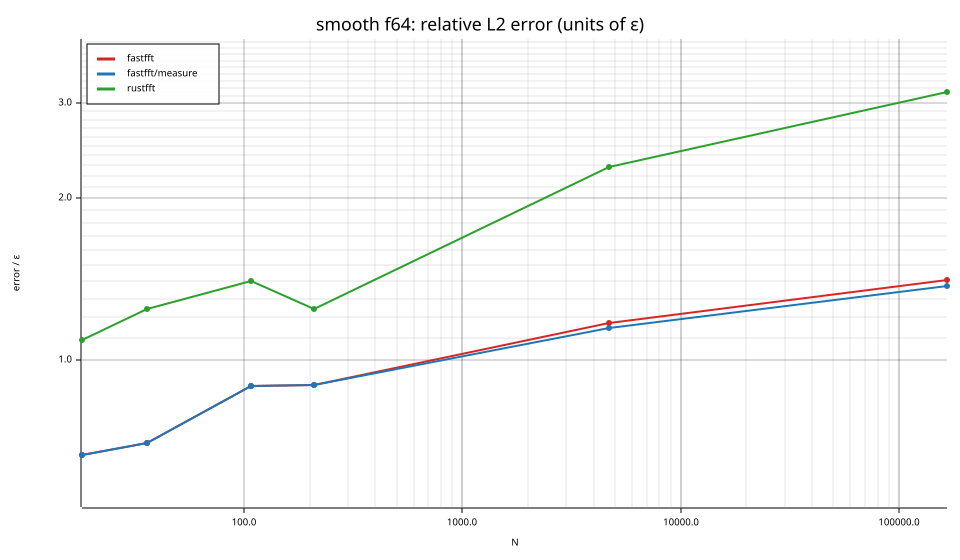

# fastfft arena report: `ticket13-odd-panels-initial`

| | |
|---|---|
| Host | mini-ryzen |
| CPU | AMD Ryzen 7 7840HS w/ Radeon 780M Graphics (family 25, model 116, stepping 1, microcode 0xa704108) |
| Pinned CPU | 2 (SMT siblings 2,10) |
| Governor / EPP / boost | performance / performance / 1 |
| Kernel | Linux version 7.0.0-28-generic |
| Virtualization | container-other |
| rustc | rustc 1.95.0 (59807616e 2026-04-14); binary: rustc; commit-hash: 59807616e1fa2540724bfbac14d7976d7e4a3860; commit-date: 2026-04-14; host: x86_64-unknown-linux-gnu; release: 1.95.0; LLVM version: 22.1.2 |
| Build profile / RUSTFLAGS | arena / `-C llvm-args=-align-all-functions=6` |
| Libraries | {"fearless_simd":"0.5.0","num-complex":"0.4.6","oxifft":"0.4.2","phastft":"0.4.1","pulp":"0.22.3","rustfft":"6.4.1","tfhe-fft":"0.10.1"} |
| FFTW | fftw-3.3.11-sse2-avx-avx2-avx2_128-avx512 `double: CFLAGS='-O3 -fPIC -std=gnu17' ./configure --enable-static --disable-shared --disable-fortran --disable-doc --enable-sse2 --enable-avx --enable-avx2 --enable-avx512 --enable-fma
single: CFLAGS='-O3 -fPIC -std=gnu17' ./configure --enable-static --disable-shared --disable-fortran --disable-doc --enable-sse2 --enable-avx --enable-avx2 --enable-avx512 --enable-fma --enable-float` |
| Git | 861f1bfe2621da1e76197e1f519824e465ec0145 (dirty: true) |
| Profile | quick |
| Official | true  |
| Control drift | max 0.81% over 2 control runs |
| Cells | 12 |

Times are per transform. *best* = minimum batch mean, *median* = median batch mean. Speedup = rustfft time ÷ library time (> 1 means faster than rustfft); *geomean* over the cells both libraries ran. mflops = 5·N·log2(N)/t(µs).

## Release gates (fastfft)

| Gate | Criterion | Status | Detail |
|---|---|---|---|
| G1 | pow2 vs rustfft: geomean ≥ 1.5×, no cell < 0.95× | – n/a | no data |
| G2 | smooth vs rustfft: geomean ≥ 1.3×, no cell < 0.95× | ❌ fail | geomean best 0.429×, median 0.430×, worst cell 0.244× (smooth:f32:fwd:ip:n4725), 12 cells |
| G3 | rough vs rustfft: geomean ≥ 0.75×, no cell < 0.5× | – n/a | no data |
| G4 | vs each other Rust library: geomean ≥ 1.1×, ≥ 0.97× on ≥ 90% of cells | – n/a |  |
| G5 | AVX2 forced: pow2 ≥ 1.2×, smooth ≥ 1.1× vs rustfft | – n/a | pow2 NaN×/NaN×, smooth NaN×/NaN× |
| G6 | scenarios ≥ 1.3× each; batch geomean ≥ 1.5× | – n/a | scenarios min inf×, batch NaN×/NaN× |
| G7 | accuracy within §6 thresholds and ≤ 1.5× rustfft + 1ε | ✅ pass | 12 cells checked |
| G8 | Estimate planning time ≤ 2× rustfft for every N ≤ 2^20 | ❌ fail | worst ratio 15.70× (smooth:f64:fwd:ip:n18), 12 cells |

G9 (build time) is measured by `cargo xtask build-time`, not by the arena.

## Speedup vs rustfft (geomean of best-time ratios; median-time ratio in parentheses)

| suite | prec | fastfft | fastfft/measure | rustfft |
|---|---|---|---|---|
| smooth | f32 | 0.35× (0.35×) 0/0/6 | 0.60× (0.60×) 1/0/5 | 1.00× (1.00×) 0/6/0 |
| smooth | f64 | 0.52× (0.52×) 0/0/6 | 0.69× (0.69×) 1/0/5 | 1.00× (1.00×) 0/6/0 |

w/t/l = cells faster / within ±3% / slower than rustfft (best times).

## Suite `smooth`

### smooth f32

| cell | fastfft | fastfft/measure | rustfft |
|---|---|---|---|
| N=18 fwd ip | 60.4ns (0.39×) | 60.8ns (0.39×) | 23.5ns |
| N=36 fwd ip | 47.7ns (0.41×) | 47.4ns (0.42×) | 19.8ns |
| N=108 fwd ip | 126.0ns (0.48×) | 126.9ns (0.48×) | 60.7ns |
| N=210 fwd ip | 646.6ns (0.39×) | 503.6ns (0.50×) | 251.7ns |
| N=4725 fwd ip | 24.97us (0.24×) | 6.32us (0.96×) | 6.09us |
| N=165375 fwd ip | 1.23ms (0.26×) | 246.25us (1.29×) | 317.88us |

### smooth f64

| cell | fastfft | fastfft/measure | rustfft |
|---|---|---|---|
| N=18 fwd ip | 36.9ns (0.39×) | 36.9ns (0.39×) | 14.3ns |
| N=36 fwd ip | 49.9ns (0.44×) | 50.9ns (0.44×) | 22.2ns |
| N=108 fwd ip | 121.3ns (0.76×) | 121.9ns (0.76×) | 92.7ns |
| N=210 fwd ip | 467.8ns (0.62×) | 469.1ns (0.62×) | 291.8ns |
| N=4725 fwd ip | 21.47us (0.47×) | 10.50us (0.97×) | 10.16us |
| N=165375 fwd ip | 1.08ms (0.53×) | 417.76us (1.36×) | 566.89us |

## Accuracy and planning time (medians over cells)

| lib | cells verified | failed | median error (ε) | worst error (ε) | median plan time |
|---|---|---|---|---|---|
| fastfft | 12 | 0 | 0.89 | 1.41 | 8.20us |
| fastfft/measure | 12 | 0 | 0.89 | 1.37 | 1.00s |
| rustfft | 12 | 0 | 1.24 | 3.16 | 1.96us |
