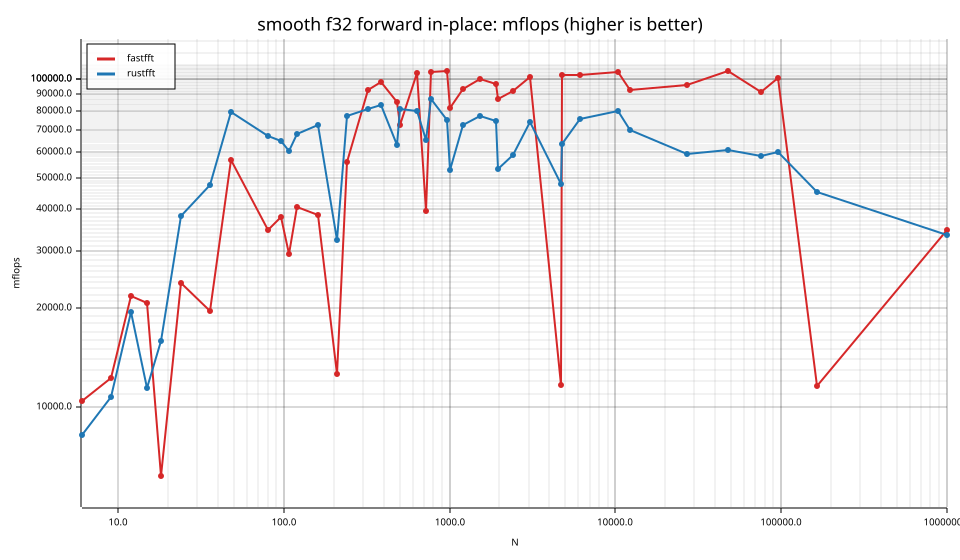
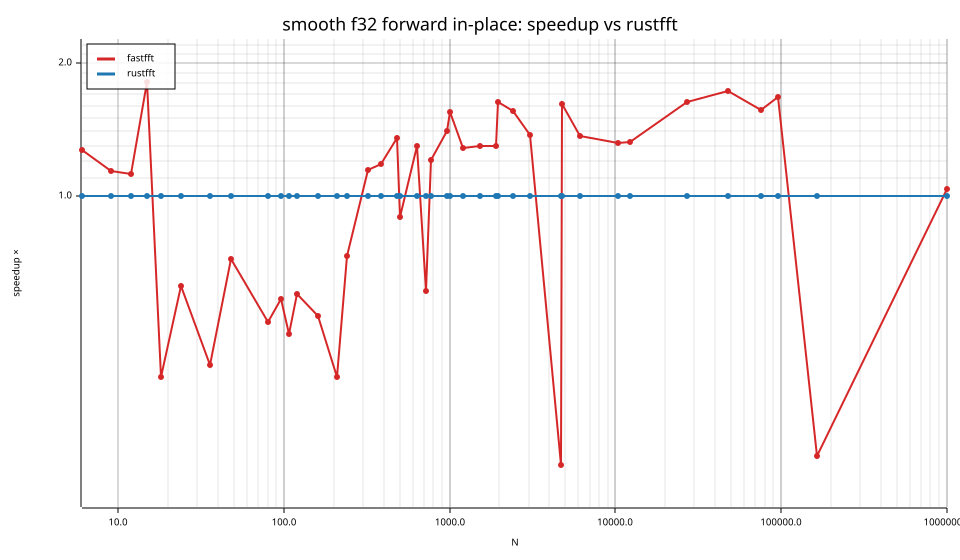
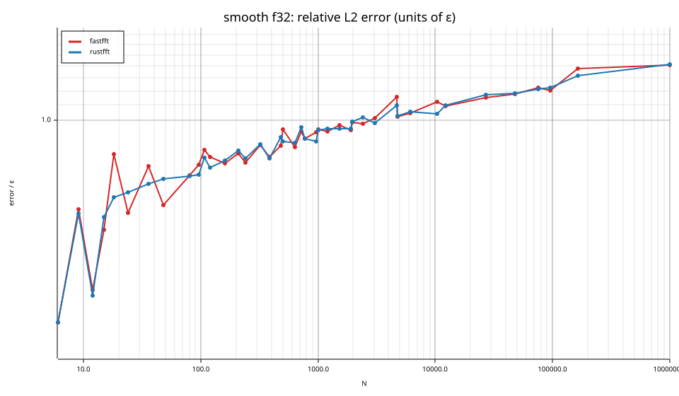
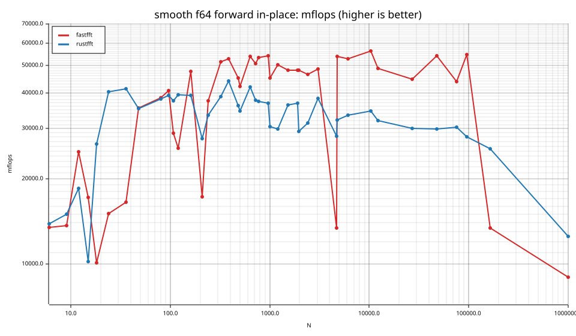
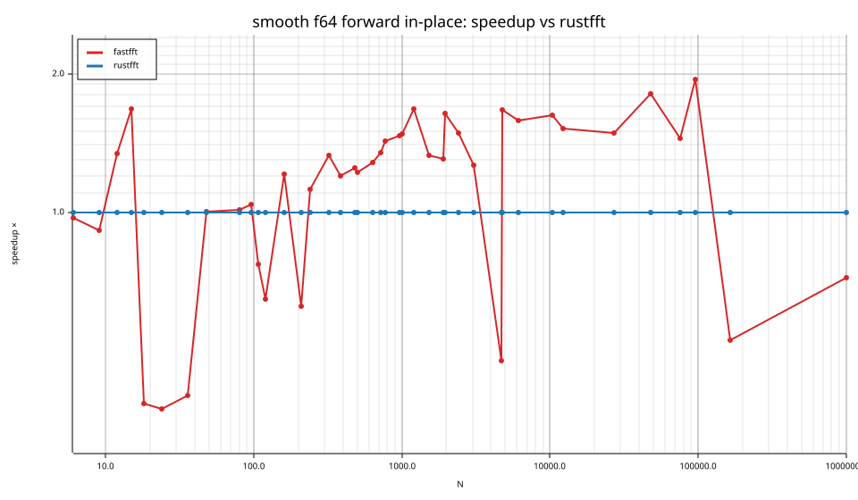
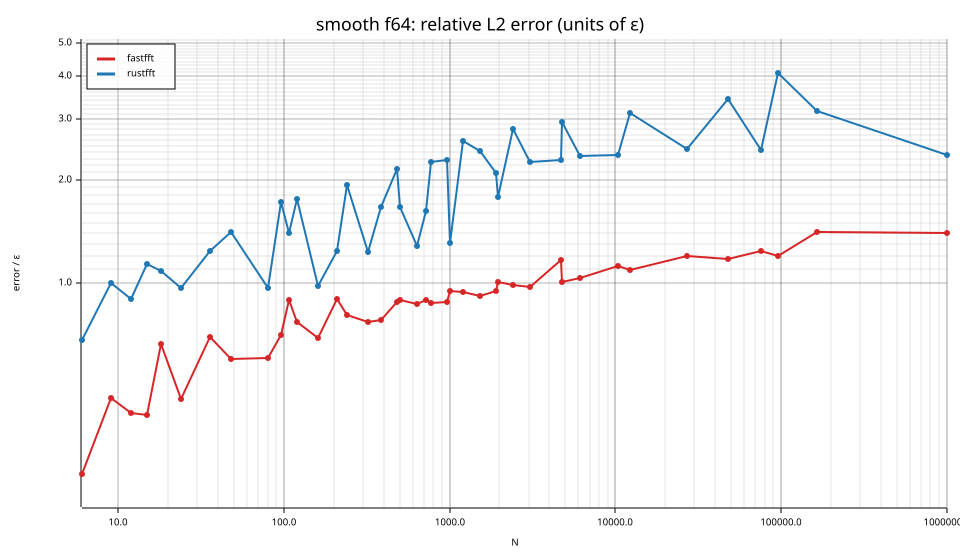

# fastfft arena report: `ticket13-before-small`

| | |
|---|---|
| Host | mini-ryzen |
| CPU | AMD Ryzen 7 7840HS w/ Radeon 780M Graphics (family 25, model 116, stepping 1, microcode 0xa704108) |
| Pinned CPU | 2 (SMT siblings 2,10) |
| Governor / EPP / boost | performance / performance / 1 |
| Kernel | Linux version 7.0.0-28-generic |
| Virtualization | container-other |
| rustc | rustc 1.95.0 (59807616e 2026-04-14); binary: rustc; commit-hash: 59807616e1fa2540724bfbac14d7976d7e4a3860; commit-date: 2026-04-14; host: x86_64-unknown-linux-gnu; release: 1.95.0; LLVM version: 22.1.2 |
| Build profile / RUSTFLAGS | arena / `-C llvm-args=-align-all-functions=6` |
| Libraries | {"fearless_simd":"0.5.0","num-complex":"0.4.6","oxifft":"0.4.2","phastft":"0.4.1","pulp":"0.22.3","rustfft":"6.4.1","tfhe-fft":"0.10.1"} |
| FFTW | fftw-3.3.11-sse2-avx-avx2-avx2_128-avx512 `double: CFLAGS='-O3 -fPIC -std=gnu17' ./configure --enable-static --disable-shared --disable-fortran --disable-doc --enable-sse2 --enable-avx --enable-avx2 --enable-avx512 --enable-fma
single: CFLAGS='-O3 -fPIC -std=gnu17' ./configure --enable-static --disable-shared --disable-fortran --disable-doc --enable-sse2 --enable-avx --enable-avx2 --enable-avx512 --enable-fma --enable-float` |
| Git | 8a36159f41d3d1858cecacb70a546789b20ccbef (dirty: false) |
| Profile | quick |
| Official | true  |
| Control drift | max 0.99% over 5 control runs |
| Cells | 82 |

Times are per transform. *best* = minimum batch mean, *median* = median batch mean. Speedup = rustfft time ÷ library time (> 1 means faster than rustfft); *geomean* over the cells both libraries ran. mflops = 5·N·log2(N)/t(µs).

## Release gates (fastfft)

| Gate | Criterion | Status | Detail |
|---|---|---|---|
| G1 | pow2 vs rustfft: geomean ≥ 1.5×, no cell < 0.95× | – n/a | no data |
| G2 | smooth vs rustfft: geomean ≥ 1.3×, no cell < 0.95× | ❌ fail | geomean best 1.024×, median 1.023×, worst cell 0.245× (smooth:f32:fwd:ip:n4725), 82 cells |
| G3 | rough vs rustfft: geomean ≥ 0.75×, no cell < 0.5× | – n/a | no data |
| G4 | vs each other Rust library: geomean ≥ 1.1×, ≥ 0.97× on ≥ 90% of cells | – n/a |  |
| G5 | AVX2 forced: pow2 ≥ 1.2×, smooth ≥ 1.1× vs rustfft | – n/a | pow2 NaN×/NaN×, smooth NaN×/NaN× |
| G6 | scenarios ≥ 1.3× each; batch geomean ≥ 1.5× | – n/a | scenarios min inf×, batch NaN×/NaN× |
| G7 | accuracy within §6 thresholds and ≤ 1.5× rustfft + 1ε | ✅ pass | 82 cells checked |
| G8 | Estimate planning time ≤ 2× rustfft for every N ≤ 2^20 | ❌ fail | worst ratio 18.23× (smooth:f32:fwd:ip:n24), 82 cells |

G9 (build time) is measured by `cargo xtask build-time`, not by the arena.

## Speedup vs rustfft (geomean of best-time ratios; median-time ratio in parentheses)

| suite | prec | fastfft | rustfft |
|---|---|---|---|
| smooth | f32 | 0.95× (0.95×) 26/0/15 | 1.00× (1.00×) 0/41/0 |
| smooth | f64 | 1.10× (1.10×) 28/2/11 | 1.00× (1.00×) 0/41/0 |

w/t/l = cells faster / within ±3% / slower than rustfft (best times).

## Suite `smooth`

### smooth f32

| cell | fastfft | rustfft |
|---|---|---|
| N=6 fwd ip | 7.4ns (1.27×) | 9.4ns |
| N=9 fwd ip | 11.7ns (1.14×) | 13.2ns |
| N=12 fwd ip | 9.8ns (1.12×) | 11.0ns |
| N=15 fwd ip | 14.1ns (1.81×) | 25.6ns |
| N=18 fwd ip | 60.6ns (0.39×) | 23.5ns |
| N=24 fwd ip | 23.1ns (0.62×) | 14.4ns |
| N=36 fwd ip | 47.6ns (0.41×) | 19.6ns |
| N=48 fwd ip | 23.6ns (0.72×) | 16.9ns |
| N=80 fwd ip | 72.9ns (0.52×) | 37.7ns |
| N=96 fwd ip | 83.6ns (0.58×) | 48.9ns |
| N=108 fwd ip | 124.8ns (0.49×) | 60.6ns |
| N=120 fwd ip | 101.8ns (0.60×) | 61.0ns |
| N=160 fwd ip | 152.0ns (0.53×) | 81.1ns |
| N=210 fwd ip | 643.6ns (0.39×) | 250.1ns |
| N=240 fwd ip | 169.6ns (0.73×) | 123.6ns |
| N=320 fwd ip | 144.0ns (1.14×) | 164.5ns |
| N=384 fwd ip | 168.1ns (1.18×) | 198.3ns |
| N=480 fwd ip | 250.9ns (1.35×) | 339.5ns |
| N=504 fwd ip | 312.2ns (0.90×) | 280.2ns |
| N=640 fwd ip | 287.3ns (1.30×) | 372.7ns |
| N=720 fwd ip | 862.5ns (0.61×) | 525.7ns |
| N=768 fwd ip | 351.8ns (1.21×) | 425.1ns |
| N=960 fwd ip | 451.4ns (1.40×) | 633.6ns |
| N=1000 fwd ip | 610.8ns (1.55×) | 946.0ns |
| N=1200 fwd ip | 660.3ns (1.28×) | 846.7ns |
| N=1536 fwd ip | 813.4ns (1.30×) | 1.06us |
| N=1920 fwd ip | 1.09us (1.30×) | 1.41us |
| N=1960 fwd ip | 1.24us (1.64×) | 2.02us |
| N=2400 fwd ip | 1.47us (1.56×) | 2.30us |
| N=3072 fwd ip | 1.75us (1.37×) | 2.41us |
| N=4725 fwd ip | 24.59us (0.25×) | 6.04us |
| N=4800 fwd ip | 2.86us (1.62×) | 4.62us |
| N=6144 fwd ip | 3.75us (1.37×) | 5.13us |
| N=10368 fwd ip | 6.60us (1.32×) | 8.69us |
| N=12288 fwd ip | 9.01us (1.33×) | 11.96us |
| N=27000 fwd ip | 20.71us (1.63×) | 33.77us |
| N=48000 fwd ip | 35.47us (1.73×) | 61.32us |
| N=75600 fwd ip | 67.02us (1.57×) | 105.22us |
| N=96000 fwd ip | 79.07us (1.68×) | 132.81us |
| N=165375 fwd ip | 1.23ms (0.26×) | 316.79us |
| N=1000000 fwd ip | 2.87ms (1.04×) | 2.98ms |

### smooth f64

| cell | fastfft | rustfft |
|---|---|---|
| N=6 fwd ip | 5.8ns (0.97×) | 5.6ns |
| N=9 fwd ip | 10.4ns (0.91×) | 9.5ns |
| N=12 fwd ip | 8.6ns (1.34×) | 11.6ns |
| N=15 fwd ip | 17.1ns (1.68×) | 28.7ns |
| N=18 fwd ip | 37.0ns (0.38×) | 14.2ns |
| N=24 fwd ip | 36.5ns (0.37×) | 13.6ns |
| N=36 fwd ip | 56.2ns (0.40×) | 22.5ns |
| N=48 fwd ip | 37.9ns (1.00×) | 38.0ns |
| N=80 fwd ip | 65.8ns (1.01×) | 66.4ns |
| N=96 fwd ip | 77.4ns (1.04×) | 80.6ns |
| N=108 fwd ip | 126.1ns (0.77×) | 96.9ns |
| N=120 fwd ip | 162.3ns (0.65×) | 105.1ns |
| N=160 fwd ip | 123.1ns (1.21×) | 149.1ns |
| N=210 fwd ip | 469.4ns (0.62×) | 293.2ns |
| N=240 fwd ip | 253.0ns (1.12×) | 283.4ns |
| N=320 fwd ip | 258.2ns (1.33×) | 342.6ns |
| N=384 fwd ip | 312.0ns (1.20×) | 374.4ns |
| N=480 fwd ip | 473.4ns (1.25×) | 590.2ns |
| N=504 fwd ip | 536.2ns (1.22×) | 654.4ns |
| N=640 fwd ip | 553.7ns (1.29×) | 711.5ns |
| N=720 fwd ip | 671.7ns (1.35×) | 904.4ns |
| N=768 fwd ip | 690.2ns (1.43×) | 985.1ns |
| N=960 fwd ip | 879.5ns (1.47×) | 1.29us |
| N=1000 fwd ip | 1.10us (1.48×) | 1.63us |
| N=1200 fwd ip | 1.22us (1.68×) | 2.05us |
| N=1536 fwd ip | 1.69us (1.33×) | 2.24us |
| N=1920 fwd ip | 2.18us (1.31×) | 2.84us |
| N=1960 fwd ip | 2.22us (1.64×) | 3.65us |
| N=2400 fwd ip | 2.89us (1.49×) | 4.30us |
| N=3072 fwd ip | 3.67us (1.27×) | 4.64us |
| N=4725 fwd ip | 21.53us (0.47×) | 10.21us |
| N=4800 fwd ip | 5.46us (1.67×) | 9.13us |
| N=6144 fwd ip | 7.31us (1.58×) | 11.58us |
| N=10368 fwd ip | 12.33us (1.63×) | 20.04us |
| N=12288 fwd ip | 17.13us (1.52×) | 26.07us |
| N=27000 fwd ip | 44.37us (1.49×) | 66.06us |
| N=48000 fwd ip | 68.94us (1.81×) | 124.97us |
| N=75600 fwd ip | 139.41us (1.45×) | 202.09us |
| N=96000 fwd ip | 145.56us (1.94×) | 282.73us |
| N=165375 fwd ip | 1.07ms (0.53×) | 564.09us |
| N=1000000 fwd ip | 11.04ms (0.72×) | 7.95ms |

## Accuracy and planning time (medians over cells)

| lib | cells verified | failed | median error (ε) | worst error (ε) | median plan time |
|---|---|---|---|---|---|
| fastfft | 82 | 0 | 0.90 | 1.41 | 23.88us |
| rustfft | 82 | 0 | 1.10 | 4.09 | 6.16us |
