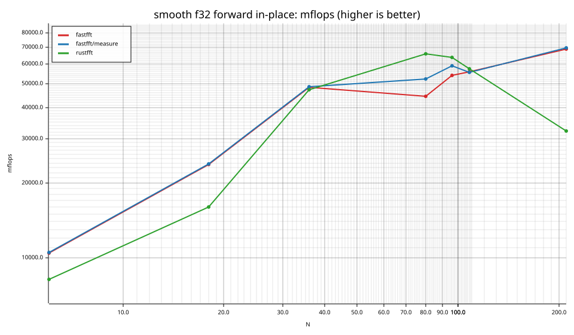
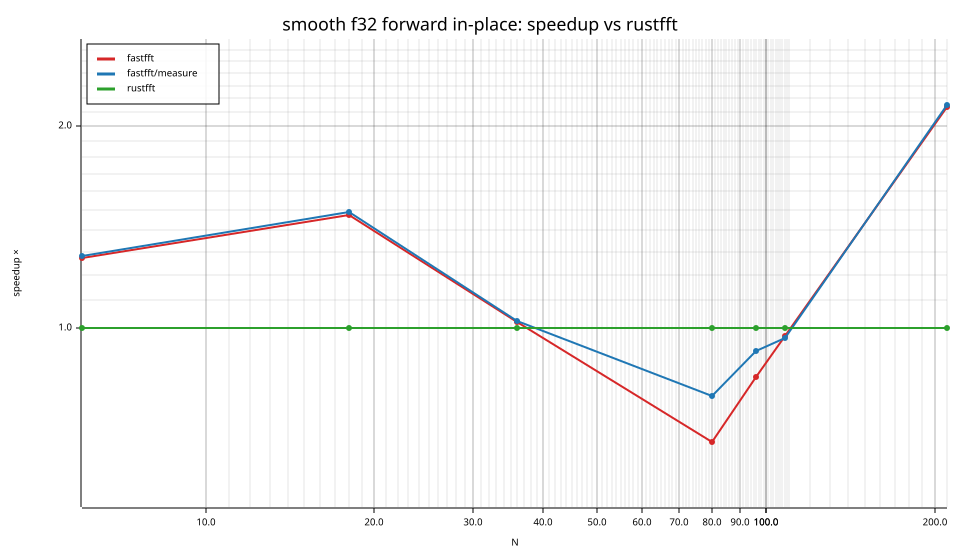
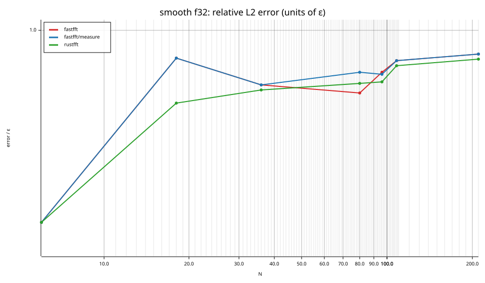
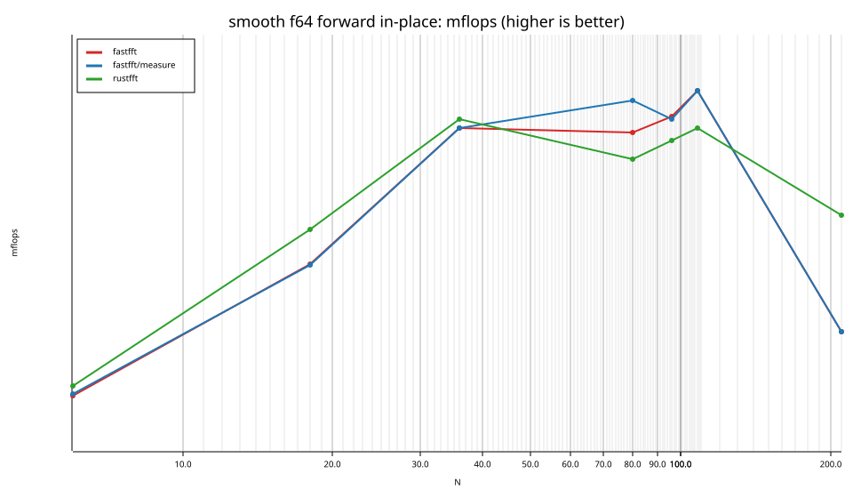
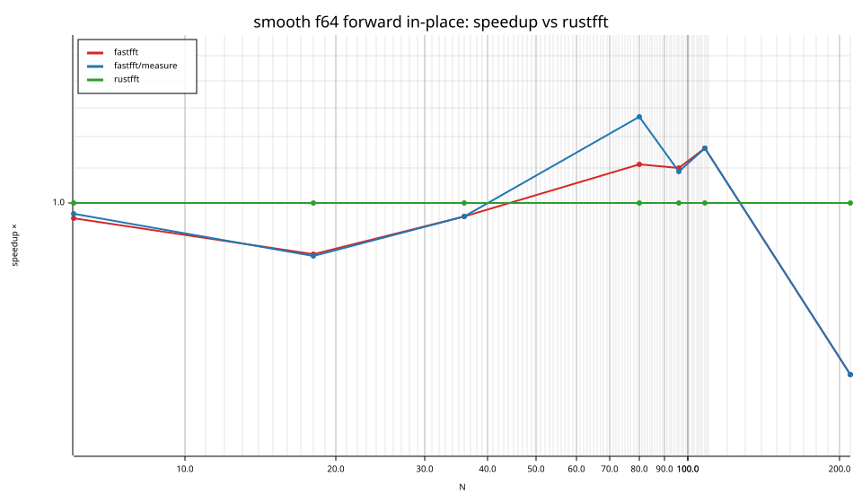
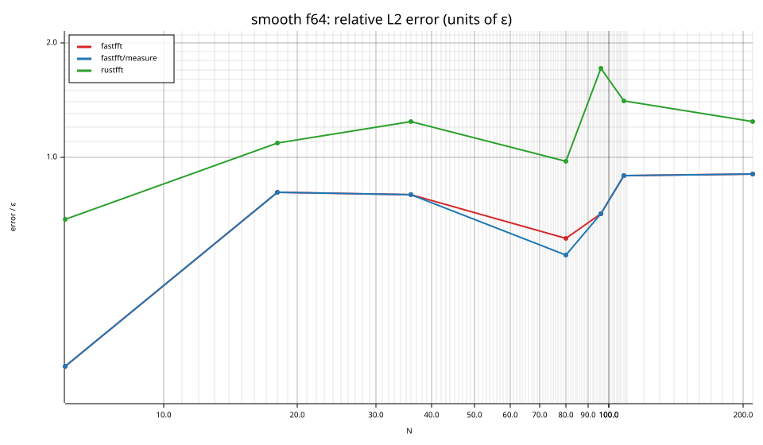

# fastfft arena report: `ticket13-remaining-measure`

| | |
|---|---|
| Host | mini-ryzen |
| CPU | AMD Ryzen 7 7840HS w/ Radeon 780M Graphics (family 25, model 116, stepping 1, microcode 0xa704108) |
| Pinned CPU | 2 (SMT siblings 2,10) |
| Governor / EPP / boost | performance / performance / 1 |
| Kernel | Linux version 7.0.0-28-generic |
| Virtualization | container-other |
| rustc | rustc 1.95.0 (59807616e 2026-04-14); binary: rustc; commit-hash: 59807616e1fa2540724bfbac14d7976d7e4a3860; commit-date: 2026-04-14; host: x86_64-unknown-linux-gnu; release: 1.95.0; LLVM version: 22.1.2 |
| Build profile / RUSTFLAGS | arena / `-C llvm-args=-align-all-functions=6` |
| Libraries | {"fearless_simd":"0.5.0","num-complex":"0.4.6","oxifft":"0.4.2","phastft":"0.4.1","pulp":"0.22.3","rustfft":"6.4.1","tfhe-fft":"0.10.1"} |
| FFTW | fftw-3.3.11-sse2-avx-avx2-avx2_128-avx512 `double: CFLAGS='-O3 -fPIC -std=gnu17' ./configure --enable-static --disable-shared --disable-fortran --disable-doc --enable-sse2 --enable-avx --enable-avx2 --enable-avx512 --enable-fma
single: CFLAGS='-O3 -fPIC -std=gnu17' ./configure --enable-static --disable-shared --disable-fortran --disable-doc --enable-sse2 --enable-avx --enable-avx2 --enable-avx512 --enable-fma --enable-float` |
| Git | 8a36159f41d3d1858cecacb70a546789b20ccbef (dirty: true) |
| Profile | quick |
| Official | true  |
| Control drift | max 0.90% over 2 control runs |
| Cells | 14 |

Times are per transform. *best* = minimum batch mean, *median* = median batch mean. Speedup = rustfft time ÷ library time (> 1 means faster than rustfft); *geomean* over the cells both libraries ran. mflops = 5·N·log2(N)/t(µs).

## Release gates (fastfft)

| Gate | Criterion | Status | Detail |
|---|---|---|---|
| G1 | pow2 vs rustfft: geomean ≥ 1.5×, no cell < 0.95× | – n/a | no data |
| G2 | smooth vs rustfft: geomean ≥ 1.3×, no cell < 0.95× | ❌ fail | geomean best 1.035×, median 1.036×, worst cell 0.624× (smooth:f64:fwd:ip:n210), 14 cells |
| G3 | rough vs rustfft: geomean ≥ 0.75×, no cell < 0.5× | – n/a | no data |
| G4 | vs each other Rust library: geomean ≥ 1.1×, ≥ 0.97× on ≥ 90% of cells | – n/a |  |
| G5 | AVX2 forced: pow2 ≥ 1.2×, smooth ≥ 1.1× vs rustfft | – n/a | pow2 NaN×/NaN×, smooth NaN×/NaN× |
| G6 | scenarios ≥ 1.3× each; batch geomean ≥ 1.5× | – n/a | scenarios min inf×, batch NaN×/NaN× |
| G7 | accuracy within §6 thresholds and ≤ 1.5× rustfft + 1ε | ✅ pass | 14 cells checked |
| G8 | Estimate planning time ≤ 2× rustfft for every N ≤ 2^20 | ❌ fail | worst ratio 22.16× (smooth:f64:fwd:ip:n18), 14 cells |

G9 (build time) is measured by `cargo xtask build-time`, not by the arena.

## Speedup vs rustfft (geomean of best-time ratios; median-time ratio in parentheses)

| suite | prec | fastfft | fastfft/measure | rustfft |
|---|---|---|---|---|
| smooth | f32 | 1.12× (1.13×) 3/2/2 | 1.17× (1.17×) 3/1/3 | 1.00× (1.00×) 0/7/0 |
| smooth | f64 | 0.95× (0.95×) 3/0/4 | 0.97× (0.97×) 3/0/4 | 1.00× (1.00×) 0/7/0 |

w/t/l = cells faster / within ±3% / slower than rustfft (best times).

## Suite `smooth`

### smooth f32

| cell | fastfft | fastfft/measure | rustfft |
|---|---|---|---|
| N=6 fwd ip | 7.4ns (1.27×) | 7.4ns (1.28×) | 9.4ns |
| N=18 fwd ip | 15.9ns (1.48×) | 15.7ns (1.49×) | 23.4ns |
| N=36 fwd ip | 19.2ns (1.02×) | 19.2ns (1.03×) | 19.6ns |
| N=80 fwd ip | 57.0ns (0.68×) | 48.6ns (0.79×) | 38.5ns |
| N=96 fwd ip | 58.7ns (0.84×) | 53.6ns (0.93×) | 49.6ns |
| N=108 fwd ip | 65.3ns (0.97×) | 65.8ns (0.97×) | 63.5ns |
| N=210 fwd ip | 117.5ns (2.14×) | 116.4ns (2.15×) | 250.9ns |

### smooth f64

| cell | fastfft | fastfft/measure | rustfft |
|---|---|---|---|
| N=6 fwd ip | 5.8ns (0.96×) | 5.8ns (0.97×) | 5.6ns |
| N=18 fwd ip | 16.5ns (0.87×) | 16.6ns (0.86×) | 14.3ns |
| N=36 fwd ip | 23.6ns (0.96×) | 23.6ns (0.96×) | 22.8ns |
| N=80 fwd ip | 65.4ns (1.11×) | 57.4ns (1.27×) | 72.7ns |
| N=96 fwd ip | 76.6ns (1.10×) | 77.3ns (1.09×) | 84.4ns |
| N=108 fwd ip | 79.5ns (1.16×) | 79.6ns (1.16×) | 92.5ns |
| N=210 fwd ip | 468.4ns (0.62×) | 468.4ns (0.62×) | 292.2ns |

## Accuracy and planning time (medians over cells)

| lib | cells verified | failed | median error (ε) | worst error (ε) | median plan time |
|---|---|---|---|---|---|
| fastfft | 14 | 0 | 0.80 | 0.90 | 5.06us |
| fastfft/measure | 14 | 0 | 0.80 | 0.90 | 1.00s |
| rustfft | 14 | 0 | 0.83 | 1.72 | 791.0ns |
