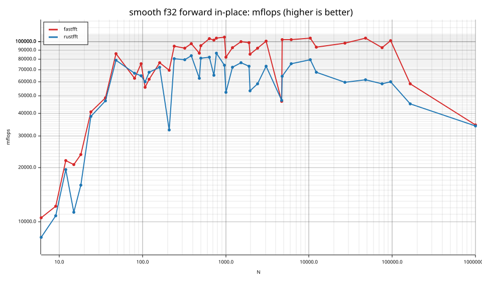
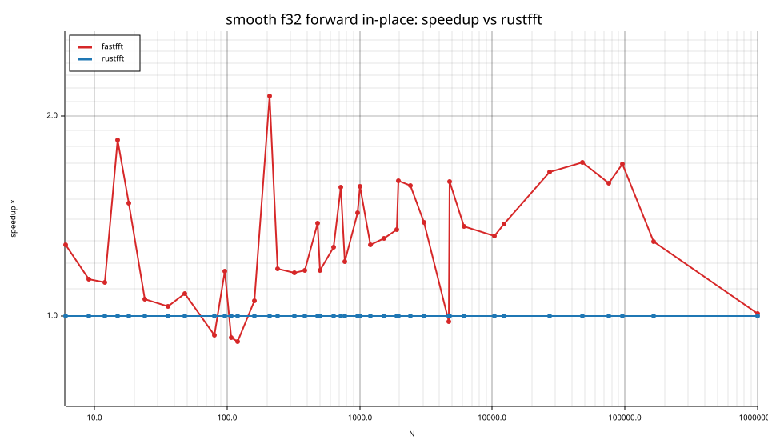
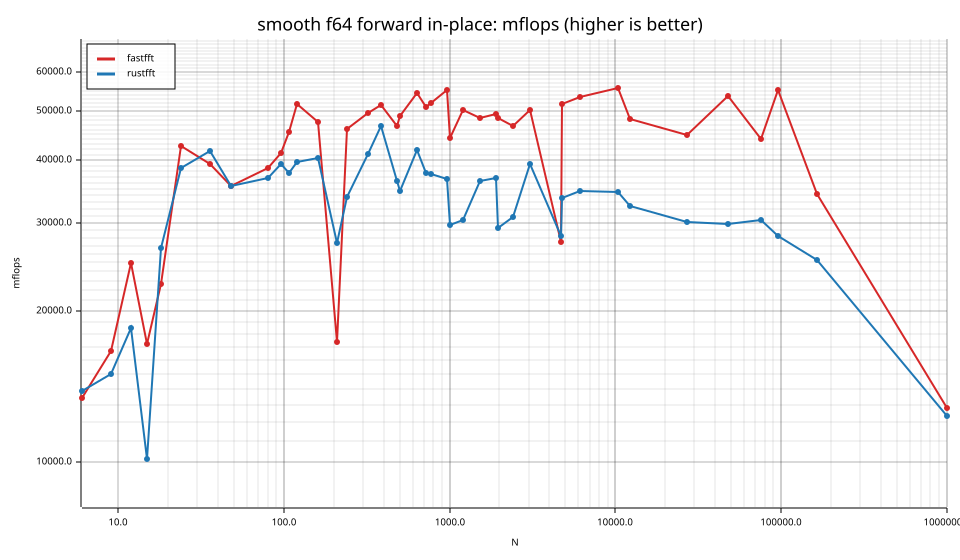
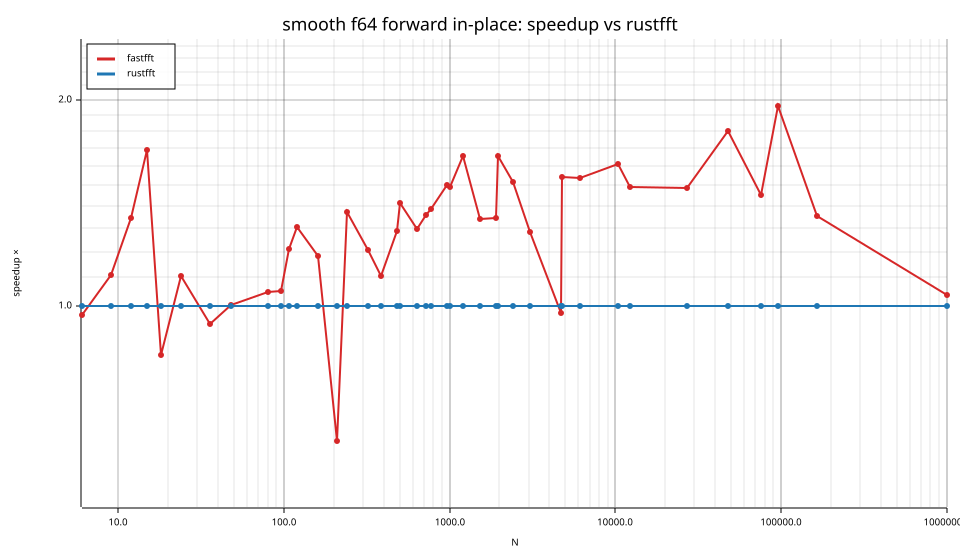
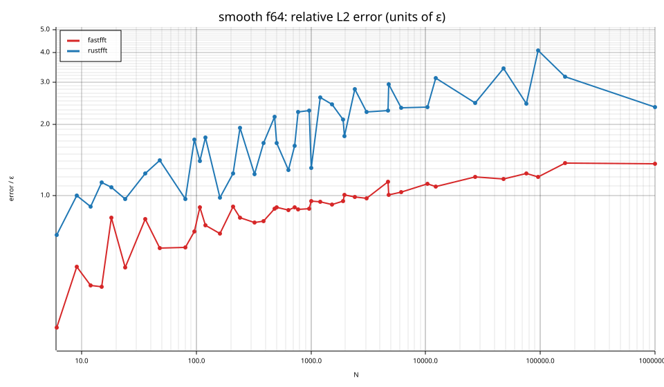

# fastfft arena report: `ticket13-smooth-checkpoint`

| | |
|---|---|
| Host | mini-ryzen |
| CPU | AMD Ryzen 7 7840HS w/ Radeon 780M Graphics (family 25, model 116, stepping 1, microcode 0xa704108) |
| Pinned CPU | 2 (SMT siblings 2,10) |
| Governor / EPP / boost | performance / performance / 1 |
| Kernel | Linux version 7.0.0-28-generic |
| Virtualization | container-other |
| rustc | rustc 1.95.0 (59807616e 2026-04-14); binary: rustc; commit-hash: 59807616e1fa2540724bfbac14d7976d7e4a3860; commit-date: 2026-04-14; host: x86_64-unknown-linux-gnu; release: 1.95.0; LLVM version: 22.1.2 |
| Build profile / RUSTFLAGS | arena / `-C llvm-args=-align-all-functions=6` |
| Libraries | {"fearless_simd":"0.5.0","num-complex":"0.4.6","oxifft":"0.4.2","phastft":"0.4.1","pulp":"0.22.3","rustfft":"6.4.1","tfhe-fft":"0.10.1"} |
| FFTW | fftw-3.3.11-sse2-avx-avx2-avx2_128-avx512 `double: CFLAGS='-O3 -fPIC -std=gnu17' ./configure --enable-static --disable-shared --disable-fortran --disable-doc --enable-sse2 --enable-avx --enable-avx2 --enable-avx512 --enable-fma
single: CFLAGS='-O3 -fPIC -std=gnu17' ./configure --enable-static --disable-shared --disable-fortran --disable-doc --enable-sse2 --enable-avx --enable-avx2 --enable-avx512 --enable-fma --enable-float` |
| Git | 8a36159f41d3d1858cecacb70a546789b20ccbef (dirty: true) |
| Profile | quick |
| Official | true  |
| Control drift | max 0.68% over 5 control runs |
| Cells | 82 |

Times are per transform. *best* = minimum batch mean, *median* = median batch mean. Speedup = rustfft time ÷ library time (> 1 means faster than rustfft); *geomean* over the cells both libraries ran. mflops = 5·N·log2(N)/t(µs).

## Release gates (fastfft)

| Gate | Criterion | Status | Detail |
|---|---|---|---|
| G1 | pow2 vs rustfft: geomean ≥ 1.5×, no cell < 0.95× | – n/a | no data |
| G2 | smooth vs rustfft: geomean ≥ 1.3×, no cell < 0.95× | ❌ fail | geomean best 1.292×, median 1.292×, worst cell 0.633× (smooth:f64:fwd:ip:n210), 82 cells |
| G3 | rough vs rustfft: geomean ≥ 0.75×, no cell < 0.5× | – n/a | no data |
| G4 | vs each other Rust library: geomean ≥ 1.1×, ≥ 0.97× on ≥ 90% of cells | – n/a |  |
| G5 | AVX2 forced: pow2 ≥ 1.2×, smooth ≥ 1.1× vs rustfft | – n/a | pow2 NaN×/NaN×, smooth NaN×/NaN× |
| G6 | scenarios ≥ 1.3× each; batch geomean ≥ 1.5× | – n/a | scenarios min inf×, batch NaN×/NaN× |
| G7 | accuracy within §6 thresholds and ≤ 1.5× rustfft + 1ε | ✅ pass | 82 cells checked |
| G8 | Estimate planning time ≤ 2× rustfft for every N ≤ 2^20 | ❌ fail | worst ratio 32.70× (smooth:f32:fwd:ip:n24), 82 cells |

G9 (build time) is measured by `cargo xtask build-time`, not by the arena.

## Speedup vs rustfft (geomean of best-time ratios; median-time ratio in parentheses)

| suite | prec | fastfft | rustfft |
|---|---|---|---|
| smooth | f32 | 1.30× (1.30×) 36/2/3 | 1.00× (1.00×) 0/41/0 |
| smooth | f64 | 1.28× (1.29×) 35/2/4 | 1.00× (1.00×) 0/41/0 |

w/t/l = cells faster / within ±3% / slower than rustfft (best times).

## Suite `smooth`

### smooth f32

| cell | fastfft | rustfft |
|---|---|---|
| N=6 fwd ip | 7.4ns (1.28×) | 9.4ns |
| N=9 fwd ip | 11.7ns (1.14×) | 13.2ns |
| N=12 fwd ip | 9.8ns (1.12×) | 11.1ns |
| N=15 fwd ip | 14.1ns (1.84×) | 25.9ns |
| N=18 fwd ip | 15.9ns (1.48×) | 23.4ns |
| N=24 fwd ip | 13.5ns (1.06×) | 14.3ns |
| N=36 fwd ip | 19.1ns (1.03×) | 19.8ns |
| N=48 fwd ip | 15.7ns (1.08×) | 17.0ns |
| N=80 fwd ip | 40.4ns (0.94×) | 37.8ns |
| N=96 fwd ip | 41.8ns (1.17×) | 48.9ns |
| N=108 fwd ip | 65.5ns (0.93×) | 60.8ns |
| N=120 fwd ip | 66.8ns (0.92×) | 61.2ns |
| N=160 fwd ip | 76.6ns (1.06×) | 80.9ns |
| N=210 fwd ip | 116.7ns (2.14×) | 249.9ns |
| N=240 fwd ip | 100.4ns (1.18×) | 118.3ns |
| N=320 fwd ip | 144.4ns (1.16×) | 167.8ns |
| N=384 fwd ip | 168.6ns (1.17×) | 197.6ns |
| N=480 fwd ip | 246.8ns (1.38×) | 340.4ns |
| N=504 fwd ip | 238.2ns (1.17×) | 279.0ns |
| N=640 fwd ip | 286.3ns (1.27×) | 363.7ns |
| N=720 fwd ip | 335.1ns (1.56×) | 523.5ns |
| N=768 fwd ip | 352.4ns (1.21×) | 426.3ns |
| N=960 fwd ip | 449.2ns (1.43×) | 642.9ns |
| N=1000 fwd ip | 607.0ns (1.57×) | 952.0ns |
| N=1200 fwd ip | 663.2ns (1.28×) | 849.4ns |
| N=1536 fwd ip | 812.4ns (1.31×) | 1.06us |
| N=1920 fwd ip | 1.06us (1.35×) | 1.43us |
| N=1960 fwd ip | 1.25us (1.60×) | 2.00us |
| N=2400 fwd ip | 1.47us (1.57×) | 2.31us |
| N=3072 fwd ip | 1.77us (1.38×) | 2.44us |
| N=4725 fwd ip | 6.20us (0.98×) | 6.09us |
| N=4800 fwd ip | 2.86us (1.59×) | 4.56us |
| N=6144 fwd ip | 3.77us (1.36×) | 5.14us |
| N=10368 fwd ip | 6.60us (1.32×) | 8.72us |
| N=12288 fwd ip | 8.93us (1.38×) | 12.30us |
| N=27000 fwd ip | 20.28us (1.65×) | 33.37us |
| N=48000 fwd ip | 35.58us (1.70×) | 60.60us |
| N=75600 fwd ip | 66.11us (1.59×) | 104.82us |
| N=96000 fwd ip | 78.21us (1.69×) | 132.50us |
| N=165375 fwd ip | 245.21us (1.30×) | 317.72us |
| N=1000000 fwd ip | 2.89ms (1.01×) | 2.92ms |

### smooth f64

| cell | fastfft | rustfft |
|---|---|---|
| N=6 fwd ip | 5.8ns (0.97×) | 5.6ns |
| N=9 fwd ip | 8.6ns (1.11×) | 9.5ns |
| N=12 fwd ip | 8.6ns (1.34×) | 11.6ns |
| N=15 fwd ip | 17.1ns (1.69×) | 28.9ns |
| N=18 fwd ip | 16.5ns (0.85×) | 14.0ns |
| N=24 fwd ip | 12.9ns (1.11×) | 14.3ns |
| N=36 fwd ip | 23.7ns (0.94×) | 22.3ns |
| N=48 fwd ip | 37.7ns (1.00×) | 37.8ns |
| N=80 fwd ip | 65.4ns (1.05×) | 68.6ns |
| N=96 fwd ip | 76.4ns (1.05×) | 80.4ns |
| N=108 fwd ip | 80.2ns (1.21×) | 97.0ns |
| N=120 fwd ip | 80.1ns (1.30×) | 104.4ns |
| N=160 fwd ip | 122.9ns (1.18×) | 145.2ns |
| N=210 fwd ip | 467.4ns (0.63×) | 296.0ns |
| N=240 fwd ip | 205.5ns (1.37×) | 281.3ns |
| N=320 fwd ip | 268.3ns (1.20×) | 323.2ns |
| N=384 fwd ip | 319.4ns (1.10×) | 352.6ns |
| N=480 fwd ip | 456.5ns (1.29×) | 587.5ns |
| N=504 fwd ip | 461.9ns (1.41×) | 652.5ns |
| N=640 fwd ip | 548.7ns (1.30×) | 711.2ns |
| N=720 fwd ip | 669.3ns (1.36×) | 907.8ns |
| N=768 fwd ip | 707.6ns (1.38×) | 979.9ns |
| N=960 fwd ip | 862.8ns (1.50×) | 1.30us |
| N=1000 fwd ip | 1.12us (1.49×) | 1.68us |
| N=1200 fwd ip | 1.22us (1.66×) | 2.02us |
| N=1536 fwd ip | 1.67us (1.34×) | 2.24us |
| N=1920 fwd ip | 2.12us (1.34×) | 2.84us |
| N=1960 fwd ip | 2.21us (1.65×) | 3.66us |
| N=2400 fwd ip | 2.89us (1.51×) | 4.37us |
| N=3072 fwd ip | 3.53us (1.28×) | 4.53us |
| N=4725 fwd ip | 10.50us (0.97×) | 10.23us |
| N=4800 fwd ip | 5.67us (1.54×) | 8.73us |
| N=6144 fwd ip | 7.25us (1.54×) | 11.15us |
| N=10368 fwd ip | 12.43us (1.61×) | 20.04us |
| N=12288 fwd ip | 17.29us (1.49×) | 25.76us |
| N=27000 fwd ip | 44.35us (1.49×) | 66.02us |
| N=48000 fwd ip | 69.44us (1.80×) | 124.94us |
| N=75600 fwd ip | 138.79us (1.45×) | 201.44us |
| N=96000 fwd ip | 143.78us (1.96×) | 282.00us |
| N=165375 fwd ip | 419.25us (1.35×) | 566.61us |
| N=1000000 fwd ip | 7.76ms (1.04×) | 8.05ms |

## Accuracy and planning time (medians over cells)

| lib | cells verified | failed | median error (ε) | worst error (ε) | median plan time |
|---|---|---|---|---|---|
| fastfft | 82 | 0 | 0.90 | 1.41 | 23.98us |
| rustfft | 82 | 0 | 1.10 | 4.09 | 6.13us |
