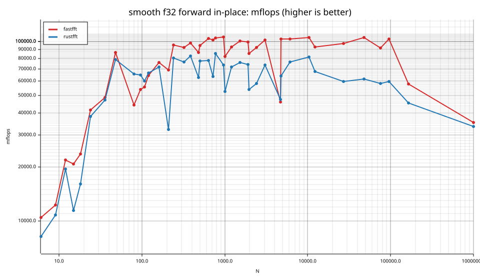
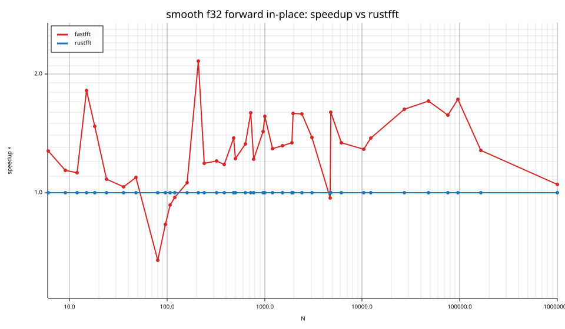
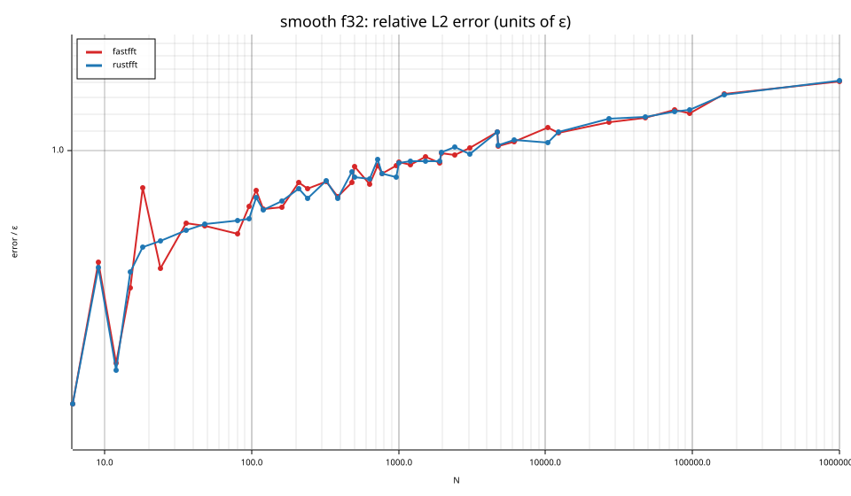
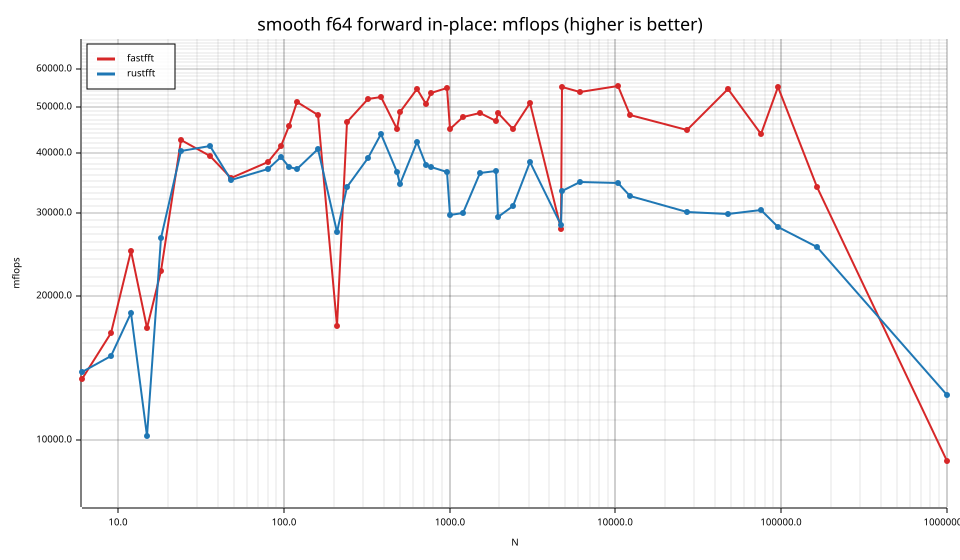
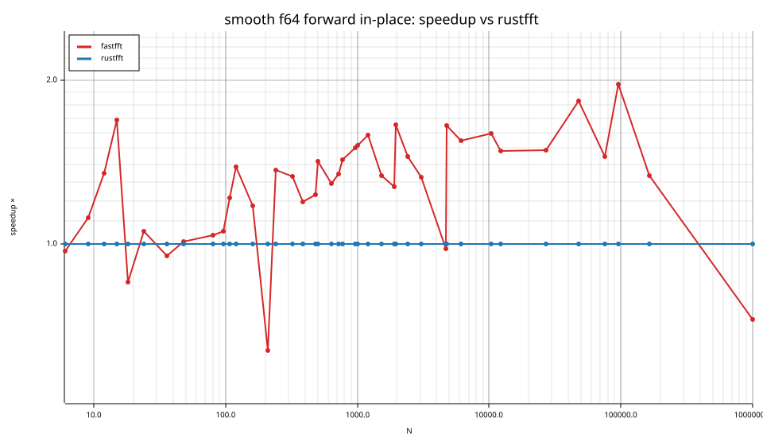
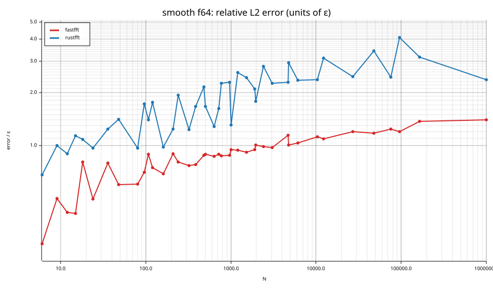

# fastfft arena report: `ticket13-smooth-dispatch`

| | |
|---|---|
| Host | mini-ryzen |
| CPU | AMD Ryzen 7 7840HS w/ Radeon 780M Graphics (family 25, model 116, stepping 1, microcode 0xa704108) |
| Pinned CPU | 2 (SMT siblings 2,10) |
| Governor / EPP / boost | performance / performance / 1 |
| Kernel | Linux version 7.0.0-28-generic |
| Virtualization | container-other |
| rustc | rustc 1.95.0 (59807616e 2026-04-14); binary: rustc; commit-hash: 59807616e1fa2540724bfbac14d7976d7e4a3860; commit-date: 2026-04-14; host: x86_64-unknown-linux-gnu; release: 1.95.0; LLVM version: 22.1.2 |
| Build profile / RUSTFLAGS | arena / `-C llvm-args=-align-all-functions=6` |
| Libraries | {"fearless_simd":"0.5.0","num-complex":"0.4.6","oxifft":"0.4.2","phastft":"0.4.1","pulp":"0.22.3","rustfft":"6.4.1","tfhe-fft":"0.10.1"} |
| FFTW | fftw-3.3.11-sse2-avx-avx2-avx2_128-avx512 `double: CFLAGS='-O3 -fPIC -std=gnu17' ./configure --enable-static --disable-shared --disable-fortran --disable-doc --enable-sse2 --enable-avx --enable-avx2 --enable-avx512 --enable-fma
single: CFLAGS='-O3 -fPIC -std=gnu17' ./configure --enable-static --disable-shared --disable-fortran --disable-doc --enable-sse2 --enable-avx --enable-avx2 --enable-avx512 --enable-fma --enable-float` |
| Git | 8a36159f41d3d1858cecacb70a546789b20ccbef (dirty: true) |
| Profile | quick |
| Official | true  |
| Control drift | max 1.62% over 5 control runs |
| Cells | 82 |

Times are per transform. *best* = minimum batch mean, *median* = median batch mean. Speedup = rustfft time ÷ library time (> 1 means faster than rustfft); *geomean* over the cells both libraries ran. mflops = 5·N·log2(N)/t(µs).

## Release gates (fastfft)

| Gate | Criterion | Status | Detail |
|---|---|---|---|
| G1 | pow2 vs rustfft: geomean ≥ 1.5×, no cell < 0.95× | – n/a | no data |
| G2 | smooth vs rustfft: geomean ≥ 1.3×, no cell < 0.95× | ❌ fail | geomean best 1.281×, median 1.279×, worst cell 0.635× (smooth:f64:fwd:ip:n210), 82 cells |
| G3 | rough vs rustfft: geomean ≥ 0.75×, no cell < 0.5× | – n/a | no data |
| G4 | vs each other Rust library: geomean ≥ 1.1×, ≥ 0.97× on ≥ 90% of cells | – n/a |  |
| G5 | AVX2 forced: pow2 ≥ 1.2×, smooth ≥ 1.1× vs rustfft | – n/a | pow2 NaN×/NaN×, smooth NaN×/NaN× |
| G6 | scenarios ≥ 1.3× each; batch geomean ≥ 1.5× | – n/a | scenarios min inf×, batch NaN×/NaN× |
| G7 | accuracy within §6 thresholds and ≤ 1.5× rustfft + 1ε | ✅ pass | 82 cells checked |
| G8 | Estimate planning time ≤ 2× rustfft for every N ≤ 2^20 | ❌ fail | worst ratio 32.40× (smooth:f32:fwd:ip:n24), 82 cells |

G9 (build time) is measured by `cargo xtask build-time`, not by the arena.

## Speedup vs rustfft (geomean of best-time ratios; median-time ratio in parentheses)

| suite | prec | fastfft | rustfft |
|---|---|---|---|
| smooth | f32 | 1.28× (1.28×) 36/1/4 | 1.00× (1.00×) 0/41/0 |
| smooth | f64 | 1.28× (1.28×) 34/2/5 | 1.00× (1.00×) 0/41/0 |

w/t/l = cells faster / within ±3% / slower than rustfft (best times).

## Suite `smooth`

### smooth f32

| cell | fastfft | rustfft |
|---|---|---|
| N=6 fwd ip | 7.4ns (1.27×) | 9.4ns |
| N=9 fwd ip | 11.7ns (1.14×) | 13.2ns |
| N=12 fwd ip | 9.8ns (1.12×) | 11.0ns |
| N=15 fwd ip | 14.1ns (1.82×) | 25.7ns |
| N=18 fwd ip | 15.9ns (1.47×) | 23.4ns |
| N=24 fwd ip | 13.3ns (1.08×) | 14.4ns |
| N=36 fwd ip | 19.1ns (1.03×) | 19.7ns |
| N=48 fwd ip | 15.5ns (1.09×) | 16.9ns |
| N=80 fwd ip | 57.2ns (0.67×) | 38.5ns |
| N=96 fwd ip | 58.5ns (0.83×) | 48.6ns |
| N=108 fwd ip | 65.5ns (0.93×) | 60.8ns |
| N=120 fwd ip | 64.1ns (0.97×) | 62.3ns |
| N=160 fwd ip | 77.1ns (1.06×) | 81.6ns |
| N=210 fwd ip | 116.7ns (2.15×) | 251.4ns |
| N=240 fwd ip | 99.4ns (1.19×) | 117.9ns |
| N=320 fwd ip | 144.0ns (1.20×) | 173.2ns |
| N=384 fwd ip | 168.9ns (1.18×) | 199.1ns |
| N=480 fwd ip | 247.2ns (1.37×) | 339.6ns |
| N=504 fwd ip | 238.8ns (1.22×) | 291.5ns |
| N=640 fwd ip | 287.0ns (1.33×) | 381.2ns |
| N=720 fwd ip | 336.0ns (1.59×) | 534.9ns |
| N=768 fwd ip | 353.0ns (1.22×) | 429.3ns |
| N=960 fwd ip | 451.0ns (1.43×) | 645.0ns |
| N=1000 fwd ip | 607.3ns (1.56×) | 949.7ns |
| N=1200 fwd ip | 661.7ns (1.29×) | 855.2ns |
| N=1536 fwd ip | 810.7ns (1.32×) | 1.07us |
| N=1920 fwd ip | 1.06us (1.34×) | 1.41us |
| N=1960 fwd ip | 1.25us (1.59×) | 1.99us |
| N=2400 fwd ip | 1.46us (1.58×) | 2.31us |
| N=3072 fwd ip | 1.75us (1.38×) | 2.41us |
| N=4725 fwd ip | 6.26us (0.97×) | 6.07us |
| N=4800 fwd ip | 2.86us (1.60×) | 4.58us |
| N=6144 fwd ip | 3.77us (1.34×) | 5.03us |
| N=10368 fwd ip | 6.58us (1.29×) | 8.48us |
| N=12288 fwd ip | 8.98us (1.37×) | 12.33us |
| N=27000 fwd ip | 20.46us (1.63×) | 33.33us |
| N=48000 fwd ip | 35.52us (1.71×) | 60.65us |
| N=75600 fwd ip | 66.94us (1.57×) | 105.19us |
| N=96000 fwd ip | 77.33us (1.72×) | 133.21us |
| N=165375 fwd ip | 247.66us (1.28×) | 316.66us |
| N=1000000 fwd ip | 2.83ms (1.05×) | 2.96ms |

### smooth f64

| cell | fastfft | rustfft |
|---|---|---|
| N=6 fwd ip | 5.8ns (0.97×) | 5.6ns |
| N=9 fwd ip | 8.5ns (1.12×) | 9.5ns |
| N=12 fwd ip | 8.6ns (1.35×) | 11.6ns |
| N=15 fwd ip | 17.1ns (1.69×) | 28.8ns |
| N=18 fwd ip | 16.6ns (0.85×) | 14.1ns |
| N=24 fwd ip | 12.9ns (1.06×) | 13.6ns |
| N=36 fwd ip | 23.7ns (0.95×) | 22.5ns |
| N=48 fwd ip | 37.9ns (1.01×) | 38.2ns |
| N=80 fwd ip | 66.0ns (1.04×) | 68.4ns |
| N=96 fwd ip | 76.4ns (1.06×) | 80.6ns |
| N=108 fwd ip | 80.0ns (1.22×) | 97.3ns |
| N=120 fwd ip | 80.8ns (1.39×) | 112.1ns |
| N=160 fwd ip | 122.0ns (1.17×) | 143.3ns |
| N=210 fwd ip | 466.4ns (0.64×) | 296.4ns |
| N=240 fwd ip | 204.6ns (1.36×) | 279.1ns |
| N=320 fwd ip | 256.5ns (1.33×) | 340.8ns |
| N=384 fwd ip | 314.6ns (1.20×) | 376.3ns |
| N=480 fwd ip | 475.2ns (1.23×) | 585.0ns |
| N=504 fwd ip | 464.0ns (1.42×) | 658.1ns |
| N=640 fwd ip | 548.6ns (1.29×) | 707.5ns |
| N=720 fwd ip | 673.8ns (1.34×) | 905.8ns |
| N=768 fwd ip | 689.3ns (1.43×) | 983.3ns |
| N=960 fwd ip | 867.6ns (1.50×) | 1.30us |
| N=1000 fwd ip | 1.11us (1.52×) | 1.68us |
| N=1200 fwd ip | 1.29us (1.58×) | 2.05us |
| N=1536 fwd ip | 1.68us (1.33×) | 2.24us |
| N=1920 fwd ip | 2.24us (1.27×) | 2.86us |
| N=1960 fwd ip | 2.21us (1.65×) | 3.65us |
| N=2400 fwd ip | 3.01us (1.45×) | 4.35us |
| N=3072 fwd ip | 3.50us (1.33×) | 4.65us |
| N=4725 fwd ip | 10.42us (0.98×) | 10.19us |
| N=4800 fwd ip | 5.33us (1.65×) | 8.81us |
| N=6144 fwd ip | 7.19us (1.55×) | 11.11us |
| N=10368 fwd ip | 12.49us (1.60×) | 19.96us |
| N=12288 fwd ip | 17.35us (1.48×) | 25.73us |
| N=27000 fwd ip | 44.45us (1.49×) | 66.08us |
| N=48000 fwd ip | 68.53us (1.83×) | 125.35us |
| N=75600 fwd ip | 139.40us (1.45×) | 201.99us |
| N=96000 fwd ip | 144.45us (1.97×) | 284.25us |
| N=165375 fwd ip | 423.31us (1.34×) | 565.70us |
| N=1000000 fwd ip | 11.05ms (0.73×) | 8.02ms |

## Accuracy and planning time (medians over cells)

| lib | cells verified | failed | median error (ε) | worst error (ε) | median plan time |
|---|---|---|---|---|---|
| fastfft | 82 | 0 | 0.90 | 1.41 | 24.69us |
| rustfft | 82 | 0 | 1.10 | 4.09 | 6.13us |
