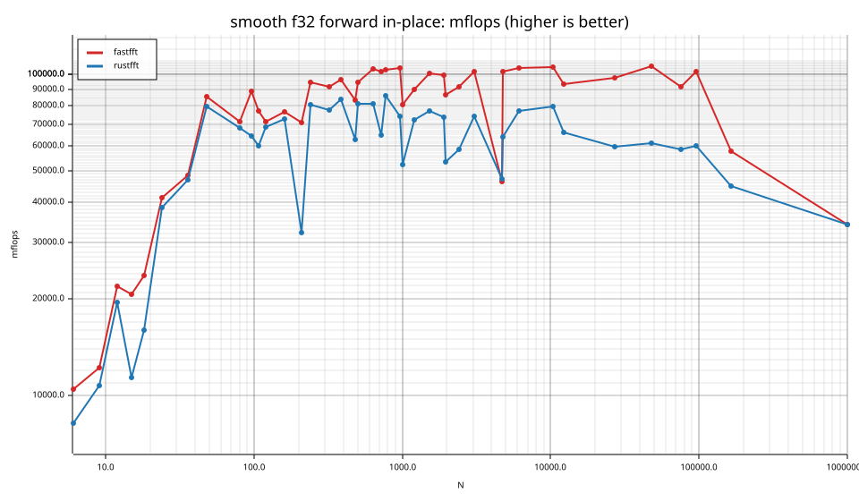
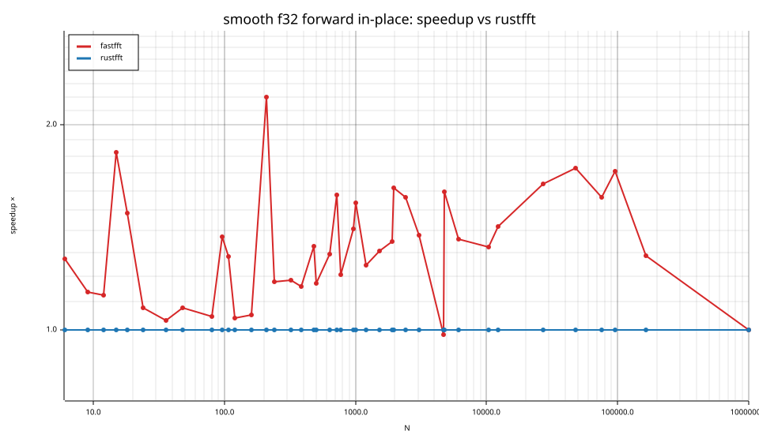
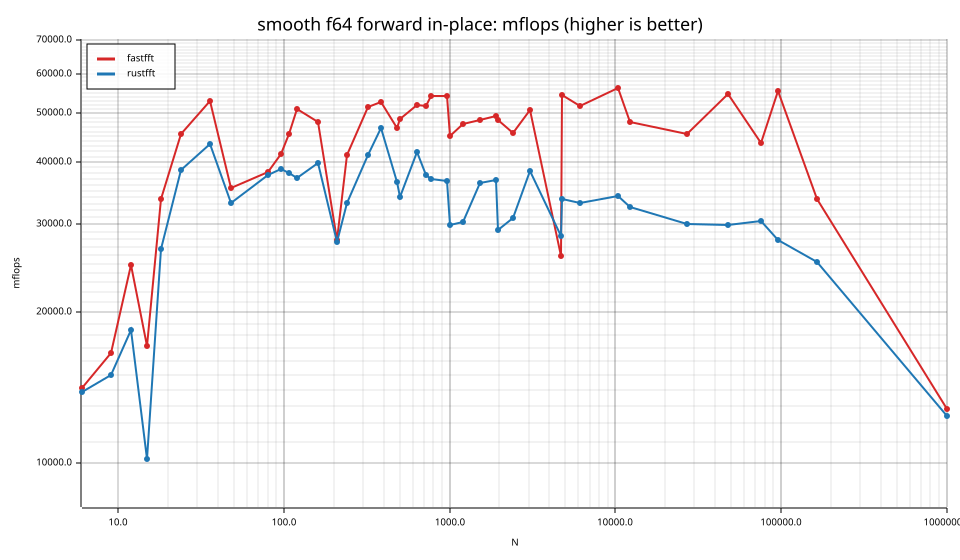
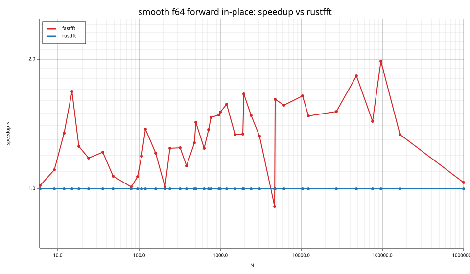

# fastfft arena report: `ticket13-smooth-gate-repeat`

| | |
|---|---|
| Host | mini-ryzen |
| CPU | AMD Ryzen 7 7840HS w/ Radeon 780M Graphics (family 25, model 116, stepping 1, microcode 0xa704108) |
| Pinned CPU | 2 (SMT siblings 2,10) |
| Governor / EPP / boost | performance / performance / 1 |
| Kernel | Linux version 7.0.0-28-generic |
| Virtualization | container-other |
| rustc | rustc 1.95.0 (59807616e 2026-04-14); binary: rustc; commit-hash: 59807616e1fa2540724bfbac14d7976d7e4a3860; commit-date: 2026-04-14; host: x86_64-unknown-linux-gnu; release: 1.95.0; LLVM version: 22.1.2 |
| Build profile / RUSTFLAGS | arena / `-C llvm-args=-align-all-functions=6` |
| Libraries | {"fearless_simd":"0.5.0","num-complex":"0.4.6","oxifft":"0.4.2","phastft":"0.4.1","pulp":"0.22.3","rustfft":"6.4.1","tfhe-fft":"0.10.1"} |
| FFTW | fftw-3.3.11-sse2-avx-avx2-avx2_128-avx512 `double: CFLAGS='-O3 -fPIC -std=gnu17' ./configure --enable-static --disable-shared --disable-fortran --disable-doc --enable-sse2 --enable-avx --enable-avx2 --enable-avx512 --enable-fma
single: CFLAGS='-O3 -fPIC -std=gnu17' ./configure --enable-static --disable-shared --disable-fortran --disable-doc --enable-sse2 --enable-avx --enable-avx2 --enable-avx512 --enable-fma --enable-float` |
| Git | 8a36159f41d3d1858cecacb70a546789b20ccbef (dirty: true) |
| Profile | quick |
| Official | true  |
| Control drift | max 0.62% over 5 control runs |
| Cells | 82 |

Times are per transform. *best* = minimum batch mean, *median* = median batch mean. Speedup = rustfft time ÷ library time (> 1 means faster than rustfft); *geomean* over the cells both libraries ran. mflops = 5·N·log2(N)/t(µs).

## Release gates (fastfft)

| Gate | Criterion | Status | Detail |
|---|---|---|---|
| G1 | pow2 vs rustfft: geomean ≥ 1.5×, no cell < 0.95× | – n/a | no data |
| G2 | smooth vs rustfft: geomean ≥ 1.3×, no cell < 0.95× | ❌ fail | geomean best 1.324×, median 1.324×, worst cell 0.907× (smooth:f64:fwd:ip:n4725), 82 cells |
| G3 | rough vs rustfft: geomean ≥ 0.75×, no cell < 0.5× | – n/a | no data |
| G4 | vs each other Rust library: geomean ≥ 1.1×, ≥ 0.97× on ≥ 90% of cells | – n/a |  |
| G5 | AVX2 forced: pow2 ≥ 1.2×, smooth ≥ 1.1× vs rustfft | – n/a | pow2 NaN×/NaN×, smooth NaN×/NaN× |
| G6 | scenarios ≥ 1.3× each; batch geomean ≥ 1.5× | – n/a | scenarios min inf×, batch NaN×/NaN× |
| G7 | accuracy within §6 thresholds and ≤ 1.5× rustfft + 1ε | ✅ pass | 82 cells checked |
| G8 | Estimate planning time ≤ 2× rustfft for every N ≤ 2^20 | ❌ fail | worst ratio 33.28× (smooth:f32:fwd:ip:n24), 82 cells |

G9 (build time) is measured by `cargo xtask build-time`, not by the arena.

## Speedup vs rustfft (geomean of best-time ratios; median-time ratio in parentheses)

| suite | prec | fastfft | rustfft |
|---|---|---|---|
| smooth | f32 | 1.32× (1.32×) 39/2/0 | 1.00× (1.00×) 0/41/0 |
| smooth | f64 | 1.33× (1.33×) 37/3/1 | 1.00× (1.00×) 0/41/0 |

w/t/l = cells faster / within ±3% / slower than rustfft (best times).

## Suite `smooth`

### smooth f32

| cell | fastfft | rustfft |
|---|---|---|
| N=6 fwd ip | 7.4ns (1.27×) | 9.4ns |
| N=9 fwd ip | 11.6ns (1.14×) | 13.2ns |
| N=12 fwd ip | 9.8ns (1.12×) | 11.0ns |
| N=15 fwd ip | 14.1ns (1.82×) | 25.8ns |
| N=18 fwd ip | 15.8ns (1.49×) | 23.5ns |
| N=24 fwd ip | 13.3ns (1.08×) | 14.3ns |
| N=36 fwd ip | 19.1ns (1.03×) | 19.8ns |
| N=48 fwd ip | 15.7ns (1.08×) | 16.9ns |
| N=80 fwd ip | 35.5ns (1.05×) | 37.1ns |
| N=96 fwd ip | 35.7ns (1.37×) | 49.0ns |
| N=108 fwd ip | 47.4ns (1.28×) | 60.7ns |
| N=120 fwd ip | 58.2ns (1.04×) | 60.6ns |
| N=160 fwd ip | 76.7ns (1.05×) | 80.6ns |
| N=210 fwd ip | 114.3ns (2.20×) | 251.2ns |
| N=240 fwd ip | 100.2ns (1.18×) | 117.9ns |
| N=320 fwd ip | 145.2ns (1.18×) | 171.6ns |
| N=384 fwd ip | 170.8ns (1.16×) | 197.5ns |
| N=480 fwd ip | 257.3ns (1.33×) | 341.5ns |
| N=504 fwd ip | 238.8ns (1.17×) | 279.6ns |
| N=640 fwd ip | 286.0ns (1.29×) | 369.1ns |
| N=720 fwd ip | 335.5ns (1.58×) | 529.1ns |
| N=768 fwd ip | 355.2ns (1.21×) | 428.2ns |
| N=960 fwd ip | 455.3ns (1.41×) | 641.2ns |
| N=1000 fwd ip | 619.1ns (1.54×) | 951.6ns |
| N=1200 fwd ip | 683.7ns (1.25×) | 851.6ns |
| N=1536 fwd ip | 809.0ns (1.31×) | 1.06us |
| N=1920 fwd ip | 1.05us (1.35×) | 1.42us |
| N=1960 fwd ip | 1.24us (1.62×) | 2.00us |
| N=2400 fwd ip | 1.47us (1.57×) | 2.30us |
| N=3072 fwd ip | 1.75us (1.38×) | 2.41us |
| N=4725 fwd ip | 6.21us (0.98×) | 6.11us |
| N=4800 fwd ip | 2.87us (1.59×) | 4.58us |
| N=6144 fwd ip | 3.70us (1.36×) | 5.03us |
| N=10368 fwd ip | 6.57us (1.32×) | 8.69us |
| N=12288 fwd ip | 8.94us (1.42×) | 12.68us |
| N=27000 fwd ip | 20.36us (1.64×) | 33.35us |
| N=48000 fwd ip | 35.26us (1.73×) | 60.91us |
| N=75600 fwd ip | 67.07us (1.56×) | 104.91us |
| N=96000 fwd ip | 77.76us (1.71×) | 132.77us |
| N=165375 fwd ip | 247.67us (1.28×) | 318.04us |
| N=1000000 fwd ip | 2.92ms (1.00×) | 2.92ms |

### smooth f64

| cell | fastfft | rustfft |
|---|---|---|
| N=6 fwd ip | 5.5ns (1.02×) | 5.6ns |
| N=9 fwd ip | 8.6ns (1.11×) | 9.5ns |
| N=12 fwd ip | 8.6ns (1.35×) | 11.6ns |
| N=15 fwd ip | 17.1ns (1.68×) | 28.8ns |
| N=18 fwd ip | 11.2ns (1.26×) | 14.0ns |
| N=24 fwd ip | 12.1ns (1.18×) | 14.3ns |
| N=36 fwd ip | 17.5ns (1.22×) | 21.4ns |
| N=48 fwd ip | 37.9ns (1.07×) | 40.6ns |
| N=80 fwd ip | 66.2ns (1.01×) | 67.0ns |
| N=96 fwd ip | 76.2ns (1.07×) | 81.5ns |
| N=108 fwd ip | 80.4ns (1.19×) | 95.9ns |
| N=120 fwd ip | 81.0ns (1.37×) | 111.4ns |
| N=160 fwd ip | 121.7ns (1.21×) | 147.3ns |
| N=210 fwd ip | 289.6ns (1.01×) | 293.2ns |
| N=240 fwd ip | 230.2ns (1.24×) | 286.2ns |
| N=320 fwd ip | 258.8ns (1.25×) | 322.9ns |
| N=384 fwd ip | 312.3ns (1.13×) | 353.2ns |
| N=480 fwd ip | 458.1ns (1.28×) | 585.6ns |
| N=504 fwd ip | 465.1ns (1.43×) | 664.1ns |
| N=640 fwd ip | 574.2ns (1.24×) | 714.3ns |
| N=720 fwd ip | 661.8ns (1.37×) | 908.9ns |
| N=768 fwd ip | 680.4ns (1.47×) | 997.6ns |
| N=960 fwd ip | 877.0ns (1.48×) | 1.30us |
| N=1000 fwd ip | 1.11us (1.51×) | 1.67us |
| N=1200 fwd ip | 1.29us (1.57×) | 2.02us |
| N=1536 fwd ip | 1.67us (1.34×) | 2.24us |
| N=1920 fwd ip | 2.12us (1.34×) | 2.84us |
| N=1960 fwd ip | 2.21us (1.66×) | 3.67us |
| N=2400 fwd ip | 2.94us (1.48×) | 4.36us |
| N=3072 fwd ip | 3.50us (1.33×) | 4.64us |
| N=4725 fwd ip | 11.13us (0.91×) | 10.14us |
| N=4800 fwd ip | 5.40us (1.62×) | 8.72us |
| N=6144 fwd ip | 7.48us (1.57×) | 11.71us |
| N=10368 fwd ip | 12.30us (1.64×) | 20.23us |
| N=12288 fwd ip | 17.36us (1.48×) | 25.64us |
| N=27000 fwd ip | 43.77us (1.51×) | 66.26us |
| N=48000 fwd ip | 68.30us (1.83×) | 124.83us |
| N=75600 fwd ip | 140.47us (1.43×) | 201.55us |
| N=96000 fwd ip | 143.56us (1.98×) | 284.01us |
| N=165375 fwd ip | 424.45us (1.34×) | 568.09us |
| N=1000000 fwd ip | 7.76ms (1.04×) | 8.04ms |

## Accuracy and planning time (medians over cells)

| lib | cells verified | failed | median error (ε) | worst error (ε) | median plan time |
|---|---|---|---|---|---|
| fastfft | 82 | 0 | 0.90 | 1.41 | 25.14us |
| rustfft | 82 | 0 | 1.10 | 4.09 | 6.17us |
