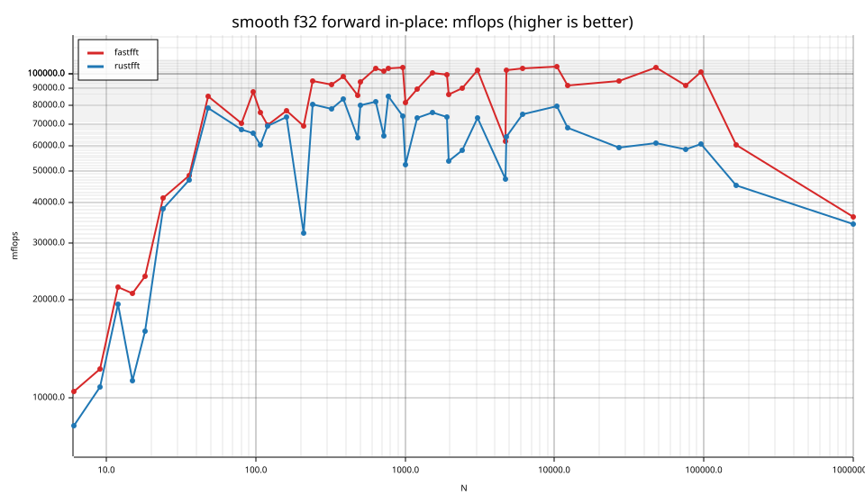
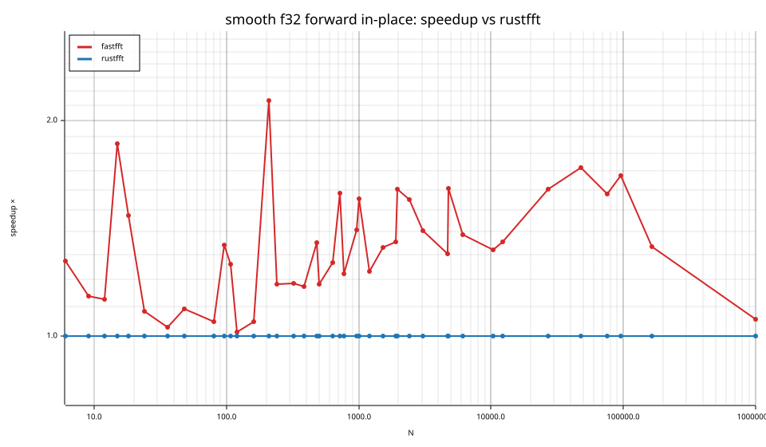
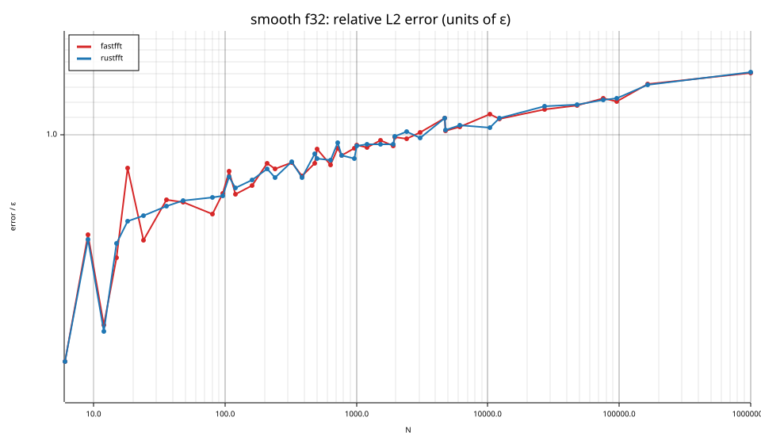
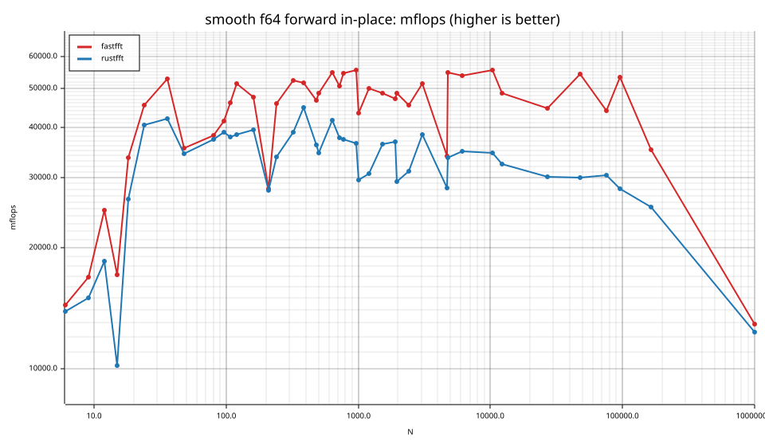
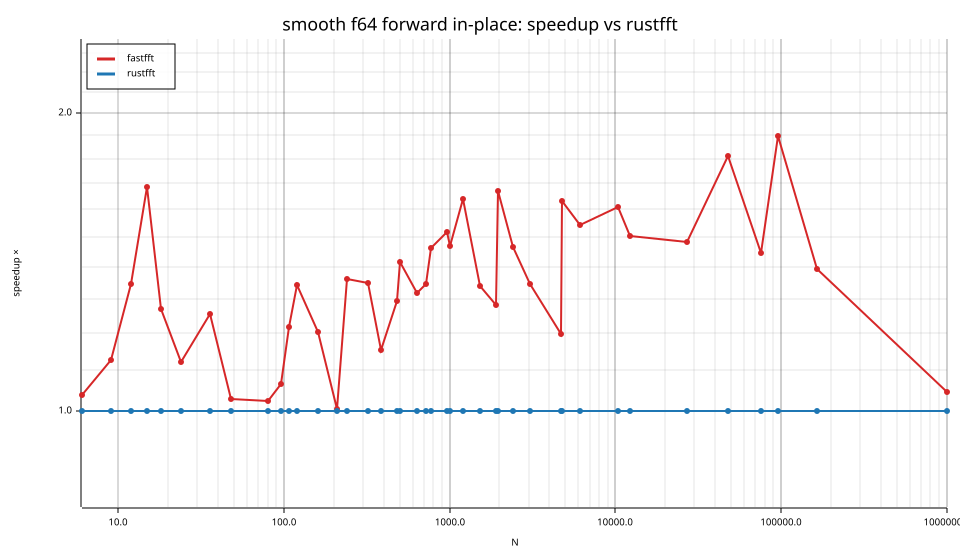

# fastfft arena report: `ticket13-masked-gate`

| | |
|---|---|
| Host | mini-ryzen |
| CPU | AMD Ryzen 7 7840HS w/ Radeon 780M Graphics (family 25, model 116, stepping 1, microcode 0xa704108) |
| Pinned CPU | 2 (SMT siblings 2,10) |
| Governor / EPP / boost | performance / performance / 1 |
| Kernel | Linux version 7.0.0-28-generic |
| Virtualization | container-other |
| rustc | rustc 1.95.0 (59807616e 2026-04-14); binary: rustc; commit-hash: 59807616e1fa2540724bfbac14d7976d7e4a3860; commit-date: 2026-04-14; host: x86_64-unknown-linux-gnu; release: 1.95.0; LLVM version: 22.1.2 |
| Build profile / RUSTFLAGS | arena / `-C llvm-args=-align-all-functions=6` |
| Libraries | {"fearless_simd":"0.5.0","num-complex":"0.4.6","oxifft":"0.4.2","phastft":"0.4.1","pulp":"0.22.3","rustfft":"6.4.1","tfhe-fft":"0.10.1"} |
| FFTW | fftw-3.3.11-sse2-avx-avx2-avx2_128-avx512 `double: CFLAGS='-O3 -fPIC -std=gnu17' ./configure --enable-static --disable-shared --disable-fortran --disable-doc --enable-sse2 --enable-avx --enable-avx2 --enable-avx512 --enable-fma
single: CFLAGS='-O3 -fPIC -std=gnu17' ./configure --enable-static --disable-shared --disable-fortran --disable-doc --enable-sse2 --enable-avx --enable-avx2 --enable-avx512 --enable-fma --enable-float` |
| Git | 8a36159f41d3d1858cecacb70a546789b20ccbef (dirty: true) |
| Profile | quick |
| Official | true  |
| Control drift | max 13.49% over 5 control runs — **FLAGGED** |
| Cells | 82 |

Times are per transform. *best* = minimum batch mean, *median* = median batch mean. Speedup = rustfft time ÷ library time (> 1 means faster than rustfft); *geomean* over the cells both libraries ran. mflops = 5·N·log2(N)/t(µs).

## Release gates (fastfft)

| Gate | Criterion | Status | Detail |
|---|---|---|---|
| G1 | pow2 vs rustfft: geomean ≥ 1.5×, no cell < 0.95× | – n/a | no data |
| G2 | smooth vs rustfft: geomean ≥ 1.3×, no cell < 0.95× | ✅ pass | geomean best 1.336×, median 1.333×, worst cell 1.005× (smooth:f64:fwd:ip:n210), 82 cells |
| G3 | rough vs rustfft: geomean ≥ 0.75×, no cell < 0.5× | – n/a | no data |
| G4 | vs each other Rust library: geomean ≥ 1.1×, ≥ 0.97× on ≥ 90% of cells | – n/a |  |
| G5 | AVX2 forced: pow2 ≥ 1.2×, smooth ≥ 1.1× vs rustfft | – n/a | pow2 NaN×/NaN×, smooth NaN×/NaN× |
| G6 | scenarios ≥ 1.3× each; batch geomean ≥ 1.5× | – n/a | scenarios min inf×, batch NaN×/NaN× |
| G7 | accuracy within §6 thresholds and ≤ 1.5× rustfft + 1ε | ✅ pass | 82 cells checked |
| G8 | Estimate planning time ≤ 2× rustfft for every N ≤ 2^20 | ❌ fail | worst ratio 32.84× (smooth:f32:fwd:ip:n24), 82 cells |

G9 (build time) is measured by `cargo xtask build-time`, not by the arena.

## Speedup vs rustfft (geomean of best-time ratios; median-time ratio in parentheses)

| suite | prec | fastfft | rustfft |
|---|---|---|---|
| smooth | f32 | 1.33× (1.33×) 39/2/0 | 1.00× (1.00×) 0/41/0 |
| smooth | f64 | 1.34× (1.34×) 39/2/0 | 1.00× (1.00×) 0/41/0 |

w/t/l = cells faster / within ±3% / slower than rustfft (best times).

## Suite `smooth`

### smooth f32

| cell | fastfft | rustfft |
|---|---|---|
| N=6 fwd ip | 7.4ns (1.27×) | 9.4ns |
| N=9 fwd ip | 11.7ns (1.14×) | 13.2ns |
| N=12 fwd ip | 9.8ns (1.12×) | 11.0ns |
| N=15 fwd ip | 14.0ns (1.86×) | 26.0ns |
| N=18 fwd ip | 15.9ns (1.48×) | 23.4ns |
| N=24 fwd ip | 13.3ns (1.08×) | 14.4ns |
| N=36 fwd ip | 19.2ns (1.03×) | 19.8ns |
| N=48 fwd ip | 15.7ns (1.09×) | 17.1ns |
| N=80 fwd ip | 35.9ns (1.05×) | 37.5ns |
| N=96 fwd ip | 36.0ns (1.34×) | 48.3ns |
| N=108 fwd ip | 48.2ns (1.26×) | 60.7ns |
| N=120 fwd ip | 59.6ns (1.01×) | 60.3ns |
| N=160 fwd ip | 76.2ns (1.05×) | 79.8ns |
| N=210 fwd ip | 117.6ns (2.13×) | 250.9ns |
| N=240 fwd ip | 100.2ns (1.18×) | 118.3ns |
| N=320 fwd ip | 144.2ns (1.18×) | 170.7ns |
| N=384 fwd ip | 168.7ns (1.17×) | 197.6ns |
| N=480 fwd ip | 249.7ns (1.35×) | 336.9ns |
| N=504 fwd ip | 239.3ns (1.18×) | 282.8ns |
| N=640 fwd ip | 286.6ns (1.27×) | 363.0ns |
| N=720 fwd ip | 336.4ns (1.58×) | 532.1ns |
| N=768 fwd ip | 355.2ns (1.22×) | 433.4ns |
| N=960 fwd ip | 456.2ns (1.41×) | 641.4ns |
| N=1000 fwd ip | 610.5ns (1.56×) | 949.7ns |
| N=1200 fwd ip | 684.1ns (1.23×) | 841.9ns |
| N=1536 fwd ip | 806.2ns (1.33×) | 1.07us |
| N=1920 fwd ip | 1.06us (1.35×) | 1.43us |
| N=1960 fwd ip | 1.24us (1.61×) | 2.00us |
| N=2400 fwd ip | 1.50us (1.55×) | 2.32us |
| N=3072 fwd ip | 1.73us (1.40×) | 2.43us |
| N=4725 fwd ip | 4.67us (1.30×) | 6.09us |
| N=4800 fwd ip | 2.86us (1.61×) | 4.59us |
| N=6144 fwd ip | 3.72us (1.39×) | 5.15us |
| N=10368 fwd ip | 6.59us (1.32×) | 8.70us |
| N=12288 fwd ip | 9.06us (1.36×) | 12.28us |
| N=27000 fwd ip | 20.91us (1.61×) | 33.57us |
| N=48000 fwd ip | 35.68us (1.72×) | 61.32us |
| N=75600 fwd ip | 66.59us (1.58×) | 105.15us |
| N=96000 fwd ip | 78.39us (1.67×) | 131.24us |
| N=165375 fwd ip | 238.05us (1.33×) | 316.99us |
| N=1000000 fwd ip | 2.75ms (1.06×) | 2.90ms |

### smooth f64

| cell | fastfft | rustfft |
|---|---|---|
| N=6 fwd ip | 5.4ns (1.04×) | 5.6ns |
| N=9 fwd ip | 8.4ns (1.13×) | 9.5ns |
| N=12 fwd ip | 8.6ns (1.34×) | 11.6ns |
| N=15 fwd ip | 17.1ns (1.69×) | 28.8ns |
| N=18 fwd ip | 11.2ns (1.27×) | 14.2ns |
| N=24 fwd ip | 12.1ns (1.12×) | 13.6ns |
| N=36 fwd ip | 17.6ns (1.25×) | 22.1ns |
| N=48 fwd ip | 37.8ns (1.03×) | 39.0ns |
| N=80 fwd ip | 66.3ns (1.02×) | 67.9ns |
| N=96 fwd ip | 76.2ns (1.07×) | 81.3ns |
| N=108 fwd ip | 79.2ns (1.22×) | 96.4ns |
| N=120 fwd ip | 80.6ns (1.34×) | 108.1ns |
| N=160 fwd ip | 123.3ns (1.20×) | 148.4ns |
| N=210 fwd ip | 288.8ns (1.01×) | 290.3ns |
| N=240 fwd ip | 206.5ns (1.36×) | 281.2ns |
| N=320 fwd ip | 254.6ns (1.35×) | 343.1ns |
| N=384 fwd ip | 319.8ns (1.15×) | 368.5ns |
| N=480 fwd ip | 458.2ns (1.29×) | 592.3ns |
| N=504 fwd ip | 464.1ns (1.41×) | 656.1ns |
| N=640 fwd ip | 545.3ns (1.32×) | 717.5ns |
| N=720 fwd ip | 673.8ns (1.34×) | 905.9ns |
| N=768 fwd ip | 675.8ns (1.46×) | 988.3ns |
| N=960 fwd ip | 857.7ns (1.52×) | 1.30us |
| N=1000 fwd ip | 1.15us (1.47×) | 1.68us |
| N=1200 fwd ip | 1.23us (1.64×) | 2.01us |
| N=1536 fwd ip | 1.67us (1.34×) | 2.24us |
| N=1920 fwd ip | 2.22us (1.28×) | 2.85us |
| N=1960 fwd ip | 2.20us (1.67×) | 3.67us |
| N=2400 fwd ip | 2.96us (1.46×) | 4.34us |
| N=3072 fwd ip | 3.46us (1.34×) | 4.65us |
| N=4725 fwd ip | 8.52us (1.20×) | 10.20us |
| N=4800 fwd ip | 5.36us (1.63×) | 8.75us |
| N=6144 fwd ip | 7.18us (1.54×) | 11.08us |
| N=10368 fwd ip | 12.46us (1.61×) | 20.05us |
| N=12288 fwd ip | 17.18us (1.50×) | 25.82us |
| N=27000 fwd ip | 44.55us (1.48×) | 65.97us |
| N=48000 fwd ip | 68.87us (1.81×) | 124.68us |
| N=75600 fwd ip | 139.34us (1.45×) | 201.44us |
| N=96000 fwd ip | 148.93us (1.90×) | 282.81us |
| N=165375 fwd ip | 407.39us (1.39×) | 567.22us |
| N=1000000 fwd ip | 7.72ms (1.05×) | 8.09ms |

## Accuracy and planning time (medians over cells)

| lib | cells verified | failed | median error (ε) | worst error (ε) | median plan time |
|---|---|---|---|---|---|
| fastfft | 82 | 0 | 0.90 | 1.41 | 24.76us |
| rustfft | 82 | 0 | 1.10 | 4.09 | 6.16us |
