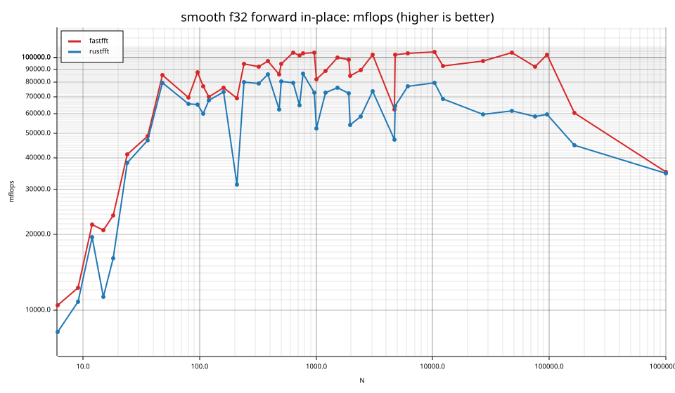
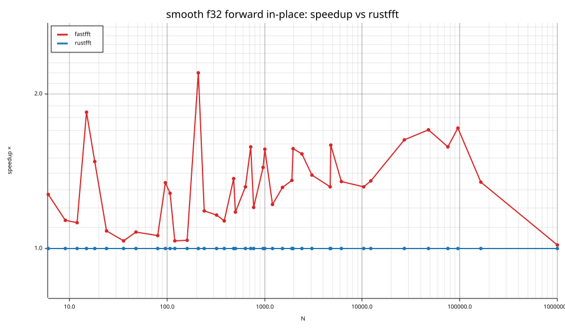
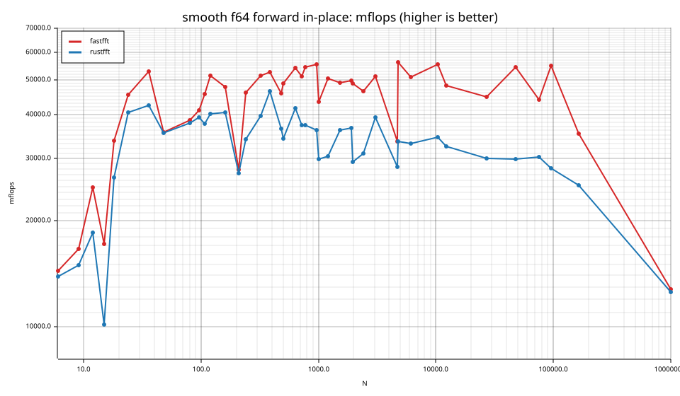
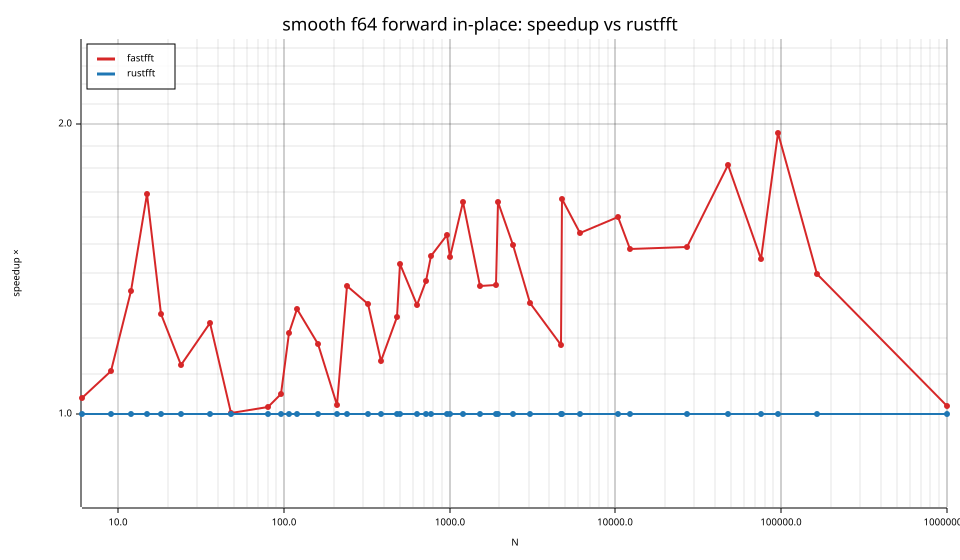

# fastfft arena report: `ticket13-masked-gate-repeat`

| | |
|---|---|
| Host | mini-ryzen |
| CPU | AMD Ryzen 7 7840HS w/ Radeon 780M Graphics (family 25, model 116, stepping 1, microcode 0xa704108) |
| Pinned CPU | 2 (SMT siblings 2,10) |
| Governor / EPP / boost | performance / performance / 1 |
| Kernel | Linux version 7.0.0-28-generic |
| Virtualization | container-other |
| rustc | rustc 1.95.0 (59807616e 2026-04-14); binary: rustc; commit-hash: 59807616e1fa2540724bfbac14d7976d7e4a3860; commit-date: 2026-04-14; host: x86_64-unknown-linux-gnu; release: 1.95.0; LLVM version: 22.1.2 |
| Build profile / RUSTFLAGS | arena / `-C llvm-args=-align-all-functions=6` |
| Libraries | {"fearless_simd":"0.5.0","num-complex":"0.4.6","oxifft":"0.4.2","phastft":"0.4.1","pulp":"0.22.3","rustfft":"6.4.1","tfhe-fft":"0.10.1"} |
| FFTW | fftw-3.3.11-sse2-avx-avx2-avx2_128-avx512 `double: CFLAGS='-O3 -fPIC -std=gnu17' ./configure --enable-static --disable-shared --disable-fortran --disable-doc --enable-sse2 --enable-avx --enable-avx2 --enable-avx512 --enable-fma
single: CFLAGS='-O3 -fPIC -std=gnu17' ./configure --enable-static --disable-shared --disable-fortran --disable-doc --enable-sse2 --enable-avx --enable-avx2 --enable-avx512 --enable-fma --enable-float` |
| Git | 8a36159f41d3d1858cecacb70a546789b20ccbef (dirty: true) |
| Profile | quick |
| Official | true  |
| Control drift | max 0.89% over 5 control runs |
| Cells | 82 |

Times are per transform. *best* = minimum batch mean, *median* = median batch mean. Speedup = rustfft time ÷ library time (> 1 means faster than rustfft); *geomean* over the cells both libraries ran. mflops = 5·N·log2(N)/t(µs).

## Release gates (fastfft)

| Gate | Criterion | Status | Detail |
|---|---|---|---|
| G1 | pow2 vs rustfft: geomean ≥ 1.5×, no cell < 0.95× | – n/a | no data |
| G2 | smooth vs rustfft: geomean ≥ 1.3×, no cell < 0.95× | ✅ pass | geomean best 1.335×, median 1.332×, worst cell 0.985× (smooth:f32:fwd:ip:n1000000), 82 cells |
| G3 | rough vs rustfft: geomean ≥ 0.75×, no cell < 0.5× | – n/a | no data |
| G4 | vs each other Rust library: geomean ≥ 1.1×, ≥ 0.97× on ≥ 90% of cells | – n/a |  |
| G5 | AVX2 forced: pow2 ≥ 1.2×, smooth ≥ 1.1× vs rustfft | – n/a | pow2 NaN×/NaN×, smooth NaN×/NaN× |
| G6 | scenarios ≥ 1.3× each; batch geomean ≥ 1.5× | – n/a | scenarios min inf×, batch NaN×/NaN× |
| G7 | accuracy within §6 thresholds and ≤ 1.5× rustfft + 1ε | ✅ pass | 82 cells checked |
| G8 | Estimate planning time ≤ 2× rustfft for every N ≤ 2^20 | ❌ fail | worst ratio 32.84× (smooth:f32:fwd:ip:n24), 82 cells |

G9 (build time) is measured by `cargo xtask build-time`, not by the arena.

## Speedup vs rustfft (geomean of best-time ratios; median-time ratio in parentheses)

| suite | prec | fastfft | rustfft |
|---|---|---|---|
| smooth | f32 | 1.33× (1.33×) 40/1/0 | 1.00× (1.00×) 0/41/0 |
| smooth | f64 | 1.34× (1.34×) 37/4/0 | 1.00× (1.00×) 0/41/0 |

w/t/l = cells faster / within ±3% / slower than rustfft (best times).

## Suite `smooth`

### smooth f32

| cell | fastfft | rustfft |
|---|---|---|
| N=6 fwd ip | 7.4ns (1.27×) | 9.4ns |
| N=9 fwd ip | 11.7ns (1.14×) | 13.2ns |
| N=12 fwd ip | 9.8ns (1.12×) | 11.1ns |
| N=15 fwd ip | 14.1ns (1.84×) | 26.0ns |
| N=18 fwd ip | 15.9ns (1.48×) | 23.4ns |
| N=24 fwd ip | 13.3ns (1.08×) | 14.4ns |
| N=36 fwd ip | 19.0ns (1.04×) | 19.7ns |
| N=48 fwd ip | 15.7ns (1.08×) | 16.9ns |
| N=80 fwd ip | 36.4ns (1.06×) | 38.6ns |
| N=96 fwd ip | 36.1ns (1.34×) | 48.5ns |
| N=108 fwd ip | 47.5ns (1.28×) | 60.9ns |
| N=120 fwd ip | 59.1ns (1.04×) | 61.2ns |
| N=160 fwd ip | 77.2ns (1.04×) | 80.1ns |
| N=210 fwd ip | 117.3ns (2.20×) | 258.0ns |
| N=240 fwd ip | 100.3ns (1.18×) | 118.5ns |
| N=320 fwd ip | 145.0ns (1.16×) | 168.4ns |
| N=384 fwd ip | 170.1ns (1.13×) | 192.4ns |
| N=480 fwd ip | 249.9ns (1.37×) | 342.2ns |
| N=504 fwd ip | 238.8ns (1.18×) | 281.3ns |
| N=640 fwd ip | 284.4ns (1.32×) | 374.7ns |
| N=720 fwd ip | 335.5ns (1.58×) | 529.3ns |
| N=768 fwd ip | 353.5ns (1.20×) | 425.6ns |
| N=960 fwd ip | 454.7ns (1.44×) | 653.8ns |
| N=1000 fwd ip | 607.0ns (1.56×) | 948.9ns |
| N=1200 fwd ip | 690.9ns (1.22×) | 842.4ns |
| N=1536 fwd ip | 814.8ns (1.32×) | 1.07us |
| N=1920 fwd ip | 1.07us (1.36×) | 1.45us |
| N=1960 fwd ip | 1.26us (1.57×) | 1.98us |
| N=2400 fwd ip | 1.51us (1.53×) | 2.30us |
| N=3072 fwd ip | 1.74us (1.39×) | 2.41us |
| N=4725 fwd ip | 4.63us (1.32×) | 6.10us |
| N=4800 fwd ip | 2.86us (1.59×) | 4.56us |
| N=6144 fwd ip | 3.72us (1.35×) | 5.03us |
| N=10368 fwd ip | 6.58us (1.32×) | 8.68us |
| N=12288 fwd ip | 9.00us (1.35×) | 12.19us |
| N=27000 fwd ip | 20.52us (1.63×) | 33.42us |
| N=48000 fwd ip | 35.73us (1.70×) | 60.78us |
| N=75600 fwd ip | 66.54us (1.58×) | 105.07us |
| N=96000 fwd ip | 77.36us (1.72×) | 132.95us |
| N=165375 fwd ip | 236.99us (1.35×) | 319.06us |
| N=1000000 fwd ip | 2.82ms (1.01×) | 2.86ms |

### smooth f64

| cell | fastfft | rustfft |
|---|---|---|
| N=6 fwd ip | 5.4ns (1.04×) | 5.6ns |
| N=9 fwd ip | 8.6ns (1.11×) | 9.5ns |
| N=12 fwd ip | 8.6ns (1.34×) | 11.6ns |
| N=15 fwd ip | 17.1ns (1.69×) | 28.8ns |
| N=18 fwd ip | 11.2ns (1.27×) | 14.2ns |
| N=24 fwd ip | 12.1ns (1.12×) | 13.6ns |
| N=36 fwd ip | 17.6ns (1.24×) | 21.9ns |
| N=48 fwd ip | 37.7ns (1.00×) | 37.8ns |
| N=80 fwd ip | 65.8ns (1.02×) | 67.0ns |
| N=96 fwd ip | 77.0ns (1.05×) | 80.8ns |
| N=108 fwd ip | 79.8ns (1.21×) | 96.8ns |
| N=120 fwd ip | 80.6ns (1.28×) | 103.5ns |
| N=160 fwd ip | 122.7ns (1.18×) | 144.9ns |
| N=210 fwd ip | 290.1ns (1.02×) | 296.7ns |
| N=240 fwd ip | 206.1ns (1.36×) | 279.6ns |
| N=320 fwd ip | 258.7ns (1.30×) | 336.9ns |
| N=384 fwd ip | 312.7ns (1.14×) | 354.9ns |
| N=480 fwd ip | 465.8ns (1.26×) | 588.1ns |
| N=504 fwd ip | 462.6ns (1.43×) | 661.5ns |
| N=640 fwd ip | 550.8ns (1.30×) | 715.2ns |
| N=720 fwd ip | 668.5ns (1.37×) | 917.9ns |
| N=768 fwd ip | 676.5ns (1.46×) | 987.3ns |
| N=960 fwd ip | 857.5ns (1.53×) | 1.32us |
| N=1000 fwd ip | 1.15us (1.46×) | 1.67us |
| N=1200 fwd ip | 1.22us (1.66×) | 2.02us |
| N=1536 fwd ip | 1.66us (1.36×) | 2.25us |
| N=1920 fwd ip | 2.10us (1.36×) | 2.86us |
| N=1960 fwd ip | 2.19us (1.66×) | 3.65us |
| N=2400 fwd ip | 2.90us (1.50×) | 4.34us |
| N=3072 fwd ip | 3.48us (1.30×) | 4.54us |
| N=4725 fwd ip | 8.61us (1.18×) | 10.17us |
| N=4800 fwd ip | 5.23us (1.67×) | 8.74us |
| N=6144 fwd ip | 7.57us (1.54×) | 11.68us |
| N=10368 fwd ip | 12.50us (1.60×) | 20.03us |
| N=12288 fwd ip | 17.32us (1.48×) | 25.72us |
| N=27000 fwd ip | 44.31us (1.49×) | 66.14us |
| N=48000 fwd ip | 68.71us (1.82×) | 124.76us |
| N=75600 fwd ip | 139.56us (1.45×) | 202.21us |
| N=96000 fwd ip | 144.54us (1.96×) | 283.06us |
| N=165375 fwd ip | 407.02us (1.40×) | 569.43us |
| N=1000000 fwd ip | 7.79ms (1.02×) | 7.94ms |

## Accuracy and planning time (medians over cells)

| lib | cells verified | failed | median error (ε) | worst error (ε) | median plan time |
|---|---|---|---|---|---|
| fastfft | 82 | 0 | 0.90 | 1.41 | 25.59us |
| rustfft | 82 | 0 | 1.10 | 4.09 | 6.10us |
