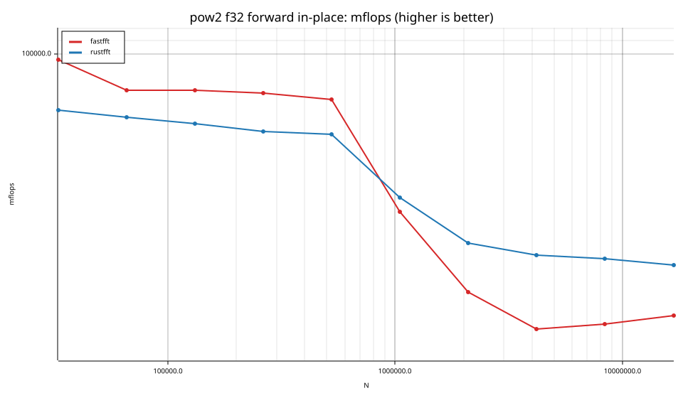
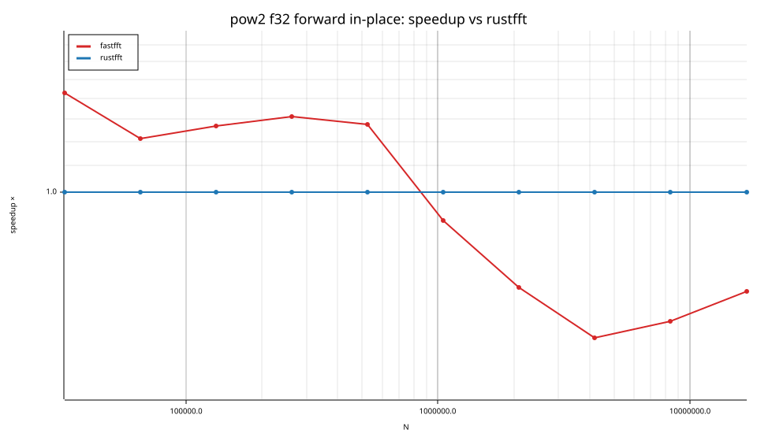
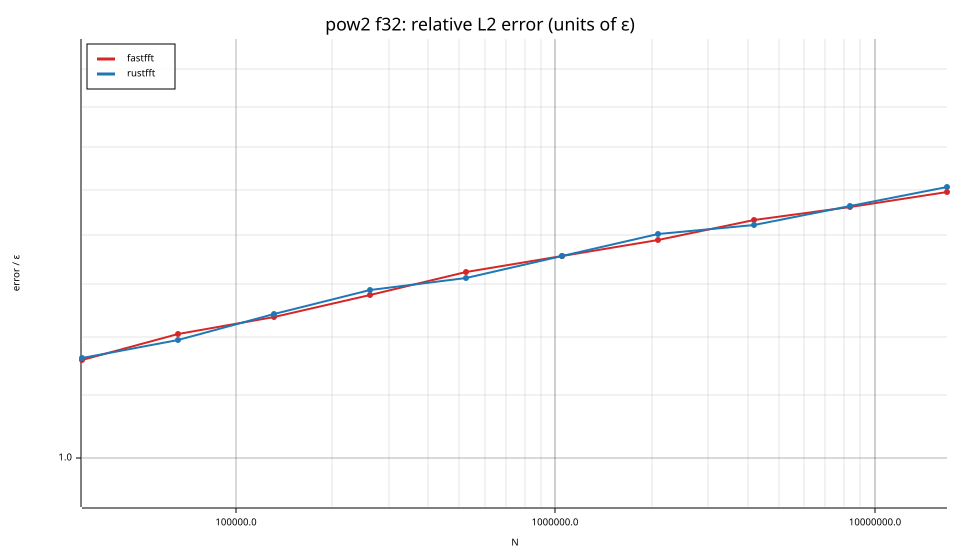
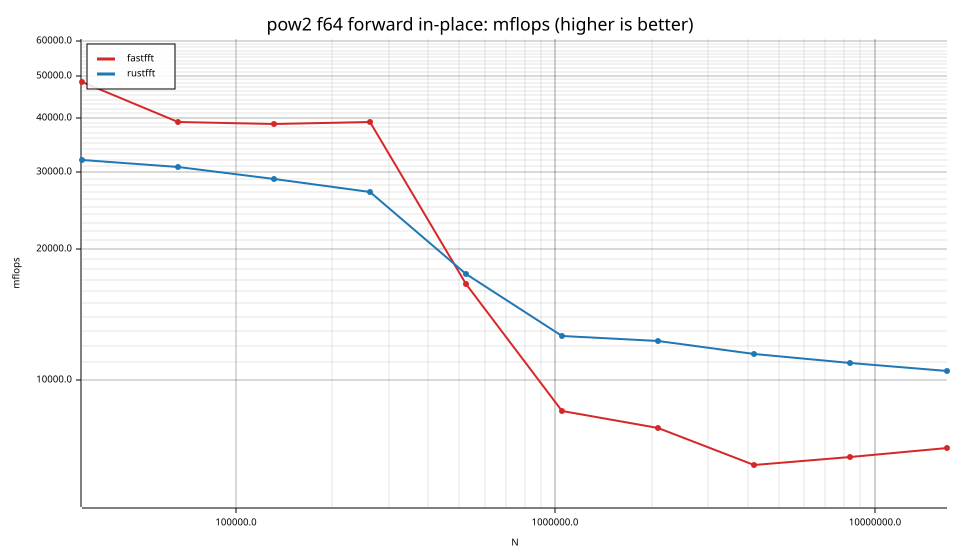
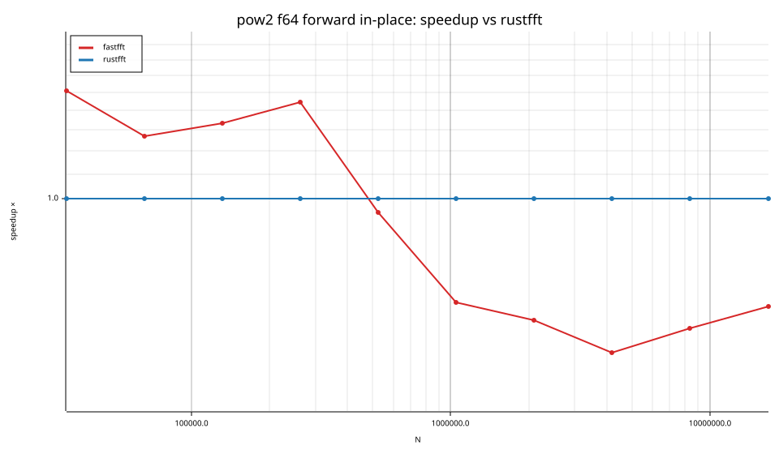
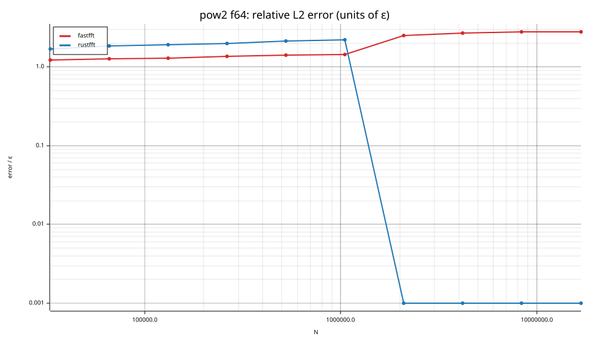

# fastfft arena report: `ticket14-baseline`

| | |
|---|---|
| Host | mini-ryzen |
| CPU | AMD Ryzen 7 7840HS w/ Radeon 780M Graphics (family 25, model 116, stepping 1, microcode 0xa704108) |
| Pinned CPU | 2 (SMT siblings 2,10) |
| Governor / EPP / boost | performance / performance / 1 |
| Kernel | Linux version 7.0.0-28-generic |
| Virtualization | container-other |
| rustc | rustc 1.95.0 (59807616e 2026-04-14); binary: rustc; commit-hash: 59807616e1fa2540724bfbac14d7976d7e4a3860; commit-date: 2026-04-14; host: x86_64-unknown-linux-gnu; release: 1.95.0; LLVM version: 22.1.2 |
| Build profile / RUSTFLAGS | arena / `-C llvm-args=-align-all-functions=6` |
| Libraries | {"fearless_simd":"0.5.0","num-complex":"0.4.6","oxifft":"0.4.2","phastft":"0.4.1","pulp":"0.22.3","rustfft":"6.4.1","tfhe-fft":"0.10.1"} |
| FFTW | fftw-3.3.11-sse2-avx-avx2-avx2_128-avx512 `double: CFLAGS='-O3 -fPIC -std=gnu17' ./configure --enable-static --disable-shared --disable-fortran --disable-doc --enable-sse2 --enable-avx --enable-avx2 --enable-avx512 --enable-fma
single: CFLAGS='-O3 -fPIC -std=gnu17' ./configure --enable-static --disable-shared --disable-fortran --disable-doc --enable-sse2 --enable-avx --enable-avx2 --enable-avx512 --enable-fma --enable-float` |
| Git | d775eac828891a0dd37189e6906ff39175777d1f (dirty: true) |
| Profile | quick |
| Official | true  |
| Control drift | max 1.58% over 2 control runs |
| Cells | 20 |

Times are per transform. *best* = minimum batch mean, *median* = median batch mean. Speedup = rustfft time ÷ library time (> 1 means faster than rustfft); *geomean* over the cells both libraries ran. mflops = 5·N·log2(N)/t(µs).

## Release gates (fastfft)

| Gate | Criterion | Status | Detail |
|---|---|---|---|
| G1 | pow2 vs rustfft: geomean ≥ 1.5×, no cell < 0.95× | ❌ fail | geomean best 0.924×, median 0.927×, worst cell 0.555× (pow2:f64:fwd:ip:n4194304), 20 cells |
| G2 | smooth vs rustfft: geomean ≥ 1.3×, no cell < 0.95× | – n/a | no data |
| G3 | rough vs rustfft: geomean ≥ 0.75×, no cell < 0.5× | – n/a | no data |
| G4 | vs each other Rust library: geomean ≥ 1.1×, ≥ 0.97× on ≥ 90% of cells | – n/a |  |
| G5 | AVX2 forced: pow2 ≥ 1.2×, smooth ≥ 1.1× vs rustfft | – n/a | pow2 NaN×/NaN×, smooth NaN×/NaN× |
| G6 | scenarios ≥ 1.3× each; batch geomean ≥ 1.5× | – n/a | scenarios min inf×, batch NaN×/NaN× |
| G7 | accuracy within §6 thresholds and ≤ 1.5× rustfft + 1ε | ✅ pass | 12 cells checked |
| G8 | Estimate planning time ≤ 2× rustfft for every N ≤ 2^20 | ❌ fail | worst ratio 2.84× (pow2:f64:fwd:ip:n524288), 12 cells |

G9 (build time) is measured by `cargo xtask build-time`, not by the arena.

## Speedup vs rustfft (geomean of best-time ratios; median-time ratio in parentheses)

| suite | prec | fastfft | rustfft |
|---|---|---|---|
| pow2 | f32 | 0.95× (0.96×) 5/0/5 | 1.00× (1.00×) 0/10/0 |
| pow2 | f64 | 0.90× (0.90×) 4/0/6 | 1.00× (1.00×) 0/10/0 |

w/t/l = cells faster / within ±3% / slower than rustfft (best times).

## Suite `pow2`

### pow2 f32

| cell | fastfft | rustfft |
|---|---|---|
| N=32768 fwd ip | 25.53us (1.43×) | 36.50us |
| N=65536 fwd ip | 67.57us (1.21×) | 81.94us |
| N=131072 fwd ip | 143.87us (1.27×) | 182.58us |
| N=262144 fwd ip | 310.99us (1.31×) | 408.20us |
| N=524288 fwd ip | 687.97us (1.28×) | 878.93us |
| N=1048576 fwd ip | 3.21ms (0.90×) | 2.90ms |
| N=2097152 fwd ip | 11.89ms (0.71×) | 8.42ms |
| N=4194304 fwd ip | 32.44ms (0.59×) | 19.18ms |
| N=8388608 fwd ip | 65.47ms (0.63×) | 41.07ms |
| N=16777216 fwd ip | 128.71ms (0.70×) | 89.89ms |

### pow2 f64

| cell | fastfft | rustfft |
|---|---|---|
| N=32768 fwd ip | 50.80us (1.51×) | 76.72us |
| N=65536 fwd ip | 134.15us (1.27×) | 170.28us |
| N=131072 fwd ip | 287.93us (1.34×) | 384.77us |
| N=262144 fwd ip | 604.39us (1.44×) | 873.10us |
| N=524288 fwd ip | 2.99ms (0.95×) | 2.84ms |
| N=1048576 fwd ip | 12.31ms (0.68×) | 8.31ms |
| N=2097152 fwd ip | 28.42ms (0.63×) | 17.91ms |
| N=4194304 fwd ip | 72.30ms (0.56×) | 40.27ms |
| N=8388608 fwd ip | 144.45ms (0.61×) | 88.21ms |
| N=16777216 fwd ip | 288.52ms (0.67×) | 191.95ms |

## Accuracy and planning time (medians over cells)

| lib | cells verified | failed | median error (ε) | worst error (ε) | median plan time |
|---|---|---|---|---|---|
| fastfft | 20 | 0 | 1.39 | 2.80 | 21.39ms |
| rustfft | 20 | 0 | 1.40 | 2.21 | 8.68ms |
