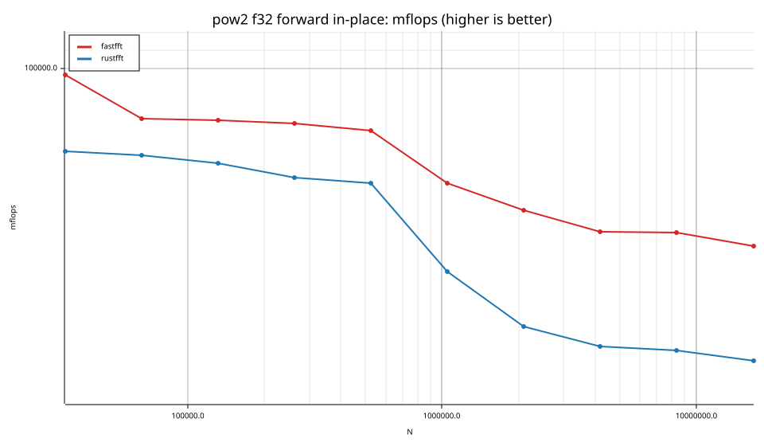
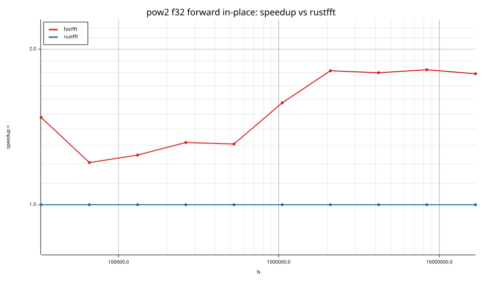
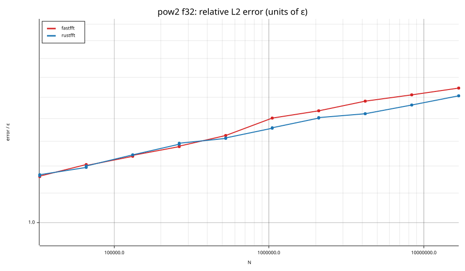
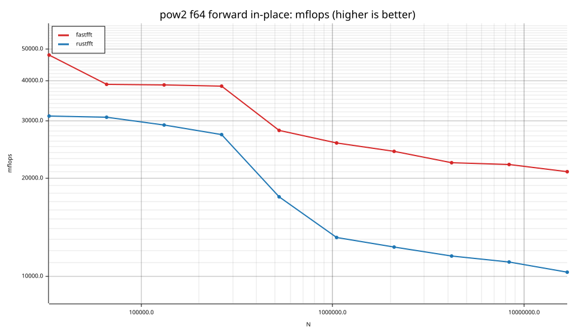
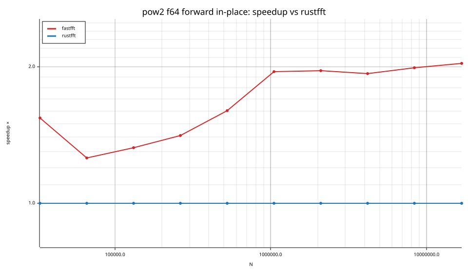

# fastfft arena report: `ticket14-fourstep`

| | |
|---|---|
| Host | mini-ryzen |
| CPU | AMD Ryzen 7 7840HS w/ Radeon 780M Graphics (family 25, model 116, stepping 1, microcode 0xa704108) |
| Pinned CPU | 2 (SMT siblings 2,10) |
| Governor / EPP / boost | performance / performance / 1 |
| Kernel | Linux version 7.0.0-28-generic |
| Virtualization | container-other |
| rustc | rustc 1.95.0 (59807616e 2026-04-14); binary: rustc; commit-hash: 59807616e1fa2540724bfbac14d7976d7e4a3860; commit-date: 2026-04-14; host: x86_64-unknown-linux-gnu; release: 1.95.0; LLVM version: 22.1.2 |
| Build profile / RUSTFLAGS | arena / `-C llvm-args=-align-all-functions=6` |
| Libraries | {"fearless_simd":"0.5.0","num-complex":"0.4.6","oxifft":"0.4.2","phastft":"0.4.1","pulp":"0.22.3","rustfft":"6.4.1","tfhe-fft":"0.10.1"} |
| FFTW | fftw-3.3.11-sse2-avx-avx2-avx2_128-avx512 `double: CFLAGS='-O3 -fPIC -std=gnu17' ./configure --enable-static --disable-shared --disable-fortran --disable-doc --enable-sse2 --enable-avx --enable-avx2 --enable-avx512 --enable-fma
single: CFLAGS='-O3 -fPIC -std=gnu17' ./configure --enable-static --disable-shared --disable-fortran --disable-doc --enable-sse2 --enable-avx --enable-avx2 --enable-avx512 --enable-fma --enable-float` |
| Git | d775eac828891a0dd37189e6906ff39175777d1f (dirty: true) |
| Profile | full |
| Official | true  |
| Control drift | max 7.61% over 5 control runs — **FLAGGED** |
| Cells | 80 |

Times are per transform. *best* = minimum batch mean, *median* = median batch mean. Speedup = rustfft time ÷ library time (> 1 means faster than rustfft); *geomean* over the cells both libraries ran. mflops = 5·N·log2(N)/t(µs).

## Release gates (fastfft)

| Gate | Criterion | Status | Detail |
|---|---|---|---|
| G1 | pow2 vs rustfft: geomean ≥ 1.5×, no cell < 0.95× | ✅ pass | geomean best 1.581×, median 1.579×, worst cell 1.174× (pow2:f32:inv:oop:n524288), 80 cells |
| G2 | smooth vs rustfft: geomean ≥ 1.3×, no cell < 0.95× | – n/a | no data |
| G3 | rough vs rustfft: geomean ≥ 0.75×, no cell < 0.5× | – n/a | no data |
| G4 | vs each other Rust library: geomean ≥ 1.1×, ≥ 0.97× on ≥ 90% of cells | – n/a |  |
| G5 | AVX2 forced: pow2 ≥ 1.2×, smooth ≥ 1.1× vs rustfft | – n/a | pow2 NaN×/NaN×, smooth NaN×/NaN× |
| G6 | scenarios ≥ 1.3× each; batch geomean ≥ 1.5× | – n/a | scenarios min inf×, batch NaN×/NaN× |
| G7 | accuracy within §6 thresholds and ≤ 1.5× rustfft + 1ε | ✅ pass | 48 cells checked |
| G8 | Estimate planning time ≤ 2× rustfft for every N ≤ 2^20 | ❌ fail | worst ratio 2.94× (pow2:f64:inv:ip:n262144), 48 cells |

G9 (build time) is measured by `cargo xtask build-time`, not by the arena.

## Speedup vs rustfft (geomean of best-time ratios; median-time ratio in parentheses)

| suite | prec | fastfft | rustfft |
|---|---|---|---|
| pow2 | f32 | 1.50× (1.50×) 40/0/0 | 1.00× (1.00×) 0/40/0 |
| pow2 | f64 | 1.66× (1.66×) 40/0/0 | 1.00× (1.00×) 0/40/0 |

w/t/l = cells faster / within ±3% / slower than rustfft (best times).

## Suite `pow2`

### pow2 f32

| cell | fastfft | rustfft |
|---|---|---|
| N=32768 fwd ip | 25.39us (1.47×) | 37.45us |
| N=32768 fwd oop | 28.29us (1.30×) | 36.67us |
| N=32768 inv ip | 25.77us (1.43×) | 36.91us |
| N=32768 inv oop | 28.16us (1.31×) | 36.97us |
| N=65536 fwd ip | 67.58us (1.21×) | 81.52us |
| N=65536 fwd oop | 62.16us (1.27×) | 78.94us |
| N=65536 inv ip | 67.76us (1.21×) | 81.83us |
| N=65536 inv oop | 62.22us (1.26×) | 78.63us |
| N=131072 fwd ip | 145.26us (1.25×) | 180.98us |
| N=131072 fwd oop | 132.27us (1.30×) | 171.88us |
| N=131072 inv ip | 143.94us (1.26×) | 181.29us |
| N=131072 inv oop | 133.50us (1.29×) | 172.76us |
| N=262144 fwd ip | 312.58us (1.32×) | 412.01us |
| N=262144 fwd oop | 288.92us (1.36×) | 391.58us |
| N=262144 inv ip | 312.53us (1.31×) | 409.12us |
| N=262144 inv oop | 289.44us (1.37×) | 395.45us |
| N=524288 fwd ip | 683.20us (1.31×) | 895.15us |
| N=524288 fwd oop | 731.22us (1.18×) | 866.30us |
| N=524288 inv ip | 682.35us (1.30×) | 888.98us |
| N=524288 inv oop | 738.82us (1.17×) | 867.20us |
| N=1048576 fwd ip | 1.89ms (1.57×) | 2.97ms |
| N=1048576 fwd oop | 1.79ms (1.50×) | 2.68ms |
| N=1048576 inv ip | 1.89ms (1.55×) | 2.93ms |
| N=1048576 inv oop | 1.80ms (1.47×) | 2.64ms |
| N=2097152 fwd ip | 4.54ms (1.82×) | 8.24ms |
| N=2097152 fwd oop | 4.63ms (1.59×) | 7.38ms |
| N=2097152 inv ip | 4.41ms (1.95×) | 8.59ms |
| N=2097152 inv oop | 4.62ms (1.58×) | 7.31ms |
| N=4194304 fwd ip | 10.61ms (1.80×) | 19.09ms |
| N=4194304 fwd oop | 10.67ms (1.82×) | 19.46ms |
| N=4194304 inv ip | 10.55ms (1.82×) | 19.18ms |
| N=4194304 inv oop | 10.70ms (1.82×) | 19.42ms |
| N=8388608 fwd ip | 22.33ms (1.82×) | 40.71ms |
| N=8388608 fwd oop | 22.71ms (1.83×) | 41.61ms |
| N=8388608 inv ip | 22.45ms (1.80×) | 40.49ms |
| N=8388608 inv oop | 22.44ms (1.86×) | 41.65ms |
| N=16777216 fwd ip | 50.00ms (1.79×) | 89.66ms |
| N=16777216 fwd oop | 51.06ms (1.97×) | 100.49ms |
| N=16777216 inv ip | 50.50ms (1.77×) | 89.28ms |
| N=16777216 inv oop | 50.10ms (2.01×) | 100.81ms |

### pow2 f64

| cell | fastfft | rustfft |
|---|---|---|
| N=32768 fwd ip | 51.36us (1.54×) | 79.21us |
| N=32768 fwd oop | 56.51us (1.31×) | 74.15us |
| N=32768 inv ip | 51.14us (1.52×) | 77.62us |
| N=32768 inv oop | 56.77us (1.30×) | 73.81us |
| N=65536 fwd ip | 134.82us (1.26×) | 169.77us |
| N=65536 fwd oop | 122.61us (1.33×) | 162.60us |
| N=65536 inv ip | 134.59us (1.27×) | 170.46us |
| N=65536 inv oop | 122.65us (1.33×) | 162.71us |
| N=131072 fwd ip | 288.06us (1.33×) | 382.44us |
| N=131072 fwd oop | 267.30us (1.35×) | 360.10us |
| N=131072 inv ip | 292.63us (1.31×) | 382.62us |
| N=131072 inv oop | 268.29us (1.34×) | 358.72us |
| N=262144 fwd ip | 613.55us (1.41×) | 865.63us |
| N=262144 fwd oop | 558.90us (1.50×) | 840.83us |
| N=262144 inv ip | 619.37us (1.40×) | 865.05us |
| N=262144 inv oop | 556.56us (1.50×) | 835.89us |
| N=524288 fwd ip | 1.77ms (1.60×) | 2.84ms |
| N=524288 fwd oop | 1.71ms (1.50×) | 2.56ms |
| N=524288 inv ip | 1.77ms (1.59×) | 2.82ms |
| N=524288 inv oop | 1.70ms (1.51×) | 2.57ms |
| N=1048576 fwd ip | 4.07ms (1.95×) | 7.96ms |
| N=1048576 fwd oop | 4.19ms (1.68×) | 7.04ms |
| N=1048576 inv ip | 4.10ms (1.96×) | 8.04ms |
| N=1048576 inv oop | 4.21ms (1.68×) | 7.06ms |
| N=2097152 fwd ip | 9.10ms (1.96×) | 17.87ms |
| N=2097152 fwd oop | 9.40ms (1.76×) | 16.55ms |
| N=2097152 inv ip | 9.10ms (1.97×) | 17.95ms |
| N=2097152 inv oop | 9.38ms (1.76×) | 16.55ms |
| N=4194304 fwd ip | 20.62ms (1.93×) | 39.90ms |
| N=4194304 fwd oop | 20.56ms (1.98×) | 40.79ms |
| N=4194304 inv ip | 20.55ms (1.94×) | 39.77ms |
| N=4194304 inv oop | 20.59ms (1.98×) | 40.77ms |
| N=8388608 fwd ip | 43.71ms (1.99×) | 87.07ms |
| N=8388608 fwd oop | 43.48ms (2.26×) | 98.12ms |
| N=8388608 inv ip | 43.46ms (2.02×) | 87.64ms |
| N=8388608 inv oop | 43.43ms (2.25×) | 97.73ms |
| N=16777216 fwd ip | 95.84ms (2.04×) | 195.42ms |
| N=16777216 fwd oop | 95.31ms (2.13×) | 202.67ms |
| N=16777216 inv ip | 95.88ms (2.04×) | 196.04ms |
| N=16777216 inv oop | 96.38ms (2.12×) | 204.54ms |

## Accuracy and planning time (medians over cells)

| lib | cells verified | failed | median error (ε) | worst error (ε) | median plan time |
|---|---|---|---|---|---|
| fastfft | 80 | 0 | 1.41 | 2.82 | 4.13ms |
| rustfft | 80 | 0 | 1.40 | 2.21 | 8.33ms |
