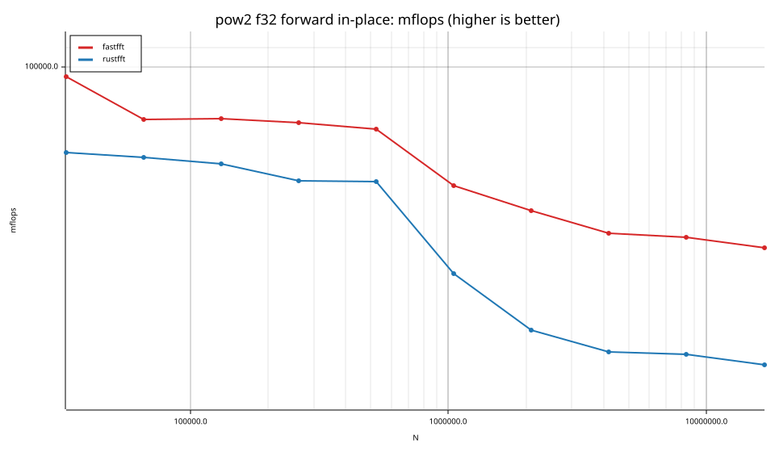
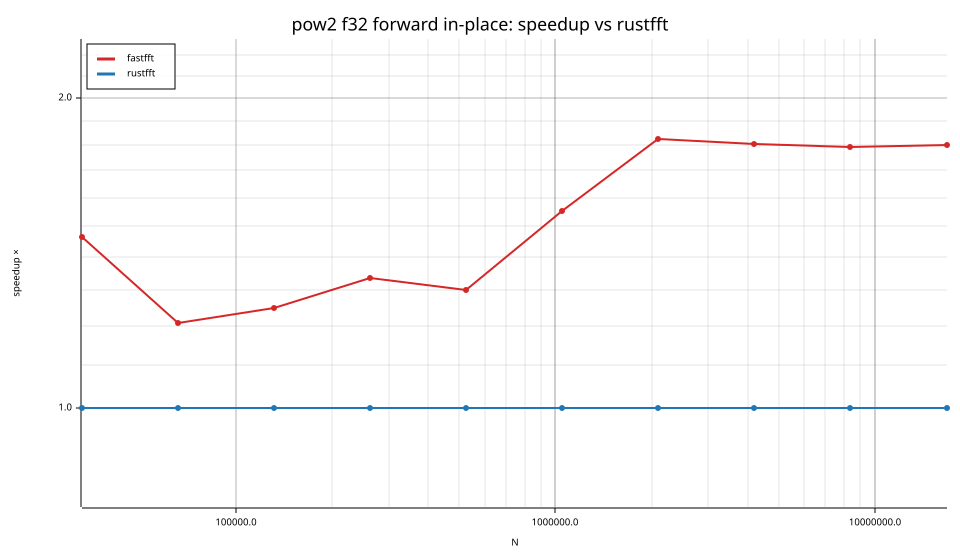
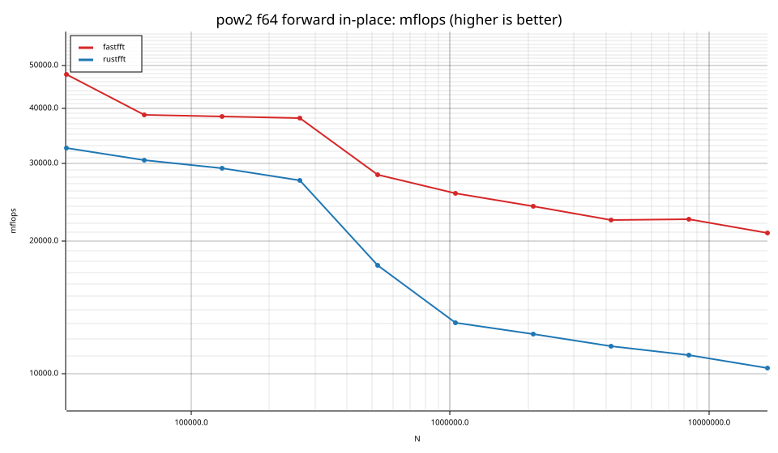
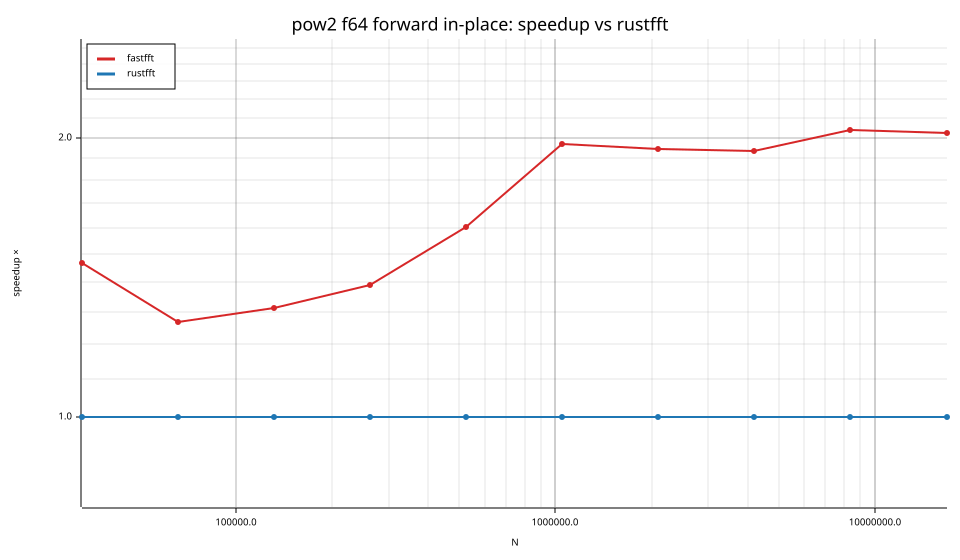
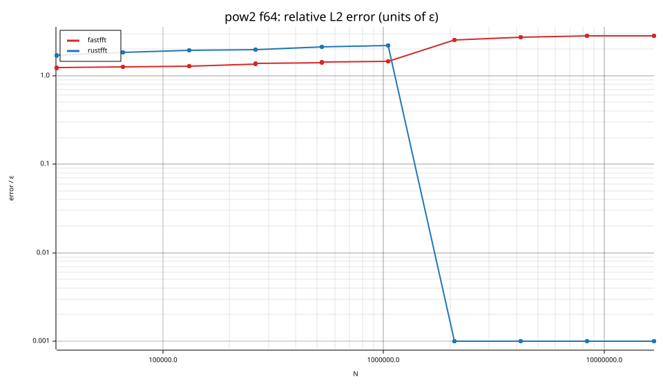

# fastfft arena report: `ticket14-fourstep`

| | |
|---|---|
| Host | mini-ryzen |
| CPU | AMD Ryzen 7 7840HS w/ Radeon 780M Graphics (family 25, model 116, stepping 1, microcode 0xa704108) |
| Pinned CPU | 2 (SMT siblings 2,10) |
| Governor / EPP / boost | performance / performance / 1 |
| Kernel | Linux version 7.0.0-28-generic |
| Virtualization | container-other |
| rustc | rustc 1.95.0 (59807616e 2026-04-14); binary: rustc; commit-hash: 59807616e1fa2540724bfbac14d7976d7e4a3860; commit-date: 2026-04-14; host: x86_64-unknown-linux-gnu; release: 1.95.0; LLVM version: 22.1.2 |
| Build profile / RUSTFLAGS | arena / `-C llvm-args=-align-all-functions=6` |
| Libraries | {"fearless_simd":"0.5.0","num-complex":"0.4.6","oxifft":"0.4.2","phastft":"0.4.1","pulp":"0.22.3","rustfft":"6.4.1","tfhe-fft":"0.10.1"} |
| FFTW | fftw-3.3.11-sse2-avx-avx2-avx2_128-avx512 `double: CFLAGS='-O3 -fPIC -std=gnu17' ./configure --enable-static --disable-shared --disable-fortran --disable-doc --enable-sse2 --enable-avx --enable-avx2 --enable-avx512 --enable-fma
single: CFLAGS='-O3 -fPIC -std=gnu17' ./configure --enable-static --disable-shared --disable-fortran --disable-doc --enable-sse2 --enable-avx --enable-avx2 --enable-avx512 --enable-fma --enable-float` |
| Git | d775eac828891a0dd37189e6906ff39175777d1f (dirty: true) |
| Profile | full |
| Official | true  |
| Control drift | max 1.32% over 5 control runs |
| Cells | 80 |

Times are per transform. *best* = minimum batch mean, *median* = median batch mean. Speedup = rustfft time ÷ library time (> 1 means faster than rustfft); *geomean* over the cells both libraries ran. mflops = 5·N·log2(N)/t(µs).

## Release gates (fastfft)

| Gate | Criterion | Status | Detail |
|---|---|---|---|
| G1 | pow2 vs rustfft: geomean ≥ 1.5×, no cell < 0.95× | ✅ pass | geomean best 1.578×, median 1.577×, worst cell 1.156× (pow2:f32:inv:oop:n524288), 80 cells |
| G2 | smooth vs rustfft: geomean ≥ 1.3×, no cell < 0.95× | – n/a | no data |
| G3 | rough vs rustfft: geomean ≥ 0.75×, no cell < 0.5× | – n/a | no data |
| G4 | vs each other Rust library: geomean ≥ 1.1×, ≥ 0.97× on ≥ 90% of cells | – n/a |  |
| G5 | AVX2 forced: pow2 ≥ 1.2×, smooth ≥ 1.1× vs rustfft | – n/a | pow2 NaN×/NaN×, smooth NaN×/NaN× |
| G6 | scenarios ≥ 1.3× each; batch geomean ≥ 1.5× | – n/a | scenarios min inf×, batch NaN×/NaN× |
| G7 | accuracy within §6 thresholds and ≤ 1.5× rustfft + 1ε | ✅ pass | 48 cells checked |
| G8 | Estimate planning time ≤ 2× rustfft for every N ≤ 2^20 | ❌ fail | worst ratio 2.95× (pow2:f64:fwd:ip:n262144), 48 cells |

G9 (build time) is measured by `cargo xtask build-time`, not by the arena.

## Speedup vs rustfft (geomean of best-time ratios; median-time ratio in parentheses)

| suite | prec | fastfft | rustfft |
|---|---|---|---|
| pow2 | f32 | 1.50× (1.50×) 40/0/0 | 1.00× (1.00×) 0/40/0 |
| pow2 | f64 | 1.66× (1.66×) 40/0/0 | 1.00× (1.00×) 0/40/0 |

w/t/l = cells faster / within ±3% / slower than rustfft (best times).

## Suite `pow2`

### pow2 f32

| cell | fastfft | rustfft |
|---|---|---|
| N=32768 fwd ip | 25.76us (1.47×) | 37.78us |
| N=32768 fwd oop | 28.23us (1.30×) | 36.77us |
| N=32768 inv ip | 25.58us (1.47×) | 37.59us |
| N=32768 inv oop | 28.04us (1.29×) | 36.08us |
| N=65536 fwd ip | 68.12us (1.21×) | 82.34us |
| N=65536 fwd oop | 62.00us (1.27×) | 78.79us |
| N=65536 inv ip | 67.29us (1.23×) | 82.49us |
| N=65536 inv oop | 62.11us (1.26×) | 78.36us |
| N=131072 fwd ip | 144.51us (1.25×) | 180.50us |
| N=131072 fwd oop | 133.10us (1.30×) | 172.50us |
| N=131072 inv ip | 144.64us (1.24×) | 179.80us |
| N=131072 inv oop | 133.13us (1.30×) | 172.48us |
| N=262144 fwd ip | 311.59us (1.34×) | 416.13us |
| N=262144 fwd oop | 289.01us (1.35×) | 390.49us |
| N=262144 inv ip | 313.21us (1.32×) | 412.81us |
| N=262144 inv oop | 288.74us (1.36×) | 393.56us |
| N=524288 fwd ip | 679.80us (1.30×) | 885.25us |
| N=524288 fwd oop | 740.34us (1.18×) | 872.25us |
| N=524288 inv ip | 681.72us (1.31×) | 894.58us |
| N=524288 inv oop | 746.40us (1.16×) | 865.30us |
| N=1048576 fwd ip | 1.90ms (1.55×) | 2.95ms |
| N=1048576 fwd oop | 1.79ms (1.49×) | 2.67ms |
| N=1048576 inv ip | 1.89ms (1.57×) | 2.97ms |
| N=1048576 inv oop | 1.81ms (1.48×) | 2.68ms |
| N=2097152 fwd ip | 4.51ms (1.82×) | 8.22ms |
| N=2097152 fwd oop | 4.64ms (1.59×) | 7.36ms |
| N=2097152 inv ip | 4.52ms (1.85×) | 8.36ms |
| N=2097152 inv oop | 4.55ms (1.61×) | 7.34ms |
| N=4194304 fwd ip | 10.62ms (1.81×) | 19.16ms |
| N=4194304 fwd oop | 10.64ms (1.81×) | 19.30ms |
| N=4194304 inv ip | 10.63ms (1.79×) | 19.07ms |
| N=4194304 inv oop | 10.67ms (1.81×) | 19.31ms |
| N=8388608 fwd ip | 22.64ms (1.79×) | 40.60ms |
| N=8388608 fwd oop | 22.50ms (1.85×) | 41.53ms |
| N=8388608 inv ip | 22.54ms (1.81×) | 40.71ms |
| N=8388608 inv oop | 22.36ms (1.86×) | 41.64ms |
| N=16777216 fwd ip | 49.69ms (1.80×) | 89.45ms |
| N=16777216 fwd oop | 49.77ms (2.02×) | 100.68ms |
| N=16777216 inv ip | 49.89ms (1.79×) | 89.39ms |
| N=16777216 inv oop | 50.47ms (2.00×) | 100.88ms |

### pow2 f64

| cell | fastfft | rustfft |
|---|---|---|
| N=32768 fwd ip | 51.46us (1.46×) | 75.38us |
| N=32768 fwd oop | 56.26us (1.31×) | 73.88us |
| N=32768 inv ip | 51.53us (1.46×) | 75.02us |
| N=32768 inv oop | 56.47us (1.32×) | 74.26us |
| N=65536 fwd ip | 135.65us (1.27×) | 171.94us |
| N=65536 fwd oop | 123.00us (1.32×) | 161.86us |
| N=65536 inv ip | 133.62us (1.28×) | 171.34us |
| N=65536 inv oop | 123.79us (1.31×) | 162.10us |
| N=131072 fwd ip | 289.95us (1.31×) | 380.02us |
| N=131072 fwd oop | 267.60us (1.34×) | 358.83us |
| N=131072 inv ip | 291.12us (1.31×) | 381.22us |
| N=131072 inv oop | 267.78us (1.34×) | 359.19us |
| N=262144 fwd ip | 618.82us (1.39×) | 859.33us |
| N=262144 fwd oop | 563.51us (1.48×) | 835.38us |
| N=262144 inv ip | 613.63us (1.41×) | 867.88us |
| N=262144 inv oop | 562.18us (1.50×) | 840.77us |
| N=524288 fwd ip | 1.76ms (1.60×) | 2.82ms |
| N=524288 fwd oop | 1.71ms (1.50×) | 2.56ms |
| N=524288 inv ip | 1.78ms (1.60×) | 2.85ms |
| N=524288 inv oop | 1.72ms (1.50×) | 2.58ms |
| N=1048576 fwd ip | 4.08ms (1.97×) | 8.03ms |
| N=1048576 fwd oop | 4.18ms (1.67×) | 7.01ms |
| N=1048576 inv ip | 4.08ms (1.95×) | 7.96ms |
| N=1048576 inv oop | 4.19ms (1.68×) | 7.04ms |
| N=2097152 fwd ip | 9.19ms (1.95×) | 17.88ms |
| N=2097152 fwd oop | 9.38ms (1.77×) | 16.59ms |
| N=2097152 inv ip | 9.13ms (1.97×) | 17.97ms |
| N=2097152 inv oop | 9.06ms (1.82×) | 16.50ms |
| N=4194304 fwd ip | 20.62ms (1.94×) | 39.92ms |
| N=4194304 fwd oop | 20.62ms (1.98×) | 40.89ms |
| N=4194304 inv ip | 20.62ms (1.94×) | 39.99ms |
| N=4194304 inv oop | 20.65ms (1.97×) | 40.76ms |
| N=8388608 fwd ip | 42.91ms (2.04×) | 87.58ms |
| N=8388608 fwd oop | 43.57ms (2.24×) | 97.40ms |
| N=8388608 inv ip | 43.19ms (2.00×) | 86.46ms |
| N=8388608 inv oop | 43.26ms (2.24×) | 96.89ms |
| N=16777216 fwd ip | 96.37ms (2.02×) | 194.92ms |
| N=16777216 fwd oop | 95.99ms (2.14×) | 205.17ms |
| N=16777216 inv ip | 96.66ms (2.02×) | 195.42ms |
| N=16777216 inv oop | 96.06ms (2.13×) | 204.57ms |

## Accuracy and planning time (medians over cells)

| lib | cells verified | failed | median error (ε) | worst error (ε) | median plan time |
|---|---|---|---|---|---|
| fastfft | 80 | 0 | 1.41 | 2.82 | 3.99ms |
| rustfft | 80 | 0 | 1.40 | 2.21 | 8.33ms |
