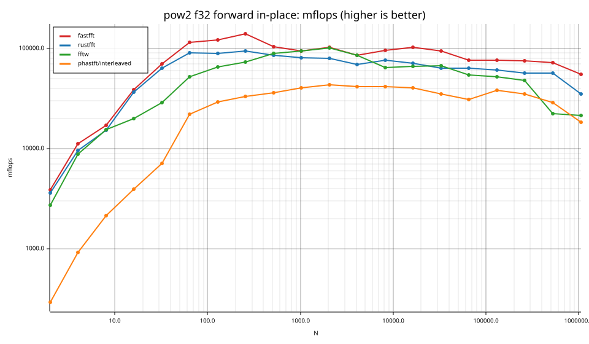
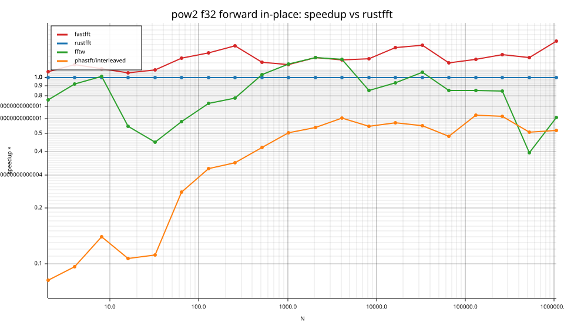
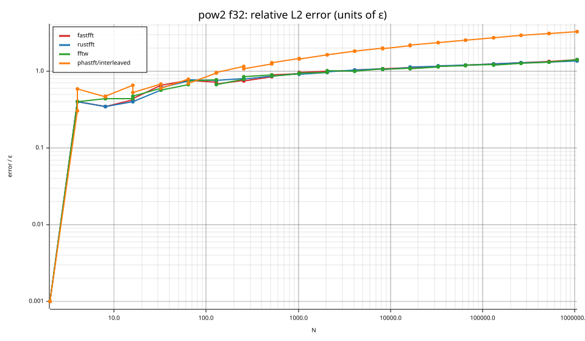
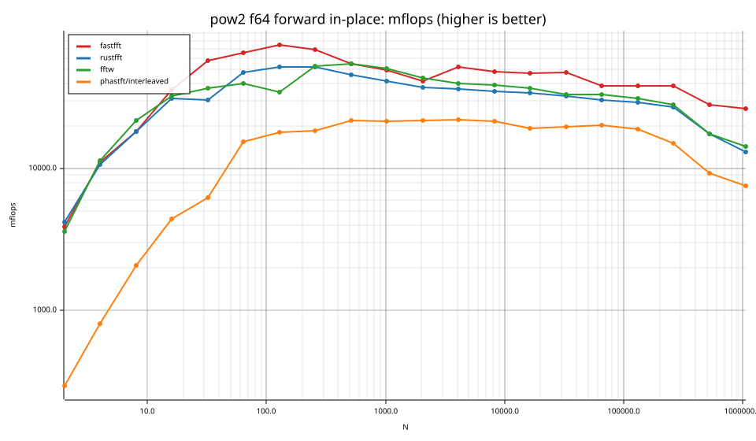
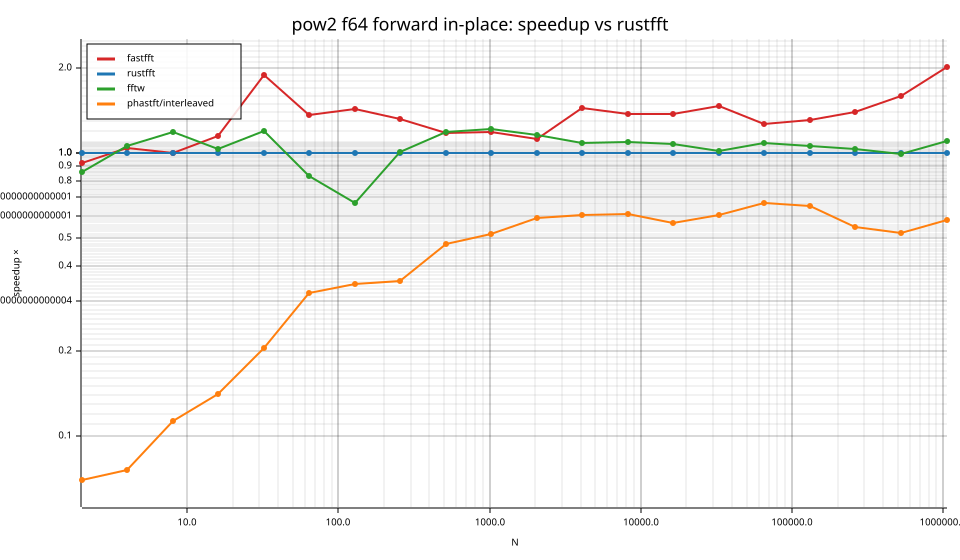
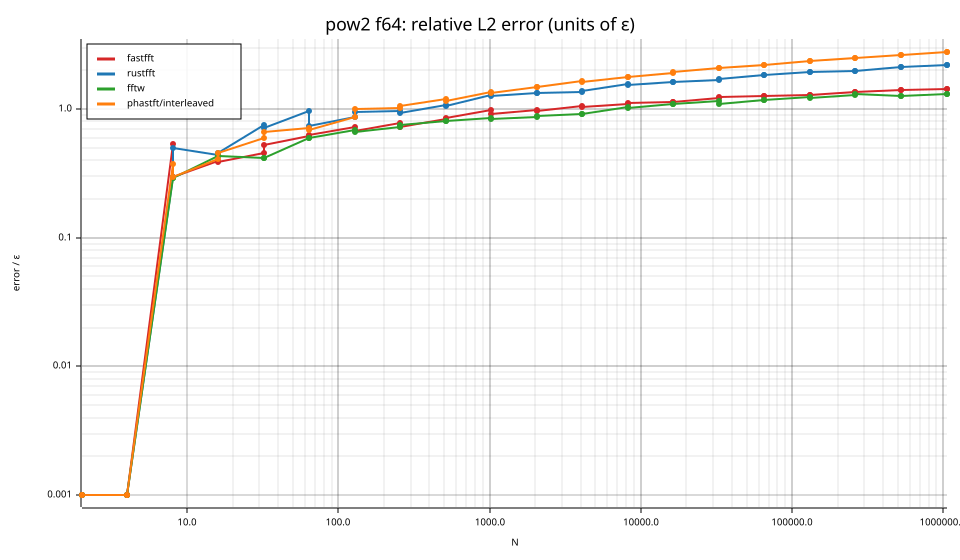

# fastfft arena report: `2026-10-02-mini-ryzen-four-library-comparison`

| | |
|---|---|
| Host | mini-ryzen |
| CPU | AMD Ryzen 7 7840HS w/ Radeon 780M Graphics (family 25, model 116, stepping 1, microcode 0xa704108) |
| Pinned CPU | 2 (SMT siblings 2,10) |
| Governor / EPP / boost | performance / performance / 1 |
| Kernel | Linux version 7.0.0-28-generic |
| Virtualization | none |
| rustc | rustc 1.95.0 (59807616e 2026-04-14); binary: rustc; commit-hash: 59807616e1fa2540724bfbac14d7976d7e4a3860; commit-date: 2026-04-14; host: x86_64-unknown-linux-gnu; release: 1.95.0; LLVM version: 22.1.2 |
| Build profile / RUSTFLAGS | arena / `-C llvm-args=-align-all-functions=6` |
| Libraries | {"fearless_simd":"0.5.0","num-complex":"0.4.6","oxifft":"0.4.2","phastft":"0.4.1","pulp":"0.22.3","rustfft":"6.4.1","tfhe-fft":"0.10.1"} |
| FFTW | fftw-3.3.11-sse2-avx-avx2-avx2_128-avx512 `double: CFLAGS='-O3 -fPIC -std=gnu17' ./configure --enable-static --disable-shared --disable-fortran --disable-doc --enable-sse2 --enable-avx --enable-avx2 --enable-avx512 --enable-fma
single: CFLAGS='-O3 -fPIC -std=gnu17' ./configure --enable-static --disable-shared --disable-fortran --disable-doc --enable-sse2 --enable-avx --enable-avx2 --enable-avx512 --enable-fma --enable-float` |
| Git | a4d8aae88738db827a9a259f23077b72b591481c (dirty: true) |
| Profile | full |
| Official | true  |
| Control drift | max 1.42% over 5 control runs |
| Cells | 80 |

Times are per transform. *best* = minimum batch mean, *median* = median batch mean. Speedup = rustfft time ÷ library time (> 1 means faster than rustfft); *geomean* over the cells both libraries ran. mflops = 5·N·log2(N)/t(µs).

## Release gates (fastfft)

| Gate | Criterion | Status | Detail |
|---|---|---|---|
| G1 | pow2 vs rustfft: geomean ≥ 1.5×, no cell < 0.95× | ❌ fail | geomean best 1.287×, median 1.288×, worst cell 0.925× (pow2:f64:fwd:ip:n2), 80 cells |
| G2 | smooth vs rustfft: geomean ≥ 1.3×, no cell < 0.95× | – n/a | no data |
| G3 | rough vs rustfft: geomean ≥ 0.75×, no cell < 0.5× | – n/a | no data |
| G4 | vs each other Rust library: geomean ≥ 1.1×, ≥ 0.97× on ≥ 90% of cells | ✅ pass | phastft/interleaved: 3.78×/3.87× (100% ≥ 0.97×, 40 cells) |
| G5 | AVX2 forced: pow2 ≥ 1.2×, smooth ≥ 1.1× vs rustfft | – n/a | pow2 NaN×/NaN×, smooth NaN×/NaN× |
| G6 | scenarios ≥ 1.3× each; batch geomean ≥ 1.5× | – n/a | scenarios min inf×, batch NaN×/NaN× |
| G7 | accuracy within §6 thresholds and ≤ 1.5× rustfft + 1ε | ✅ pass | 80 cells checked |
| G8 | Estimate planning time ≤ 2× rustfft for every N ≤ 2^20 | ❌ fail | worst ratio 19.04× (pow2:f64:inv:ip:n16), 80 cells |

G9 (build time) is measured by `cargo xtask build-time`, not by the arena.

## Speedup vs rustfft (geomean of best-time ratios; median-time ratio in parentheses)

| suite | prec | fastfft | rustfft | fftw | phastft/interleaved |
|---|---|---|---|---|---|
| pow2 | f32 | 1.26× (1.25×) 40/0/0 | 1.00× (1.00×) 0/40/0 | 0.80× (0.80×) 8/3/29 | 0.32× (0.32×) 0/0/40 |
| pow2 | f64 | 1.32× (1.32×) 36/2/2 | 1.00× (1.00×) 0/40/0 | 1.03× (1.03×) 28/4/8 | 0.34× (0.33×) 0/0/40 |

w/t/l = cells faster / within ±3% / slower than rustfft (best times).

## Suite `pow2`

### pow2 f32

| cell | fastfft | rustfft | fftw | phastft/interleaved |
|---|---|---|---|---|
| N=2 fwd ip | 2.6ns (1.07×) | 2.8ns | 3.7ns (0.76×) | 33.9ns (0.08×) |
| N=2 inv ip | 2.6ns (1.07×) | 2.8ns | 6.1ns (0.46×) | 37.6ns (0.07×) |
| N=4 fwd ip | 3.6ns (1.17×) | 4.2ns | 4.5ns (0.92×) | 43.1ns (0.10×) |
| N=4 inv ip | 3.6ns (1.18×) | 4.2ns | 4.6ns (0.91×) | 44.3ns (0.09×) |
| N=8 fwd ip | 7.0ns (1.11×) | 7.8ns | 7.7ns (1.01×) | 56.1ns (0.14×) |
| N=8 inv ip | 7.0ns (1.11×) | 7.8ns | 7.6ns (1.02×) | 58.6ns (0.13×) |
| N=16 fwd ip | 8.3ns (1.06×) | 8.7ns | 16.0ns (0.55×) | 81.4ns (0.11×) |
| N=16 inv ip | 8.3ns (1.06×) | 8.7ns | 16.2ns (0.54×) | 85.5ns (0.10×) |
| N=32 fwd ip | 11.4ns (1.10×) | 12.5ns | 27.8ns (0.45×) | 111.7ns (0.11×) |
| N=32 inv ip | 11.6ns (1.08×) | 12.5ns | 25.9ns (0.48×) | 113.9ns (0.11×) |
| N=64 fwd ip | 16.8ns (1.26×) | 21.3ns | 36.8ns (0.58×) | 87.3ns (0.24×) |
| N=64 inv ip | 16.8ns (1.28×) | 21.4ns | 36.5ns (0.59×) | 92.5ns (0.23×) |
| N=128 fwd ip | 36.9ns (1.35×) | 49.9ns | 68.9ns (0.72×) | 153.4ns (0.33×) |
| N=128 inv ip | 36.2ns (1.29×) | 46.8ns | 58.7ns (0.80×) | 161.0ns (0.29×) |
| N=256 fwd ip | 73.5ns (1.47×) | 108.3ns | 139.4ns (0.78×) | 309.2ns (0.35×) |
| N=256 inv ip | 73.2ns (1.45×) | 106.5ns | 137.6ns (0.77×) | 330.1ns (0.32×) |
| N=512 fwd ip | 222.5ns (1.21×) | 269.0ns | 259.9ns (1.04×) | 638.0ns (0.42×) |
| N=512 inv ip | 222.2ns (1.12×) | 249.9ns | 264.5ns (0.95×) | 700.8ns (0.36×) |
| N=1024 fwd ip | 544.0ns (1.17×) | 635.9ns | 539.6ns (1.18×) | 1.26us (0.51×) |
| N=1024 inv ip | 503.2ns (1.27×) | 641.2ns | 490.2ns (1.31×) | 1.33us (0.48×) |
| N=2048 fwd ip | 1.10us (1.28×) | 1.41us | 1.11us (1.28×) | 2.61us (0.54×) |
| N=2048 inv ip | 1.14us (1.24×) | 1.41us | 1.15us (1.22×) | 2.86us (0.49×) |
| N=4096 fwd ip | 2.87us (1.24×) | 3.57us | 2.86us (1.25×) | 5.92us (0.60×) |
| N=4096 inv ip | 2.91us (1.19×) | 3.47us | 2.75us (1.27×) | 6.48us (0.54×) |
| N=8192 fwd ip | 5.56us (1.26×) | 6.98us | 8.21us (0.85×) | 12.73us (0.55×) |
| N=8192 inv ip | 5.78us (1.36×) | 7.87us | 8.17us (0.96×) | 12.40us (0.63×) |
| N=16384 fwd ip | 11.20us (1.44×) | 16.17us | 17.27us (0.94×) | 28.30us (0.57×) |
| N=16384 inv ip | 11.15us (1.45×) | 16.22us | 17.78us (0.91×) | 27.33us (0.59×) |
| N=32768 fwd ip | 25.97us (1.49×) | 38.66us | 36.38us (1.06×) | 70.08us (0.55×) |
| N=32768 inv ip | 26.22us (1.44×) | 37.68us | 37.29us (1.01×) | 69.11us (0.55×) |
| N=65536 fwd ip | 68.82us (1.20×) | 82.33us | 96.72us (0.85×) | 169.82us (0.48×) |
| N=65536 inv ip | 68.53us (1.24×) | 85.10us | 95.40us (0.89×) | 171.63us (0.50×) |
| N=131072 fwd ip | 146.50us (1.25×) | 182.66us | 214.09us (0.85×) | 291.56us (0.63×) |
| N=131072 inv ip | 146.37us (1.26×) | 183.79us | 215.57us (0.85×) | 316.82us (0.58×) |
| N=262144 fwd ip | 312.47us (1.33×) | 415.25us | 492.03us (0.84×) | 671.48us (0.62×) |
| N=262144 inv ip | 315.89us (1.30×) | 410.76us | 503.17us (0.82×) | 673.09us (0.61×) |
| N=524288 fwd ip | 688.70us (1.28×) | 880.76us | 2.23ms (0.40×) | 1.73ms (0.51×) |
| N=524288 inv ip | 679.83us (1.30×) | 883.34us | 2.27ms (0.39×) | 1.64ms (0.54×) |
| N=1048576 fwd ip | 1.91ms (1.56×) | 2.99ms | 4.90ms (0.61×) | 5.73ms (0.52×) |
| N=1048576 inv ip | 1.90ms (1.55×) | 2.95ms | 4.92ms (0.60×) | 5.47ms (0.54×) |

### pow2 f64

| cell | fastfft | rustfft | fftw | phastft/interleaved |
|---|---|---|---|---|
| N=2 fwd ip | 2.6ns (0.93×) | 2.4ns | 2.8ns (0.86×) | 34.2ns (0.07×) |
| N=2 inv ip | 2.6ns (0.93×) | 2.4ns | 2.8ns (0.86×) | 35.3ns (0.07×) |
| N=4 fwd ip | 3.6ns (1.05×) | 3.8ns | 3.5ns (1.06×) | 49.5ns (0.08×) |
| N=4 inv ip | 3.6ns (1.05×) | 3.8ns | 3.6ns (1.05×) | 46.4ns (0.08×) |
| N=8 fwd ip | 6.6ns (1.00×) | 6.6ns | 5.5ns (1.19×) | 57.9ns (0.11×) |
| N=8 inv ip | 6.6ns (1.01×) | 6.6ns | 5.5ns (1.21×) | 58.9ns (0.11×) |
| N=16 fwd ip | 8.9ns (1.15×) | 10.2ns | 9.8ns (1.03×) | 72.2ns (0.14×) |
| N=16 inv ip | 8.8ns (1.16×) | 10.2ns | 9.1ns (1.13×) | 74.8ns (0.14×) |
| N=32 fwd ip | 13.8ns (1.90×) | 26.2ns | 21.8ns (1.20×) | 128.0ns (0.20×) |
| N=32 inv ip | 14.0ns (1.24×) | 17.4ns | 21.5ns (0.81×) | 131.0ns (0.13×) |
| N=64 fwd ip | 29.3ns (1.37×) | 40.0ns | 48.1ns (0.83×) | 124.8ns (0.32×) |
| N=64 inv ip | 29.0ns (1.36×) | 39.6ns | 46.2ns (0.86×) | 128.7ns (0.31×) |
| N=128 fwd ip | 59.9ns (1.44×) | 86.2ns | 128.9ns (0.67×) | 249.8ns (0.34×) |
| N=128 inv ip | 61.1ns (1.41×) | 86.1ns | 126.4ns (0.68×) | 265.1ns (0.32×) |
| N=256 fwd ip | 148.1ns (1.33×) | 196.6ns | 194.3ns (1.01×) | 556.0ns (0.35×) |
| N=256 inv ip | 129.1ns (1.53×) | 197.5ns | 214.5ns (0.92×) | 588.6ns (0.34×) |
| N=512 fwd ip | 422.1ns (1.18×) | 500.2ns | 419.3ns (1.19×) | 1.05us (0.48×) |
| N=512 inv ip | 424.7ns (1.18×) | 501.2ns | 435.5ns (1.15×) | 1.27us (0.39×) |
| N=1024 fwd ip | 1.03us (1.19×) | 1.24us | 1.01us (1.22×) | 2.38us (0.52×) |
| N=1024 inv ip | 1.05us (1.18×) | 1.24us | 1.01us (1.23×) | 2.51us (0.49×) |
| N=2048 fwd ip | 2.70us (1.12×) | 3.03us | 2.60us (1.17×) | 5.12us (0.59×) |
| N=2048 inv ip | 2.70us (1.10×) | 2.96us | 2.63us (1.12×) | 5.52us (0.54×) |
| N=4096 fwd ip | 4.68us (1.44×) | 6.76us | 6.19us (1.09×) | 11.15us (0.61×) |
| N=4096 inv ip | 4.56us (1.69×) | 7.69us | 6.50us (1.18×) | 11.31us (0.68×) |
| N=8192 fwd ip | 10.97us (1.37×) | 15.08us | 13.78us (1.09×) | 24.68us (0.61×) |
| N=8192 inv ip | 10.83us (1.37×) | 14.80us | 13.99us (1.06×) | 27.78us (0.53×) |
| N=16384 fwd ip | 24.44us (1.38×) | 33.69us | 31.14us (1.08×) | 59.27us (0.57×) |
| N=16384 inv ip | 23.92us (1.42×) | 33.92us | 30.89us (1.10×) | 57.26us (0.59×) |
| N=32768 fwd ip | 51.44us (1.47×) | 75.56us | 74.06us (1.02×) | 124.38us (0.61×) |
| N=32768 inv ip | 51.09us (1.49×) | 76.06us | 73.76us (1.03×) | 142.07us (0.54×) |
| N=65536 fwd ip | 135.71us (1.27×) | 172.24us | 158.08us (1.09×) | 258.52us (0.67×) |
| N=65536 inv ip | 135.28us (1.27×) | 172.09us | 159.39us (1.08×) | 245.62us (0.70×) |
| N=131072 fwd ip | 290.89us (1.31×) | 382.06us | 358.34us (1.07×) | 588.33us (0.65×) |
| N=131072 inv ip | 290.62us (1.32×) | 383.74us | 363.07us (1.06×) | 617.20us (0.62×) |
| N=262144 fwd ip | 617.49us (1.40×) | 865.22us | 833.44us (1.04×) | 1.57ms (0.55×) |
| N=262144 inv ip | 620.40us (1.49×) | 926.30us | 831.68us (1.11×) | 1.57ms (0.59×) |
| N=524288 fwd ip | 1.77ms (1.59×) | 2.82ms | 2.83ms (0.99×) | 5.37ms (0.52×) |
| N=524288 inv ip | 1.79ms (1.59×) | 2.84ms | 2.78ms (1.02×) | 5.36ms (0.53×) |
| N=1048576 fwd ip | 3.97ms (2.02×) | 8.03ms | 7.28ms (1.10×) | 13.84ms (0.58×) |
| N=1048576 inv ip | 4.02ms (1.99×) | 7.98ms | 7.69ms (1.04×) | 14.59ms (0.55×) |

## Accuracy and planning time (medians over cells)

| lib | cells verified | failed | median error (ε) | worst error (ε) | median plan time |
|---|---|---|---|---|---|
| fastfft | 80 | 0 | 0.98 | 1.44 | 40.22us |
| rustfft | 80 | 0 | 1.05 | 2.21 | 16.27us |
| fftw | 80 | 0 | 0.92 | 1.42 | 46.19ms |
| phastft/interleaved | 80 | 0 | 1.47 | 3.28 | 19.96us |

### Library notes

- phastft/interleaved: interleaved API deinterleaves into temporary Vecs
- phastft/interleaved: normalizes inverse by 1/N
