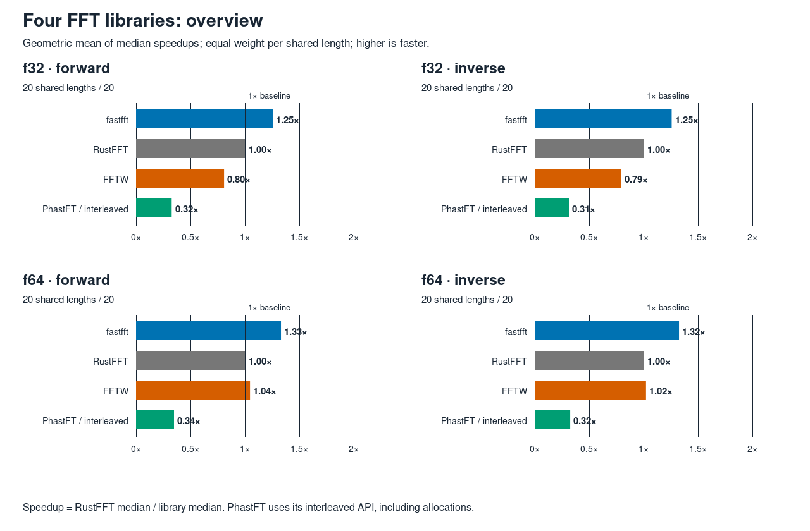
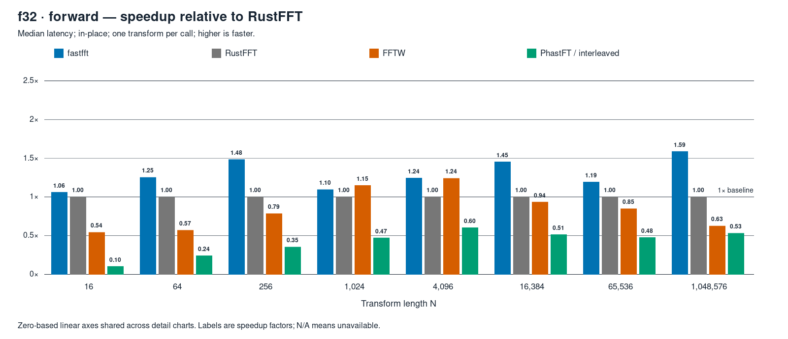
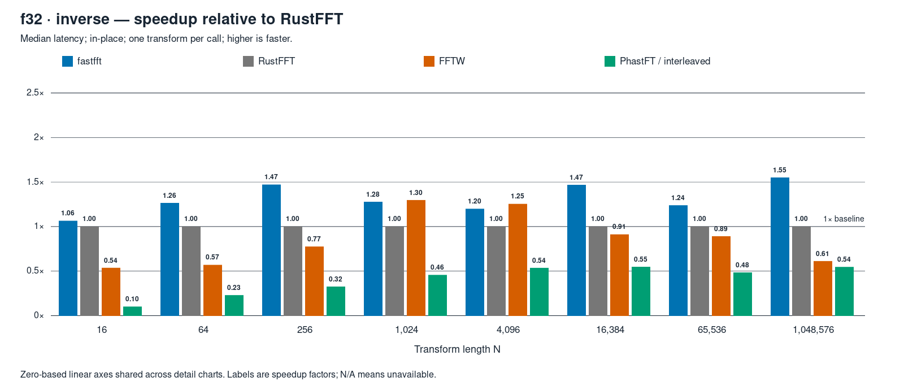
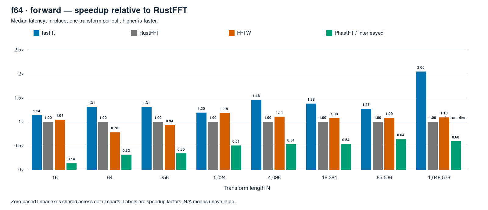
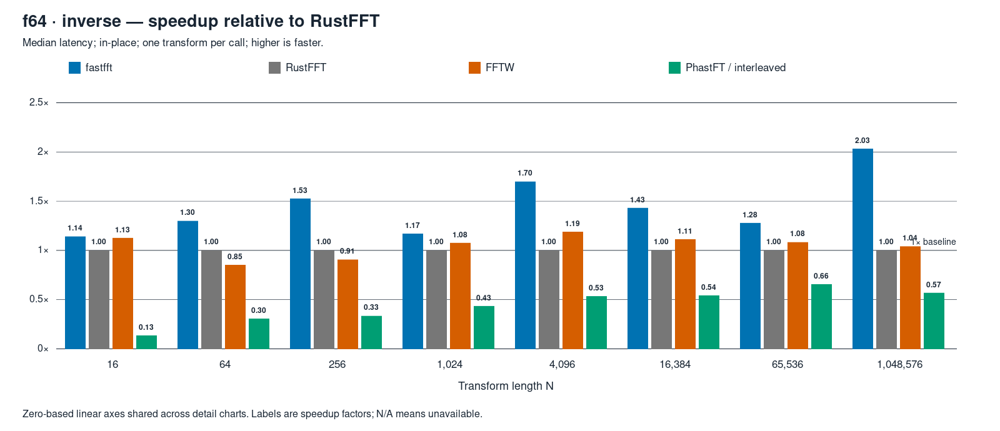

# Four-library FFT comparison

Host: **mini-ryzen**. One full-profile run; 80 cells; 320/320 available library measurements.

Speedup is **RustFFT median latency ÷ library median latency**. Above 1× is faster. Overview bars use the geometric mean over lengths with valid results for all four libraries, with equal weight per length. Controls are excluded. These are execution timings; planning is separate.



[Overview SVG](overview.svg)

| Precision / direction | Shared cells | fastfft | RustFFT | FFTW | PhastFT interleaved |
|---|---:|---:|---:|---:|---:|
| f32 forward | 20 | 1.253× | 1.000× | 0.804× | 0.323× |
| f32 inverse | 20 | 1.254× | 1.000× | 0.788× | 0.308× |
| f64 forward | 20 | 1.327× | 1.000× | 1.043× | 0.344× |
| f64 inverse | 20 | 1.321× | 1.000× | 1.017× | 0.321× |

## Measurement method

Lengths are 2¹ through 2²⁰ (2–1,048,576), f32/f64, forward/inverse, in-place, one transform per call, 64-byte-aligned arena buffers. Full profile: 200 ms warm-up per library, seven rounds with rotating library order, at least 100 ms per library per round, and calibrated batches targeting at least 50 µs. Zero-filled input is used for timing. Each cell runs sequentially in its own child pinned to CPU 2; SMT sibling CPU 10 stays idle. Median is taken over recorded batch means per transform, rather than individual-call samples.

Every available library result passed seeded-random-input verification against the double-double reference before timing (relative L2 tolerance 200·(log₂ N + 1)·ε). The arena repeats an N=4,096 control before timing, every 25 cells, and at the end; each control merges three child processes. Drift uses the arena's dependent-add timing proxy, not calibrated GHz; control latency is informational.

Run validity: official=True; drift flag=False; maximum proxy drift=1.42%; child failures=0; aborted=None; elapsed=333.2 s.

Host-visible processes were inspected after compilation. Immediately before timing, three consecutive 10-second samples required overall CPU usage and usage of CPUs 2 and 10 each ≤2%, followed by a passing `scripts/bench-env.sh check --core 2`. Builds, tests and chart generation were paused during timing. [Idle samples and host process evidence](idle-check.json); [environment check](bench-env-check.txt); [execution log](run.log).

## Library APIs and comparability

- fastfft 0.1.0: default Estimate planner; detected AVX-512 tier; observed kernels: AVX2, AVX-512, AVX-512 YMM (selected by length and precision); preallocated scratch; `process_with_scratch`. The detected plan descriptions are retained in the complete results.
- RustFFT 6.4.1: automatic SIMD planner; preallocated scratch; `process_with_scratch`.
- FFTW fftw-3.3.11-sse2-avx-avx2-avx2_128-avx512: existing static single/double build; `FFTW_MEASURE`, saved host wisdom; planning excluded.
- PhastFT 0.4.1: `complex-nums` interleaved API with reused `PlannerDit32/64`; `parallel` disabled. Each timed call deinterleaves into two temporary vectors, transforms, allocates a complex vector to recombine, and copies the result back. Allocation, conversion, copy and deallocation are included. These temporary vectors have the library’s own alignment.

PhastFT inverse transforms normalize by 1/N; fastfft, RustFFT and FFTW return unnormalized inverse transforms. Verification rescales PhastFT outside timing. The timed inverse calls retain their native behavior, including PhastFT's normalization. These results compare the requested interleaved APIs and do not measure PhastFT's split-array API.

## Build and machine

- CPU: AMD Ryzen 7 7840HS w/ Radeon 780M Graphics; host `mini-ryzen`; CPU 2, siblings `2,10`.
- Governor `performance`; EPP `performance`; boost `1`; SMT `1`.
- Compiler: `rustc 1.95.0 (59807616e 2026-04-14); binary: rustc; commit-hash: 59807616e1fa2540724bfbac14d7976d7e4a3860; commit-date: 2026-04-14; host: x86_64-unknown-linux-gnu; release: 1.95.0; LLVM version: 22.1.2`.
- Source revision: `a4d8aae88738db827a9a259f23077b72b591481c`; captured dirty status `True`. The reporting script and evidence were added locally; benchmark source and Cargo.lock were unchanged.
- Profile: `arena` (optimized, fat LTO, one codegen unit); RUSTFLAGS: `-C llvm-args=-align-all-functions=6`; `target-cpu=native`: `False`.

FFTW configure lines:

```text
double: CFLAGS='-O3 -fPIC -std=gnu17' ./configure --enable-static --disable-shared --disable-fortran --disable-doc --enable-sse2 --enable-avx --enable-avx2 --enable-avx512 --enable-fma
single: CFLAGS='-O3 -fPIC -std=gnu17' ./configure --enable-static --disable-shared --disable-fortran --disable-doc --enable-sse2 --enable-avx --enable-avx2 --enable-avx512 --enable-fma --enable-float
```

Benchmark command (after preparation and idle check):

```bash
RUSTFLAGS="-C llvm-args=-align-all-functions=6" \
  cargo xtask arena run --suite pow2 --profile full \
  --libs fastfft,rustfft,fftw,phastft/interleaved \
  --max-n 1048576 --filter place=ip --core 2 \
  --label four-library-comparison
```

## Detailed charts and absolute median latencies

All detail charts share a zero-based linear scale. Selected lengths are 16, 64, 256, 1,024, 4,096, 16,384, 65,536 and 1,048,576. Tables include every measured length; latencies are **nanoseconds per transform**, rounded to three decimals.

### f32 forward



[SVG chart](f32-forward.svg)

| N | fastfft (ns) | RustFFT (ns) | FFTW (ns) | PhastFT interleaved (ns) |
|---:|---:|---:|---:|---:|
| 2 | 2.651 | 2.905 | 3.752 | 34.991 |
| 4 | 3.596 | 4.293 | 4.635 | 44.181 |
| 8 | 7.244 | 7.892 | 7.881 | 58.133 |
| 16 | 8.328 | 8.842 | 16.280 | 84.976 |
| 32 | 11.865 | 12.678 | 28.857 | 113.621 |
| 64 | 17.249 | 21.618 | 37.928 | 89.766 |
| 128 | 38.179 | 50.949 | 72.709 | 156.315 |
| 256 | 75.199 | 111.573 | 142.107 | 315.466 |
| 512 | 227.417 | 271.344 | 263.676 | 664.600 |
| 1,024 | 585.378 | 641.213 | 558.360 | 1,356.892 |
| 2,048 | 1,114.386 | 1,418.938 | 1,130.279 | 2,784.722 |
| 4,096 | 2,917.778 | 3,630.200 | 2,925.529 | 6,020.222 |
| 8,192 | 5,600.556 | 7,007.125 | 8,344.167 | 13,179.750 |
| 16,384 | 11,321.400 | 16,451.000 | 17,589.833 | 32,025.500 |
| 32,768 | 26,515.500 | 39,610.000 | 36,919.750 | 72,457.000 |
| 65,536 | 70,153.000 | 83,669.000 | 98,606.000 | 175,783.000 |
| 131,072 | 148,702.000 | 186,011.000 | 217,091.000 | 298,194.000 |
| 262,144 | 318,948.500 | 425,595.000 | 499,735.000 | 692,851.000 |
| 524,288 | 719,671.000 | 911,734.500 | 2,300,843.000 | 1,809,853.500 |
| 1,048,576 | 1,970,903.500 | 3,130,382.000 | 5,004,963.000 | 5,889,496.000 |

### f32 inverse



[SVG chart](f32-inverse.svg)

| N | fastfft (ns) | RustFFT (ns) | FFTW (ns) | PhastFT interleaved (ns) |
|---:|---:|---:|---:|---:|
| 2 | 2.649 | 2.901 | 6.315 | 39.943 |
| 4 | 3.596 | 4.289 | 4.766 | 45.806 |
| 8 | 7.243 | 7.894 | 7.784 | 60.267 |
| 16 | 8.312 | 8.841 | 16.496 | 88.238 |
| 32 | 11.914 | 12.724 | 27.176 | 117.039 |
| 64 | 17.174 | 21.687 | 38.131 | 95.119 |
| 128 | 38.174 | 48.072 | 61.381 | 164.045 |
| 256 | 74.946 | 110.182 | 142.424 | 339.489 |
| 512 | 227.180 | 252.256 | 268.201 | 797.161 |
| 1,024 | 509.255 | 650.099 | 501.561 | 1,426.757 |
| 2,048 | 1,146.116 | 1,420.400 | 1,207.048 | 2,954.500 |
| 4,096 | 2,956.176 | 3,541.700 | 2,825.389 | 6,618.750 |
| 8,192 | 5,838.778 | 7,930.714 | 8,355.833 | 13,806.250 |
| 16,384 | 11,259.200 | 16,506.250 | 18,114.333 | 30,247.500 |
| 32,768 | 26,705.500 | 38,478.000 | 37,676.000 | 75,823.000 |
| 65,536 | 69,792.000 | 86,323.000 | 96,973.000 | 178,808.000 |
| 131,072 | 148,992.000 | 186,352.000 | 218,573.000 | 321,367.000 |
| 262,144 | 322,580.500 | 418,697.000 | 511,132.000 | 685,667.000 |
| 524,288 | 704,242.000 | 915,983.000 | 2,327,002.000 | 1,740,161.000 |
| 1,048,576 | 1,979,956.000 | 3,065,850.000 | 5,015,698.500 | 5,625,837.500 |

### f64 forward



[SVG chart](f64-forward.svg)

| N | fastfft (ns) | RustFFT (ns) | FFTW (ns) | PhastFT interleaved (ns) |
|---:|---:|---:|---:|---:|
| 2 | 2.583 | 2.591 | 2.846 | 35.170 |
| 4 | 3.684 | 3.818 | 3.655 | 50.690 |
| 8 | 6.685 | 7.135 | 5.684 | 59.995 |
| 16 | 9.107 | 10.396 | 9.949 | 75.084 |
| 32 | 14.204 | 27.293 | 22.314 | 130.985 |
| 64 | 30.668 | 40.301 | 51.369 | 126.877 |
| 128 | 64.378 | 89.112 | 133.192 | 255.161 |
| 256 | 152.222 | 199.849 | 213.737 | 578.884 |
| 512 | 436.657 | 508.607 | 422.946 | 1,089.341 |
| 1,024 | 1,042.617 | 1,246.125 | 1,048.867 | 2,453.150 |
| 2,048 | 2,736.211 | 3,083.938 | 2,646.053 | 5,838.500 |
| 4,096 | 4,742.545 | 6,933.167 | 6,255.625 | 12,954.500 |
| 8,192 | 11,143.200 | 15,366.750 | 14,025.375 | 27,256.500 |
| 16,384 | 25,017.500 | 34,550.500 | 31,975.500 | 63,861.000 |
| 32,768 | 52,459.000 | 77,156.000 | 75,433.000 | 145,982.000 |
| 65,536 | 137,901.000 | 175,532.000 | 161,726.000 | 274,754.500 |
| 131,072 | 296,941.500 | 389,522.000 | 363,668.000 | 646,448.000 |
| 262,144 | 646,207.500 | 894,833.000 | 847,643.000 | 1,653,142.500 |
| 524,288 | 1,832,351.500 | 2,954,243.500 | 2,877,814.000 | 5,527,096.000 |
| 1,048,576 | 4,159,985.000 | 8,525,793.500 | 7,784,296.000 | 14,272,073.500 |

### f64 inverse



[SVG chart](f64-inverse.svg)

| N | fastfft (ns) | RustFFT (ns) | FFTW (ns) | PhastFT interleaved (ns) |
|---:|---:|---:|---:|---:|
| 2 | 2.584 | 2.585 | 2.845 | 36.964 |
| 4 | 3.686 | 3.816 | 3.665 | 48.530 |
| 8 | 6.683 | 7.132 | 5.667 | 62.175 |
| 16 | 9.122 | 10.400 | 9.241 | 77.669 |
| 32 | 14.221 | 17.491 | 23.022 | 135.114 |
| 64 | 30.697 | 39.853 | 46.873 | 130.929 |
| 128 | 64.409 | 89.041 | 128.627 | 270.339 |
| 256 | 131.713 | 200.935 | 221.950 | 602.819 |
| 512 | 437.991 | 506.348 | 462.953 | 1,466.767 |
| 1,024 | 1,066.064 | 1,245.100 | 1,158.021 | 2,872.056 |
| 2,048 | 2,720.947 | 3,002.765 | 2,825.333 | 6,281.875 |
| 4,096 | 4,616.000 | 7,837.375 | 6,598.750 | 14,712.750 |
| 8,192 | 10,988.800 | 15,101.000 | 14,257.000 | 28,842.250 |
| 16,384 | 24,316.000 | 34,785.500 | 31,314.500 | 64,251.000 |
| 32,768 | 52,028.000 | 78,068.000 | 75,332.000 | 157,719.000 |
| 65,536 | 137,219.000 | 175,292.000 | 162,006.000 | 267,516.000 |
| 131,072 | 297,012.000 | 392,312.000 | 368,888.000 | 650,586.000 |
| 262,144 | 642,485.000 | 953,033.000 | 843,426.000 | 1,638,028.000 |
| 524,288 | 1,842,425.000 | 2,998,663.000 | 2,838,429.000 | 5,506,687.000 |
| 1,048,576 | 4,206,918.500 | 8,546,257.000 | 8,222,144.000 | 15,049,590.000 |

## Availability and limits

No unavailable measurements: all 320 library measurements passed verification and were timed; each overview panel shares all 20 lengths.

One run on one CPU with aligned buffers and zero-filled timing data does not establish cross-machine performance or run-to-run uncertainty. Single-process address placement and small-N call overhead can affect ratios. Inverse normalization and PhastFT's allocation costs are part of the API behavior being compared.

## Complete results and regeneration

[Interactive HTML report](index.html).

[Complete results](results.jsonl.gz), [environment](env.json), [run metadata](meta.json), [chart arithmetic and shared cells](chart-data.json), [arena report](report.md), [validation](validation.json).

Regenerate from the repository root:

```bash
python3 scripts/plot-library-comparison.py docs/benchmarks/2026-10-02-mini-ryzen-four-library-comparison --out docs/benchmarks/2026-10-02-mini-ryzen-four-library-comparison
```
