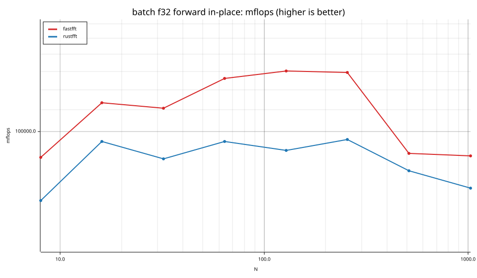
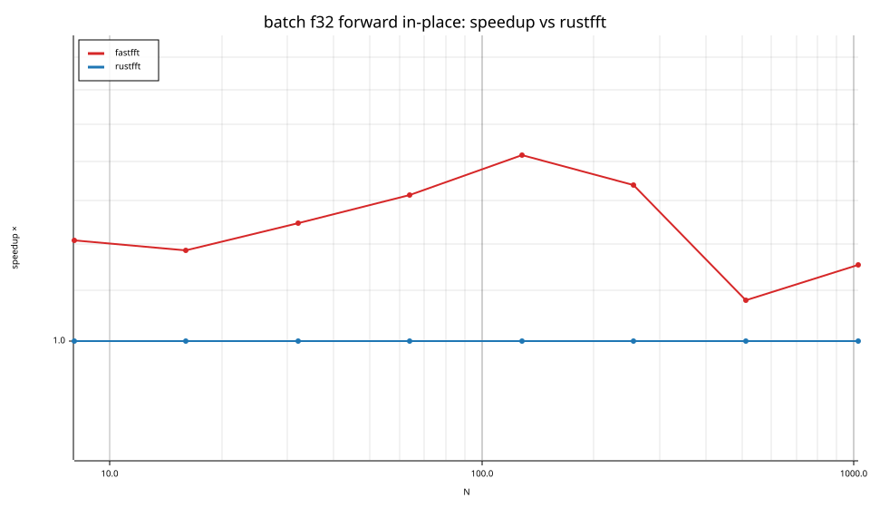
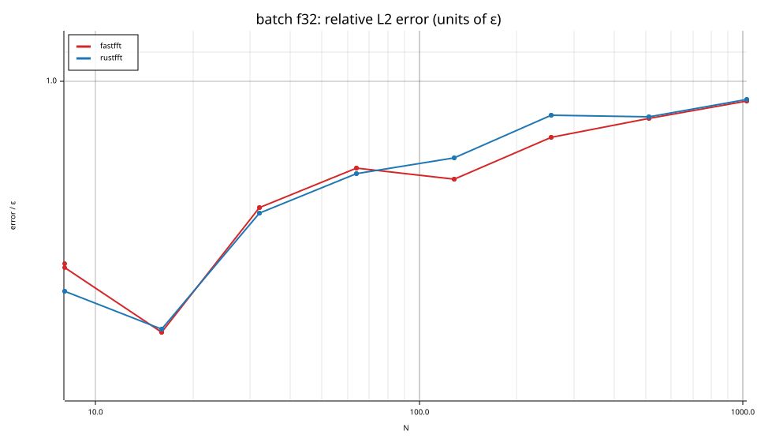
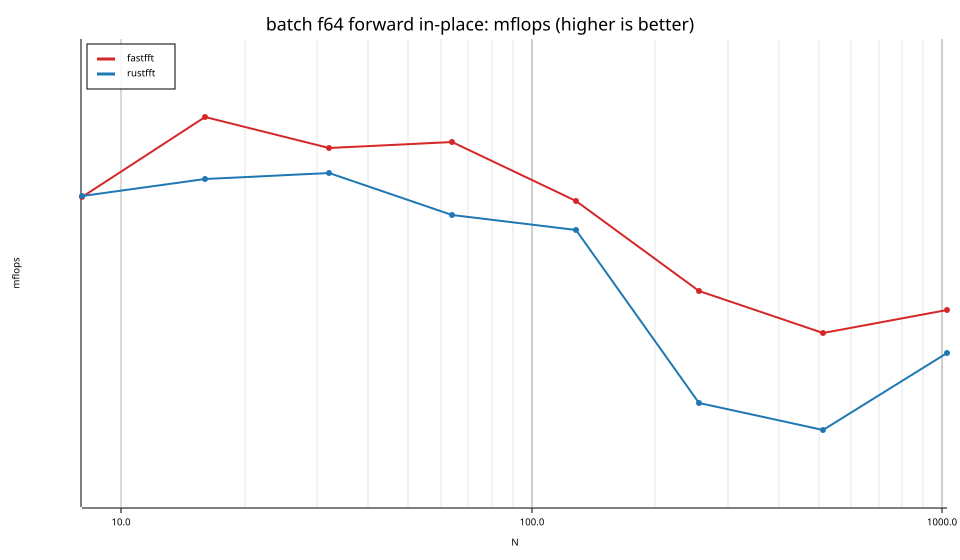
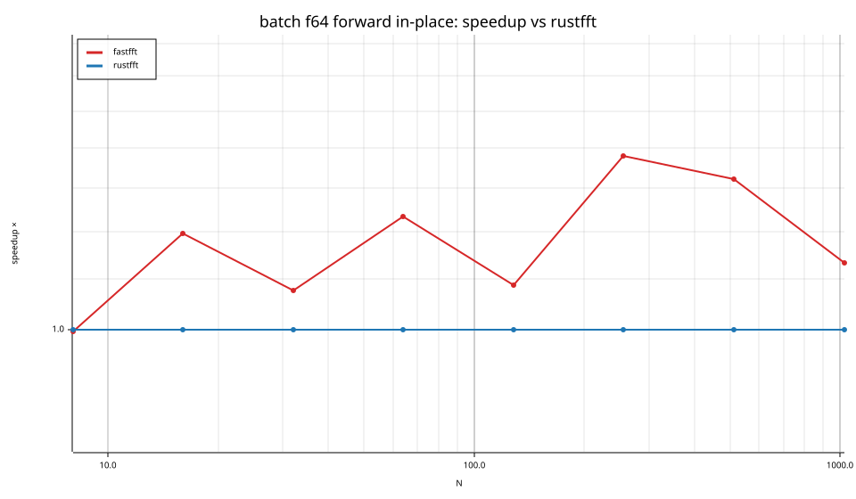
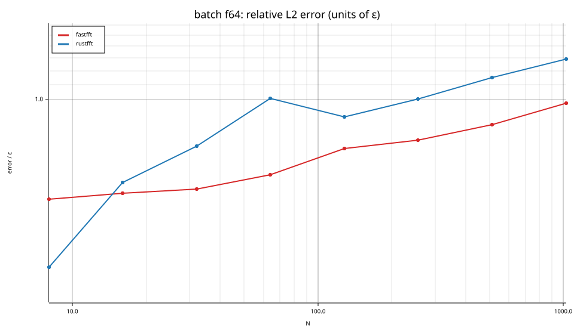

# fastfft arena report: `official`

| | |
|---|---|
| Host | mini-ryzen |
| CPU | AMD Ryzen 7 7840HS w/ Radeon 780M Graphics (family 25, model 116, stepping 1, microcode 0xa704108) |
| Pinned CPU | 2 (SMT siblings 2,10) |
| Governor / EPP / boost | performance / performance / 1 |
| Kernel | Linux version 7.0.0-28-generic |
| Virtualization | container-other |
| rustc | rustc 1.95.0 (59807616e 2026-04-14); binary: rustc; commit-hash: 59807616e1fa2540724bfbac14d7976d7e4a3860; commit-date: 2026-04-14; host: x86_64-unknown-linux-gnu; release: 1.95.0; LLVM version: 22.1.2 |
| Build profile / RUSTFLAGS | arena / `` |
| Libraries | {"fearless_simd":"0.5.0","num-complex":"0.4.6","oxifft":"0.4.2","phastft":"0.4.1","pulp":"0.22.3","rustfft":"6.4.1","tfhe-fft":"0.10.1"} |
| FFTW | fftw-3.3.11-sse2-avx-avx2-avx2_128-avx512 `double: CFLAGS='-O3 -fPIC -std=gnu17' ./configure --enable-static --disable-shared --disable-fortran --disable-doc --enable-sse2 --enable-avx --enable-avx2 --enable-avx512 --enable-fma
single: CFLAGS='-O3 -fPIC -std=gnu17' ./configure --enable-static --disable-shared --disable-fortran --disable-doc --enable-sse2 --enable-avx --enable-avx2 --enable-avx512 --enable-fma --enable-float` |
| Git | a4d8aae88738db827a9a259f23077b72b591481c (dirty: true) |
| Profile | full |
| Official | true  |
| Control drift | max 0.99% over 3 control runs |
| Cells | 32 |

Times are per transform. *best* = minimum batch mean, *median* = median batch mean. Speedup = rustfft time ÷ library time (> 1 means faster than rustfft); *geomean* over the cells both libraries ran. mflops = 5·N·log2(N)/t(µs).

## Release gates (fastfft)

| Gate | Criterion | Status | Detail |
|---|---|---|---|
| G1 | pow2 vs rustfft: geomean ≥ 1.5×, no cell < 0.95× | – n/a | no data |
| G2 | smooth vs rustfft: geomean ≥ 1.3×, no cell < 0.95× | – n/a | no data |
| G3 | rough vs rustfft: geomean ≥ 0.75×, no cell < 0.5× | – n/a | no data |
| G4 | vs each other Rust library: geomean ≥ 1.1×, ≥ 0.97× on ≥ 90% of cells | – n/a |  |
| G5 | AVX2 forced: pow2 ≥ 1.2×, smooth ≥ 1.1× vs rustfft | – n/a | pow2 NaN×/NaN×, smooth NaN×/NaN× |
| G6 | scenarios ≥ 1.3× each; batch geomean ≥ 1.5× | ❌ fail | scenarios min inf×, batch 1.310×/1.298× |
| G7 | accuracy within §6 thresholds and ≤ 1.5× rustfft + 1ε | ✅ pass | 32 cells checked |
| G8 | Estimate planning time ≤ 2× rustfft for every N ≤ 2^20 | ❌ fail | worst ratio 23.04× (batch:f64:fwd:oop:n16:b65536), 32 cells |

G9 (build time) is measured by `cargo xtask build-time`, not by the arena.

## Speedup vs rustfft (geomean of best-time ratios; median-time ratio in parentheses)

| suite | prec | fastfft | rustfft |
|---|---|---|---|
| batch | f32 | 1.26× (1.27×) 16/0/0 | 1.00× (1.00×) 0/16/0 |
| batch | f64 | 1.36× (1.32×) 15/1/0 | 1.00× (1.00×) 0/16/0 |

w/t/l = cells faster / within ±3% / slower than rustfft (best times).

## Suite `batch`

### batch f32

| cell | fastfft | rustfft |
|---|---|---|
| N=8 ×131072 fwd ip | 1.3ns (1.21×) | 1.6ns |
| N=8 ×131072 fwd oop | 1.6ns (1.26×) | 2.0ns |
| N=16 ×65536 fwd ip | 2.8ns (1.18×) | 3.3ns |
| N=16 ×65536 fwd oop | 3.2ns (1.25×) | 4.0ns |
| N=32 ×32768 fwd ip | 7.2ns (1.25×) | 9.0ns |
| N=32 ×32768 fwd oop | 7.1ns (1.37×) | 9.8ns |
| N=64 ×16384 fwd ip | 15.3ns (1.31×) | 20.1ns |
| N=64 ×16384 fwd oop | 15.7ns (1.40×) | 22.0ns |
| N=128 ×8192 fwd ip | 34.4ns (1.42×) | 48.7ns |
| N=128 ×8192 fwd oop | 43.4ns (1.17×) | 50.9ns |
| N=256 ×4096 fwd ip | 79.2ns (1.34×) | 106.1ns |
| N=256 ×4096 fwd oop | 107.3ns (1.06×) | 113.9ns |
| N=512 ×2048 fwd ip | 253.6ns (1.08×) | 273.5ns |
| N=512 ×2048 fwd oop | 293.8ns (1.47×) | 430.5ns |
| N=1024 ×1024 fwd ip | 569.0ns (1.15×) | 656.1ns |
| N=1024 ×1024 fwd oop | 681.6ns (1.35×) | 919.5ns |

### batch f64

| cell | fastfft | rustfft |
|---|---|---|
| N=8 ×131072 fwd ip | 2.4ns (1.00×) | 2.4ns |
| N=8 ×131072 fwd oop | 4.9ns (1.62×) | 7.9ns |
| N=16 ×65536 fwd ip | 5.1ns (1.20×) | 6.1ns |
| N=16 ×65536 fwd oop | 9.8ns (1.63×) | 15.9ns |
| N=32 ×32768 fwd ip | 14.0ns (1.08×) | 15.0ns |
| N=32 ×32768 fwd oop | 20.1ns (1.63×) | 32.8ns |
| N=64 ×16384 fwd ip | 33.0ns (1.23×) | 40.7ns |
| N=64 ×16384 fwd oop | 50.6ns (1.40×) | 70.9ns |
| N=128 ×8192 fwd ip | 91.1ns (1.09×) | 99.0ns |
| N=128 ×8192 fwd oop | 113.6ns (1.35×) | 153.2ns |
| N=256 ×4096 fwd ip | 270.2ns (1.38×) | 373.0ns |
| N=256 ×4096 fwd oop | 321.5ns (1.94×) | 623.9ns |
| N=512 ×2048 fwd ip | 685.4ns (1.32×) | 906.4ns |
| N=512 ×2048 fwd oop | 898.9ns (1.70×) | 1.53us |
| N=1024 ×1024 fwd ip | 1.43us (1.13×) | 1.61us |
| N=1024 ×1024 fwd oop | 1.85us (1.45×) | 2.67us |

## Accuracy and planning time (medians over cells)

| lib | cells verified | failed | median error (ε) | worst error (ε) | median plan time |
|---|---|---|---|---|---|
| fastfft | 32 | 0 | 0.74 | 0.98 | 7.25us |
| rustfft | 32 | 0 | 0.89 | 1.29 | 1.00us |
