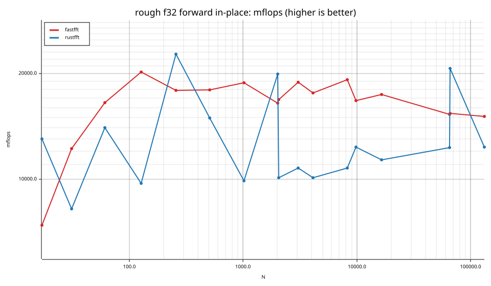
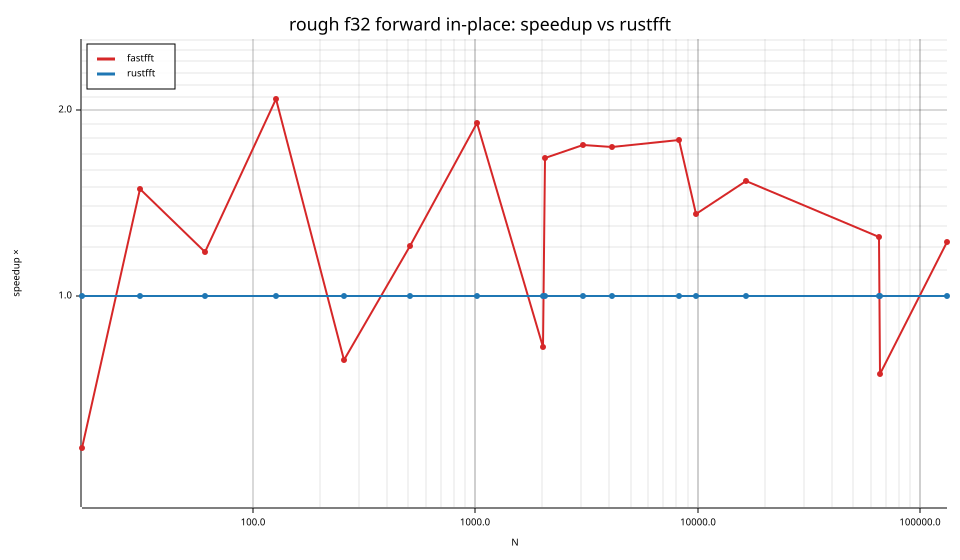
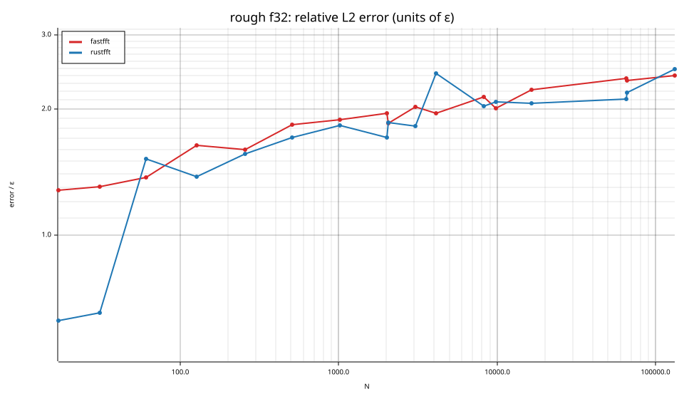
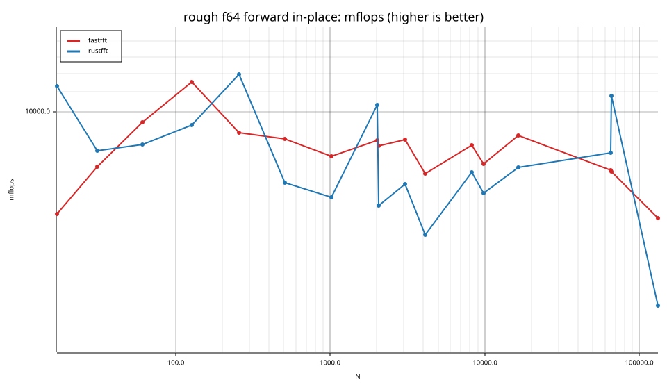
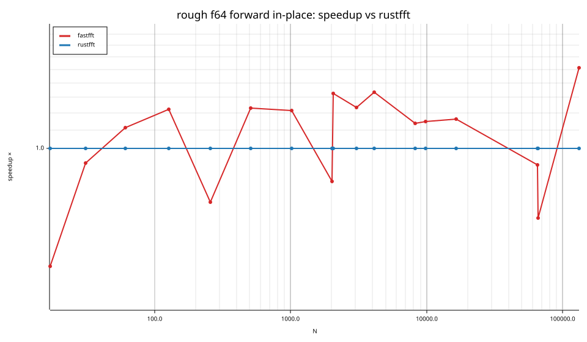
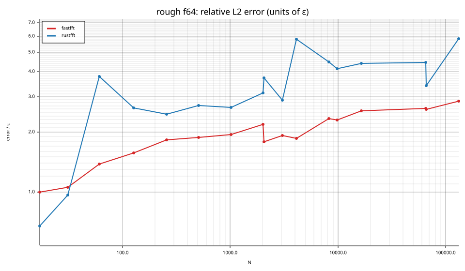

# fastfft arena report: `after`

| | |
|---|---|
| Host | mini-ryzen |
| CPU | AMD Ryzen 7 7840HS w/ Radeon 780M Graphics (family 25, model 116, stepping 1, microcode 0xa704108) |
| Pinned CPU | 2 (SMT siblings 2,10) |
| Governor / EPP / boost | performance / performance / 1 |
| Kernel | Linux version 7.0.0-28-generic |
| Virtualization | container-other |
| rustc | rustc 1.95.0 (59807616e 2026-04-14); binary: rustc; commit-hash: 59807616e1fa2540724bfbac14d7976d7e4a3860; commit-date: 2026-04-14; host: x86_64-unknown-linux-gnu; release: 1.95.0; LLVM version: 22.1.2 |
| Build profile / RUSTFLAGS | arena / `-C llvm-args=-align-all-functions=6` |
| Libraries | {"fearless_simd":"0.5.0","num-complex":"0.4.6","oxifft":"0.4.2","phastft":"0.4.1","pulp":"0.22.3","rustfft":"6.4.1","tfhe-fft":"0.10.1"} |
| FFTW | fftw-3.3.11-sse2-avx-avx2-avx2_128-avx512 `double: CFLAGS='-O3 -fPIC -std=gnu17' ./configure --enable-static --disable-shared --disable-fortran --disable-doc --enable-sse2 --enable-avx --enable-avx2 --enable-avx512 --enable-fma
single: CFLAGS='-O3 -fPIC -std=gnu17' ./configure --enable-static --disable-shared --disable-fortran --disable-doc --enable-sse2 --enable-avx --enable-avx2 --enable-avx512 --enable-fma --enable-float` |
| Git | b908bc6c0d76427cf82cafb6a53625eaebbab812 (dirty: true) |
| Profile | quick |
| Official | true  |
| Control drift | max 1.14% over 3 control runs |
| Cells | 34 |

Times are per transform. *best* = minimum batch mean, *median* = median batch mean. Speedup = rustfft time ÷ library time (> 1 means faster than rustfft); *geomean* over the cells both libraries ran. mflops = 5·N·log2(N)/t(µs).

## Release gates (fastfft)

| Gate | Criterion | Status | Detail |
|---|---|---|---|
| G1 | pow2 vs rustfft: geomean ≥ 1.5×, no cell < 0.95× | – n/a | no data |
| G2 | smooth vs rustfft: geomean ≥ 1.3×, no cell < 0.95× | – n/a | no data |
| G3 | rough vs rustfft: geomean ≥ 0.75×, no cell < 0.5× | ✅ pass | geomean best 1.157×, median 1.151×, worst cell 0.546× (rough:f64:fwd:ip:n17), 34 cells |
| G4 | vs each other Rust library: geomean ≥ 1.1×, ≥ 0.97× on ≥ 90% of cells | – n/a |  |
| G5 | AVX2 forced: pow2 ≥ 1.2×, smooth ≥ 1.1× vs rustfft | – n/a | pow2 NaN×/NaN×, smooth NaN×/NaN× |
| G6 | scenarios ≥ 1.3× each; batch geomean ≥ 1.5× | – n/a | scenarios min inf×, batch NaN×/NaN× |
| G7 | accuracy within §6 thresholds and ≤ 1.5× rustfft + 1ε | ✅ pass | 34 cells checked |
| G8 | Estimate planning time ≤ 2× rustfft for every N ≤ 2^20 | ❌ fail | worst ratio 310.59× (rough:f64:fwd:ip:n31), 34 cells |

G9 (build time) is measured by `cargo xtask build-time`, not by the arena.

## Speedup vs rustfft (geomean of best-time ratios; median-time ratio in parentheses)

| suite | prec | fastfft | rustfft |
|---|---|---|---|
| rough | f32 | 1.28× (1.27×) 13/0/4 | 1.00× (1.00×) 0/17/0 |
| rough | f64 | 1.05× (1.04×) 11/0/6 | 1.00× (1.00×) 0/17/0 |

w/t/l = cells faster / within ±3% / slower than rustfft (best times).

## Suite `rough`

### rough f32

| cell | fastfft | rustfft |
|---|---|---|
| N=17 fwd ip | 47.0ns (0.57×) | 26.7ns |
| N=31 fwd ip | 62.8ns (1.49×) | 93.5ns |
| N=61 fwd ip | 109.4ns (1.18×) | 128.8ns |
| N=127 fwd ip | 219.5ns (2.08×) | 457.1ns |
| N=257 fwd ip | 574.1ns (0.79×) | 452.8ns |
| N=509 fwd ip | 1.27us (1.20×) | 1.53us |
| N=1021 fwd ip | 2.71us (1.91×) | 5.17us |
| N=2018 fwd ip | 6.73us (0.83×) | 5.56us |
| N=2053 fwd ip | 6.69us (1.67×) | 11.19us |
| N=3063 fwd ip | 9.39us (1.76×) | 16.51us |
| N=4099 fwd ip | 13.97us (1.74×) | 24.35us |
| N=8191 fwd ip | 27.67us (1.79×) | 49.48us |
| N=9797 fwd ip | 38.80us (1.36×) | 52.59us |
| N=16381 fwd ip | 65.68us (1.54×) | 101.00us |
| N=65524 fwd ip | 342.42us (1.25×) | 426.82us |
| N=65537 fwd ip | 339.94us (0.75×) | 253.66us |
| N=131071 fwd ip | 737.65us (1.22×) | 901.71us |

### rough f64

| cell | fastfft | rustfft |
|---|---|---|
| N=17 fwd ip | 56.3ns (0.55×) | 30.7ns |
| N=31 fwd ip | 99.4ns (0.93×) | 92.3ns |
| N=61 fwd ip | 189.6ns (1.11×) | 210.9ns |
| N=127 fwd ip | 385.3ns (1.22×) | 471.2ns |
| N=257 fwd ip | 1.13us (0.76×) | 860.7ns |
| N=509 fwd ip | 2.60us (1.23×) | 3.20us |
| N=1021 fwd ip | 6.30us (1.21×) | 7.65us |
| N=2018 fwd ip | 12.66us (0.84×) | 10.69us |
| N=2053 fwd ip | 13.25us (1.33×) | 17.57us |
| N=3063 fwd ip | 20.19us (1.23×) | 24.92us |
| N=4099 fwd ip | 32.98us (1.33×) | 43.99us |
| N=8191 fwd ip | 62.32us (1.14×) | 70.91us |
| N=9797 fwd ip | 83.04us (1.15×) | 95.38us |
| N=16381 fwd ip | 128.06us (1.16×) | 149.03us |
| N=65524 fwd ip | 691.17us (0.92×) | 636.24us |
| N=65537 fwd ip | 694.88us (0.70×) | 486.14us |
| N=131071 fwd ip | 1.84ms (1.51×) | 2.79ms |

## Accuracy and planning time (medians over cells)

| lib | cells verified | failed | median error (ε) | worst error (ε) | median plan time |
|---|---|---|---|---|---|
| fastfft | 34 | 0 | 1.94 | 2.85 | 309.44us |
| rustfft | 34 | 0 | 2.43 | 5.84 | 42.61us |
