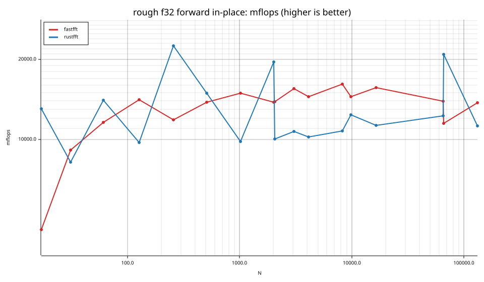
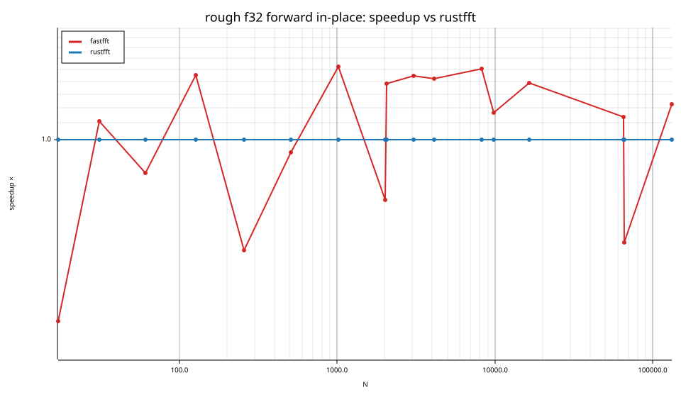
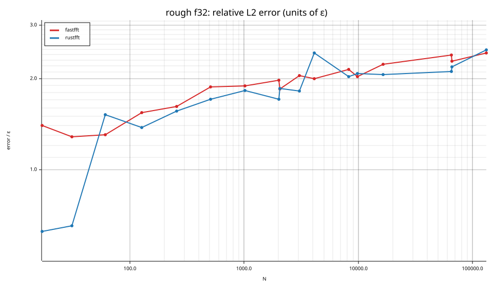
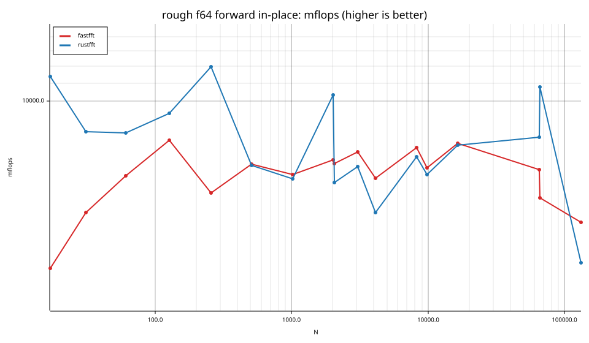
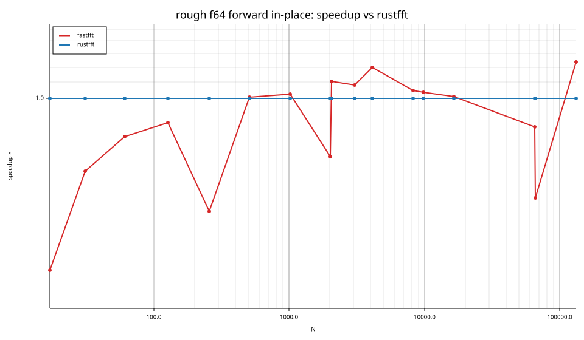
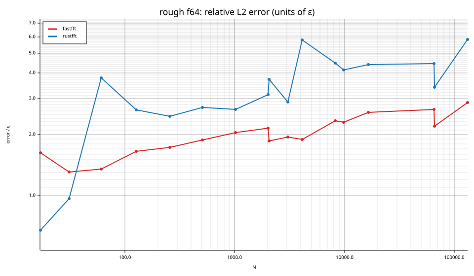

# fastfft arena report: `before`

| | |
|---|---|
| Host | mini-ryzen |
| CPU | AMD Ryzen 7 7840HS w/ Radeon 780M Graphics (family 25, model 116, stepping 1, microcode 0xa704108) |
| Pinned CPU | 2 (SMT siblings 2,10) |
| Governor / EPP / boost | performance / performance / 1 |
| Kernel | Linux version 7.0.0-28-generic |
| Virtualization | container-other |
| rustc | rustc 1.95.0 (59807616e 2026-04-14); binary: rustc; commit-hash: 59807616e1fa2540724bfbac14d7976d7e4a3860; commit-date: 2026-04-14; host: x86_64-unknown-linux-gnu; release: 1.95.0; LLVM version: 22.1.2 |
| Build profile / RUSTFLAGS | arena / `-C llvm-args=-align-all-functions=6` |
| Libraries | {"fearless_simd":"0.5.0","num-complex":"0.4.6","oxifft":"0.4.2","phastft":"0.4.1","pulp":"0.22.3","rustfft":"6.4.1","tfhe-fft":"0.10.1"} |
| FFTW | fftw-3.3.11-sse2-avx-avx2-avx2_128-avx512 `double: CFLAGS='-O3 -fPIC -std=gnu17' ./configure --enable-static --disable-shared --disable-fortran --disable-doc --enable-sse2 --enable-avx --enable-avx2 --enable-avx512 --enable-fma
single: CFLAGS='-O3 -fPIC -std=gnu17' ./configure --enable-static --disable-shared --disable-fortran --disable-doc --enable-sse2 --enable-avx --enable-avx2 --enable-avx512 --enable-fma --enable-float` |
| Git | b908bc6c0d76427cf82cafb6a53625eaebbab812 (dirty: true) |
| Profile | quick |
| Official | true  |
| Control drift | max 2.41% over 3 control runs |
| Cells | 34 |

Times are per transform. *best* = minimum batch mean, *median* = median batch mean. Speedup = rustfft time ÷ library time (> 1 means faster than rustfft); *geomean* over the cells both libraries ran. mflops = 5·N·log2(N)/t(µs).

## Release gates (fastfft)

| Gate | Criterion | Status | Detail |
|---|---|---|---|
| G1 | pow2 vs rustfft: geomean ≥ 1.5×, no cell < 0.95× | – n/a | no data |
| G2 | smooth vs rustfft: geomean ≥ 1.3×, no cell < 0.95× | – n/a | no data |
| G3 | rough vs rustfft: geomean ≥ 0.75×, no cell < 0.5× | ❌ fail | geomean best 0.927×, median 0.921×, worst cell 0.348× (rough:f32:fwd:ip:n17), 34 cells |
| G4 | vs each other Rust library: geomean ≥ 1.1×, ≥ 0.97× on ≥ 90% of cells | – n/a |  |
| G5 | AVX2 forced: pow2 ≥ 1.2×, smooth ≥ 1.1× vs rustfft | – n/a | pow2 NaN×/NaN×, smooth NaN×/NaN× |
| G6 | scenarios ≥ 1.3× each; batch geomean ≥ 1.5× | – n/a | scenarios min inf×, batch NaN×/NaN× |
| G7 | accuracy within §6 thresholds and ≤ 1.5× rustfft + 1ε | ✅ pass | 34 cells checked |
| G8 | Estimate planning time ≤ 2× rustfft for every N ≤ 2^20 | ❌ fail | worst ratio 76.01× (rough:f64:fwd:ip:n31), 34 cells |

G9 (build time) is measured by `cargo xtask build-time`, not by the arena.

## Speedup vs rustfft (geomean of best-time ratios; median-time ratio in parentheses)

| suite | prec | fastfft | rustfft |
|---|---|---|---|
| rough | f32 | 1.02× (1.01×) 11/0/6 | 1.00× (1.00×) 0/17/0 |
| rough | f64 | 0.85× (0.84×) 6/3/8 | 1.00× (1.00×) 0/17/0 |

w/t/l = cells faster / within ±3% / slower than rustfft (best times).

## Suite `rough`

### rough f32

| cell | fastfft | rustfft |
|---|---|---|
| N=17 fwd ip | 76.1ns (0.35×) | 26.6ns |
| N=31 fwd ip | 84.0ns (1.11×) | 93.5ns |
| N=61 fwd ip | 155.6ns (0.83×) | 128.4ns |
| N=127 fwd ip | 313.6ns (1.45×) | 455.4ns |
| N=257 fwd ip | 865.7ns (0.53×) | 455.5ns |
| N=509 fwd ip | 1.65us (0.93×) | 1.53us |
| N=1021 fwd ip | 3.41us (1.52×) | 5.20us |
| N=2018 fwd ip | 8.03us (0.70×) | 5.65us |
| N=2053 fwd ip | 8.13us (1.38×) | 11.25us |
| N=3063 fwd ip | 11.42us (1.45×) | 16.50us |
| N=4099 fwd ip | 16.95us (1.42×) | 24.08us |
| N=8191 fwd ip | 32.92us (1.50×) | 49.48us |
| N=9797 fwd ip | 44.83us (1.17×) | 52.34us |
| N=16381 fwd ip | 73.17us (1.39×) | 101.42us |
| N=65524 fwd ip | 375.63us (1.14×) | 427.16us |
| N=65537 fwd ip | 454.94us (0.55×) | 251.03us |
| N=131071 fwd ip | 809.27us (1.22×) | 990.18us |

### rough f64

| cell | fastfft | rustfft |
|---|---|---|
| N=17 fwd ip | 83.1ns (0.37×) | 30.5ns |
| N=31 fwd ip | 137.5ns (0.65×) | 90.0ns |
| N=61 fwd ip | 266.8ns (0.80×) | 213.1ns |
| N=127 fwd ip | 544.2ns (0.87×) | 471.9ns |
| N=257 fwd ip | 1.66us (0.52×) | 859.3ns |
| N=509 fwd ip | 3.18us (1.01×) | 3.20us |
| N=1021 fwd ip | 7.48us (1.02×) | 7.65us |
| N=2018 fwd ip | 15.04us (0.71×) | 10.72us |
| N=2053 fwd ip | 15.62us (1.11×) | 17.27us |
| N=3063 fwd ip | 23.07us (1.08×) | 24.92us |
| N=4099 fwd ip | 36.77us (1.20×) | 44.06us |
| N=8191 fwd ip | 67.89us (1.05×) | 71.08us |
| N=9797 fwd ip | 91.95us (1.04×) | 95.30us |
| N=16381 fwd ip | 142.65us (1.01×) | 144.00us |
| N=65524 fwd ip | 748.96us (0.85×) | 632.95us |
| N=65537 fwd ip | 869.79us (0.56×) | 486.63us |
| N=131071 fwd ip | 2.10ms (1.23×) | 2.59ms |

## Accuracy and planning time (medians over cells)

| lib | cells verified | failed | median error (ε) | worst error (ε) | median plan time |
|---|---|---|---|---|---|
| fastfft | 34 | 0 | 1.97 | 2.87 | 230.23us |
| rustfft | 34 | 0 | 2.43 | 5.84 | 42.65us |
