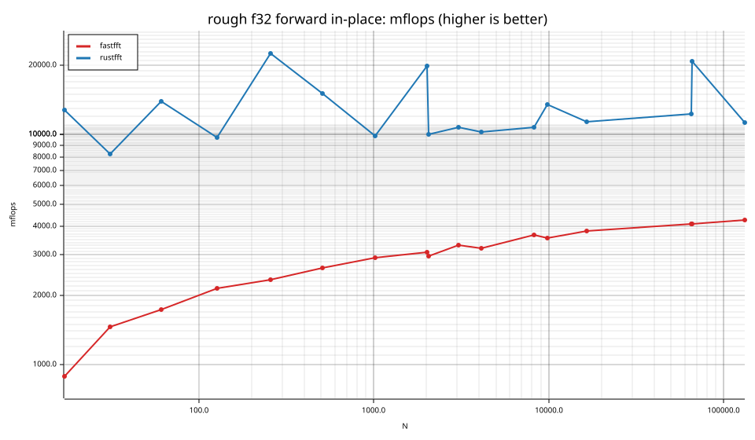
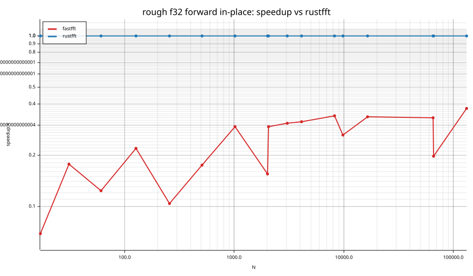
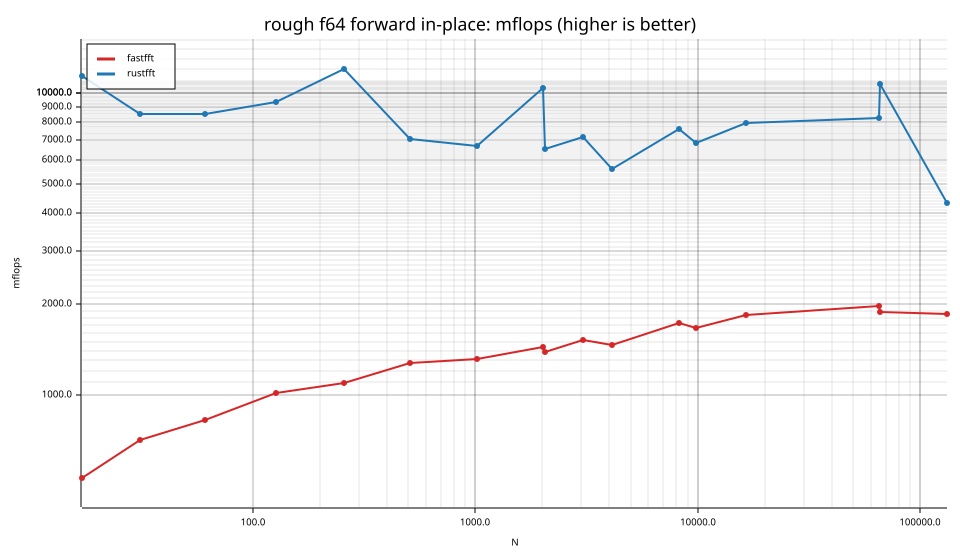
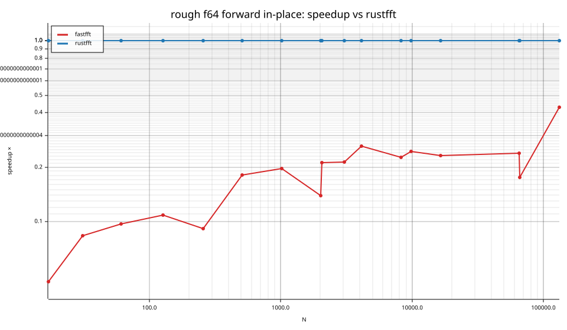

# fastfft arena report: `after`

| | |
|---|---|
| Host | mini-ryzen |
| CPU | AMD Ryzen 7 7840HS w/ Radeon 780M Graphics (family 25, model 116, stepping 1, microcode 0xa704108) |
| Pinned CPU | 2 (SMT siblings 2,10) |
| Governor / EPP / boost | performance / performance / 1 |
| Kernel | Linux version 7.0.0-28-generic |
| Virtualization | container-other |
| rustc | rustc 1.95.0 (59807616e 2026-04-14); binary: rustc; commit-hash: 59807616e1fa2540724bfbac14d7976d7e4a3860; commit-date: 2026-04-14; host: x86_64-unknown-linux-gnu; release: 1.95.0; LLVM version: 22.1.2 |
| Build profile / RUSTFLAGS | arena / `-C llvm-args=-align-all-functions=6` |
| Libraries | {"fearless_simd":"0.5.0","num-complex":"0.4.6","oxifft":"0.4.2","phastft":"0.4.1","pulp":"0.22.3","rustfft":"6.4.1","tfhe-fft":"0.10.1"} |
| FFTW | fftw-3.3.11-sse2-avx-avx2-avx2_128-avx512 `double: CFLAGS='-O3 -fPIC -std=gnu17' ./configure --enable-static --disable-shared --disable-fortran --disable-doc --enable-sse2 --enable-avx --enable-avx2 --enable-avx512 --enable-fma
single: CFLAGS='-O3 -fPIC -std=gnu17' ./configure --enable-static --disable-shared --disable-fortran --disable-doc --enable-sse2 --enable-avx --enable-avx2 --enable-avx512 --enable-fma --enable-float` |
| Git | b908bc6c0d76427cf82cafb6a53625eaebbab812 (dirty: true) |
| Profile | quick |
| Official | true  |
| Control drift | max 1.85% over 3 control runs |
| Cells | 34 |

Times are per transform. *best* = minimum batch mean, *median* = median batch mean. Speedup = rustfft time ÷ library time (> 1 means faster than rustfft); *geomean* over the cells both libraries ran. mflops = 5·N·log2(N)/t(µs).

## Release gates (fastfft)

| Gate | Criterion | Status | Detail |
|---|---|---|---|
| G1 | pow2 vs rustfft: geomean ≥ 1.5×, no cell < 0.95× | – n/a | no data |
| G2 | smooth vs rustfft: geomean ≥ 1.3×, no cell < 0.95× | – n/a | no data |
| G3 | rough vs rustfft: geomean ≥ 0.75×, no cell < 0.5× | ❌ fail | geomean best 0.190×, median 0.187×, worst cell 0.046× (rough:f64:fwd:ip:n17), 34 cells |
| G4 | vs each other Rust library: geomean ≥ 1.1×, ≥ 0.97× on ≥ 90% of cells | – n/a |  |
| G5 | AVX2 forced: pow2 ≥ 1.2×, smooth ≥ 1.1× vs rustfft | – n/a | pow2 NaN×/NaN×, smooth NaN×/NaN× |
| G6 | scenarios ≥ 1.3× each; batch geomean ≥ 1.5× | – n/a | scenarios min inf×, batch NaN×/NaN× |
| G7 | accuracy within §6 thresholds and ≤ 1.5× rustfft + 1ε | ✅ pass | 34 cells checked |
| G8 | Estimate planning time ≤ 2× rustfft for every N ≤ 2^20 | ❌ fail | worst ratio 314.35× (rough:f64:fwd:ip:n31), 34 cells |

G9 (build time) is measured by `cargo xtask build-time`, not by the arena.

## Speedup vs rustfft (geomean of best-time ratios; median-time ratio in parentheses)

| suite | prec | fastfft | rustfft |
|---|---|---|---|
| rough | f32 | 0.22× (0.22×) 0/0/17 | 1.00× (1.00×) 0/17/0 |
| rough | f64 | 0.16× (0.16×) 0/0/17 | 1.00× (1.00×) 0/17/0 |

w/t/l = cells faster / within ±3% / slower than rustfft (best times).

## Suite `rough`

### rough f32

| cell | fastfft | rustfft |
|---|---|---|
| N=17 fwd ip | 391.3ns (0.07×) | 27.0ns |
| N=31 fwd ip | 527.2ns (0.18×) | 93.5ns |
| N=61 fwd ip | 1.05us (0.12×) | 129.2ns |
| N=127 fwd ip | 2.07us (0.22×) | 455.5ns |
| N=257 fwd ip | 4.40us (0.10×) | 455.3ns |
| N=509 fwd ip | 8.68us (0.17×) | 1.51us |
| N=1021 fwd ip | 17.53us (0.29×) | 5.15us |
| N=2018 fwd ip | 36.00us (0.16×) | 5.58us |
| N=2053 fwd ip | 38.11us (0.29×) | 11.21us |
| N=3063 fwd ip | 53.46us (0.31×) | 16.41us |
| N=4099 fwd ip | 76.67us (0.31×) | 24.00us |
| N=8191 fwd ip | 145.60us (0.34×) | 49.32us |
| N=9797 fwd ip | 182.25us (0.26×) | 47.84us |
| N=16381 fwd ip | 300.73us (0.34×) | 100.84us |
| N=65524 fwd ip | 1.28ms (0.33×) | 425.79us |
| N=65537 fwd ip | 1.28ms (0.20×) | 251.94us |
| N=131071 fwd ip | 2.63ms (0.38×) | 985.29us |

### rough f64

| cell | fastfft | rustfft |
|---|---|---|
| N=17 fwd ip | 656.6ns (0.05×) | 30.5ns |
| N=31 fwd ip | 1.08us (0.08×) | 90.4ns |
| N=61 fwd ip | 2.19us (0.10×) | 212.5ns |
| N=127 fwd ip | 4.37us (0.11×) | 473.6ns |
| N=257 fwd ip | 9.38us (0.09×) | 854.3ns |
| N=509 fwd ip | 17.96us (0.18×) | 3.24us |
| N=1021 fwd ip | 38.89us (0.20×) | 7.62us |
| N=2018 fwd ip | 76.99us (0.14×) | 10.67us |
| N=2053 fwd ip | 81.64us (0.21×) | 17.25us |
| N=3063 fwd ip | 116.37us (0.21×) | 24.79us |
| N=4099 fwd ip | 167.74us (0.26×) | 43.88us |
| N=8191 fwd ip | 308.31us (0.23×) | 69.88us |
| N=9797 fwd ip | 389.69us (0.24×) | 95.20us |
| N=16381 fwd ip | 623.05us (0.23×) | 144.47us |
| N=65524 fwd ip | 2.66ms (0.24×) | 633.99us |
| N=65537 fwd ip | 2.78ms (0.18×) | 488.62us |
| N=131071 fwd ip | 6.00ms (0.43×) | 2.57ms |

## Accuracy and planning time (medians over cells)

| lib | cells verified | failed | median error (ε) | worst error (ε) | median plan time |
|---|---|---|---|---|---|
| fastfft | 34 | 0 | 1.94 | 2.85 | 304.89us |
| rustfft | 34 | 0 | 2.43 | 5.84 | 42.52us |
