# fastfft arena report: `after-cache-penalty`

| | |
|---|---|
| Host | mini-ryzen |
| CPU | AMD Ryzen 7 7840HS w/ Radeon 780M Graphics (family 25, model 116, stepping 1, microcode 0xa704108) |
| Pinned CPU | 2 (SMT siblings 2,10) |
| Governor / EPP / boost | performance / performance / 1 |
| Kernel | Linux version 7.0.0-28-generic |
| Virtualization | container-other |
| rustc | rustc 1.95.0 (59807616e 2026-04-14); binary: rustc; commit-hash: 59807616e1fa2540724bfbac14d7976d7e4a3860; commit-date: 2026-04-14; host: x86_64-unknown-linux-gnu; release: 1.95.0; LLVM version: 22.1.2 |
| Build profile / RUSTFLAGS | arena / `` |
| Libraries | {"fearless_simd":"0.5.0","num-complex":"0.4.6","oxifft":"0.4.2","phastft":"0.4.1","pulp":"0.22.3","rustfft":"6.4.1","tfhe-fft":"0.10.1"} |
| FFTW | fftw-3.3.11-sse2-avx-avx2-avx2_128-avx512 `double: CFLAGS='-O3 -fPIC -std=gnu17' ./configure --enable-static --disable-shared --disable-fortran --disable-doc --enable-sse2 --enable-avx --enable-avx2 --enable-avx512 --enable-fma
single: CFLAGS='-O3 -fPIC -std=gnu17' ./configure --enable-static --disable-shared --disable-fortran --disable-doc --enable-sse2 --enable-avx --enable-avx2 --enable-avx512 --enable-fma --enable-float` |
| Git | 0801f9bdaaff1d821385806e6e83f4c4092a7983 (dirty: true) |
| Profile | quick |
| Official | true  |
| Control drift | max 24.39% over 8 control runs — **FLAGGED** |
| Cells | 156 |

Times are per transform. *best* = minimum batch mean, *median* = median batch mean. Speedup = rustfft time ÷ library time (> 1 means faster than rustfft); *geomean* over the cells both libraries ran. mflops = 5·N·log2(N)/t(µs).

## Release gates (fastfft)

| Gate | Criterion | Status | Detail |
|---|---|---|---|
| G1 | pow2 vs rustfft: geomean ≥ 1.5×, no cell < 0.95× | ❌ fail | geomean best 1.299×, median 1.294×, worst cell 0.996× (pow2:f64:fwd:ip:n2), 40 cells |
| G2 | smooth vs rustfft: geomean ≥ 1.3×, no cell < 0.95× | ❌ fail | geomean best 1.381×, median 1.379×, worst cell 0.949× (smooth:f32:fwd:ip:n1000000), 82 cells |
| G3 | rough vs rustfft: geomean ≥ 0.75×, no cell < 0.5× | ✅ pass | geomean best 1.178×, median 1.171×, worst cell 0.539× (rough:f64:fwd:ip:n17), 34 cells |
| G4 | vs each other Rust library: geomean ≥ 1.1×, ≥ 0.97× on ≥ 90% of cells | – n/a |  |
| G5 | AVX2 forced: pow2 ≥ 1.2×, smooth ≥ 1.1× vs rustfft | – n/a | pow2 NaN×/NaN×, smooth NaN×/NaN× |
| G6 | scenarios ≥ 1.3× each; batch geomean ≥ 1.5× | – n/a | scenarios min inf×, batch NaN×/NaN× |
| G7 | accuracy within §6 thresholds and ≤ 1.5× rustfft + 1ε | ✅ pass | 156 cells checked |
| G8 | Estimate planning time ≤ 2× rustfft for every N ≤ 2^20 | ❌ fail | worst ratio 57.98× (rough:f64:fwd:ip:n31), 156 cells |

G9 (build time) is measured by `cargo xtask build-time`, not by the arena.

## Speedup vs rustfft (geomean of best-time ratios; median-time ratio in parentheses)

| suite | prec | fastfft | rustfft |
|---|---|---|---|
| pow2 | f32 | 1.26× (1.26×) 20/0/0 | 1.00× (1.00×) 0/20/0 |
| pow2 | f64 | 1.33× (1.33×) 19/1/0 | 1.00× (1.00×) 0/20/0 |
| smooth | f32 | 1.36× (1.35×) 41/0/0 | 1.00× (1.00×) 0/41/0 |
| smooth | f64 | 1.41× (1.41×) 41/0/0 | 1.00× (1.00×) 0/41/0 |
| rough | f32 | 1.29× (1.28×) 13/0/4 | 1.00× (1.00×) 0/17/0 |
| rough | f64 | 1.08× (1.07×) 11/0/6 | 1.00× (1.00×) 0/17/0 |

w/t/l = cells faster / within ±3% / slower than rustfft (best times).

## Suite `pow2`

### pow2 f32

| cell | fastfft | rustfft |
|---|---|---|
| N=2 fwd ip | 2.6ns (1.07×) | 2.8ns |
| N=4 fwd ip | 3.6ns (1.18×) | 4.2ns |
| N=8 fwd ip | 7.0ns (1.12×) | 7.8ns |
| N=16 fwd ip | 8.3ns (1.06×) | 8.8ns |
| N=32 fwd ip | 11.4ns (1.10×) | 12.6ns |
| N=64 fwd ip | 17.3ns (1.25×) | 21.5ns |
| N=128 fwd ip | 36.5ns (1.31×) | 47.9ns |
| N=256 fwd ip | 74.6ns (1.38×) | 102.6ns |
| N=512 fwd ip | 224.0ns (1.15×) | 258.5ns |
| N=1024 fwd ip | 500.5ns (1.24×) | 621.9ns |
| N=2048 fwd ip | 1.09us (1.27×) | 1.38us |
| N=4096 fwd ip | 2.42us (1.33×) | 3.21us |
| N=8192 fwd ip | 5.20us (1.33×) | 6.93us |
| N=16384 fwd ip | 11.17us (1.45×) | 16.16us |
| N=32768 fwd ip | 25.89us (1.45×) | 37.62us |
| N=65536 fwd ip | 63.07us (1.31×) | 82.32us |
| N=131072 fwd ip | 143.72us (1.27×) | 182.29us |
| N=262144 fwd ip | 316.23us (1.31×) | 414.75us |
| N=524288 fwd ip | 648.83us (1.40×) | 907.42us |
| N=1048576 fwd ip | 2.09ms (1.43×) | 3.00ms |

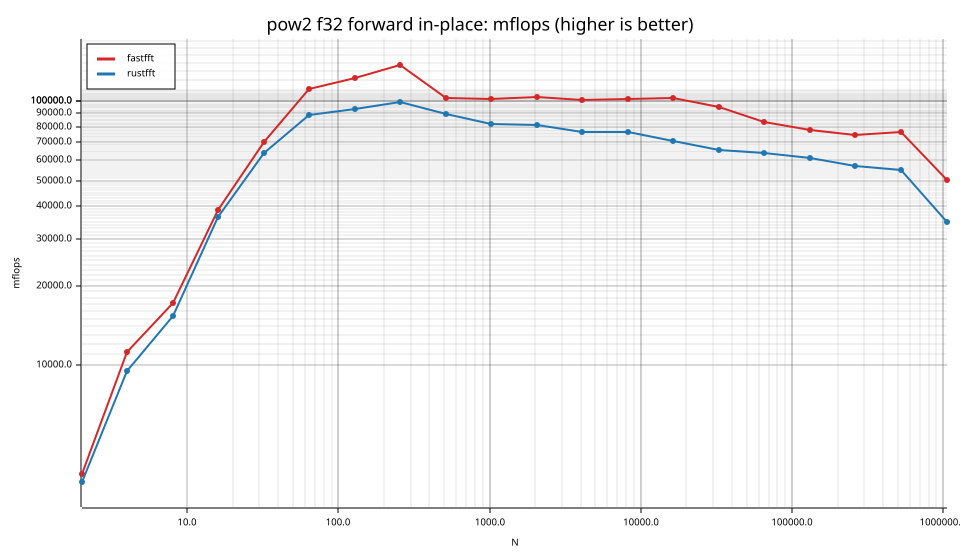
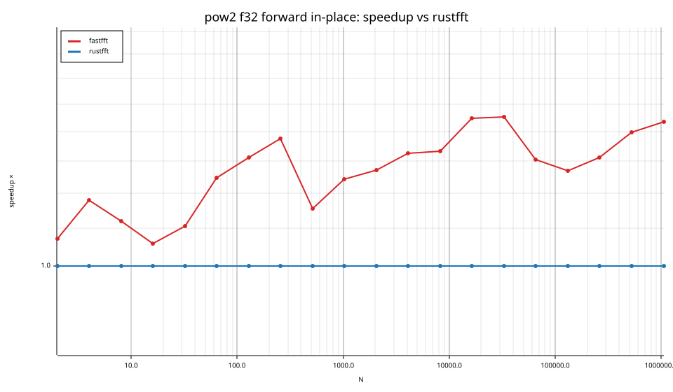

### pow2 f64

| cell | fastfft | rustfft |
|---|---|---|
| N=2 fwd ip | 2.6ns (1.00×) | 2.6ns |
| N=4 fwd ip | 3.6ns (1.05×) | 3.8ns |
| N=8 fwd ip | 6.4ns (1.10×) | 7.0ns |
| N=16 fwd ip | 8.9ns (1.14×) | 10.2ns |
| N=32 fwd ip | 14.1ns (1.25×) | 17.6ns |
| N=64 fwd ip | 29.6ns (1.34×) | 39.7ns |
| N=128 fwd ip | 61.4ns (1.39×) | 85.0ns |
| N=256 fwd ip | 129.8ns (1.54×) | 200.4ns |
| N=512 fwd ip | 426.0ns (1.17×) | 498.9ns |
| N=1024 fwd ip | 994.5ns (1.23×) | 1.22us |
| N=2048 fwd ip | 2.24us (1.25×) | 2.80us |
| N=4096 fwd ip | 4.99us (1.30×) | 6.47us |
| N=8192 fwd ip | 10.44us (1.48×) | 15.43us |
| N=16384 fwd ip | 22.02us (1.53×) | 33.72us |
| N=32768 fwd ip | 51.76us (1.49×) | 77.07us |
| N=65536 fwd ip | 127.93us (1.34×) | 171.68us |
| N=131072 fwd ip | 277.13us (1.37×) | 379.05us |
| N=262144 fwd ip | 614.29us (1.47×) | 903.53us |
| N=524288 fwd ip | 1.81ms (1.62×) | 2.92ms |
| N=1048576 fwd ip | 4.14ms (1.96×) | 8.12ms |

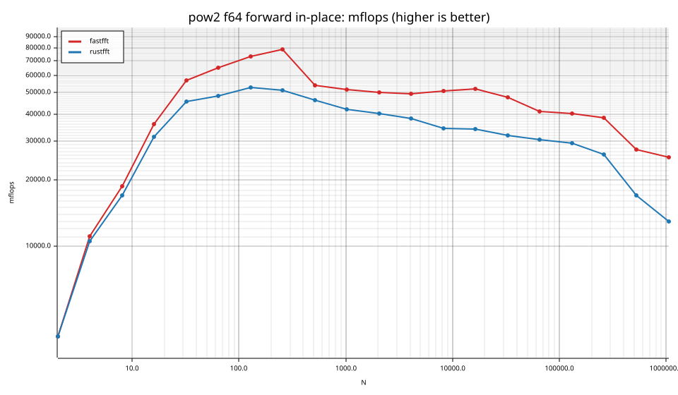
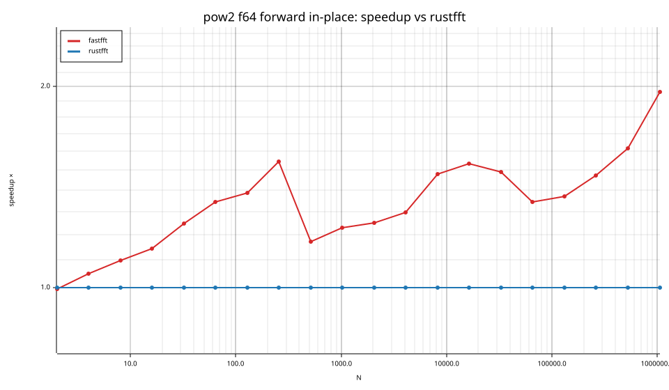

## Suite `smooth`

### smooth f32

| cell | fastfft | rustfft |
|---|---|---|
| N=6 fwd ip | 7.4ns (1.27×) | 9.4ns |
| N=9 fwd ip | 10.8ns (1.22×) | 13.2ns |
| N=12 fwd ip | 9.8ns (1.12×) | 11.0ns |
| N=15 fwd ip | 13.6ns (2.38×) | 32.3ns |
| N=18 fwd ip | 15.9ns (1.48×) | 23.4ns |
| N=24 fwd ip | 13.4ns (1.07×) | 14.4ns |
| N=36 fwd ip | 19.1ns (1.03×) | 19.8ns |
| N=48 fwd ip | 15.7ns (1.07×) | 16.9ns |
| N=80 fwd ip | 35.4ns (1.08×) | 38.4ns |
| N=96 fwd ip | 34.6ns (1.40×) | 48.5ns |
| N=108 fwd ip | 48.0ns (1.27×) | 60.9ns |
| N=120 fwd ip | 59.4ns (1.09×) | 64.7ns |
| N=160 fwd ip | 78.3ns (1.04×) | 81.5ns |
| N=210 fwd ip | 117.0ns (2.15×) | 251.9ns |
| N=240 fwd ip | 98.9ns (1.26×) | 124.5ns |
| N=320 fwd ip | 142.0ns (1.20×) | 170.3ns |
| N=384 fwd ip | 167.7ns (1.23×) | 206.1ns |
| N=480 fwd ip | 247.4ns (1.38×) | 340.2ns |
| N=504 fwd ip | 238.1ns (1.21×) | 287.0ns |
| N=640 fwd ip | 286.4ns (1.31×) | 374.2ns |
| N=720 fwd ip | 334.1ns (1.59×) | 530.2ns |
| N=768 fwd ip | 346.8ns (1.23×) | 426.1ns |
| N=960 fwd ip | 455.5ns (1.42×) | 644.6ns |
| N=1000 fwd ip | 616.1ns (1.54×) | 946.7ns |
| N=1200 fwd ip | 676.7ns (1.27×) | 856.2ns |
| N=1536 fwd ip | 774.3ns (1.37×) | 1.06us |
| N=1920 fwd ip | 1.08us (1.30×) | 1.41us |
| N=1960 fwd ip | 1.24us (1.63×) | 2.01us |
| N=2400 fwd ip | 1.46us (1.62×) | 2.37us |
| N=3072 fwd ip | 1.71us (1.42×) | 2.42us |
| N=4725 fwd ip | 4.69us (1.30×) | 6.08us |
| N=4800 fwd ip | 2.87us (1.54×) | 4.42us |
| N=6144 fwd ip | 3.74us (1.34×) | 5.02us |
| N=10368 fwd ip | 6.61us (1.31×) | 8.64us |
| N=12288 fwd ip | 7.92us (1.49×) | 11.77us |
| N=27000 fwd ip | 20.43us (1.64×) | 33.49us |
| N=48000 fwd ip | 35.68us (1.69×) | 60.44us |
| N=75600 fwd ip | 65.55us (1.61×) | 105.44us |
| N=96000 fwd ip | 79.17us (1.67×) | 131.93us |
| N=165375 fwd ip | 236.87us (1.34×) | 317.63us |
| N=1000000 fwd ip | 2.86ms (1.04×) | 2.97ms |

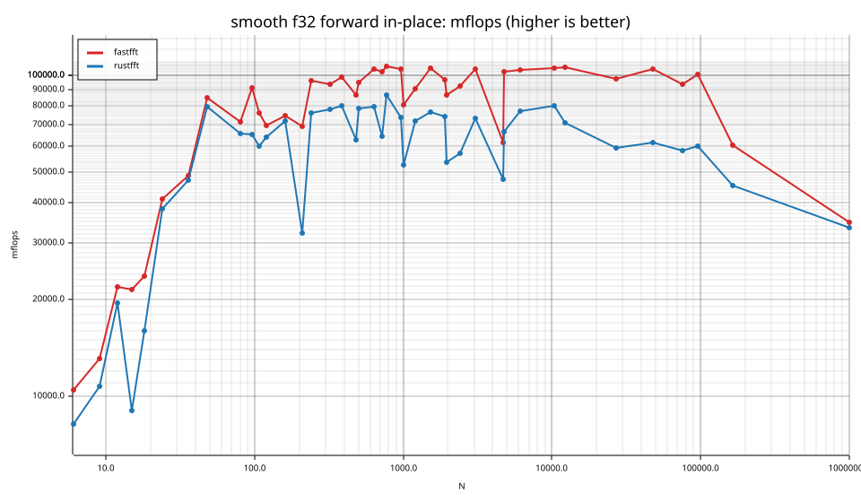
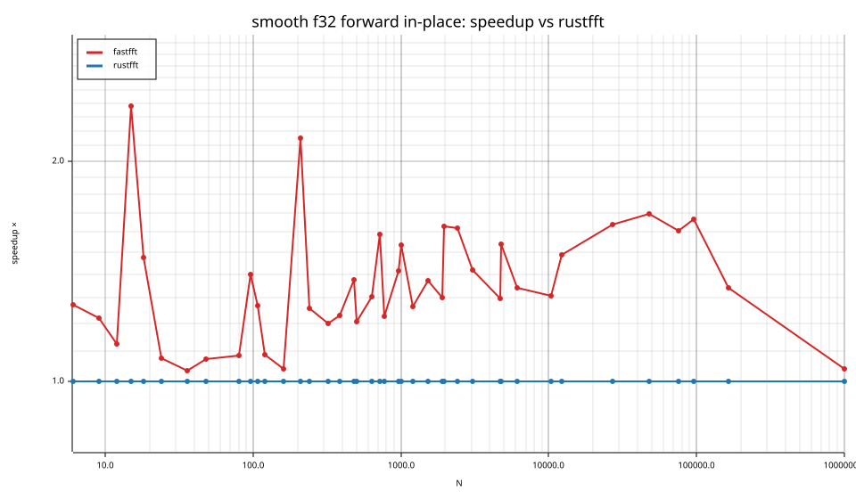

### smooth f64

| cell | fastfft | rustfft |
|---|---|---|
| N=6 fwd ip | 5.4ns (1.03×) | 5.6ns |
| N=9 fwd ip | 8.4ns (1.14×) | 9.5ns |
| N=12 fwd ip | 8.7ns (1.34×) | 11.6ns |
| N=15 fwd ip | 14.6ns (1.97×) | 28.8ns |
| N=18 fwd ip | 11.2ns (1.26×) | 14.2ns |
| N=24 fwd ip | 12.2ns (1.12×) | 13.7ns |
| N=36 fwd ip | 18.0ns (1.23×) | 22.0ns |
| N=48 fwd ip | 21.8ns (1.99×) | 43.3ns |
| N=80 fwd ip | 57.6ns (1.19×) | 68.6ns |
| N=96 fwd ip | 66.8ns (1.22×) | 81.4ns |
| N=108 fwd ip | 79.8ns (1.23×) | 97.7ns |
| N=120 fwd ip | 80.4ns (1.32×) | 106.3ns |
| N=160 fwd ip | 120.2ns (1.25×) | 150.2ns |
| N=210 fwd ip | 282.2ns (1.05×) | 297.0ns |
| N=240 fwd ip | 188.6ns (1.50×) | 282.5ns |
| N=320 fwd ip | 247.1ns (1.40×) | 346.2ns |
| N=384 fwd ip | 298.4ns (1.23×) | 366.5ns |
| N=480 fwd ip | 393.8ns (1.49×) | 584.8ns |
| N=504 fwd ip | 462.6ns (1.44×) | 665.4ns |
| N=640 fwd ip | 553.3ns (1.30×) | 717.5ns |
| N=720 fwd ip | 640.7ns (1.41×) | 905.5ns |
| N=768 fwd ip | 695.4ns (1.42×) | 990.1ns |
| N=960 fwd ip | 882.4ns (1.47×) | 1.30us |
| N=1000 fwd ip | 1.06us (1.50×) | 1.59us |
| N=1200 fwd ip | 1.22us (1.73×) | 2.12us |
| N=1536 fwd ip | 1.57us (1.38×) | 2.17us |
| N=1920 fwd ip | 2.00us (1.38×) | 2.77us |
| N=1960 fwd ip | 2.22us (1.61×) | 3.57us |
| N=2400 fwd ip | 2.58us (1.60×) | 4.12us |
| N=3072 fwd ip | 3.44us (1.31×) | 4.51us |
| N=4725 fwd ip | 8.73us (1.17×) | 10.21us |
| N=4800 fwd ip | 5.36us (1.71×) | 9.14us |
| N=6144 fwd ip | 7.24us (1.48×) | 10.75us |
| N=10368 fwd ip | 12.38us (1.62×) | 20.09us |
| N=12288 fwd ip | 15.76us (1.64×) | 25.92us |
| N=27000 fwd ip | 43.43us (1.52×) | 65.94us |
| N=48000 fwd ip | 67.87us (1.84×) | 125.19us |
| N=75600 fwd ip | 129.76us (1.57×) | 203.44us |
| N=96000 fwd ip | 141.83us (2.00×) | 283.15us |
| N=165375 fwd ip | 417.96us (1.36×) | 570.17us |
| N=1000000 fwd ip | 7.85ms (1.04×) | 8.20ms |

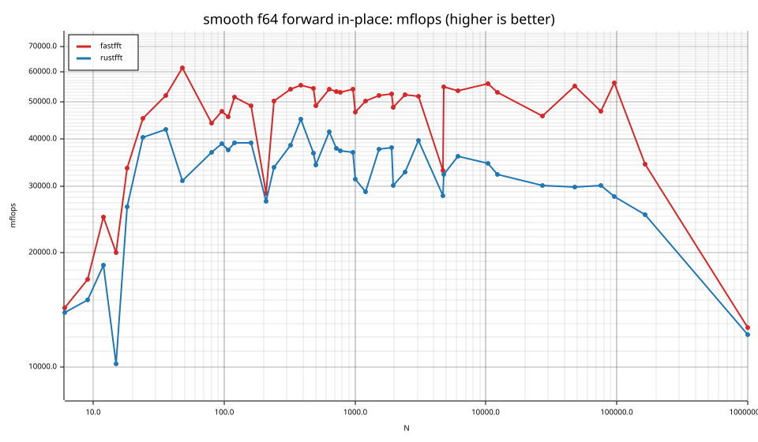
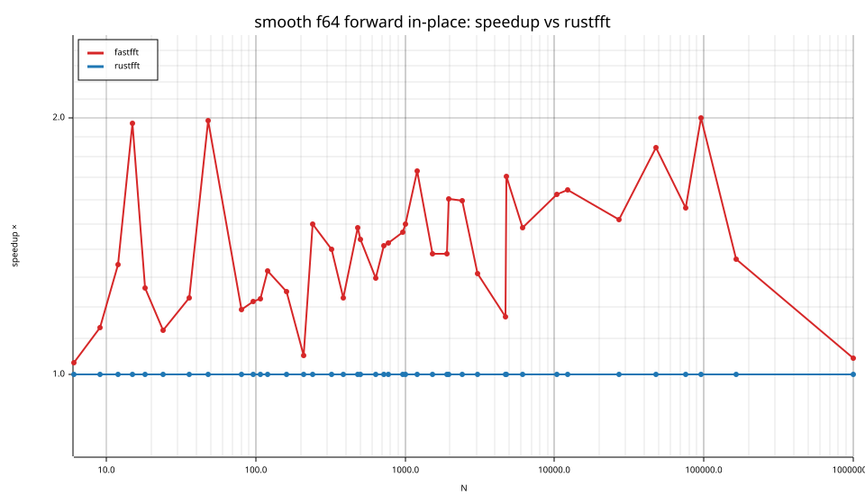

## Suite `rough`

### rough f32

| cell | fastfft | rustfft |
|---|---|---|
| N=17 fwd ip | 46.6ns (0.58×) | 27.2ns |
| N=31 fwd ip | 62.3ns (1.50×) | 93.7ns |
| N=61 fwd ip | 119.9ns (1.08×) | 129.2ns |
| N=127 fwd ip | 223.9ns (2.17×) | 486.4ns |
| N=257 fwd ip | 572.7ns (0.80×) | 456.3ns |
| N=509 fwd ip | 1.27us (1.19×) | 1.51us |
| N=1021 fwd ip | 2.70us (1.92×) | 5.20us |
| N=2018 fwd ip | 6.63us (0.84×) | 5.54us |
| N=2053 fwd ip | 7.24us (1.55×) | 11.23us |
| N=3063 fwd ip | 9.38us (1.75×) | 16.42us |
| N=4099 fwd ip | 14.52us (1.66×) | 24.07us |
| N=8191 fwd ip | 27.55us (1.81×) | 49.78us |
| N=9797 fwd ip | 35.39us (1.48×) | 52.49us |
| N=16381 fwd ip | 65.14us (1.55×) | 101.22us |
| N=65524 fwd ip | 339.91us (1.26×) | 427.35us |
| N=65537 fwd ip | 342.66us (0.74×) | 251.93us |
| N=131071 fwd ip | 728.62us (1.37×) | 999.67us |

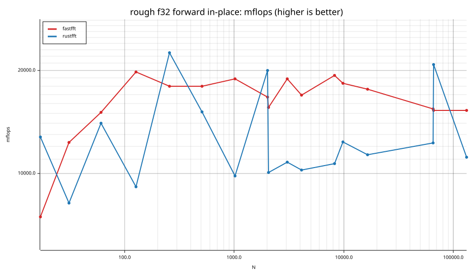
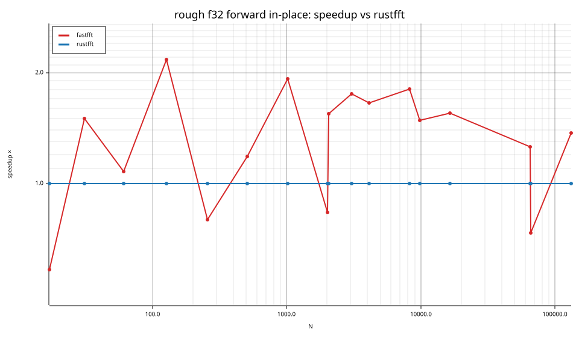

### rough f64

| cell | fastfft | rustfft |
|---|---|---|
| N=17 fwd ip | 56.8ns (0.55×) | 31.1ns |
| N=31 fwd ip | 99.3ns (0.92×) | 91.4ns |
| N=61 fwd ip | 191.3ns (1.10×) | 210.3ns |
| N=127 fwd ip | 382.2ns (1.24×) | 475.6ns |
| N=257 fwd ip | 1.13us (0.76×) | 855.8ns |
| N=509 fwd ip | 2.50us (1.14×) | 2.85us |
| N=1021 fwd ip | 5.74us (1.33×) | 7.65us |
| N=2018 fwd ip | 12.95us (0.82×) | 10.68us |
| N=2053 fwd ip | 13.56us (1.28×) | 17.39us |
| N=3063 fwd ip | 18.28us (1.36×) | 24.90us |
| N=4099 fwd ip | 28.28us (1.55×) | 43.93us |
| N=8191 fwd ip | 55.47us (1.31×) | 72.81us |
| N=9797 fwd ip | 82.59us (1.15×) | 94.84us |
| N=16381 fwd ip | 128.91us (1.16×) | 149.18us |
| N=65524 fwd ip | 661.09us (0.96×) | 635.64us |
| N=65537 fwd ip | 663.66us (0.79×) | 527.42us |
| N=131071 fwd ip | 1.88ms (1.49×) | 2.80ms |

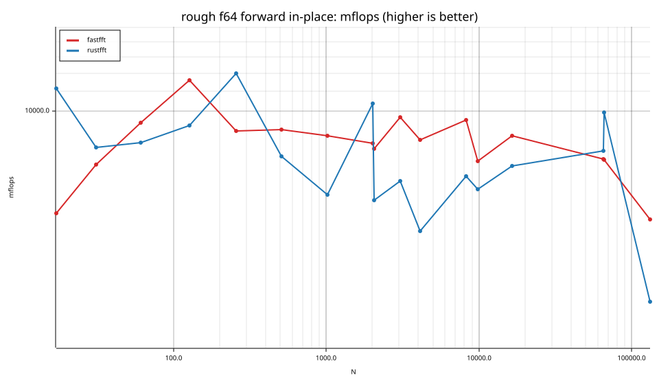
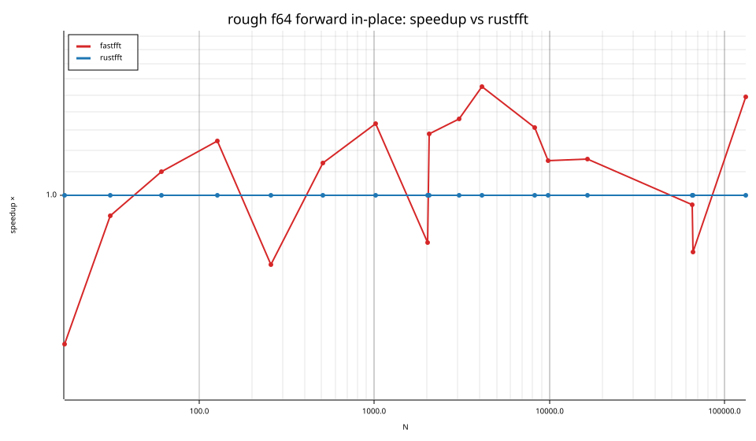

## Accuracy and planning time (medians over cells)

| lib | cells verified | failed | median error (ε) | worst error (ε) | median plan time |
|---|---|---|---|---|---|
| fastfft | 156 | 0 | 0.99 | 2.85 | 19.28us |
| rustfft | 156 | 0 | 1.24 | 5.84 | 9.97us |
