# fastfft arena report: `after-idle`

| | |
|---|---|
| Host | mini-ryzen |
| CPU | AMD Ryzen 7 7840HS w/ Radeon 780M Graphics (family 25, model 116, stepping 1, microcode 0xa704108) |
| Pinned CPU | 2 (SMT siblings 2,10) |
| Governor / EPP / boost | performance / performance / 1 |
| Kernel | Linux version 7.0.0-28-generic |
| Virtualization | container-other |
| rustc | rustc 1.95.0 (59807616e 2026-04-14); binary: rustc; commit-hash: 59807616e1fa2540724bfbac14d7976d7e4a3860; commit-date: 2026-04-14; host: x86_64-unknown-linux-gnu; release: 1.95.0; LLVM version: 22.1.2 |
| Build profile / RUSTFLAGS | arena / `` |
| Libraries | {"fearless_simd":"0.5.0","num-complex":"0.4.6","oxifft":"0.4.2","phastft":"0.4.1","pulp":"0.22.3","rustfft":"6.4.1","tfhe-fft":"0.10.1"} |
| FFTW | fftw-3.3.11-sse2-avx-avx2-avx2_128-avx512 `double: CFLAGS='-O3 -fPIC -std=gnu17' ./configure --enable-static --disable-shared --disable-fortran --disable-doc --enable-sse2 --enable-avx --enable-avx2 --enable-avx512 --enable-fma
single: CFLAGS='-O3 -fPIC -std=gnu17' ./configure --enable-static --disable-shared --disable-fortran --disable-doc --enable-sse2 --enable-avx --enable-avx2 --enable-avx512 --enable-fma --enable-float` |
| Git | 0801f9bdaaff1d821385806e6e83f4c4092a7983 (dirty: true) |
| Profile | quick |
| Official | true  |
| Control drift | max 1.19% over 8 control runs |
| Cells | 156 |

Times are per transform. *best* = minimum batch mean, *median* = median batch mean. Speedup = rustfft time ÷ library time (> 1 means faster than rustfft); *geomean* over the cells both libraries ran. mflops = 5·N·log2(N)/t(µs).

## Release gates (fastfft)

| Gate | Criterion | Status | Detail |
|---|---|---|---|
| G1 | pow2 vs rustfft: geomean ≥ 1.5×, no cell < 0.95× | ❌ fail | geomean best 1.297×, median 1.293×, worst cell 0.928× (pow2:f64:fwd:ip:n2), 40 cells |
| G2 | smooth vs rustfft: geomean ≥ 1.3×, no cell < 0.95× | ✅ pass | geomean best 1.382×, median 1.380×, worst cell 1.009× (smooth:f64:fwd:ip:n6), 82 cells |
| G3 | rough vs rustfft: geomean ≥ 0.75×, no cell < 0.5× | ✅ pass | geomean best 1.135×, median 1.127×, worst cell 0.540× (rough:f64:fwd:ip:n17), 34 cells |
| G4 | vs each other Rust library: geomean ≥ 1.1×, ≥ 0.97× on ≥ 90% of cells | – n/a |  |
| G5 | AVX2 forced: pow2 ≥ 1.2×, smooth ≥ 1.1× vs rustfft | – n/a | pow2 NaN×/NaN×, smooth NaN×/NaN× |
| G6 | scenarios ≥ 1.3× each; batch geomean ≥ 1.5× | – n/a | scenarios min inf×, batch NaN×/NaN× |
| G7 | accuracy within §6 thresholds and ≤ 1.5× rustfft + 1ε | ✅ pass | 156 cells checked |
| G8 | Estimate planning time ≤ 2× rustfft for every N ≤ 2^20 | ❌ fail | worst ratio 64.56× (rough:f64:fwd:ip:n31), 156 cells |

G9 (build time) is measured by `cargo xtask build-time`, not by the arena.

## Speedup vs rustfft (geomean of best-time ratios; median-time ratio in parentheses)

| suite | prec | fastfft | rustfft |
|---|---|---|---|
| pow2 | f32 | 1.27× (1.27×) 20/0/0 | 1.00× (1.00×) 0/20/0 |
| pow2 | f64 | 1.32× (1.32×) 18/1/1 | 1.00× (1.00×) 0/20/0 |
| smooth | f32 | 1.35× (1.35×) 41/0/0 | 1.00× (1.00×) 0/41/0 |
| smooth | f64 | 1.41× (1.41×) 39/2/0 | 1.00× (1.00×) 0/41/0 |
| rough | f32 | 1.26× (1.25×) 12/1/4 | 1.00× (1.00×) 0/17/0 |
| rough | f64 | 1.02× (1.02×) 10/1/6 | 1.00× (1.00×) 0/17/0 |

w/t/l = cells faster / within ±3% / slower than rustfft (best times).

## Suite `pow2`

### pow2 f32

| cell | fastfft | rustfft |
|---|---|---|
| N=2 fwd ip | 2.6ns (1.07×) | 2.8ns |
| N=4 fwd ip | 3.6ns (1.19×) | 4.2ns |
| N=8 fwd ip | 7.0ns (1.13×) | 7.8ns |
| N=16 fwd ip | 8.2ns (1.07×) | 8.8ns |
| N=32 fwd ip | 11.4ns (1.10×) | 12.6ns |
| N=64 fwd ip | 17.3ns (1.25×) | 21.5ns |
| N=128 fwd ip | 36.2ns (1.33×) | 47.9ns |
| N=256 fwd ip | 74.5ns (1.39×) | 103.7ns |
| N=512 fwd ip | 224.1ns (1.24×) | 278.4ns |
| N=1024 fwd ip | 500.4ns (1.24×) | 623.0ns |
| N=2048 fwd ip | 1.09us (1.27×) | 1.38us |
| N=4096 fwd ip | 2.40us (1.35×) | 3.24us |
| N=8192 fwd ip | 5.24us (1.33×) | 6.98us |
| N=16384 fwd ip | 11.20us (1.43×) | 16.02us |
| N=32768 fwd ip | 25.96us (1.50×) | 38.96us |
| N=65536 fwd ip | 64.08us (1.29×) | 82.75us |
| N=131072 fwd ip | 144.58us (1.26×) | 182.46us |
| N=262144 fwd ip | 311.10us (1.33×) | 413.88us |
| N=524288 fwd ip | 633.93us (1.42×) | 900.30us |
| N=1048576 fwd ip | 2.08ms (1.42×) | 2.95ms |

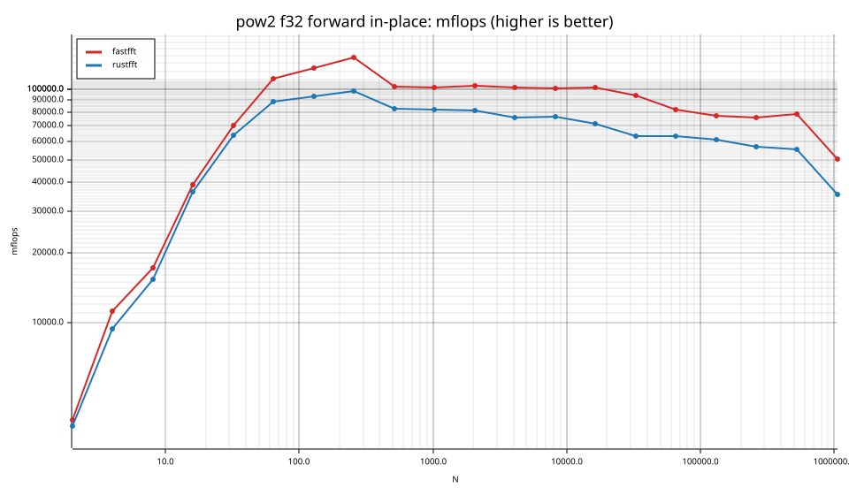
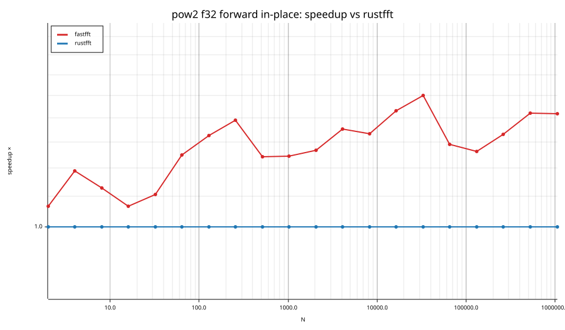
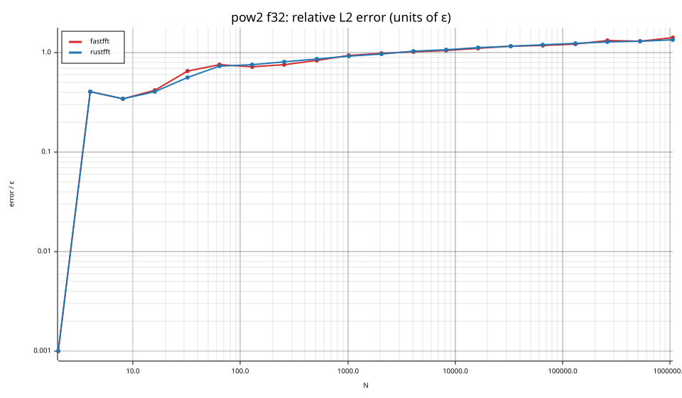

### pow2 f64

| cell | fastfft | rustfft |
|---|---|---|
| N=2 fwd ip | 2.6ns (0.93×) | 2.4ns |
| N=4 fwd ip | 3.6ns (1.03×) | 3.7ns |
| N=8 fwd ip | 6.4ns (1.06×) | 6.8ns |
| N=16 fwd ip | 8.9ns (1.14×) | 10.1ns |
| N=32 fwd ip | 13.9ns (1.26×) | 17.5ns |
| N=64 fwd ip | 29.5ns (1.35×) | 39.7ns |
| N=128 fwd ip | 61.8ns (1.39×) | 85.9ns |
| N=256 fwd ip | 129.4ns (1.51×) | 195.1ns |
| N=512 fwd ip | 424.8ns (1.17×) | 495.1ns |
| N=1024 fwd ip | 985.9ns (1.24×) | 1.22us |
| N=2048 fwd ip | 2.25us (1.25×) | 2.81us |
| N=4096 fwd ip | 5.04us (1.29×) | 6.48us |
| N=8192 fwd ip | 10.41us (1.48×) | 15.37us |
| N=16384 fwd ip | 22.11us (1.53×) | 33.89us |
| N=32768 fwd ip | 51.82us (1.47×) | 76.22us |
| N=65536 fwd ip | 127.77us (1.34×) | 170.94us |
| N=131072 fwd ip | 275.27us (1.37×) | 376.14us |
| N=262144 fwd ip | 611.31us (1.41×) | 863.80us |
| N=524288 fwd ip | 1.81ms (1.58×) | 2.87ms |
| N=1048576 fwd ip | 4.13ms (1.96×) | 8.11ms |

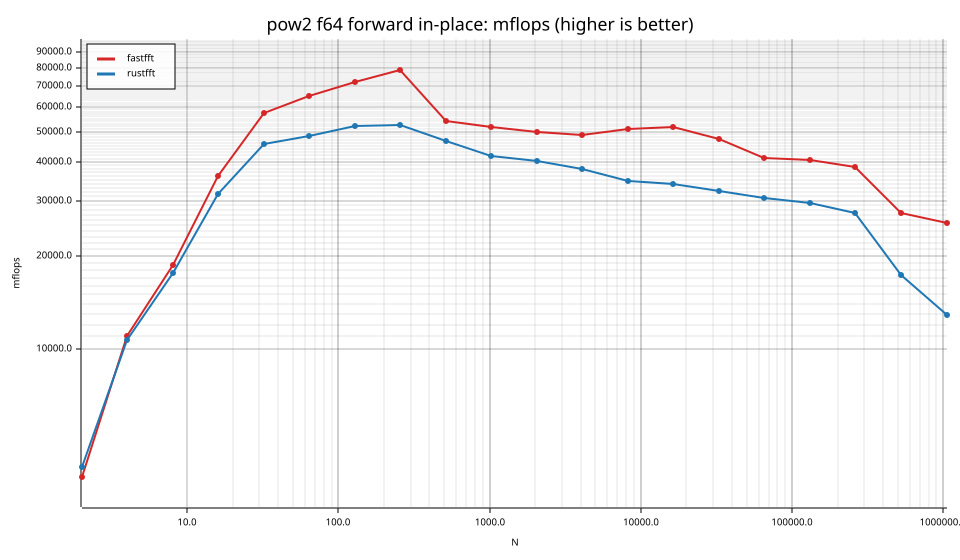
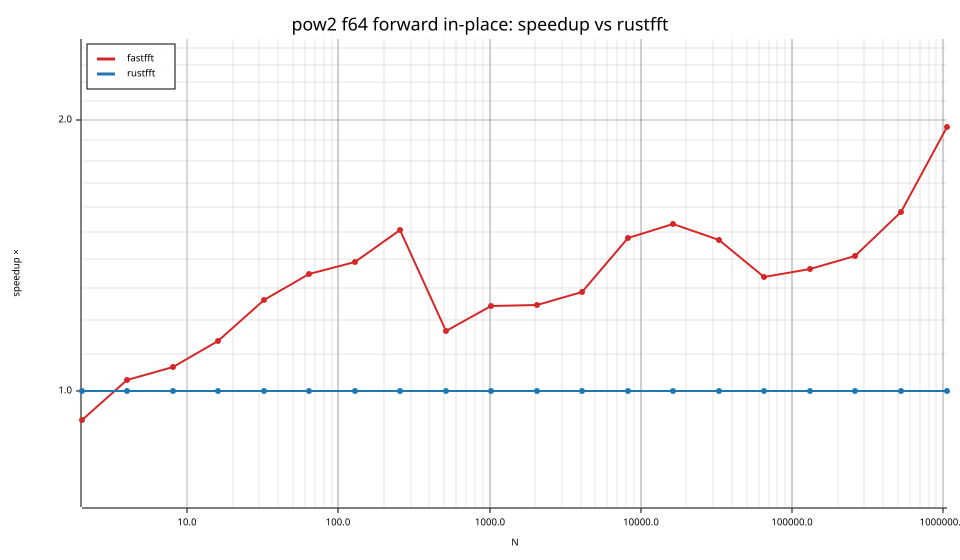

## Suite `smooth`

### smooth f32

| cell | fastfft | rustfft |
|---|---|---|
| N=6 fwd ip | 7.4ns (1.27×) | 9.4ns |
| N=9 fwd ip | 10.8ns (1.22×) | 13.2ns |
| N=12 fwd ip | 9.8ns (1.12×) | 11.0ns |
| N=15 fwd ip | 13.6ns (2.38×) | 32.3ns |
| N=18 fwd ip | 15.9ns (1.47×) | 23.4ns |
| N=24 fwd ip | 13.4ns (1.07×) | 14.4ns |
| N=36 fwd ip | 19.1ns (1.03×) | 19.8ns |
| N=48 fwd ip | 15.7ns (1.08×) | 16.9ns |
| N=80 fwd ip | 35.4ns (1.09×) | 38.5ns |
| N=96 fwd ip | 35.1ns (1.40×) | 49.1ns |
| N=108 fwd ip | 48.0ns (1.25×) | 60.1ns |
| N=120 fwd ip | 59.7ns (1.09×) | 65.3ns |
| N=160 fwd ip | 78.2ns (1.03×) | 80.6ns |
| N=210 fwd ip | 116.8ns (2.16×) | 252.3ns |
| N=240 fwd ip | 98.2ns (1.25×) | 123.0ns |
| N=320 fwd ip | 140.6ns (1.21×) | 169.6ns |
| N=384 fwd ip | 168.3ns (1.22×) | 204.9ns |
| N=480 fwd ip | 254.1ns (1.32×) | 335.5ns |
| N=504 fwd ip | 237.6ns (1.20×) | 286.1ns |
| N=640 fwd ip | 287.0ns (1.31×) | 374.8ns |
| N=720 fwd ip | 334.6ns (1.58×) | 529.4ns |
| N=768 fwd ip | 347.4ns (1.22×) | 425.3ns |
| N=960 fwd ip | 454.9ns (1.41×) | 643.6ns |
| N=1000 fwd ip | 614.9ns (1.54×) | 944.7ns |
| N=1200 fwd ip | 675.5ns (1.27×) | 855.5ns |
| N=1536 fwd ip | 775.3ns (1.38×) | 1.07us |
| N=1920 fwd ip | 1.08us (1.30×) | 1.40us |
| N=1960 fwd ip | 1.23us (1.62×) | 1.99us |
| N=2400 fwd ip | 1.46us (1.61×) | 2.36us |
| N=3072 fwd ip | 1.71us (1.42×) | 2.43us |
| N=4725 fwd ip | 4.67us (1.30×) | 6.08us |
| N=4800 fwd ip | 2.87us (1.53×) | 4.40us |
| N=6144 fwd ip | 3.71us (1.35×) | 5.02us |
| N=10368 fwd ip | 6.59us (1.31×) | 8.66us |
| N=12288 fwd ip | 7.88us (1.50×) | 11.82us |
| N=27000 fwd ip | 20.51us (1.63×) | 33.37us |
| N=48000 fwd ip | 35.49us (1.70×) | 60.47us |
| N=75600 fwd ip | 65.77us (1.60×) | 105.02us |
| N=96000 fwd ip | 79.45us (1.66×) | 132.26us |
| N=165375 fwd ip | 237.51us (1.35×) | 319.81us |
| N=1000000 fwd ip | 2.85ms (1.03×) | 2.94ms |

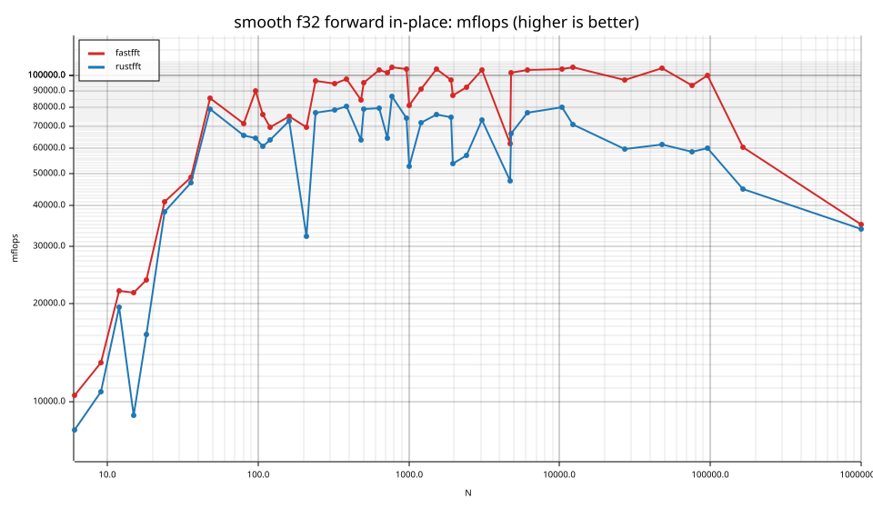
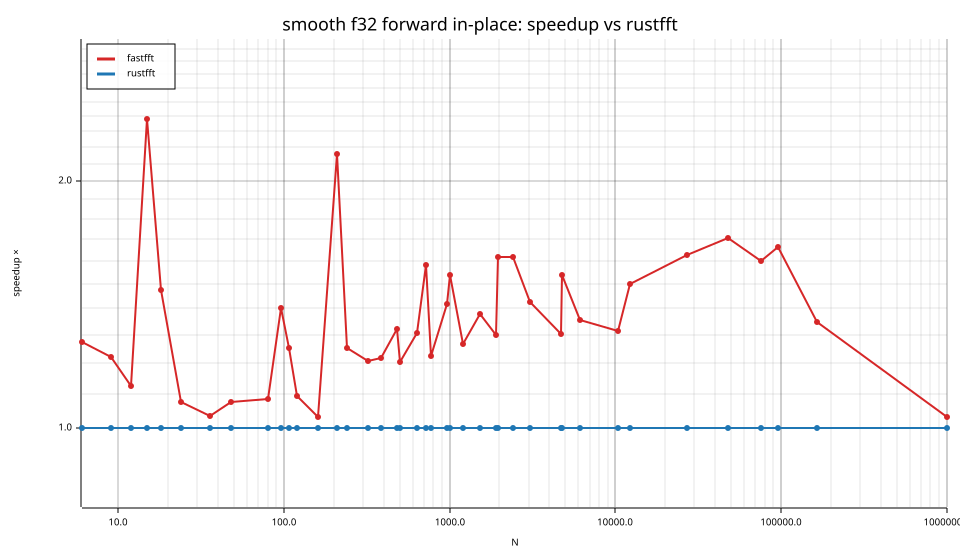

### smooth f64

| cell | fastfft | rustfft |
|---|---|---|
| N=6 fwd ip | 5.5ns (1.02×) | 5.6ns |
| N=9 fwd ip | 8.4ns (1.13×) | 9.5ns |
| N=12 fwd ip | 8.6ns (1.35×) | 11.6ns |
| N=15 fwd ip | 14.6ns (1.98×) | 28.8ns |
| N=18 fwd ip | 11.2ns (1.28×) | 14.3ns |
| N=24 fwd ip | 12.2ns (1.12×) | 13.6ns |
| N=36 fwd ip | 17.8ns (1.32×) | 23.6ns |
| N=48 fwd ip | 21.8ns (1.99×) | 43.3ns |
| N=80 fwd ip | 56.9ns (1.20×) | 68.5ns |
| N=96 fwd ip | 64.8ns (1.23×) | 79.8ns |
| N=108 fwd ip | 79.6ns (1.23×) | 98.0ns |
| N=120 fwd ip | 80.4ns (1.32×) | 105.9ns |
| N=160 fwd ip | 119.8ns (1.24×) | 148.1ns |
| N=210 fwd ip | 281.0ns (1.06×) | 296.9ns |
| N=240 fwd ip | 186.7ns (1.53×) | 285.4ns |
| N=320 fwd ip | 247.9ns (1.40×) | 346.0ns |
| N=384 fwd ip | 297.6ns (1.23×) | 366.2ns |
| N=480 fwd ip | 391.3ns (1.49×) | 583.5ns |
| N=504 fwd ip | 461.5ns (1.42×) | 653.8ns |
| N=640 fwd ip | 547.8ns (1.29×) | 709.3ns |
| N=720 fwd ip | 638.7ns (1.42×) | 905.8ns |
| N=768 fwd ip | 685.0ns (1.44×) | 987.5ns |
| N=960 fwd ip | 883.9ns (1.46×) | 1.29us |
| N=1000 fwd ip | 1.06us (1.49×) | 1.58us |
| N=1200 fwd ip | 1.22us (1.72×) | 2.10us |
| N=1536 fwd ip | 1.57us (1.38×) | 2.17us |
| N=1920 fwd ip | 2.00us (1.38×) | 2.75us |
| N=1960 fwd ip | 2.21us (1.62×) | 3.57us |
| N=2400 fwd ip | 2.60us (1.59×) | 4.13us |
| N=3072 fwd ip | 3.46us (1.31×) | 4.52us |
| N=4725 fwd ip | 8.58us (1.19×) | 10.22us |
| N=4800 fwd ip | 5.31us (1.72×) | 9.11us |
| N=6144 fwd ip | 7.22us (1.47×) | 10.64us |
| N=10368 fwd ip | 12.32us (1.64×) | 20.18us |
| N=12288 fwd ip | 15.76us (1.64×) | 25.78us |
| N=27000 fwd ip | 43.11us (1.53×) | 66.11us |
| N=48000 fwd ip | 68.04us (1.84×) | 125.17us |
| N=75600 fwd ip | 128.79us (1.58×) | 203.19us |
| N=96000 fwd ip | 141.84us (2.00×) | 283.51us |
| N=165375 fwd ip | 416.88us (1.36×) | 568.29us |
| N=1000000 fwd ip | 7.71ms (1.03×) | 7.93ms |

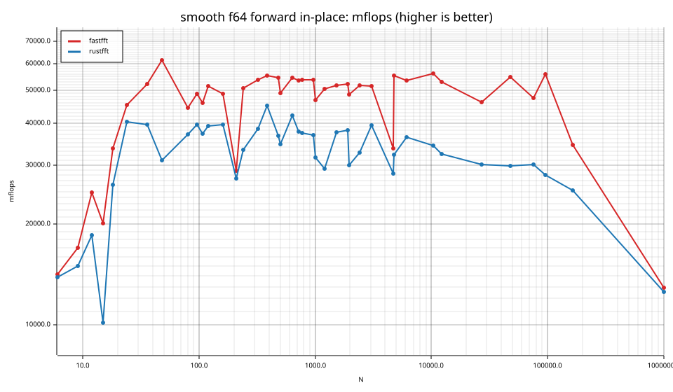
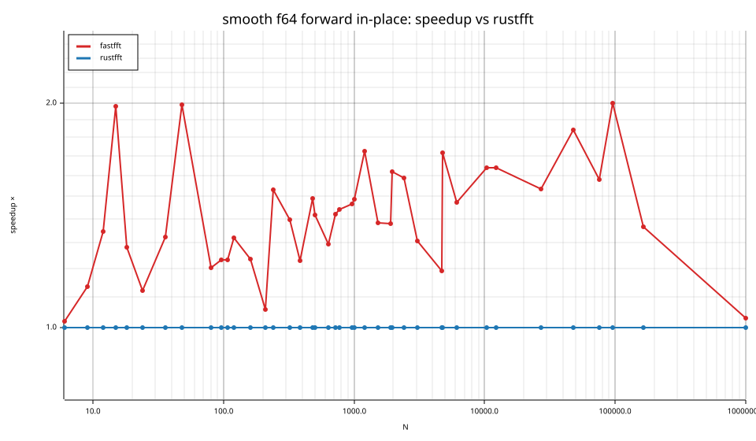
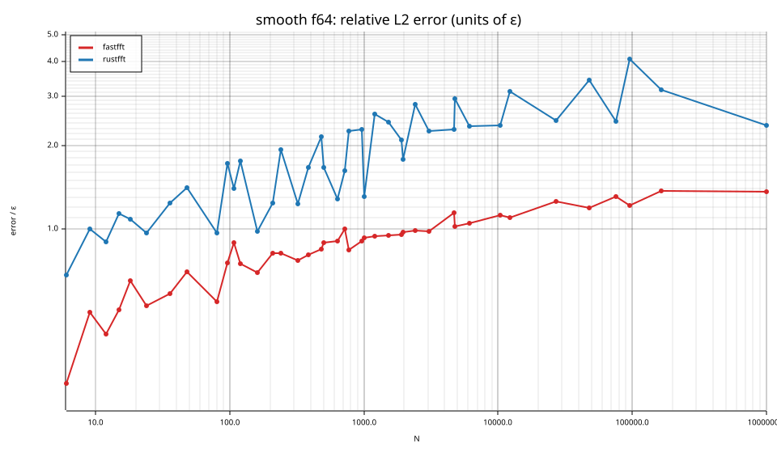

## Suite `rough`

### rough f32

| cell | fastfft | rustfft |
|---|---|---|
| N=17 fwd ip | 46.7ns (0.57×) | 26.8ns |
| N=31 fwd ip | 62.8ns (1.49×) | 93.4ns |
| N=61 fwd ip | 120.1ns (1.08×) | 129.2ns |
| N=127 fwd ip | 219.9ns (2.20×) | 483.5ns |
| N=257 fwd ip | 574.5ns (0.79×) | 456.0ns |
| N=509 fwd ip | 1.26us (1.19×) | 1.51us |
| N=1021 fwd ip | 2.66us (1.95×) | 5.19us |
| N=2018 fwd ip | 6.57us (0.85×) | 5.60us |
| N=2053 fwd ip | 7.24us (1.55×) | 11.24us |
| N=3063 fwd ip | 9.33us (1.76×) | 16.44us |
| N=4099 fwd ip | 14.47us (1.66×) | 24.08us |
| N=8191 fwd ip | 27.38us (1.81×) | 49.54us |
| N=9797 fwd ip | 35.21us (1.49×) | 52.32us |
| N=16381 fwd ip | 64.39us (1.57×) | 101.13us |
| N=65524 fwd ip | 365.68us (1.16×) | 425.64us |
| N=65537 fwd ip | 369.37us (0.68×) | 252.88us |
| N=131071 fwd ip | 893.96us (1.01×) | 899.40us |

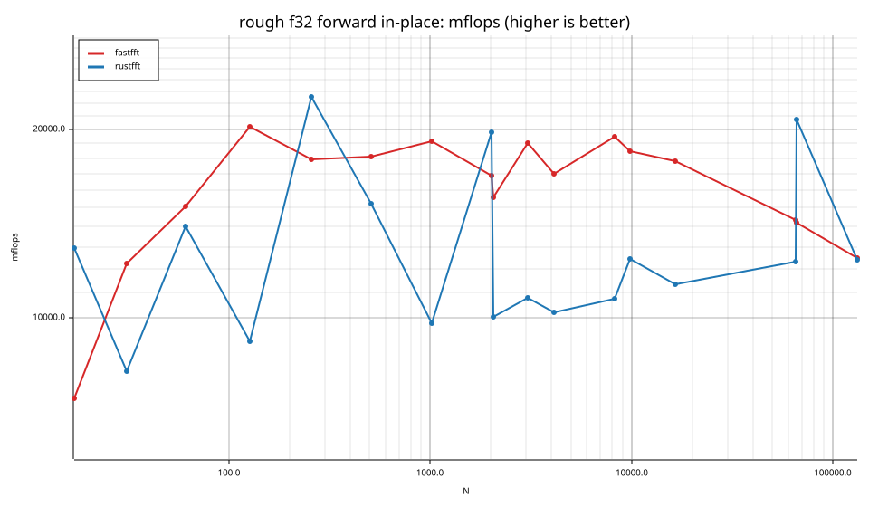
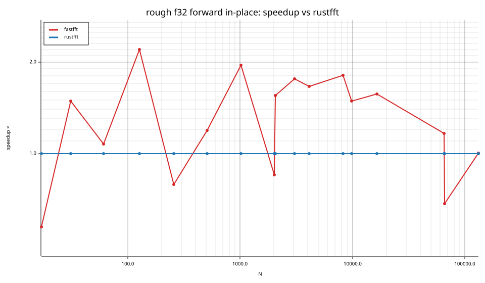
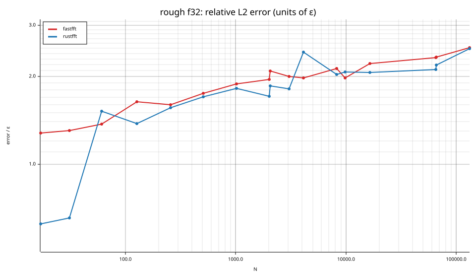

### rough f64

| cell | fastfft | rustfft |
|---|---|---|
| N=17 fwd ip | 57.3ns (0.54×) | 31.0ns |
| N=31 fwd ip | 99.1ns (0.93×) | 92.2ns |
| N=61 fwd ip | 188.9ns (1.11×) | 209.6ns |
| N=127 fwd ip | 387.2ns (1.22×) | 471.2ns |
| N=257 fwd ip | 1.12us (0.76×) | 857.2ns |
| N=509 fwd ip | 2.48us (1.15×) | 2.84us |
| N=1021 fwd ip | 5.87us (1.30×) | 7.66us |
| N=2018 fwd ip | 12.88us (0.83×) | 10.70us |
| N=2053 fwd ip | 13.55us (1.27×) | 17.17us |
| N=3063 fwd ip | 18.19us (1.36×) | 24.70us |
| N=4099 fwd ip | 27.95us (1.56×) | 43.56us |
| N=8191 fwd ip | 56.74us (1.28×) | 72.67us |
| N=9797 fwd ip | 85.86us (1.11×) | 95.16us |
| N=16381 fwd ip | 129.18us (1.12×) | 144.07us |
| N=65524 fwd ip | 778.41us (0.81×) | 632.19us |
| N=65537 fwd ip | 791.41us (0.67×) | 527.76us |
| N=131071 fwd ip | 2.65ms (1.03×) | 2.73ms |

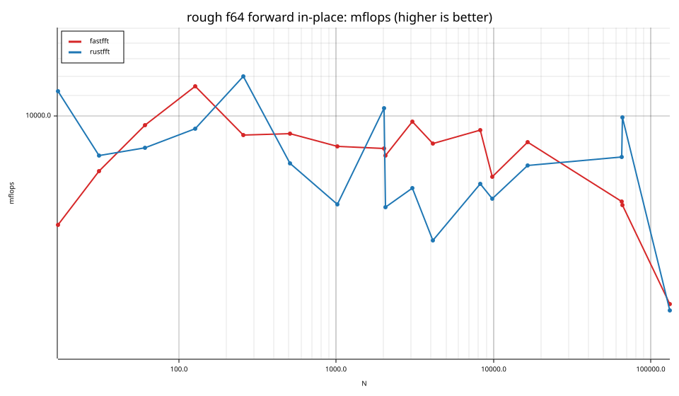
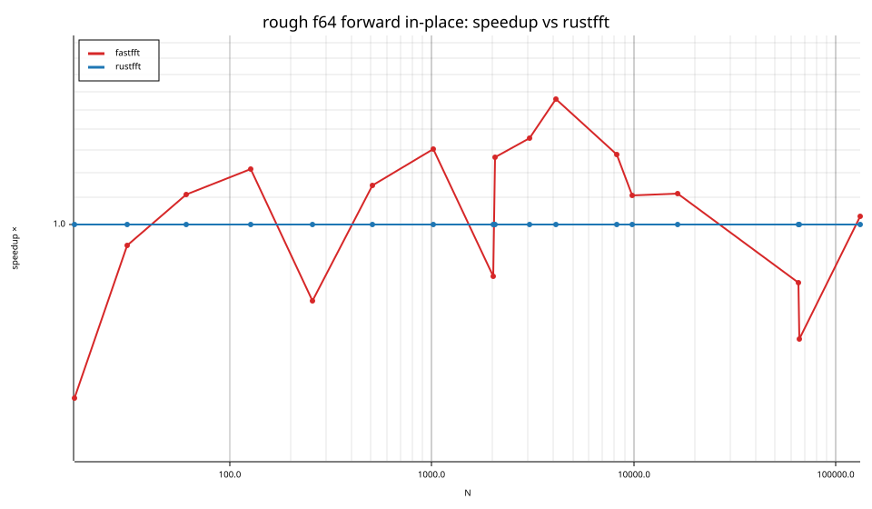
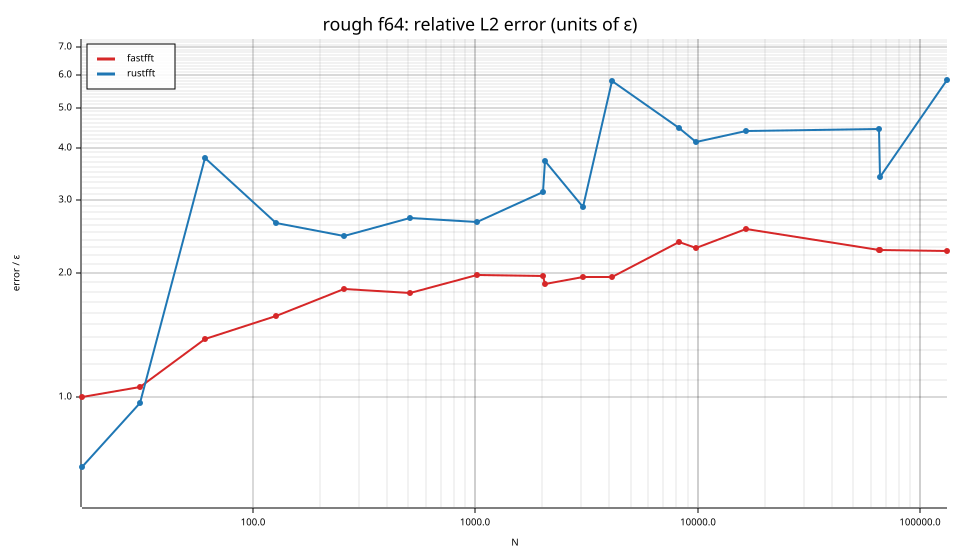

## Accuracy and planning time (medians over cells)

| lib | cells verified | failed | median error (ε) | worst error (ε) | median plan time |
|---|---|---|---|---|---|
| fastfft | 156 | 0 | 0.99 | 2.55 | 19.13us |
| rustfft | 156 | 0 | 1.24 | 5.84 | 10.10us |
