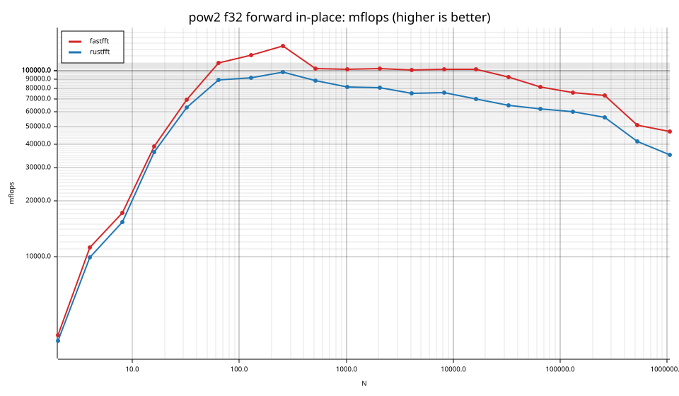
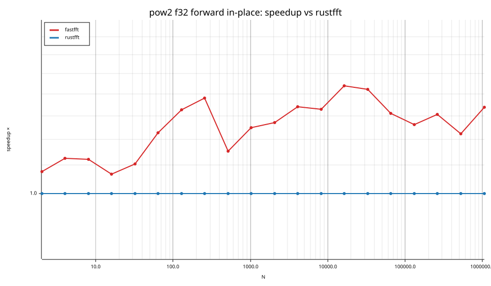
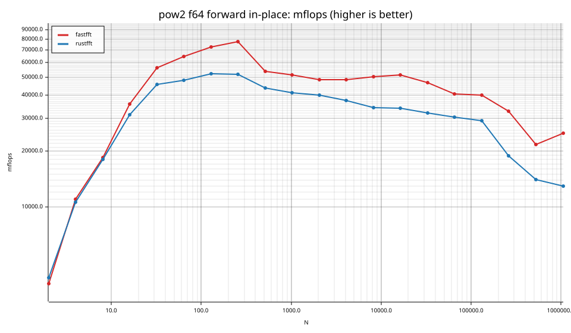
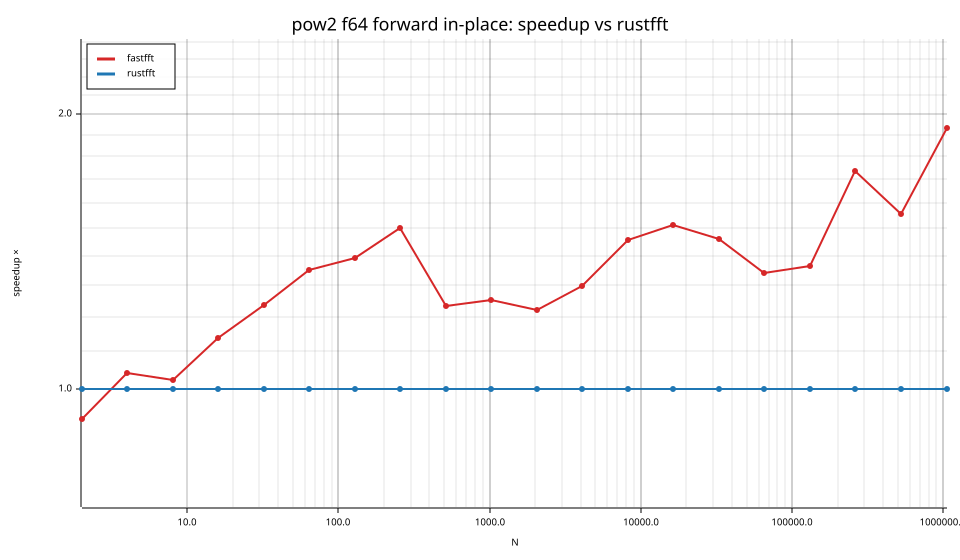
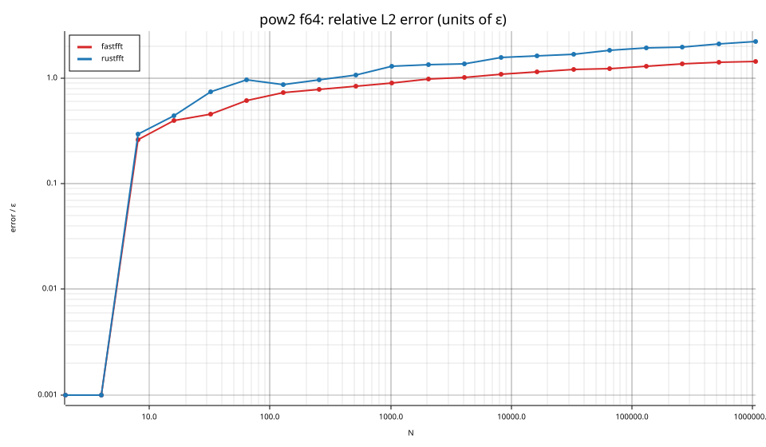
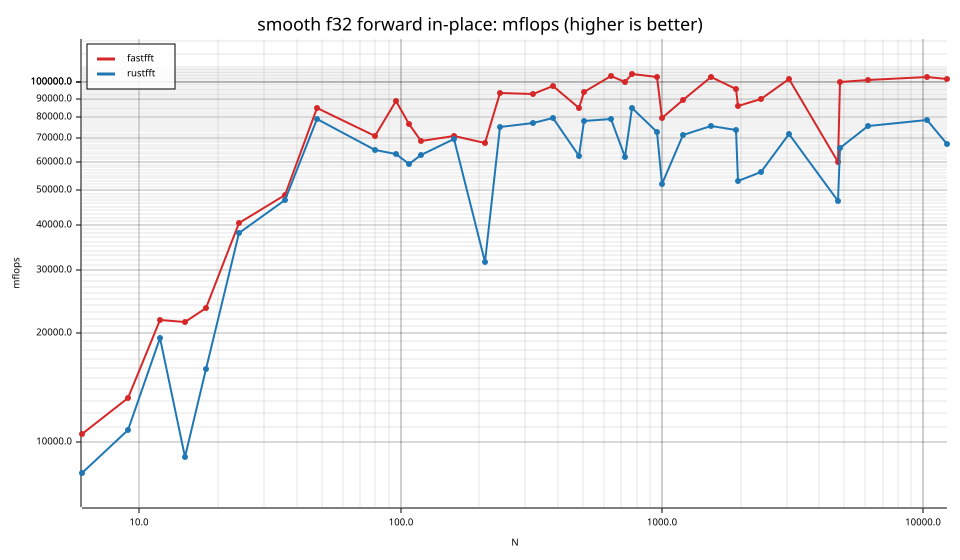
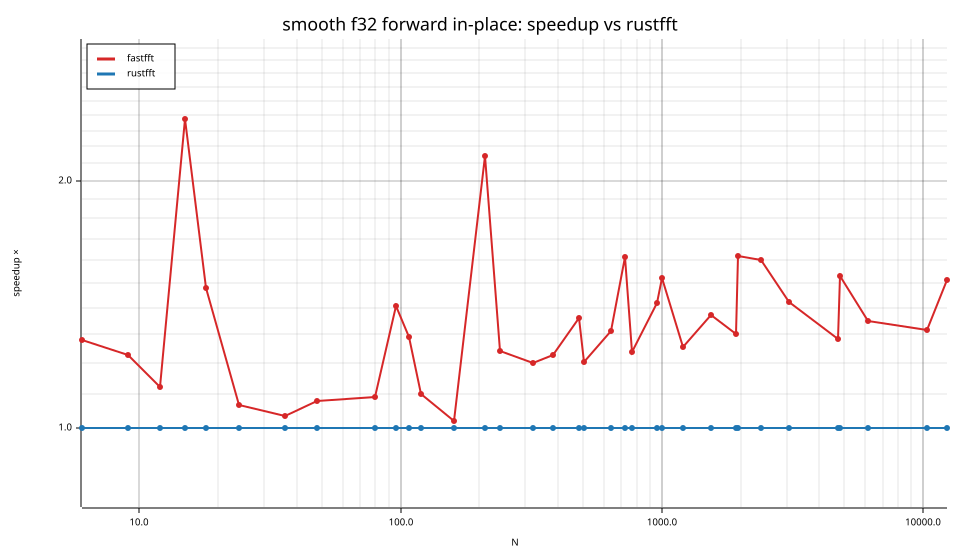
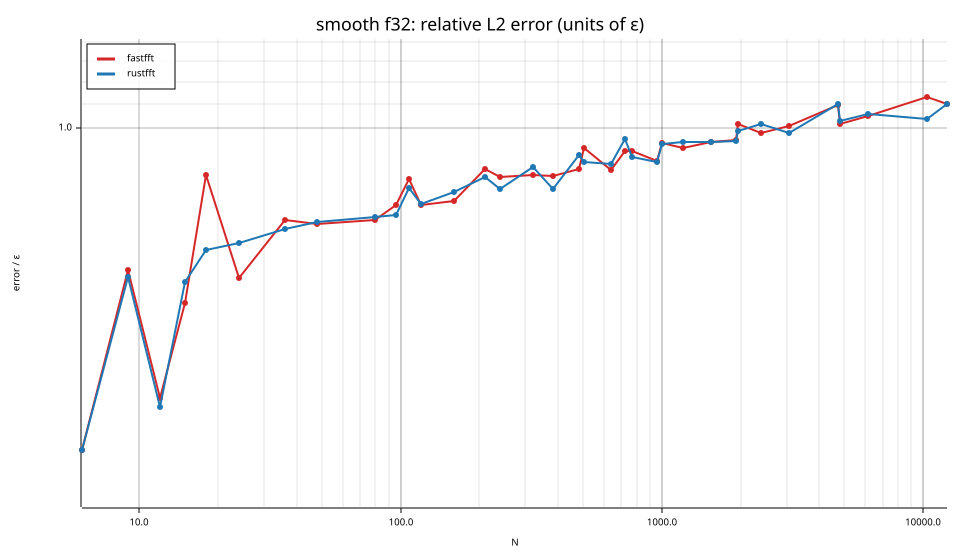

# fastfft arena report: `after`

| | |
|---|---|
| Host | mini-ryzen |
| CPU | AMD Ryzen 7 7840HS w/ Radeon 780M Graphics (family 25, model 116, stepping 1, microcode 0xa704108) |
| Pinned CPU | 2 (SMT siblings 2,10) |
| Governor / EPP / boost | performance / performance / 1 |
| Kernel | Linux version 7.0.0-28-generic |
| Virtualization | container-other |
| rustc | rustc 1.95.0 (59807616e 2026-04-14); binary: rustc; commit-hash: 59807616e1fa2540724bfbac14d7976d7e4a3860; commit-date: 2026-04-14; host: x86_64-unknown-linux-gnu; release: 1.95.0; LLVM version: 22.1.2 |
| Build profile / RUSTFLAGS | arena / `` |
| Libraries | {"fearless_simd":"0.5.0","num-complex":"0.4.6","oxifft":"0.4.2","phastft":"0.4.1","pulp":"0.22.3","rustfft":"6.4.1","tfhe-fft":"0.10.1"} |
| FFTW | fftw-3.3.11-sse2-avx-avx2-avx2_128-avx512 `double: CFLAGS='-O3 -fPIC -std=gnu17' ./configure --enable-static --disable-shared --disable-fortran --disable-doc --enable-sse2 --enable-avx --enable-avx2 --enable-avx512 --enable-fma
single: CFLAGS='-O3 -fPIC -std=gnu17' ./configure --enable-static --disable-shared --disable-fortran --disable-doc --enable-sse2 --enable-avx --enable-avx2 --enable-avx512 --enable-fma --enable-float` |
| Git | 0801f9bdaaff1d821385806e6e83f4c4092a7983 (dirty: true) |
| Profile | quick |
| Official | true  |
| Control drift | max 47.35% over 4 control runs — **FLAGGED** |
| Cells | 75 |

Times are per transform. *best* = minimum batch mean, *median* = median batch mean. Speedup = rustfft time ÷ library time (> 1 means faster than rustfft); *geomean* over the cells both libraries ran. mflops = 5·N·log2(N)/t(µs).

## Release gates (fastfft)

| Gate | Criterion | Status | Detail |
|---|---|---|---|
| G1 | pow2 vs rustfft: geomean ≥ 1.5×, no cell < 0.95× | ❌ fail | geomean best 1.288×, median 1.289×, worst cell 0.926× (pow2:f64:fwd:ip:n2), 40 cells |
| G2 | smooth vs rustfft: geomean ≥ 1.3×, no cell < 0.95× | ✅ pass | geomean best 1.336×, median 1.320×, worst cell 1.016× (smooth:f32:fwd:ip:n36), 35 cells |
| G3 | rough vs rustfft: geomean ≥ 0.75×, no cell < 0.5× | – n/a | no data |
| G4 | vs each other Rust library: geomean ≥ 1.1×, ≥ 0.97× on ≥ 90% of cells | – n/a |  |
| G5 | AVX2 forced: pow2 ≥ 1.2×, smooth ≥ 1.1× vs rustfft | – n/a | pow2 NaN×/NaN×, smooth NaN×/NaN× |
| G6 | scenarios ≥ 1.3× each; batch geomean ≥ 1.5× | – n/a | scenarios min inf×, batch NaN×/NaN× |
| G7 | accuracy within §6 thresholds and ≤ 1.5× rustfft + 1ε | ✅ pass | 75 cells checked |
| G8 | Estimate planning time ≤ 2× rustfft for every N ≤ 2^20 | ❌ fail | worst ratio 5.81× (pow2:f32:fwd:ip:n16), 75 cells |

G9 (build time) is measured by `cargo xtask build-time`, not by the arena.

## Speedup vs rustfft (geomean of best-time ratios; median-time ratio in parentheses)

| suite | prec | fastfft | rustfft |
|---|---|---|---|
| pow2 | f32 | 1.25× (1.24×) 20/0/0 | 1.00× (1.00×) 0/20/0 |
| pow2 | f64 | 1.33× (1.34×) 18/1/1 | 1.00× (1.00×) 0/20/0 |
| smooth | f32 | 1.34× (1.32×) 34/1/0 | 1.00× (1.00×) 0/35/0 |

w/t/l = cells faster / within ±3% / slower than rustfft (best times).

## Suite `pow2`

### pow2 f32

| cell | fastfft | rustfft |
|---|---|---|
| N=2 fwd ip | 2.6ns (1.08×) | 2.8ns |
| N=4 fwd ip | 3.6ns (1.13×) | 4.0ns |
| N=8 fwd ip | 7.0ns (1.12×) | 7.8ns |
| N=16 fwd ip | 8.2ns (1.07×) | 8.8ns |
| N=32 fwd ip | 11.4ns (1.10×) | 12.6ns |
| N=64 fwd ip | 17.5ns (1.23×) | 21.5ns |
| N=128 fwd ip | 37.1ns (1.33×) | 49.2ns |
| N=256 fwd ip | 75.6ns (1.38×) | 104.3ns |
| N=512 fwd ip | 225.2ns (1.15×) | 260.0ns |
| N=1024 fwd ip | 504.2ns (1.25×) | 629.6ns |
| N=2048 fwd ip | 1.10us (1.27×) | 1.40us |
| N=4096 fwd ip | 2.43us (1.34×) | 3.26us |
| N=8192 fwd ip | 5.27us (1.33×) | 7.00us |
| N=16384 fwd ip | 11.32us (1.44×) | 16.28us |
| N=32768 fwd ip | 26.56us (1.42×) | 37.75us |
| N=65536 fwd ip | 64.08us (1.31×) | 83.99us |
| N=131072 fwd ip | 146.41us (1.26×) | 184.86us |
| N=262144 fwd ip | 322.44us (1.31×) | 421.39us |
| N=524288 fwd ip | 982.16us (1.22×) | 1.20ms |
| N=1048576 fwd ip | 2.23ms (1.34×) | 2.99ms |

### pow2 f64

| cell | fastfft | rustfft |
|---|---|---|
| N=2 fwd ip | 2.6ns (0.93×) | 2.4ns |
| N=4 fwd ip | 3.6ns (1.04×) | 3.8ns |
| N=8 fwd ip | 6.5ns (1.02×) | 6.7ns |
| N=16 fwd ip | 9.0ns (1.14×) | 10.2ns |
| N=32 fwd ip | 14.2ns (1.24×) | 17.5ns |
| N=64 fwd ip | 29.6ns (1.35×) | 40.0ns |
| N=128 fwd ip | 61.7ns (1.39×) | 85.8ns |
| N=256 fwd ip | 131.5ns (1.50×) | 197.3ns |
| N=512 fwd ip | 428.6ns (1.23×) | 528.5ns |
| N=1024 fwd ip | 994.4ns (1.25×) | 1.24us |
| N=2048 fwd ip | 2.32us (1.22×) | 2.82us |
| N=4096 fwd ip | 5.07us (1.30×) | 6.58us |
| N=8192 fwd ip | 10.62us (1.46×) | 15.49us |
| N=16384 fwd ip | 22.34us (1.51×) | 33.81us |
| N=32768 fwd ip | 52.43us (1.46×) | 76.61us |
| N=65536 fwd ip | 128.61us (1.34×) | 172.51us |
| N=131072 fwd ip | 279.10us (1.36×) | 380.95us |
| N=262144 fwd ip | 720.87us (1.73×) | 1.25ms |
| N=524288 fwd ip | 2.29ms (1.55×) | 3.55ms |
| N=1048576 fwd ip | 4.20ms (1.93×) | 8.12ms |

## Suite `smooth`

### smooth f32

| cell | fastfft | rustfft |
|---|---|---|
| N=6 fwd ip | 7.4ns (1.28×) | 9.5ns |
| N=9 fwd ip | 10.8ns (1.23×) | 13.2ns |
| N=12 fwd ip | 9.9ns (1.12×) | 11.1ns |
| N=15 fwd ip | 13.6ns (2.38×) | 32.4ns |
| N=18 fwd ip | 16.0ns (1.48×) | 23.6ns |
| N=24 fwd ip | 13.6ns (1.07×) | 14.5ns |
| N=36 fwd ip | 19.2ns (1.03×) | 19.8ns |
| N=48 fwd ip | 15.8ns (1.08×) | 17.0ns |
| N=80 fwd ip | 35.7ns (1.09×) | 38.9ns |
| N=96 fwd ip | 35.6ns (1.41×) | 50.1ns |
| N=108 fwd ip | 47.8ns (1.29×) | 61.6ns |
| N=120 fwd ip | 60.2ns (1.10×) | 66.2ns |
| N=160 fwd ip | 82.5ns (1.02×) | 84.1ns |
| N=210 fwd ip | 119.6ns (2.14×) | 255.9ns |
| N=240 fwd ip | 101.7ns (1.24×) | 126.1ns |
| N=320 fwd ip | 143.7ns (1.20×) | 172.5ns |
| N=384 fwd ip | 168.4ns (1.23×) | 206.8ns |
| N=480 fwd ip | 251.5ns (1.36×) | 341.8ns |
| N=504 fwd ip | 241.0ns (1.20×) | 290.1ns |
| N=640 fwd ip | 287.3ns (1.31×) | 376.4ns |
| N=720 fwd ip | 341.9ns (1.61×) | 551.9ns |
| N=768 fwd ip | 349.8ns (1.24×) | 432.7ns |
| N=960 fwd ip | 459.1ns (1.42×) | 652.1ns |
| N=1000 fwd ip | 627.8ns (1.52×) | 955.9ns |
| N=1200 fwd ip | 685.4ns (1.26×) | 860.2ns |
| N=1536 fwd ip | 785.6ns (1.37×) | 1.08us |
| N=1920 fwd ip | 1.09us (1.30×) | 1.42us |
| N=1960 fwd ip | 1.25us (1.62×) | 2.02us |
| N=2400 fwd ip | 1.50us (1.60×) | 2.40us |
| N=3072 fwd ip | 1.74us (1.42×) | 2.48us |
| N=4725 fwd ip | 4.82us (1.28×) | 6.17us |
| N=4800 fwd ip | 2.92us (1.53×) | 4.47us |
| N=6144 fwd ip | 3.80us (1.35×) | 5.13us |
| N=10368 fwd ip | 6.71us (1.32×) | 8.82us |
| N=12288 fwd ip | 8.18us (1.52×) | 12.39us |

## Accuracy and planning time (medians over cells)

| lib | cells verified | failed | median error (ε) | worst error (ε) | median plan time |
|---|---|---|---|---|---|
| fastfft | 75 | 0 | 0.88 | 1.44 | 10.34us |
| rustfft | 75 | 0 | 0.93 | 2.21 | 5.58us |
