# fastfft arena report: `before-idle`

| | |
|---|---|
| Host | mini-ryzen |
| CPU | AMD Ryzen 7 7840HS w/ Radeon 780M Graphics (family 25, model 116, stepping 1, microcode 0xa704108) |
| Pinned CPU | 2 (SMT siblings 2,10) |
| Governor / EPP / boost | performance / performance / 1 |
| Kernel | Linux version 7.0.0-28-generic |
| Virtualization | container-other |
| rustc | rustc 1.95.0 (59807616e 2026-04-14); binary: rustc; commit-hash: 59807616e1fa2540724bfbac14d7976d7e4a3860; commit-date: 2026-04-14; host: x86_64-unknown-linux-gnu; release: 1.95.0; LLVM version: 22.1.2 |
| Build profile / RUSTFLAGS | arena / `-C llvm-args=-align-all-functions=6` |
| Libraries | {"fearless_simd":"0.5.0","num-complex":"0.4.6","oxifft":"0.4.2","phastft":"0.4.1","pulp":"0.22.3","rustfft":"6.4.1","tfhe-fft":"0.10.1"} |
| FFTW | fftw-3.3.11-sse2-avx-avx2-avx2_128-avx512 `double: CFLAGS='-O3 -fPIC -std=gnu17' ./configure --enable-static --disable-shared --disable-fortran --disable-doc --enable-sse2 --enable-avx --enable-avx2 --enable-avx512 --enable-fma
single: CFLAGS='-O3 -fPIC -std=gnu17' ./configure --enable-static --disable-shared --disable-fortran --disable-doc --enable-sse2 --enable-avx --enable-avx2 --enable-avx512 --enable-fma --enable-float` |
| Git | 0801f9bdaaff1d821385806e6e83f4c4092a7983 (dirty: true) |
| Profile | quick |
| Official | true  |
| Control drift | max 11.60% over 8 control runs — **FLAGGED** |
| Cells | 156 |

Times are per transform. *best* = minimum batch mean, *median* = median batch mean. Speedup = rustfft time ÷ library time (> 1 means faster than rustfft); *geomean* over the cells both libraries ran. mflops = 5·N·log2(N)/t(µs).

## Release gates (fastfft)

| Gate | Criterion | Status | Detail |
|---|---|---|---|
| G1 | pow2 vs rustfft: geomean ≥ 1.5×, no cell < 0.95× | ❌ fail | geomean best 1.280×, median 1.277×, worst cell 0.925× (pow2:f64:fwd:ip:n2), 40 cells |
| G2 | smooth vs rustfft: geomean ≥ 1.3×, no cell < 0.95× | ✅ pass | geomean best 1.335×, median 1.333×, worst cell 1.011× (smooth:f64:fwd:ip:n210), 82 cells |
| G3 | rough vs rustfft: geomean ≥ 0.75×, no cell < 0.5× | ✅ pass | geomean best 1.161×, median 1.154×, worst cell 0.542× (rough:f64:fwd:ip:n17), 34 cells |
| G4 | vs each other Rust library: geomean ≥ 1.1×, ≥ 0.97× on ≥ 90% of cells | – n/a |  |
| G5 | AVX2 forced: pow2 ≥ 1.2×, smooth ≥ 1.1× vs rustfft | – n/a | pow2 NaN×/NaN×, smooth NaN×/NaN× |
| G6 | scenarios ≥ 1.3× each; batch geomean ≥ 1.5× | – n/a | scenarios min inf×, batch NaN×/NaN× |
| G7 | accuracy within §6 thresholds and ≤ 1.5× rustfft + 1ε | ✅ pass | 156 cells checked |
| G8 | Estimate planning time ≤ 2× rustfft for every N ≤ 2^20 | ❌ fail | worst ratio 307.71× (rough:f64:fwd:ip:n31), 156 cells |

G9 (build time) is measured by `cargo xtask build-time`, not by the arena.

## Speedup vs rustfft (geomean of best-time ratios; median-time ratio in parentheses)

| suite | prec | fastfft | rustfft |
|---|---|---|---|
| pow2 | f32 | 1.25× (1.25×) 20/0/0 | 1.00× (1.00×) 0/20/0 |
| pow2 | f64 | 1.31× (1.31×) 18/1/1 | 1.00× (1.00×) 0/20/0 |
| smooth | f32 | 1.33× (1.33×) 40/1/0 | 1.00× (1.00×) 0/41/0 |
| smooth | f64 | 1.34× (1.34×) 40/1/0 | 1.00× (1.00×) 0/41/0 |
| rough | f32 | 1.29× (1.28×) 13/0/4 | 1.00× (1.00×) 0/17/0 |
| rough | f64 | 1.05× (1.04×) 11/0/6 | 1.00× (1.00×) 0/17/0 |

w/t/l = cells faster / within ±3% / slower than rustfft (best times).

## Suite `pow2`

### pow2 f32

| cell | fastfft | rustfft |
|---|---|---|
| N=2 fwd ip | 2.6ns (1.06×) | 2.8ns |
| N=4 fwd ip | 3.6ns (1.18×) | 4.2ns |
| N=8 fwd ip | 7.1ns (1.11×) | 7.8ns |
| N=16 fwd ip | 8.2ns (1.07×) | 8.8ns |
| N=32 fwd ip | 11.4ns (1.11×) | 12.6ns |
| N=64 fwd ip | 17.4ns (1.24×) | 21.5ns |
| N=128 fwd ip | 37.5ns (1.28×) | 47.9ns |
| N=256 fwd ip | 74.9ns (1.38×) | 103.7ns |
| N=512 fwd ip | 224.1ns (1.13×) | 254.3ns |
| N=1024 fwd ip | 502.3ns (1.23×) | 616.5ns |
| N=2048 fwd ip | 1.09us (1.28×) | 1.40us |
| N=4096 fwd ip | 2.63us (1.29×) | 3.38us |
| N=8192 fwd ip | 5.49us (1.33×) | 7.30us |
| N=16384 fwd ip | 11.28us (1.40×) | 15.80us |
| N=32768 fwd ip | 25.65us (1.46×) | 37.35us |
| N=65536 fwd ip | 67.73us (1.23×) | 83.33us |
| N=131072 fwd ip | 144.07us (1.26×) | 182.01us |
| N=262144 fwd ip | 312.05us (1.32×) | 411.97us |
| N=524288 fwd ip | 692.79us (1.29×) | 890.32us |
| N=1048576 fwd ip | 1.90ms (1.55×) | 2.94ms |

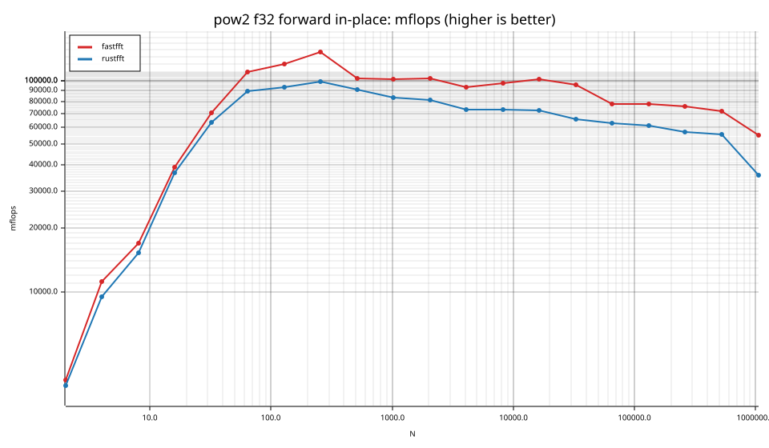
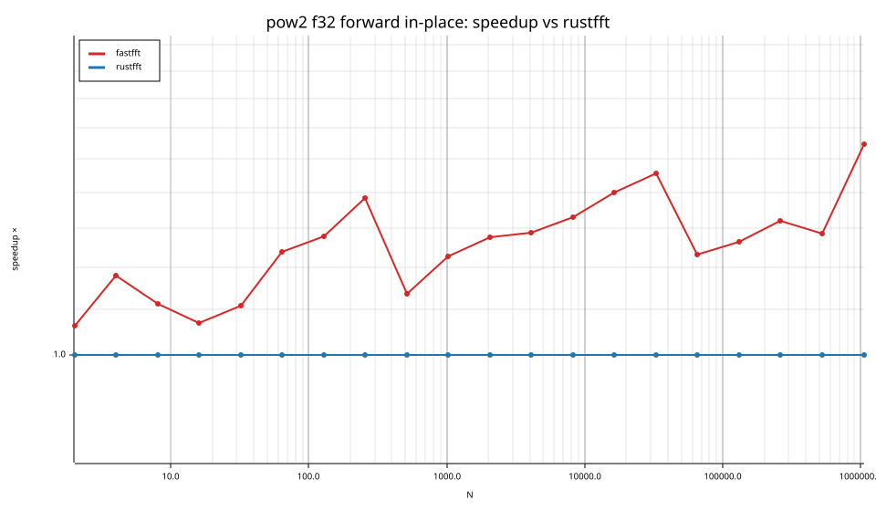
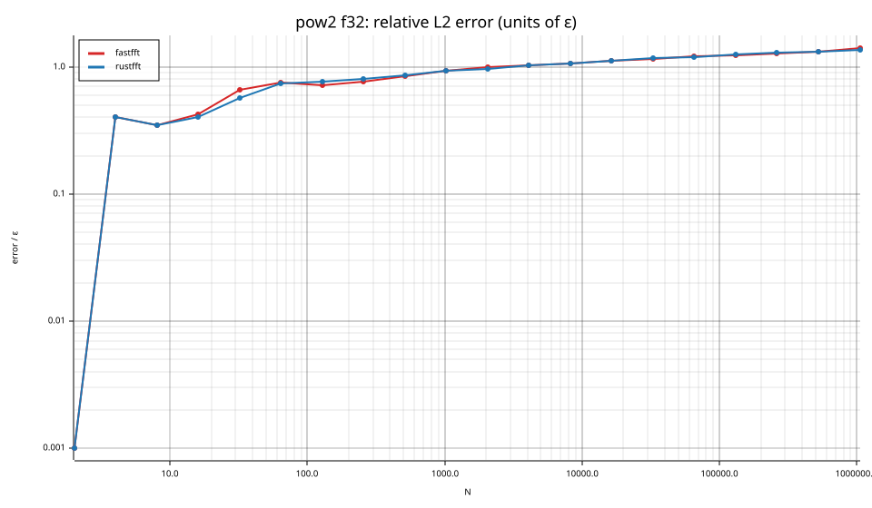

### pow2 f64

| cell | fastfft | rustfft |
|---|---|---|
| N=2 fwd ip | 2.6ns (0.93×) | 2.4ns |
| N=4 fwd ip | 3.6ns (1.05×) | 3.8ns |
| N=8 fwd ip | 6.6ns (1.03×) | 6.7ns |
| N=16 fwd ip | 8.8ns (1.15×) | 10.2ns |
| N=32 fwd ip | 14.2ns (1.23×) | 17.4ns |
| N=64 fwd ip | 28.3ns (1.40×) | 39.8ns |
| N=128 fwd ip | 60.2ns (1.41×) | 84.8ns |
| N=256 fwd ip | 129.6ns (1.52×) | 197.2ns |
| N=512 fwd ip | 426.7ns (1.15×) | 489.1ns |
| N=1024 fwd ip | 1.02us (1.22×) | 1.24us |
| N=2048 fwd ip | 2.62us (1.13×) | 2.96us |
| N=4096 fwd ip | 4.55us (1.48×) | 6.73us |
| N=8192 fwd ip | 10.92us (1.35×) | 14.69us |
| N=16384 fwd ip | 24.18us (1.37×) | 33.20us |
| N=32768 fwd ip | 51.15us (1.51×) | 77.06us |
| N=65536 fwd ip | 134.93us (1.28×) | 172.04us |
| N=131072 fwd ip | 291.28us (1.30×) | 379.64us |
| N=262144 fwd ip | 610.19us (1.44×) | 876.92us |
| N=524288 fwd ip | 1.78ms (1.60×) | 2.86ms |
| N=1048576 fwd ip | 4.06ms (1.99×) | 8.09ms |

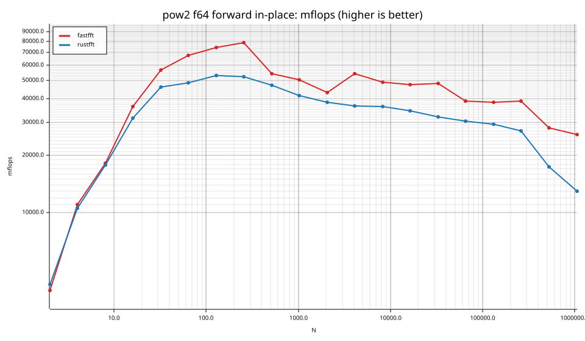
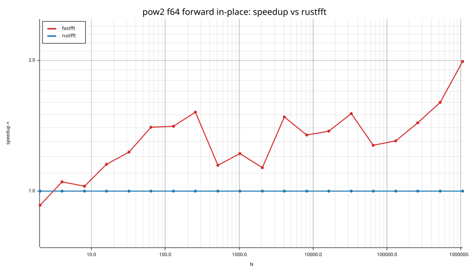
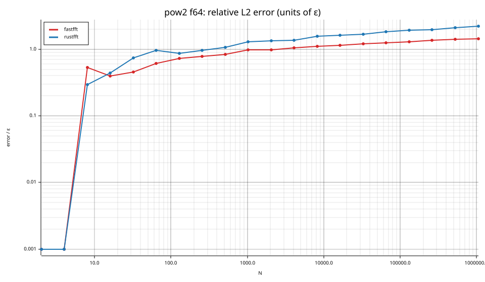

## Suite `smooth`

### smooth f32

| cell | fastfft | rustfft |
|---|---|---|
| N=6 fwd ip | 7.4ns (1.27×) | 9.4ns |
| N=9 fwd ip | 11.6ns (1.14×) | 13.2ns |
| N=12 fwd ip | 9.8ns (1.12×) | 11.0ns |
| N=15 fwd ip | 14.2ns (1.82×) | 25.8ns |
| N=18 fwd ip | 15.7ns (1.49×) | 23.4ns |
| N=24 fwd ip | 13.4ns (1.08×) | 14.4ns |
| N=36 fwd ip | 19.0ns (1.04×) | 19.8ns |
| N=48 fwd ip | 15.9ns (1.07×) | 16.9ns |
| N=80 fwd ip | 36.0ns (1.03×) | 37.1ns |
| N=96 fwd ip | 36.1ns (1.35×) | 48.8ns |
| N=108 fwd ip | 46.5ns (1.31×) | 60.8ns |
| N=120 fwd ip | 59.0ns (1.03×) | 60.7ns |
| N=160 fwd ip | 77.8ns (1.03×) | 80.4ns |
| N=210 fwd ip | 117.3ns (2.14×) | 251.4ns |
| N=240 fwd ip | 99.6ns (1.18×) | 117.3ns |
| N=320 fwd ip | 143.8ns (1.19×) | 171.8ns |
| N=384 fwd ip | 169.4ns (1.17×) | 198.6ns |
| N=480 fwd ip | 250.7ns (1.35×) | 338.9ns |
| N=504 fwd ip | 238.4ns (1.19×) | 283.0ns |
| N=640 fwd ip | 287.5ns (1.30×) | 373.5ns |
| N=720 fwd ip | 336.9ns (1.57×) | 529.9ns |
| N=768 fwd ip | 355.2ns (1.20×) | 427.6ns |
| N=960 fwd ip | 453.0ns (1.41×) | 639.2ns |
| N=1000 fwd ip | 607.9ns (1.56×) | 949.5ns |
| N=1200 fwd ip | 682.0ns (1.24×) | 846.8ns |
| N=1536 fwd ip | 809.9ns (1.31×) | 1.06us |
| N=1920 fwd ip | 1.06us (1.35×) | 1.43us |
| N=1960 fwd ip | 1.25us (1.59×) | 1.99us |
| N=2400 fwd ip | 1.47us (1.57×) | 2.31us |
| N=3072 fwd ip | 1.76us (1.38×) | 2.43us |
| N=4725 fwd ip | 4.64us (1.31×) | 6.09us |
| N=4800 fwd ip | 2.86us (1.59×) | 4.55us |
| N=6144 fwd ip | 3.75us (1.38×) | 5.16us |
| N=10368 fwd ip | 6.58us (1.29×) | 8.49us |
| N=12288 fwd ip | 9.03us (1.35×) | 12.23us |
| N=27000 fwd ip | 20.47us (1.64×) | 33.49us |
| N=48000 fwd ip | 35.06us (1.75×) | 61.26us |
| N=75600 fwd ip | 66.90us (1.57×) | 105.15us |
| N=96000 fwd ip | 77.46us (1.71×) | 132.75us |
| N=165375 fwd ip | 239.03us (1.33×) | 317.34us |
| N=1000000 fwd ip | 2.87ms (1.03×) | 2.97ms |

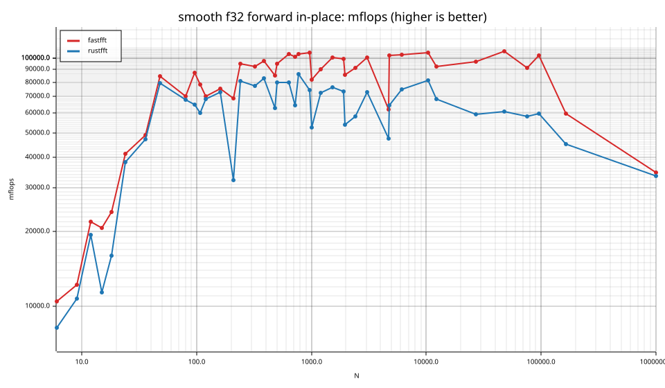
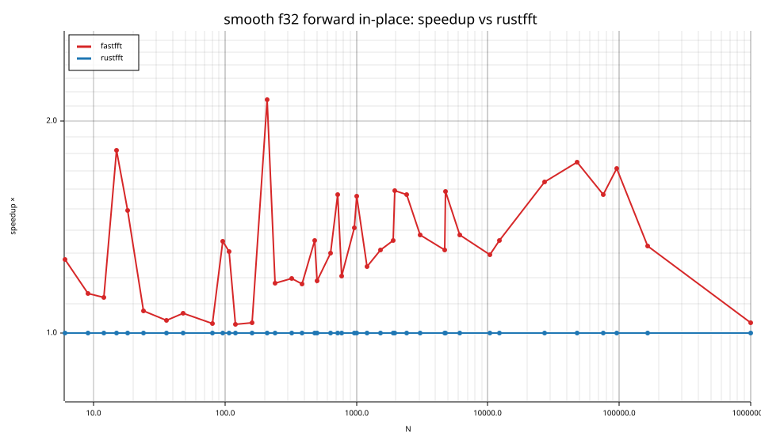

### smooth f64

| cell | fastfft | rustfft |
|---|---|---|
| N=6 fwd ip | 5.4ns (1.04×) | 5.6ns |
| N=9 fwd ip | 8.5ns (1.12×) | 9.5ns |
| N=12 fwd ip | 8.6ns (1.34×) | 11.6ns |
| N=15 fwd ip | 17.1ns (1.69×) | 28.8ns |
| N=18 fwd ip | 11.0ns (1.28×) | 14.1ns |
| N=24 fwd ip | 12.3ns (1.11×) | 13.6ns |
| N=36 fwd ip | 18.0ns (1.26×) | 22.7ns |
| N=48 fwd ip | 37.9ns (1.13×) | 42.7ns |
| N=80 fwd ip | 65.6ns (1.03×) | 67.6ns |
| N=96 fwd ip | 76.8ns (1.04×) | 80.3ns |
| N=108 fwd ip | 79.3ns (1.23×) | 97.7ns |
| N=120 fwd ip | 80.6ns (1.39×) | 111.9ns |
| N=160 fwd ip | 122.9ns (1.17×) | 144.2ns |
| N=210 fwd ip | 289.2ns (1.01×) | 292.4ns |
| N=240 fwd ip | 204.1ns (1.37×) | 280.1ns |
| N=320 fwd ip | 261.6ns (1.24×) | 323.2ns |
| N=384 fwd ip | 313.2ns (1.18×) | 371.0ns |
| N=480 fwd ip | 451.9ns (1.30×) | 588.5ns |
| N=504 fwd ip | 464.7ns (1.41×) | 655.8ns |
| N=640 fwd ip | 548.6ns (1.29×) | 706.8ns |
| N=720 fwd ip | 671.8ns (1.36×) | 915.4ns |
| N=768 fwd ip | 688.6ns (1.43×) | 984.1ns |
| N=960 fwd ip | 865.7ns (1.52×) | 1.32us |
| N=1000 fwd ip | 1.10us (1.53×) | 1.69us |
| N=1200 fwd ip | 1.23us (1.67×) | 2.05us |
| N=1536 fwd ip | 1.76us (1.27×) | 2.24us |
| N=1920 fwd ip | 2.11us (1.36×) | 2.86us |
| N=1960 fwd ip | 2.28us (1.62×) | 3.70us |
| N=2400 fwd ip | 2.91us (1.50×) | 4.37us |
| N=3072 fwd ip | 3.48us (1.33×) | 4.64us |
| N=4725 fwd ip | 8.56us (1.19×) | 10.19us |
| N=4800 fwd ip | 5.57us (1.57×) | 8.73us |
| N=6144 fwd ip | 7.73us (1.43×) | 11.08us |
| N=10368 fwd ip | 12.37us (1.63×) | 20.09us |
| N=12288 fwd ip | 17.11us (1.51×) | 25.76us |
| N=27000 fwd ip | 46.68us (1.41×) | 65.98us |
| N=48000 fwd ip | 68.49us (1.82×) | 124.86us |
| N=75600 fwd ip | 138.97us (1.46×) | 202.49us |
| N=96000 fwd ip | 145.43us (1.95×) | 282.93us |
| N=165375 fwd ip | 416.73us (1.36×) | 568.80us |
| N=1000000 fwd ip | 7.72ms (1.03×) | 7.96ms |

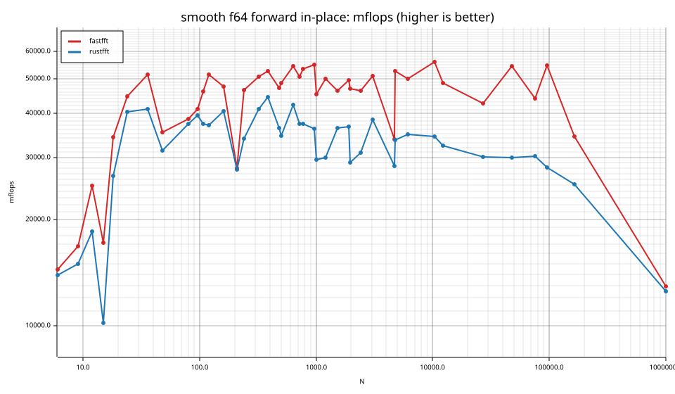
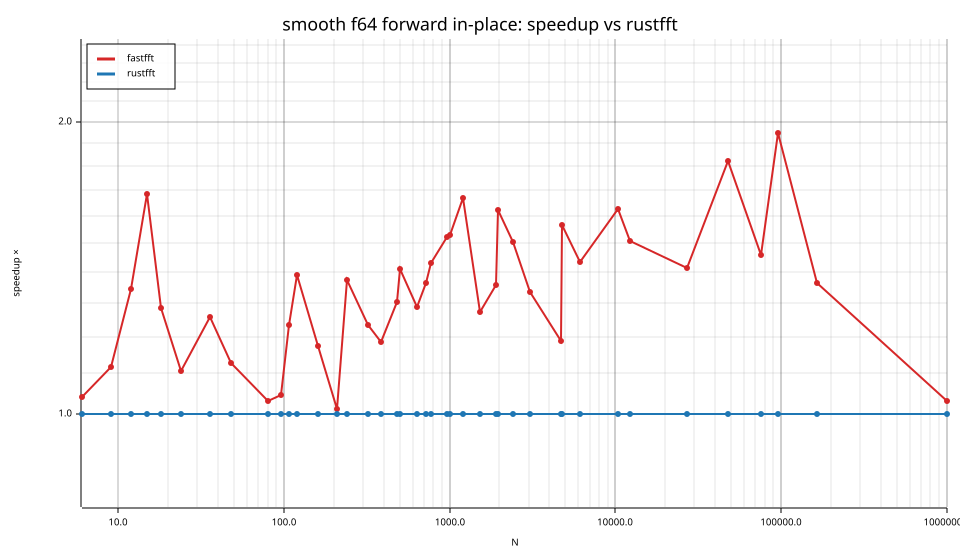

## Suite `rough`

### rough f32

| cell | fastfft | rustfft |
|---|---|---|
| N=17 fwd ip | 46.4ns (0.58×) | 26.7ns |
| N=31 fwd ip | 63.2ns (1.48×) | 93.8ns |
| N=61 fwd ip | 109.9ns (1.18×) | 129.7ns |
| N=127 fwd ip | 220.7ns (2.07×) | 456.3ns |
| N=257 fwd ip | 574.5ns (0.80×) | 458.4ns |
| N=509 fwd ip | 1.28us (1.22×) | 1.56us |
| N=1021 fwd ip | 2.69us (1.93×) | 5.19us |
| N=2018 fwd ip | 6.59us (0.84×) | 5.54us |
| N=2053 fwd ip | 6.72us (1.66×) | 11.17us |
| N=3063 fwd ip | 9.32us (1.77×) | 16.54us |
| N=4099 fwd ip | 13.94us (1.73×) | 24.12us |
| N=8191 fwd ip | 27.60us (1.80×) | 49.55us |
| N=9797 fwd ip | 37.88us (1.39×) | 52.62us |
| N=16381 fwd ip | 65.47us (1.55×) | 101.22us |
| N=65524 fwd ip | 338.43us (1.26×) | 426.92us |
| N=65537 fwd ip | 341.01us (0.74×) | 253.61us |
| N=131071 fwd ip | 739.68us (1.22×) | 899.44us |

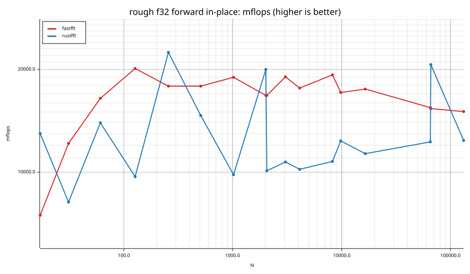
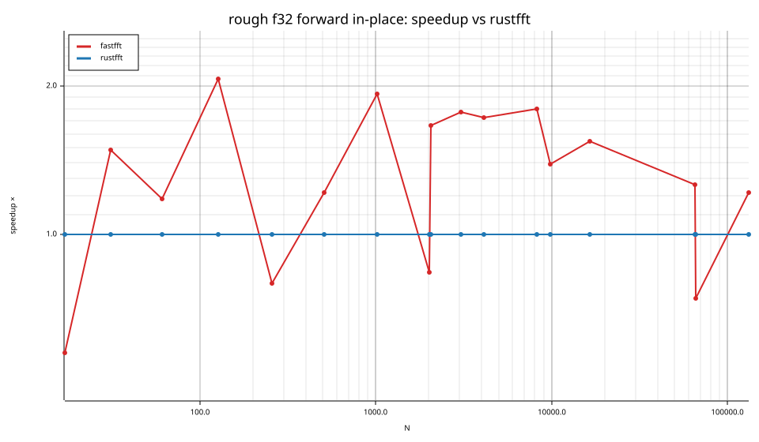

### rough f64

| cell | fastfft | rustfft |
|---|---|---|
| N=17 fwd ip | 56.3ns (0.54×) | 30.5ns |
| N=31 fwd ip | 98.9ns (0.92×) | 90.8ns |
| N=61 fwd ip | 187.9ns (1.14×) | 213.9ns |
| N=127 fwd ip | 387.7ns (1.22×) | 474.1ns |
| N=257 fwd ip | 1.12us (0.77×) | 862.9ns |
| N=509 fwd ip | 2.56us (1.25×) | 3.20us |
| N=1021 fwd ip | 6.26us (1.23×) | 7.67us |
| N=2018 fwd ip | 12.83us (0.84×) | 10.77us |
| N=2053 fwd ip | 13.42us (1.29×) | 17.30us |
| N=3063 fwd ip | 19.72us (1.26×) | 24.87us |
| N=4099 fwd ip | 32.30us (1.36×) | 44.04us |
| N=8191 fwd ip | 62.00us (1.13×) | 70.29us |
| N=9797 fwd ip | 83.48us (1.14×) | 95.52us |
| N=16381 fwd ip | 129.26us (1.12×) | 144.59us |
| N=65524 fwd ip | 689.59us (0.92×) | 632.67us |
| N=65537 fwd ip | 691.60us (0.71×) | 489.30us |
| N=131071 fwd ip | 1.83ms (1.52×) | 2.77ms |

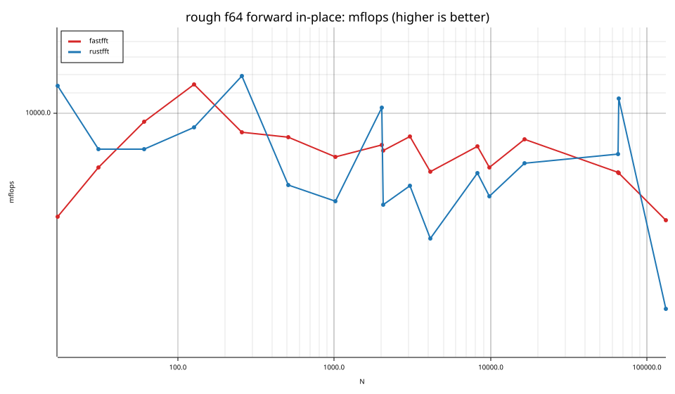
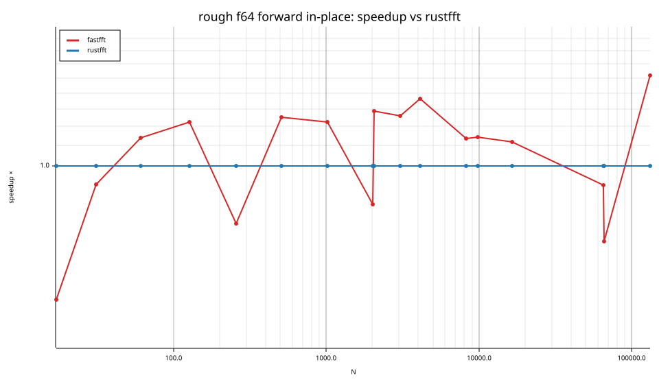

## Accuracy and planning time (medians over cells)

| lib | cells verified | failed | median error (ε) | worst error (ε) | median plan time |
|---|---|---|---|---|---|
| fastfft | 156 | 0 | 0.99 | 2.85 | 42.18us |
| rustfft | 156 | 0 | 1.24 | 5.84 | 10.10us |
