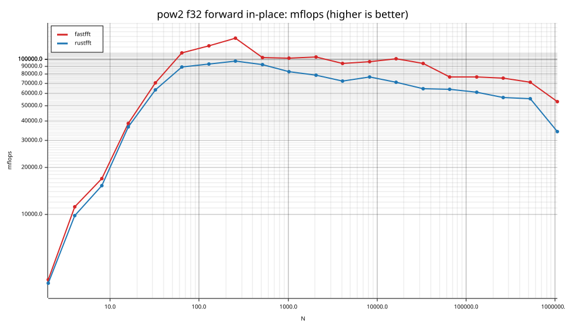
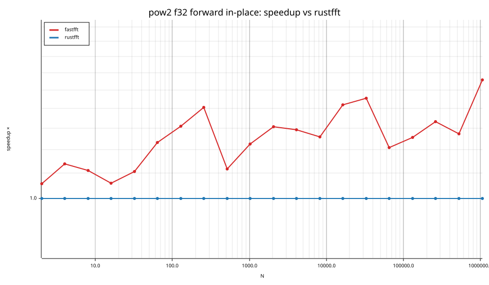
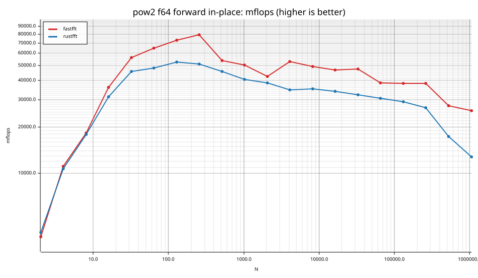
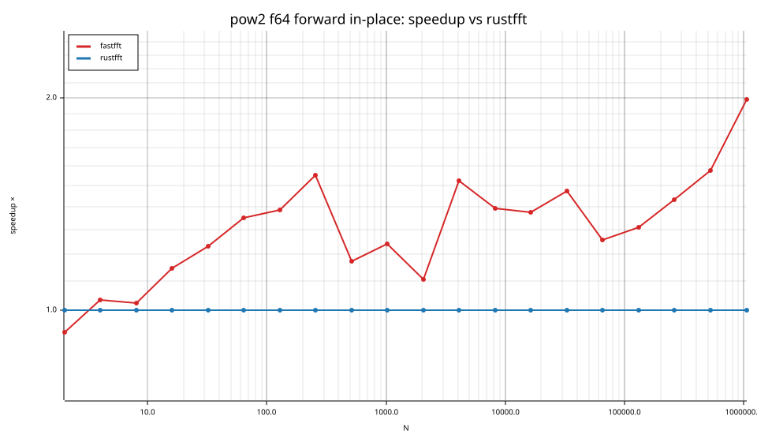
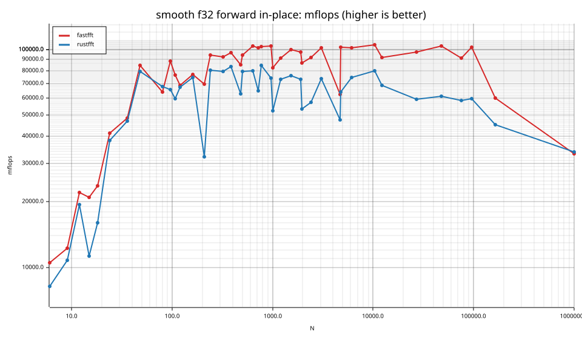
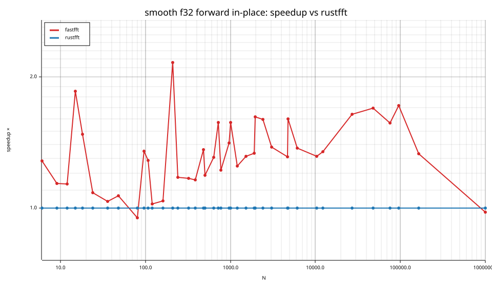
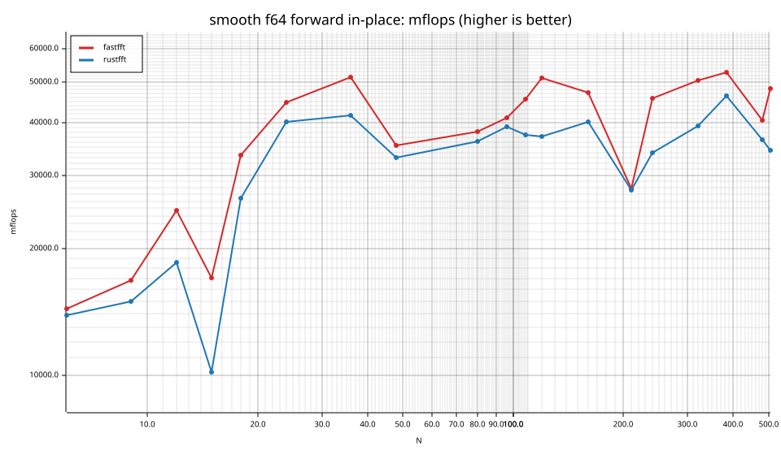
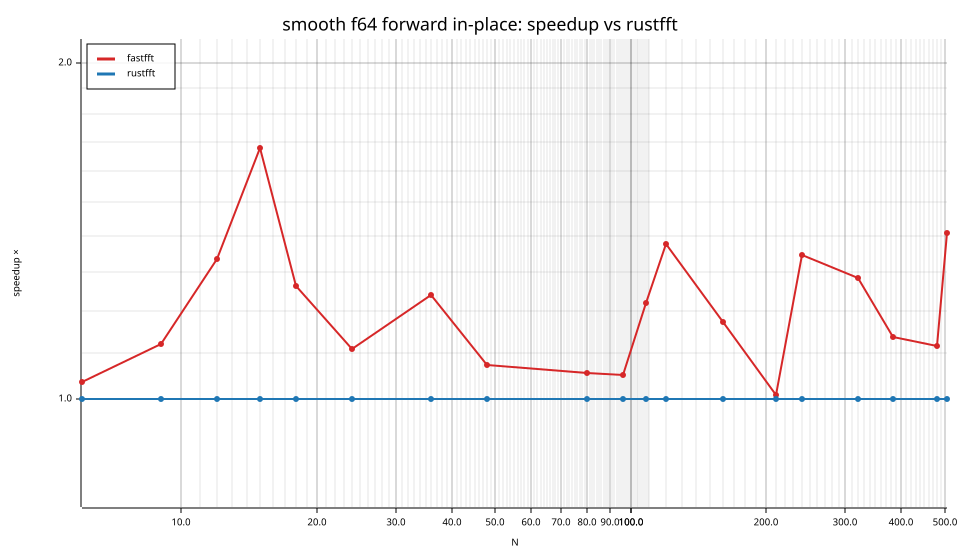
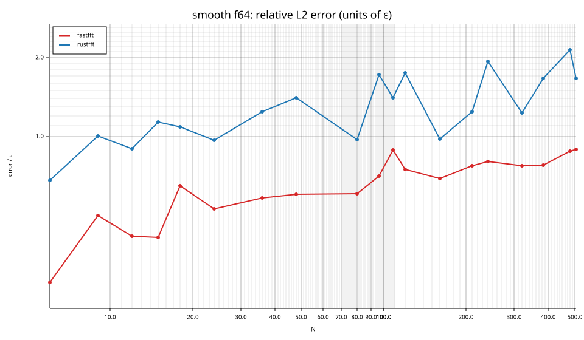

# fastfft arena report: `before-repeat`

| | |
|---|---|
| Host | mini-ryzen |
| CPU | AMD Ryzen 7 7840HS w/ Radeon 780M Graphics (family 25, model 116, stepping 1, microcode 0xa704108) |
| Pinned CPU | 2 (SMT siblings 2,10) |
| Governor / EPP / boost | performance / performance / 1 |
| Kernel | Linux version 7.0.0-28-generic |
| Virtualization | container-other |
| rustc | rustc 1.95.0 (59807616e 2026-04-14); binary: rustc; commit-hash: 59807616e1fa2540724bfbac14d7976d7e4a3860; commit-date: 2026-04-14; host: x86_64-unknown-linux-gnu; release: 1.95.0; LLVM version: 22.1.2 |
| Build profile / RUSTFLAGS | arena / `-C llvm-args=-align-all-functions=6` |
| Libraries | {"fearless_simd":"0.5.0","num-complex":"0.4.6","oxifft":"0.4.2","phastft":"0.4.1","pulp":"0.22.3","rustfft":"6.4.1","tfhe-fft":"0.10.1"} |
| FFTW | fftw-3.3.11-sse2-avx-avx2-avx2_128-avx512 `double: CFLAGS='-O3 -fPIC -std=gnu17' ./configure --enable-static --disable-shared --disable-fortran --disable-doc --enable-sse2 --enable-avx --enable-avx2 --enable-avx512 --enable-fma
single: CFLAGS='-O3 -fPIC -std=gnu17' ./configure --enable-static --disable-shared --disable-fortran --disable-doc --enable-sse2 --enable-avx --enable-avx2 --enable-avx512 --enable-fma --enable-float` |
| Git | 0801f9bdaaff1d821385806e6e83f4c4092a7983 (dirty: true) |
| Profile | quick |
| Official | true  |
| Control drift | max 48.26% over 5 control runs — **FLAGGED** |
| Cells | 100 |

Times are per transform. *best* = minimum batch mean, *median* = median batch mean. Speedup = rustfft time ÷ library time (> 1 means faster than rustfft); *geomean* over the cells both libraries ran. mflops = 5·N·log2(N)/t(µs).

## Release gates (fastfft)

| Gate | Criterion | Status | Detail |
|---|---|---|---|
| G1 | pow2 vs rustfft: geomean ≥ 1.5×, no cell < 0.95× | ❌ fail | geomean best 1.277×, median 1.283×, worst cell 0.930× (pow2:f64:fwd:ip:n2), 40 cells |
| G2 | smooth vs rustfft: geomean ≥ 1.3×, no cell < 0.95× | ❌ fail | geomean best 1.287×, median 1.289×, worst cell 0.948× (smooth:f32:fwd:ip:n80), 60 cells |
| G3 | rough vs rustfft: geomean ≥ 0.75×, no cell < 0.5× | – n/a | no data |
| G4 | vs each other Rust library: geomean ≥ 1.1×, ≥ 0.97× on ≥ 90% of cells | – n/a |  |
| G5 | AVX2 forced: pow2 ≥ 1.2×, smooth ≥ 1.1× vs rustfft | – n/a | pow2 NaN×/NaN×, smooth NaN×/NaN× |
| G6 | scenarios ≥ 1.3× each; batch geomean ≥ 1.5× | – n/a | scenarios min inf×, batch NaN×/NaN× |
| G7 | accuracy within §6 thresholds and ≤ 1.5× rustfft + 1ε | ✅ pass | 100 cells checked |
| G8 | Estimate planning time ≤ 2× rustfft for every N ≤ 2^20 | ❌ fail | worst ratio 35.18× (smooth:f32:fwd:ip:n24), 100 cells |

G9 (build time) is measured by `cargo xtask build-time`, not by the arena.

## Speedup vs rustfft (geomean of best-time ratios; median-time ratio in parentheses)

| suite | prec | fastfft | rustfft |
|---|---|---|---|
| pow2 | f32 | 1.25× (1.25×) 20/0/0 | 1.00× (1.00×) 0/20/0 |
| pow2 | f64 | 1.31× (1.31×) 18/1/1 | 1.00× (1.00×) 0/20/0 |
| smooth | f32 | 1.33× (1.32×) 38/2/1 | 1.00× (1.00×) 0/41/0 |
| smooth | f64 | 1.20× (1.22×) 18/1/0 | 1.00× (1.00×) 0/19/0 |

w/t/l = cells faster / within ±3% / slower than rustfft (best times).

## Suite `pow2`

### pow2 f32

| cell | fastfft | rustfft |
|---|---|---|
| N=2 fwd ip | 2.6ns (1.06×) | 2.8ns |
| N=4 fwd ip | 3.6ns (1.14×) | 4.1ns |
| N=8 fwd ip | 7.1ns (1.11×) | 7.8ns |
| N=16 fwd ip | 8.3ns (1.06×) | 8.7ns |
| N=32 fwd ip | 11.4ns (1.11×) | 12.6ns |
| N=64 fwd ip | 17.5ns (1.23×) | 21.6ns |
| N=128 fwd ip | 36.7ns (1.31×) | 48.0ns |
| N=256 fwd ip | 74.9ns (1.41×) | 105.4ns |
| N=512 fwd ip | 223.8ns (1.12×) | 250.1ns |
| N=1024 fwd ip | 501.7ns (1.23×) | 615.5ns |
| N=2048 fwd ip | 1.09us (1.31×) | 1.43us |
| N=4096 fwd ip | 2.63us (1.29×) | 3.39us |
| N=8192 fwd ip | 5.51us (1.26×) | 6.93us |
| N=16384 fwd ip | 11.34us (1.42×) | 16.09us |
| N=32768 fwd ip | 26.07us (1.46×) | 37.94us |
| N=65536 fwd ip | 67.97us (1.21×) | 82.23us |
| N=131072 fwd ip | 144.86us (1.26×) | 182.13us |
| N=262144 fwd ip | 311.82us (1.33×) | 416.10us |
| N=524288 fwd ip | 699.41us (1.27×) | 891.66us |
| N=1048576 fwd ip | 1.96ms (1.56×) | 3.06ms |

### pow2 f64

| cell | fastfft | rustfft |
|---|---|---|
| N=2 fwd ip | 2.6ns (0.93×) | 2.4ns |
| N=4 fwd ip | 3.6ns (1.03×) | 3.7ns |
| N=8 fwd ip | 6.6ns (1.02×) | 6.7ns |
| N=16 fwd ip | 8.9ns (1.15×) | 10.2ns |
| N=32 fwd ip | 14.2ns (1.23×) | 17.4ns |
| N=64 fwd ip | 29.5ns (1.35×) | 39.9ns |
| N=128 fwd ip | 61.2ns (1.39×) | 84.9ns |
| N=256 fwd ip | 129.0ns (1.55×) | 200.1ns |
| N=512 fwd ip | 428.6ns (1.17×) | 502.8ns |
| N=1024 fwd ip | 1.02us (1.24×) | 1.26us |
| N=2048 fwd ip | 2.65us (1.11×) | 2.92us |
| N=4096 fwd ip | 4.63us (1.52×) | 7.06us |
| N=8192 fwd ip | 10.83us (1.39×) | 15.11us |
| N=16384 fwd ip | 24.45us (1.38×) | 33.64us |
| N=32768 fwd ip | 51.64us (1.47×) | 76.10us |
| N=65536 fwd ip | 136.17us (1.26×) | 171.23us |
| N=131072 fwd ip | 291.60us (1.31×) | 382.00us |
| N=262144 fwd ip | 615.80us (1.43×) | 882.25us |
| N=524288 fwd ip | 1.82ms (1.58×) | 2.87ms |
| N=1048576 fwd ip | 4.11ms (1.99×) | 8.16ms |

## Suite `smooth`

### smooth f32

| cell | fastfft | rustfft |
|---|---|---|
| N=6 fwd ip | 7.4ns (1.28×) | 9.4ns |
| N=9 fwd ip | 11.6ns (1.14×) | 13.2ns |
| N=12 fwd ip | 9.7ns (1.14×) | 11.0ns |
| N=15 fwd ip | 13.9ns (1.86×) | 25.9ns |
| N=18 fwd ip | 15.9ns (1.48×) | 23.4ns |
| N=24 fwd ip | 13.3ns (1.08×) | 14.4ns |
| N=36 fwd ip | 19.2ns (1.04×) | 19.8ns |
| N=48 fwd ip | 15.9ns (1.07×) | 16.9ns |
| N=80 fwd ip | 39.5ns (0.95×) | 37.5ns |
| N=96 fwd ip | 35.8ns (1.35×) | 48.3ns |
| N=108 fwd ip | 47.7ns (1.28×) | 61.3ns |
| N=120 fwd ip | 60.4ns (1.02×) | 61.7ns |
| N=160 fwd ip | 76.0ns (1.04×) | 78.8ns |
| N=210 fwd ip | 116.6ns (2.16×) | 251.8ns |
| N=240 fwd ip | 100.4ns (1.18×) | 118.0ns |
| N=320 fwd ip | 143.8ns (1.17×) | 168.3ns |
| N=384 fwd ip | 170.1ns (1.16×) | 197.4ns |
| N=480 fwd ip | 251.4ns (1.36×) | 341.8ns |
| N=504 fwd ip | 239.7ns (1.19×) | 285.3ns |
| N=640 fwd ip | 286.8ns (1.31×) | 374.5ns |
| N=720 fwd ip | 336.4ns (1.57×) | 529.1ns |
| N=768 fwd ip | 356.1ns (1.22×) | 435.1ns |
| N=960 fwd ip | 457.1ns (1.41×) | 645.1ns |
| N=1000 fwd ip | 604.1ns (1.57×) | 950.4ns |
| N=1200 fwd ip | 672.8ns (1.25×) | 839.4ns |
| N=1536 fwd ip | 814.3ns (1.32×) | 1.07us |
| N=1920 fwd ip | 1.07us (1.34×) | 1.43us |
| N=1960 fwd ip | 1.24us (1.62×) | 2.00us |
| N=2400 fwd ip | 1.47us (1.60×) | 2.35us |
| N=3072 fwd ip | 1.75us (1.38×) | 2.42us |
| N=4725 fwd ip | 4.64us (1.31×) | 6.07us |
| N=4800 fwd ip | 2.87us (1.60×) | 4.59us |
| N=6144 fwd ip | 3.79us (1.37×) | 5.20us |
| N=10368 fwd ip | 6.60us (1.31×) | 8.67us |
| N=12288 fwd ip | 9.06us (1.35×) | 12.20us |
| N=27000 fwd ip | 20.45us (1.64×) | 33.57us |
| N=48000 fwd ip | 36.01us (1.69×) | 60.99us |
| N=75600 fwd ip | 67.03us (1.57×) | 104.99us |
| N=96000 fwd ip | 77.69us (1.72×) | 133.50us |
| N=165375 fwd ip | 238.90us (1.33×) | 317.85us |
| N=1000000 fwd ip | 3.00ms (0.98×) | 2.93ms |

### smooth f64

| cell | fastfft | rustfft |
|---|---|---|
| N=6 fwd ip | 5.4ns (1.04×) | 5.6ns |
| N=9 fwd ip | 8.5ns (1.12×) | 9.5ns |
| N=12 fwd ip | 8.7ns (1.34×) | 11.6ns |
| N=15 fwd ip | 17.1ns (1.68×) | 28.8ns |
| N=18 fwd ip | 11.2ns (1.26×) | 14.2ns |
| N=24 fwd ip | 12.3ns (1.11×) | 13.7ns |
| N=36 fwd ip | 18.1ns (1.24×) | 22.4ns |
| N=48 fwd ip | 37.9ns (1.07×) | 40.6ns |
| N=80 fwd ip | 66.2ns (1.06×) | 70.0ns |
| N=96 fwd ip | 76.8ns (1.05×) | 80.8ns |
| N=108 fwd ip | 79.9ns (1.22×) | 97.4ns |
| N=120 fwd ip | 81.0ns (1.38×) | 111.5ns |
| N=160 fwd ip | 124.1ns (1.17×) | 145.5ns |
| N=210 fwd ip | 290.1ns (1.01×) | 292.9ns |
| N=240 fwd ip | 207.3ns (1.35×) | 278.9ns |
| N=320 fwd ip | 263.5ns (1.28×) | 338.2ns |
| N=384 fwd ip | 312.7ns (1.14×) | 355.3ns |
| N=480 fwd ip | 525.8ns (1.12×) | 587.2ns |
| N=504 fwd ip | 467.5ns (1.41×) | 658.7ns |

## Accuracy and planning time (medians over cells)

| lib | cells verified | failed | median error (ε) | worst error (ε) | median plan time |
|---|---|---|---|---|---|
| fastfft | 100 | 0 | 0.86 | 1.44 | 17.24us |
| rustfft | 100 | 0 | 0.98 | 2.21 | 3.91us |
