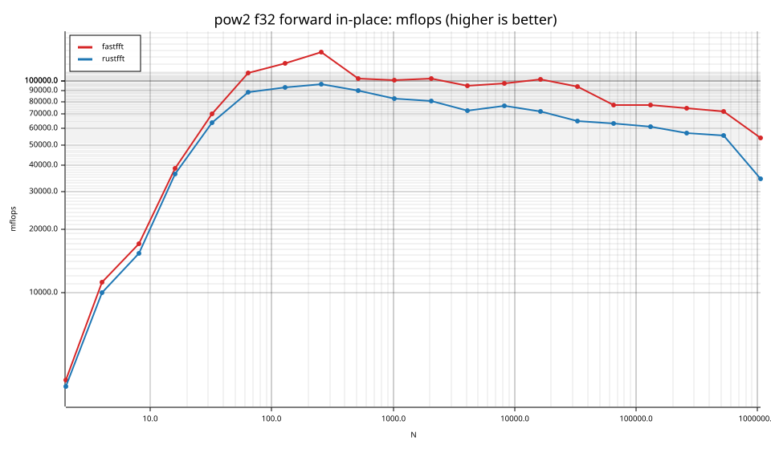
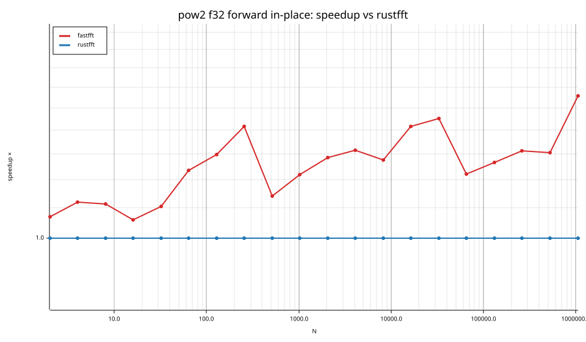
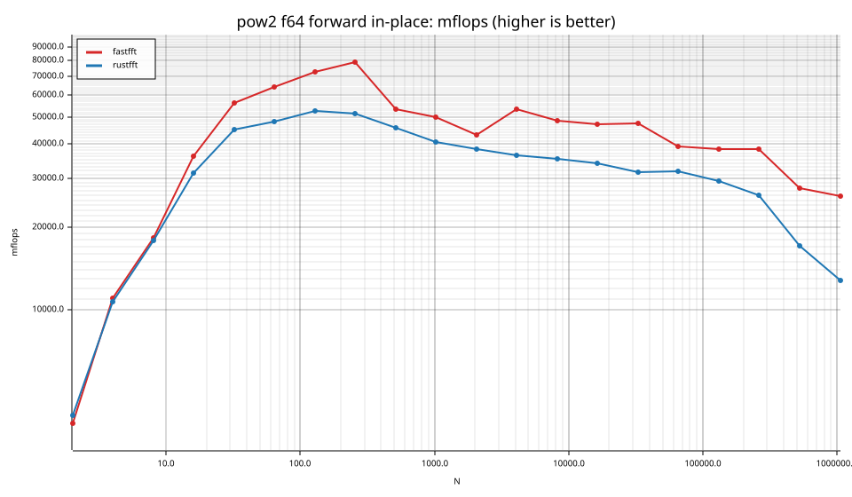
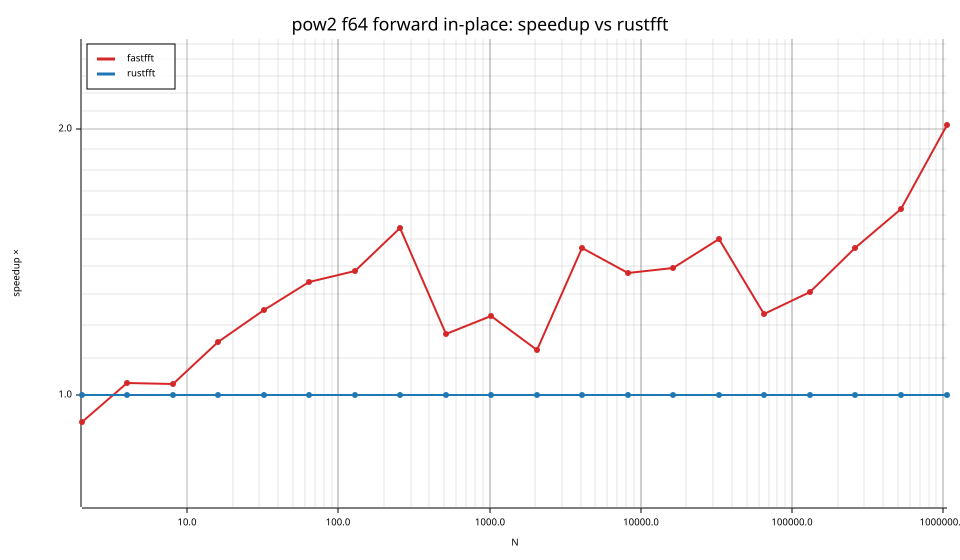
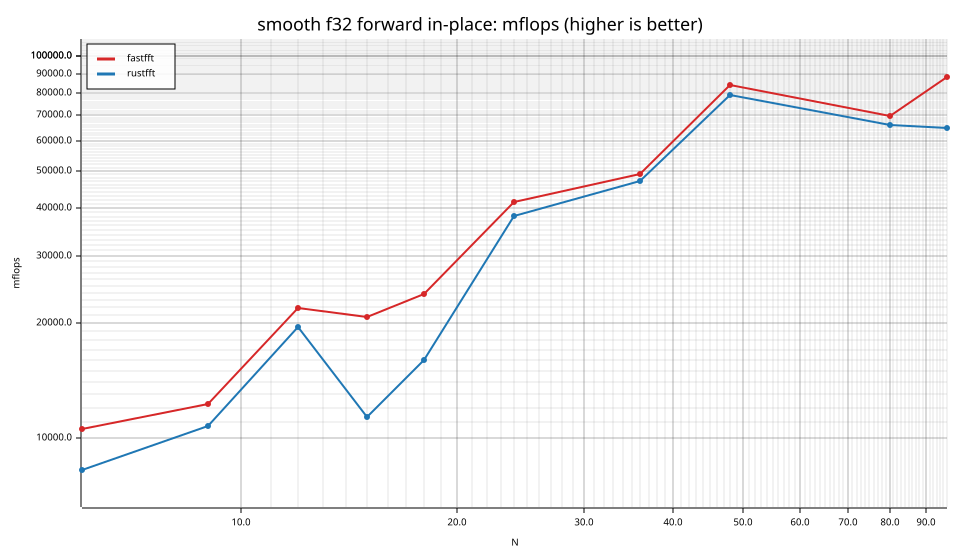
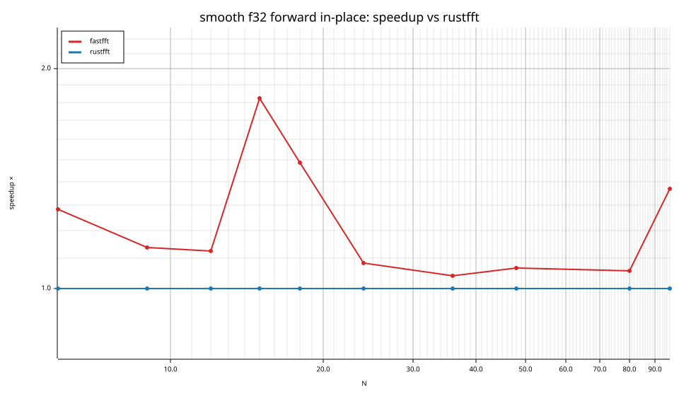
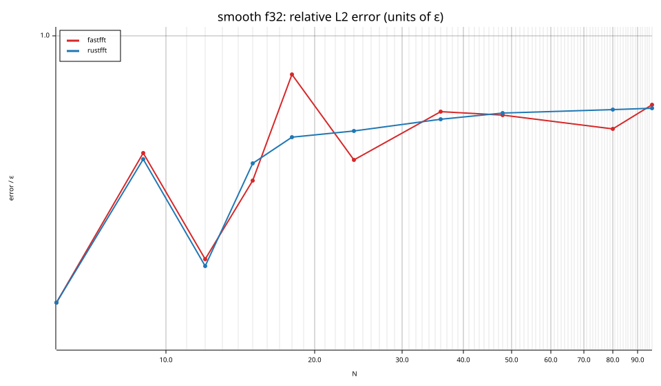

# fastfft arena report: `before`

| | |
|---|---|
| Host | mini-ryzen |
| CPU | AMD Ryzen 7 7840HS w/ Radeon 780M Graphics (family 25, model 116, stepping 1, microcode 0xa704108) |
| Pinned CPU | 2 (SMT siblings 2,10) |
| Governor / EPP / boost | performance / performance / 1 |
| Kernel | Linux version 7.0.0-28-generic |
| Virtualization | container-other |
| rustc | rustc 1.95.0 (59807616e 2026-04-14); binary: rustc; commit-hash: 59807616e1fa2540724bfbac14d7976d7e4a3860; commit-date: 2026-04-14; host: x86_64-unknown-linux-gnu; release: 1.95.0; LLVM version: 22.1.2 |
| Build profile / RUSTFLAGS | arena / `-C llvm-args=-align-all-functions=6` |
| Libraries | {"fearless_simd":"0.5.0","num-complex":"0.4.6","oxifft":"0.4.2","phastft":"0.4.1","pulp":"0.22.3","rustfft":"6.4.1","tfhe-fft":"0.10.1"} |
| FFTW | fftw-3.3.11-sse2-avx-avx2-avx2_128-avx512 `double: CFLAGS='-O3 -fPIC -std=gnu17' ./configure --enable-static --disable-shared --disable-fortran --disable-doc --enable-sse2 --enable-avx --enable-avx2 --enable-avx512 --enable-fma
single: CFLAGS='-O3 -fPIC -std=gnu17' ./configure --enable-static --disable-shared --disable-fortran --disable-doc --enable-sse2 --enable-avx --enable-avx2 --enable-avx512 --enable-fma --enable-float` |
| Git | 0801f9bdaaff1d821385806e6e83f4c4092a7983 (dirty: true) |
| Profile | quick |
| Official | true  |
| Control drift | max 38.00% over 3 control runs — **FLAGGED** |
| Cells | 50 |

Times are per transform. *best* = minimum batch mean, *median* = median batch mean. Speedup = rustfft time ÷ library time (> 1 means faster than rustfft); *geomean* over the cells both libraries ran. mflops = 5·N·log2(N)/t(µs).

## Release gates (fastfft)

| Gate | Criterion | Status | Detail |
|---|---|---|---|
| G1 | pow2 vs rustfft: geomean ≥ 1.5×, no cell < 0.95× | ❌ fail | geomean best 1.280×, median 1.310×, worst cell 0.931× (pow2:f64:fwd:ip:n2), 40 cells |
| G2 | smooth vs rustfft: geomean ≥ 1.3×, no cell < 0.95× | ❌ fail | geomean best 1.227×, median 1.225×, worst cell 1.022× (smooth:f32:fwd:ip:n36), 10 cells |
| G3 | rough vs rustfft: geomean ≥ 0.75×, no cell < 0.5× | – n/a | no data |
| G4 | vs each other Rust library: geomean ≥ 1.1×, ≥ 0.97× on ≥ 90% of cells | – n/a |  |
| G5 | AVX2 forced: pow2 ≥ 1.2×, smooth ≥ 1.1× vs rustfft | – n/a | pow2 NaN×/NaN×, smooth NaN×/NaN× |
| G6 | scenarios ≥ 1.3× each; batch geomean ≥ 1.5× | – n/a | scenarios min inf×, batch NaN×/NaN× |
| G7 | accuracy within §6 thresholds and ≤ 1.5× rustfft + 1ε | ✅ pass | 50 cells checked |
| G8 | Estimate planning time ≤ 2× rustfft for every N ≤ 2^20 | ❌ fail | worst ratio 34.84× (smooth:f32:fwd:ip:n24), 50 cells |

G9 (build time) is measured by `cargo xtask build-time`, not by the arena.

## Speedup vs rustfft (geomean of best-time ratios; median-time ratio in parentheses)

| suite | prec | fastfft | rustfft |
|---|---|---|---|
| pow2 | f32 | 1.25× (1.29×) 20/0/0 | 1.00× (1.00×) 0/20/0 |
| pow2 | f64 | 1.31× (1.33×) 18/1/1 | 1.00× (1.00×) 0/20/0 |
| smooth | f32 | 1.23× (1.23×) 10/0/0 | 1.00× (1.00×) 0/10/0 |

w/t/l = cells faster / within ±3% / slower than rustfft (best times).

## Suite `pow2`

### pow2 f32

| cell | fastfft | rustfft |
|---|---|---|
| N=2 fwd ip | 2.6ns (1.07×) | 2.8ns |
| N=4 fwd ip | 3.6ns (1.12×) | 4.0ns |
| N=8 fwd ip | 7.1ns (1.11×) | 7.8ns |
| N=16 fwd ip | 8.3ns (1.06×) | 8.8ns |
| N=32 fwd ip | 11.4ns (1.10×) | 12.6ns |
| N=64 fwd ip | 17.5ns (1.23×) | 21.7ns |
| N=128 fwd ip | 36.9ns (1.30×) | 47.8ns |
| N=256 fwd ip | 74.6ns (1.42×) | 105.8ns |
| N=512 fwd ip | 223.5ns (1.14×) | 255.1ns |
| N=1024 fwd ip | 506.8ns (1.22×) | 617.8ns |
| N=2048 fwd ip | 1.09us (1.29×) | 1.40us |
| N=4096 fwd ip | 2.58us (1.32×) | 3.40us |
| N=8192 fwd ip | 5.47us (1.28×) | 6.98us |
| N=16384 fwd ip | 11.27us (1.42×) | 15.97us |
| N=32768 fwd ip | 26.04us (1.45×) | 37.82us |
| N=65536 fwd ip | 67.96us (1.22×) | 82.99us |
| N=131072 fwd ip | 144.32us (1.27×) | 182.66us |
| N=262144 fwd ip | 315.83us (1.31×) | 414.82us |
| N=524288 fwd ip | 689.64us (1.31×) | 900.56us |
| N=1048576 fwd ip | 1.95ms (1.56×) | 3.04ms |

### pow2 f64

| cell | fastfft | rustfft |
|---|---|---|
| N=2 fwd ip | 2.6ns (0.93×) | 2.4ns |
| N=4 fwd ip | 3.6ns (1.03×) | 3.7ns |
| N=8 fwd ip | 6.5ns (1.03×) | 6.7ns |
| N=16 fwd ip | 8.9ns (1.15×) | 10.2ns |
| N=32 fwd ip | 14.2ns (1.25×) | 17.7ns |
| N=64 fwd ip | 29.8ns (1.34×) | 40.0ns |
| N=128 fwd ip | 61.5ns (1.38×) | 84.9ns |
| N=256 fwd ip | 129.1ns (1.54×) | 199.4ns |
| N=512 fwd ip | 429.7ns (1.17×) | 503.4ns |
| N=1024 fwd ip | 1.02us (1.23×) | 1.26us |
| N=2048 fwd ip | 2.61us (1.12×) | 2.94us |
| N=4096 fwd ip | 4.59us (1.47×) | 6.74us |
| N=8192 fwd ip | 10.99us (1.37×) | 15.10us |
| N=16384 fwd ip | 24.33us (1.39×) | 33.83us |
| N=32768 fwd ip | 51.96us (1.50×) | 78.05us |
| N=65536 fwd ip | 133.78us (1.23×) | 164.98us |
| N=131072 fwd ip | 290.47us (1.31×) | 379.63us |
| N=262144 fwd ip | 617.00us (1.47×) | 905.88us |
| N=524288 fwd ip | 1.80ms (1.63×) | 2.92ms |
| N=1048576 fwd ip | 4.05ms (2.02×) | 8.20ms |

## Suite `smooth`

### smooth f32

| cell | fastfft | rustfft |
|---|---|---|
| N=6 fwd ip | 7.4ns (1.28×) | 9.4ns |
| N=9 fwd ip | 11.7ns (1.14×) | 13.2ns |
| N=12 fwd ip | 9.8ns (1.12×) | 11.0ns |
| N=15 fwd ip | 14.1ns (1.82×) | 25.8ns |
| N=18 fwd ip | 15.8ns (1.49×) | 23.4ns |
| N=24 fwd ip | 13.3ns (1.08×) | 14.4ns |
| N=36 fwd ip | 19.0ns (1.04×) | 19.7ns |
| N=48 fwd ip | 15.9ns (1.07×) | 17.0ns |
| N=80 fwd ip | 36.2ns (1.06×) | 38.3ns |
| N=96 fwd ip | 35.8ns (1.37×) | 48.9ns |

## Accuracy and planning time (medians over cells)

| lib | cells verified | failed | median error (ε) | worst error (ε) | median plan time |
|---|---|---|---|---|---|
| fastfft | 50 | 0 | 0.83 | 1.44 | 11.65us |
| rustfft | 50 | 0 | 0.93 | 2.21 | 2.06us |
