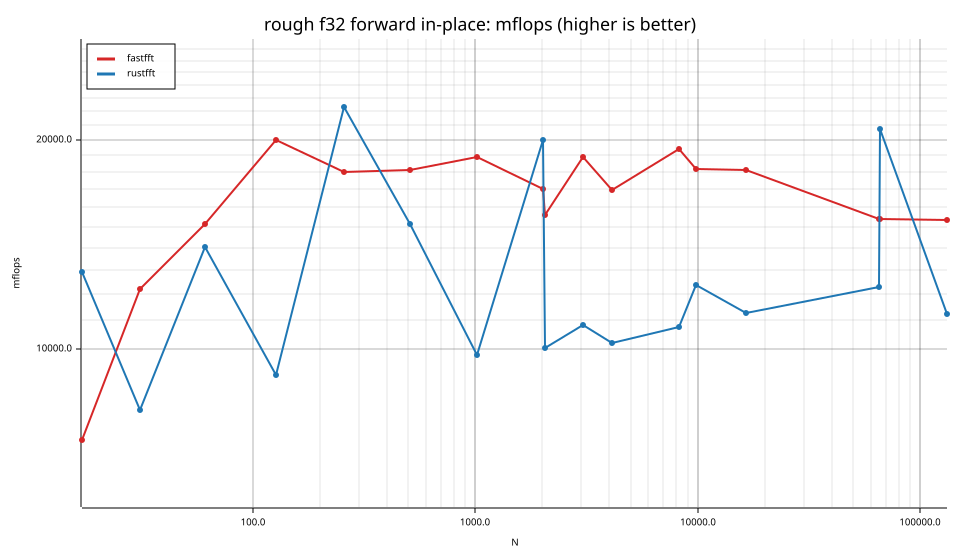
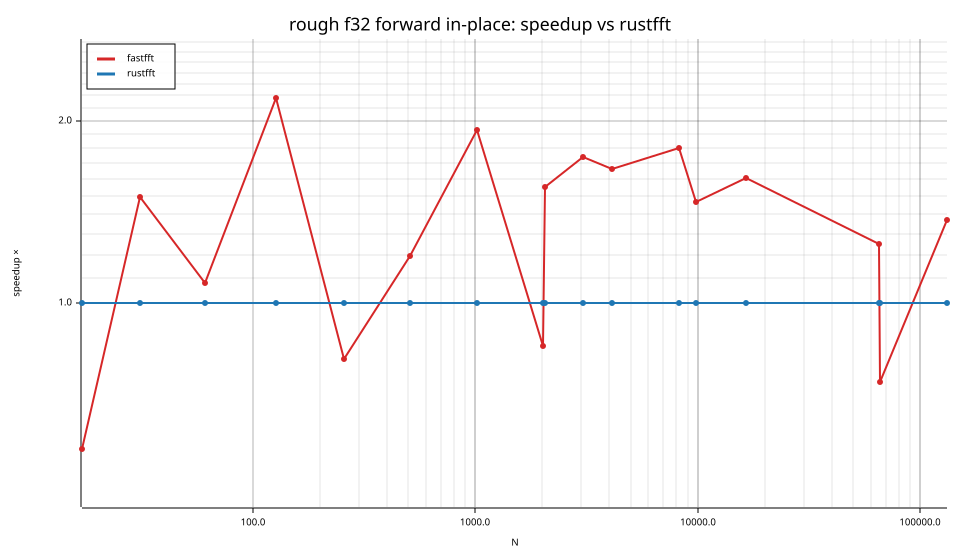
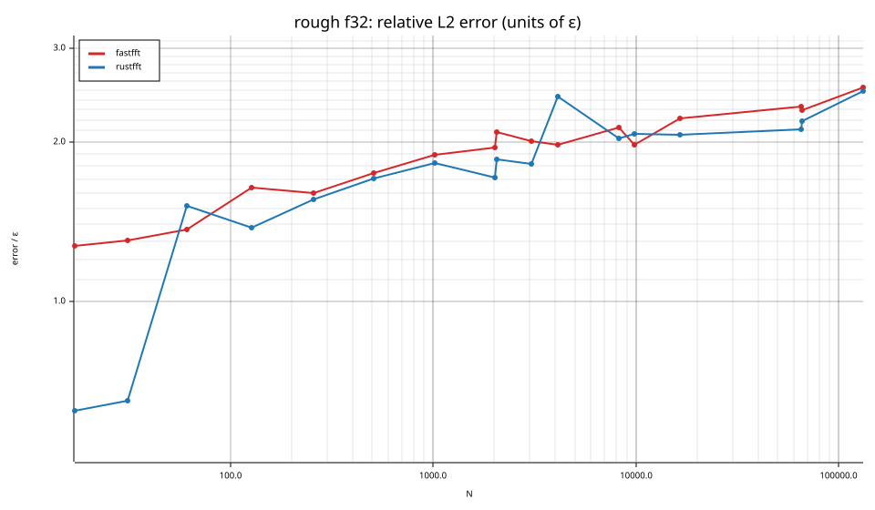
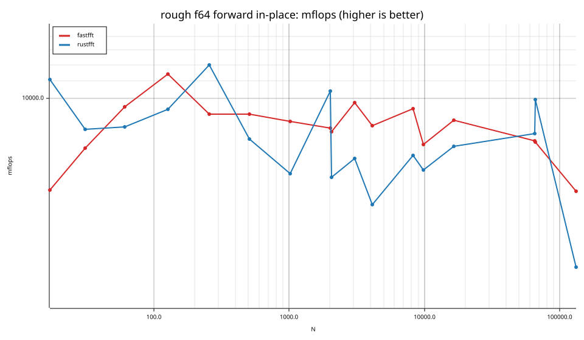
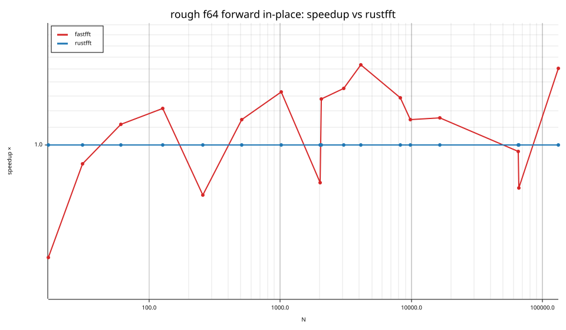
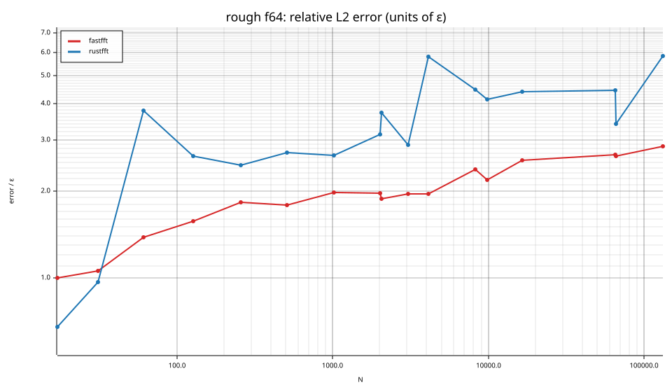

# fastfft arena report: `rough-cache-penalty`

| | |
|---|---|
| Host | mini-ryzen |
| CPU | AMD Ryzen 7 7840HS w/ Radeon 780M Graphics (family 25, model 116, stepping 1, microcode 0xa704108) |
| Pinned CPU | 2 (SMT siblings 2,10) |
| Governor / EPP / boost | performance / performance / 1 |
| Kernel | Linux version 7.0.0-28-generic |
| Virtualization | container-other |
| rustc | rustc 1.95.0 (59807616e 2026-04-14); binary: rustc; commit-hash: 59807616e1fa2540724bfbac14d7976d7e4a3860; commit-date: 2026-04-14; host: x86_64-unknown-linux-gnu; release: 1.95.0; LLVM version: 22.1.2 |
| Build profile / RUSTFLAGS | arena / `` |
| Libraries | {"fearless_simd":"0.5.0","num-complex":"0.4.6","oxifft":"0.4.2","phastft":"0.4.1","pulp":"0.22.3","rustfft":"6.4.1","tfhe-fft":"0.10.1"} |
| FFTW | fftw-3.3.11-sse2-avx-avx2-avx2_128-avx512 `double: CFLAGS='-O3 -fPIC -std=gnu17' ./configure --enable-static --disable-shared --disable-fortran --disable-doc --enable-sse2 --enable-avx --enable-avx2 --enable-avx512 --enable-fma
single: CFLAGS='-O3 -fPIC -std=gnu17' ./configure --enable-static --disable-shared --disable-fortran --disable-doc --enable-sse2 --enable-avx --enable-avx2 --enable-avx512 --enable-fma --enable-float` |
| Git | 0801f9bdaaff1d821385806e6e83f4c4092a7983 (dirty: true) |
| Profile | quick |
| Official | true  |
| Control drift | max 6.56% over 3 control runs — **FLAGGED** |
| Cells | 34 |

Times are per transform. *best* = minimum batch mean, *median* = median batch mean. Speedup = rustfft time ÷ library time (> 1 means faster than rustfft); *geomean* over the cells both libraries ran. mflops = 5·N·log2(N)/t(µs).

## Release gates (fastfft)

| Gate | Criterion | Status | Detail |
|---|---|---|---|
| G1 | pow2 vs rustfft: geomean ≥ 1.5×, no cell < 0.95× | – n/a | no data |
| G2 | smooth vs rustfft: geomean ≥ 1.3×, no cell < 0.95× | – n/a | no data |
| G3 | rough vs rustfft: geomean ≥ 0.75×, no cell < 0.5× | ✅ pass | geomean best 1.177×, median 1.170×, worst cell 0.540× (rough:f64:fwd:ip:n17), 34 cells |
| G4 | vs each other Rust library: geomean ≥ 1.1×, ≥ 0.97× on ≥ 90% of cells | – n/a |  |
| G5 | AVX2 forced: pow2 ≥ 1.2×, smooth ≥ 1.1× vs rustfft | – n/a | pow2 NaN×/NaN×, smooth NaN×/NaN× |
| G6 | scenarios ≥ 1.3× each; batch geomean ≥ 1.5× | – n/a | scenarios min inf×, batch NaN×/NaN× |
| G7 | accuracy within §6 thresholds and ≤ 1.5× rustfft + 1ε | ✅ pass | 34 cells checked |
| G8 | Estimate planning time ≤ 2× rustfft for every N ≤ 2^20 | ❌ fail | worst ratio 57.86× (rough:f64:fwd:ip:n31), 34 cells |

G9 (build time) is measured by `cargo xtask build-time`, not by the arena.

## Speedup vs rustfft (geomean of best-time ratios; median-time ratio in parentheses)

| suite | prec | fastfft | rustfft |
|---|---|---|---|
| rough | f32 | 1.29× (1.28×) 13/0/4 | 1.00× (1.00×) 0/17/0 |
| rough | f64 | 1.07× (1.07×) 11/0/6 | 1.00× (1.00×) 0/17/0 |

w/t/l = cells faster / within ±3% / slower than rustfft (best times).

## Suite `rough`

### rough f32

| cell | fastfft | rustfft |
|---|---|---|
| N=17 fwd ip | 47.0ns (0.57×) | 27.0ns |
| N=31 fwd ip | 62.9ns (1.50×) | 94.1ns |
| N=61 fwd ip | 119.4ns (1.08×) | 128.9ns |
| N=127 fwd ip | 222.3ns (2.18×) | 484.0ns |
| N=257 fwd ip | 571.7ns (0.81×) | 461.3ns |
| N=509 fwd ip | 1.26us (1.20×) | 1.51us |
| N=1021 fwd ip | 2.70us (1.93×) | 5.20us |
| N=2018 fwd ip | 6.53us (0.85×) | 5.54us |
| N=2053 fwd ip | 7.25us (1.55×) | 11.26us |
| N=3063 fwd ip | 9.40us (1.74×) | 16.37us |
| N=4099 fwd ip | 14.51us (1.66×) | 24.11us |
| N=8191 fwd ip | 27.41us (1.80×) | 49.42us |
| N=9797 fwd ip | 35.79us (1.47×) | 52.49us |
| N=16381 fwd ip | 63.40us (1.61×) | 101.76us |
| N=65524 fwd ip | 340.92us (1.25×) | 426.47us |
| N=65537 fwd ip | 341.32us (0.74×) | 252.86us |
| N=131071 fwd ip | 726.00us (1.37×) | 993.08us |

### rough f64

| cell | fastfft | rustfft |
|---|---|---|
| N=17 fwd ip | 57.2ns (0.55×) | 31.3ns |
| N=31 fwd ip | 100.6ns (0.90×) | 90.8ns |
| N=61 fwd ip | 189.1ns (1.12×) | 211.2ns |
| N=127 fwd ip | 388.3ns (1.21×) | 471.5ns |
| N=257 fwd ip | 1.12us (0.77×) | 858.6ns |
| N=509 fwd ip | 2.49us (1.14×) | 2.85us |
| N=1021 fwd ip | 5.78us (1.33×) | 7.68us |
| N=2018 fwd ip | 13.03us (0.82×) | 10.65us |
| N=2053 fwd ip | 13.56us (1.28×) | 17.31us |
| N=3063 fwd ip | 18.17us (1.35×) | 24.61us |
| N=4099 fwd ip | 28.54us (1.53×) | 43.78us |
| N=8191 fwd ip | 56.37us (1.29×) | 72.55us |
| N=9797 fwd ip | 83.57us (1.15×) | 95.75us |
| N=16381 fwd ip | 128.95us (1.16×) | 149.00us |
| N=65524 fwd ip | 659.36us (0.96×) | 635.53us |
| N=65537 fwd ip | 664.42us (0.79×) | 527.09us |
| N=131071 fwd ip | 1.85ms (1.51×) | 2.78ms |

## Accuracy and planning time (medians over cells)

| lib | cells verified | failed | median error (ε) | worst error (ε) | median plan time |
|---|---|---|---|---|---|
| fastfft | 34 | 0 | 1.96 | 2.85 | 215.66us |
| rustfft | 34 | 0 | 2.43 | 5.84 | 42.70us |
