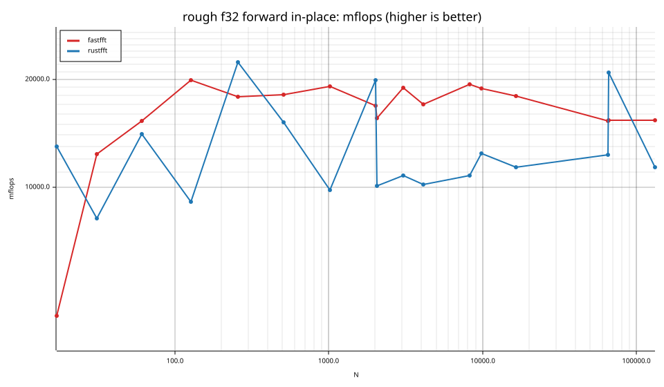
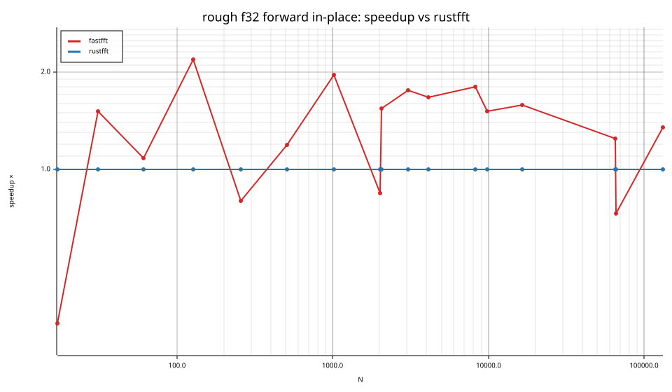
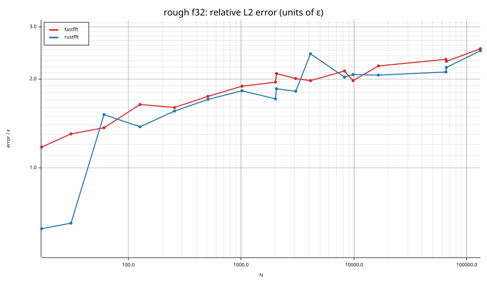
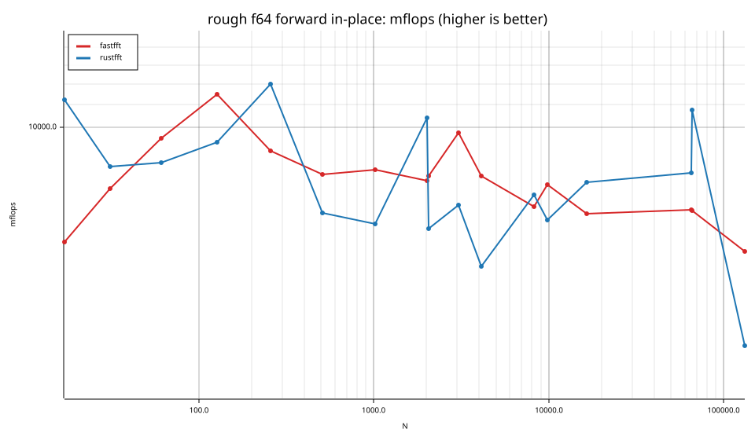
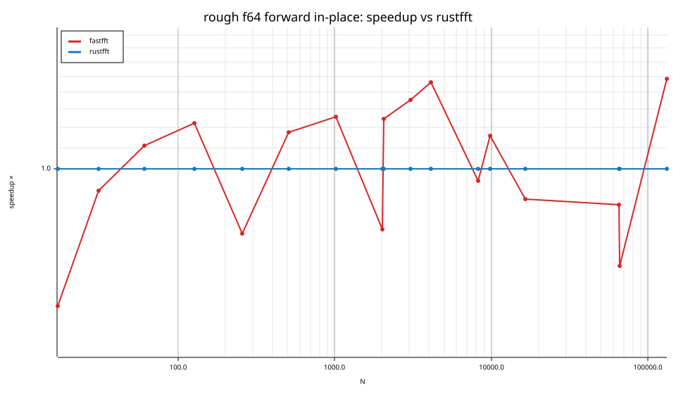
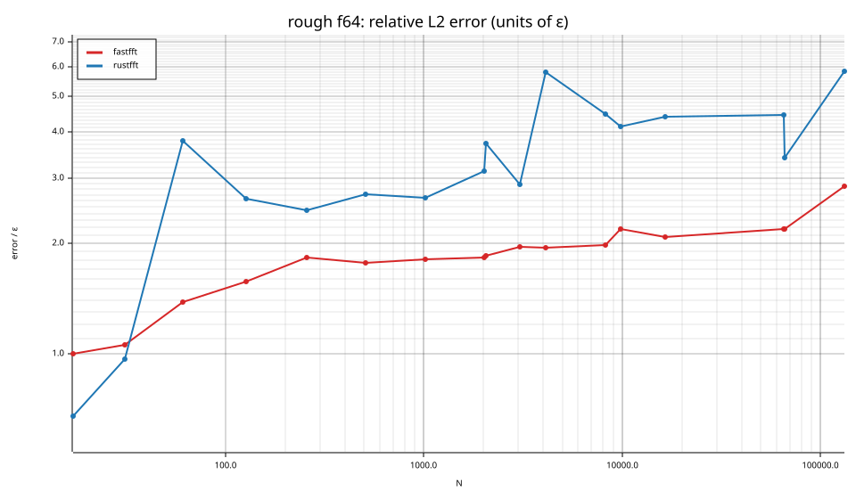

# fastfft arena report: `rough-cache-scaled`

| | |
|---|---|
| Host | mini-ryzen |
| CPU | AMD Ryzen 7 7840HS w/ Radeon 780M Graphics (family 25, model 116, stepping 1, microcode 0xa704108) |
| Pinned CPU | 2 (SMT siblings 2,10) |
| Governor / EPP / boost | performance / performance / 1 |
| Kernel | Linux version 7.0.0-28-generic |
| Virtualization | container-other |
| rustc | rustc 1.95.0 (59807616e 2026-04-14); binary: rustc; commit-hash: 59807616e1fa2540724bfbac14d7976d7e4a3860; commit-date: 2026-04-14; host: x86_64-unknown-linux-gnu; release: 1.95.0; LLVM version: 22.1.2 |
| Build profile / RUSTFLAGS | arena / `` |
| Libraries | {"fearless_simd":"0.5.0","num-complex":"0.4.6","oxifft":"0.4.2","phastft":"0.4.1","pulp":"0.22.3","rustfft":"6.4.1","tfhe-fft":"0.10.1"} |
| FFTW | fftw-3.3.11-sse2-avx-avx2-avx2_128-avx512 `double: CFLAGS='-O3 -fPIC -std=gnu17' ./configure --enable-static --disable-shared --disable-fortran --disable-doc --enable-sse2 --enable-avx --enable-avx2 --enable-avx512 --enable-fma
single: CFLAGS='-O3 -fPIC -std=gnu17' ./configure --enable-static --disable-shared --disable-fortran --disable-doc --enable-sse2 --enable-avx --enable-avx2 --enable-avx512 --enable-fma --enable-float` |
| Git | 0801f9bdaaff1d821385806e6e83f4c4092a7983 (dirty: true) |
| Profile | quick |
| Official | true  |
| Control drift | max 1.27% over 3 control runs |
| Cells | 34 |

Times are per transform. *best* = minimum batch mean, *median* = median batch mean. Speedup = rustfft time ÷ library time (> 1 means faster than rustfft); *geomean* over the cells both libraries ran. mflops = 5·N·log2(N)/t(µs).

## Release gates (fastfft)

| Gate | Criterion | Status | Detail |
|---|---|---|---|
| G1 | pow2 vs rustfft: geomean ≥ 1.5×, no cell < 0.95× | – n/a | no data |
| G2 | smooth vs rustfft: geomean ≥ 1.3×, no cell < 0.95× | – n/a | no data |
| G3 | rough vs rustfft: geomean ≥ 0.75×, no cell < 0.5× | ❌ fail | geomean best 1.124×, median 1.118×, worst cell 0.336× (rough:f32:fwd:ip:n17), 34 cells |
| G4 | vs each other Rust library: geomean ≥ 1.1×, ≥ 0.97× on ≥ 90% of cells | – n/a |  |
| G5 | AVX2 forced: pow2 ≥ 1.2×, smooth ≥ 1.1× vs rustfft | – n/a | pow2 NaN×/NaN×, smooth NaN×/NaN× |
| G6 | scenarios ≥ 1.3× each; batch geomean ≥ 1.5× | – n/a | scenarios min inf×, batch NaN×/NaN× |
| G7 | accuracy within §6 thresholds and ≤ 1.5× rustfft + 1ε | ✅ pass | 34 cells checked |
| G8 | Estimate planning time ≤ 2× rustfft for every N ≤ 2^20 | ❌ fail | worst ratio 60.24× (rough:f64:fwd:ip:n31), 34 cells |

G9 (build time) is measured by `cargo xtask build-time`, not by the arena.

## Speedup vs rustfft (geomean of best-time ratios; median-time ratio in parentheses)

| suite | prec | fastfft | rustfft |
|---|---|---|---|
| rough | f32 | 1.25× (1.25×) 13/0/4 | 1.00× (1.00×) 0/17/0 |
| rough | f64 | 1.01× (1.00×) 9/0/8 | 1.00× (1.00×) 0/17/0 |

w/t/l = cells faster / within ±3% / slower than rustfft (best times).

## Suite `rough`

### rough f32

| cell | fastfft | rustfft |
|---|---|---|
| N=17 fwd ip | 79.6ns (0.34×) | 26.7ns |
| N=31 fwd ip | 62.2ns (1.51×) | 93.9ns |
| N=61 fwd ip | 118.3ns (1.09×) | 128.4ns |
| N=127 fwd ip | 223.0ns (2.19×) | 487.6ns |
| N=257 fwd ip | 575.4ns (0.80×) | 460.2ns |
| N=509 fwd ip | 1.26us (1.19×) | 1.51us |
| N=1021 fwd ip | 2.67us (1.95×) | 5.21us |
| N=2018 fwd ip | 6.57us (0.85×) | 5.56us |
| N=2053 fwd ip | 7.27us (1.54×) | 11.22us |
| N=3063 fwd ip | 9.35us (1.76×) | 16.44us |
| N=4099 fwd ip | 14.45us (1.67×) | 24.16us |
| N=8191 fwd ip | 27.51us (1.80×) | 49.43us |
| N=9797 fwd ip | 34.50us (1.51×) | 52.23us |
| N=16381 fwd ip | 63.84us (1.58×) | 100.98us |
| N=65524 fwd ip | 342.67us (1.24×) | 426.25us |
| N=65537 fwd ip | 341.75us (0.73×) | 250.94us |
| N=131071 fwd ip | 724.82us (1.35×) | 980.20us |

### rough f64

| cell | fastfft | rustfft |
|---|---|---|
| N=17 fwd ip | 56.4ns (0.55×) | 30.9ns |
| N=31 fwd ip | 99.4ns (0.91×) | 90.5ns |
| N=61 fwd ip | 189.5ns (1.11×) | 209.9ns |
| N=127 fwd ip | 386.6ns (1.22×) | 473.2ns |
| N=257 fwd ip | 1.14us (0.75×) | 858.1ns |
| N=509 fwd ip | 2.79us (1.18×) | 3.28us |
| N=1021 fwd ip | 6.10us (1.26×) | 7.67us |
| N=2018 fwd ip | 13.88us (0.77×) | 10.66us |
| N=2053 fwd ip | 13.88us (1.25×) | 17.29us |
| N=3063 fwd ip | 18.15us (1.35×) | 24.56us |
| N=4099 fwd ip | 30.19us (1.46×) | 44.18us |
| N=8191 fwd ip | 74.41us (0.95×) | 70.63us |
| N=9797 fwd ip | 82.71us (1.16×) | 95.82us |
| N=16381 fwd ip | 164.80us (0.88×) | 144.63us |
| N=65524 fwd ip | 742.81us (0.86×) | 635.11us |
| N=65537 fwd ip | 745.10us (0.65×) | 487.74us |
| N=131071 fwd ip | 1.88ms (1.49×) | 2.79ms |

## Accuracy and planning time (medians over cells)

| lib | cells verified | failed | median error (ε) | worst error (ε) | median plan time |
|---|---|---|---|---|---|
| fastfft | 34 | 0 | 1.95 | 2.85 | 205.01us |
| rustfft | 34 | 0 | 2.43 | 5.84 | 42.36us |
