# fastfft arena report: `arena-validation`

| | |
|---|---|
| Host | mini-ryzen |
| CPU | AMD Ryzen 7 7840HS w/ Radeon 780M Graphics (family 25, model 116, stepping 1, microcode 0xa704108) |
| Pinned CPU | 2 (SMT siblings 2,10) |
| Governor / EPP / boost | performance / performance / 1 |
| Kernel | Linux version 7.0.0-28-generic |
| Virtualization | container-other |
| rustc | rustc 1.95.0 (59807616e 2026-04-14); binary: rustc; commit-hash: 59807616e1fa2540724bfbac14d7976d7e4a3860; commit-date: 2026-04-14; host: x86_64-unknown-linux-gnu; release: 1.95.0; LLVM version: 22.1.2 |
| Build profile / RUSTFLAGS | arena / `` |
| Libraries | {"fearless_simd":"0.5.0","num-complex":"0.4.6","oxifft":"0.4.2","phastft":"0.4.1","pulp":"0.22.3","rustfft":"6.4.1","tfhe-fft":"0.10.1"} |
| FFTW | fftw-3.3.11-sse2-avx-avx2-avx2_128-avx512 `double: CFLAGS='-O3 -fPIC -std=gnu17' ./configure --enable-static --disable-shared --disable-fortran --disable-doc --enable-sse2 --enable-avx --enable-avx2 --enable-avx512 --enable-fma
single: CFLAGS='-O3 -fPIC -std=gnu17' ./configure --enable-static --disable-shared --disable-fortran --disable-doc --enable-sse2 --enable-avx --enable-avx2 --enable-avx512 --enable-fma --enable-float` |
| Git | 0801f9bdaaff1d821385806e6e83f4c4092a7983 (dirty: true) |
| Profile | quick |
| Official | true  |
| Control drift | max 1.23% over 8 control runs |
| Cells | 164 |

Times are per transform. *best* = minimum batch mean, *median* = median batch mean. Speedup = rustfft time ÷ library time (> 1 means faster than rustfft); *geomean* over the cells both libraries ran. mflops = 5·N·log2(N)/t(µs).

## Release gates (fastfft)

| Gate | Criterion | Status | Detail |
|---|---|---|---|
| G1 | pow2 vs rustfft: geomean ≥ 1.5×, no cell < 0.95× | ❌ fail | geomean best 1.389×, median 1.390×, worst cell 0.932× (pow2:f64:fwd:ip:n2), 48 cells |
| G2 | smooth vs rustfft: geomean ≥ 1.3×, no cell < 0.95× | ✅ pass | geomean best 1.371×, median 1.365×, worst cell 0.976× (smooth:f64:fwd:ip:n210), 82 cells |
| G3 | rough vs rustfft: geomean ≥ 0.75×, no cell < 0.5× | ✅ pass | geomean best 1.174×, median 1.169×, worst cell 0.550× (rough:f64:fwd:ip:n17), 34 cells |
| G4 | vs each other Rust library: geomean ≥ 1.1×, ≥ 0.97× on ≥ 90% of cells | – n/a |  |
| G5 | AVX2 forced: pow2 ≥ 1.2×, smooth ≥ 1.1× vs rustfft | – n/a | pow2 NaN×/NaN×, smooth NaN×/NaN× |
| G6 | scenarios ≥ 1.3× each; batch geomean ≥ 1.5× | – n/a | scenarios min inf×, batch NaN×/NaN× |
| G7 | accuracy within §6 thresholds and ≤ 1.5× rustfft + 1ε | ✅ pass | 156 cells checked |
| G8 | Estimate planning time ≤ 2× rustfft for every N ≤ 2^20 | ❌ fail | worst ratio 46.71× (rough:f64:fwd:ip:n31), 156 cells |

G9 (build time) is measured by `cargo xtask build-time`, not by the arena.

## Speedup vs rustfft (geomean of best-time ratios; median-time ratio in parentheses)

| suite | prec | fastfft | rustfft |
|---|---|---|---|
| pow2 | f32 | 1.35× (1.34×) 24/0/0 | 1.00× (1.00×) 0/24/0 |
| pow2 | f64 | 1.43× (1.44×) 23/0/1 | 1.00× (1.00×) 0/24/0 |
| smooth | f32 | 1.34× (1.34×) 41/0/0 | 1.00× (1.00×) 0/41/0 |
| smooth | f64 | 1.40× (1.39×) 40/1/0 | 1.00× (1.00×) 0/41/0 |
| rough | f32 | 1.28× (1.27×) 13/0/4 | 1.00× (1.00×) 0/17/0 |
| rough | f64 | 1.08× (1.08×) 11/0/6 | 1.00× (1.00×) 0/17/0 |

w/t/l = cells faster / within ±3% / slower than rustfft (best times).

## Suite `pow2`

### pow2 f32

| cell | fastfft | rustfft |
|---|---|---|
| N=2 fwd ip | 2.6ns (1.07×) | 2.8ns |
| N=4 fwd ip | 3.6ns (1.19×) | 4.2ns |
| N=8 fwd ip | 7.0ns (1.12×) | 7.8ns |
| N=16 fwd ip | 8.3ns (1.06×) | 8.8ns |
| N=32 fwd ip | 11.4ns (1.11×) | 12.6ns |
| N=64 fwd ip | 17.5ns (1.22×) | 21.5ns |
| N=128 fwd ip | 36.3ns (1.32×) | 48.1ns |
| N=256 fwd ip | 74.2ns (1.39×) | 103.2ns |
| N=512 fwd ip | 223.4ns (1.12×) | 249.3ns |
| N=1024 fwd ip | 501.1ns (1.22×) | 612.2ns |
| N=2048 fwd ip | 1.08us (1.29×) | 1.40us |
| N=4096 fwd ip | 2.65us (1.37×) | 3.63us |
| N=8192 fwd ip | 5.23us (1.37×) | 7.18us |
| N=16384 fwd ip | 11.48us (1.41×) | 16.16us |
| N=32768 fwd ip | 25.75us (1.49×) | 38.49us |
| N=65536 fwd ip | 63.37us (1.31×) | 82.98us |
| N=131072 fwd ip | 145.16us (1.26×) | 183.20us |
| N=262144 fwd ip | 317.60us (1.31×) | 414.60us |
| N=524288 fwd ip | 649.23us (1.36×) | 882.29us |
| N=1048576 fwd ip | 1.94ms (1.54×) | 2.98ms |
| N=2097152 fwd ip | 4.56ms (1.89×) | 8.61ms |
| N=4194304 fwd ip | 10.71ms (1.80×) | 19.23ms |
| N=8388608 fwd ip | 22.45ms (1.81×) | 40.65ms |
| N=16777216 fwd ip | 51.11ms (1.76×) | 89.85ms |

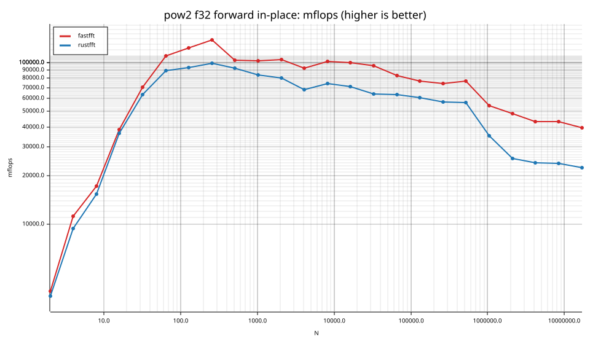
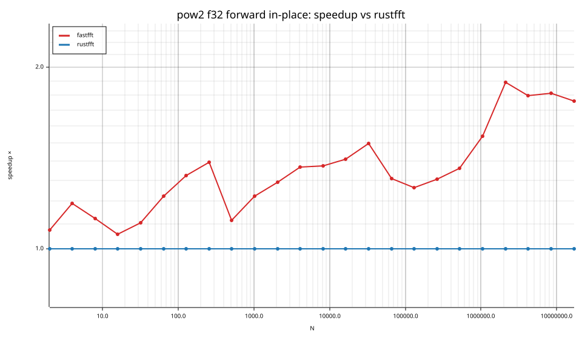
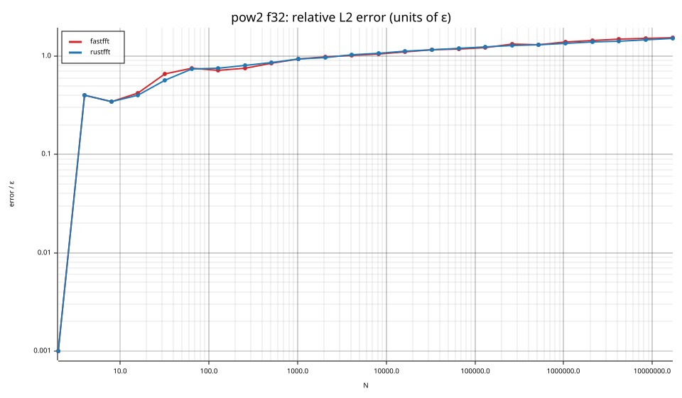

### pow2 f64

| cell | fastfft | rustfft |
|---|---|---|
| N=2 fwd ip | 2.6ns (0.93×) | 2.4ns |
| N=4 fwd ip | 3.6ns (1.05×) | 3.8ns |
| N=8 fwd ip | 6.4ns (1.06×) | 6.8ns |
| N=16 fwd ip | 9.0ns (1.15×) | 10.3ns |
| N=32 fwd ip | 14.1ns (1.23×) | 17.4ns |
| N=64 fwd ip | 29.2ns (1.36×) | 39.9ns |
| N=128 fwd ip | 60.7ns (1.41×) | 85.8ns |
| N=256 fwd ip | 129.8ns (1.51×) | 195.9ns |
| N=512 fwd ip | 428.1ns (1.15×) | 491.3ns |
| N=1024 fwd ip | 1.00us (1.24×) | 1.24us |
| N=2048 fwd ip | 2.28us (1.30×) | 2.96us |
| N=4096 fwd ip | 4.63us (1.54×) | 7.12us |
| N=8192 fwd ip | 10.50us (1.45×) | 15.26us |
| N=16384 fwd ip | 22.14us (1.52×) | 33.58us |
| N=32768 fwd ip | 51.80us (1.47×) | 75.89us |
| N=65536 fwd ip | 127.99us (1.33×) | 170.62us |
| N=131072 fwd ip | 277.81us (1.39×) | 386.15us |
| N=262144 fwd ip | 603.72us (1.46×) | 881.12us |
| N=524288 fwd ip | 1.77ms (1.60×) | 2.83ms |
| N=1048576 fwd ip | 4.05ms (2.07×) | 8.38ms |
| N=2097152 fwd ip | 9.11ms (1.99×) | 18.13ms |
| N=4194304 fwd ip | 20.59ms (1.94×) | 40.00ms |
| N=8388608 fwd ip | 43.16ms (2.03×) | 87.69ms |
| N=16777216 fwd ip | 95.59ms (2.03×) | 193.82ms |

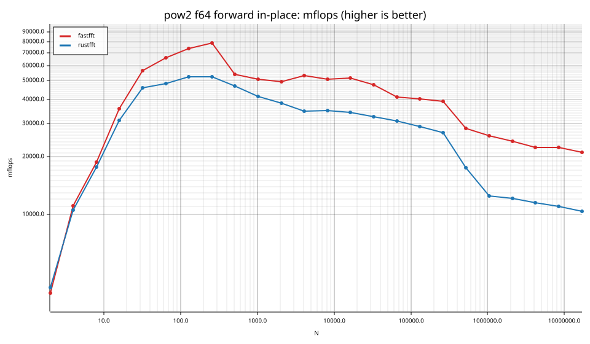
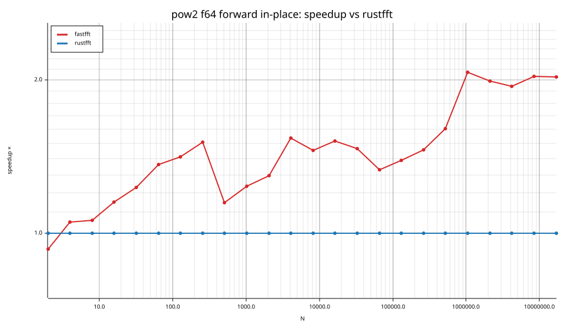
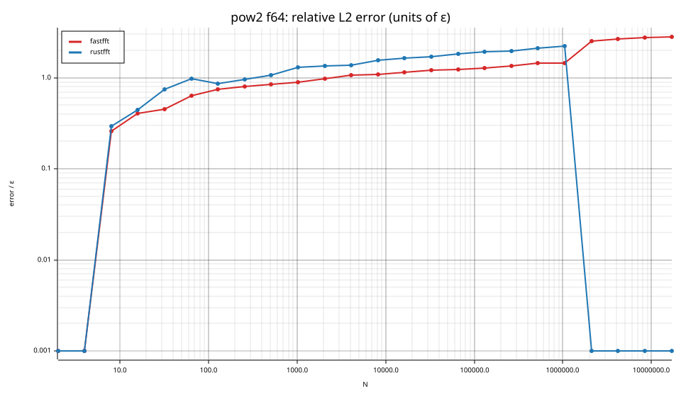

## Suite `smooth`

### smooth f32

| cell | fastfft | rustfft |
|---|---|---|
| N=6 fwd ip | 7.4ns (1.27×) | 9.4ns |
| N=9 fwd ip | 10.8ns (1.23×) | 13.2ns |
| N=12 fwd ip | 9.8ns (1.13×) | 11.0ns |
| N=15 fwd ip | 13.6ns (1.92×) | 26.1ns |
| N=18 fwd ip | 15.9ns (1.47×) | 23.4ns |
| N=24 fwd ip | 13.3ns (1.08×) | 14.4ns |
| N=36 fwd ip | 19.1ns (1.03×) | 19.8ns |
| N=48 fwd ip | 15.7ns (1.09×) | 17.1ns |
| N=80 fwd ip | 35.6ns (1.07×) | 38.2ns |
| N=96 fwd ip | 34.7ns (1.40×) | 48.6ns |
| N=108 fwd ip | 48.4ns (1.27×) | 61.3ns |
| N=120 fwd ip | 59.7ns (1.08×) | 64.7ns |
| N=160 fwd ip | 76.6ns (1.05×) | 80.8ns |
| N=210 fwd ip | 115.4ns (2.17×) | 250.5ns |
| N=240 fwd ip | 100.7ns (1.23×) | 123.6ns |
| N=320 fwd ip | 139.7ns (1.19×) | 166.7ns |
| N=384 fwd ip | 167.1ns (1.15×) | 191.8ns |
| N=480 fwd ip | 246.7ns (1.33×) | 327.7ns |
| N=504 fwd ip | 239.0ns (1.17×) | 279.0ns |
| N=640 fwd ip | 284.9ns (1.26×) | 360.1ns |
| N=720 fwd ip | 333.7ns (1.55×) | 518.0ns |
| N=768 fwd ip | 346.8ns (1.20×) | 415.2ns |
| N=960 fwd ip | 456.8ns (1.41×) | 643.8ns |
| N=1000 fwd ip | 621.7ns (1.52×) | 946.9ns |
| N=1200 fwd ip | 678.0ns (1.22×) | 827.2ns |
| N=1536 fwd ip | 778.3ns (1.36×) | 1.06us |
| N=1920 fwd ip | 1.07us (1.32×) | 1.42us |
| N=1960 fwd ip | 1.23us (1.62×) | 1.99us |
| N=2400 fwd ip | 1.46us (1.60×) | 2.34us |
| N=3072 fwd ip | 1.70us (1.42×) | 2.42us |
| N=4725 fwd ip | 4.67us (1.30×) | 6.09us |
| N=4800 fwd ip | 2.87us (1.60×) | 4.60us |
| N=6144 fwd ip | 3.74us (1.38×) | 5.16us |
| N=10368 fwd ip | 6.59us (1.32×) | 8.69us |
| N=12288 fwd ip | 7.91us (1.54×) | 12.16us |
| N=27000 fwd ip | 20.35us (1.63×) | 33.24us |
| N=48000 fwd ip | 35.76us (1.69×) | 60.52us |
| N=75600 fwd ip | 66.91us (1.57×) | 105.37us |
| N=96000 fwd ip | 79.46us (1.67×) | 132.34us |
| N=165375 fwd ip | 240.51us (1.33×) | 319.17us |
| N=1000000 fwd ip | 2.78ms (1.06×) | 2.94ms |

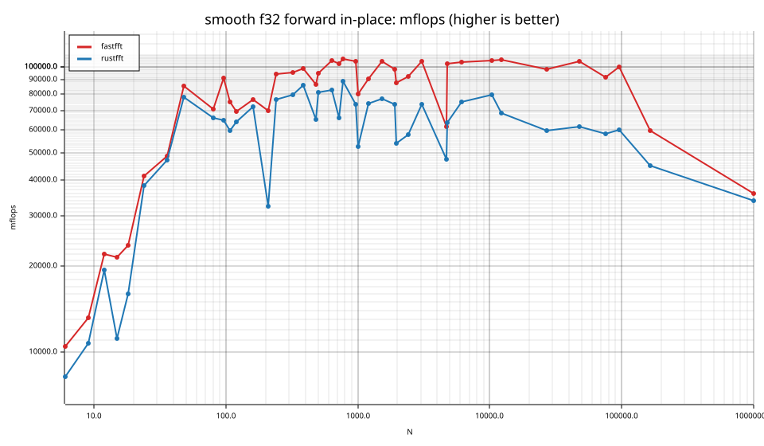
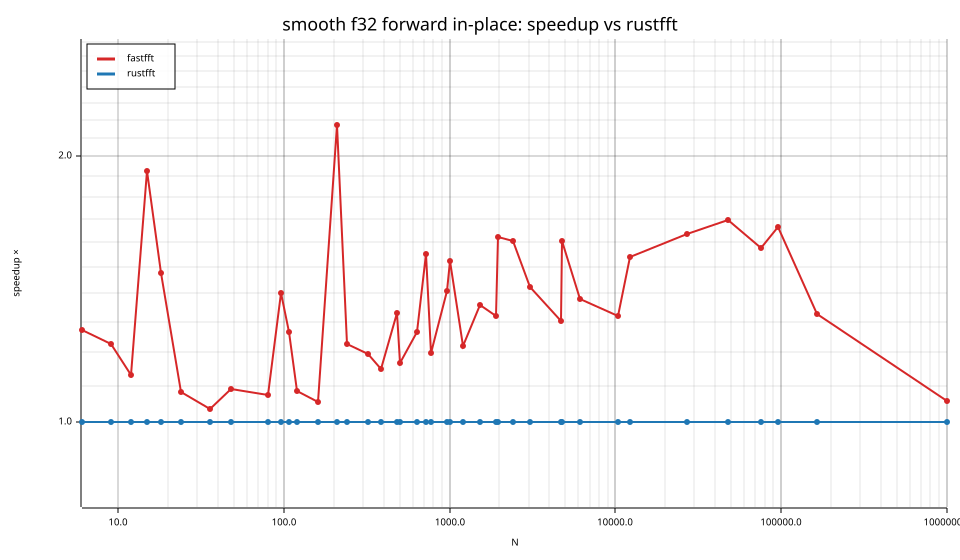
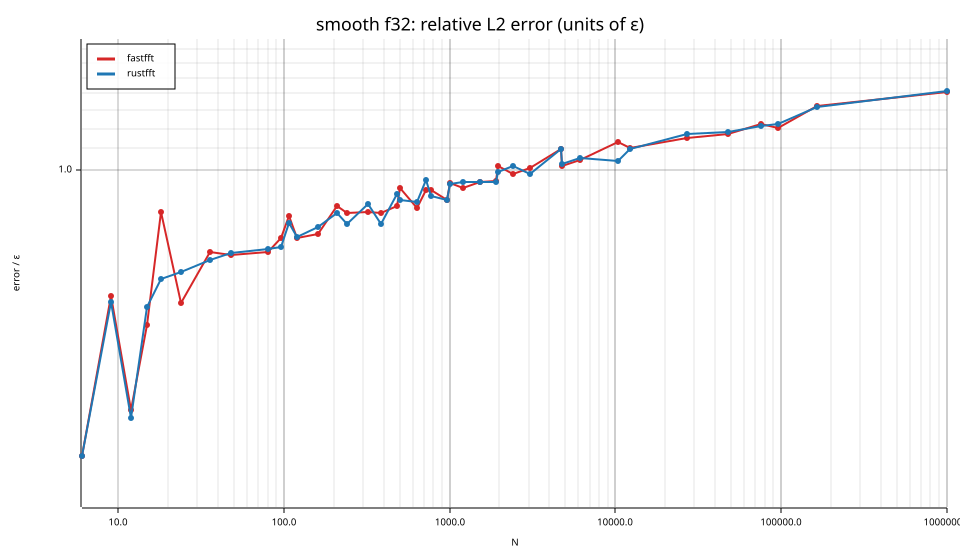

### smooth f64

| cell | fastfft | rustfft |
|---|---|---|
| N=6 fwd ip | 5.4ns (1.04×) | 5.6ns |
| N=9 fwd ip | 8.6ns (1.11×) | 9.5ns |
| N=12 fwd ip | 8.6ns (1.35×) | 11.6ns |
| N=15 fwd ip | 14.7ns (1.96×) | 28.9ns |
| N=18 fwd ip | 11.2ns (1.28×) | 14.3ns |
| N=24 fwd ip | 12.3ns (1.11×) | 13.6ns |
| N=36 fwd ip | 17.9ns (1.27×) | 22.7ns |
| N=48 fwd ip | 21.8ns (2.00×) | 43.6ns |
| N=80 fwd ip | 56.7ns (1.20×) | 67.8ns |
| N=96 fwd ip | 64.1ns (1.26×) | 80.7ns |
| N=108 fwd ip | 80.3ns (1.17×) | 94.0ns |
| N=120 fwd ip | 80.8ns (1.40×) | 113.0ns |
| N=160 fwd ip | 119.4ns (1.19×) | 141.9ns |
| N=210 fwd ip | 302.6ns (0.99×) | 299.8ns |
| N=240 fwd ip | 183.2ns (1.46×) | 268.4ns |
| N=320 fwd ip | 246.0ns (1.31×) | 322.7ns |
| N=384 fwd ip | 297.8ns (1.18×) | 352.5ns |
| N=480 fwd ip | 393.8ns (1.44×) | 566.3ns |
| N=504 fwd ip | 461.4ns (1.36×) | 628.1ns |
| N=640 fwd ip | 548.3ns (1.24×) | 678.3ns |
| N=720 fwd ip | 638.5ns (1.36×) | 868.8ns |
| N=768 fwd ip | 673.0ns (1.46×) | 982.7ns |
| N=960 fwd ip | 879.3ns (1.41×) | 1.24us |
| N=1000 fwd ip | 1.07us (1.55×) | 1.66us |
| N=1200 fwd ip | 1.21us (1.60×) | 1.94us |
| N=1536 fwd ip | 1.56us (1.44×) | 2.24us |
| N=1920 fwd ip | 2.04us (1.40×) | 2.85us |
| N=1960 fwd ip | 2.21us (1.65×) | 3.64us |
| N=2400 fwd ip | 2.61us (1.65×) | 4.31us |
| N=3072 fwd ip | 3.44us (1.36×) | 4.66us |
| N=4725 fwd ip | 8.63us (1.18×) | 10.16us |
| N=4800 fwd ip | 5.30us (1.73×) | 9.15us |
| N=6144 fwd ip | 7.30us (1.52×) | 11.09us |
| N=10368 fwd ip | 12.46us (1.62×) | 20.25us |
| N=12288 fwd ip | 15.79us (1.63×) | 25.78us |
| N=27000 fwd ip | 42.67us (1.55×) | 66.28us |
| N=48000 fwd ip | 69.08us (1.81×) | 125.14us |
| N=75600 fwd ip | 130.05us (1.55×) | 201.54us |
| N=96000 fwd ip | 143.14us (2.01×) | 288.27us |
| N=165375 fwd ip | 411.95us (1.37×) | 564.47us |
| N=1000000 fwd ip | 7.70ms (1.04×) | 7.99ms |

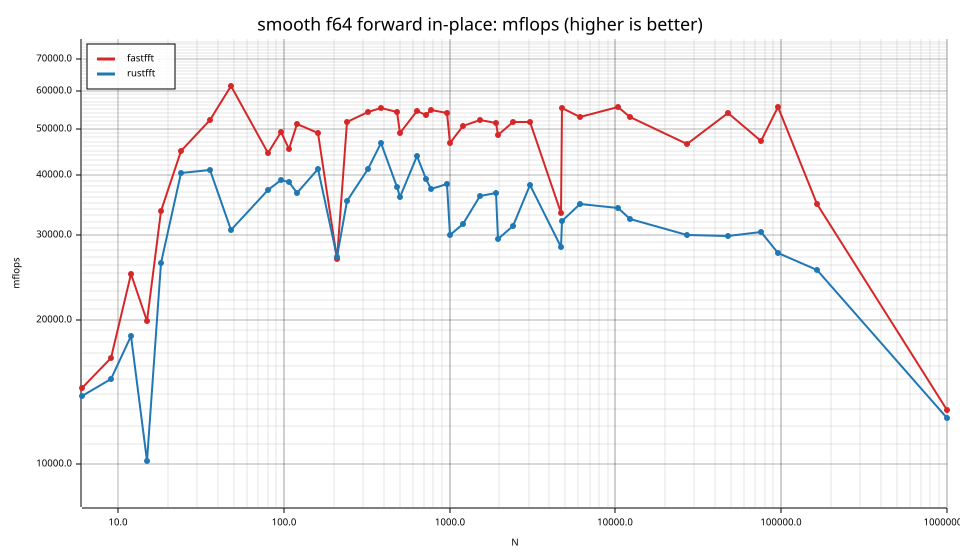
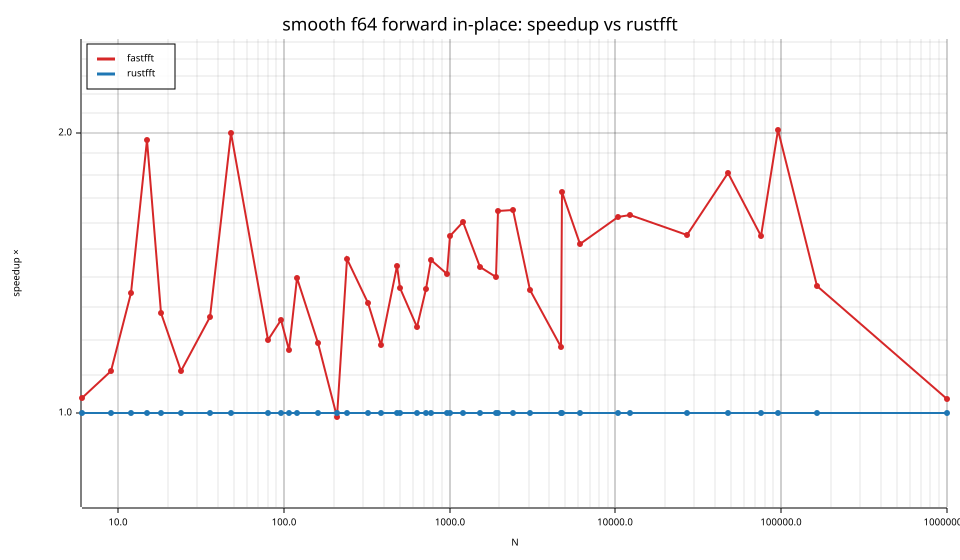
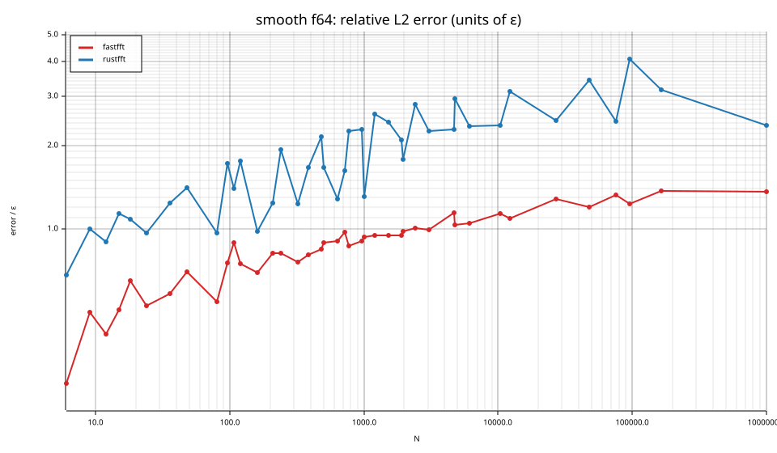

## Suite `rough`

### rough f32

| cell | fastfft | rustfft |
|---|---|---|
| N=17 fwd ip | 47.2ns (0.57×) | 27.0ns |
| N=31 fwd ip | 62.3ns (1.51×) | 94.0ns |
| N=61 fwd ip | 120.8ns (1.05×) | 127.0ns |
| N=127 fwd ip | 221.0ns (2.19×) | 482.9ns |
| N=257 fwd ip | 574.9ns (0.76×) | 439.2ns |
| N=509 fwd ip | 1.27us (1.22×) | 1.54us |
| N=1021 fwd ip | 2.67us (1.93×) | 5.16us |
| N=2018 fwd ip | 6.74us (0.82×) | 5.55us |
| N=2053 fwd ip | 7.95us (1.41×) | 11.24us |
| N=3063 fwd ip | 9.58us (1.71×) | 16.41us |
| N=4099 fwd ip | 14.40us (1.68×) | 24.17us |
| N=8191 fwd ip | 27.89us (1.77×) | 49.38us |
| N=9797 fwd ip | 35.53us (1.47×) | 52.23us |
| N=16381 fwd ip | 65.42us (1.56×) | 101.97us |
| N=65524 fwd ip | 340.38us (1.26×) | 427.89us |
| N=65537 fwd ip | 336.38us (0.75×) | 252.81us |
| N=131071 fwd ip | 722.27us (1.37×) | 990.65us |

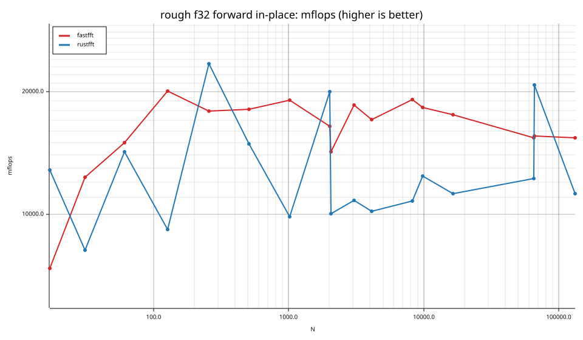
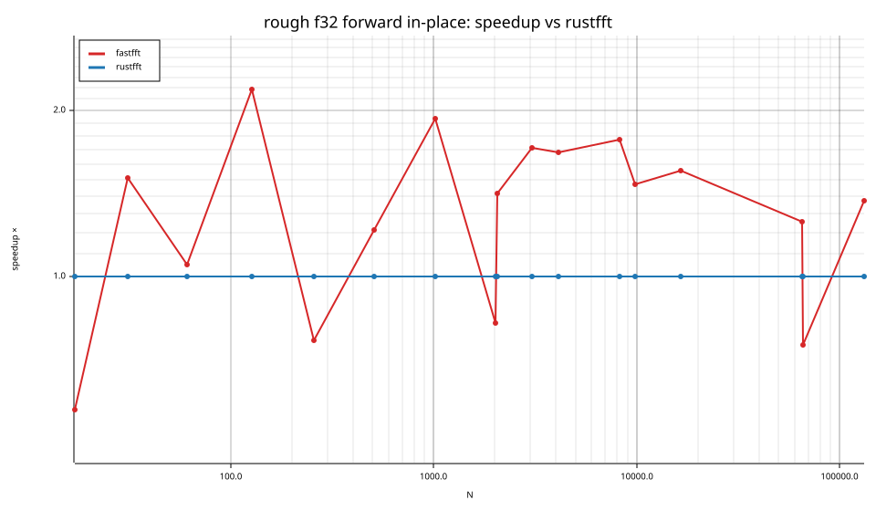

### rough f64

| cell | fastfft | rustfft |
|---|---|---|
| N=17 fwd ip | 56.6ns (0.55×) | 31.1ns |
| N=31 fwd ip | 100.8ns (0.91×) | 91.9ns |
| N=61 fwd ip | 190.3ns (1.11×) | 211.2ns |
| N=127 fwd ip | 383.0ns (1.24×) | 473.7ns |
| N=257 fwd ip | 1.13us (0.76×) | 857.6ns |
| N=509 fwd ip | 2.49us (1.27×) | 3.17us |
| N=1021 fwd ip | 5.79us (1.32×) | 7.67us |
| N=2018 fwd ip | 12.81us (0.83×) | 10.66us |
| N=2053 fwd ip | 13.66us (1.27×) | 17.33us |
| N=3063 fwd ip | 18.31us (1.36×) | 24.92us |
| N=4099 fwd ip | 27.91us (1.56×) | 43.55us |
| N=8191 fwd ip | 57.34us (1.24×) | 70.90us |
| N=9797 fwd ip | 81.35us (1.29×) | 105.03us |
| N=16381 fwd ip | 130.12us (1.11×) | 144.90us |
| N=65524 fwd ip | 661.64us (0.96×) | 633.25us |
| N=65537 fwd ip | 660.25us (0.74×) | 487.31us |
| N=131071 fwd ip | 1.83ms (1.50×) | 2.74ms |

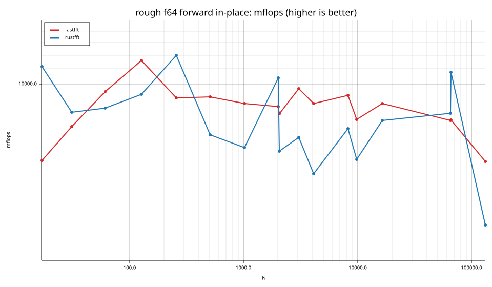
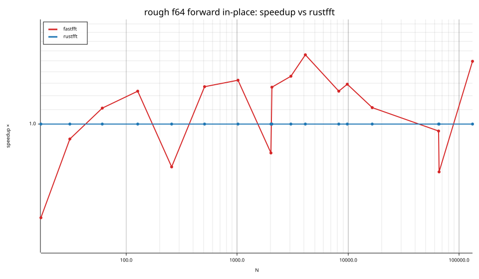
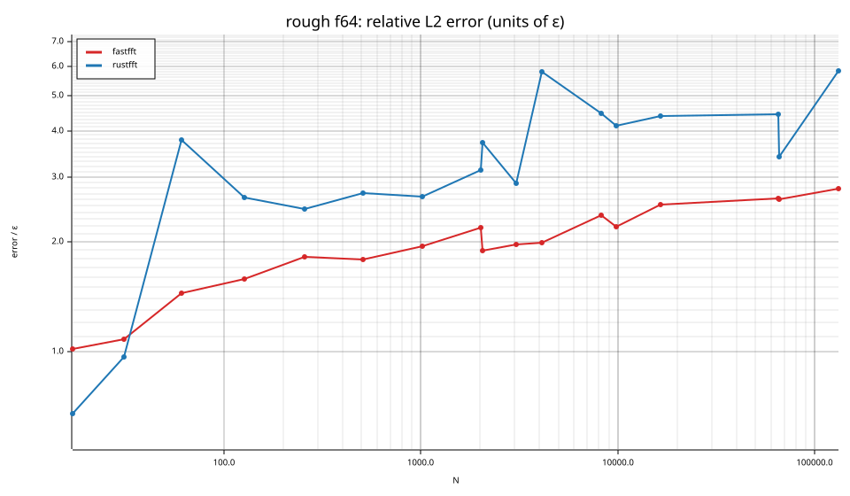

## Accuracy and planning time (medians over cells)

| lib | cells verified | failed | median error (ε) | worst error (ε) | median plan time |
|---|---|---|---|---|---|
| fastfft | 164 | 0 | 1.02 | 2.81 | 22.50us |
| rustfft | 164 | 0 | 1.24 | 5.84 | 15.70us |
