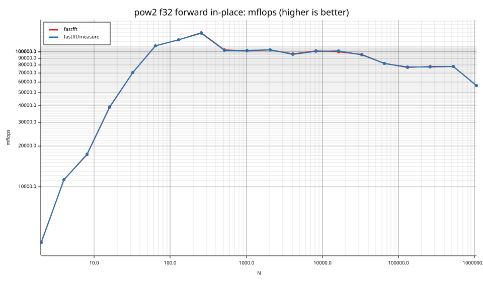
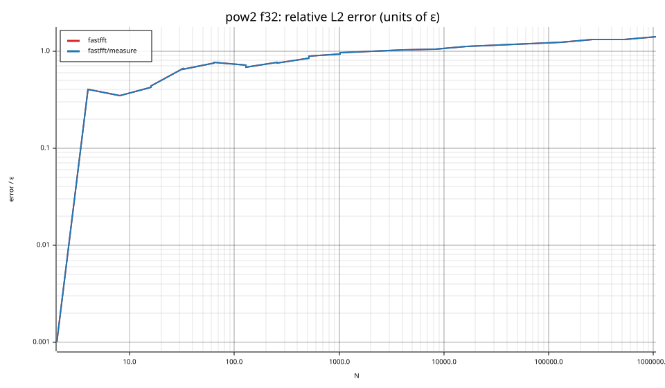

# fastfft arena report: `parent-all8`

| | |
|---|---|
| Host | mini-ryzen |
| CPU | AMD Ryzen 7 7840HS w/ Radeon 780M Graphics (family 25, model 116, stepping 1, microcode 0xa704108) |
| Pinned CPU | 2 (SMT siblings 2,10) |
| Governor / EPP / boost | performance / performance / 1 |
| Kernel | Linux version 7.0.0-28-generic |
| Virtualization | container-other |
| rustc | rustc 1.95.0 (59807616e 2026-04-14); binary: rustc; commit-hash: 59807616e1fa2540724bfbac14d7976d7e4a3860; commit-date: 2026-04-14; host: x86_64-unknown-linux-gnu; release: 1.95.0; LLVM version: 22.1.2 |
| Build profile / RUSTFLAGS | arena / `-C llvm-args=-align-all-functions=6` |
| Libraries | {"fearless_simd":"0.5.0","num-complex":"0.4.6","oxifft":"0.4.2","phastft":"0.4.1","pulp":"0.22.3","rustfft":"6.4.1","tfhe-fft":"0.10.1"} |
| FFTW | ? `?` |
| Git | 932ed59d5d8c23b239436940a1ac8b622a7cbb7f (dirty: true) |
| Profile | full |
| Official | true  |
| Control drift | max 55.60% over 4 control runs — **FLAGGED** |
| Cells | 80 |

Times are per transform. *best* = minimum batch mean, *median* = median batch mean. Speedup = rustfft time ÷ library time (> 1 means faster than rustfft); *geomean* over the cells both libraries ran. mflops = 5·N·log2(N)/t(µs).

## Release gates (fastfft)

| Gate | Criterion | Status | Detail |
|---|---|---|---|
| G1 | pow2 vs rustfft: geomean ≥ 1.5×, no cell < 0.95× | – n/a | no data |
| G2 | smooth vs rustfft: geomean ≥ 1.3×, no cell < 0.95× | – n/a | no data |
| G3 | rough vs rustfft: geomean ≥ 0.75×, no cell < 0.5× | – n/a | no data |
| G4 | vs each other Rust library: geomean ≥ 1.1×, ≥ 0.97× on ≥ 90% of cells | – n/a |  |
| G5 | AVX2 forced: pow2 ≥ 1.2×, smooth ≥ 1.1× vs rustfft | – n/a | pow2 NaN×/NaN×, smooth NaN×/NaN× |
| G6 | scenarios ≥ 1.3× each; batch geomean ≥ 1.5× | – n/a | scenarios min inf×, batch NaN×/NaN× |
| G7 | accuracy within §6 thresholds and ≤ 1.5× rustfft + 1ε | – n/a | 0 cells checked |
| G8 | Estimate planning time ≤ 2× rustfft for every N ≤ 2^20 | – n/a | worst ratio 0.00× (), 0 cells |

G9 (build time) is measured by `cargo xtask build-time`, not by the arena.

## Speedup vs rustfft (geomean of best-time ratios; median-time ratio in parentheses)

| suite | prec | fastfft | fastfft/measure |
|---|---|---|---|
| pow2 | f32 | – | – |

w/t/l = cells faster / within ±3% / slower than rustfft (best times).

## Suite `pow2`

### pow2 f32

| cell | fastfft | fastfft/measure |
|---|---|---|
| N=2 fwd ip | 2.6ns | 2.6ns |
| N=2 fwd oop | 1.4ns | 1.4ns |
| N=2 inv ip | 2.6ns | 2.6ns |
| N=2 inv oop | 1.4ns | 1.4ns |
| N=4 fwd ip | 3.6ns | 3.6ns |
| N=4 fwd oop | 1.4ns | 1.4ns |
| N=4 inv ip | 3.6ns | 3.6ns |
| N=4 inv oop | 1.4ns | 1.4ns |
| N=8 fwd ip | 6.9ns | 6.9ns |
| N=8 fwd oop | 3.0ns | 3.0ns |
| N=8 inv ip | 6.9ns | 6.9ns |
| N=8 inv oop | 3.0ns | 3.0ns |
| N=16 fwd ip | 8.2ns | 8.1ns |
| N=16 fwd oop | 3.8ns | 3.8ns |
| N=16 inv ip | 8.2ns | 8.2ns |
| N=16 inv oop | 3.8ns | 3.8ns |
| N=32 fwd ip | 11.4ns | 11.4ns |
| N=32 fwd oop | 7.8ns | 7.7ns |
| N=32 inv ip | 11.6ns | 11.6ns |
| N=32 inv oop | 7.7ns | 7.7ns |
| N=64 fwd ip | 17.3ns | 17.3ns |
| N=64 fwd oop | 16.1ns | 16.1ns |
| N=64 inv ip | 17.5ns | 17.3ns |
| N=64 inv oop | 16.1ns | 16.1ns |
| N=128 fwd ip | 36.3ns | 36.3ns |
| N=128 fwd oop | 36.5ns | 36.5ns |
| N=128 inv ip | 36.3ns | 36.3ns |
| N=128 inv oop | 36.5ns | 36.5ns |
| N=256 fwd ip | 73.8ns | 74.0ns |
| N=256 fwd oop | 74.2ns | 73.8ns |
| N=256 inv ip | 73.0ns | 73.8ns |
| N=256 inv oop | 73.6ns | 73.8ns |
| N=512 fwd ip | 222.6ns | 223.0ns |
| N=512 fwd oop | 223.4ns | 223.6ns |
| N=512 inv ip | 223.0ns | 222.2ns |
| N=512 inv oop | 222.9ns | 222.8ns |
| N=1024 fwd ip | 500.3ns | 499.0ns |
| N=1024 fwd oop | 499.1ns | 499.6ns |
| N=1024 inv ip | 500.8ns | 501.9ns |
| N=1024 inv oop | 498.3ns | 498.2ns |
| N=2048 fwd ip | 1.09us | 1.09us |
| N=2048 fwd oop | 1.07us | 1.07us |
| N=2048 inv ip | 1.09us | 1.08us |
| N=2048 inv oop | 1.07us | 1.07us |
| N=4096 fwd ip | 2.54us | 2.55us |
| N=4096 fwd oop | 2.38us | 2.36us |
| N=4096 inv ip | 2.55us | 2.58us |
| N=4096 inv oop | 2.37us | 2.39us |
| N=8192 fwd ip | 5.20us | 5.25us |
| N=8192 fwd oop | 5.57us | 5.55us |
| N=8192 inv ip | 5.21us | 5.25us |
| N=8192 inv oop | 5.55us | 5.56us |
| N=16384 fwd ip | 11.42us | 11.20us |
| N=16384 fwd oop | 12.80us | 12.72us |
| N=16384 inv ip | 11.43us | 11.24us |
| N=16384 inv oop | 12.88us | 12.75us |
| N=32768 fwd ip | 25.52us | 25.90us |
| N=32768 fwd oop | 28.26us | 28.27us |
| N=32768 inv ip | 25.41us | 25.65us |
| N=32768 inv oop | 28.15us | 28.07us |
| N=65536 fwd ip | 63.80us | 63.56us |
| N=65536 fwd oop | 60.26us | 60.42us |
| N=65536 inv ip | 64.01us | 63.93us |
| N=65536 inv oop | 60.15us | 60.36us |
| N=131072 fwd ip | 144.45us | 143.92us |
| N=131072 fwd oop | 137.49us | 136.70us |
| N=131072 inv ip | 144.72us | 144.73us |
| N=131072 inv oop | 137.01us | 136.75us |
| N=262144 fwd ip | 301.72us | 304.11us |
| N=262144 fwd oop | 305.97us | 307.01us |
| N=262144 inv ip | 301.19us | 302.59us |
| N=262144 inv oop | 307.16us | 310.14us |
| N=524288 fwd ip | 639.12us | 635.18us |
| N=524288 fwd oop | 686.92us | 683.26us |
| N=524288 inv ip | 639.20us | 641.04us |
| N=524288 inv oop | 689.38us | 688.45us |
| N=1048576 fwd ip | 1.86ms | 1.87ms |
| N=1048576 fwd oop | 1.76ms | 1.77ms |
| N=1048576 inv ip | 1.88ms | 1.87ms |
| N=1048576 inv oop | 1.74ms | 1.72ms |

## Accuracy and planning time (medians over cells)

| lib | cells verified | failed | median error (ε) | worst error (ε) | median plan time |
|---|---|---|---|---|---|
| fastfft | 80 | 0 | 0.99 | 1.40 | 23.75us |
| fastfft/measure | 80 | 0 | 0.99 | 1.40 | 13.80ms |
