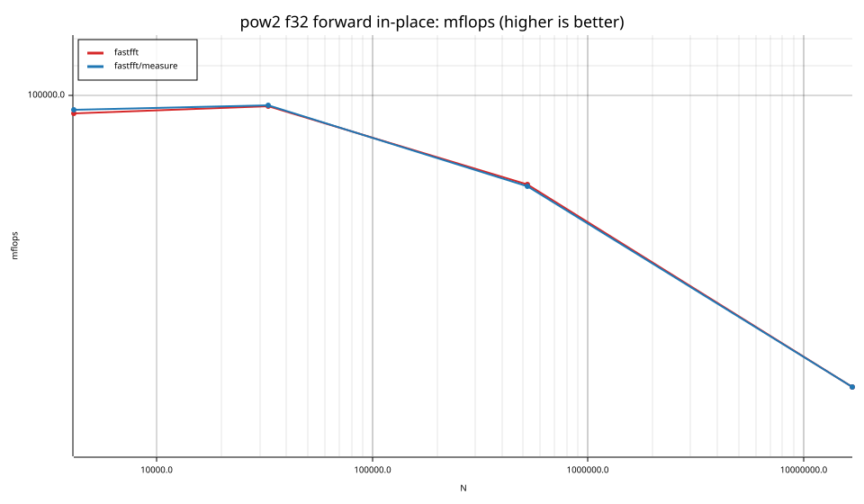
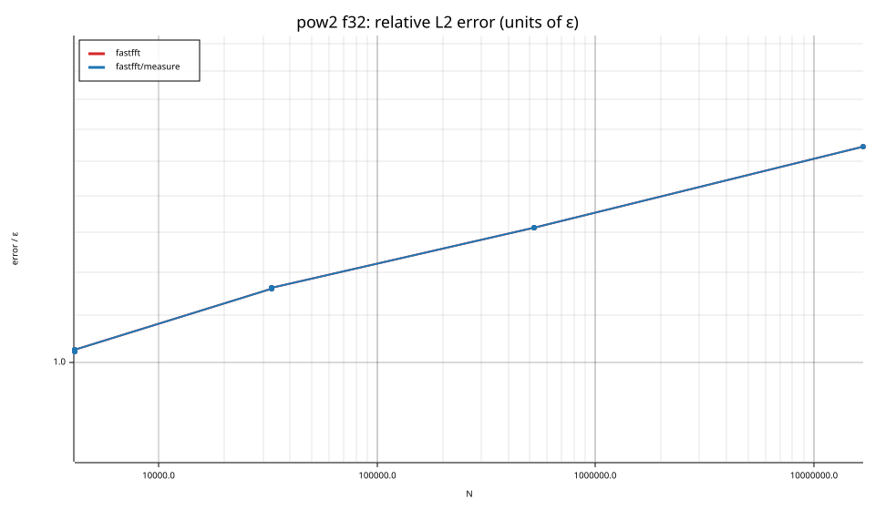
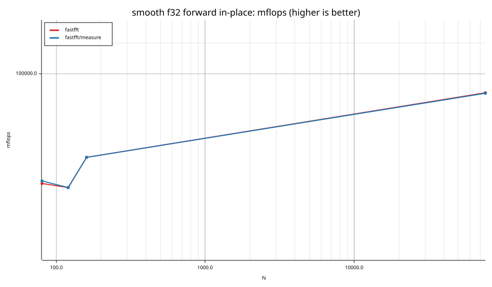
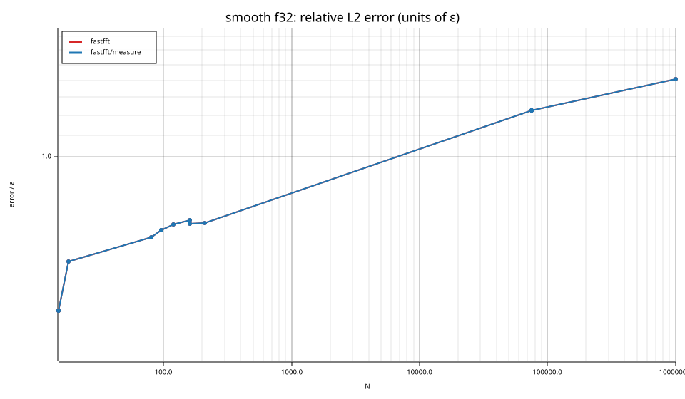
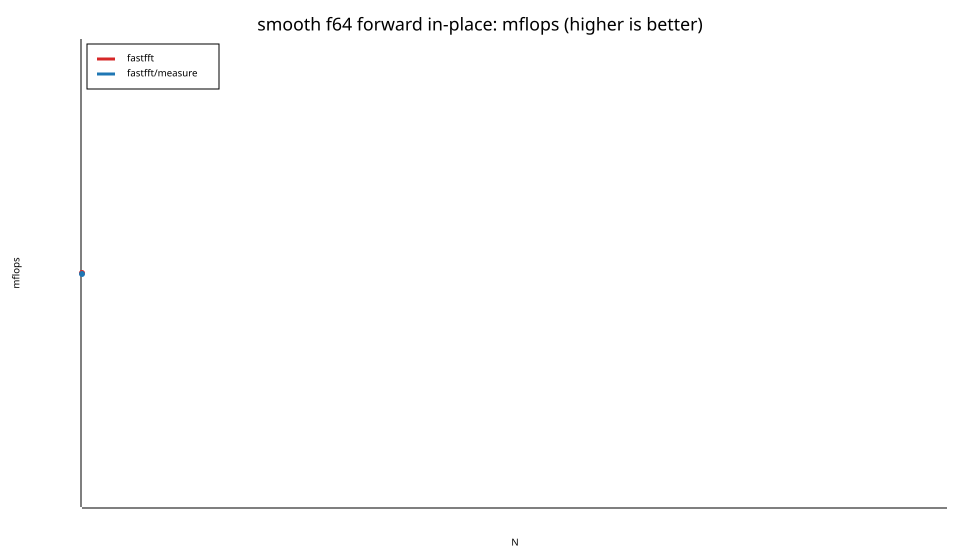
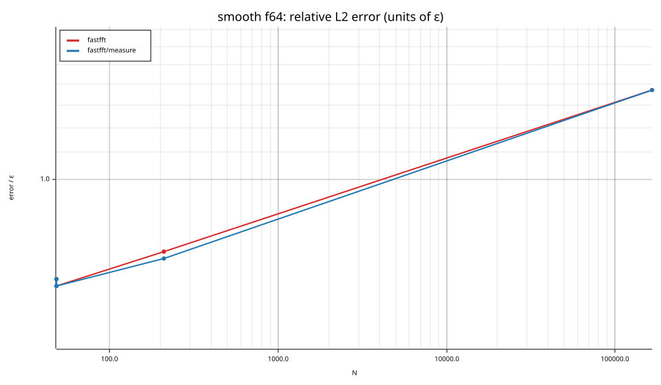
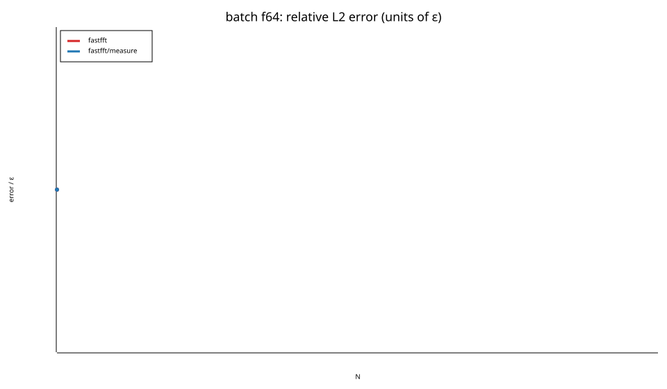

# fastfft arena report: `focus`

| | |
|---|---|
| Host | mini-ryzen |
| CPU | AMD Ryzen 7 7840HS w/ Radeon 780M Graphics (family 25, model 116, stepping 1, microcode 0xa704108) |
| Pinned CPU | 4 (SMT siblings 4,12) |
| Governor / EPP / boost | performance / performance / 1 |
| Kernel | Linux version 7.0.0-28-generic |
| Virtualization | none |
| rustc | rustc 1.95.0 (59807616e 2026-04-14); binary: rustc; commit-hash: 59807616e1fa2540724bfbac14d7976d7e4a3860; commit-date: 2026-04-14; host: x86_64-unknown-linux-gnu; release: 1.95.0; LLVM version: 22.1.2 |
| Build profile / RUSTFLAGS | arena / `-C llvm-args=-align-all-functions=6` |
| Libraries | {"fearless_simd":"0.5.0","num-complex":"0.4.6","oxifft":"0.4.2","phastft":"0.4.1","pulp":"0.22.3","rustfft":"6.4.1","tfhe-fft":"0.10.1"} |
| FFTW | ? `?` |
| Git | 932ed59d5d8c23b239436940a1ac8b622a7cbb7f (dirty: true) |
| Profile | full |
| Official | true  |
| Control drift | max 1.06% over 3 control runs |
| Cells | 34 |

Times are per transform. *best* = minimum batch mean, *median* = median batch mean. Speedup = rustfft time ÷ library time (> 1 means faster than rustfft); *geomean* over the cells both libraries ran. mflops = 5·N·log2(N)/t(µs).

## Release gates (fastfft)

| Gate | Criterion | Status | Detail |
|---|---|---|---|
| G1 | pow2 vs rustfft: geomean ≥ 1.5×, no cell < 0.95× | – n/a | no data |
| G2 | smooth vs rustfft: geomean ≥ 1.3×, no cell < 0.95× | – n/a | no data |
| G3 | rough vs rustfft: geomean ≥ 0.75×, no cell < 0.5× | – n/a | no data |
| G4 | vs each other Rust library: geomean ≥ 1.1×, ≥ 0.97× on ≥ 90% of cells | – n/a |  |
| G5 | AVX2 forced: pow2 ≥ 1.2×, smooth ≥ 1.1× vs rustfft | – n/a | pow2 NaN×/NaN×, smooth NaN×/NaN× |
| G6 | scenarios ≥ 1.3× each; batch geomean ≥ 1.5× | – n/a | scenarios min inf×, batch NaN×/NaN× |
| G7 | accuracy within §6 thresholds and ≤ 1.5× rustfft + 1ε | – n/a | 0 cells checked |
| G8 | Estimate planning time ≤ 2× rustfft for every N ≤ 2^20 | – n/a | worst ratio 0.00× (), 0 cells |

G9 (build time) is measured by `cargo xtask build-time`, not by the arena.

## Speedup vs rustfft (geomean of best-time ratios; median-time ratio in parentheses)

| suite | prec | fastfft | fastfft/measure |
|---|---|---|---|
| pow2 | f32 | – | – |
| smooth | f32 | – | – |
| smooth | f64 | – | – |
| batch | f64 | – | – |

w/t/l = cells faster / within ±3% / slower than rustfft (best times).

## Suite `pow2`

### pow2 f32

| cell | fastfft | fastfft/measure |
|---|---|---|
| N=4096 fwd ip | 2.60us | 2.57us |
| N=4096 fwd oop | 2.40us | 2.40us |
| N=4096 inv ip | 2.60us | 2.60us |
| N=4096 inv oop | 2.40us | 2.37us |
| N=32768 fwd ip | 25.42us | 25.36us |
| N=32768 fwd oop | 27.88us | 27.99us |
| N=32768 inv ip | 25.52us | 25.52us |
| N=32768 inv oop | 28.05us | 27.72us |
| N=524288 fwd ip | 660.31us | 665.08us |
| N=524288 fwd oop | 703.11us | 710.59us |
| N=16777216 fwd ip | 50.92ms | 50.94ms |

## Suite `smooth`

### smooth f32

| cell | fastfft | fastfft/measure |
|---|---|---|
| N=15 inv ip | 21.9ns | 14.4ns |
| N=15 inv oop | 15.9ns | 11.1ns |
| N=18 inv oop | 10.6ns | 10.6ns |
| N=80 fwd ip | 35.5ns | 35.2ns |
| N=96 inv ip | 34.0ns | 34.2ns |
| N=96 inv oop | 32.6ns | 32.3ns |
| N=120 fwd ip | 58.8ns | 58.8ns |
| N=160 fwd ip | 75.7ns | 75.7ns |
| N=160 inv ip | 75.6ns | 75.8ns |
| N=210 inv ip | 114.4ns | 114.9ns |
| N=75600 fwd ip | 64.94us | 65.05us |
| N=75600 fwd oop | 68.30us | 68.47us |
| N=75600 inv ip | 64.47us | 65.26us |
| N=75600 inv oop | 69.27us | 69.48us |
| N=1000000 inv ip | 2.76ms | 2.92ms |

### smooth f64

| cell | fastfft | fastfft/measure |
|---|---|---|
| N=48 fwd ip | 21.5ns | 21.5ns |
| N=48 fwd oop | 19.9ns | 20.3ns |
| N=48 inv ip | 21.7ns | 21.3ns |
| N=48 inv oop | 19.4ns | 19.4ns |
| N=210 inv ip | 291.1ns | 292.6ns |
| N=210 inv oop | 289.1ns | 284.6ns |
| N=165375 inv oop | 457.95us | 457.84us |

## Suite `batch`

### batch f64

| cell | fastfft | fastfft/measure |
|---|---|---|
| N=32 ×32768 fwd oop | 20.1ns | 20.0ns |

## Accuracy and planning time (medians over cells)

| lib | cells verified | failed | median error (ε) | worst error (ε) | median plan time |
|---|---|---|---|---|---|
| fastfft | 34 | 0 | 1.02 | 1.54 | 35.09us |
| fastfft/measure | 34 | 0 | 1.02 | 1.54 | 30.15ms |
