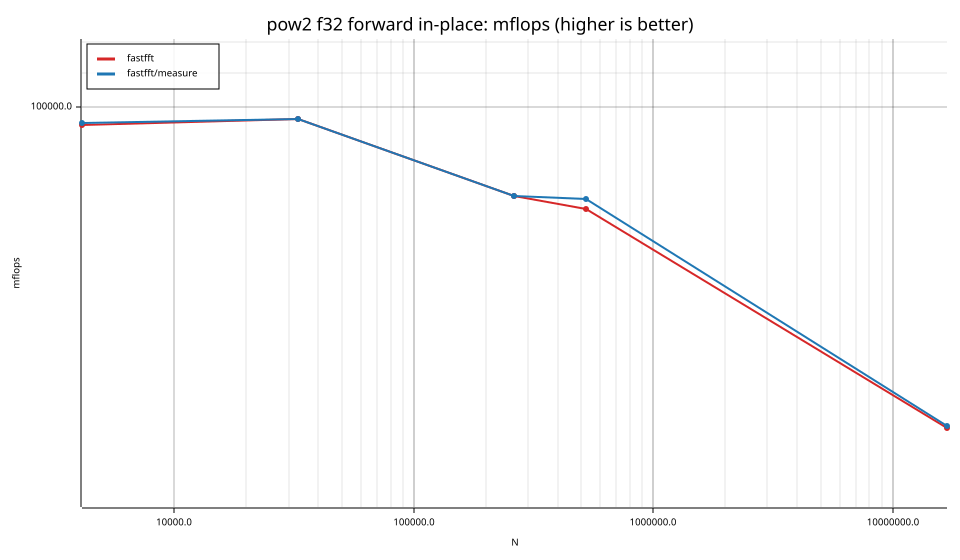
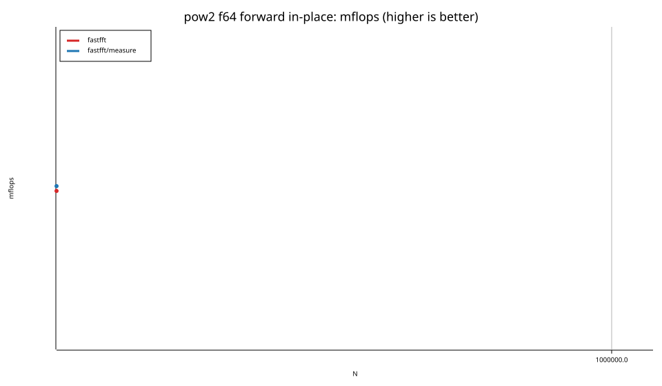
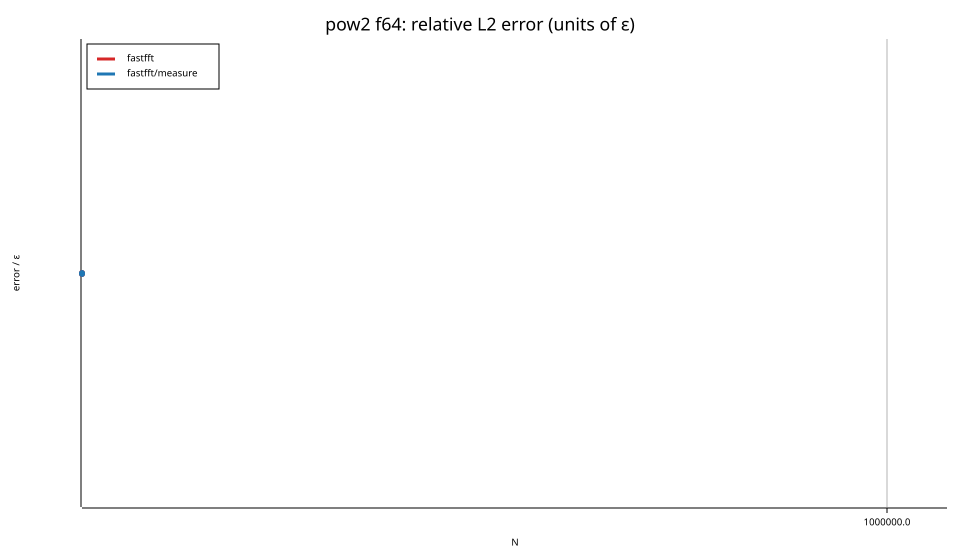
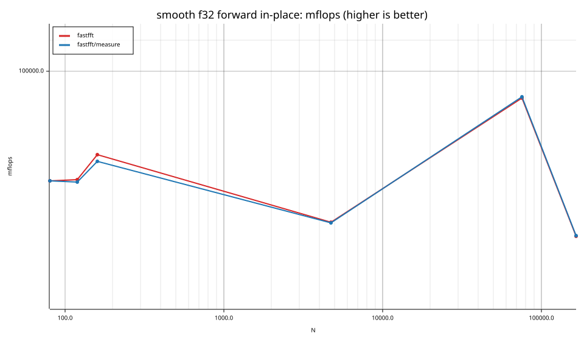
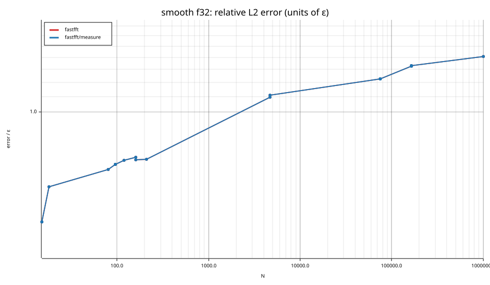
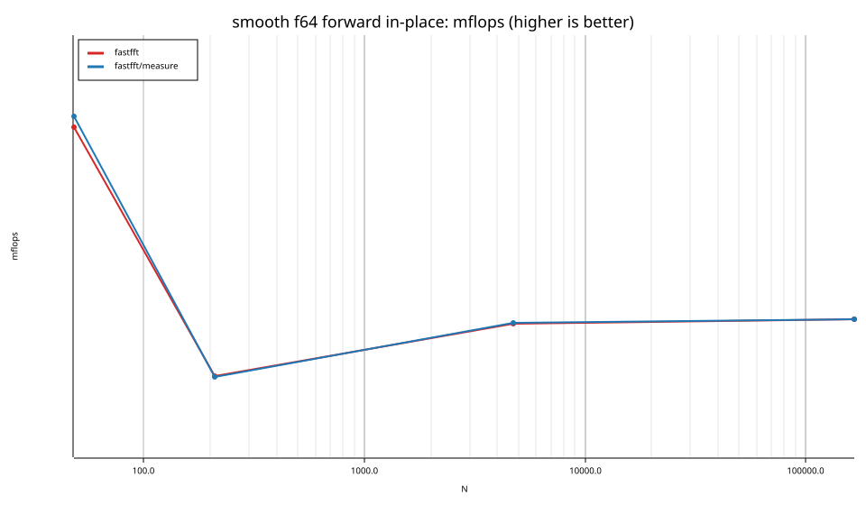
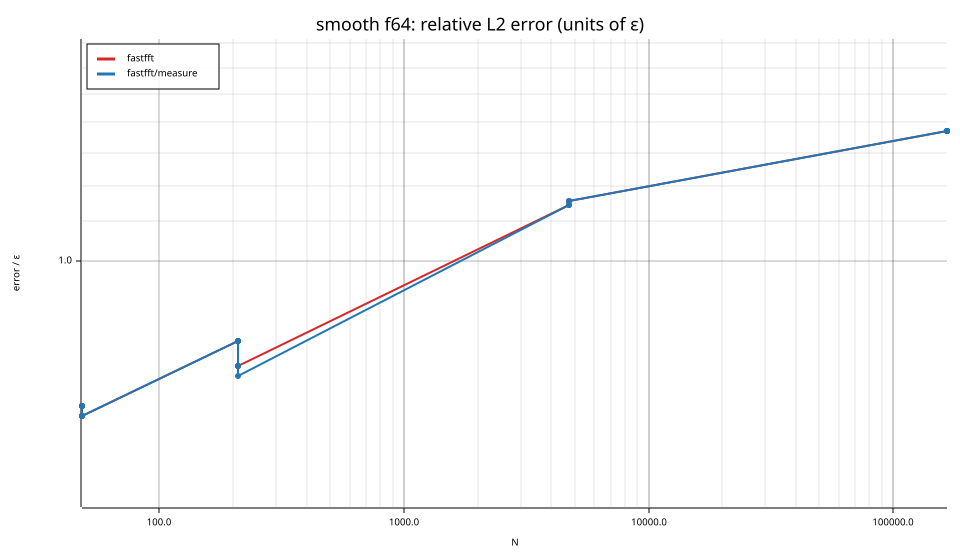

# fastfft arena report: `focus`

| | |
|---|---|
| Host | mini-ryzen |
| CPU | AMD Ryzen 7 7840HS w/ Radeon 780M Graphics (family 25, model 116, stepping 1, microcode 0xa704108) |
| Pinned CPU | 4 (SMT siblings 4,12) |
| Governor / EPP / boost | performance / performance / 1 |
| Kernel | Linux version 7.0.0-28-generic |
| Virtualization | none |
| rustc | rustc 1.95.0 (59807616e 2026-04-14); binary: rustc; commit-hash: 59807616e1fa2540724bfbac14d7976d7e4a3860; commit-date: 2026-04-14; host: x86_64-unknown-linux-gnu; release: 1.95.0; LLVM version: 22.1.2 |
| Build profile / RUSTFLAGS | arena / `-C llvm-args=-align-all-functions=6` |
| Libraries | {"fearless_simd":"0.5.0","num-complex":"0.4.6","oxifft":"0.4.2","phastft":"0.4.1","pulp":"0.22.3","rustfft":"6.4.1","tfhe-fft":"0.10.1"} |
| FFTW | ? `?` |
| Git | 932ed59d5d8c23b239436940a1ac8b622a7cbb7f (dirty: true) |
| Profile | full |
| Official | true  |
| Control drift | max 2.09% over 4 control runs |
| Cells | 51 |

Times are per transform. *best* = minimum batch mean, *median* = median batch mean. Speedup = rustfft time ÷ library time (> 1 means faster than rustfft); *geomean* over the cells both libraries ran. mflops = 5·N·log2(N)/t(µs).

## Release gates (fastfft)

| Gate | Criterion | Status | Detail |
|---|---|---|---|
| G1 | pow2 vs rustfft: geomean ≥ 1.5×, no cell < 0.95× | – n/a | no data |
| G2 | smooth vs rustfft: geomean ≥ 1.3×, no cell < 0.95× | – n/a | no data |
| G3 | rough vs rustfft: geomean ≥ 0.75×, no cell < 0.5× | – n/a | no data |
| G4 | vs each other Rust library: geomean ≥ 1.1×, ≥ 0.97× on ≥ 90% of cells | – n/a |  |
| G5 | AVX2 forced: pow2 ≥ 1.2×, smooth ≥ 1.1× vs rustfft | – n/a | pow2 NaN×/NaN×, smooth NaN×/NaN× |
| G6 | scenarios ≥ 1.3× each; batch geomean ≥ 1.5× | – n/a | scenarios min inf×, batch NaN×/NaN× |
| G7 | accuracy within §6 thresholds and ≤ 1.5× rustfft + 1ε | – n/a | 0 cells checked |
| G8 | Estimate planning time ≤ 2× rustfft for every N ≤ 2^20 | – n/a | worst ratio 0.00× (), 0 cells |

G9 (build time) is measured by `cargo xtask build-time`, not by the arena.

## Speedup vs rustfft (geomean of best-time ratios; median-time ratio in parentheses)

| suite | prec | fastfft | fastfft/measure |
|---|---|---|---|
| pow2 | f32 | – | – |
| pow2 | f64 | – | – |
| smooth | f32 | – | – |
| smooth | f64 | – | – |
| batch | f64 | – | – |

w/t/l = cells faster / within ±3% / slower than rustfft (best times).

## Suite `pow2`

### pow2 f32

| cell | fastfft | fastfft/measure |
|---|---|---|
| N=4096 fwd ip | 2.58us | 2.57us |
| N=4096 fwd oop | 2.47us | 2.47us |
| N=4096 inv ip | 2.56us | 2.59us |
| N=4096 inv oop | 2.47us | 2.46us |
| N=32768 fwd ip | 25.41us | 25.43us |
| N=32768 fwd oop | 27.86us | 27.75us |
| N=32768 inv ip | 25.45us | 25.41us |
| N=32768 inv oop | 27.64us | 27.70us |
| N=262144 fwd ip | 302.35us | 302.43us |
| N=262144 inv oop | 307.79us | 307.64us |
| N=524288 fwd ip | 661.98us | 644.77us |
| N=524288 fwd oop | 712.00us | 716.89us |
| N=16777216 fwd ip | 49.50ms | 49.28ms |

### pow2 f64

| cell | fastfft | fastfft/measure |
|---|---|---|
| N=524288 fwd ip | 1.73ms | 1.71ms |
| N=524288 inv oop | 1.66ms | 1.65ms |

## Suite `smooth`

### smooth f32

| cell | fastfft | fastfft/measure |
|---|---|---|
| N=15 inv ip | 21.9ns | 14.3ns |
| N=15 inv oop | 15.9ns | 11.2ns |
| N=18 inv oop | 10.6ns | 10.6ns |
| N=80 fwd ip | 35.4ns | 35.4ns |
| N=96 inv ip | 34.8ns | 34.9ns |
| N=96 inv oop | 32.8ns | 32.8ns |
| N=120 fwd ip | 57.7ns | 58.2ns |
| N=160 fwd ip | 75.7ns | 77.2ns |
| N=160 inv ip | 76.2ns | 76.1ns |
| N=210 inv ip | 113.6ns | 114.4ns |
| N=4725 fwd ip | 4.58us | 4.58us |
| N=4725 inv oop | 4.69us | 4.70us |
| N=75600 fwd ip | 66.58us | 66.31us |
| N=75600 fwd oop | 68.63us | 67.90us |
| N=75600 inv ip | 65.57us | 65.78us |
| N=75600 inv oop | 68.65us | 68.50us |
| N=165375 fwd ip | 237.43us | 237.03us |
| N=165375 fwd oop | 237.65us | 237.43us |
| N=165375 inv ip | 237.28us | 237.46us |
| N=165375 inv oop | 237.24us | 238.49us |
| N=1000000 inv ip | 2.84ms | 2.88ms |

### smooth f64

| cell | fastfft | fastfft/measure |
|---|---|---|
| N=48 fwd ip | 22.2ns | 21.5ns |
| N=48 fwd oop | 20.0ns | 19.5ns |
| N=48 inv ip | 21.9ns | 21.4ns |
| N=48 inv oop | 19.9ns | 19.3ns |
| N=210 fwd ip | 266.9ns | 267.7ns |
| N=210 fwd oop | 267.7ns | 269.9ns |
| N=210 inv ip | 282.9ns | 283.4ns |
| N=210 inv oop | 284.7ns | 290.7ns |
| N=4725 fwd ip | 8.22us | 8.20us |
| N=4725 inv oop | 8.40us | 8.38us |
| N=165375 fwd ip | 403.48us | 403.49us |
| N=165375 fwd oop | 439.89us | 449.19us |
| N=165375 inv ip | 412.22us | 411.06us |
| N=165375 inv oop | 453.44us | 459.86us |

## Suite `batch`

### batch f64

| cell | fastfft | fastfft/measure |
|---|---|---|
| N=32 ×32768 fwd oop | 20.6ns | 20.8ns |

## Accuracy and planning time (medians over cells)

| lib | cells verified | failed | median error (ε) | worst error (ε) | median plan time |
|---|---|---|---|---|---|
| fastfft | 51 | 0 | 1.15 | 1.54 | 74.21us |
| fastfft/measure | 51 | 0 | 1.15 | 1.54 | 51.45ms |
