# fastfft arena report: `full-deferred-reserved-all8`

| | |
|---|---|
| Host | mini-ryzen |
| CPU | AMD Ryzen 7 7840HS w/ Radeon 780M Graphics (family 25, model 116, stepping 1, microcode 0xa704108) |
| Pinned CPU | 4 (SMT siblings 4,12) |
| Governor / EPP / boost | performance / performance / 1 |
| Kernel | Linux version 7.0.0-28-generic |
| Virtualization | none |
| rustc | rustc 1.95.0 (59807616e 2026-04-14); binary: rustc; commit-hash: 59807616e1fa2540724bfbac14d7976d7e4a3860; commit-date: 2026-04-14; host: x86_64-unknown-linux-gnu; release: 1.95.0; LLVM version: 22.1.2 |
| Build profile / RUSTFLAGS | arena / `-C llvm-args=-align-all-functions=6` |
| Libraries | {"fearless_simd":"0.5.0","num-complex":"0.4.6","oxifft":"0.4.2","phastft":"0.4.1","pulp":"0.22.3","rustfft":"6.4.1","tfhe-fft":"0.10.1"} |
| FFTW | ? `?` |
| Git | 932ed59d5d8c23b239436940a1ac8b622a7cbb7f (dirty: true) |
| Profile | full |
| Official | true  |
| Control drift | max 1.42% over 30 control runs |
| Cells | 710 |

Times are per transform. *best* = minimum batch mean, *median* = median batch mean. Speedup = rustfft time ÷ library time (> 1 means faster than rustfft); *geomean* over the cells both libraries ran. mflops = 5·N·log2(N)/t(µs).

## Release gates (fastfft)

| Gate | Criterion | Status | Detail |
|---|---|---|---|
| G1 | pow2 vs rustfft: geomean ≥ 1.5×, no cell < 0.95× | – n/a | no data |
| G2 | smooth vs rustfft: geomean ≥ 1.3×, no cell < 0.95× | – n/a | no data |
| G3 | rough vs rustfft: geomean ≥ 0.75×, no cell < 0.5× | – n/a | no data |
| G4 | vs each other Rust library: geomean ≥ 1.1×, ≥ 0.97× on ≥ 90% of cells | – n/a |  |
| G5 | AVX2 forced: pow2 ≥ 1.2×, smooth ≥ 1.1× vs rustfft | – n/a | pow2 NaN×/NaN×, smooth NaN×/NaN× |
| G6 | scenarios ≥ 1.3× each; batch geomean ≥ 1.5× | – n/a | scenarios min inf×, batch NaN×/NaN× |
| G7 | accuracy within §6 thresholds and ≤ 1.5× rustfft + 1ε | – n/a | 0 cells checked |
| G8 | Estimate planning time ≤ 2× rustfft for every N ≤ 2^20 | – n/a | worst ratio 0.00× (), 0 cells |

G9 (build time) is measured by `cargo xtask build-time`, not by the arena.

## Speedup vs rustfft (geomean of best-time ratios; median-time ratio in parentheses)

| suite | prec | fastfft | fastfft/measure |
|---|---|---|---|
| pow2 | f32 | – | – |
| pow2 | f64 | – | – |
| smooth | f32 | – | – |
| smooth | f64 | – | – |
| rough | f32 | – | – |
| rough | f64 | – | – |
| batch | f32 | – | – |
| batch | f64 | – | – |
| realworld | f32 | – | – |
| realworld | f64 | – | – |
| datacheck | f32 | – | – |
| datacheck | f64 | – | – |

w/t/l = cells faster / within ±3% / slower than rustfft (best times).

## Suite `pow2`

### pow2 f32

| cell | fastfft | fastfft/measure |
|---|---|---|
| N=2 fwd ip | 2.6ns | 2.6ns |
| N=2 fwd oop | 1.4ns | 1.3ns |
| N=2 inv ip | 2.6ns | 2.6ns |
| N=2 inv oop | 1.4ns | 1.4ns |
| N=4 fwd ip | 3.6ns | 3.6ns |
| N=4 fwd oop | 1.3ns | 1.2ns |
| N=4 inv ip | 3.6ns | 3.6ns |
| N=4 inv oop | 1.2ns | 1.2ns |
| N=8 fwd ip | 6.9ns | 6.9ns |
| N=8 fwd oop | 3.0ns | 3.0ns |
| N=8 inv ip | 6.9ns | 6.9ns |
| N=8 inv oop | 3.0ns | 3.0ns |
| N=16 fwd ip | 8.3ns | 8.2ns |
| N=16 fwd oop | 3.8ns | 3.8ns |
| N=16 inv ip | 8.3ns | 8.2ns |
| N=16 inv oop | 3.8ns | 3.8ns |
| N=32 fwd ip | 11.4ns | 11.4ns |
| N=32 fwd oop | 7.6ns | 7.6ns |
| N=32 inv ip | 11.6ns | 11.6ns |
| N=32 inv oop | 7.8ns | 7.8ns |
| N=64 fwd ip | 17.3ns | 17.3ns |
| N=64 fwd oop | 15.9ns | 15.9ns |
| N=64 inv ip | 17.3ns | 17.3ns |
| N=64 inv oop | 16.0ns | 15.9ns |
| N=128 fwd ip | 35.9ns | 36.3ns |
| N=128 fwd oop | 36.3ns | 36.1ns |
| N=128 inv ip | 36.3ns | 35.9ns |
| N=128 inv oop | 36.5ns | 36.5ns |
| N=256 fwd ip | 73.6ns | 73.8ns |
| N=256 fwd oop | 74.0ns | 74.0ns |
| N=256 inv ip | 73.4ns | 73.0ns |
| N=256 inv oop | 74.0ns | 73.8ns |
| N=512 fwd ip | 223.1ns | 223.4ns |
| N=512 fwd oop | 222.9ns | 222.4ns |
| N=512 inv ip | 223.6ns | 222.5ns |
| N=512 inv oop | 223.1ns | 223.6ns |
| N=1024 fwd ip | 498.2ns | 499.9ns |
| N=1024 fwd oop | 499.3ns | 498.7ns |
| N=1024 inv ip | 499.7ns | 498.9ns |
| N=1024 inv oop | 498.8ns | 499.0ns |
| N=2048 fwd ip | 1.08us | 1.08us |
| N=2048 fwd oop | 1.06us | 1.07us |
| N=2048 inv ip | 1.09us | 1.08us |
| N=2048 inv oop | 1.07us | 1.07us |
| N=4096 fwd ip | 2.55us | 2.62us |
| N=4096 fwd oop | 2.36us | 2.38us |
| N=4096 inv ip | 2.56us | 2.55us |
| N=4096 inv oop | 2.38us | 2.40us |
| N=8192 fwd ip | 5.21us | 5.21us |
| N=8192 fwd oop | 5.57us | 5.53us |
| N=8192 inv ip | 5.21us | 5.20us |
| N=8192 inv oop | 5.57us | 5.52us |
| N=16384 fwd ip | 11.42us | 11.28us |
| N=16384 fwd oop | 12.83us | 12.77us |
| N=16384 inv ip | 11.36us | 11.34us |
| N=16384 inv oop | 12.80us | 12.84us |
| N=32768 fwd ip | 25.67us | 25.62us |
| N=32768 fwd oop | 28.24us | 28.37us |
| N=32768 inv ip | 25.47us | 25.66us |
| N=32768 inv oop | 28.06us | 28.01us |
| N=65536 fwd ip | 63.36us | 63.41us |
| N=65536 fwd oop | 59.53us | 60.30us |
| N=65536 inv ip | 63.42us | 63.61us |
| N=65536 inv oop | 60.02us | 59.75us |
| N=131072 fwd ip | 144.58us | 144.22us |
| N=131072 fwd oop | 136.55us | 136.82us |
| N=131072 inv ip | 144.49us | 143.77us |
| N=131072 inv oop | 137.41us | 136.87us |
| N=262144 fwd ip | 301.18us | 303.88us |
| N=262144 fwd oop | 303.93us | 308.50us |
| N=262144 inv ip | 304.49us | 305.54us |
| N=262144 inv oop | 307.69us | 308.78us |
| N=524288 fwd ip | 643.70us | 642.26us |
| N=524288 fwd oop | 698.21us | 694.90us |
| N=524288 inv ip | 635.96us | 638.90us |
| N=524288 inv oop | 696.54us | 697.35us |
| N=1048576 fwd ip | 1.88ms | 1.89ms |
| N=1048576 fwd oop | 1.77ms | 1.79ms |
| N=1048576 inv ip | 1.88ms | 1.88ms |
| N=1048576 inv oop | 1.78ms | 1.78ms |
| N=2097152 fwd ip | 4.51ms | 4.50ms |
| N=2097152 fwd oop | 4.59ms | 4.58ms |
| N=2097152 inv ip | 4.50ms | 4.51ms |
| N=2097152 inv oop | 4.61ms | 4.61ms |
| N=4194304 fwd ip | 10.61ms | 10.64ms |
| N=4194304 fwd oop | 10.64ms | 10.67ms |
| N=4194304 inv ip | 10.47ms | 10.43ms |
| N=4194304 inv oop | 10.66ms | 10.66ms |
| N=8388608 fwd ip | 22.33ms | 22.31ms |
| N=8388608 fwd oop | 22.22ms | 22.36ms |
| N=8388608 inv ip | 22.23ms | 22.33ms |
| N=8388608 inv oop | 22.19ms | 22.33ms |
| N=16777216 fwd ip | 50.00ms | 51.17ms |
| N=16777216 fwd oop | 51.41ms | 51.19ms |
| N=16777216 inv ip | 50.85ms | 51.17ms |
| N=16777216 inv oop | 51.21ms | 51.37ms |

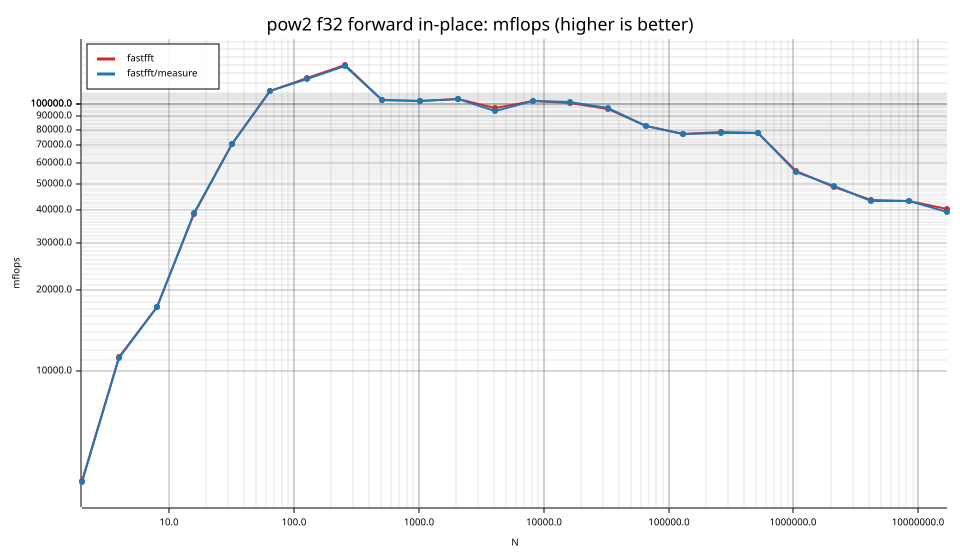

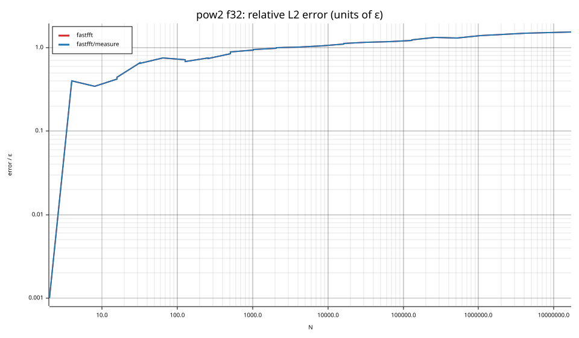

### pow2 f64

| cell | fastfft | fastfft/measure |
|---|---|---|
| N=2 fwd ip | 2.6ns | 2.6ns |
| N=2 fwd oop | 1.2ns | 1.2ns |
| N=2 inv ip | 2.6ns | 2.6ns |
| N=2 inv oop | 1.2ns | 1.2ns |
| N=4 fwd ip | 3.6ns | 3.6ns |
| N=4 fwd oop | 1.6ns | 1.6ns |
| N=4 inv ip | 3.6ns | 3.7ns |
| N=4 inv oop | 1.6ns | 1.6ns |
| N=8 fwd ip | 6.4ns | 6.4ns |
| N=8 fwd oop | 4.4ns | 4.4ns |
| N=8 inv ip | 6.3ns | 6.3ns |
| N=8 inv oop | 4.2ns | 4.2ns |
| N=16 fwd ip | 8.8ns | 8.7ns |
| N=16 fwd oop | 5.2ns | 5.2ns |
| N=16 inv ip | 8.8ns | 8.8ns |
| N=16 inv oop | 5.2ns | 5.2ns |
| N=32 fwd ip | 14.0ns | 14.0ns |
| N=32 fwd oop | 11.9ns | 11.9ns |
| N=32 inv ip | 14.0ns | 14.0ns |
| N=32 inv oop | 11.9ns | 11.9ns |
| N=64 fwd ip | 29.0ns | 28.2ns |
| N=64 fwd oop | 27.0ns | 27.0ns |
| N=64 inv ip | 29.1ns | 29.0ns |
| N=64 inv oop | 27.2ns | 27.0ns |
| N=128 fwd ip | 60.8ns | 60.7ns |
| N=128 fwd oop | 60.3ns | 59.6ns |
| N=128 inv ip | 60.7ns | 61.0ns |
| N=128 inv oop | 60.7ns | 59.6ns |
| N=256 fwd ip | 128.6ns | 128.0ns |
| N=256 fwd oop | 129.4ns | 128.7ns |
| N=256 inv ip | 128.5ns | 128.4ns |
| N=256 inv oop | 128.7ns | 128.7ns |
| N=512 fwd ip | 422.5ns | 422.6ns |
| N=512 fwd oop | 427.0ns | 426.1ns |
| N=512 inv ip | 426.5ns | 426.3ns |
| N=512 inv oop | 423.3ns | 423.3ns |
| N=1024 fwd ip | 984.3ns | 985.1ns |
| N=1024 fwd oop | 965.0ns | 965.1ns |
| N=1024 inv ip | 985.1ns | 978.0ns |
| N=1024 inv oop | 960.6ns | 959.8ns |
| N=2048 fwd ip | 2.27us | 2.26us |
| N=2048 fwd oop | 2.14us | 2.13us |
| N=2048 inv ip | 2.26us | 2.26us |
| N=2048 inv oop | 2.12us | 2.13us |
| N=4096 fwd ip | 4.51us | 4.53us |
| N=4096 fwd oop | 4.44us | 4.44us |
| N=4096 inv ip | 4.57us | 4.51us |
| N=4096 inv oop | 4.44us | 4.46us |
| N=8192 fwd ip | 10.36us | 10.39us |
| N=8192 fwd oop | 11.77us | 11.72us |
| N=8192 inv ip | 10.36us | 10.36us |
| N=8192 inv oop | 11.79us | 11.76us |
| N=16384 fwd ip | 21.65us | 21.90us |
| N=16384 fwd oop | 24.31us | 24.35us |
| N=16384 inv ip | 21.42us | 21.75us |
| N=16384 inv oop | 24.24us | 24.28us |
| N=32768 fwd ip | 51.01us | 50.86us |
| N=32768 fwd oop | 55.95us | 56.08us |
| N=32768 inv ip | 50.70us | 51.37us |
| N=32768 inv oop | 56.53us | 56.25us |
| N=65536 fwd ip | 126.05us | 126.29us |
| N=65536 fwd oop | 119.69us | 120.08us |
| N=65536 inv ip | 126.24us | 125.58us |
| N=65536 inv oop | 119.87us | 120.20us |
| N=131072 fwd ip | 272.90us | 271.79us |
| N=131072 fwd oop | 260.70us | 260.89us |
| N=131072 inv ip | 275.14us | 274.06us |
| N=131072 inv oop | 260.41us | 260.75us |
| N=262144 fwd ip | 605.47us | 604.35us |
| N=262144 fwd oop | 554.71us | 560.73us |
| N=262144 inv ip | 607.38us | 606.94us |
| N=262144 inv oop | 557.30us | 558.79us |
| N=524288 fwd ip | 1.75ms | 1.76ms |
| N=524288 fwd oop | 1.69ms | 1.68ms |
| N=524288 inv ip | 1.75ms | 1.74ms |
| N=524288 inv oop | 1.67ms | 1.69ms |
| N=1048576 fwd ip | 4.03ms | 4.06ms |
| N=1048576 fwd oop | 4.15ms | 4.17ms |
| N=1048576 inv ip | 4.02ms | 4.06ms |
| N=1048576 inv oop | 4.17ms | 4.20ms |
| N=2097152 fwd ip | 9.06ms | 9.08ms |
| N=2097152 fwd oop | 8.94ms | 8.95ms |
| N=2097152 inv ip | 9.07ms | 9.10ms |
| N=2097152 inv oop | 9.30ms | 9.33ms |
| N=4194304 fwd ip | 20.41ms | 20.40ms |
| N=4194304 fwd oop | 20.52ms | 20.57ms |
| N=4194304 inv ip | 20.56ms | 20.52ms |
| N=4194304 inv oop | 20.56ms | 20.56ms |
| N=8388608 fwd ip | 42.64ms | 42.59ms |
| N=8388608 fwd oop | 42.54ms | 42.59ms |
| N=8388608 inv ip | 42.59ms | 42.82ms |
| N=8388608 inv oop | 42.60ms | 42.83ms |
| N=16777216 fwd ip | 94.95ms | 95.35ms |
| N=16777216 fwd oop | 94.73ms | 94.91ms |
| N=16777216 inv ip | 94.98ms | 95.53ms |
| N=16777216 inv oop | 95.72ms | 95.39ms |

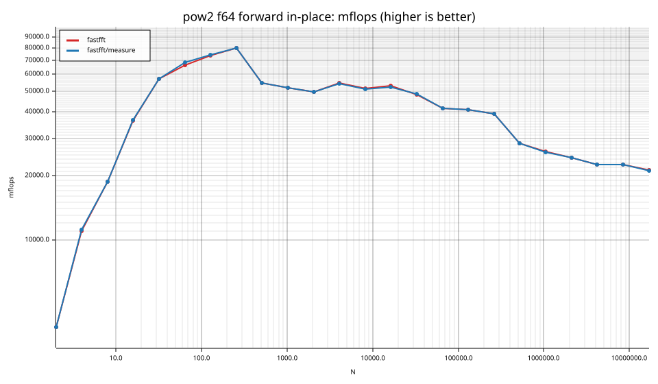

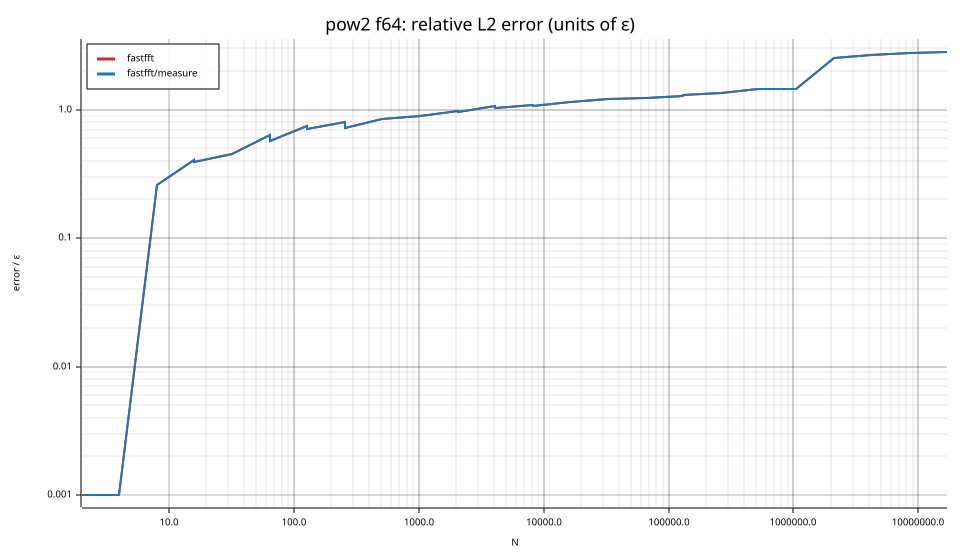

## Suite `smooth`

### smooth f32

| cell | fastfft | fastfft/measure |
|---|---|---|
| N=6 fwd ip | 7.4ns | 7.4ns |
| N=6 fwd oop | 2.9ns | 2.9ns |
| N=6 inv ip | 7.4ns | 7.4ns |
| N=6 inv oop | 2.9ns | 2.9ns |
| N=9 fwd ip | 10.8ns | 10.7ns |
| N=9 fwd oop | 6.0ns | 6.0ns |
| N=9 inv ip | 10.8ns | 10.8ns |
| N=9 inv oop | 6.0ns | 6.0ns |
| N=12 fwd ip | 9.8ns | 9.8ns |
| N=12 fwd oop | 6.2ns | 6.2ns |
| N=12 inv ip | 9.4ns | 9.4ns |
| N=12 inv oop | 6.1ns | 6.1ns |
| N=15 fwd ip | 13.6ns | 13.6ns |
| N=15 fwd oop | 11.1ns | 11.1ns |
| N=15 inv ip | 21.8ns | 14.4ns |
| N=15 inv oop | 15.9ns | 11.2ns |
| N=18 fwd ip | 15.7ns | 15.8ns |
| N=18 fwd oop | 10.6ns | 10.6ns |
| N=18 inv ip | 15.9ns | 15.9ns |
| N=18 inv oop | 10.6ns | 10.6ns |
| N=24 fwd ip | 13.4ns | 13.4ns |
| N=24 fwd oop | 10.4ns | 10.4ns |
| N=24 inv ip | 12.9ns | 12.9ns |
| N=24 inv oop | 10.4ns | 10.4ns |
| N=36 fwd ip | 19.1ns | 19.0ns |
| N=36 fwd oop | 17.2ns | 17.2ns |
| N=36 inv ip | 18.8ns | 18.9ns |
| N=36 inv oop | 16.6ns | 17.0ns |
| N=48 fwd ip | 15.6ns | 15.6ns |
| N=48 fwd oop | 12.2ns | 12.3ns |
| N=48 inv ip | 15.6ns | 15.7ns |
| N=48 inv oop | 12.3ns | 12.3ns |
| N=80 fwd ip | 35.4ns | 35.4ns |
| N=80 fwd oop | 29.8ns | 28.9ns |
| N=80 inv ip | 35.0ns | 35.1ns |
| N=80 inv oop | 29.4ns | 29.8ns |
| N=96 fwd ip | 34.5ns | 34.5ns |
| N=96 fwd oop | 32.9ns | 33.0ns |
| N=96 inv ip | 34.8ns | 34.2ns |
| N=96 inv oop | 32.6ns | 32.6ns |
| N=108 fwd ip | 46.5ns | 46.9ns |
| N=108 fwd oop | 41.1ns | 41.1ns |
| N=108 inv ip | 46.5ns | 46.9ns |
| N=108 inv oop | 41.4ns | 41.3ns |
| N=120 fwd ip | 58.6ns | 58.6ns |
| N=120 fwd oop | 54.4ns | 55.0ns |
| N=120 inv ip | 58.8ns | 58.8ns |
| N=120 inv oop | 54.8ns | 55.2ns |
| N=160 fwd ip | 75.7ns | 76.5ns |
| N=160 fwd oop | 75.4ns | 75.2ns |
| N=160 inv ip | 76.3ns | 76.5ns |
| N=160 inv oop | 73.6ns | 73.9ns |
| N=210 fwd ip | 116.0ns | 112.6ns |
| N=210 fwd oop | 109.9ns | 112.0ns |
| N=210 inv ip | 114.4ns | 114.4ns |
| N=210 inv oop | 112.3ns | 112.1ns |
| N=240 fwd ip | 99.5ns | 99.9ns |
| N=240 fwd oop | 98.0ns | 97.5ns |
| N=240 inv ip | 98.9ns | 98.5ns |
| N=240 inv oop | 98.6ns | 97.6ns |
| N=320 fwd ip | 139.3ns | 140.0ns |
| N=320 fwd oop | 140.4ns | 140.8ns |
| N=320 inv ip | 139.7ns | 140.2ns |
| N=320 inv oop | 139.9ns | 139.1ns |
| N=384 fwd ip | 166.2ns | 166.1ns |
| N=384 fwd oop | 166.9ns | 166.7ns |
| N=384 inv ip | 166.7ns | 166.9ns |
| N=384 inv oop | 167.7ns | 166.7ns |
| N=480 fwd ip | 244.3ns | 244.9ns |
| N=480 fwd oop | 246.3ns | 245.2ns |
| N=480 inv ip | 244.7ns | 243.5ns |
| N=480 inv oop | 245.6ns | 244.8ns |
| N=504 fwd ip | 237.1ns | 237.0ns |
| N=504 fwd oop | 237.1ns | 237.1ns |
| N=504 inv ip | 237.5ns | 236.9ns |
| N=504 inv oop | 237.7ns | 237.1ns |
| N=640 fwd ip | 283.0ns | 283.6ns |
| N=640 fwd oop | 285.0ns | 284.6ns |
| N=640 inv ip | 284.2ns | 283.1ns |
| N=640 inv oop | 285.0ns | 283.8ns |
| N=720 fwd ip | 331.0ns | 332.2ns |
| N=720 fwd oop | 337.1ns | 337.9ns |
| N=720 inv ip | 332.2ns | 331.7ns |
| N=720 inv oop | 337.9ns | 337.9ns |
| N=768 fwd ip | 344.5ns | 342.8ns |
| N=768 fwd oop | 343.5ns | 343.2ns |
| N=768 inv ip | 344.1ns | 344.1ns |
| N=768 inv oop | 343.6ns | 343.9ns |
| N=960 fwd ip | 452.2ns | 449.2ns |
| N=960 fwd oop | 453.7ns | 454.6ns |
| N=960 inv ip | 450.4ns | 446.9ns |
| N=960 inv oop | 451.6ns | 451.1ns |
| N=1000 fwd ip | 614.4ns | 614.4ns |
| N=1000 fwd oop | 602.9ns | 604.6ns |
| N=1000 inv ip | 621.2ns | 622.8ns |
| N=1000 inv oop | 604.5ns | 607.8ns |
| N=1200 fwd ip | 668.2ns | 668.2ns |
| N=1200 fwd oop | 667.6ns | 668.8ns |
| N=1200 inv ip | 663.6ns | 665.3ns |
| N=1200 inv oop | 667.3ns | 661.1ns |
| N=1536 fwd ip | 768.1ns | 765.9ns |
| N=1536 fwd oop | 767.0ns | 761.9ns |
| N=1536 inv ip | 770.2ns | 767.5ns |
| N=1536 inv oop | 763.5ns | 763.2ns |
| N=1920 fwd ip | 1.06us | 1.06us |
| N=1920 fwd oop | 1.05us | 1.05us |
| N=1920 inv ip | 1.06us | 1.06us |
| N=1920 inv oop | 1.06us | 1.05us |
| N=1960 fwd ip | 1.25us | 1.25us |
| N=1960 fwd oop | 1.22us | 1.23us |
| N=1960 inv ip | 1.25us | 1.25us |
| N=1960 inv oop | 1.24us | 1.24us |
| N=2400 fwd ip | 1.47us | 1.46us |
| N=2400 fwd oop | 1.42us | 1.42us |
| N=2400 inv ip | 1.47us | 1.47us |
| N=2400 inv oop | 1.41us | 1.41us |
| N=3072 fwd ip | 1.70us | 1.70us |
| N=3072 fwd oop | 1.69us | 1.69us |
| N=3072 inv ip | 1.71us | 1.70us |
| N=3072 inv oop | 1.70us | 1.69us |
| N=4725 fwd ip | 4.61us | 4.62us |
| N=4725 fwd oop | 4.63us | 4.61us |
| N=4725 inv ip | 4.70us | 4.66us |
| N=4725 inv oop | 4.62us | 4.63us |
| N=4800 fwd ip | 2.86us | 2.85us |
| N=4800 fwd oop | 2.83us | 2.82us |
| N=4800 inv ip | 2.86us | 2.86us |
| N=4800 inv oop | 2.83us | 2.83us |
| N=6144 fwd ip | 3.73us | 3.72us |
| N=6144 fwd oop | 3.67us | 3.67us |
| N=6144 inv ip | 3.72us | 3.74us |
| N=6144 inv oop | 3.68us | 3.67us |
| N=10368 fwd ip | 6.60us | 6.59us |
| N=10368 fwd oop | 6.57us | 6.55us |
| N=10368 inv ip | 6.59us | 6.58us |
| N=10368 inv oop | 6.57us | 6.55us |
| N=12288 fwd ip | 7.98us | 8.01us |
| N=12288 fwd oop | 8.30us | 8.33us |
| N=12288 inv ip | 7.98us | 8.01us |
| N=12288 inv oop | 8.28us | 8.33us |
| N=27000 fwd ip | 20.39us | 20.35us |
| N=27000 fwd oop | 20.18us | 20.16us |
| N=27000 inv ip | 20.12us | 20.10us |
| N=27000 inv oop | 19.98us | 20.17us |
| N=48000 fwd ip | 35.19us | 35.33us |
| N=48000 fwd oop | 35.71us | 35.82us |
| N=48000 inv ip | 35.27us | 35.27us |
| N=48000 inv oop | 35.56us | 35.46us |
| N=75600 fwd ip | 65.91us | 66.08us |
| N=75600 fwd oop | 68.32us | 68.58us |
| N=75600 inv ip | 65.25us | 64.32us |
| N=75600 inv oop | 68.56us | 68.12us |
| N=96000 fwd ip | 78.80us | 78.85us |
| N=96000 fwd oop | 77.27us | 77.76us |
| N=96000 inv ip | 76.96us | 76.69us |
| N=96000 inv oop | 77.25us | 77.33us |
| N=165375 fwd ip | 239.22us | 239.73us |
| N=165375 fwd oop | 239.43us | 240.50us |
| N=165375 inv ip | 239.37us | 239.32us |
| N=165375 inv oop | 241.56us | 241.15us |
| N=1000000 fwd ip | 2.74ms | 2.66ms |
| N=1000000 fwd oop | 2.94ms | 2.84ms |
| N=1000000 inv ip | 2.64ms | 2.75ms |
| N=1000000 inv oop | 2.98ms | 2.92ms |

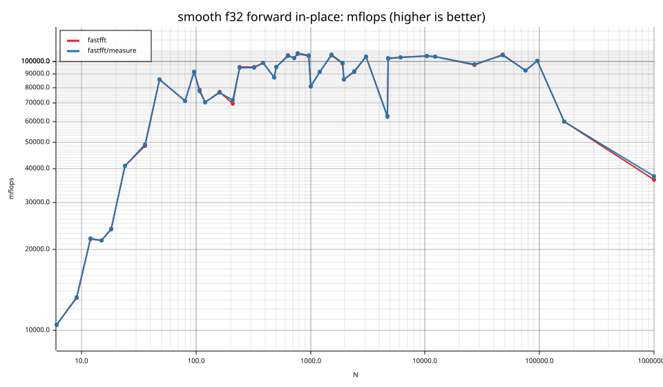

### smooth f64

| cell | fastfft | fastfft/measure |
|---|---|---|
| N=6 fwd ip | 5.4ns | 5.4ns |
| N=6 fwd oop | 2.4ns | 2.4ns |
| N=6 inv ip | 5.4ns | 5.4ns |
| N=6 inv oop | 2.4ns | 2.4ns |
| N=9 fwd ip | 8.5ns | 8.5ns |
| N=9 fwd oop | 4.5ns | 4.4ns |
| N=9 inv ip | 8.5ns | 8.5ns |
| N=9 inv oop | 4.5ns | 4.5ns |
| N=12 fwd ip | 8.6ns | 8.6ns |
| N=12 fwd oop | 5.7ns | 5.7ns |
| N=12 inv ip | 8.6ns | 8.6ns |
| N=12 inv oop | 5.7ns | 5.7ns |
| N=15 fwd ip | 14.7ns | 14.7ns |
| N=15 fwd oop | 13.9ns | 14.0ns |
| N=15 inv ip | 14.0ns | 14.0ns |
| N=15 inv oop | 13.1ns | 13.1ns |
| N=18 fwd ip | 11.0ns | 11.0ns |
| N=18 fwd oop | 8.5ns | 8.5ns |
| N=18 inv ip | 11.0ns | 11.1ns |
| N=18 inv oop | 8.5ns | 8.5ns |
| N=24 fwd ip | 12.1ns | 12.1ns |
| N=24 fwd oop | 8.4ns | 8.4ns |
| N=24 inv ip | 12.1ns | 12.1ns |
| N=24 inv oop | 8.4ns | 8.4ns |
| N=36 fwd ip | 17.6ns | 17.3ns |
| N=36 fwd oop | 15.1ns | 15.2ns |
| N=36 inv ip | 17.3ns | 17.6ns |
| N=36 inv oop | 15.1ns | 15.2ns |
| N=48 fwd ip | 21.5ns | 21.5ns |
| N=48 fwd oop | 19.3ns | 19.3ns |
| N=48 inv ip | 21.5ns | 21.5ns |
| N=48 inv oop | 19.4ns | 19.4ns |
| N=80 fwd ip | 55.5ns | 56.5ns |
| N=80 fwd oop | 53.1ns | 53.0ns |
| N=80 inv ip | 54.7ns | 54.5ns |
| N=80 inv oop | 52.7ns | 53.2ns |
| N=96 fwd ip | 63.9ns | 64.1ns |
| N=96 fwd oop | 62.1ns | 61.8ns |
| N=96 inv ip | 63.4ns | 63.1ns |
| N=96 inv oop | 62.0ns | 62.0ns |
| N=108 fwd ip | 80.1ns | 79.5ns |
| N=108 fwd oop | 77.5ns | 77.9ns |
| N=108 inv ip | 79.9ns | 79.7ns |
| N=108 inv oop | 77.9ns | 77.8ns |
| N=120 fwd ip | 79.8ns | 79.9ns |
| N=120 fwd oop | 79.8ns | 79.6ns |
| N=120 inv ip | 80.0ns | 80.4ns |
| N=120 inv oop | 79.0ns | 79.7ns |
| N=160 fwd ip | 119.4ns | 119.5ns |
| N=160 fwd oop | 119.7ns | 119.3ns |
| N=160 inv ip | 119.3ns | 119.3ns |
| N=160 inv oop | 119.6ns | 119.6ns |
| N=210 fwd ip | 276.6ns | 278.4ns |
| N=210 fwd oop | 278.7ns | 277.4ns |
| N=210 inv ip | 293.5ns | 285.3ns |
| N=210 inv oop | 308.2ns | 283.5ns |
| N=240 fwd ip | 183.8ns | 182.4ns |
| N=240 fwd oop | 180.7ns | 180.5ns |
| N=240 inv ip | 181.5ns | 183.0ns |
| N=240 inv oop | 182.0ns | 180.7ns |
| N=320 fwd ip | 245.0ns | 245.1ns |
| N=320 fwd oop | 244.7ns | 245.1ns |
| N=320 inv ip | 245.3ns | 244.9ns |
| N=320 inv oop | 245.2ns | 244.5ns |
| N=384 fwd ip | 296.1ns | 296.6ns |
| N=384 fwd oop | 296.4ns | 296.1ns |
| N=384 inv ip | 296.8ns | 296.9ns |
| N=384 inv oop | 295.6ns | 296.9ns |
| N=480 fwd ip | 391.1ns | 390.6ns |
| N=480 fwd oop | 392.2ns | 391.3ns |
| N=480 inv ip | 387.7ns | 386.1ns |
| N=480 inv oop | 390.7ns | 389.0ns |
| N=504 fwd ip | 445.6ns | 450.5ns |
| N=504 fwd oop | 442.3ns | 441.7ns |
| N=504 inv ip | 451.0ns | 451.6ns |
| N=504 inv oop | 442.3ns | 440.7ns |
| N=640 fwd ip | 549.7ns | 549.1ns |
| N=640 fwd oop | 546.0ns | 544.7ns |
| N=640 inv ip | 553.3ns | 552.7ns |
| N=640 inv oop | 551.0ns | 551.0ns |
| N=720 fwd ip | 634.5ns | 635.3ns |
| N=720 fwd oop | 634.5ns | 634.9ns |
| N=720 inv ip | 638.9ns | 638.5ns |
| N=720 inv oop | 638.9ns | 638.4ns |
| N=768 fwd ip | 671.0ns | 672.5ns |
| N=768 fwd oop | 680.9ns | 668.2ns |
| N=768 inv ip | 671.8ns | 673.1ns |
| N=768 inv oop | 688.0ns | 674.8ns |
| N=960 fwd ip | 871.7ns | 870.9ns |
| N=960 fwd oop | 868.5ns | 867.8ns |
| N=960 inv ip | 869.6ns | 872.0ns |
| N=960 inv oop | 873.5ns | 877.7ns |
| N=1000 fwd ip | 1.06us | 1.06us |
| N=1000 fwd oop | 1.04us | 1.04us |
| N=1000 inv ip | 1.06us | 1.07us |
| N=1000 inv oop | 1.04us | 1.05us |
| N=1200 fwd ip | 1.20us | 1.20us |
| N=1200 fwd oop | 1.23us | 1.22us |
| N=1200 inv ip | 1.25us | 1.25us |
| N=1200 inv oop | 1.26us | 1.26us |
| N=1536 fwd ip | 1.57us | 1.57us |
| N=1536 fwd oop | 1.53us | 1.54us |
| N=1536 inv ip | 1.56us | 1.56us |
| N=1536 inv oop | 1.54us | 1.54us |
| N=1920 fwd ip | 1.99us | 1.98us |
| N=1920 fwd oop | 1.95us | 1.95us |
| N=1920 inv ip | 1.98us | 1.98us |
| N=1920 inv oop | 1.95us | 1.95us |
| N=1960 fwd ip | 2.20us | 2.20us |
| N=1960 fwd oop | 2.20us | 2.20us |
| N=1960 inv ip | 2.20us | 2.21us |
| N=1960 inv oop | 2.20us | 2.21us |
| N=2400 fwd ip | 2.59us | 2.59us |
| N=2400 fwd oop | 2.55us | 2.55us |
| N=2400 inv ip | 2.61us | 2.61us |
| N=2400 inv oop | 2.57us | 2.57us |
| N=3072 fwd ip | 3.43us | 3.42us |
| N=3072 fwd oop | 3.40us | 3.40us |
| N=3072 inv ip | 3.44us | 3.42us |
| N=3072 inv oop | 3.38us | 3.40us |
| N=4725 fwd ip | 8.52us | 8.52us |
| N=4725 fwd oop | 8.83us | 8.73us |
| N=4725 inv ip | 8.67us | 8.57us |
| N=4725 inv oop | 8.71us | 8.57us |
| N=4800 fwd ip | 5.32us | 5.32us |
| N=4800 fwd oop | 5.14us | 5.12us |
| N=4800 inv ip | 5.34us | 5.31us |
| N=4800 inv oop | 5.13us | 5.12us |
| N=6144 fwd ip | 7.41us | 7.40us |
| N=6144 fwd oop | 7.75us | 7.76us |
| N=6144 inv ip | 7.36us | 7.39us |
| N=6144 inv oop | 7.76us | 7.76us |
| N=10368 fwd ip | 12.09us | 12.25us |
| N=10368 fwd oop | 12.12us | 12.28us |
| N=10368 inv ip | 12.05us | 12.22us |
| N=10368 inv oop | 12.06us | 12.16us |
| N=12288 fwd ip | 15.59us | 15.76us |
| N=12288 fwd oop | 17.82us | 17.77us |
| N=12288 inv ip | 15.79us | 15.86us |
| N=12288 inv oop | 17.75us | 17.71us |
| N=27000 fwd ip | 42.24us | 42.73us |
| N=27000 fwd oop | 42.09us | 42.12us |
| N=27000 inv ip | 43.37us | 43.31us |
| N=27000 inv oop | 41.96us | 41.76us |
| N=48000 fwd ip | 68.17us | 68.11us |
| N=48000 fwd oop | 71.49us | 71.34us |
| N=48000 inv ip | 68.37us | 68.60us |
| N=48000 inv oop | 71.89us | 71.69us |
| N=75600 fwd ip | 129.57us | 128.69us |
| N=75600 fwd oop | 128.23us | 128.94us |
| N=75600 inv ip | 129.10us | 129.63us |
| N=75600 inv oop | 128.51us | 128.54us |
| N=96000 fwd ip | 143.18us | 143.38us |
| N=96000 fwd oop | 149.76us | 149.48us |
| N=96000 inv ip | 141.70us | 141.46us |
| N=96000 inv oop | 149.59us | 149.48us |
| N=165375 fwd ip | 414.00us | 411.54us |
| N=165375 fwd oop | 461.86us | 463.32us |
| N=165375 inv ip | 416.64us | 417.11us |
| N=165375 inv oop | 454.70us | 467.15us |
| N=1000000 fwd ip | 7.73ms | 7.76ms |
| N=1000000 fwd oop | 8.07ms | 8.06ms |
| N=1000000 inv ip | 7.72ms | 7.67ms |
| N=1000000 inv oop | 8.05ms | 8.08ms |

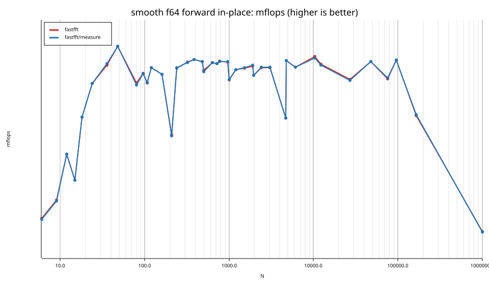

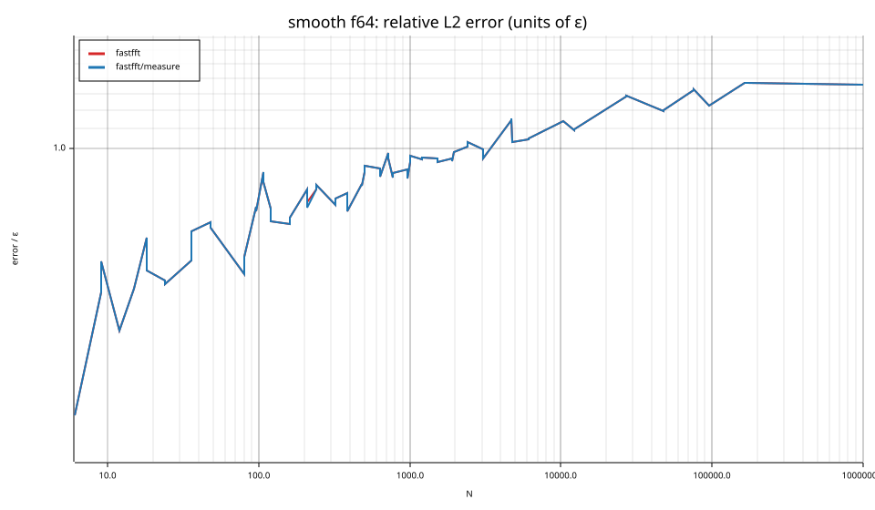

## Suite `rough`

### rough f32

| cell | fastfft | fastfft/measure |
|---|---|---|
| N=17 fwd ip | 46.6ns | 46.4ns |
| N=17 fwd oop | 44.9ns | 45.3ns |
| N=17 inv ip | 47.4ns | 47.4ns |
| N=17 inv oop | 45.2ns | 45.3ns |
| N=31 fwd ip | 62.7ns | 61.6ns |
| N=31 fwd oop | 63.1ns | 62.5ns |
| N=31 inv ip | 62.5ns | 62.3ns |
| N=31 inv oop | 62.0ns | 63.5ns |
| N=61 fwd ip | 120.0ns | 120.9ns |
| N=61 fwd oop | 120.1ns | 120.6ns |
| N=61 inv ip | 120.2ns | 120.5ns |
| N=61 inv oop | 121.8ns | 119.5ns |
| N=127 fwd ip | 218.9ns | 220.0ns |
| N=127 fwd oop | 220.2ns | 220.9ns |
| N=127 inv ip | 220.1ns | 221.6ns |
| N=127 inv oop | 222.4ns | 221.8ns |
| N=257 fwd ip | 571.1ns | 569.5ns |
| N=257 fwd oop | 576.6ns | 573.5ns |
| N=257 inv ip | 574.0ns | 571.7ns |
| N=257 inv oop | 576.0ns | 576.2ns |
| N=509 fwd ip | 1.26us | 1.26us |
| N=509 fwd oop | 1.26us | 1.28us |
| N=509 inv ip | 1.26us | 1.27us |
| N=509 inv oop | 1.27us | 1.27us |
| N=1021 fwd ip | 2.66us | 2.68us |
| N=1021 fwd oop | 2.66us | 2.67us |
| N=1021 inv ip | 2.67us | 2.67us |
| N=1021 inv oop | 2.68us | 2.67us |
| N=2018 fwd ip | 6.55us | 6.57us |
| N=2018 fwd oop | 6.56us | 6.59us |
| N=2018 inv ip | 6.54us | 6.52us |
| N=2018 inv oop | 6.57us | 6.55us |
| N=2053 fwd ip | 7.27us | 7.26us |
| N=2053 fwd oop | 7.25us | 7.25us |
| N=2053 inv ip | 7.23us | 7.24us |
| N=2053 inv oop | 7.23us | 7.22us |
| N=3063 fwd ip | 9.39us | 9.34us |
| N=3063 fwd oop | 9.38us | 9.38us |
| N=3063 inv ip | 9.34us | 9.30us |
| N=3063 inv oop | 9.38us | 9.34us |
| N=4099 fwd ip | 14.35us | 14.37us |
| N=4099 fwd oop | 14.35us | 14.39us |
| N=4099 inv ip | 14.35us | 14.38us |
| N=4099 inv oop | 14.40us | 14.40us |
| N=8191 fwd ip | 27.04us | 27.12us |
| N=8191 fwd oop | 27.08us | 27.20us |
| N=8191 inv ip | 27.06us | 27.10us |
| N=8191 inv oop | 27.19us | 27.21us |
| N=9797 fwd ip | 34.53us | 34.52us |
| N=9797 fwd oop | 34.81us | 34.63us |
| N=9797 inv ip | 34.26us | 34.45us |
| N=9797 inv oop | 34.56us | 34.38us |
| N=16381 fwd ip | 63.11us | 62.37us |
| N=16381 fwd oop | 63.17us | 62.86us |
| N=16381 inv ip | 64.17us | 62.58us |
| N=16381 inv oop | 64.57us | 62.75us |
| N=65524 fwd ip | 332.35us | 330.84us |
| N=65524 fwd oop | 330.79us | 331.11us |
| N=65524 inv ip | 330.50us | 331.12us |
| N=65524 inv oop | 331.48us | 330.00us |
| N=65537 fwd ip | 332.37us | 331.19us |
| N=65537 fwd oop | 331.39us | 331.67us |
| N=65537 inv ip | 330.98us | 331.89us |
| N=65537 inv oop | 332.81us | 329.52us |
| N=131071 fwd ip | 725.25us | 710.88us |
| N=131071 fwd oop | 730.69us | 712.95us |
| N=131071 inv ip | 723.41us | 710.09us |
| N=131071 inv oop | 730.05us | 712.20us |

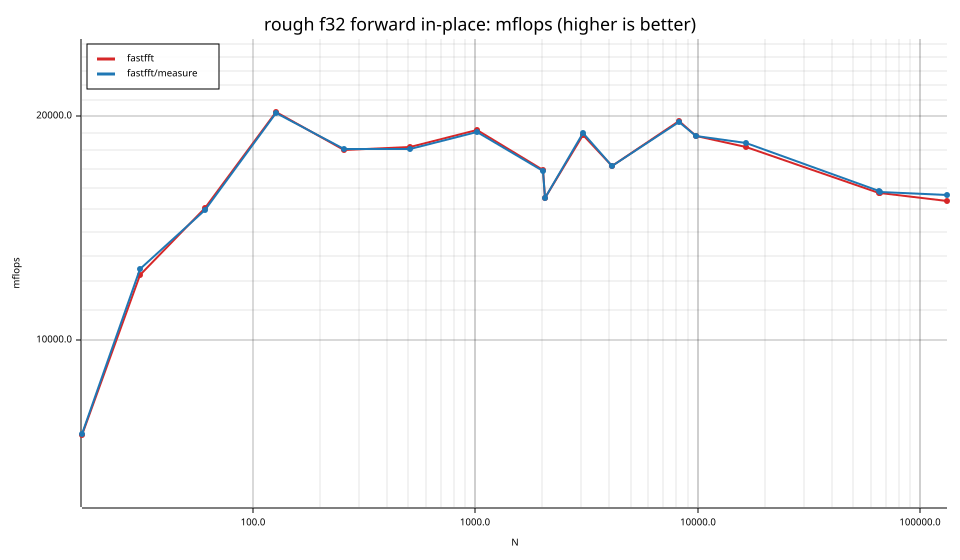

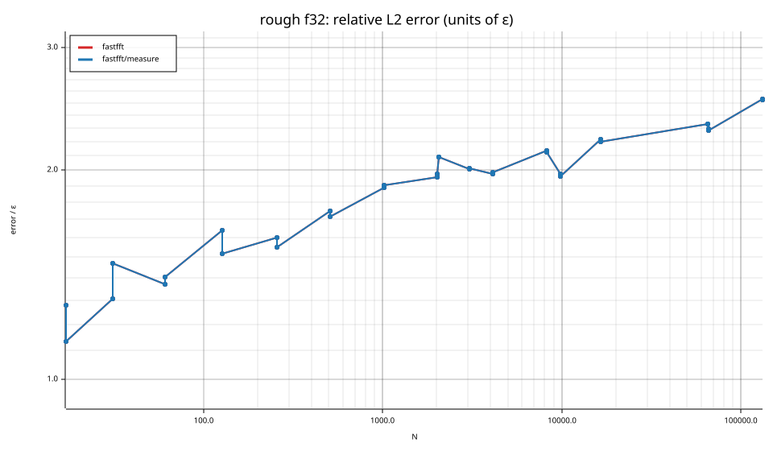

### rough f64

| cell | fastfft | fastfft/measure |
|---|---|---|
| N=17 fwd ip | 56.3ns | 55.7ns |
| N=17 fwd oop | 56.6ns | 56.3ns |
| N=17 inv ip | 57.0ns | 57.1ns |
| N=17 inv oop | 56.7ns | 57.7ns |
| N=31 fwd ip | 97.1ns | 97.8ns |
| N=31 fwd oop | 97.4ns | 98.8ns |
| N=31 inv ip | 98.1ns | 97.5ns |
| N=31 inv oop | 97.5ns | 98.3ns |
| N=61 fwd ip | 187.6ns | 187.6ns |
| N=61 fwd oop | 185.4ns | 186.2ns |
| N=61 inv ip | 189.2ns | 186.8ns |
| N=61 inv oop | 188.7ns | 190.5ns |
| N=127 fwd ip | 379.1ns | 378.7ns |
| N=127 fwd oop | 387.7ns | 387.5ns |
| N=127 inv ip | 383.8ns | 381.4ns |
| N=127 inv oop | 389.3ns | 388.6ns |
| N=257 fwd ip | 1.11us | 1.11us |
| N=257 fwd oop | 1.12us | 1.12us |
| N=257 inv ip | 1.12us | 1.12us |
| N=257 inv oop | 1.12us | 1.12us |
| N=509 fwd ip | 2.47us | 2.47us |
| N=509 fwd oop | 2.48us | 2.48us |
| N=509 inv ip | 2.49us | 2.47us |
| N=509 inv oop | 2.48us | 2.49us |
| N=1021 fwd ip | 5.73us | 5.72us |
| N=1021 fwd oop | 5.75us | 5.74us |
| N=1021 inv ip | 5.79us | 5.73us |
| N=1021 inv oop | 5.71us | 5.73us |
| N=2018 fwd ip | 12.59us | 12.59us |
| N=2018 fwd oop | 12.67us | 12.68us |
| N=2018 inv ip | 12.66us | 12.64us |
| N=2018 inv oop | 12.63us | 12.70us |
| N=2053 fwd ip | 13.58us | 13.59us |
| N=2053 fwd oop | 13.64us | 13.59us |
| N=2053 inv ip | 13.64us | 13.60us |
| N=2053 inv oop | 13.64us | 13.61us |
| N=3063 fwd ip | 18.23us | 18.28us |
| N=3063 fwd oop | 18.21us | 18.31us |
| N=3063 inv ip | 18.29us | 18.27us |
| N=3063 inv oop | 18.25us | 18.28us |
| N=4099 fwd ip | 27.50us | 27.56us |
| N=4099 fwd oop | 27.74us | 27.83us |
| N=4099 inv ip | 27.70us | 27.59us |
| N=4099 inv oop | 27.86us | 27.85us |
| N=8191 fwd ip | 54.91us | 54.49us |
| N=8191 fwd oop | 55.58us | 54.95us |
| N=8191 inv ip | 54.77us | 54.61us |
| N=8191 inv oop | 55.21us | 55.17us |
| N=9797 fwd ip | 79.88us | 80.03us |
| N=9797 fwd oop | 79.94us | 80.23us |
| N=9797 inv ip | 79.86us | 79.96us |
| N=9797 inv oop | 80.08us | 80.68us |
| N=16381 fwd ip | 126.97us | 125.33us |
| N=16381 fwd oop | 127.56us | 125.61us |
| N=16381 inv ip | 126.85us | 125.21us |
| N=16381 inv oop | 127.40us | 125.80us |
| N=65524 fwd ip | 640.94us | 643.68us |
| N=65524 fwd oop | 646.57us | 643.62us |
| N=65524 inv ip | 647.18us | 645.20us |
| N=65524 inv oop | 650.84us | 647.48us |
| N=65537 fwd ip | 645.67us | 646.10us |
| N=65537 fwd oop | 647.24us | 646.67us |
| N=65537 inv ip | 643.10us | 641.04us |
| N=65537 inv oop | 646.74us | 647.17us |
| N=131071 fwd ip | 1.79ms | 1.77ms |
| N=131071 fwd oop | 1.84ms | 1.84ms |
| N=131071 inv ip | 1.79ms | 1.79ms |
| N=131071 inv oop | 1.84ms | 1.83ms |

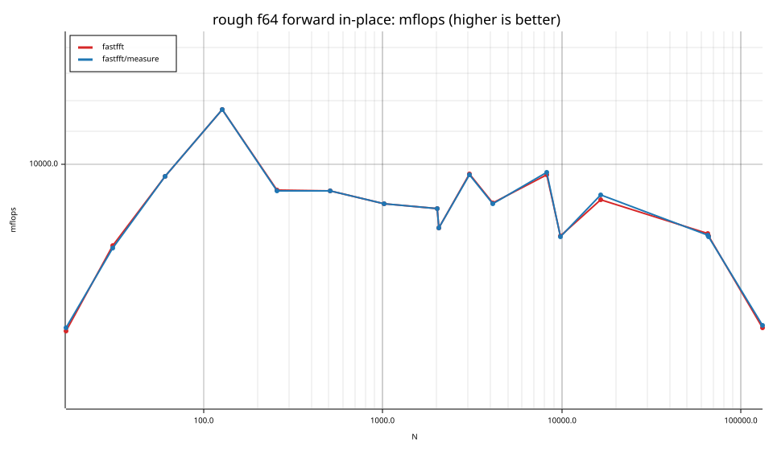

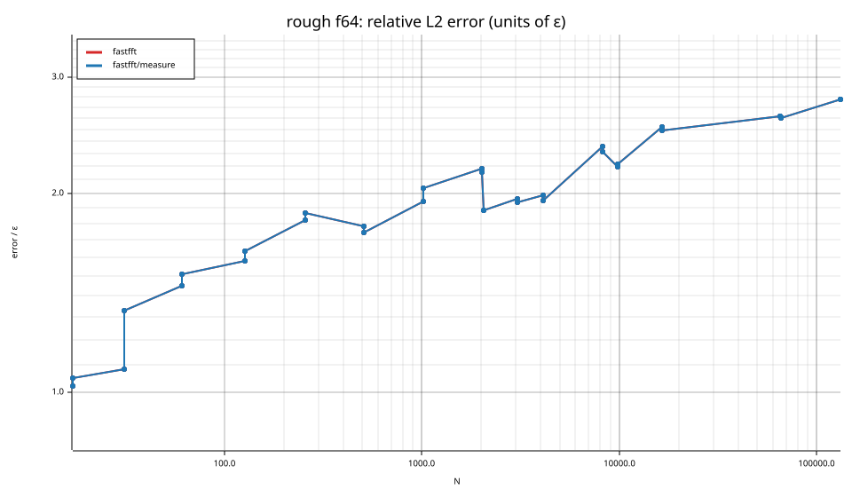

## Suite `batch`

### batch f32

| cell | fastfft | fastfft/measure |
|---|---|---|
| N=8 ×131072 fwd ip | 1.3ns | 1.3ns |
| N=8 ×131072 fwd oop | 1.6ns | 1.6ns |
| N=16 ×65536 fwd ip | 2.8ns | 2.8ns |
| N=16 ×65536 fwd oop | 3.2ns | 3.2ns |
| N=32 ×32768 fwd ip | 7.2ns | 7.2ns |
| N=32 ×32768 fwd oop | 7.2ns | 7.0ns |
| N=64 ×16384 fwd ip | 15.3ns | 15.3ns |
| N=64 ×16384 fwd oop | 15.6ns | 15.6ns |
| N=128 ×8192 fwd ip | 37.3ns | 37.3ns |
| N=128 ×8192 fwd oop | 42.4ns | 42.3ns |
| N=256 ×4096 fwd ip | 78.6ns | 79.7ns |
| N=256 ×4096 fwd oop | 106.9ns | 106.3ns |
| N=512 ×2048 fwd ip | 254.6ns | 253.7ns |
| N=512 ×2048 fwd oop | 293.3ns | 294.1ns |
| N=1024 ×1024 fwd ip | 560.6ns | 561.8ns |
| N=1024 ×1024 fwd oop | 672.5ns | 674.9ns |

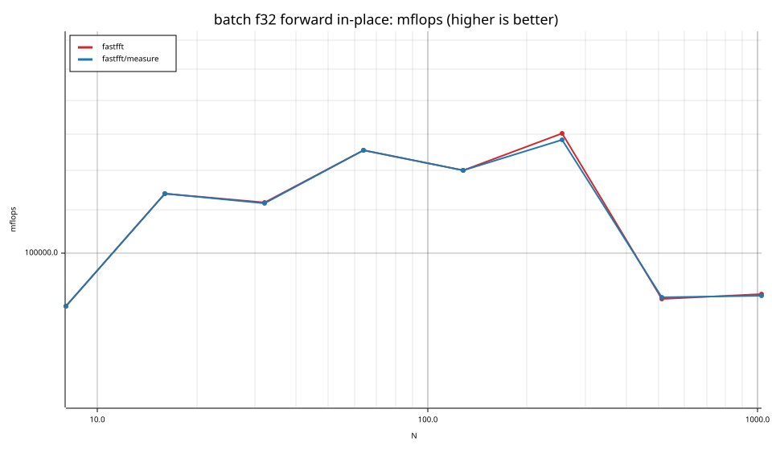

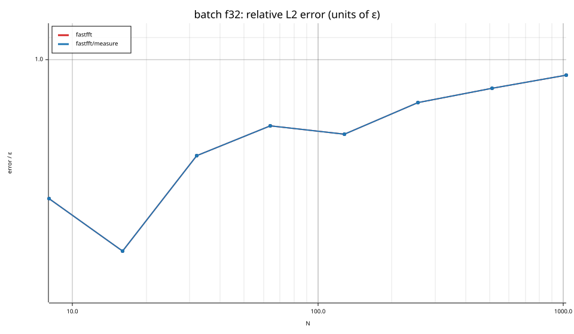

### batch f64

| cell | fastfft | fastfft/measure |
|---|---|---|
| N=8 ×131072 fwd ip | 3.8ns | 3.8ns |
| N=8 ×131072 fwd oop | 4.9ns | 4.9ns |
| N=16 ×65536 fwd ip | 5.0ns | 5.0ns |
| N=16 ×65536 fwd oop | 9.8ns | 9.8ns |
| N=32 ×32768 fwd ip | 13.8ns | 13.8ns |
| N=32 ×32768 fwd oop | 19.7ns | 20.3ns |
| N=64 ×16384 fwd ip | 31.0ns | 31.0ns |
| N=64 ×16384 fwd oop | 43.9ns | 41.5ns |
| N=128 ×8192 fwd ip | 86.7ns | 86.9ns |
| N=128 ×8192 fwd oop | 108.0ns | 107.8ns |
| N=256 ×4096 fwd ip | 240.2ns | 242.9ns |
| N=256 ×4096 fwd oop | 318.6ns | 298.6ns |
| N=512 ×2048 fwd ip | 678.1ns | 676.6ns |
| N=512 ×2048 fwd oop | 898.1ns | 894.0ns |
| N=1024 ×1024 fwd ip | 1.41us | 1.42us |
| N=1024 ×1024 fwd oop | 1.85us | 1.86us |

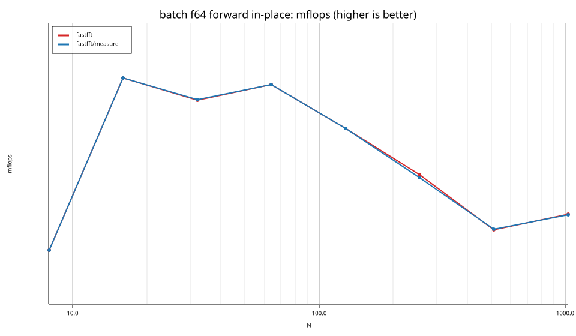

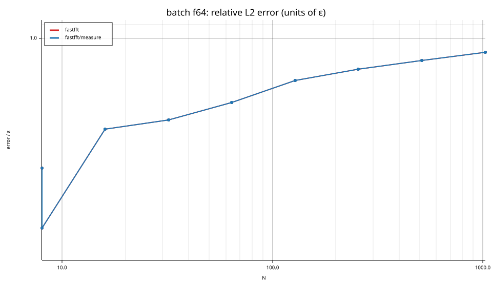

## Suite `realworld`

### realworld f32

| cell | fastfft | fastfft/measure |
|---|---|---|
| Spectrogram N=1024 | 802 MS/s | 787 MS/s |
| Spectrogram N=4096 | 647 MS/s | 648 MS/s |
| Spectrogram N=16384 | 609 MS/s | 611 MS/s |
| Spectrogram N=65536 | 539 MS/s | 542 MS/s |
| OverlapSave N=4096 | 331 MS/s | 333 MS/s |

### realworld f64

| cell | fastfft | fastfft/measure |
|---|---|---|
| Spectrogram N=4096 | 336 MS/s | 337 MS/s |

## Suite `datacheck`

### datacheck f32

| cell | fastfft | fastfft/measure |
|---|---|---|
| N=64 fwd imm | 16.1ns | 15.9ns |
| N=64 fwd imm | 16.0ns | 16.2ns |
| N=4096 fwd imm | 2.82us | 2.86us |
| N=4096 fwd imm | 2.72us | 2.75us |
| N=65536 fwd imm | 64.92us | 65.01us |
| N=65536 fwd imm | 65.02us | 65.35us |
| N=1048576 fwd imm | 1.78ms | 1.79ms |
| N=1048576 fwd imm | 1.77ms | 1.79ms |

### datacheck f64

| cell | fastfft | fastfft/measure |
|---|---|---|
| N=64 fwd imm | 26.9ns | 27.0ns |
| N=64 fwd imm | 27.1ns | 27.0ns |
| N=4096 fwd imm | 4.54us | 4.54us |
| N=4096 fwd imm | 4.59us | 4.58us |
| N=65536 fwd imm | 127.27us | 127.32us |
| N=65536 fwd imm | 128.27us | 127.99us |
| N=1048576 fwd imm | 4.14ms | 4.18ms |
| N=1048576 fwd imm | 4.15ms | 4.18ms |

## Accuracy and planning time (medians over cells)

| lib | cells verified | failed | median error (ε) | worst error (ε) | median plan time |
|---|---|---|---|---|---|
| fastfft | 710 | 0 | 1.01 | 2.81 | 15.12us |
| fastfft/measure | 710 | 0 | 1.01 | 2.81 | 10.79ms |
