# fastfft arena report: `full`

| | |
|---|---|
| Host | mini-ryzen |
| CPU | AMD Ryzen 7 7840HS w/ Radeon 780M Graphics (family 25, model 116, stepping 1, microcode 0xa704108) |
| Pinned CPU | 4 (SMT siblings 4,12) |
| Governor / EPP / boost | performance / performance / 1 |
| Kernel | Linux version 7.0.0-28-generic |
| Virtualization | none |
| rustc | rustc 1.95.0 (59807616e 2026-04-14); binary: rustc; commit-hash: 59807616e1fa2540724bfbac14d7976d7e4a3860; commit-date: 2026-04-14; host: x86_64-unknown-linux-gnu; release: 1.95.0; LLVM version: 22.1.2 |
| Build profile / RUSTFLAGS | arena / `-C llvm-args=-align-all-functions=6` |
| Libraries | {"fearless_simd":"0.5.0","num-complex":"0.4.6","oxifft":"0.4.2","phastft":"0.4.1","pulp":"0.22.3","rustfft":"6.4.1","tfhe-fft":"0.10.1"} |
| FFTW | ? `?` |
| Git | 932ed59d5d8c23b239436940a1ac8b622a7cbb7f (dirty: true) |
| Profile | full |
| Official | true  |
| Control drift | max 6.41% over 30 control runs — **FLAGGED** |
| Cells | 710 |

Times are per transform. *best* = minimum batch mean, *median* = median batch mean. Speedup = rustfft time ÷ library time (> 1 means faster than rustfft); *geomean* over the cells both libraries ran. mflops = 5·N·log2(N)/t(µs).

## Release gates (fastfft)

| Gate | Criterion | Status | Detail |
|---|---|---|---|
| G1 | pow2 vs rustfft: geomean ≥ 1.5×, no cell < 0.95× | – n/a | no data |
| G2 | smooth vs rustfft: geomean ≥ 1.3×, no cell < 0.95× | – n/a | no data |
| G3 | rough vs rustfft: geomean ≥ 0.75×, no cell < 0.5× | – n/a | no data |
| G4 | vs each other Rust library: geomean ≥ 1.1×, ≥ 0.97× on ≥ 90% of cells | – n/a |  |
| G5 | AVX2 forced: pow2 ≥ 1.2×, smooth ≥ 1.1× vs rustfft | – n/a | pow2 NaN×/NaN×, smooth NaN×/NaN× |
| G6 | scenarios ≥ 1.3× each; batch geomean ≥ 1.5× | – n/a | scenarios min inf×, batch NaN×/NaN× |
| G7 | accuracy within §6 thresholds and ≤ 1.5× rustfft + 1ε | – n/a | 0 cells checked |
| G8 | Estimate planning time ≤ 2× rustfft for every N ≤ 2^20 | – n/a | worst ratio 0.00× (), 0 cells |

G9 (build time) is measured by `cargo xtask build-time`, not by the arena.

## Speedup vs rustfft (geomean of best-time ratios; median-time ratio in parentheses)

| suite | prec | fastfft | fastfft/measure |
|---|---|---|---|
| pow2 | f32 | – | – |
| pow2 | f64 | – | – |
| smooth | f32 | – | – |
| smooth | f64 | – | – |
| rough | f32 | – | – |
| rough | f64 | – | – |
| batch | f32 | – | – |
| batch | f64 | – | – |
| realworld | f32 | – | – |
| realworld | f64 | – | – |
| datacheck | f32 | – | – |
| datacheck | f64 | – | – |

w/t/l = cells faster / within ±3% / slower than rustfft (best times).

## Suite `pow2`

### pow2 f32

| cell | fastfft | fastfft/measure |
|---|---|---|
| N=2 fwd ip | 2.6ns | 2.6ns |
| N=2 fwd oop | 1.2ns | 1.2ns |
| N=2 inv ip | 2.6ns | 2.6ns |
| N=2 inv oop | 1.2ns | 1.2ns |
| N=4 fwd ip | 3.6ns | 3.6ns |
| N=4 fwd oop | 1.4ns | 1.2ns |
| N=4 inv ip | 3.6ns | 3.6ns |
| N=4 inv oop | 1.2ns | 1.2ns |
| N=8 fwd ip | 6.9ns | 6.9ns |
| N=8 fwd oop | 3.0ns | 3.0ns |
| N=8 inv ip | 6.9ns | 6.9ns |
| N=8 inv oop | 3.0ns | 3.0ns |
| N=16 fwd ip | 8.2ns | 8.3ns |
| N=16 fwd oop | 4.0ns | 4.0ns |
| N=16 inv ip | 8.2ns | 8.3ns |
| N=16 inv oop | 3.8ns | 3.8ns |
| N=32 fwd ip | 11.4ns | 11.4ns |
| N=32 fwd oop | 7.8ns | 7.8ns |
| N=32 inv ip | 11.6ns | 11.6ns |
| N=32 inv oop | 7.7ns | 7.8ns |
| N=64 fwd ip | 17.3ns | 17.4ns |
| N=64 fwd oop | 15.9ns | 16.0ns |
| N=64 inv ip | 17.4ns | 17.4ns |
| N=64 inv oop | 15.9ns | 16.1ns |
| N=128 fwd ip | 36.1ns | 36.3ns |
| N=128 fwd oop | 36.5ns | 36.5ns |
| N=128 inv ip | 35.7ns | 36.3ns |
| N=128 inv oop | 35.9ns | 36.5ns |
| N=256 fwd ip | 74.1ns | 74.5ns |
| N=256 fwd oop | 74.6ns | 74.2ns |
| N=256 inv ip | 74.2ns | 74.5ns |
| N=256 inv oop | 74.2ns | 74.0ns |
| N=512 fwd ip | 223.9ns | 223.8ns |
| N=512 fwd oop | 223.0ns | 223.2ns |
| N=512 inv ip | 223.3ns | 223.9ns |
| N=512 inv oop | 224.2ns | 224.6ns |
| N=1024 fwd ip | 499.2ns | 498.7ns |
| N=1024 fwd oop | 497.4ns | 496.3ns |
| N=1024 inv ip | 498.5ns | 496.9ns |
| N=1024 inv oop | 499.8ns | 498.9ns |
| N=2048 fwd ip | 1.08us | 1.08us |
| N=2048 fwd oop | 1.07us | 1.07us |
| N=2048 inv ip | 1.09us | 1.09us |
| N=2048 inv oop | 1.06us | 1.07us |
| N=4096 fwd ip | 2.61us | 2.60us |
| N=4096 fwd oop | 2.49us | 2.47us |
| N=4096 inv ip | 2.60us | 2.60us |
| N=4096 inv oop | 2.46us | 2.46us |
| N=8192 fwd ip | 5.20us | 5.20us |
| N=8192 fwd oop | 5.53us | 5.51us |
| N=8192 inv ip | 5.22us | 5.22us |
| N=8192 inv oop | 5.52us | 5.51us |
| N=16384 fwd ip | 11.19us | 11.20us |
| N=16384 fwd oop | 12.66us | 12.68us |
| N=16384 inv ip | 11.20us | 11.17us |
| N=16384 inv oop | 12.61us | 12.63us |
| N=32768 fwd ip | 25.45us | 25.42us |
| N=32768 fwd oop | 28.03us | 27.85us |
| N=32768 inv ip | 25.55us | 25.29us |
| N=32768 inv oop | 27.79us | 27.73us |
| N=65536 fwd ip | 62.91us | 62.98us |
| N=65536 fwd oop | 59.17us | 58.94us |
| N=65536 inv ip | 62.85us | 62.85us |
| N=65536 inv oop | 59.33us | 59.04us |
| N=131072 fwd ip | 142.54us | 142.77us |
| N=131072 fwd oop | 135.80us | 136.02us |
| N=131072 inv ip | 143.33us | 142.92us |
| N=131072 inv oop | 136.21us | 135.99us |
| N=262144 fwd ip | 302.37us | 302.18us |
| N=262144 fwd oop | 301.69us | 308.33us |
| N=262144 inv ip | 301.64us | 301.33us |
| N=262144 inv oop | 305.24us | 301.83us |
| N=524288 fwd ip | 652.74us | 646.75us |
| N=524288 fwd oop | 696.65us | 695.56us |
| N=524288 inv ip | 644.03us | 648.68us |
| N=524288 inv oop | 705.58us | 698.26us |
| N=1048576 fwd ip | 1.86ms | 1.87ms |
| N=1048576 fwd oop | 1.76ms | 1.75ms |
| N=1048576 inv ip | 1.86ms | 1.86ms |
| N=1048576 inv oop | 1.75ms | 1.75ms |
| N=2097152 fwd ip | 4.42ms | 4.42ms |
| N=2097152 fwd oop | 4.61ms | 4.59ms |
| N=2097152 inv ip | 4.47ms | 4.48ms |
| N=2097152 inv oop | 4.57ms | 4.58ms |
| N=4194304 fwd ip | 10.43ms | 10.45ms |
| N=4194304 fwd oop | 10.49ms | 10.48ms |
| N=4194304 inv ip | 10.56ms | 10.57ms |
| N=4194304 inv oop | 10.58ms | 10.58ms |
| N=8388608 fwd ip | 22.09ms | 22.11ms |
| N=8388608 fwd oop | 22.10ms | 22.17ms |
| N=8388608 inv ip | 22.05ms | 22.16ms |
| N=8388608 inv oop | 22.16ms | 22.09ms |
| N=16777216 fwd ip | 47.68ms | 47.62ms |
| N=16777216 fwd oop | 48.34ms | 48.18ms |
| N=16777216 inv ip | 48.30ms | 48.36ms |
| N=16777216 inv oop | 48.13ms | 48.14ms |

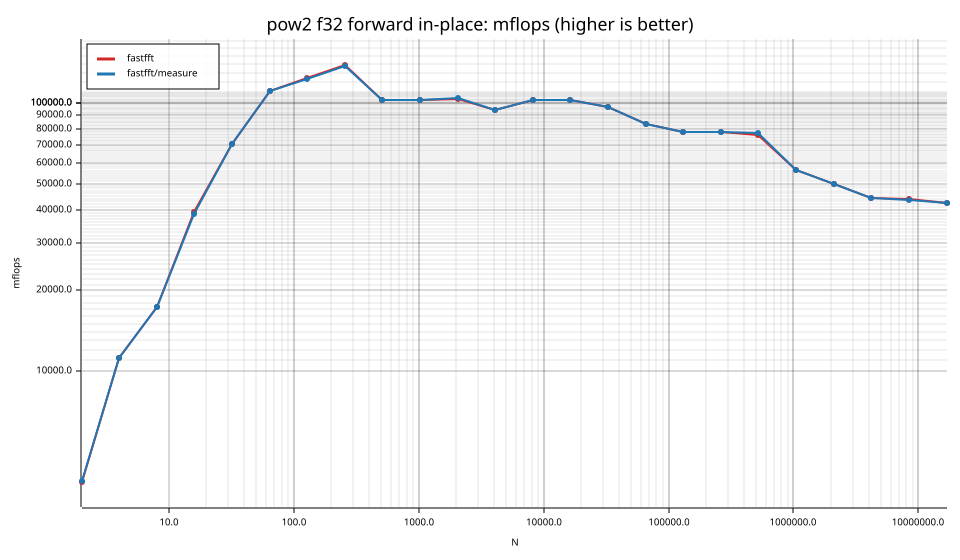

### pow2 f64

| cell | fastfft | fastfft/measure |
|---|---|---|
| N=2 fwd ip | 2.6ns | 2.6ns |
| N=2 fwd oop | 1.2ns | 1.2ns |
| N=2 inv ip | 2.6ns | 2.6ns |
| N=2 inv oop | 1.2ns | 1.2ns |
| N=4 fwd ip | 3.7ns | 3.7ns |
| N=4 fwd oop | 1.6ns | 1.6ns |
| N=4 inv ip | 3.7ns | 3.7ns |
| N=4 inv oop | 1.6ns | 1.6ns |
| N=8 fwd ip | 6.4ns | 6.4ns |
| N=8 fwd oop | 4.4ns | 4.4ns |
| N=8 inv ip | 6.3ns | 6.3ns |
| N=8 inv oop | 4.2ns | 4.2ns |
| N=16 fwd ip | 8.8ns | 8.8ns |
| N=16 fwd oop | 5.3ns | 5.3ns |
| N=16 inv ip | 8.8ns | 8.8ns |
| N=16 inv oop | 5.3ns | 5.3ns |
| N=32 fwd ip | 14.1ns | 13.8ns |
| N=32 fwd oop | 11.8ns | 11.7ns |
| N=32 inv ip | 14.1ns | 14.0ns |
| N=32 inv oop | 11.8ns | 11.8ns |
| N=64 fwd ip | 29.2ns | 29.3ns |
| N=64 fwd oop | 27.0ns | 27.2ns |
| N=64 inv ip | 29.3ns | 29.3ns |
| N=64 inv oop | 27.1ns | 27.3ns |
| N=128 fwd ip | 61.1ns | 59.8ns |
| N=128 fwd oop | 60.4ns | 60.9ns |
| N=128 inv ip | 60.1ns | 60.9ns |
| N=128 inv oop | 60.5ns | 60.9ns |
| N=256 fwd ip | 129.4ns | 129.8ns |
| N=256 fwd oop | 129.3ns | 130.0ns |
| N=256 inv ip | 129.2ns | 129.0ns |
| N=256 inv oop | 130.3ns | 129.9ns |
| N=512 fwd ip | 418.6ns | 418.8ns |
| N=512 fwd oop | 424.3ns | 423.7ns |
| N=512 inv ip | 422.3ns | 423.9ns |
| N=512 inv oop | 423.9ns | 425.3ns |
| N=1024 fwd ip | 980.6ns | 977.1ns |
| N=1024 fwd oop | 962.0ns | 958.3ns |
| N=1024 inv ip | 983.3ns | 982.5ns |
| N=1024 inv oop | 962.8ns | 958.9ns |
| N=2048 fwd ip | 2.22us | 2.22us |
| N=2048 fwd oop | 2.13us | 2.13us |
| N=2048 inv ip | 2.24us | 2.23us |
| N=2048 inv oop | 2.12us | 2.13us |
| N=4096 fwd ip | 4.55us | 4.55us |
| N=4096 fwd oop | 4.56us | 4.57us |
| N=4096 inv ip | 4.55us | 4.55us |
| N=4096 inv oop | 4.57us | 4.53us |
| N=8192 fwd ip | 10.29us | 10.31us |
| N=8192 fwd oop | 11.71us | 11.72us |
| N=8192 inv ip | 10.31us | 10.30us |
| N=8192 inv oop | 11.64us | 11.65us |
| N=16384 fwd ip | 21.61us | 21.61us |
| N=16384 fwd oop | 23.68us | 23.69us |
| N=16384 inv ip | 21.68us | 21.60us |
| N=16384 inv oop | 23.72us | 23.80us |
| N=32768 fwd ip | 50.61us | 50.66us |
| N=32768 fwd oop | 56.27us | 55.89us |
| N=32768 inv ip | 50.77us | 50.75us |
| N=32768 inv oop | 55.91us | 56.00us |
| N=65536 fwd ip | 126.04us | 125.89us |
| N=65536 fwd oop | 118.81us | 118.48us |
| N=65536 inv ip | 125.47us | 125.60us |
| N=65536 inv oop | 118.32us | 117.86us |
| N=131072 fwd ip | 273.65us | 273.63us |
| N=131072 fwd oop | 260.97us | 260.41us |
| N=131072 inv ip | 273.04us | 271.94us |
| N=131072 inv oop | 259.53us | 259.00us |
| N=262144 fwd ip | 608.91us | 607.74us |
| N=262144 fwd oop | 559.20us | 557.88us |
| N=262144 inv ip | 608.61us | 606.48us |
| N=262144 inv oop | 559.73us | 563.10us |
| N=524288 fwd ip | 1.73ms | 1.73ms |
| N=524288 fwd oop | 1.64ms | 1.64ms |
| N=524288 inv ip | 1.72ms | 1.71ms |
| N=524288 inv oop | 1.64ms | 1.63ms |
| N=1048576 fwd ip | 3.88ms | 3.89ms |
| N=1048576 fwd oop | 4.02ms | 4.01ms |
| N=1048576 inv ip | 3.89ms | 3.91ms |
| N=1048576 inv oop | 4.01ms | 4.02ms |
| N=2097152 fwd ip | 9.02ms | 9.05ms |
| N=2097152 fwd oop | 9.28ms | 9.29ms |
| N=2097152 inv ip | 9.07ms | 9.05ms |
| N=2097152 inv oop | 9.29ms | 9.28ms |
| N=4194304 fwd ip | 20.33ms | 20.32ms |
| N=4194304 fwd oop | 20.34ms | 20.31ms |
| N=4194304 inv ip | 20.33ms | 20.33ms |
| N=4194304 inv oop | 20.28ms | 20.37ms |
| N=8388608 fwd ip | 41.92ms | 41.85ms |
| N=8388608 fwd oop | 42.23ms | 42.18ms |
| N=8388608 inv ip | 42.01ms | 41.79ms |
| N=8388608 inv oop | 41.87ms | 41.60ms |
| N=16777216 fwd ip | 93.11ms | 93.27ms |
| N=16777216 fwd oop | 93.38ms | 93.56ms |
| N=16777216 inv ip | 92.80ms | 92.79ms |
| N=16777216 inv oop | 92.62ms | 92.32ms |

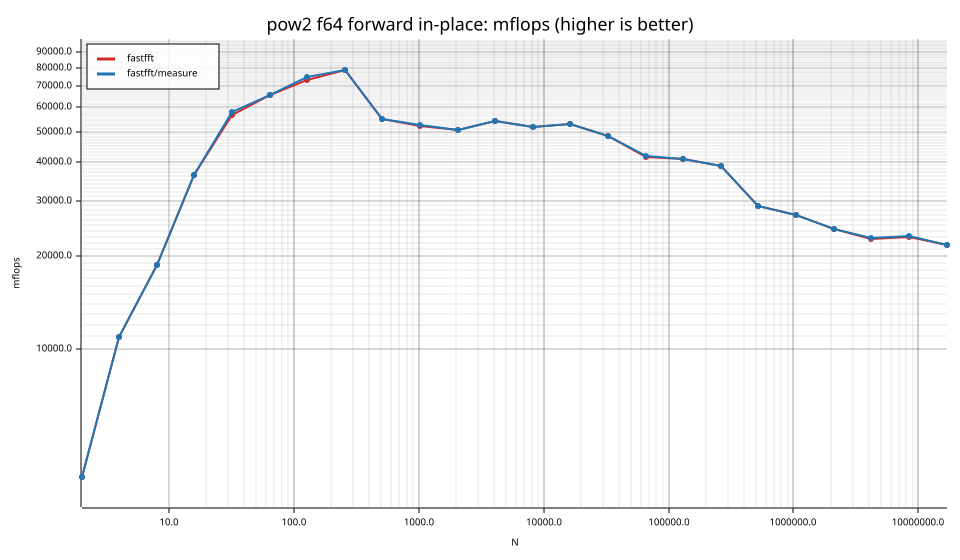

## Suite `smooth`

### smooth f32

| cell | fastfft | fastfft/measure |
|---|---|---|
| N=6 fwd ip | 7.4ns | 7.4ns |
| N=6 fwd oop | 2.9ns | 2.9ns |
| N=6 inv ip | 7.4ns | 7.4ns |
| N=6 inv oop | 2.9ns | 2.9ns |
| N=9 fwd ip | 10.8ns | 10.8ns |
| N=9 fwd oop | 6.0ns | 6.0ns |
| N=9 inv ip | 10.7ns | 10.8ns |
| N=9 inv oop | 6.0ns | 6.0ns |
| N=12 fwd ip | 9.8ns | 9.8ns |
| N=12 fwd oop | 6.2ns | 6.2ns |
| N=12 inv ip | 9.4ns | 9.4ns |
| N=12 inv oop | 6.1ns | 6.1ns |
| N=15 fwd ip | 13.6ns | 13.6ns |
| N=15 fwd oop | 11.1ns | 11.1ns |
| N=15 inv ip | 21.8ns | 14.4ns |
| N=15 inv oop | 15.9ns | 11.1ns |
| N=18 fwd ip | 15.8ns | 15.7ns |
| N=18 fwd oop | 10.7ns | 10.7ns |
| N=18 inv ip | 15.9ns | 15.7ns |
| N=18 inv oop | 10.7ns | 10.7ns |
| N=24 fwd ip | 13.3ns | 13.3ns |
| N=24 fwd oop | 10.5ns | 10.5ns |
| N=24 inv ip | 12.9ns | 12.9ns |
| N=24 inv oop | 10.5ns | 10.5ns |
| N=36 fwd ip | 19.0ns | 19.0ns |
| N=36 fwd oop | 17.0ns | 17.2ns |
| N=36 inv ip | 18.8ns | 18.9ns |
| N=36 inv oop | 17.0ns | 17.0ns |
| N=48 fwd ip | 15.7ns | 15.6ns |
| N=48 fwd oop | 12.3ns | 12.3ns |
| N=48 inv ip | 15.7ns | 15.7ns |
| N=48 inv oop | 12.3ns | 12.3ns |
| N=80 fwd ip | 35.6ns | 35.6ns |
| N=80 fwd oop | 29.6ns | 29.8ns |
| N=80 inv ip | 35.3ns | 35.3ns |
| N=80 inv oop | 29.8ns | 29.8ns |
| N=96 fwd ip | 35.0ns | 34.9ns |
| N=96 fwd oop | 32.8ns | 32.9ns |
| N=96 inv ip | 34.8ns | 34.6ns |
| N=96 inv oop | 32.9ns | 32.9ns |
| N=108 fwd ip | 46.0ns | 45.8ns |
| N=108 fwd oop | 40.9ns | 41.1ns |
| N=108 inv ip | 46.0ns | 46.1ns |
| N=108 inv oop | 41.2ns | 41.0ns |
| N=120 fwd ip | 58.0ns | 57.9ns |
| N=120 fwd oop | 54.0ns | 54.2ns |
| N=120 inv ip | 58.2ns | 58.2ns |
| N=120 inv oop | 54.4ns | 54.3ns |
| N=160 fwd ip | 76.9ns | 76.5ns |
| N=160 fwd oop | 74.7ns | 74.6ns |
| N=160 inv ip | 76.6ns | 75.7ns |
| N=160 inv oop | 74.9ns | 74.6ns |
| N=210 fwd ip | 116.4ns | 114.2ns |
| N=210 fwd oop | 116.5ns | 116.2ns |
| N=210 inv ip | 114.5ns | 114.4ns |
| N=210 inv oop | 114.6ns | 115.5ns |
| N=240 fwd ip | 99.7ns | 99.5ns |
| N=240 fwd oop | 100.4ns | 101.2ns |
| N=240 inv ip | 99.6ns | 98.9ns |
| N=240 inv oop | 100.6ns | 101.4ns |
| N=320 fwd ip | 139.0ns | 140.2ns |
| N=320 fwd oop | 140.4ns | 140.9ns |
| N=320 inv ip | 139.5ns | 139.9ns |
| N=320 inv oop | 141.5ns | 140.9ns |
| N=384 fwd ip | 166.6ns | 166.7ns |
| N=384 fwd oop | 166.9ns | 166.9ns |
| N=384 inv ip | 166.9ns | 166.6ns |
| N=384 inv oop | 167.7ns | 167.3ns |
| N=480 fwd ip | 245.5ns | 245.5ns |
| N=480 fwd oop | 245.6ns | 245.9ns |
| N=480 inv ip | 245.6ns | 245.4ns |
| N=480 inv oop | 246.3ns | 244.9ns |
| N=504 fwd ip | 245.9ns | 245.0ns |
| N=504 fwd oop | 235.8ns | 236.8ns |
| N=504 inv ip | 245.0ns | 245.4ns |
| N=504 inv oop | 236.2ns | 236.5ns |
| N=640 fwd ip | 285.1ns | 284.9ns |
| N=640 fwd oop | 285.1ns | 285.4ns |
| N=640 inv ip | 285.2ns | 285.1ns |
| N=640 inv oop | 285.8ns | 284.9ns |
| N=720 fwd ip | 330.9ns | 330.6ns |
| N=720 fwd oop | 334.8ns | 334.2ns |
| N=720 inv ip | 331.6ns | 330.9ns |
| N=720 inv oop | 335.0ns | 334.6ns |
| N=768 fwd ip | 344.6ns | 345.5ns |
| N=768 fwd oop | 346.1ns | 346.4ns |
| N=768 inv ip | 344.9ns | 345.4ns |
| N=768 inv oop | 346.1ns | 345.1ns |
| N=960 fwd ip | 448.9ns | 450.3ns |
| N=960 fwd oop | 451.0ns | 449.2ns |
| N=960 inv ip | 450.7ns | 450.5ns |
| N=960 inv oop | 452.0ns | 451.1ns |
| N=1000 fwd ip | 612.6ns | 613.6ns |
| N=1000 fwd oop | 612.3ns | 612.7ns |
| N=1000 inv ip | 615.1ns | 617.3ns |
| N=1000 inv oop | 613.2ns | 612.9ns |
| N=1200 fwd ip | 668.7ns | 667.9ns |
| N=1200 fwd oop | 667.8ns | 668.1ns |
| N=1200 inv ip | 667.7ns | 669.0ns |
| N=1200 inv oop | 663.6ns | 665.3ns |
| N=1536 fwd ip | 770.5ns | 772.3ns |
| N=1536 fwd oop | 770.2ns | 767.7ns |
| N=1536 inv ip | 771.0ns | 772.1ns |
| N=1536 inv oop | 771.0ns | 767.6ns |
| N=1920 fwd ip | 1.05us | 1.05us |
| N=1920 fwd oop | 1.05us | 1.05us |
| N=1920 inv ip | 1.04us | 1.05us |
| N=1920 inv oop | 1.05us | 1.05us |
| N=1960 fwd ip | 1.24us | 1.24us |
| N=1960 fwd oop | 1.22us | 1.22us |
| N=1960 inv ip | 1.24us | 1.24us |
| N=1960 inv oop | 1.22us | 1.22us |
| N=2400 fwd ip | 1.47us | 1.46us |
| N=2400 fwd oop | 1.41us | 1.41us |
| N=2400 inv ip | 1.46us | 1.46us |
| N=2400 inv oop | 1.41us | 1.41us |
| N=3072 fwd ip | 1.70us | 1.70us |
| N=3072 fwd oop | 1.69us | 1.69us |
| N=3072 inv ip | 1.70us | 1.70us |
| N=3072 inv oop | 1.69us | 1.69us |
| N=4725 fwd ip | 4.62us | 4.64us |
| N=4725 fwd oop | 4.58us | 4.58us |
| N=4725 inv ip | 4.75us | 4.75us |
| N=4725 inv oop | 4.71us | 4.72us |
| N=4800 fwd ip | 2.86us | 2.86us |
| N=4800 fwd oop | 2.84us | 2.83us |
| N=4800 inv ip | 2.87us | 2.87us |
| N=4800 inv oop | 2.83us | 2.84us |
| N=6144 fwd ip | 3.72us | 3.72us |
| N=6144 fwd oop | 3.68us | 3.67us |
| N=6144 inv ip | 3.73us | 3.73us |
| N=6144 inv oop | 3.68us | 3.69us |
| N=10368 fwd ip | 6.51us | 6.51us |
| N=10368 fwd oop | 6.53us | 6.54us |
| N=10368 inv ip | 6.53us | 6.54us |
| N=10368 inv oop | 6.54us | 6.54us |
| N=12288 fwd ip | 7.95us | 7.93us |
| N=12288 fwd oop | 8.28us | 8.29us |
| N=12288 inv ip | 7.93us | 7.90us |
| N=12288 inv oop | 8.29us | 8.28us |
| N=27000 fwd ip | 20.24us | 20.23us |
| N=27000 fwd oop | 20.03us | 20.07us |
| N=27000 inv ip | 20.10us | 20.10us |
| N=27000 inv oop | 19.93us | 20.04us |
| N=48000 fwd ip | 35.55us | 35.63us |
| N=48000 fwd oop | 35.82us | 35.91us |
| N=48000 inv ip | 35.08us | 35.27us |
| N=48000 inv oop | 35.15us | 35.26us |
| N=75600 fwd ip | 65.37us | 64.84us |
| N=75600 fwd oop | 67.71us | 68.11us |
| N=75600 inv ip | 64.73us | 63.70us |
| N=75600 inv oop | 67.12us | 68.09us |
| N=96000 fwd ip | 76.50us | 76.56us |
| N=96000 fwd oop | 76.91us | 76.59us |
| N=96000 inv ip | 77.02us | 77.29us |
| N=96000 inv oop | 79.81us | 77.54us |
| N=165375 fwd ip | 235.95us | 236.80us |
| N=165375 fwd oop | 236.52us | 236.50us |
| N=165375 inv ip | 237.56us | 237.25us |
| N=165375 inv oop | 238.51us | 237.96us |
| N=1000000 fwd ip | 2.79ms | 2.80ms |
| N=1000000 fwd oop | 2.97ms | 3.03ms |
| N=1000000 inv ip | 2.73ms | 2.68ms |
| N=1000000 inv oop | 2.96ms | 3.00ms |

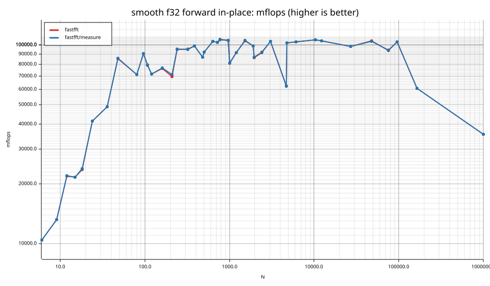

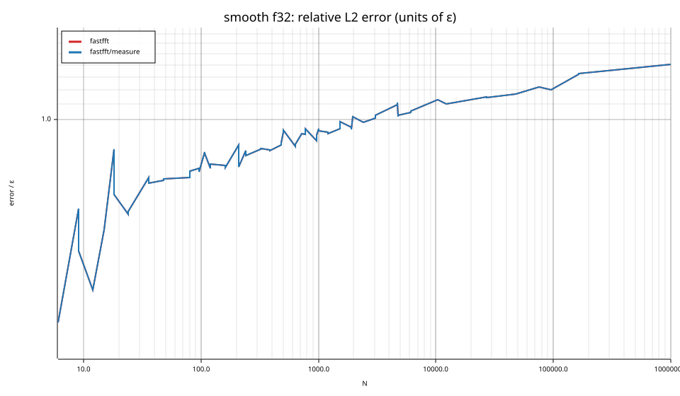

### smooth f64

| cell | fastfft | fastfft/measure |
|---|---|---|
| N=6 fwd ip | 5.4ns | 5.5ns |
| N=6 fwd oop | 2.4ns | 2.4ns |
| N=6 inv ip | 5.4ns | 5.4ns |
| N=6 inv oop | 2.4ns | 2.4ns |
| N=9 fwd ip | 8.6ns | 8.6ns |
| N=9 fwd oop | 4.5ns | 4.5ns |
| N=9 inv ip | 8.5ns | 8.6ns |
| N=9 inv oop | 4.5ns | 4.5ns |
| N=12 fwd ip | 8.6ns | 8.6ns |
| N=12 fwd oop | 5.7ns | 5.7ns |
| N=12 inv ip | 8.6ns | 8.6ns |
| N=12 inv oop | 5.7ns | 5.7ns |
| N=15 fwd ip | 14.7ns | 14.7ns |
| N=15 fwd oop | 14.0ns | 14.0ns |
| N=15 inv ip | 14.0ns | 14.0ns |
| N=15 inv oop | 13.1ns | 13.1ns |
| N=18 fwd ip | 11.1ns | 11.1ns |
| N=18 fwd oop | 8.5ns | 8.5ns |
| N=18 inv ip | 11.1ns | 11.1ns |
| N=18 inv oop | 8.5ns | 8.5ns |
| N=24 fwd ip | 12.1ns | 12.1ns |
| N=24 fwd oop | 8.4ns | 8.4ns |
| N=24 inv ip | 12.1ns | 12.1ns |
| N=24 inv oop | 8.4ns | 8.4ns |
| N=36 fwd ip | 17.5ns | 17.9ns |
| N=36 fwd oop | 15.1ns | 15.2ns |
| N=36 inv ip | 17.5ns | 17.8ns |
| N=36 inv oop | 15.1ns | 15.2ns |
| N=48 fwd ip | 22.3ns | 21.5ns |
| N=48 fwd oop | 20.0ns | 19.8ns |
| N=48 inv ip | 22.2ns | 21.7ns |
| N=48 inv oop | 19.8ns | 19.3ns |
| N=80 fwd ip | 55.3ns | 56.1ns |
| N=80 fwd oop | 53.1ns | 53.1ns |
| N=80 inv ip | 54.4ns | 54.4ns |
| N=80 inv oop | 52.6ns | 52.8ns |
| N=96 fwd ip | 64.0ns | 64.6ns |
| N=96 fwd oop | 61.2ns | 62.5ns |
| N=96 inv ip | 64.8ns | 64.6ns |
| N=96 inv oop | 61.5ns | 61.3ns |
| N=108 fwd ip | 79.9ns | 79.3ns |
| N=108 fwd oop | 81.8ns | 81.6ns |
| N=108 inv ip | 78.9ns | 79.3ns |
| N=108 inv oop | 81.8ns | 81.6ns |
| N=120 fwd ip | 79.2ns | 79.5ns |
| N=120 fwd oop | 79.5ns | 79.1ns |
| N=120 inv ip | 80.8ns | 80.9ns |
| N=120 inv oop | 79.9ns | 80.5ns |
| N=160 fwd ip | 119.3ns | 119.8ns |
| N=160 fwd oop | 119.4ns | 120.3ns |
| N=160 inv ip | 119.9ns | 120.2ns |
| N=160 inv oop | 119.9ns | 119.3ns |
| N=210 fwd ip | 268.1ns | 266.0ns |
| N=210 fwd oop | 268.7ns | 270.9ns |
| N=210 inv ip | 280.8ns | 279.4ns |
| N=210 inv oop | 282.3ns | 280.6ns |
| N=240 fwd ip | 181.2ns | 179.8ns |
| N=240 fwd oop | 178.2ns | 181.9ns |
| N=240 inv ip | 183.6ns | 184.0ns |
| N=240 inv oop | 183.8ns | 183.7ns |
| N=320 fwd ip | 245.3ns | 243.8ns |
| N=320 fwd oop | 245.4ns | 244.8ns |
| N=320 inv ip | 245.7ns | 245.8ns |
| N=320 inv oop | 245.3ns | 245.7ns |
| N=384 fwd ip | 297.5ns | 297.8ns |
| N=384 fwd oop | 298.0ns | 298.6ns |
| N=384 inv ip | 296.5ns | 295.9ns |
| N=384 inv oop | 296.5ns | 297.1ns |
| N=480 fwd ip | 389.9ns | 389.9ns |
| N=480 fwd oop | 391.0ns | 391.1ns |
| N=480 inv ip | 386.8ns | 385.3ns |
| N=480 inv oop | 388.9ns | 388.8ns |
| N=504 fwd ip | 443.7ns | 442.9ns |
| N=504 fwd oop | 453.6ns | 453.8ns |
| N=504 inv ip | 444.2ns | 445.2ns |
| N=504 inv oop | 454.7ns | 455.1ns |
| N=640 fwd ip | 551.3ns | 551.3ns |
| N=640 fwd oop | 548.3ns | 548.6ns |
| N=640 inv ip | 555.4ns | 555.5ns |
| N=640 inv oop | 553.7ns | 554.2ns |
| N=720 fwd ip | 639.4ns | 639.3ns |
| N=720 fwd oop | 639.4ns | 638.8ns |
| N=720 inv ip | 638.8ns | 638.7ns |
| N=720 inv oop | 638.4ns | 638.3ns |
| N=768 fwd ip | 672.4ns | 671.1ns |
| N=768 fwd oop | 669.6ns | 669.2ns |
| N=768 inv ip | 672.0ns | 671.4ns |
| N=768 inv oop | 669.5ns | 669.2ns |
| N=960 fwd ip | 874.0ns | 873.8ns |
| N=960 fwd oop | 870.7ns | 870.4ns |
| N=960 inv ip | 872.9ns | 871.6ns |
| N=960 inv oop | 889.5ns | 890.4ns |
| N=1000 fwd ip | 1.06us | 1.06us |
| N=1000 fwd oop | 1.04us | 1.05us |
| N=1000 inv ip | 1.06us | 1.06us |
| N=1000 inv oop | 1.04us | 1.05us |
| N=1200 fwd ip | 1.21us | 1.21us |
| N=1200 fwd oop | 1.22us | 1.22us |
| N=1200 inv ip | 1.25us | 1.24us |
| N=1200 inv oop | 1.27us | 1.27us |
| N=1536 fwd ip | 1.55us | 1.56us |
| N=1536 fwd oop | 1.54us | 1.54us |
| N=1536 inv ip | 1.56us | 1.56us |
| N=1536 inv oop | 1.54us | 1.54us |
| N=1920 fwd ip | 1.98us | 1.98us |
| N=1920 fwd oop | 1.96us | 1.95us |
| N=1920 inv ip | 1.98us | 1.98us |
| N=1920 inv oop | 1.96us | 1.96us |
| N=1960 fwd ip | 2.20us | 2.20us |
| N=1960 fwd oop | 2.19us | 2.19us |
| N=1960 inv ip | 2.21us | 2.20us |
| N=1960 inv oop | 2.20us | 2.20us |
| N=2400 fwd ip | 2.59us | 2.59us |
| N=2400 fwd oop | 2.59us | 2.59us |
| N=2400 inv ip | 2.59us | 2.58us |
| N=2400 inv oop | 2.56us | 2.56us |
| N=3072 fwd ip | 3.43us | 3.43us |
| N=3072 fwd oop | 3.37us | 3.37us |
| N=3072 inv ip | 3.45us | 3.45us |
| N=3072 inv oop | 3.43us | 3.42us |
| N=4725 fwd ip | 8.19us | 8.18us |
| N=4725 fwd oop | 8.23us | 8.23us |
| N=4725 inv ip | 8.28us | 8.26us |
| N=4725 inv oop | 8.34us | 8.31us |
| N=4800 fwd ip | 5.35us | 5.36us |
| N=4800 fwd oop | 5.17us | 5.17us |
| N=4800 inv ip | 5.32us | 5.32us |
| N=4800 inv oop | 5.15us | 5.15us |
| N=6144 fwd ip | 7.34us | 7.36us |
| N=6144 fwd oop | 7.71us | 7.71us |
| N=6144 inv ip | 7.33us | 7.32us |
| N=6144 inv oop | 7.73us | 7.73us |
| N=10368 fwd ip | 12.07us | 12.06us |
| N=10368 fwd oop | 12.09us | 12.11us |
| N=10368 inv ip | 12.04us | 12.01us |
| N=10368 inv oop | 12.11us | 12.10us |
| N=12288 fwd ip | 15.52us | 15.51us |
| N=12288 fwd oop | 17.73us | 17.65us |
| N=12288 inv ip | 15.58us | 15.66us |
| N=12288 inv oop | 17.50us | 17.76us |
| N=27000 fwd ip | 42.50us | 42.55us |
| N=27000 fwd oop | 41.67us | 41.78us |
| N=27000 inv ip | 42.38us | 42.59us |
| N=27000 inv oop | 41.71us | 41.65us |
| N=48000 fwd ip | 67.41us | 66.81us |
| N=48000 fwd oop | 70.39us | 70.12us |
| N=48000 inv ip | 67.93us | 67.83us |
| N=48000 inv oop | 70.43us | 70.49us |
| N=75600 fwd ip | 127.94us | 128.61us |
| N=75600 fwd oop | 127.69us | 128.01us |
| N=75600 inv ip | 129.02us | 129.40us |
| N=75600 inv oop | 126.89us | 127.06us |
| N=96000 fwd ip | 140.86us | 140.55us |
| N=96000 fwd oop | 148.00us | 147.98us |
| N=96000 inv ip | 141.36us | 140.88us |
| N=96000 inv oop | 147.81us | 149.24us |
| N=165375 fwd ip | 399.69us | 402.01us |
| N=165375 fwd oop | 426.15us | 419.14us |
| N=165375 inv ip | 408.47us | 409.27us |
| N=165375 inv oop | 441.66us | 445.27us |
| N=1000000 fwd ip | 7.77ms | 7.73ms |
| N=1000000 fwd oop | 8.09ms | 8.11ms |
| N=1000000 inv ip | 7.74ms | 7.72ms |
| N=1000000 inv oop | 8.11ms | 8.11ms |

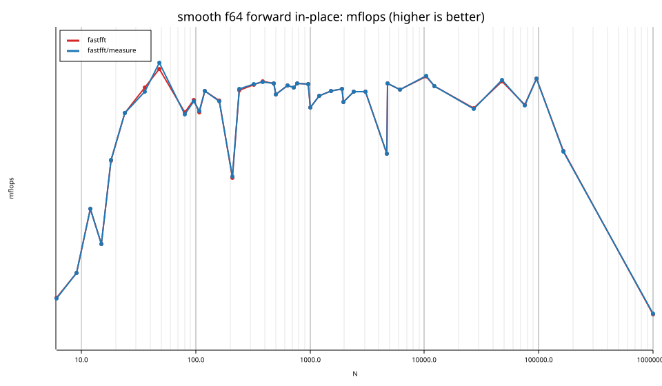

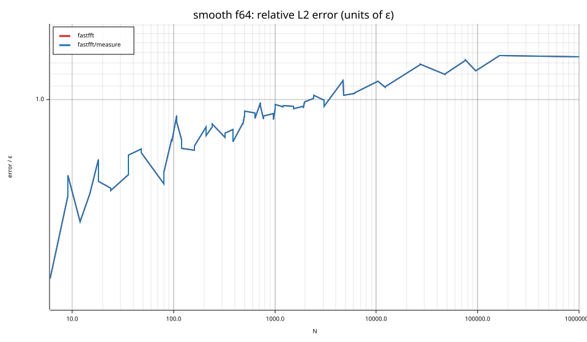

## Suite `rough`

### rough f32

| cell | fastfft | fastfft/measure |
|---|---|---|
| N=17 fwd ip | 46.8ns | 46.8ns |
| N=17 fwd oop | 45.3ns | 44.9ns |
| N=17 inv ip | 46.8ns | 46.8ns |
| N=17 inv oop | 45.3ns | 45.3ns |
| N=31 fwd ip | 61.6ns | 62.4ns |
| N=31 fwd oop | 62.7ns | 63.1ns |
| N=31 inv ip | 61.9ns | 62.9ns |
| N=31 inv oop | 63.3ns | 63.2ns |
| N=61 fwd ip | 119.7ns | 119.1ns |
| N=61 fwd oop | 119.3ns | 119.7ns |
| N=61 inv ip | 120.3ns | 119.6ns |
| N=61 inv oop | 120.9ns | 120.3ns |
| N=127 fwd ip | 218.9ns | 221.3ns |
| N=127 fwd oop | 219.3ns | 221.0ns |
| N=127 inv ip | 219.0ns | 220.4ns |
| N=127 inv oop | 220.7ns | 221.1ns |
| N=257 fwd ip | 572.5ns | 573.8ns |
| N=257 fwd oop | 579.1ns | 579.4ns |
| N=257 inv ip | 575.5ns | 573.3ns |
| N=257 inv oop | 588.6ns | 585.9ns |
| N=509 fwd ip | 1.26us | 1.26us |
| N=509 fwd oop | 1.26us | 1.26us |
| N=509 inv ip | 1.26us | 1.26us |
| N=509 inv oop | 1.27us | 1.27us |
| N=1021 fwd ip | 2.67us | 2.67us |
| N=1021 fwd oop | 2.67us | 2.67us |
| N=1021 inv ip | 2.66us | 2.66us |
| N=1021 inv oop | 2.66us | 2.67us |
| N=2018 fwd ip | 6.66us | 6.70us |
| N=2018 fwd oop | 6.66us | 6.65us |
| N=2018 inv ip | 6.60us | 6.61us |
| N=2018 inv oop | 6.66us | 6.67us |
| N=2053 fwd ip | 7.24us | 7.23us |
| N=2053 fwd oop | 7.23us | 7.23us |
| N=2053 inv ip | 7.23us | 7.24us |
| N=2053 inv oop | 7.24us | 7.23us |
| N=3063 fwd ip | 9.35us | 9.33us |
| N=3063 fwd oop | 9.35us | 9.35us |
| N=3063 inv ip | 9.32us | 9.34us |
| N=3063 inv oop | 9.38us | 9.33us |
| N=4099 fwd ip | 14.40us | 14.39us |
| N=4099 fwd oop | 14.38us | 14.37us |
| N=4099 inv ip | 14.38us | 14.40us |
| N=4099 inv oop | 14.38us | 14.37us |
| N=8191 fwd ip | 27.24us | 27.19us |
| N=8191 fwd oop | 27.20us | 27.50us |
| N=8191 inv ip | 27.22us | 27.09us |
| N=8191 inv oop | 27.18us | 27.17us |
| N=9797 fwd ip | 33.94us | 34.14us |
| N=9797 fwd oop | 34.09us | 34.00us |
| N=9797 inv ip | 33.95us | 33.91us |
| N=9797 inv oop | 33.99us | 34.10us |
| N=16381 fwd ip | 62.46us | 62.26us |
| N=16381 fwd oop | 63.24us | 62.93us |
| N=16381 inv ip | 63.14us | 62.40us |
| N=16381 inv oop | 63.40us | 62.60us |
| N=65524 fwd ip | 331.48us | 331.08us |
| N=65524 fwd oop | 331.57us | 330.60us |
| N=65524 inv ip | 332.14us | 331.28us |
| N=65524 inv oop | 332.10us | 331.27us |
| N=65537 fwd ip | 332.91us | 329.24us |
| N=65537 fwd oop | 331.52us | 330.25us |
| N=65537 inv ip | 332.87us | 330.10us |
| N=65537 inv oop | 332.70us | 330.90us |
| N=131071 fwd ip | 714.40us | 712.32us |
| N=131071 fwd oop | 714.54us | 715.14us |
| N=131071 inv ip | 713.62us | 712.33us |
| N=131071 inv oop | 724.04us | 718.10us |

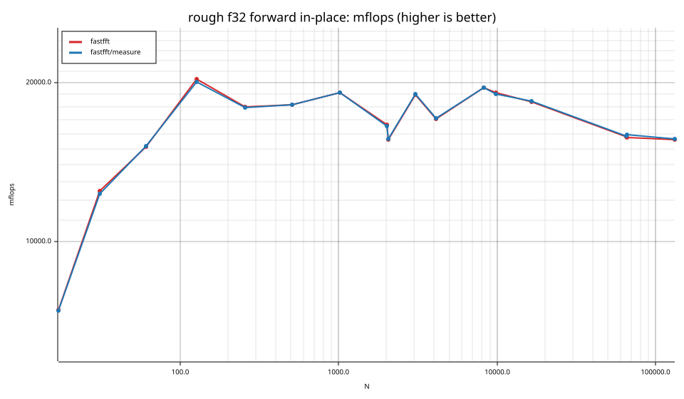

### rough f64

| cell | fastfft | fastfft/measure |
|---|---|---|
| N=17 fwd ip | 55.7ns | 56.2ns |
| N=17 fwd oop | 55.7ns | 56.3ns |
| N=17 inv ip | 56.9ns | 57.2ns |
| N=17 inv oop | 56.8ns | 57.2ns |
| N=31 fwd ip | 97.2ns | 96.8ns |
| N=31 fwd oop | 98.9ns | 98.4ns |
| N=31 inv ip | 98.2ns | 95.0ns |
| N=31 inv oop | 98.4ns | 98.3ns |
| N=61 fwd ip | 185.7ns | 186.2ns |
| N=61 fwd oop | 185.5ns | 187.7ns |
| N=61 inv ip | 187.1ns | 186.9ns |
| N=61 inv oop | 187.5ns | 188.4ns |
| N=127 fwd ip | 379.2ns | 389.8ns |
| N=127 fwd oop | 391.7ns | 386.7ns |
| N=127 inv ip | 388.3ns | 382.0ns |
| N=127 inv oop | 392.3ns | 390.1ns |
| N=257 fwd ip | 1.12us | 1.12us |
| N=257 fwd oop | 1.12us | 1.13us |
| N=257 inv ip | 1.12us | 1.12us |
| N=257 inv oop | 1.13us | 1.12us |
| N=509 fwd ip | 2.47us | 2.47us |
| N=509 fwd oop | 2.47us | 2.50us |
| N=509 inv ip | 2.46us | 2.46us |
| N=509 inv oop | 2.47us | 2.47us |
| N=1021 fwd ip | 5.67us | 5.66us |
| N=1021 fwd oop | 5.65us | 5.63us |
| N=1021 inv ip | 5.68us | 5.67us |
| N=1021 inv oop | 5.64us | 5.67us |
| N=2018 fwd ip | 12.54us | 12.51us |
| N=2018 fwd oop | 12.66us | 12.54us |
| N=2018 inv ip | 12.57us | 12.52us |
| N=2018 inv oop | 12.62us | 12.56us |
| N=2053 fwd ip | 13.56us | 13.57us |
| N=2053 fwd oop | 13.57us | 13.58us |
| N=2053 inv ip | 13.55us | 13.57us |
| N=2053 inv oop | 13.59us | 13.62us |
| N=3063 fwd ip | 18.17us | 18.15us |
| N=3063 fwd oop | 18.20us | 18.19us |
| N=3063 inv ip | 18.23us | 18.17us |
| N=3063 inv oop | 18.18us | 18.17us |
| N=4099 fwd ip | 28.03us | 27.51us |
| N=4099 fwd oop | 27.82us | 27.56us |
| N=4099 inv ip | 27.51us | 27.46us |
| N=4099 inv oop | 27.92us | 27.52us |
| N=8191 fwd ip | 54.35us | 54.05us |
| N=8191 fwd oop | 54.74us | 54.52us |
| N=8191 inv ip | 54.29us | 54.14us |
| N=8191 inv oop | 54.86us | 54.56us |
| N=9797 fwd ip | 79.38us | 79.17us |
| N=9797 fwd oop | 79.90us | 80.08us |
| N=9797 inv ip | 79.37us | 79.47us |
| N=9797 inv oop | 80.21us | 79.96us |
| N=16381 fwd ip | 124.57us | 123.28us |
| N=16381 fwd oop | 124.61us | 124.61us |
| N=16381 inv ip | 124.57us | 123.89us |
| N=16381 inv oop | 125.32us | 124.44us |
| N=65524 fwd ip | 642.34us | 641.07us |
| N=65524 fwd oop | 646.96us | 647.21us |
| N=65524 inv ip | 641.01us | 642.66us |
| N=65524 inv oop | 647.05us | 643.28us |
| N=65537 fwd ip | 644.14us | 640.20us |
| N=65537 fwd oop | 644.31us | 646.01us |
| N=65537 inv ip | 642.63us | 639.47us |
| N=65537 inv oop | 647.68us | 645.22us |
| N=131071 fwd ip | 1.79ms | 1.79ms |
| N=131071 fwd oop | 1.81ms | 1.81ms |
| N=131071 inv ip | 1.77ms | 1.76ms |
| N=131071 inv oop | 1.81ms | 1.78ms |

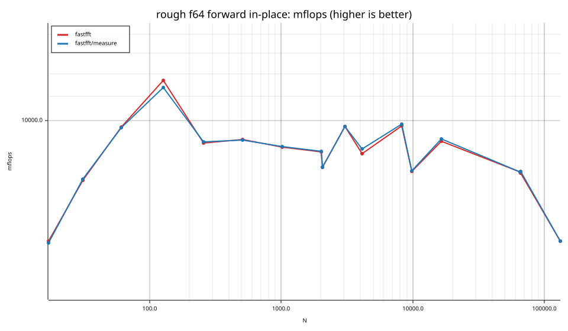

## Suite `batch`

### batch f32

| cell | fastfft | fastfft/measure |
|---|---|---|
| N=8 ×131072 fwd ip | 1.4ns | 1.3ns |
| N=8 ×131072 fwd oop | 1.6ns | 1.6ns |
| N=16 ×65536 fwd ip | 2.8ns | 2.8ns |
| N=16 ×65536 fwd oop | 3.2ns | 3.2ns |
| N=32 ×32768 fwd ip | 7.2ns | 7.2ns |
| N=32 ×32768 fwd oop | 7.0ns | 7.1ns |
| N=64 ×16384 fwd ip | 15.2ns | 15.2ns |
| N=64 ×16384 fwd oop | 15.6ns | 15.1ns |
| N=128 ×8192 fwd ip | 37.1ns | 37.2ns |
| N=128 ×8192 fwd oop | 42.2ns | 42.3ns |
| N=256 ×4096 fwd ip | 79.2ns | 79.7ns |
| N=256 ×4096 fwd oop | 105.9ns | 106.3ns |
| N=512 ×2048 fwd ip | 248.2ns | 250.6ns |
| N=512 ×2048 fwd oop | 293.8ns | 293.6ns |
| N=1024 ×1024 fwd ip | 552.5ns | 549.0ns |
| N=1024 ×1024 fwd oop | 669.8ns | 669.6ns |

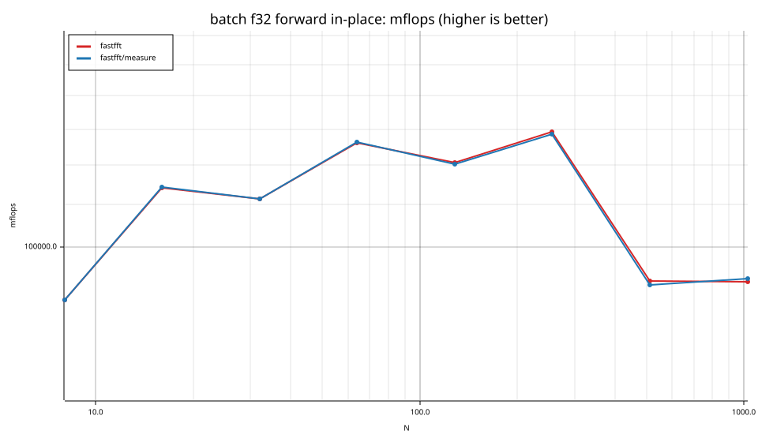

### batch f64

| cell | fastfft | fastfft/measure |
|---|---|---|
| N=8 ×131072 fwd ip | 3.8ns | 3.8ns |
| N=8 ×131072 fwd oop | 4.7ns | 4.7ns |
| N=16 ×65536 fwd ip | 5.0ns | 5.1ns |
| N=16 ×65536 fwd oop | 9.8ns | 10.0ns |
| N=32 ×32768 fwd ip | 13.6ns | 13.7ns |
| N=32 ×32768 fwd oop | 19.8ns | 19.6ns |
| N=64 ×16384 fwd ip | 30.6ns | 30.4ns |
| N=64 ×16384 fwd oop | 41.1ns | 41.2ns |
| N=128 ×8192 fwd ip | 86.3ns | 83.1ns |
| N=128 ×8192 fwd oop | 107.4ns | 107.4ns |
| N=256 ×4096 fwd ip | 259.2ns | 256.6ns |
| N=256 ×4096 fwd oop | 292.4ns | 297.3ns |
| N=512 ×2048 fwd ip | 669.6ns | 665.5ns |
| N=512 ×2048 fwd oop | 876.7ns | 881.5ns |
| N=1024 ×1024 fwd ip | 1.38us | 1.38us |
| N=1024 ×1024 fwd oop | 1.82us | 1.83us |

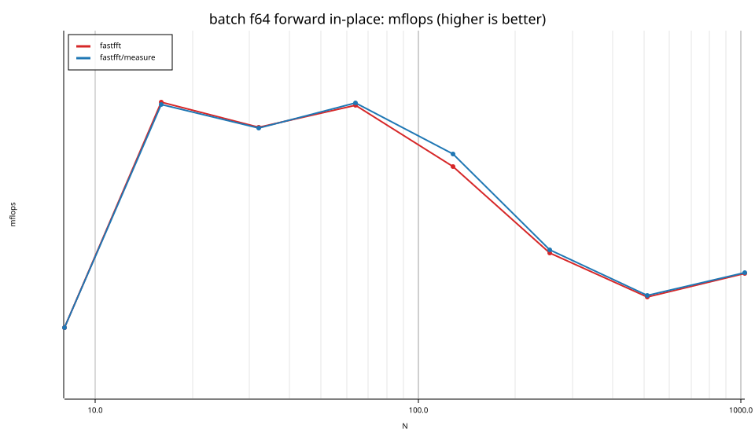

## Suite `realworld`

### realworld f32

| cell | fastfft | fastfft/measure |
|---|---|---|
| Spectrogram N=1024 | 830 MS/s | 831 MS/s |
| Spectrogram N=4096 | 674 MS/s | 676 MS/s |
| Spectrogram N=16384 | 639 MS/s | 634 MS/s |
| Spectrogram N=65536 | 553 MS/s | 556 MS/s |
| OverlapSave N=4096 | 340 MS/s | 340 MS/s |

### realworld f64

| cell | fastfft | fastfft/measure |
|---|---|---|
| Spectrogram N=4096 | 346 MS/s | 346 MS/s |

## Suite `datacheck`

### datacheck f32

| cell | fastfft | fastfft/measure |
|---|---|---|
| N=64 fwd imm | 16.1ns | 15.7ns |
| N=64 fwd imm | 16.1ns | 15.6ns |
| N=4096 fwd imm | 2.78us | 2.79us |
| N=4096 fwd imm | 2.82us | 2.82us |
| N=65536 fwd imm | 64.35us | 64.29us |
| N=65536 fwd imm | 64.61us | 64.43us |
| N=1048576 fwd imm | 1.73ms | 1.73ms |
| N=1048576 fwd imm | 1.73ms | 1.73ms |

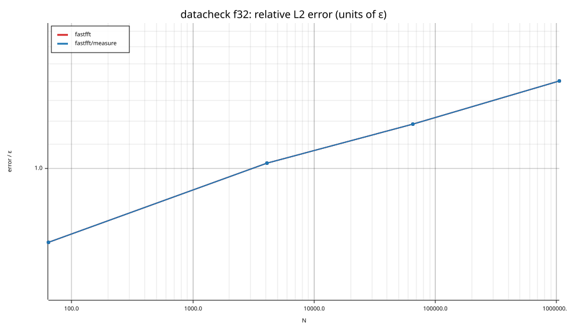

### datacheck f64

| cell | fastfft | fastfft/measure |
|---|---|---|
| N=64 fwd imm | 26.9ns | 27.0ns |
| N=64 fwd imm | 27.1ns | 27.1ns |
| N=4096 fwd imm | 4.55us | 4.55us |
| N=4096 fwd imm | 4.61us | 4.58us |
| N=65536 fwd imm | 126.72us | 126.51us |
| N=65536 fwd imm | 127.06us | 127.51us |
| N=1048576 fwd imm | 4.06ms | 4.07ms |
| N=1048576 fwd imm | 4.06ms | 4.06ms |

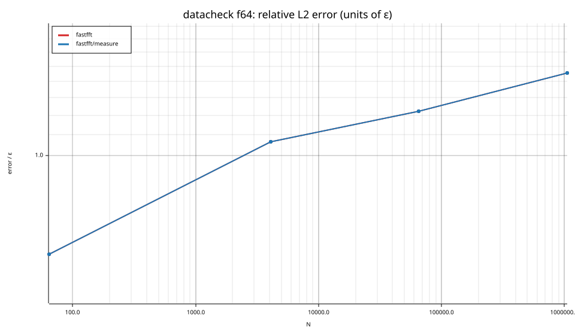

## Accuracy and planning time (medians over cells)

| lib | cells verified | failed | median error (ε) | worst error (ε) | median plan time |
|---|---|---|---|---|---|
| fastfft | 710 | 0 | 1.01 | 2.81 | 15.45us |
| fastfft/measure | 710 | 0 | 1.01 | 2.81 | 20.98ms |
