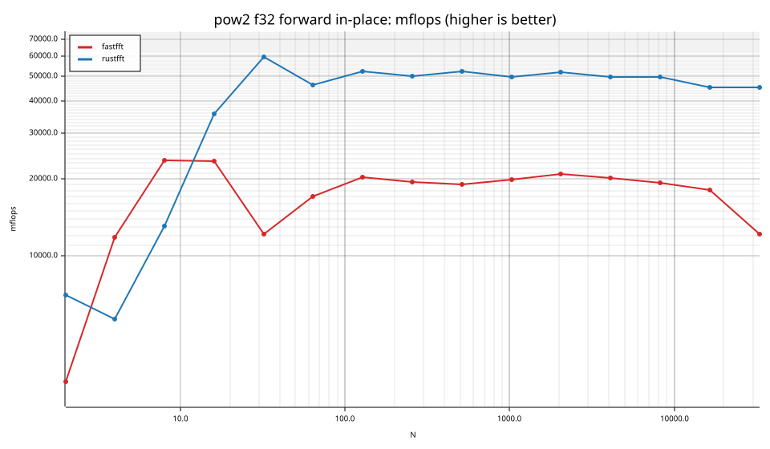
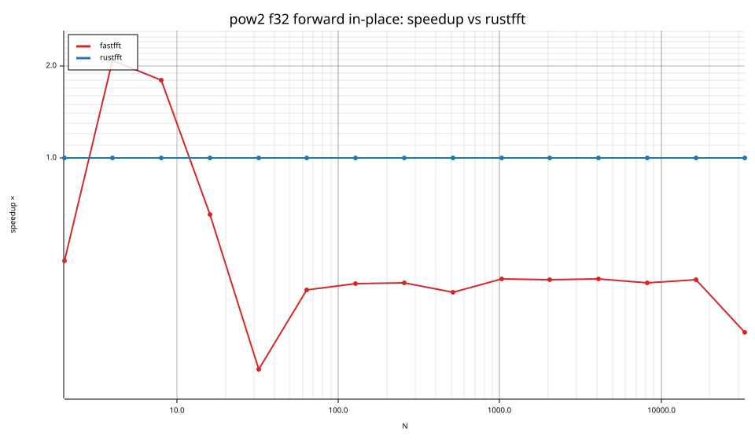
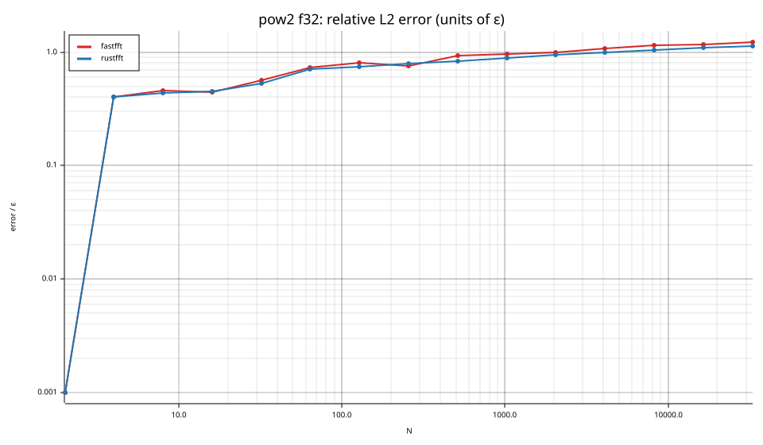

# fastfft arena report: `20261010T223313Z-Ians-Mac-Mini.localdomain-arm-before`

| | |
|---|---|
| Host | Ians-Mac-Mini.localdomain |
| CPU | Apple M6 (family ?, model ?, stepping ?, microcode ?) |
| Pinned CPU | null (SMT siblings ?) |
| Governor / EPP / boost | ? / ? / ? |
| Kernel | Darwin Ians-Mac-Mini.localdomain 27.0.0 Darwin Kernel Version 27.0.0: Tue Aug 11 21:06:15 PDT 2026; root:xnu-13432.1.9~1/RELEASE_ARM64_T8152 arm64 |
| Virtualization | ? |
| rustc | rustc 1.95.0 (59807616e 2026-04-14); binary: rustc; commit-hash: 59807616e1fa2540724bfbac14d7976d7e4a3860; commit-date: 2026-04-14; host: aarch64-apple-darwin; release: 1.95.0; LLVM version: 22.1.2 |
| Build profile / RUSTFLAGS | arena / `` |
| Libraries | {"fearless_simd":"0.5.0","num-complex":"0.4.6","oxifft":"0.4.2","phastft":"0.4.1","pulp":"0.22.3","rustfft":"6.4.1","tfhe-fft":"0.10.1"} |
| FFTW | fftw-3.3.11-neon `double: CFLAGS='-O3 -fPIC -std=gnu17' ./configure --enable-static --disable-shared --disable-fortran --disable-doc --enable-neon
single: CFLAGS='-O3 -fPIC -std=gnu17' ./configure --enable-static --disable-shared --disable-fortran --disable-doc --enable-neon --enable-float` |
| Git | fbab8a6e6954ef10466b5a5d1fe6fbdbc8f5dd9b (dirty: true) |
| Profile | quick |
| Official | false (["CPU pinning and Linux performance-policy checks are unavailable on this platform"]) |
| Control drift | max 25.35% over 1 control runs — **FLAGGED** |
| Cells | 15 |

Times are per transform. *best* = minimum batch mean, *median* = median batch mean. Speedup = rustfft time ÷ library time (> 1 means faster than rustfft); *geomean* over the cells both libraries ran. mflops = 5·N·log2(N)/t(µs).

## Release gates (fastfft)

| Gate | Criterion | Status | Detail |
|---|---|---|---|
| G1 | pow2 vs rustfft: geomean ≥ 1.5×, no cell < 0.95× | ❌ fail | geomean best 0.471×, median 0.473×, worst cell 0.192× (pow2:f32:fwd:ip:n32), 15 cells |
| G2 | smooth vs rustfft: geomean ≥ 1.3×, no cell < 0.95× | – n/a | no data |
| G3 | rough vs rustfft: geomean ≥ 0.75×, no cell < 0.5× | – n/a | no data |
| G4 | vs each other Rust library: geomean ≥ 1.1×, ≥ 0.97× on ≥ 90% of cells | – n/a |  |
| G5 | AVX2 forced: pow2 ≥ 1.2×, smooth ≥ 1.1× vs rustfft | – n/a | pow2 NaN×/NaN×, smooth NaN×/NaN× |
| G6 | scenarios ≥ 1.3× each; batch geomean ≥ 1.5× | – n/a | scenarios min inf×, batch NaN×/NaN× |
| G7 | accuracy within §6 thresholds and ≤ 1.5× rustfft + 1ε | ✅ pass | 15 cells checked |
| G8 | Estimate planning time ≤ 2× rustfft for every N ≤ 2^20 | ❌ fail | worst ratio 3.82× (pow2:f32:fwd:ip:n16384), 15 cells |

G9 (build time) is measured by `cargo xtask build-time`, not by the arena.

## Speedup vs rustfft (geomean of best-time ratios; median-time ratio in parentheses)

| suite | prec | fastfft | rustfft |
|---|---|---|---|
| pow2 | f32 | 0.47× (0.47×) 2/0/13 | 1.00× (1.00×) 0/15/0 |

w/t/l = cells faster / within ±3% / slower than rustfft (best times).

## Suite `pow2`

### pow2 f32

| cell | fastfft | rustfft |
|---|---|---|
| N=2 fwd ip | 3.1ns (0.46×) | 1.4ns |
| N=4 fwd ip | 3.4ns (2.09×) | 7.0ns |
| N=8 fwd ip | 5.1ns (1.80×) | 9.2ns |
| N=16 fwd ip | 13.7ns (0.65×) | 8.9ns |
| N=32 fwd ip | 65.9ns (0.20×) | 13.4ns |
| N=64 fwd ip | 112.9ns (0.37×) | 41.6ns |
| N=128 fwd ip | 221.2ns (0.39×) | 85.7ns |
| N=256 fwd ip | 525.6ns (0.39×) | 204.7ns |
| N=512 fwd ip | 1.22us (0.36×) | 441.3ns |
| N=1024 fwd ip | 2.57us (0.40×) | 1.03us |
| N=2048 fwd ip | 5.41us (0.40×) | 2.16us |
| N=4096 fwd ip | 12.24us (0.40×) | 4.92us |
| N=8192 fwd ip | 27.60us (0.39×) | 10.73us |
| N=16384 fwd ip | 63.46us (0.40×) | 25.35us |
| N=32768 fwd ip | 202.00us (0.27×) | 54.29us |

## Accuracy and planning time (medians over cells)

| lib | cells verified | failed | median error (ε) | worst error (ε) | median plan time |
|---|---|---|---|---|---|
| fastfft | 15 | 0 | 0.81 | 1.22 | 1.50us |
| rustfft | 15 | 0 | 0.79 | 1.14 | 1.21us |
