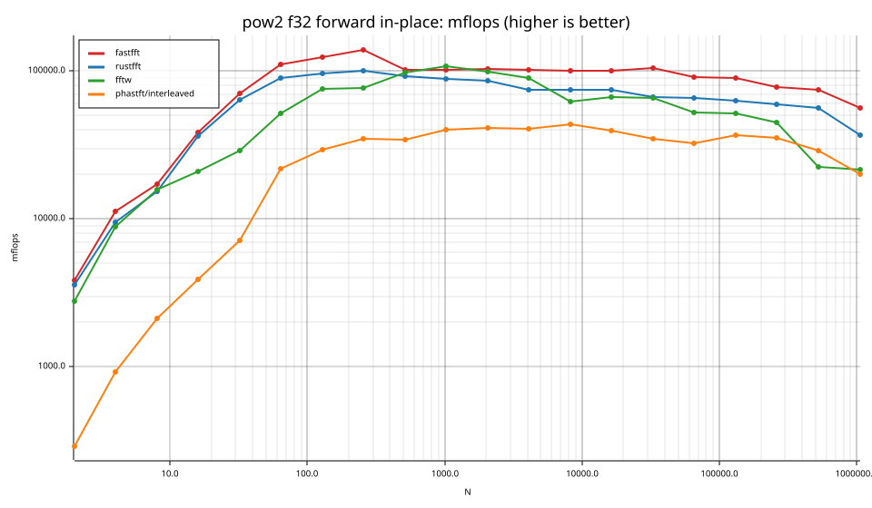
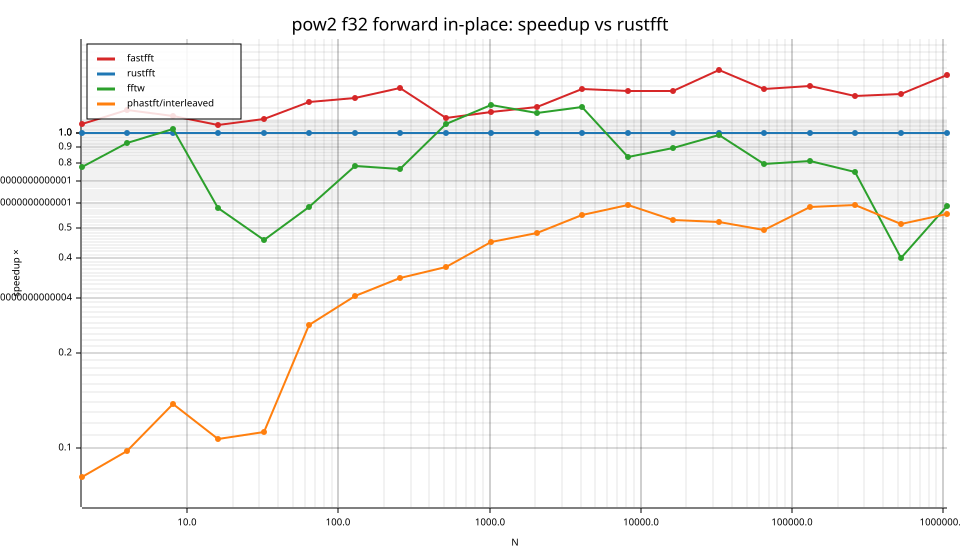
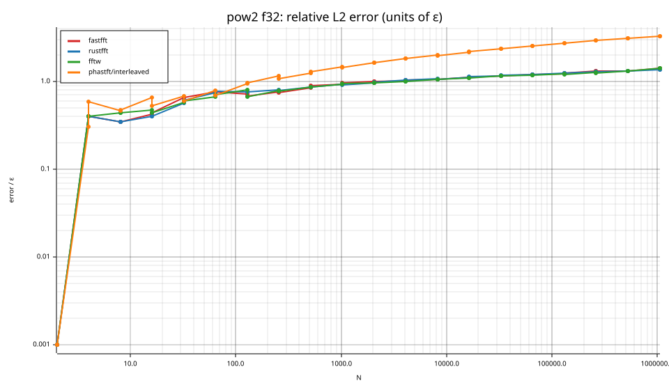
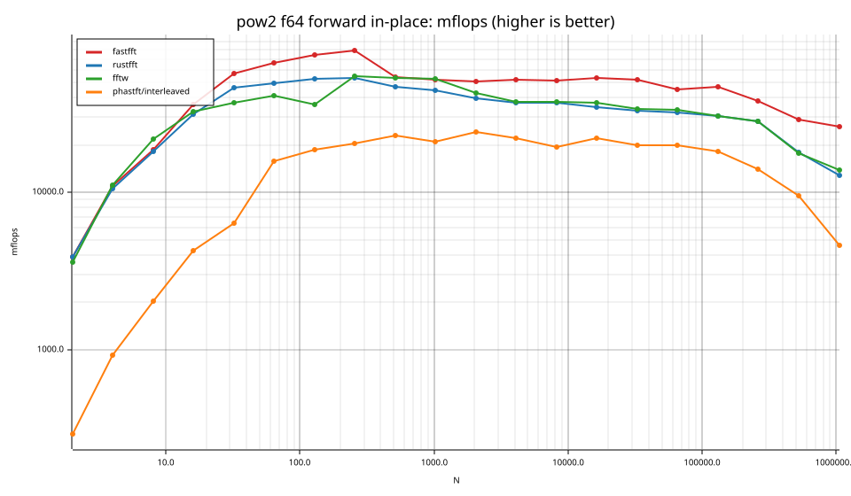
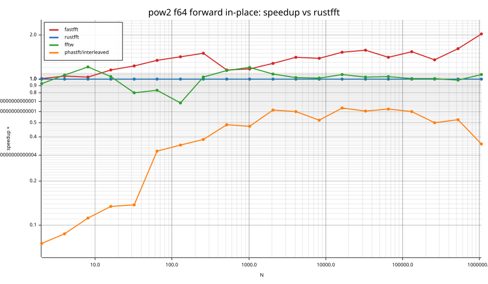
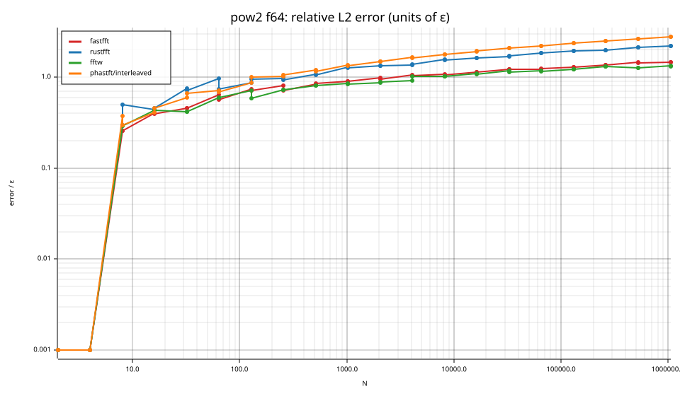

# fastfft arena report: `2026-10-16-mini-ryzen-four-library-comparison`

| | |
|---|---|
| Host | mini-ryzen |
| CPU | AMD Ryzen 7 7840HS w/ Radeon 780M Graphics (family 25, model 116, stepping 1, microcode 0xa704108) |
| Pinned CPU | 2 (SMT siblings 2,10) |
| Governor / EPP / boost | performance / performance / 1 |
| Kernel | Linux version 7.0.0-38-generic |
| Virtualization | none |
| rustc | rustc 1.95.0 (59807616e 2026-04-14); binary: rustc; commit-hash: 59807616e1fa2540724bfbac14d7976d7e4a3860; commit-date: 2026-04-14; host: x86_64-unknown-linux-gnu; release: 1.95.0; LLVM version: 22.1.2 |
| Build profile / RUSTFLAGS | arena / `-C llvm-args=-align-all-functions=6` |
| Libraries | {"fearless_simd":"0.5.0","num-complex":"0.4.6","oxifft":"0.4.2","phastft":"0.4.1","pulp":"0.22.3","rustfft":"6.4.1","tfhe-fft":"0.10.1"} |
| FFTW | fftw-3.3.11-sse2-avx-avx2-avx2_128-avx512 `double: CFLAGS='-O3 -fPIC -std=gnu17' ./configure --enable-static --disable-shared --disable-fortran --disable-doc --enable-sse2 --enable-avx --enable-avx2 --enable-avx512 --enable-fma
single: CFLAGS='-O3 -fPIC -std=gnu17' ./configure --enable-static --disable-shared --disable-fortran --disable-doc --enable-sse2 --enable-avx --enable-avx2 --enable-avx512 --enable-fma --enable-float` |
| Git | 804324ea7789fde4d0a9d4c8a6ad10cf5d68d12d (dirty: false) |
| Profile | full |
| Official | true  |
| Control drift | max 0.58% over 5 control runs |
| Cells | 80 |

Times are per transform. *best* = minimum batch mean, *median* = median batch mean. Speedup = rustfft time ÷ library time (> 1 means faster than rustfft); *geomean* over the cells both libraries ran. mflops = 5·N·log2(N)/t(µs).

## Release gates (fastfft)

| Gate | Criterion | Status | Detail |
|---|---|---|---|
| G1 | pow2 vs rustfft: geomean ≥ 1.5×, no cell < 0.95× | ❌ fail | geomean best 1.318×, median 1.315×, worst cell 0.931× (pow2:f64:inv:ip:n2), 80 cells |
| G2 | smooth vs rustfft: geomean ≥ 1.3×, no cell < 0.95× | – n/a | no data |
| G3 | rough vs rustfft: geomean ≥ 0.75×, no cell < 0.5× | – n/a | no data |
| G4 | vs each other Rust library: geomean ≥ 1.1×, ≥ 0.97× on ≥ 90% of cells | ✅ pass | phastft/interleaved: 3.97×/4.11× (100% ≥ 0.97×, 40 cells) |
| G5 | AVX2 forced: pow2 ≥ 1.2×, smooth ≥ 1.1× vs rustfft | – n/a | pow2 NaN×/NaN×, smooth NaN×/NaN× |
| G6 | scenarios ≥ 1.3× each; batch geomean ≥ 1.5× | – n/a | scenarios min inf×, batch NaN×/NaN× |
| G7 | accuracy within §6 thresholds and ≤ 1.5× rustfft + 1ε | ✅ pass | 80 cells checked |
| G8 | Estimate planning time ≤ 2× rustfft for every N ≤ 2^20 | ❌ fail | worst ratio 9.20× (pow2:f32:fwd:ip:n2), 80 cells |

G9 (build time) is measured by `cargo xtask build-time`, not by the arena.

## Speedup vs rustfft (geomean of best-time ratios; median-time ratio in parentheses)

| suite | prec | fastfft | rustfft | fftw | phastft/interleaved |
|---|---|---|---|---|---|
| pow2 | f32 | 1.30× (1.29×) 40/0/0 | 1.00× (1.00×) 0/40/0 | 0.82× (0.80×) 8/4/28 | 0.32× (0.32×) 0/0/40 |
| pow2 | f64 | 1.34× (1.33×) 37/2/1 | 1.00× (1.00×) 0/40/0 | 1.00× (0.99×) 18/13/9 | 0.33× (0.31×) 0/0/40 |

w/t/l = cells faster / within ±3% / slower than rustfft (best times).

## Suite `pow2`

### pow2 f32

| cell | fastfft | rustfft | fftw | phastft/interleaved |
|---|---|---|---|---|
| N=2 fwd ip | 2.6ns (1.07×) | 2.8ns | 3.6ns (0.78×) | 34.3ns (0.08×) |
| N=2 inv ip | 2.6ns (1.07×) | 2.8ns | 3.6ns (0.78×) | 35.2ns (0.08×) |
| N=4 fwd ip | 3.6ns (1.18×) | 4.2ns | 4.5ns (0.93×) | 43.0ns (0.10×) |
| N=4 inv ip | 3.6ns (1.18×) | 4.2ns | 4.5ns (0.93×) | 44.7ns (0.09×) |
| N=8 fwd ip | 7.0ns (1.13×) | 7.8ns | 7.6ns (1.02×) | 56.6ns (0.14×) |
| N=8 inv ip | 6.9ns (1.13×) | 7.8ns | 7.6ns (1.03×) | 58.8ns (0.13×) |
| N=16 fwd ip | 8.3ns (1.06×) | 8.7ns | 15.2ns (0.58×) | 82.2ns (0.11×) |
| N=16 inv ip | 8.3ns (1.06×) | 8.8ns | 14.7ns (0.59×) | 85.2ns (0.10×) |
| N=32 fwd ip | 11.4ns (1.10×) | 12.6ns | 27.5ns (0.46×) | 111.6ns (0.11×) |
| N=32 inv ip | 11.6ns (1.09×) | 12.7ns | 27.4ns (0.46×) | 114.3ns (0.11×) |
| N=64 fwd ip | 17.3ns (1.25×) | 21.5ns | 36.9ns (0.58×) | 87.5ns (0.25×) |
| N=64 inv ip | 17.7ns (1.82×) | 32.1ns | 37.9ns (0.85×) | 91.2ns (0.35×) |
| N=128 fwd ip | 36.2ns (1.28×) | 46.5ns | 59.2ns (0.79×) | 153.3ns (0.30×) |
| N=128 inv ip | 36.3ns (1.29×) | 46.7ns | 58.9ns (0.79×) | 160.2ns (0.29×) |
| N=256 fwd ip | 74.0ns (1.38×) | 102.4ns | 133.8ns (0.77×) | 295.3ns (0.35×) |
| N=256 inv ip | 74.3ns (1.47×) | 109.4ns | 137.5ns (0.80×) | 307.3ns (0.36×) |
| N=512 fwd ip | 225.2ns (1.11×) | 249.9ns | 235.0ns (1.06×) | 668.9ns (0.37×) |
| N=512 inv ip | 224.6ns (2.02×) | 453.4ns | 246.0ns (1.84×) | 625.1ns (0.73×) |
| N=1024 fwd ip | 499.6ns (1.16×) | 578.6ns | 474.1ns (1.22×) | 1.28us (0.45×) |
| N=1024 inv ip | 500.1ns (1.15×) | 572.7ns | 492.2ns (1.16×) | 1.27us (0.45×) |
| N=2048 fwd ip | 1.09us (1.21×) | 1.31us | 1.14us (1.15×) | 2.73us (0.48×) |
| N=2048 inv ip | 1.09us (1.20×) | 1.31us | 1.12us (1.17×) | 2.64us (0.50×) |
| N=4096 fwd ip | 2.40us (1.38×) | 3.30us | 2.75us (1.20×) | 6.01us (0.55×) |
| N=4096 inv ip | 2.38us (1.37×) | 3.25us | 2.77us (1.18×) | 6.26us (0.52×) |
| N=8192 fwd ip | 5.30us (1.35×) | 7.16us | 8.57us (0.84×) | 12.12us (0.59×) |
| N=8192 inv ip | 5.26us (1.32×) | 6.97us | 8.22us (0.85×) | 13.23us (0.53×) |
| N=16384 fwd ip | 11.39us (1.35×) | 15.41us | 17.30us (0.89×) | 29.14us (0.53×) |
| N=16384 inv ip | 11.42us (1.43×) | 16.34us | 17.27us (0.95×) | 26.76us (0.61×) |
| N=32768 fwd ip | 23.40us (1.58×) | 36.93us | 37.46us (0.99×) | 70.78us (0.52×) |
| N=32768 inv ip | 23.30us (1.59×) | 37.17us | 37.98us (0.98×) | 71.34us (0.52×) |
| N=65536 fwd ip | 57.77us (1.37×) | 79.42us | 99.72us (0.80×) | 161.98us (0.49×) |
| N=65536 inv ip | 58.00us (1.38×) | 80.08us | 101.17us (0.79×) | 165.71us (0.48×) |
| N=131072 fwd ip | 124.92us (1.41×) | 176.07us | 215.93us (0.82×) | 302.68us (0.58×) |
| N=131072 inv ip | 125.64us (1.40×) | 175.86us | 220.56us (0.80×) | 303.63us (0.58×) |
| N=262144 fwd ip | 302.48us (1.31×) | 396.00us | 526.65us (0.75×) | 670.88us (0.59×) |
| N=262144 inv ip | 305.66us (1.31×) | 399.18us | 513.56us (0.78×) | 765.75us (0.52×) |
| N=524288 fwd ip | 666.07us (1.32×) | 882.05us | 2.21ms (0.40×) | 1.72ms (0.51×) |
| N=524288 inv ip | 674.65us (1.28×) | 861.93us | 2.27ms (0.38×) | 1.63ms (0.53×) |
| N=1048576 fwd ip | 1.87ms (1.53×) | 2.86ms | 4.89ms (0.59×) | 5.19ms (0.55×) |
| N=1048576 inv ip | 1.86ms (1.54×) | 2.86ms | 4.94ms (0.58×) | 5.21ms (0.55×) |

### pow2 f64

| cell | fastfft | rustfft | fftw | phastft/interleaved |
|---|---|---|---|---|
| N=2 fwd ip | 2.6ns (1.00×) | 2.6ns | 2.8ns (0.93×) | 34.3ns (0.08×) |
| N=2 inv ip | 2.6ns (0.93×) | 2.4ns | 3.0ns (0.81×) | 35.2ns (0.07×) |
| N=4 fwd ip | 3.6ns (1.04×) | 3.8ns | 3.6ns (1.06×) | 43.5ns (0.09×) |
| N=4 inv ip | 3.6ns (1.04×) | 3.7ns | 3.6ns (1.03×) | 46.8ns (0.08×) |
| N=8 fwd ip | 6.4ns (1.03×) | 6.6ns | 5.5ns (1.20×) | 58.9ns (0.11×) |
| N=8 inv ip | 6.3ns (1.11×) | 7.0ns | 5.5ns (1.28×) | 59.5ns (0.12×) |
| N=16 fwd ip | 8.9ns (1.15×) | 10.2ns | 9.8ns (1.03×) | 75.4ns (0.13×) |
| N=16 inv ip | 8.9ns (1.14×) | 10.2ns | 9.1ns (1.11×) | 75.9ns (0.13×) |
| N=32 fwd ip | 14.2ns (1.23×) | 17.4ns | 21.7ns (0.80×) | 126.4ns (0.14×) |
| N=32 inv ip | 14.1ns (1.27×) | 17.9ns | 23.3ns (0.77×) | 130.2ns (0.14×) |
| N=64 fwd ip | 29.1ns (1.34×) | 38.9ns | 46.6ns (0.83×) | 121.2ns (0.32×) |
| N=64 inv ip | 29.4ns (1.32×) | 38.8ns | 46.5ns (0.83×) | 129.0ns (0.30×) |
| N=128 fwd ip | 60.4ns (1.41×) | 85.3ns | 124.6ns (0.68×) | 241.5ns (0.35×) |
| N=128 inv ip | 60.7ns (1.39×) | 84.6ns | 115.5ns (0.73×) | 251.4ns (0.34×) |
| N=256 fwd ip | 128.6ns (1.50×) | 192.9ns | 187.6ns (1.03×) | 501.4ns (0.38×) |
| N=256 inv ip | 128.7ns (1.49×) | 191.8ns | 208.5ns (0.92×) | 668.6ns (0.29×) |
| N=512 fwd ip | 429.1ns (1.15×) | 492.1ns | 431.4ns (1.14×) | 1.01us (0.49×) |
| N=512 inv ip | 432.2ns (1.16×) | 501.4ns | 428.9ns (1.17×) | 1.07us (0.47×) |
| N=1024 fwd ip | 991.1ns (1.17×) | 1.16us | 972.0ns (1.19×) | 2.45us (0.47×) |
| N=1024 inv ip | 1.02us (1.18×) | 1.21us | 1.00us (1.20×) | 2.53us (0.48×) |
| N=2048 fwd ip | 2.25us (1.27×) | 2.86us | 2.65us (1.08×) | 4.68us (0.61×) |
| N=2048 inv ip | 2.29us (1.23×) | 2.82us | 2.62us (1.08×) | 5.27us (0.53×) |
| N=4096 fwd ip | 4.73us (1.41×) | 6.67us | 6.53us (1.02×) | 11.14us (0.60×) |
| N=4096 inv ip | 4.54us (1.43×) | 6.50us | 6.69us (0.97×) | 11.96us (0.54×) |
| N=8192 fwd ip | 10.44us (1.38×) | 14.37us | 14.15us (1.02×) | 27.56us (0.52×) |
| N=8192 inv ip | 10.37us (1.37×) | 14.24us | 13.89us (1.03×) | 23.86us (0.60×) |
| N=16384 fwd ip | 21.64us (1.53×) | 33.03us | 30.91us (1.07×) | 52.17us (0.63×) |
| N=16384 inv ip | 21.56us (1.51×) | 32.61us | 30.73us (1.06×) | 52.35us (0.62×) |
| N=32768 fwd ip | 47.36us (1.57×) | 74.43us | 72.51us (1.03×) | 123.21us (0.60×) |
| N=32768 inv ip | 47.52us (1.56×) | 74.33us | 74.42us (1.00×) | 126.92us (0.59×) |
| N=65536 fwd ip | 116.94us (1.40×) | 164.29us | 157.92us (1.04×) | 265.11us (0.62×) |
| N=65536 inv ip | 116.89us (1.41×) | 164.30us | 161.22us (1.02×) | 292.59us (0.56×) |
| N=131072 fwd ip | 239.86us (1.53×) | 367.02us | 364.40us (1.01×) | 612.77us (0.60×) |
| N=131072 inv ip | 239.31us (1.52×) | 364.51us | 368.34us (0.99×) | 651.87us (0.56×) |
| N=262144 fwd ip | 622.28us (1.34×) | 836.35us | 833.72us (1.00×) | 1.67ms (0.50×) |
| N=262144 inv ip | 620.91us (1.43×) | 887.38us | 833.37us (1.06×) | 1.58ms (0.56×) |
| N=524288 fwd ip | 1.73ms (1.60×) | 2.78ms | 2.82ms (0.98×) | 5.26ms (0.53×) |
| N=524288 inv ip | 1.72ms (1.61×) | 2.78ms | 2.81ms (0.99×) | 5.12ms (0.54×) |
| N=1048576 fwd ip | 4.03ms (2.02×) | 8.15ms | 7.62ms (1.07×) | 22.64ms (0.36×) |
| N=1048576 inv ip | 4.03ms (2.04×) | 8.24ms | 7.69ms (1.07×) | 23.23ms (0.35×) |

## Accuracy and planning time (medians over cells)

| lib | cells verified | failed | median error (ε) | worst error (ε) | median plan time |
|---|---|---|---|---|---|
| fastfft | 80 | 0 | 0.96 | 1.46 | 23.86us |
| rustfft | 80 | 0 | 1.05 | 2.21 | 16.24us |
| fftw | 80 | 0 | 0.92 | 1.42 | 155.27ms |
| phastft/interleaved | 80 | 0 | 1.47 | 3.28 | 16.38us |

### Library notes

- phastft/interleaved: interleaved API deinterleaves into temporary Vecs
- phastft/interleaved: normalizes inverse by 1/N
