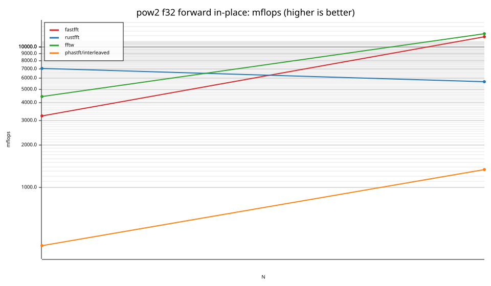
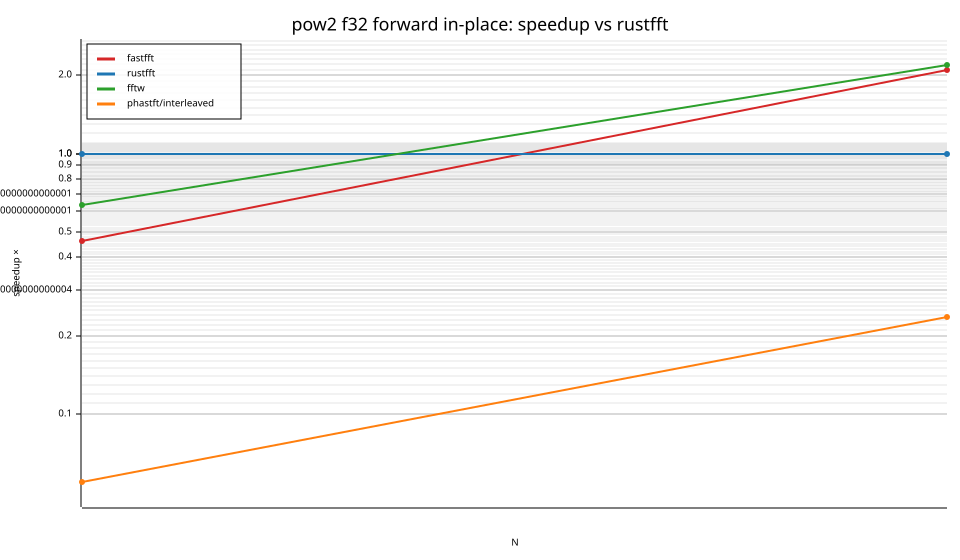
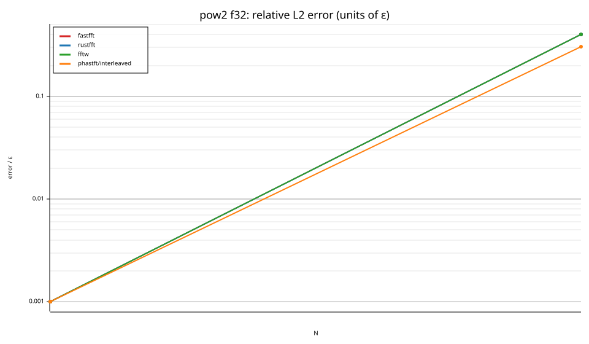

# fastfft arena report: `2026-10-17-161818-macos-master-four-library-comparison`

| | |
|---|---|
| Host | Ians-Mac-Mini.localdomain |
| CPU | Apple M6 (family ?, model ?, stepping ?, microcode ?) |
| Pinned CPU | null (SMT siblings ?) |
| Governor / EPP / boost | ? / ? / ? |
| Kernel | Darwin Ians-Mac-Mini.localdomain 27.0.0 Darwin Kernel Version 27.0.0: Tue Aug 11 21:06:15 PDT 2026; root:xnu-13432.1.9~1/RELEASE_ARM64_T8152 arm64 |
| Virtualization | ? |
| rustc | rustc 1.95.0 (59807616e 2026-04-14); binary: rustc; commit-hash: 59807616e1fa2540724bfbac14d7976d7e4a3860; commit-date: 2026-04-14; host: aarch64-apple-darwin; release: 1.95.0; LLVM version: 22.1.2 |
| Build profile / RUSTFLAGS | arena / `-C llvm-args=-align-all-functions=6` |
| Libraries | {"fearless_simd":"0.5.0","num-complex":"0.4.6","oxifft":"0.4.2","phastft":"0.4.1","pulp":"0.22.3","rustfft":"6.4.1","tfhe-fft":"0.10.1"} |
| FFTW | fftw-3.3.11-neon `double: CFLAGS='-O3 -fPIC -std=gnu17' ./configure --enable-static --disable-shared --disable-fortran --disable-doc --enable-neon
single: CFLAGS='-O3 -fPIC -std=gnu17' ./configure --enable-static --disable-shared --disable-fortran --disable-doc --enable-neon --enable-float` |
| Git | 0e9a1593a925d90f0468edea3ed73c70a0b3ec6b (dirty: true) |
| Profile | full |
| Official | false (["CPU pinning and Linux performance-policy checks are unavailable on this platform"]) |
| Control drift | max 35.71% over 1 control runs — **FLAGGED** |
| Cells | 3 |

Times are per transform. *best* = minimum batch mean, *median* = median batch mean. Speedup = rustfft time ÷ library time (> 1 means faster than rustfft); *geomean* over the cells both libraries ran. mflops = 5·N·log2(N)/t(µs).

## Release gates (fastfft)

| Gate | Criterion | Status | Detail |
|---|---|---|---|
| G1 | pow2 vs rustfft: geomean ≥ 1.5×, no cell < 0.95× | ❌ fail | geomean best 0.762×, median 0.765×, worst cell 0.461× (pow2:f32:inv:ip:n2), 3 cells |
| G2 | smooth vs rustfft: geomean ≥ 1.3×, no cell < 0.95× | – n/a | no data |
| G3 | rough vs rustfft: geomean ≥ 0.75×, no cell < 0.5× | – n/a | no data |
| G4 | vs each other Rust library: geomean ≥ 1.1×, ≥ 0.97× on ≥ 90% of cells | ✅ pass | phastft/interleaved: 8.62×/8.81× (100% ≥ 0.97×, 2 cells) |
| G5 | AVX2 forced: pow2 ≥ 1.2×, smooth ≥ 1.1× vs rustfft | – n/a | pow2 NaN×/NaN×, smooth NaN×/NaN× |
| G6 | scenarios ≥ 1.3× each; batch geomean ≥ 1.5× | – n/a | scenarios min inf×, batch NaN×/NaN× |
| G7 | accuracy within §6 thresholds and ≤ 1.5× rustfft + 1ε | ✅ pass | 3 cells checked |
| G8 | Estimate planning time ≤ 2× rustfft for every N ≤ 2^20 | ✅ pass | worst ratio 1.59× (pow2:f32:fwd:ip:n2), 3 cells |

G9 (build time) is measured by `cargo xtask build-time`, not by the arena.

## Speedup vs rustfft (geomean of best-time ratios; median-time ratio in parentheses)

| suite | prec | fastfft | rustfft | fftw | phastft/interleaved |
|---|---|---|---|---|---|
| pow2 | f32 | 0.76× (0.76×) 1/0/2 | 1.00× (1.00×) 0/3/0 | 0.95× (0.94×) 1/0/2 | 0.09× (0.09×) 0/0/3 |

w/t/l = cells faster / within ±3% / slower than rustfft (best times).

## Suite `pow2`

### pow2 f32

| cell | fastfft | rustfft | fftw | phastft/interleaved |
|---|---|---|---|---|
| N=2 fwd ip | 3.1ns (0.46×) | 1.4ns | 2.3ns (0.63×) | 26.0ns (0.05×) |
| N=2 inv ip | 3.1ns (0.46×) | 1.4ns | 2.3ns (0.63×) | 25.9ns (0.05×) |
| N=4 fwd ip | 3.4ns (2.08×) | 7.1ns | 3.2ns (2.19×) | 29.9ns (0.24×) |

## Accuracy and planning time (medians over cells)

| lib | cells verified | failed | median error (ε) | worst error (ε) | median plan time |
|---|---|---|---|---|---|
| fastfft | 3 | 0 | 0.00 | 0.40 | 375.0ns |
| rustfft | 3 | 0 | 0.00 | 0.40 | 250.0ns |
| fftw | 3 | 0 | 0.00 | 0.40 | 3.27ms |
| phastft/interleaved | 3 | 0 | 0.00 | 0.30 | 1.54us |

### Library notes

- phastft/interleaved: interleaved API deinterleaves into temporary Vecs
- phastft/interleaved: normalizes inverse by 1/N
