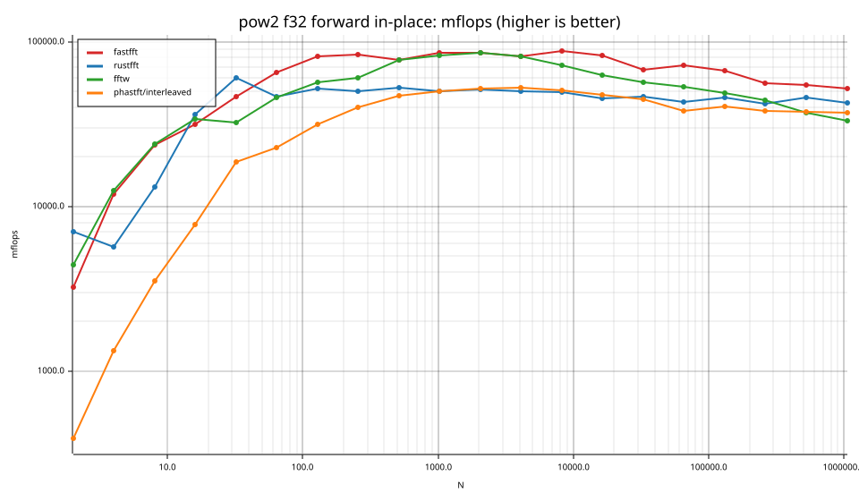
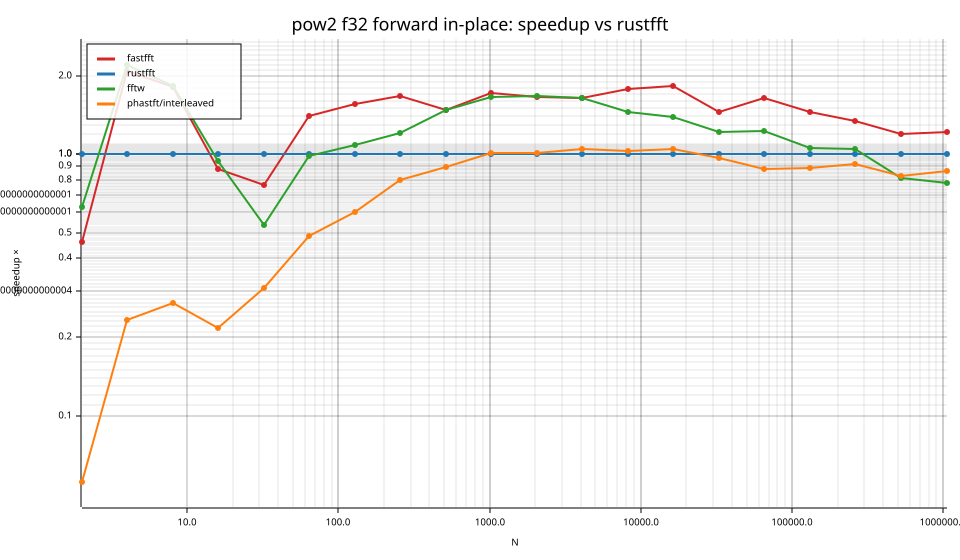
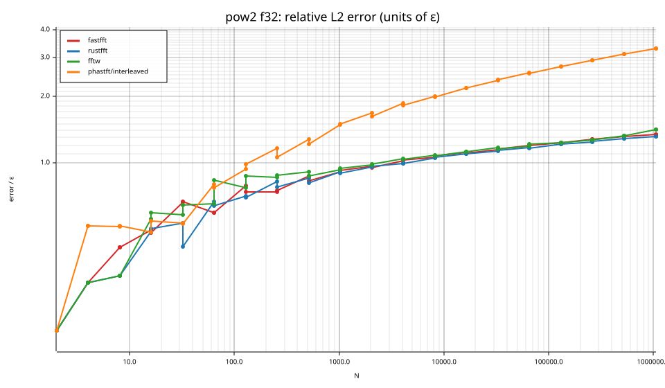
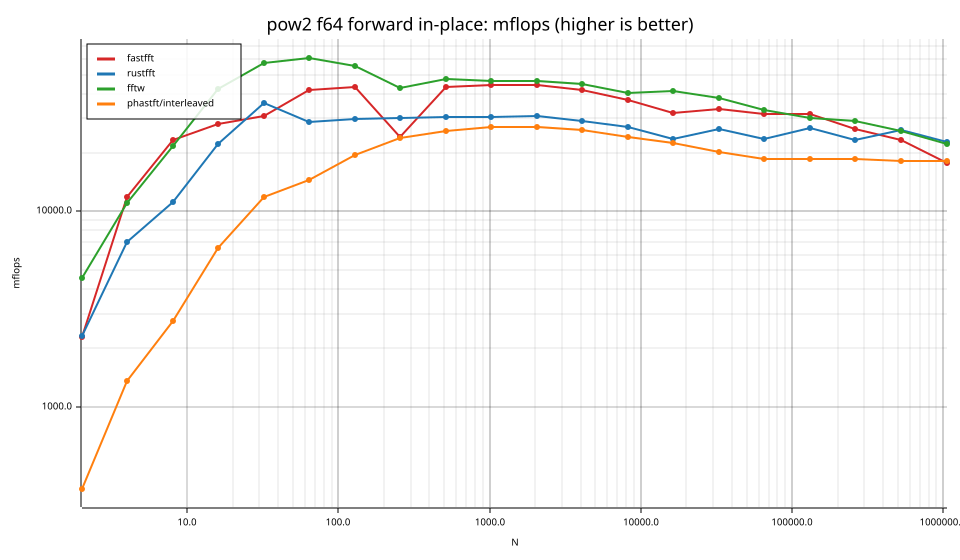
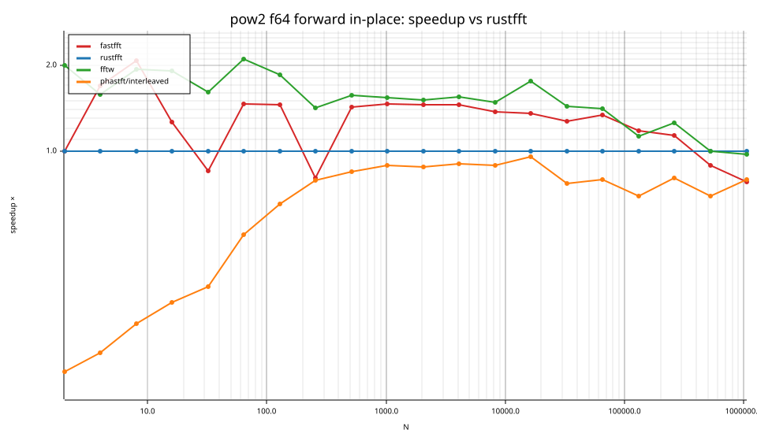
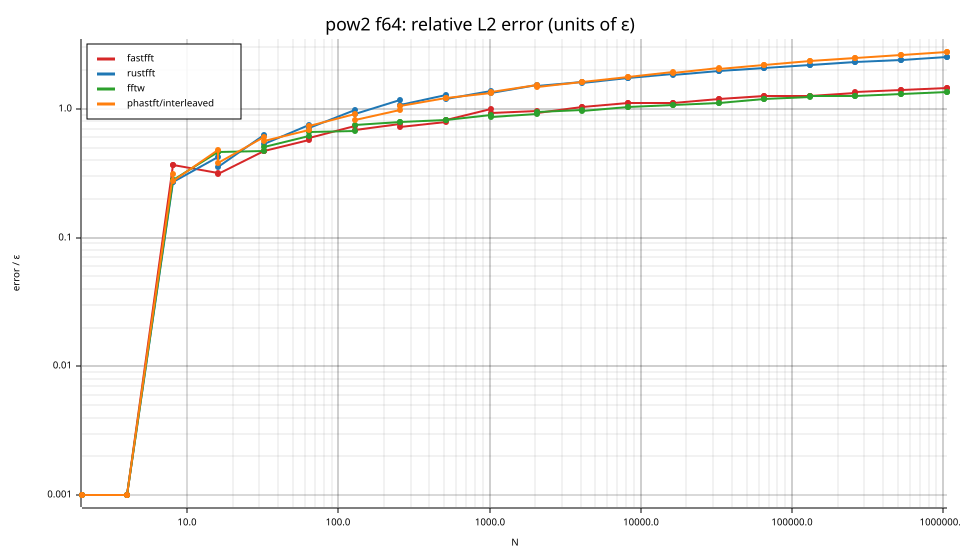

# fastfft arena report: `2026-10-17-163801-macos-master-diagnostic`

| | |
|---|---|
| Host | Ians-Mac-Mini.localdomain |
| CPU | Apple M6 (family ?, model ?, stepping ?, microcode ?) |
| Pinned CPU | null (SMT siblings ?) |
| Governor / EPP / boost | ? / ? / ? |
| Kernel | Darwin Ians-Mac-Mini.localdomain 27.0.0 Darwin Kernel Version 27.0.0: Tue Aug 11 21:06:15 PDT 2026; root:xnu-13432.1.9~1/RELEASE_ARM64_T8152 arm64 |
| Virtualization | ? |
| rustc | rustc 1.95.0 (59807616e 2026-04-14); binary: rustc; commit-hash: 59807616e1fa2540724bfbac14d7976d7e4a3860; commit-date: 2026-04-14; host: aarch64-apple-darwin; release: 1.95.0; LLVM version: 22.1.2 |
| Build profile / RUSTFLAGS | arena / `-C llvm-args=-align-all-functions=6` |
| Libraries | {"fearless_simd":"0.5.0","num-complex":"0.4.6","oxifft":"0.4.2","phastft":"0.4.1","pulp":"0.22.3","rustfft":"6.4.1","tfhe-fft":"0.10.1"} |
| FFTW | fftw-3.3.11-neon `double: CFLAGS='-O3 -fPIC -std=gnu17' ./configure --enable-static --disable-shared --disable-fortran --disable-doc --enable-neon
single: CFLAGS='-O3 -fPIC -std=gnu17' ./configure --enable-static --disable-shared --disable-fortran --disable-doc --enable-neon --enable-float` |
| Git | 0e9a1593a925d90f0468edea3ed73c70a0b3ec6b (dirty: true) |
| Profile | full |
| Official | false (["CPU pinning and Linux performance-policy checks are unavailable on this platform"]) |
| Control drift | max 0.21% over 5 control runs |
| Cells | 80 |

Times are per transform. *best* = minimum batch mean, *median* = median batch mean. Speedup = rustfft time ÷ library time (> 1 means faster than rustfft); *geomean* over the cells both libraries ran. mflops = 5·N·log2(N)/t(µs).

## Release gates (fastfft)

| Gate | Criterion | Status | Detail |
|---|---|---|---|
| G1 | pow2 vs rustfft: geomean ≥ 1.5×, no cell < 0.95× | ❌ fail | geomean best 1.322×, median 1.298×, worst cell 0.461× (pow2:f32:fwd:ip:n2), 80 cells |
| G2 | smooth vs rustfft: geomean ≥ 1.3×, no cell < 0.95× | – n/a | no data |
| G3 | rough vs rustfft: geomean ≥ 0.75×, no cell < 0.5× | – n/a | no data |
| G4 | vs each other Rust library: geomean ≥ 1.1×, ≥ 0.97× on ≥ 90% of cells | ✅ pass | phastft/interleaved: 2.24×/2.25× (98% ≥ 0.97×, 40 cells) |
| G5 | AVX2 forced: pow2 ≥ 1.2×, smooth ≥ 1.1× vs rustfft | – n/a | pow2 NaN×/NaN×, smooth NaN×/NaN× |
| G6 | scenarios ≥ 1.3× each; batch geomean ≥ 1.5× | – n/a | scenarios min inf×, batch NaN×/NaN× |
| G7 | accuracy within §6 thresholds and ≤ 1.5× rustfft + 1ε | ✅ pass | 80 cells checked |
| G8 | Estimate planning time ≤ 2× rustfft for every N ≤ 2^20 | ❌ fail | worst ratio 5.52× (pow2:f64:fwd:ip:n32), 80 cells |

G9 (build time) is measured by `cargo xtask build-time`, not by the arena.

## Speedup vs rustfft (geomean of best-time ratios; median-time ratio in parentheses)

| suite | prec | fastfft | rustfft | fftw | phastft/interleaved |
|---|---|---|---|---|---|
| pow2 | f32 | 1.38× (1.35×) 34/0/6 | 1.00× (1.00×) 0/40/0 | 1.19× (1.17×) 28/2/10 | 0.58× (0.57×) 2/6/32 |
| pow2 | f64 | 1.27× (1.24×) 31/1/8 | 1.00× (1.00×) 0/40/0 | 1.52× (1.52×) 36/3/1 | 0.57× (0.57×) 0/0/40 |

w/t/l = cells faster / within ±3% / slower than rustfft (best times).

## Suite `pow2`

### pow2 f32

| cell | fastfft | rustfft | fftw | phastft/interleaved |
|---|---|---|---|---|
| N=2 fwd ip | 3.1ns (0.46×) | 1.4ns | 2.3ns (0.63×) | 25.5ns (0.06×) |
| N=2 inv ip | 3.1ns (0.46×) | 1.4ns | 2.3ns (0.63×) | 25.9ns (0.06×) |
| N=4 fwd ip | 3.4ns (2.09×) | 7.1ns | 3.2ns (2.20×) | 30.2ns (0.23×) |
| N=4 inv ip | 3.8ns (1.86×) | 7.1ns | 3.2ns (2.21×) | 30.7ns (0.23×) |
| N=8 fwd ip | 5.1ns (1.81×) | 9.2ns | 5.0ns (1.82×) | 33.9ns (0.27×) |
| N=8 inv ip | 5.1ns (1.81×) | 9.2ns | 5.0ns (1.83×) | 34.1ns (0.27×) |
| N=16 fwd ip | 10.1ns (0.88×) | 8.9ns | 9.4ns (0.94×) | 41.1ns (0.22×) |
| N=16 inv ip | 10.2ns (0.88×) | 8.9ns | 9.3ns (0.95×) | 42.0ns (0.21×) |
| N=32 fwd ip | 17.3ns (0.77×) | 13.3ns | 24.6ns (0.54×) | 43.1ns (0.31×) |
| N=32 inv ip | 17.3ns (0.77×) | 13.3ns | 20.1ns (0.66×) | 47.8ns (0.28×) |
| N=64 fwd ip | 29.5ns (1.41×) | 41.4ns | 42.1ns (0.98×) | 84.8ns (0.49×) |
| N=64 inv ip | 29.5ns (1.40×) | 41.4ns | 40.8ns (1.01×) | 86.6ns (0.48×) |
| N=128 fwd ip | 55.1ns (1.56×) | 85.9ns | 78.7ns (1.09×) | 142.6ns (0.60×) |
| N=128 inv ip | 55.1ns (1.56×) | 85.9ns | 78.1ns (1.10×) | 150.1ns (0.57×) |
| N=256 fwd ip | 122.1ns (1.67×) | 204.4ns | 169.2ns (1.21×) | 257.1ns (0.80×) |
| N=256 inv ip | 122.1ns (1.67×) | 204.4ns | 157.9ns (1.29×) | 271.4ns (0.75×) |
| N=512 fwd ip | 298.9ns (1.48×) | 441.1ns | 297.4ns (1.48×) | 492.1ns (0.90×) |
| N=512 inv ip | 298.4ns (1.48×) | 441.1ns | 284.2ns (1.55×) | 520.4ns (0.85×) |
| N=1024 fwd ip | 600.0ns (1.72×) | 1.03us | 622.2ns (1.66×) | 1.02us (1.01×) |
| N=1024 inv ip | 600.5ns (1.72×) | 1.03us | 619.1ns (1.67×) | 1.08us (0.96×) |
| N=2048 fwd ip | 1.32us (1.66×) | 2.19us | 1.31us (1.67×) | 2.16us (1.02×) |
| N=2048 inv ip | 1.29us (1.67×) | 2.16us | 1.29us (1.67×) | 2.27us (0.95×) |
| N=4096 fwd ip | 3.00us (1.65×) | 4.94us | 3.01us (1.64×) | 4.70us (1.05×) |
| N=4096 inv ip | 3.00us (1.64×) | 4.91us | 3.01us (1.63×) | 4.99us (0.98×) |
| N=8192 fwd ip | 6.09us (1.77×) | 10.81us | 7.41us (1.46×) | 10.51us (1.03×) |
| N=8192 inv ip | 6.09us (1.77×) | 10.81us | 7.11us (1.52×) | 10.77us (1.00×) |
| N=16384 fwd ip | 13.86us (1.82×) | 25.25us | 18.22us (1.39×) | 24.01us (1.05×) |
| N=16384 inv ip | 14.39us (1.75×) | 25.21us | 18.33us (1.38×) | 25.21us (1.00×) |
| N=32768 fwd ip | 36.48us (1.46×) | 53.08us | 43.48us (1.22×) | 54.83us (0.97×) |
| N=32768 inv ip | 36.46us (1.46×) | 53.21us | 41.69us (1.28×) | 58.00us (0.92×) |
| N=65536 fwd ip | 73.38us (1.65×) | 121.12us | 98.33us (1.23×) | 137.38us (0.88×) |
| N=65536 inv ip | 73.42us (1.65×) | 121.29us | 94.71us (1.28×) | 138.17us (0.88×) |
| N=131072 fwd ip | 166.46us (1.46×) | 242.88us | 229.83us (1.06×) | 274.54us (0.88×) |
| N=131072 inv ip | 166.08us (1.46×) | 242.75us | 221.62us (1.10×) | 286.96us (0.85×) |
| N=262144 fwd ip | 422.58us (1.34×) | 565.62us | 537.08us (1.05×) | 617.58us (0.92×) |
| N=262144 inv ip | 423.08us (1.34×) | 566.71us | 511.38us (1.11×) | 645.25us (0.88×) |
| N=524288 fwd ip | 914.50us (1.19×) | 1.09ms | 1.34ms (0.82×) | 1.32ms (0.82×) |
| N=524288 inv ip | 841.83us (1.26×) | 1.06ms | 1.34ms (0.79×) | 1.39ms (0.76×) |
| N=1048576 fwd ip | 2.02ms (1.22×) | 2.45ms | 3.15ms (0.78×) | 2.83ms (0.87×) |
| N=1048576 inv ip | 2.13ms (1.18×) | 2.50ms | 3.13ms (0.80×) | 2.91ms (0.86×) |

### pow2 f64

| cell | fastfft | rustfft | fftw | phastft/interleaved |
|---|---|---|---|---|
| N=2 fwd ip | 4.4ns (1.00×) | 4.3ns | 2.2ns (2.00×) | 26.0ns (0.17×) |
| N=2 inv ip | 2.2ns (1.96×) | 4.3ns | 2.1ns (2.03×) | 26.6ns (0.16×) |
| N=4 fwd ip | 3.4ns (1.70×) | 5.7ns | 3.6ns (1.58×) | 29.4ns (0.19×) |
| N=4 inv ip | 3.3ns (1.74×) | 5.7ns | 3.2ns (1.78×) | 29.8ns (0.19×) |
| N=8 fwd ip | 5.2ns (2.07×) | 10.8ns | 5.6ns (1.94×) | 43.7ns (0.25×) |
| N=8 inv ip | 5.2ns (2.07×) | 10.8ns | 5.6ns (1.92×) | 40.4ns (0.27×) |
| N=16 fwd ip | 11.5ns (1.26×) | 14.5ns | 7.6ns (1.91×) | 49.4ns (0.29×) |
| N=16 inv ip | 11.2ns (1.30×) | 14.5ns | 7.3ns (1.99×) | 46.0ns (0.32×) |
| N=32 fwd ip | 26.2ns (0.85×) | 22.3ns | 13.9ns (1.61×) | 67.1ns (0.33×) |
| N=32 inv ip | 26.2ns (0.85×) | 22.2ns | 14.3ns (1.55×) | 75.1ns (0.30×) |
| N=64 fwd ip | 45.7ns (1.46×) | 66.9ns | 31.7ns (2.11×) | 132.1ns (0.51×) |
| N=64 inv ip | 45.9ns (1.46×) | 66.9ns | 31.8ns (2.10×) | 139.6ns (0.48×) |
| N=128 fwd ip | 103.7ns (1.45×) | 150.7ns | 81.3ns (1.85×) | 231.8ns (0.65×) |
| N=128 inv ip | 103.7ns (1.45×) | 150.7ns | 81.6ns (1.85×) | 246.3ns (0.61×) |
| N=256 fwd ip | 424.0ns (0.80×) | 339.9ns | 240.5ns (1.41×) | 432.5ns (0.79×) |
| N=256 inv ip | 422.9ns (0.80×) | 340.0ns | 240.5ns (1.41×) | 460.3ns (0.74×) |
| N=512 fwd ip | 531.0ns (1.43×) | 757.9ns | 482.3ns (1.57×) | 895.5ns (0.85×) |
| N=512 inv ip | 530.3ns (1.43×) | 757.9ns | 488.8ns (1.55×) | 952.7ns (0.80×) |
| N=1024 fwd ip | 1.15us (1.47×) | 1.69us | 1.10us (1.54×) | 1.90us (0.89×) |
| N=1024 inv ip | 1.16us (1.46×) | 1.69us | 1.06us (1.60×) | 2.00us (0.85×) |
| N=2048 fwd ip | 2.53us (1.45×) | 3.67us | 2.42us (1.51×) | 4.18us (0.88×) |
| N=2048 inv ip | 2.53us (1.45×) | 3.67us | 2.56us (1.44×) | 4.38us (0.84×) |
| N=4096 fwd ip | 5.85us (1.45×) | 8.51us | 5.51us (1.54×) | 9.44us (0.90×) |
| N=4096 inv ip | 5.84us (1.46×) | 8.50us | 5.54us (1.54×) | 9.85us (0.86×) |
| N=8192 fwd ip | 14.28us (1.37×) | 19.61us | 13.26us (1.48×) | 22.10us (0.89×) |
| N=8192 inv ip | 14.43us (1.35×) | 19.44us | 13.05us (1.49×) | 23.39us (0.83×) |
| N=16384 fwd ip | 36.15us (1.35×) | 48.92us | 27.83us (1.76×) | 51.33us (0.95×) |
| N=16384 inv ip | 36.10us (1.35×) | 48.79us | 27.96us (1.75×) | 53.50us (0.91×) |
| N=32768 fwd ip | 73.83us (1.27×) | 93.54us | 65.04us (1.44×) | 121.83us (0.77×) |
| N=32768 inv ip | 73.54us (1.27×) | 93.62us | 65.08us (1.44×) | 127.62us (0.73×) |
| N=65536 fwd ip | 166.83us (1.34×) | 223.58us | 158.88us (1.41×) | 281.71us (0.79×) |
| N=65536 inv ip | 167.58us (1.33×) | 223.62us | 161.46us (1.39×) | 293.67us (0.76×) |
| N=131072 fwd ip | 354.33us (1.17×) | 416.04us | 370.62us (1.12×) | 599.88us (0.69×) |
| N=131072 inv ip | 357.88us (1.16×) | 416.79us | 364.92us (1.14×) | 629.25us (0.66×) |
| N=262144 fwd ip | 895.96us (1.14×) | 1.02ms | 812.38us (1.25×) | 1.27ms (0.80×) |
| N=262144 inv ip | 917.88us (1.11×) | 1.02ms | 813.75us (1.26×) | 1.30ms (0.79×) |
| N=524288 fwd ip | 2.16ms (0.89×) | 1.92ms | 1.92ms (1.00×) | 2.75ms (0.70×) |
| N=524288 inv ip | 2.18ms (0.87×) | 1.91ms | 2.00ms (0.95×) | 2.87ms (0.66×) |
| N=1048576 fwd ip | 5.92ms (0.78×) | 4.62ms | 4.76ms (0.97×) | 5.82ms (0.79×) |
| N=1048576 inv ip | 5.96ms (0.78×) | 4.64ms | 4.72ms (0.98×) | 6.02ms (0.77×) |

## Accuracy and planning time (medians over cells)

| lib | cells verified | failed | median error (ε) | worst error (ε) | median plan time |
|---|---|---|---|---|---|
| fastfft | 80 | 0 | 0.95 | 1.45 | 15.58us |
| rustfft | 80 | 0 | 1.07 | 2.51 | 5.58us |
| fftw | 80 | 0 | 0.94 | 1.41 | 2.20ms |
| phastft/interleaved | 80 | 0 | 1.49 | 3.28 | 4.58us |

### Library notes

- phastft/interleaved: interleaved API deinterleaves into temporary Vecs
- phastft/interleaved: normalizes inverse by 1/N
