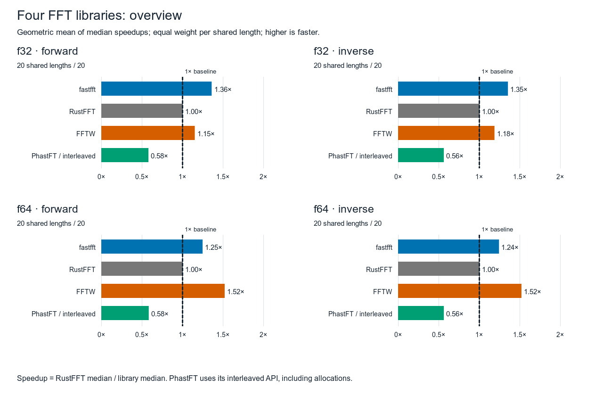
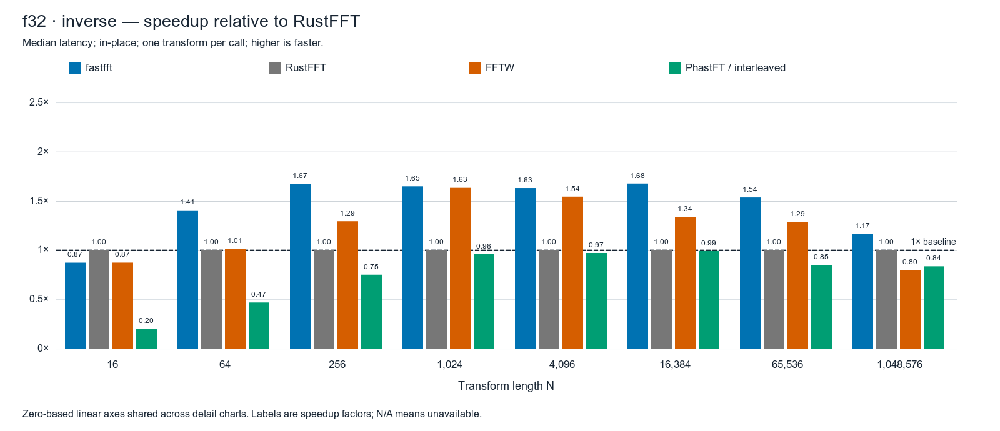
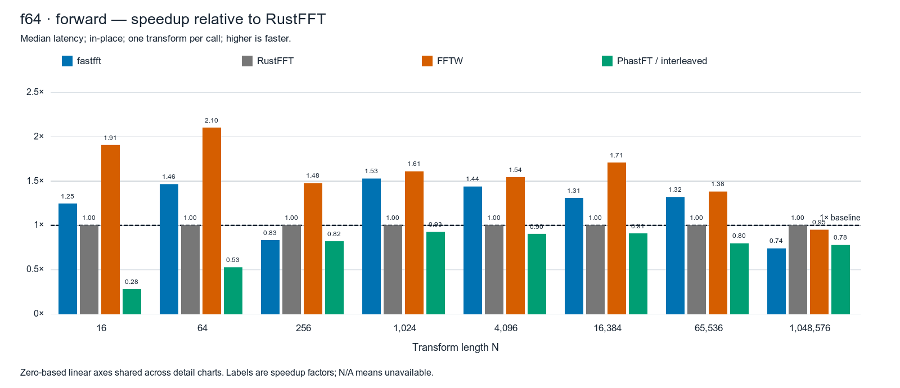
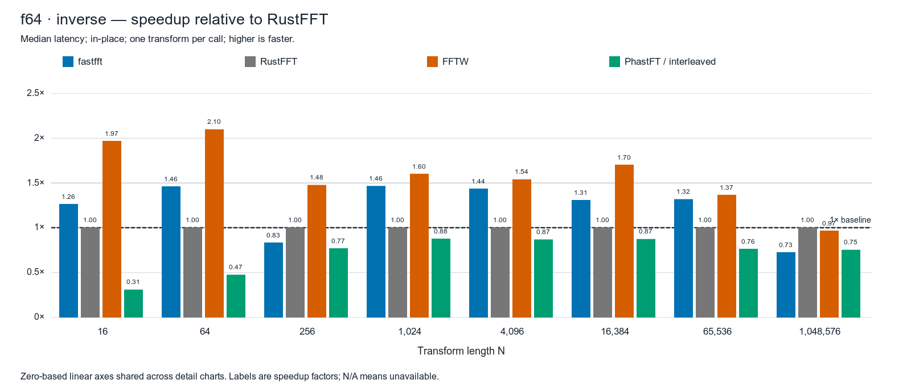

# macOS FFT diagnostic benchmark

DIAGNOSTIC ONLY — not gate-passing. User-authorized run-cell collection does not enforce the arena drift-abort gate; standard arena aborted twice. No binary/source changes or official gate changes. Unofficial local macOS run. CPU affinity and Linux performance-policy checks unavailable. Quiet-host check passed: True. Clock-proxy drift: 0.21%; drift flag: False. Clock proxy is not calibrated CPU frequency. Scheduler migration and background work may affect timings.

80 cells: N=2¹–2²⁰ (2–1,048,576), f32/f64, forward/inverse, in-place, batch 1; 64-byte-aligned buffers and zero-filled timing input. Each cell runs sequentially in its own child with user-initiated QoS, without CPU affinity. Full profile: 200 ms warm-up per library, seven rounds with rotating library order, at least 100 ms per library per round, batches targeting at least 50 µs. Median is over timed batch means per transform. Planning excluded. Available measurements first passed seeded-random-input double-double verification. Five N=4,096 controls each merge three processes. Compilation and plotting occur outside timing. Diagnostic collection uses run-cell directly, with scratch sized during child planning rather than parent pre-sizing; execution still reuses scratch. Per-child library construction order is fixed; timed rounds rotate library execution order. No cell is retried or excluded based on its timing or drift.

fastfft: default Estimate planner, reused scratch; observed kernels: neon, scalar. RustFFT: automatic SIMD planner, reused scratch. FFTW: static single/double build, FFTW_MEASURE and host wisdom; planning excluded. PhastFT: reused interleaved planner, parallel disabled; allocation, split/recombine and copy-back included. PhastFT inverse includes 1/N normalization; other libraries return unnormalized inverse. Verification rescales PhastFT outside timing. One run does not establish run-to-run uncertainty, cross-machine performance, or performance for other sizes, placements or data distributions.

Host: Ians-Mac-Mini.localdomain; CPU: Apple M6; OS: Darwin Ians-Mac-Mini.localdomain 27.0.0 Darwin Kernel Version 27.0.0: Tue Aug 11 21:06:15 PDT 2026; root:xnu-13432.1.9~1/RELEASE_ARM64_T8152 arm64. Source: 0e9a1593a925d90f0468edea3ed73c70a0b3ec6b; captured dirty: True. Tracked benchmark/library sources and Cargo.lock match HEAD; pre-existing untracked files retained. Build: arena, fat LTO, one codegen unit; RUSTFLAGS: -C llvm-args=-align-all-functions=6; target-cpu=native: False. Compiler: rustc 1.95.0 (59807616e 2026-04-14); binary: rustc; commit-hash: 59807616e1fa2540724bfbac14d7976d7e4a3860; commit-date: 2026-04-14; host: aarch64-apple-darwin; release: 1.95.0; LLVM version: 22.1.2. RustFFT 6.4.1; PhastFT 0.4.1; FFTW fftw-3.3.11-neon.

Speedup = RustFFT median latency ÷ library median latency; above 1× is faster. Overview geometric means use equal weight per shared length; controls excluded.



| Group | Shared lengths | fastfft | RustFFT | FFTW | PhastFT |
|---|---:|---:|---:|---:|---:|
| f32 forward | 20 | 1.358× | 1.000× | 1.149× | 0.577× |
| f32 inverse | 20 | 1.352× | 1.000× | 1.185× | 0.560× |
| f64 forward | 20 | 1.245× | 1.000× | 1.517× | 0.581× |
| f64 inverse | 20 | 1.241× | 1.000× | 1.517× | 0.561× |

## f32 forward


[Vector chart](f32-forward.svg)

| N | fastfft (ns) | RustFFT (ns) | FFTW (ns) | PhastFT (ns) |
|---:|---:|---:|---:|---:|
| 2 | 3.121 | 1.458 | 2.502 | 26.565 |
| 4 | 3.456 | 7.110 | 3.287 | 31.321 |
| 8 | 5.230 | 9.332 | 5.117 | 35.443 |
| 16 | 10.298 | 8.997 | 10.402 | 46.285 |
| 32 | 17.936 | 13.448 | 25.855 | 45.819 |
| 64 | 29.749 | 41.799 | 42.466 | 93.558 |
| 128 | 55.283 | 86.515 | 79.485 | 143.856 |
| 256 | 122.522 | 204.966 | 171.047 | 259.358 |
| 512 | 301.503 | 443.315 | 301.758 | 495.000 |
| 1,024 | 627.087 | 1,036.458 | 638.711 | 1,027.771 |
| 2,048 | 1,327.703 | 2,204.739 | 1,338.973 | 2,182.957 |
| 4,096 | 3,137.235 | 4,973.455 | 3,190.125 | 4,852.273 |
| 8,192 | 6,395.875 | 11,183.200 | 7,791.714 | 10,833.400 |
| 16,384 | 14,781.250 | 25,604.500 | 18,777.667 | 24,597.333 |
| 32,768 | 39,145.500 | 53,958.000 | 45,646.000 | 58,250.000 |
| 65,536 | 80,625.000 | 123,375.000 | 101,125.000 | 143,375.000 |
| 131,072 | 178,833.000 | 254,416.000 | 241,125.000 | 288,042.000 |
| 262,144 | 447,166.000 | 590,166.000 | 564,625.000 | 672,917.000 |
| 524,288 | 961,125.000 | 1,141,792.000 | 1,398,541.500 | 1,403,834.000 |
| 1,048,576 | 2,098,270.500 | 2,520,833.500 | 3,219,916.500 | 2,970,937.500 |

## f32 inverse



[Vector chart](f32-inverse.svg)

| N | fastfft (ns) | RustFFT (ns) | FFTW (ns) | PhastFT (ns) |
|---:|---:|---:|---:|---:|
| 2 | 3.124 | 1.454 | 2.508 | 26.229 |
| 4 | 3.878 | 7.108 | 3.270 | 32.101 |
| 8 | 5.232 | 9.328 | 5.125 | 35.078 |
| 16 | 10.291 | 8.991 | 10.287 | 44.489 |
| 32 | 17.945 | 13.423 | 20.465 | 49.366 |
| 64 | 29.741 | 41.800 | 41.299 | 89.202 |
| 128 | 55.281 | 86.595 | 78.393 | 151.329 |
| 256 | 122.522 | 205.128 | 158.557 | 272.816 |
| 512 | 300.525 | 443.315 | 286.491 | 523.053 |
| 1,024 | 629.163 | 1,037.333 | 634.740 | 1,081.522 |
| 2,048 | 1,300.421 | 2,172.087 | 1,307.026 | 2,299.273 |
| 4,096 | 3,024.529 | 4,931.818 | 3,192.688 | 5,075.000 |
| 8,192 | 6,401.000 | 11,175.000 | 7,517.857 | 11,283.400 |
| 16,384 | 15,406.250 | 25,854.000 | 19,305.667 | 26,083.500 |
| 32,768 | 39,291.500 | 54,000.000 | 43,958.000 | 60,625.000 |
| 65,536 | 80,416.000 | 123,458.500 | 96,042.000 | 145,541.000 |
| 131,072 | 178,167.000 | 254,167.000 | 232,750.000 | 300,834.000 |
| 262,144 | 447,583.500 | 591,250.000 | 536,791.000 | 695,125.000 |
| 524,288 | 891,646.000 | 1,117,541.000 | 1,403,270.500 | 1,459,542.000 |
| 1,048,576 | 2,193,666.500 | 2,559,458.000 | 3,202,937.500 | 3,060,250.000 |

## f64 forward



[Vector chart](f64-forward.svg)

| N | fastfft (ns) | RustFFT (ns) | FFTW (ns) | PhastFT (ns) |
|---:|---:|---:|---:|---:|
| 2 | 4.402 | 4.414 | 2.270 | 26.753 |
| 4 | 3.457 | 5.978 | 3.676 | 30.474 |
| 8 | 5.248 | 10.944 | 5.623 | 46.864 |
| 16 | 11.734 | 14.623 | 7.670 | 52.035 |
| 32 | 26.312 | 22.601 | 14.780 | 71.161 |
| 64 | 47.876 | 70.114 | 33.340 | 133.379 |
| 128 | 104.029 | 157.563 | 85.325 | 233.657 |
| 256 | 427.632 | 355.820 | 241.129 | 434.735 |
| 512 | 556.478 | 794.968 | 505.051 | 900.764 |
| 1,024 | 1,160.860 | 1,772.966 | 1,101.844 | 1,916.654 |
| 2,048 | 2,651.316 | 3,842.286 | 2,445.850 | 4,309.000 |
| 4,096 | 6,236.111 | 8,965.333 | 5,810.222 | 9,923.667 |
| 8,192 | 15,385.250 | 20,583.333 | 13,906.250 | 22,805.667 |
| 16,384 | 38,187.500 | 49,917.000 | 29,229.000 | 54,958.000 |
| 32,768 | 79,292.000 | 98,500.000 | 68,625.000 | 126,792.000 |
| 65,536 | 176,833.000 | 233,250.000 | 168,917.000 | 292,750.000 |
| 131,072 | 377,542.000 | 436,750.000 | 391,000.000 | 637,812.500 |
| 262,144 | 934,938.000 | 1,065,833.000 | 853,375.000 | 1,339,250.000 |
| 524,288 | 2,228,167.000 | 1,981,041.000 | 1,987,916.000 | 2,896,375.000 |
| 1,048,576 | 6,387,208.000 | 4,723,917.000 | 4,973,875.000 | 6,074,875.000 |

## f64 inverse



[Vector chart](f64-inverse.svg)

| N | fastfft (ns) | RustFFT (ns) | FFTW (ns) | PhastFT (ns) |
|---:|---:|---:|---:|---:|
| 2 | 4.402 | 4.419 | 2.232 | 27.247 |
| 4 | 3.344 | 5.966 | 3.309 | 30.881 |
| 8 | 5.266 | 10.950 | 5.656 | 42.845 |
| 16 | 11.575 | 14.623 | 7.428 | 47.477 |
| 32 | 26.348 | 22.604 | 15.345 | 77.401 |
| 64 | 48.046 | 70.141 | 33.431 | 148.029 |
| 128 | 104.027 | 157.699 | 85.634 | 249.782 |
| 256 | 426.904 | 355.978 | 241.129 | 463.047 |
| 512 | 555.875 | 794.317 | 514.175 | 959.135 |
| 1,024 | 1,209.302 | 1,771.552 | 1,105.978 | 2,023.360 |
| 2,048 | 2,653.526 | 3,848.214 | 2,675.421 | 4,613.636 |
| 4,096 | 6,239.500 | 8,958.333 | 5,819.444 | 10,325.000 |
| 8,192 | 15,437.500 | 20,555.333 | 13,677.000 | 24,264.000 |
| 16,384 | 38,208.500 | 49,958.000 | 29,333.000 | 57,250.000 |
| 32,768 | 79,542.000 | 98,500.000 | 68,625.000 | 132,125.000 |
| 65,536 | 177,291.000 | 233,625.000 | 170,958.000 | 306,125.000 |
| 131,072 | 383,792.000 | 437,792.000 | 382,542.000 | 660,687.000 |
| 262,144 | 958,250.000 | 1,075,645.500 | 854,834.000 | 1,382,959.000 |
| 524,288 | 2,252,000.000 | 1,977,917.000 | 2,072,833.000 | 2,994,479.000 |
| 1,048,576 | 6,543,291.500 | 4,748,708.000 | 4,913,583.000 | 6,309,917.000 |

## Evidence

- [env.json](env.json)
- [meta.json](meta.json)
- [results.jsonl.gz](results.jsonl.gz)
- [trials.jsonl.gz](trials.jsonl.gz)
- [report.md](report.md)
- [chart-data.json](chart-data.json)
- [validation.json](validation.json)
- [idle-check.json](idle-check.json)
- [idle-iostat.txt](idle-iostat.txt)
- [host-processes.txt](host-processes.txt)
- [run.log](run.log)
- [bench-env-check.txt](bench-env-check.txt)
- [source-provenance.json](source-provenance.json)
- [source-status.txt](source-status.txt)
- [command.json](command.json)
- [render-report.py](render-report.py)
- [commands.jsonl](commands.jsonl)
- [diagnostic-cells.py](diagnostic-cells.py)
- [prior-aborted-attempts/2026-10-17-161818-macos-master-four-library-comparison/report.md](prior-aborted-attempts/2026-10-17-161818-macos-master-four-library-comparison/report.md)
- [prior-aborted-attempts/2026-10-17-161818-macos-master-four-library-comparison/env.json](prior-aborted-attempts/2026-10-17-161818-macos-master-four-library-comparison/env.json)
- [prior-aborted-attempts/2026-10-17-161818-macos-master-four-library-comparison/results.jsonl.gz](prior-aborted-attempts/2026-10-17-161818-macos-master-four-library-comparison/results.jsonl.gz)
- [prior-aborted-attempts/2026-10-17-161818-macos-master-four-library-comparison/trials.jsonl.gz](prior-aborted-attempts/2026-10-17-161818-macos-master-four-library-comparison/trials.jsonl.gz)
- [prior-aborted-attempts/2026-10-17-161818-macos-master-four-library-comparison/meta.json](prior-aborted-attempts/2026-10-17-161818-macos-master-four-library-comparison/meta.json)
- [prior-aborted-attempts/2026-10-17-161818-macos-master-four-library-comparison/idle-iostat.txt](prior-aborted-attempts/2026-10-17-161818-macos-master-four-library-comparison/idle-iostat.txt)
- [prior-aborted-attempts/2026-10-17-161818-macos-master-four-library-comparison/run.log](prior-aborted-attempts/2026-10-17-161818-macos-master-four-library-comparison/run.log)
- [prior-aborted-attempts/2026-10-17-161818-macos-master-four-library-comparison/host-processes.txt](prior-aborted-attempts/2026-10-17-161818-macos-master-four-library-comparison/host-processes.txt)
- [prior-aborted-attempts/2026-10-17-161818-macos-master-four-library-comparison/idle-check.json](prior-aborted-attempts/2026-10-17-161818-macos-master-four-library-comparison/idle-check.json)
- [prior-aborted-attempts/2026-10-17-161818-macos-master-four-library-comparison/bench-env-check.txt](prior-aborted-attempts/2026-10-17-161818-macos-master-four-library-comparison/bench-env-check.txt)
- [prior-aborted-attempts/2026-10-17-161818-macos-master-four-library-comparison/command.json](prior-aborted-attempts/2026-10-17-161818-macos-master-four-library-comparison/command.json)
- [prior-aborted-attempts/2026-10-17-161818-macos-master-four-library-comparison/source-provenance.json](prior-aborted-attempts/2026-10-17-161818-macos-master-four-library-comparison/source-provenance.json)
- [prior-aborted-attempts/2026-10-17-161818-macos-master-four-library-comparison/source-status.txt](prior-aborted-attempts/2026-10-17-161818-macos-master-four-library-comparison/source-status.txt)
- [prior-aborted-attempts/2026-10-17-161947-macos-master-four-library-comparison/report.md](prior-aborted-attempts/2026-10-17-161947-macos-master-four-library-comparison/report.md)
- [prior-aborted-attempts/2026-10-17-161947-macos-master-four-library-comparison/env.json](prior-aborted-attempts/2026-10-17-161947-macos-master-four-library-comparison/env.json)
- [prior-aborted-attempts/2026-10-17-161947-macos-master-four-library-comparison/results.jsonl.gz](prior-aborted-attempts/2026-10-17-161947-macos-master-four-library-comparison/results.jsonl.gz)
- [prior-aborted-attempts/2026-10-17-161947-macos-master-four-library-comparison/trials.jsonl.gz](prior-aborted-attempts/2026-10-17-161947-macos-master-four-library-comparison/trials.jsonl.gz)
- [prior-aborted-attempts/2026-10-17-161947-macos-master-four-library-comparison/meta.json](prior-aborted-attempts/2026-10-17-161947-macos-master-four-library-comparison/meta.json)
- [prior-aborted-attempts/2026-10-17-161947-macos-master-four-library-comparison/idle-iostat.txt](prior-aborted-attempts/2026-10-17-161947-macos-master-four-library-comparison/idle-iostat.txt)
- [prior-aborted-attempts/2026-10-17-161947-macos-master-four-library-comparison/run.log](prior-aborted-attempts/2026-10-17-161947-macos-master-four-library-comparison/run.log)
- [prior-aborted-attempts/2026-10-17-161947-macos-master-four-library-comparison/host-processes.txt](prior-aborted-attempts/2026-10-17-161947-macos-master-four-library-comparison/host-processes.txt)
- [prior-aborted-attempts/2026-10-17-161947-macos-master-four-library-comparison/idle-check.json](prior-aborted-attempts/2026-10-17-161947-macos-master-four-library-comparison/idle-check.json)
- [prior-aborted-attempts/2026-10-17-161947-macos-master-four-library-comparison/bench-env-check.txt](prior-aborted-attempts/2026-10-17-161947-macos-master-four-library-comparison/bench-env-check.txt)
- [prior-aborted-attempts/2026-10-17-161947-macos-master-four-library-comparison/command.json](prior-aborted-attempts/2026-10-17-161947-macos-master-four-library-comparison/command.json)
- [prior-aborted-attempts/2026-10-17-161947-macos-master-four-library-comparison/source-provenance.json](prior-aborted-attempts/2026-10-17-161947-macos-master-four-library-comparison/source-provenance.json)
- [prior-aborted-attempts/2026-10-17-161947-macos-master-four-library-comparison/source-status.txt](prior-aborted-attempts/2026-10-17-161947-macos-master-four-library-comparison/source-status.txt)

## Exact command

```sh
/opt/homebrew/opt/python@3.14/bin/python3.14 /Users/ianhersom/repo/fastfft/target/macos-benchmark/run-benchmark.py --diagnostic
```

## FFTW configuration

```text
double: CFLAGS='-O3 -fPIC -std=gnu17' ./configure --enable-static --disable-shared --disable-fortran --disable-doc --enable-neon
single: CFLAGS='-O3 -fPIC -std=gnu17' ./configure --enable-static --disable-shared --disable-fortran --disable-doc --enable-neon --enable-float
```
